# CMGAN: Conformer-Based Metric-GAN for Monaural Speech Enhancement

Sherif Abdulatif , Ruizhe Cao , and Bin Yang , Senior Member, IEEE

Abstract—In this work, we further develop the conformerbased metric generative adversarial network (CMGAN) model1 for speech enhancement (SE) in the time-frequency (TF) domain. This paper builds on our previous work but takes a more in-depth look by conducting extensive ablation studies on model inputs and architectural design choices. We rigorously tested the generalization ability of the model to unseen noise types and distortions. We have fortified our claims through DNS-MOS measurements and listening tests. Rather than focusing exclusively on the speech denoising task, we extend this work to address the dereverberation and superresolution tasks. This necessitated exploring various architectural changes, specifically metric discriminator scores and masking techniques. It is essential to highlight that this is among the earliest works that attempted complex TF-domain super-resolution. Our findings show that CMGAN outperforms existing state-of-the-art methods in the three major speech enhancement tasks: denoising, dereverberation, and super-resolution. For example, in the denoising task using the Voice Bank+DEMAND dataset, CMGAN notably exceeded the performance of prior models, attaining a PESQ score of 3.41 and an SSNR of 11.10 dB. Audio samples and CMGAN implementations are available online2.

Index Terms—Speech enhancement, deep learning, attention models, generative adversarial networks, metric discriminator.

## I. INTRODUCTION

N REAL-LIFE speech applications, the perceived speech quality and intelligibility are dependent on the performance ofthe underlying speech enhancement (SE) systems, e.g., speech denoising, dereverberation and acoustic echo cancellation. As such, SE frameworks are an indispensable component in modern automatic speech recognition (ASR), telecommunication systems and hearing aid devices [2], [3], [4]. This is evident by the increasingly large amount of research continuously attempting to push the performance boundaries of current SE systems [5], [6]. The majority of these approaches harness the recent advances in deep learning (DL) techniques as well as the increasingly more available speech datasets [7], [8], [9], [10].

SE techniques can be roughly categorized into two prominent families of approaches. Chronologically, enhancing the speech time-frequency (TF) representation (spectrogram) constitutes the classical SE paradigm which encompasses the majority of model-based as well as more recent DL approaches [5], [11], [12], [13]. More recently, a new set of approaches were introduced to enhance raw speech time-domain waveform directly without any transformational overheads [14], [15], [16], [17], [18]. Each paradigm presents unique advantages and drawbacks. Although there are emerging hybrid methods [19], [20], [21], they are not within the scope of this work.

The time-domain paradigm is based on generative models trained to directly estimate fragments of the clean waveform from the distorted counterparts without any TF-domain transformation or reconstruction requirements [15], [16]. However, the lack ofdirect frequency representation hinders these frameworks from capturing speech phonetics in the frequency domain. This limitation is usually reflected as artifacts in the reconstructed speech. Another drawback of this paradigm is the ample input space associated with the raw waveforms, which often necessitates the utilization of deep computationally complex frameworks [14], [17].

In the TF-domain, most conventional model-based or DL techniques prioritize the magnitude component and often overlook the phase. This omission stems from the complex and unpredictable nature of the phase component, which contrasts the more structured magnitude. Such intricacy in the phase poses challenges to the employed architectures [22], [23]. To circumvent this challenge, several approaches follow the strategy of enhancing the complex spectrogram (real and imaginary parts), which implicitly enhances both magnitude and phase [24], [25]. However, the compensation effect between the magnitude and phase often leads to an inaccurate magnitude estimation [26]. This problem will be discussed in details in Section II-A. Recent studies propose enhancing the magnitude followed by complex spectrogram refinement, which can alleviate the compensation problem effectively [13], [27]. Furthermore, the commonly used objective function in SE is simply the -p−norm distance between the estimated and the target spectrograms. Nevertheless, a lower distance does not always lead to higher speech quality. MetricGAN is proposed to overcome this issue by optimizing the generator with respect to the evaluation metric score that can be learned by a discriminator [11].

In addition, many approaches utilize transformers [28] to capture the long-term dependency in the waveform or the spectrogram [13], [16], [29]. Recently, conformers have been introduced as an alternative to transformers in ASR and speech separation tasks due to their capacity of capturing both local context and global context [30], [31]. Accordingly, they were also employed for time-domain and TF-domain SE [18], [32].

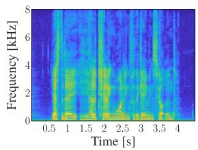  
(a) Reference track

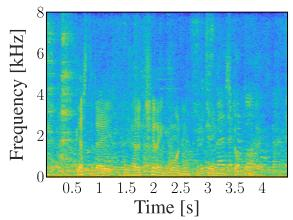  
(b) Noisy track (SNR 0 dB)

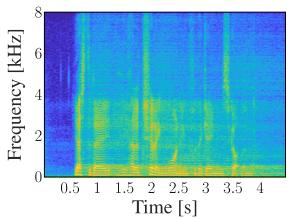  
(c) Reverb. track (τ = 0.5 s)

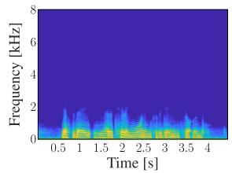  
(d) Low-res. track (s = 4)  
Fig. 1. The TF-magnitude representation of distorted speech for different SE tasks, i.e., denoising, dereverberation and bandwidth extension (super-resolution). The variable τ represents the 60 dB reverberation time and s is the bandwidth upscaling ratio.

Inspired by the stated problems and previous works, we propose the first conformer-based MetricGAN (CMGAN) for various monaural speech enhancement tasks. At its core, the CMGAN combines a generator and a metric discriminator. The latter excels in estimating and optimizing a black-box nondifferentiable metric without adversely affecting other metrics. Drifting from traditional paradigms where dual-branch models employed separate networks for magnitude masking and complex refinement, often necessitating resource-intensive interaction modules. Instead, our generator utilizes a shared encoder that ingests the concatenated magnitude and complex (both real and imaginary) parts. To mitigate computational intensity of the conformer, we integrate dual-path transformers [16], [29], [33] in a two-stage block, sequentially capturing temporal and frequency dependencies from shared encoded representations. Subsequently, the architecture splits into a dedicated mask decoder for magnitude interpretation and another branch to refine both real and imaginary facets. Our contributions can be summarized as follows:

We present a new generator leveraging a shared encoder that takes concatenated magnitude and complex components. Additionally, It employs a dedicated mask decoder and a shared decoder for both real and imaginary parts, optimizing enriched shared representation learning with fewer parameters.

\- We employ two-stage conformer blocks, capitalizing on their capacity to discern both local and global dependencies across time and frequency domains.

\- Instead of solely optimizing for point-wise loss functions, we integrate a metric discriminator to also include perceptual elements, thereby enhancing the resultant speech quality.

In this follow-up research, we have broadened the scope beyond the focus on speech denoising in our conference paper to include dereverberation and super-resolution. This expansion facilitates a detailed exploration of our original model, leading to several key contributions:

Denoising: We study the generalization capability of the proposed CMGAN relative to state-of-the-art methods under unseen distortions. Specifically, CMGAN is trained on the Voice Bank+DEMAND dataset and tested on three different datasets spanning both real and simulated distortions. Additionally, we demonstrated the superior performance of CMGAN across various opinion score evaluations.

Dereverberation: Beyond merely testing the model on new data, our exploration was profound. We conducted an in-depth comparative analysis focusing on the metric discriminator. This involved evaluating multiple objective scoring metrics and an examination of the trade-offs associated with each.

\- Super-resolution: Our research delves into an area not extensively covered in recent works: super-resolution within a complex TF representation. While traditional mapping-based methods are used for super-resolution, we innovatively incorporate masking by adding a reconstructed mask. This enabled our trained network to focus mainly on estimating the missing high-frequency bands. Our ablation studies in super-resolution manifested the strength of complex TF-domain approaches.

## II. PROBLEM STATEMENT & RELEVANT LITERATURE

In this paper, the proposed CMGAN will be evaluated on different SE tasks, namely speech denoising, dereverberation and super-resolution. Accordingly, for any acoustic environment the aforementioned SE tasks can be modeled as follows:

$$
y (t) = x (t) * h (t) + n (t),\tag{1}
$$

where $y ( t )$ is the distorted speech, $x ( t )$ is the required clean speech, $n ( t )$ is a background noise and $\cdot \ast ^ { , }$ is a convolution operation with a filter $h ( t )$ . However, due to space constraints, this study will focus on evaluating each task alone and not the superimposed effects, as shown in Fig. 1. Hence, for denoising the additive background noise $n ( t )$ will only be considered (Fig. 1(b)). For dereverberation (Fig. 1(c)), the filter $h ( t )$ will represent a room impulse response (RIR) filter. Finally, $h ( t )$ will function as a low pass filter (LPF) in the super-resolution task to simulate the impact of low sampling frequency (Fig. 1(d)). The pertinent literature for each task will be presented in the following subsections.

## A. Denoising

Speech denoising is considered as a source separation problem, where the objective is to suppress the background noise $n ( t )$ and predict the desired speech xˆ(t) with maximum possible quality and intelligibility. Accordingly, the difficulty of this problem would highly depend on the nature of both the desired speech and the background noise. For instance, speech signals are highly non-stationary. As for the noise component, it can be divided into stationary scenarios (e.g., computer fan noise and air conditioners) and non-stationary scenarios (e.g., babble and street noise). Usually, the latter scenario is more challenging, as in these cases, the noise would occupy similar frequency bands as the desired speech [22].

In the speech denoising literature, due to the non-stationary nature of the problem, exploring the TF representations of the superimposed signal to reflect the time-varying frequency properties of the waveform is the typical approach [5], [34], [35]. The only limitation arising from the TF-domain denoising is the unstructured phase representation. However, for a long time phase was considered insensitive to noise [36]. As a result, research mostly focused on magnitude denoising while maintaining the noisy phase [6]. Recently, many studies pointed out the importance of the phase on the denoised speech quality [24], [37]. To this end, TF speech denoising can be categorized into mapping-based and masking-based methods.

For mapping-based methods, a non-linear function is utilized to map the noisy speech to a corresponding denoised speech. These methods were first visited in time-domain speech denoising [15], [38], [39], [40]. For instance, SEGAN [14] is introduced as an adversarial framework to map the noisy waveform to a corresponding denoised speech. Variants of SEGANs are also proposed to increase the capacity of the generator [41], or using an additional TF-domain loss to benefit from both domains [42]. Building upon these trials, different mapping-based adversarial frameworks are also investigated on TF-domain speech denoising and they achieved more promising results [22], [43], [44], [45].

On the other hand, masking-based methods are mostly utilized in TF-domain with few trials on time-domain speech denoising [46]. TF-domain masking-based methods operate under the assumption that two signals are considered to be W-disjoint orthogonal iftheir short-time Fourier transformations (STFT) do not overlap [47]. Accordingly, it is possible to demix the signals by determining the active source in each TF unit. Inspired by the auditory masking phenomenon and the exclusive allocation principle in auditory scene analysis [48], ideal binary masking (IBM) is the first masking-based method utilized in supervised speech denoising [49]. In IBM, a mask is generated by assigning a value of 1 for a TF unit if the signal-to-noise ratio (SNR) in this unit exceeds a predefined threshold (required speech) and 0 otherwise (noise to suppress). In other words, IBM can be treated as a binary classification problem [50], [51]. Although IBM has been shown to considerably improve speech intelligibility, it can degrade the speech quality by introducing musical noise distortions [52]. Ideal ratio masking (IRM) is introduced as a remedy and it can be viewed as a soft version of the IBM, where each TF unit can take a value between 0 and 1 depending on the corresponding signal and noise powers [53], [54]. Spectral magnitude mask (SMM) is considered as an unbounded variant of IRM [55].

The aforementioned masking-based methods would solely enhance the magnitude and keep the noisy phase unaltered. Subsequently, tackling the phase is divided into phase reconstruction and phase denoising approaches. For phase reconstruction, deep neural networks (DNNs) are trained to estimate the magnitude, which is then used for iterative phase reconstruction (IPR) [56], [57], [58], [59]. As for phase denoising, authors in [60] are the first to introduce a phase-sensitive mask (PSM) as a variant of SMM and they claimed a considerable improvement in speech quality. Using IRM as a foundation, a complex ideal ratio masking (cIRM) approach is proposed that can operate on the real and imaginary parts, implicitly addressing both magnitude and phase denoising [24]. Nevertheless, since the real and imaginary parts are not necessarily positive, the authors would compress the cIRM with a tanh activation to obtain values between −1 and 1. The idea of cIRM is further extended by incorporating a deep complex-valued recurrent neural network (DCCRN) and new loss functions to estimate the relevant masks [61].

The main drawback behind these approaches is the magnitude and phase compensation effect discussed in [26]. In this case, denoising the complex representations using only a complex loss (penalizing real and imaginary parts) would implicitly provide the trained model with a certain degree of freedom in estimating the magnitude and phase. Since the phase is unstructured and always challenging to estimate, this might result in an inaccurate magnitude estimation to compensate for the challenging phase. This problem can be mitigated by including both complex and magnitude losses or by complex refinement approaches, which basically decouple the problem into estimating a bounded mask for the magnitude followed by a complex refinement branch to further improve the magnitude and estimate the phase from the denoised complex representations [13], [27], [62], [63], [64]. However, since recent studies recommended mappingbased methods over the preceding masking-based approaches for complex spectrogram estimation [25], [65], the complex refinement branch would follow a mapping-based approach. In this sense, the model can combine the fragmented benefits of both masking-based and mapping-based methods.

## B. Dereverberation

In an enclosed acoustic environment, the sound is perceived as a superposition of three distinct components: direct path, early reflections and late reverberations, which can be modeled by the convolutive RIR filter h(t) in (1) [66], [67]. Thus, speech dereverberation would mainly focus on suppressing the unwanted reflections and maintaining the direct path representing the estimated desired speech xˆ(t). Early reflections usually arrive shortly (50 ms) at the microphone as they come from a specific direction, thus they can be addressed as an attenuated copy of the direct path. In contrast, late reverberations arrive later as they represent delayed and attenuated superimposed signals from different directions. The difficulty of the dereverberation problem is accounted to different factors. For instance, room size and surface properties mainly contribute to the amount of reflections and degree of attenuation [68]. Additionally, the distance between the microphone and the speaker would affect the reflection strength, i.e., the longer the distance, the stronger the reflections [69].

To the best of our knowledge, the dereverberation problem is usually addressed in TF-domain with limited trials on timedomain [17], [70]. This is due to the fact that time-domain models are prone to temporal distortions, which are severe in reverberant conditions. Similar to denoising, TF-domain masking-based methods are also extended to dereverberation. For instance, in [71], direct path and early reflections are considered as the desired speech and an IBM is utilized to suppress late reverberations. Unlike denoising, the SNR criteria for assigning 0 and 1 in each TF unit is modified in [72] to address the speech presence probability. However, IBM is originally defined for additive noise under anechoic conditions. In reverberation, temporal smearing of speech is observed in the resultant TF representation, as shown in Fig. 1(c). Hence, IBM with hard boundaries can cause a degradation in the resultant speech quality [73] and soft IRM is usually the preferred method in this case [55], [74], [75], [76]. Following the denoising path, IRM is extended with cIRM to include phase in the dereverberation process [77], [78], [79].

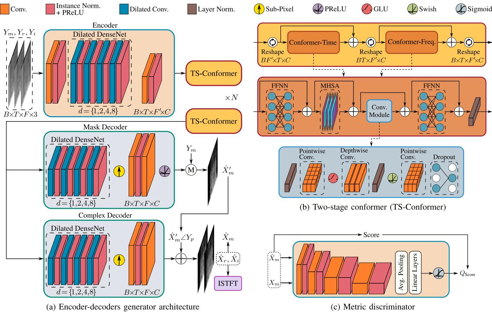  
Fig. 2. An overview of the proposed CMGAN architecture. The masking operator M in (a) denotes task-specific operations: Element-wise multiplication for speech denoising/dereverberation and addition for super-resolution (details in Section V-C).

Furthermore, mapping-based methods are also investigated in speech dereverberation. For instance, Han et al. [56] is one of the first to investigate spectral mapping on dereverberation using a simple fully connected network. Later, authors in [80] applied a fully convolutional U-Net (encoder-decoder) architecture with intermediate skip connections for this task. The SkipConvNet changed the U-Net architecture by replacing each skip connection with multiple convolutional modules to provide the decoder with intuitive feature maps [81]. Additionally, a wide residual network is introduced in [82] to process different speech representations in the TF-domain, namely the magnitude of the STFT, Mel filterbank and cepstrum. Some approaches are able to provide significant performance gain by combining DNNs with conventional methods such as delay-and-sum beamforming and late reverberation reduction by spectral subtraction [83].

## C. Super-Resolution

The super-resolution problem is slightly different from prior SE use cases. In denoising and dereverberation, the desired speech is available with superimposed unwanted noise or reflections and the task is to suppress these effects while preserving the speech. In contrast, super-resolution would reconstruct the missing samples from a low sampling frequency input signal. Accordingly, this problem can be formulated from two different perspectives based on the input domain. In the time-domain, the problem is closely related to super-resolution in natural images [84], where the task is to upsample an input signal of K×1 samples to an output signal of M ×1 samples (K < M). In this case, a DNN can be trained for an interpolation task. On the other hand, for TF-domain, the task would rather resemble natural image inpainting [85], where a part of the image or spectrogram is missing and the DNN is trained to complete the image or reconstruct the missing high-frequency bands, as shown in Fig. 1(a) and (d). Based on the previous description, it can be deduced that mapping-based is the only relevant approach in super-resolution.

In conventional audio processing, super-resolution has been investigated under the name of bandwidth extension [86]. Recently, DL-based audio super-resolution studies demonstrated superior performance compared to traditional methods. In 2017, Kuleshov et al. [87] proposed to use U-Net with skip connection architecture to reconstruct the waveform. TFiLM [89] and AFiLM [90] utilized recurrent models and attention blocks to capture the long-range time dependencies, respectively. However, the lack of frequency components limits further improvements in the performance. TFNet [88] utilized both time and frequency domain by employing two branches, one branch models the reconstruction of spectral magnitude and the other branch models the waveform. However, the phase information is $\mathrm { i g \mathrm { - } }$ nored in the frequency branch. Wang et al. [91] proposed a timedomain modified autoencoder (AE) and a cross-domain loss function to optimize the hybrid framework. Recently, authors in [92] proposed a neural vocoder based framework (NVSR) for the super-resolution task. While the above studies show promising results, many of them focus on the time-domain or hybrid time-domain and TF-domain magnitude representations. Nevertheless, the research on complex TF-domain super-resolution is not yet addressed.

## III. METHODOLOGY

## A. Generator Architecture

An overview of the generator architecture of CMGAN is shown in Fig. 2(a). For a distorted speech waveform $y \in \mathbb { R } ^ { L \times 1 }$ an STFT operation first converts the waveform into a complex spectrogram $Y _ { o } \in \mathbb { R } ^ { T \times F \times 2 }$ , where $T$ and $F$ denote the time and frequency dimensions, respectively. Then the compressed spectrogram $Y$ is obtained by the power-law compression:

$$
Y = | Y _ {o} | ^ {c} e ^ {j Y _ {p}} = Y _ {m} e ^ {j Y _ {p}} = Y _ {r} + j Y _ {i},\tag{2}
$$

where $Y _ { m } , Y _ { p } , Y _ { r }$ and $Y _ { i }$ denote the magnitude, phase, real and imaginary components of the compressed spectrogram, respectively. c is the compression exponent which ranges from 0 to 1, here we follow Braun et al. [93] to set $c = 0 . 3$ . The powerlaw compression of the magnitude equalizes the importance of quieter sounds relative to loud ones, which is closer to human perception of sound [94], [95]. The real and imaginary parts $Y _ { r }$ and $Y _ { i }$ are then concatenated with the magnitude $Y _ { m }$ as an input to the generator.

1) Encoder: Given the input feature $Y _ { i n } \in \mathbb { R } ^ { B \times T \times F \times 3 }$ where B denotes the batch size, the encoder consists of two convolution blocks with a dilated DenseNet [96] in between. Each convolution block comprises a convolution layer, an instance normalization [97] and a PReLU activation [98]. The first convolution block is used to extend the three input features to an intermediate feature map with $C$ channels. The dilated DenseNet contains four convolution blocks with dense residual connections, the dilation factors of each block are set to {1, 2, 4, 8}. The dense connections can aggregate all previous feature maps to extract different feature levels. As for the dilated convolutions, they serve to increase the receptive field effectively while preserving the kernels and layers count. The last convolution block is responsible for halving the frequency dimension to $F ^ { \prime } = F / 2$ to reduce the complexity.

2) Two-Stage Conformer Block: Conformers [30], [31] achieved great success in speech recognition and separation as they combine the advantages of both transformers and convolutional neural networks (CNNs). Transformers can capture longdistance dependencies, while CNNs exploit local features effectively. Here we employ two conformer blocks sequentially to capture the time dependency in the first stage and the frequency dependency in the second stage. $\mathrm { A s }$ shown in the Fig. 2(b), given a feature map $D \in \mathbb { R } ^ { B \times T \times F ^ { \prime } \times C }$ , the input feature map D is first reshaped to $D ^ { T } \in \mathbb { R } ^ { B F ^ { \prime } \times T \times C }$ to capture the time dependency in the first conformer block. Then the output $D _ { o } ^ { T }$ is element-wise added with the input $D ^ { T }$ (residual connection) and reshaped to a new feature map $D ^ { F } \in \operatorname { \mathbb { R } } ^ { B T \times F ^ { \prime } \times C }$ . The second conformer thus captures the frequency dependency. After the residual connection, the final output $D _ { o }$ is reshaped back to the input size.

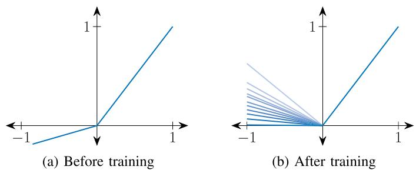  
Fig. 3. PReLU slopes of the resultant magnitude mask.

Similar to [30], each conformer block utilizes two halfstep feed-forward neural networks (FFNNs). Between the two FFNNs, a multi-head self-attention (MHSA) with four heads is employed, followed by a convolution module. The convolution module depicted in Fig. 2(b) starts with a layer normalization, a point-wise convolution layer and a gated linear unit (GLU) activation to diminish the vanishing gradient problem. The output of the GLU is then passed to a 1D-depthwise convolution layer with a swish activation function, then another point-wise convolution layer. Finally, a dropout layer is used to regularize the network. Also, a residual path connects the input to the output.

3) Decoder: The decoder extracts the output from N twostage conformer blocks in a decoupled way, which includes two paths: the mask decoder and the complex decoder. The mask decoder aims to predict a mask that will be element-wise multiplied by the input magnitude $Y _ { m }$ to predict $\hat { X } _ { m } ^ { \prime }$ . On the other hand, the complex decoder directly predicts the real and imaginary parts. Both mask and complex decoders consist of a dilated DenseNet, similar to the one in the encoder. The sub-pixel convolution layer is utilized in both paths to upsample the frequency dimension back to F [99]. For the mask decoder, a convolution block is used to squeeze the channel number to 1, followed by another convolution layer with PReLU activation to predict the final mask. Note that the PReLU activation learns different slopes for each frequency band and initially the slopes are defined as a fixed positive value (0.2). Post-training evaluation indicates that all the slopes reflect different negative values, i.e., the output mask is always projected in the positive 1st and 2nd quadrants, as depicted in Fig. 3. For the complex decoder, the architecture is identical to the mask decoder, except no activation function is applied for the complex output.

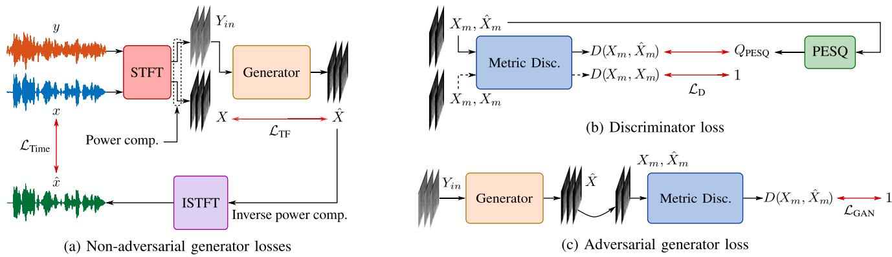  
Fig. 4. An illustration of the propagated loss functions in the CMGAN architecture. For simplicity, X and $\hat { X }$ denote the three-channel magnitude and complex representations of the clean target and the estimated output spectrograms, respectively.

Same as in [13], [27], the masked magnitude $\hat { X } _ { m } ^ { \prime }$ is first combined with the noisy phase $Y _ { p }$ to obtain the magnitude-enhanced complex spectrogram. Then it is element-wise summed with the output of the complex decoder $( \hat { X } _ { r } ^ { \prime } , \hat { X } _ { i } ^ { \prime } )$ to obtain the final complex spectrogram:

$$
\hat {X} _ {r} = \hat {X} _ {m} ^ {\prime} \cos (Y _ {p}) + \hat {X} _ {r} ^ {\prime} \qquad \hat {X} _ {i} = \hat {X} _ {m} ^ {\prime} \sin (Y _ {p}) + \hat {X} _ {i} ^ {\prime}\tag{3}
$$

The power-law compression is then inverted on the complex spectrogram $( \hat { X } _ { r } , \hat { X } _ { i } )$ and an inverse short-time Fourier transform (ISTFT) is applied to get the time-domain signal xˆ, as shown in Fig. 4(a). To further improve the magnitude component and propagate magnitude loss on both decoder branches, we compute the magnitude loss on $\hat { X } _ { m }$ expressed by:

$$
\hat {X} _ {m} = \sqrt {\hat {X} _ {r} ^ {2} + \hat {X} _ {i} ^ {2}}\tag{4}
$$

## B. Metric Discriminator

In SE, the objective functions are often not directly correlated to the evaluation metrics. Consequently, even if the objective loss is optimized, the evaluation score is still not satisfied. Furthermore, some evaluation metrics like perceptual evaluation of speech quality (PESQ) [100] and short-time objective intelligibility (STOI) [101] cannot be used as loss functions because they are non-differentiable. Hence, the discriminator in CMGAN aims to mimic the metric score and use it as a part ofthe loss function. Here we follow the MetricGAN to use the PESQ score as a label [11]. As shown in Fig. 2(c), the discriminator consists of four convolution blocks. Each block starts with a convolution layer, followed by instance normalization and a PReLU activation. After the convolution blocks, a global average pooling is followed by two feed-forward layers and a sigmoid activation. The discriminator is then trained to estimate the maximum normalized PESQ score (= 1), by using the clean magnitude as both reference and degraded inputs. Additionally, the discriminator is trained to estimate the enhanced PESQ score by taking both clean and enhanced spectrum as an input together with their corresponding PESQ label, as shown in Fig. 4(b). On the other hand, the generator is trained to render an enhanced speech resembling the clean speech, thus approaching a PESQ label of 1, as shown in Fig. 4(c).

## C. Loss Functions

Inspired by Braun et al. [93], we use a linear combination of magnitude loss $\mathcal { L } _ { \mathrm { M a g . } }$ and complex loss ${ \mathcal { L } } _ { \mathrm { R I } }$ in the TF-domain:

$$
\begin{array}{r l} & {\mathcal {L} _ {\mathrm{TF}} = \alpha \mathcal {L} _ {\mathrm{Mag.}} + (1 - \alpha) \mathcal {L} _ {\mathrm{RI}}} \\ & {\mathcal {L} _ {\mathrm{Mag.}} = \mathbb {E} _ {X _ {m}, \hat {X} _ {m}} \left[ \| X _ {m} - \hat {X} _ {m} \| _ {2} \right]} \\ & {\mathcal {L} _ {\mathrm{RI}} = \mathbb {E} _ {X _ {r}, \hat {X} _ {r}} \left[ \| X _ {r} - \hat {X} _ {r} \| _ {2} \right] + \mathbb {E} _ {X _ {i}, \hat {X} _ {i}} \left[ \| X _ {i} - \hat {X} _ {i} \| _ {2} \right],} \end{array}\tag{5}
$$

where α is a chosen weight. Based on grid search, $\alpha = 0 . 7$ leads to the best performance. Similar to least-square GANs [102], the adversarial training is following a min-min optimization task over the discriminator loss $\mathcal { L } _ { \mathrm { D } }$ and the corresponding generator loss ${ \mathcal { L } } _ { \mathrm { G A N } }$ expressed as follows:

$$
\begin{array}{l} \mathcal {L} _ {\mathrm{GAN}} = \mathbb {E} _ {X _ {m}, \hat {X} _ {m}} \left[ \| D (X _ {m}, \hat {X} _ {m}) - 1 \| _ {2} \right] \\ \mathcal {L} _ {\mathrm{D}} = \mathbb {E} _ {X _ {m}} \left[ \| D (X _ {m}, X _ {m}) - 1 \| _ {2} \right] \\ \qquad + \mathbb {E} _ {X _ {m}, \hat {X} _ {m}} \left[ \| D (X _ {m}, \hat {X} _ {m}) - Q _ {\mathrm{PESQ}} \| _ {2} \right], \end{array}\tag{6}
$$

where D refers to the discriminator and $Q _ { \mathrm { P E S Q } }$ refers to the normalized PESQ score. Here we normalize the PESQ score to the range [0,1]. Moreover, an additional penalization in the resultant waveform $\mathcal { L } _ { \mathrm { T i m e } }$ is proven to improve the restored speech quality [23]:

$$
\mathcal {L} _ {\mathrm{Time}} = \mathbb {E} _ {x, \hat {x}} \left[ \| x - \hat {x} \| _ {1} \right],\tag{7}
$$

where $\hat { x }$ is the enhanced waveform, and $x$ is the clean target waveform. In this context,  · 1 denotes the $\ell ^ { 1 }$ −norm (sum of absolute values), and  · 2 represents the $\ell ^ { 2 }$ −norm (Euclidean distance). The final generator loss is formulated as follows:

$$
\mathcal {L} _ {\mathrm{G}} = \gamma_ {1} \mathcal {L} _ {\mathrm{TF}} + \gamma_ {2} \mathcal {L} _ {\mathrm{GAN}} + \gamma_ {3} \mathcal {L} _ {\text { Time }},\tag{8}
$$

where $\gamma _ { 1 } , \gamma _ { 2 }$ and $\gamma _ { 3 }$ are the weights of the corresponding losses and they are chosen to reflect equal importance.

## IV. EXPERIMENTS

## A. Datasets

1) Denoising: We investigate our proposed approach on the commonly used publicly available Voice Bank+DEMAND dataset [7]. The clean tracks are selected from the Voice Bank corpus [103] which includes 11,572 utterances from 28 speakers in the training set and 824 utterances from 2 unseen speakers in the test set. In the training set, the clean utterances are mixed with background noise (8 noise types from DEMAND database [104] and 2 artificial noise types) at SNRs of 0 dB, 5 dB, 10 dB and 15 dB. In the test set, the clean utterances are mixed with 5 unseen noise types from the DEMAND database at SNRs of 2.5 dB, 7.5 dB, 12.5 dB and 17.5 dB. The noise types are mostly challenging, e.g., public space noises (cafeteria, restaurant and office), domestic noises (kitchen and living room) and transportation/street noises (car, metro, bus, busy traffic, public square and subway station). All utterances are resampled to 16 kHz in our experiments.

2) Dereverberation: We choose the REVERB challenge dataset [8], the utterances are divided into simulated and real recordings. The simulated data is based on the wall streetjournal corpus (WSJCAM0) [105] distorted by measured RIRs and a stationary ambient noise of SNR = 20 dB. The measured RIRs represent three different room sizes: small – room 1, medium – room 2 and large – room 3, with a 60 dB reverberation time (τ) of 0.3, 0.6 and 0.7 seconds, respectively. For each room, the microphone is placed at a near condition (0.5 m) and a far condition (2 m). The real data is based on the multi-channel wall street journal audio-visual (MC-WSJ-AV) corpus [106], where the speakers are recording in a large room of τ = 0.7 seconds at a near (1 m) and a far (2.5 m) microphone conditions. The training set includes 7861 paired utterances from the simulated data. The test set contains both simulated paired utterances (2176) and real reverberant utterances (372). Different room recordings are used for the training and test sets. The datasets were originally captured in a single-channel, two-channel and eight-channel configuration with a 16 kHz sampling frequency. However, for the scope ofthis study, we only use the single-channel configuration.

3) Super-Resolution: For comparative analysis, we utilize the English multi-speaker corpus (VCTK) [107]. The VCTK dataset contains 44 hours recordings from 108 speakers with various English accents. For the super-resolution experiment, we follow the design choice of [87], where the low-resolution audio signal is generated from the 16 kHz original tracks by subsampling the signal with the desired upscaling ratio (s). The first task uses a single VCTK speaker (p225), the first 223 recordings are used for training and the last 8 recordings are used for testing. The second task takes the first 100 VCTK speakers as the training set and tests on the last 8 speakers. The upscaling ratios for both the single-speaker and the multi-speaker tasks are set to {2, 4, 8}, representing a reconstruction from 8 kHz, 4 kHz, 2 kHz to 16 kHz.

## B. Experimental Setup

The utterances in the training set are sliced into 2 seconds, while in the test set, no slicing is utilized and the length is kept variable. A Hamming window with 25 ms window length (400- point FFT) and hop size of 6.25 ms (75% overlap) is employed. Thus, the resultant spectrogram will have 200 frequency bins F, while the time dimension T depends on the variable track duration. The number of two-stage conformer blocks N, the batch size B and the channel number C in the generator are set to 4, 4 and 64, respectively. The channel numbers in the metric discriminator are set to {16, 32, 64, 128}. In the training stage, AdamW optimizer [110] is used for both the generator and the discriminator to train for 50 epochs. The learning rate is set to $5 \times 1 0 ^ { - 4 }$ for the generator and $1 \times 1 0 ^ { - 3 }$ for the discriminator. A learning rate scheduler is applied with a decay factor of 0.5 every 12 epochs. In the generator loss $\mathcal { L } _ { \mathrm { G } }$ , the weights are set to $\{ \gamma _ { 1 } = 1 , \gamma _ { 2 } = 0 . 0 1 , \gamma _ { 3 } = 1 \}$ . The detailed parameter setup of both generator and discriminator is presented in Appendix.

## V. RESULTS AND DISCUSSION

For the three tasks discussed in this section, all methods, including baselines and proposed approaches, are evaluated using standard benchmarks. The reported numbers adhere to the consistent train/test splits that these benchmarks specify.

## A. Denoising

Objective scores: We choose a set of commonly used metrics to evaluate the denoised speech quality, i.e., PESQ with a score range from −0.5 to 4.5, segmental signal-to-noise ratio (SSNR) and composite mean opinion score (MOS) [111] based metrics: MOS prediction of the signal distortion (CSIG), MOS prediction of the intrusiveness of background noise (CBAK) and MOS prediction of the overall effect (COVL), all of them are within a score range of 1 to 5. Additionally, we utilize STOI with a score range from 0 to 1 to judge speech intelligibility. Higher values indicate better performance for all given metrics.

Results analysis: Our proposed CMGAN is objectively compared with other state-of-the-art (SOTA) denoising baselines, as shown in Table I. For the time-domain methods, we included the standard SEGAN [14] and three recent methods: TSTNN [16], DEMUCS [17] and SE-Conformer [18]. It is worth noting that DEMUCS is trained not only on the standard Voice Bank+DEMAND dataset [7], but also incorporates additional data from the DNS-Challenge [10]. For the TF-domain methods, we evaluate six recent SOTA methods, i.e., Metric-GAN [11], PHASEN [12], PFPL [108], MetricGAN+ [109], DB-AIAT [13] and DPT-FSNet [29]. It can be observed that most of the TF-domain methods outperform the time-domain counterparts over all utilized metrics. Moreover, our proposed TF conformer-based approach shows a major improvement over the time-domain SE-Conformer. Compared to frameworks involving metric discriminators (MetricGAN+), we have 0.26, 0.49, 0.78 and 0.48 improvements on the PESQ, CSIG, CBAK and COVL scores, respectively. Finally, our framework also outperforms recent improved transformer-based methods, such as DB-AIAT and DPT-FSNet in all of the evaluation scores with a relatively low model size of only 1.83 M parameters.

Ablation study: To verify our design choices, an ablation study is conducted, as shown in Table II. We first investigate the influence of different inputs and decoders. For the Single-Mask configuration, only magnitude is used as the input. The enhanced magnitude is then combined with the noisy phase for the ISTFT operation, omitting the complex decoder. Conversely, the Single-Complex approach solely uses the complex spectrogram as input, and the mask decoder is removed. The drop in the PESQ score from 3.35 in Single-Complex to 3.23 in Single-Mask emphasizes the crucial influence of phase information on the enhanced speech quality. Turning our attention to SSNR, the Single-Mask setup using magnitude-based masking reaches 9.82 dB, while the Single-Complex with its complete input representation attains only 9.19 dB. This suggests that, for segment-specific metrics like SSNR, explicit masking remains vital.

TABLE I  
PERFORMANCE COMPARISON ON THE VOICE BANK+DEMAND DATASET [7]

<table><tr><td>Method</td><td>Year</td><td>Input</td><td>Model Size (M)</td><td>PESQ</td><td>CSIG</td><td>CBAK</td><td>COVL</td><td>SSNR</td><td>STOI</td></tr><tr><td>Noisy</td><td>-</td><td>-</td><td>-</td><td>1.97</td><td>3.35</td><td>2.44</td><td>2.63</td><td>1.68</td><td>0.91</td></tr><tr><td>SEGAN [14]</td><td>2017</td><td>Time</td><td>97.47</td><td>2.16</td><td>3.48</td><td>2.94</td><td>2.80</td><td>7.73</td><td>0.92</td></tr><tr><td>MetricGAN [11]</td><td>2019</td><td>Magnitude</td><td>-</td><td>2.86</td><td>3.99</td><td>3.18</td><td>3.42</td><td>-</td><td>-</td></tr><tr><td>PHASEN [12]</td><td>2020</td><td>Magnitude+Phase</td><td>-</td><td>2.99</td><td>4.21</td><td>3.55</td><td>3.62</td><td>10.08</td><td>-</td></tr><tr><td>TSTNN [16]</td><td>2021</td><td>Time</td><td>0.92</td><td>2.96</td><td>4.10</td><td>3.77</td><td>3.52</td><td>9.70</td><td>0.95</td></tr><tr><td>DEMUCS [17]</td><td>2021</td><td>Time</td><td>128</td><td>3.07</td><td>4.31</td><td>3.40</td><td>3.63</td><td>-</td><td>0.95</td></tr><tr><td>PFPL [108]</td><td>2021</td><td>Complex</td><td>-</td><td>3.15</td><td>4.18</td><td>3.60</td><td>3.67</td><td>-</td><td>0.95</td></tr><tr><td>MetricGAN+ [109]</td><td>2021</td><td>Magnitude</td><td>-</td><td>3.15</td><td>4.14</td><td>3.16</td><td>3.64</td><td>-</td><td>-</td></tr><tr><td>SE-Conformer [18]</td><td>2021</td><td>Time</td><td>-</td><td>3.13</td><td>4.45</td><td>3.55</td><td>3.82</td><td>-</td><td>0.95</td></tr><tr><td>DB-AIAT [13]</td><td>2021</td><td>Complex+Magnitude</td><td>2.81</td><td>3.31</td><td>4.61</td><td>3.75</td><td>3.96</td><td>10.79</td><td>0.96</td></tr><tr><td>DPT-FSNet [29]</td><td>2021</td><td>Complex</td><td>0.91</td><td>3.33</td><td>4.58</td><td>3.72</td><td>4.00</td><td>-</td><td>0.96</td></tr><tr><td>CMGAN</td><td>2022</td><td>Complex+Magnitude</td><td>1.83</td><td>3.41</td><td>4.63</td><td>3.94</td><td>4.12</td><td>11.10</td><td>0.96</td></tr></table>

“-" denotes the result is not provided in the original paper. Model size represents the number of trainable parameters in million.

TABLE II  
RESULTS OF THE DENOISING ABLATION STUDY

<table><tr><td>Method</td><td>PESQ</td><td>CSIG</td><td>CBAK</td><td>COVL</td><td>SSNR</td><td>STOI</td></tr><tr><td>CMGAN</td><td>3.41</td><td>4.63</td><td>3.94</td><td>4.12</td><td>11.10</td><td>0.96</td></tr><tr><td colspan="7">Inputs &amp; Decoders</td></tr><tr><td>Single-Mask</td><td>3.23</td><td>4.60</td><td>3.76</td><td>4.00</td><td>9.82</td><td>0.95</td></tr><tr><td>Single-Complex</td><td>3.35</td><td>4.56</td><td>3.79</td><td>4.05</td><td>9.19</td><td>0.96</td></tr><tr><td>Dual-Mask</td><td>3.23</td><td>4.62</td><td>3.79</td><td>4.01</td><td>10.20</td><td>0.96</td></tr><tr><td>Dual-Complex</td><td>3.39</td><td>4.63</td><td>3.82</td><td>4.10</td><td>9.41</td><td>0.95</td></tr><tr><td>Single-Path</td><td>3.38</td><td>4.54</td><td>3.86</td><td>4.05</td><td>10.19</td><td>0.96</td></tr><tr><td>Mask + cIRM</td><td>3.28</td><td>4.60</td><td>3.83</td><td>4.03</td><td>10.40</td><td>0.96</td></tr><tr><td colspan="7">Loss functions &amp; Discriminator</td></tr><tr><td>w/o Time Loss</td><td>3.45</td><td>4.56</td><td>3.86</td><td>4.11</td><td>9.71</td><td>0.96</td></tr><tr><td>w/o Disc.</td><td>3.24</td><td>4.46</td><td>3.82</td><td>3.93</td><td>10.56</td><td>0.96</td></tr><tr><td>Patch Disc.</td><td>3.28</td><td>4.48</td><td>3.85</td><td>3.96</td><td>10.75</td><td>0.96</td></tr><tr><td>Pretrained Disc.</td><td>3.23</td><td>4.48</td><td>3.83</td><td>3.93</td><td>10.76</td><td>0.96</td></tr><tr><td>MetricGAN+ Disc.</td><td>3.44</td><td>4.61</td><td>3.87</td><td>4.13</td><td>9.83</td><td>0.96</td></tr><tr><td>PESQ + STOI Disc.</td><td>3.41</td><td>4.63</td><td>3.89</td><td>4.12</td><td>10.34</td><td>0.96</td></tr><tr><td colspan="7">TS-Conformer design</td></tr><tr><td>Parallel-Conf.</td><td>3.35</td><td>4.54</td><td>3.87</td><td>4.03</td><td>10.63</td><td>0.96</td></tr><tr><td>Freq. → Time</td><td>3.39</td><td>4.56</td><td>3.91</td><td>4.07</td><td>10.84</td><td>0.96</td></tr><tr><td colspan="7">Magnitude mask activation function</td></tr><tr><td>Sigmoid</td><td>3.34</td><td>4.52</td><td>3.80</td><td>4.02</td><td>10.70</td><td>0.96</td></tr><tr><td>ReLU</td><td>3.32</td><td>4.54</td><td>3.80</td><td>4.04</td><td>10.69</td><td>0.96</td></tr><tr><td>Softplus</td><td>3.43</td><td>4.58</td><td>3.83</td><td>4.02</td><td>10.75</td><td>0.96</td></tr></table>

To ascertain whether the advancements of CMGAN stemmed from the synergy between both mask and complex decoders rather than just an increased parameter count, we introduced two additional configurations: Dual-Mask and Dual-Complex. The Dual-Mask design used magnitude-only as input and featured two mask decoders. Both decoders received the same input, with the output from the first mask decoder being subsequently masked by the second before being combined with the noisy phase. With an identical parameter count to CMGAN, this configuration displayed minor improvements in most metrics when compared to its Single-Mask counterpart. Notably, there was a rise of 0.38 dB in SSNR, reinforcing the link between SSNR and effective masking techniques. In contrast, the Dual-Complex setup solely relied on the complex representation and incorporated an additional complex decoder, with both decoders summing their outputs to produce the final result. While this approach displayed metric improvements, it did not achieve the performance levels exhibited by CMGAN, underscoring the importance of integrating both mask and complex decoders in our design.

To further evaluate the efficacy of our design decisions, we implemented two additional modifications. First, we explored the necessity of decoder decoupling in complex refinement through the Single-Path decoder configuration. In this setup, we employed a single decoder that produces three channels: the first channel undergoes a PReLU activation for magnitude, while the subsequent two channels, which represent the complex component, have no activation. A comparison with our primary mask/complex decoders indicates a decline across all metrics, most significantly in the SSNR metric with a decrease of 0.91 dB. In another separate alteration, Mask + cIRM, we maintained the mask decoder while adjusting the complex decoder to integrate a cIRM inspired by [24]. This change resulted in a notable reduction in both PESQ and SSNR when compared to the original CMGAN setup.

In our exploration of loss functions, several variations revealed insightful impacts on performance metrics. The omission of time loss (w/o Time Loss) led to an improvement in the PESQ score, reaching 3.45, but with a noticeable effect on SSNR. This indicates the effectiveness of the time loss in balancing the performance for both PESQ and SSNR scores. Further, two discriminator-based assessments were conducted: one that entirely removed the discriminator (w/o Disc.) and another that substituted the metric discriminator with a patch discriminator, commonly employed in image generation tasks [112]. It can be realized that the absence of the discriminator negatively impacted all the given scores. Similarly, adding a patch discriminator only showed a marginal improvement, which reflects that the generator is fully capable of enhancing the tracks without the aid of a normal patch discriminator. However, a metric discriminator to directly improve the evaluation scores is proven to be beneficial.

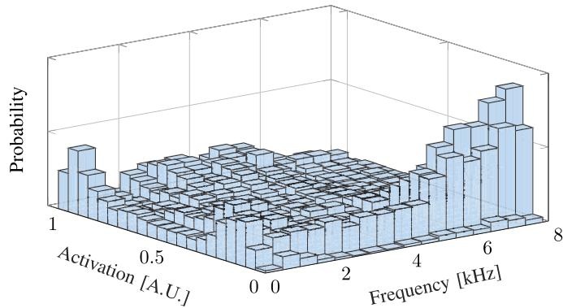  
Fig. 5. Histogram of masking PReLU activations.

For the Pretrained Disc. experiment, the discriminator was pretrained to predict normalized PESQ. During its training, the discriminator lacked access to enhanced tracks, with noisy tracks taking their place. The generator then integrated this loss, which was derived from the pretrained discriminator, with other reconstruction losses. Throughout the generator training, the discriminator remained frozen, receiving no updates from the generator. This approach resulted in reduced performance across all metrics compared to CMGAN. These findings highlight the importance of adversarial training, which can be largely attributed to the dynamic feedback loop it establishes for better model generalization. With the MetricGAN+ Disc. setup, noisy tracks were included in the discriminator loss. While there was a minor uplift in PESQ, other metrics remained unchanged or even registered a decline in SSNR. Such outcomes suggest potential instabilities when directing the discriminator with a broader objective set. Our hands-on observations led us to persist with the original MetricGAN loss structure. Exploring the PESQ + STOI Disc. method, we incorporated an extra discriminator to estimate the STOI in conjunction with PESQ. The results closely paralleled those of CMGAN, suggesting a possible ceiling in STOI optimization. The aforementioned discriminator adjustments illustrate the intricate interplay between metric discriminators and SSNR. Introducing extra tailored discriminators or additional objectives can negatively impact SSNR, highlighting the significance of careful design decisions.

Furthermore, we investigate the influence of the two-stage conformer design. Given an input feature map, the two-stage conformer will separately focus on the time and frequency dimensions. To this end, two different configurations can be proposed, either sequential or parallel. Accordingly, we compare our sequential CMGAN to a parallel connection counterpart without any further modifications (Parallel-Conf.). The results illustrate that the parallel approach lags behind the proposed sequential design, with the PESQ and SSNR scores reduced by 0.06 and 0.47 dB, respectively. A possible explanation is that parallel conformers might learn redundant or conflicting patterns, lacking the synergistic benefits seen in sequential models. Additionally, we flipped the order of the sequential conformer blocks (Freq. → Time) and found the scores to be similar with a slight improvement in favor of the standard CMGAN (Time → Freq.). Note that designing a single conformer to attend over both time and frequency is theoretically possible. However, in this case, the complexity will grow exponentially [113].

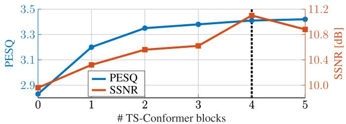  
Fig. 6. Influence of TS-Conformer blocks on objective scores.

Preliminary literature mostly assumes the predicted magnitude mask to be between 0 and 1 [11], [12], [13], [61], [109]. Hence, sigmoid activation is usually the preferred activation to reflect this interval. Although this is true, a bounded sigmoid function would restrict the model to allocate values between 0 and 0.5 to all aggregated negative activations from the previous layer. On the other hand, an unbounded activation function such as PReLU could automatically learn this interval while mitigating the negative activations issue by learning a relevant slope to each frequency band as explained in Section III-A. To confirm this assumption, we construct a histogram of several magnitude masks from different noisy tracks. As shown in Fig. 5, the PReLU activations would always lie in the 0 to 1 interval. Moreover, the majority of low activations are assigned to frequency bands above 5 kHz (beyond human speech) [114]. We also extend our ablation study to involve different bounded and unbounded activations for the mask decoder, namely sigmoid, ReLU and the soft version of ReLU (softplus) [115]. According to Table II, both sigmoid and ReLU activations are comparable and they report lower scores than CMGAN with PReLU activation. Softplus achieves slightly higher PESQ, but at the expense of other metrics.

Finally, we experiment with the number of TS-Conformer blocks. As shown in Fig. 6, the performance of CMGAN without any conformer blocks is acceptable and even comparable with other SOTA methods, such as MetricGAN. However, only one conformer block effectively improves the PESQ by 0.4. The performance gradually increases with more blocks until no further improvement is observed after four blocks. Due to space constraints, the original CMGAN will be considered for upcoming tasks with few relevant ablation studies.

## B. Dereverberation

Objective scores: For dereverberation, we utilize the recommended measures in the REVERB challenge paper [8]: cepstrum distance (CD) [116], log-likelihood ratio (LLR) [117], frequency weighted segmental SNR (FWSegSNR) [118] and speech-todereverberation modulation energy ratio (SRMR) [119]. The paper also recommended PESQ as an optional measure, although most of the latest dereverberation literature did not take it into account. For outliers reduction, authors in [111] suggested limiting the ranges of CD to [0,10] and LLR to [0,2]. Lower values indicate better scores for CD and LLR, while higher values indicate better speech quality for FWSegSSNR, PESQ and SRMR. The CD, LLR, FWSegSNR and PESQ are chosen as they correlate to listening tests, albeit they are all intrusive scores, i.e., enhanced speech and clean reference are required. Accordingly, SRMR is employed as a non-intrusive score to operate on enhanced speech without a clean reference. Thus, it is quite important to measure the quality and intelligibility of enhanced unpaired real recordings.

TABLE III  
RESULTS OF SIMULATED AND REAL DATA ON NEAR MICROPHONE CASE

<table><tr><td rowspan="2">Room</td><td colspan="4">CD ↓</td><td colspan="4">LLR ↓</td><td colspan="4">FWSegSNR ↑</td><td colspan="4">SRMR ↑</td><td>SRMR-real ↑</td></tr><tr><td>1</td><td>2</td><td>3</td><td>Avg.</td><td>1</td><td>2</td><td>3</td><td>Avg.</td><td>1</td><td>2</td><td>3</td><td>Avg.</td><td>1</td><td>2</td><td>3</td><td>Avg.</td><td>-</td></tr><tr><td>Reverberant speech</td><td>1.99</td><td>4.63</td><td>4.38</td><td>3.67</td><td>0.35</td><td>0.49</td><td>0.65</td><td>0.50</td><td>8.12</td><td>3.35</td><td>2.27</td><td>4.58</td><td>4.50</td><td>3.74</td><td>3.57</td><td>3.94</td><td>3.17</td></tr><tr><td>Xiao et al. [83]</td><td>1.58</td><td>2.65</td><td>2.68</td><td>2.30</td><td>0.37</td><td>0.50</td><td>0.52</td><td>0.46</td><td>9.79</td><td>7.27</td><td>6.83</td><td>7.96</td><td>5.74</td><td>6.49</td><td>5.86</td><td>6.03</td><td>4.29</td></tr><tr><td>WRN [82]</td><td>2.02</td><td>4.61</td><td>4.15</td><td>3.59</td><td>0.36</td><td>0.46</td><td>0.60</td><td>0.47</td><td>8.28</td><td>3.57</td><td>2.54</td><td>4.80</td><td>4.04</td><td>3.46</td><td>3.27</td><td>3.59</td><td>-</td></tr><tr><td>U-Net [80]</td><td>1.75</td><td>2.58</td><td>2.53</td><td>2.28</td><td>0.20</td><td>0.41</td><td>0.45</td><td>0.35</td><td>13.32</td><td>10.87</td><td>10.40</td><td>11.53</td><td>4.51</td><td>5.09</td><td>4.94</td><td>4.85</td><td>5.47</td></tr><tr><td>SkipConvNet [81]</td><td>1.86</td><td>2.57</td><td>2.45</td><td>2.29</td><td>0.19</td><td>0.30</td><td>0.35</td><td>0.28</td><td>13.07</td><td>10.96</td><td>10.22</td><td>11.42</td><td>4.99</td><td>4.75</td><td>4.56</td><td>4.77</td><td>7.27</td></tr><tr><td>CMGAN</td><td>1.46</td><td>2.14</td><td>2.27</td><td>1.96</td><td>0.14</td><td>0.25</td><td>0.34</td><td>0.24</td><td>14.36</td><td>13.49</td><td>11.69</td><td>13.18</td><td>5.42</td><td>5.74</td><td>5.29</td><td>5.48</td><td>6.49</td></tr><tr><td>CMGAN-LLR</td><td>1.69</td><td>2.56</td><td>2.43</td><td>2.23</td><td>0.15</td><td>0.25</td><td>0.25</td><td>0.22</td><td>14.48</td><td>12.49</td><td>11.03</td><td>12.67</td><td>5.48</td><td>5.80</td><td>6.02</td><td>5.77</td><td>7.71</td></tr></table>

TABLE IV

RESULTS OF SIMULATED AND REAL DATA ON FAR MICROPHONE CASE

<table><tr><td rowspan="2">Room</td><td colspan="4">CD ↓</td><td colspan="4">LLR ↓</td><td colspan="4">FWSegSNR ↑</td><td colspan="4">SRMR ↑</td><td>SRMR-real ↑</td></tr><tr><td>1</td><td>2</td><td>3</td><td>Avg.</td><td>1</td><td>2</td><td>3</td><td>Avg.</td><td>1</td><td>2</td><td>3</td><td>Avg.</td><td>1</td><td>2</td><td>3</td><td>Avg.</td><td>-</td></tr><tr><td>Reverberant speech</td><td>2.67</td><td>5.21</td><td>4.96</td><td>4.28</td><td>0.38</td><td>0.75</td><td>0.84</td><td>0.66</td><td>6.68</td><td>1.04</td><td>0.24</td><td>2.65</td><td>4.58</td><td>2.97</td><td>2.73</td><td>3.43</td><td>3.19</td></tr><tr><td>Xiao et al. [83]</td><td>1.92</td><td>3.17</td><td>2.99</td><td>2.69</td><td>0.41</td><td>0.61</td><td>0.58</td><td>0.53</td><td>9.12</td><td>6.31</td><td>5.97</td><td>7.13</td><td>5.67</td><td>5.80</td><td>5.03</td><td>5.50</td><td>4.42</td></tr><tr><td>WRN [82]</td><td>2.43</td><td>4.99</td><td>4.56</td><td>3.99</td><td>0.35</td><td>0.59</td><td>0.67</td><td>0.54</td><td>7.54</td><td>1.79</td><td>0.88</td><td>3.40</td><td>4.48</td><td>3.32</td><td>2.84</td><td>3.55</td><td>-</td></tr><tr><td>U-Net [80]</td><td>2.05</td><td>3.19</td><td>2.92</td><td>2.72</td><td>0.26</td><td>0.57</td><td>0.56</td><td>0.46</td><td>12.08</td><td>9.00</td><td>9.05</td><td>10.04</td><td>4.76</td><td>5.27</td><td>4.71</td><td>4.91</td><td>5.68</td></tr><tr><td>SkipConvNet [81]</td><td>2.12</td><td>3.06</td><td>2.82</td><td>2.67</td><td>0.22</td><td>0.46</td><td>0.46</td><td>0.38</td><td>11.80</td><td>8.88</td><td>8.16</td><td>9.61</td><td>5.10</td><td>4.76</td><td>4.25</td><td>4.70</td><td>6.87</td></tr><tr><td>CMGAN</td><td>1.88</td><td>2.90</td><td>2.85</td><td>2.54</td><td>0.24</td><td>0.43</td><td>0.47</td><td>0.38</td><td>11.65</td><td>10.34</td><td>8.91</td><td>10.30</td><td>5.78</td><td>5.87</td><td>4.69</td><td>5.45</td><td>6.61</td></tr><tr><td>CMGAN-LLR</td><td>2.07</td><td>3.32</td><td>3.05</td><td>2.81</td><td>0.24</td><td>0.46</td><td>0.40</td><td>0.37</td><td>11.21</td><td>9.22</td><td>9.48</td><td>9.97</td><td>5.93</td><td>5.54</td><td>5.19</td><td>5.55</td><td>7.62</td></tr></table>

Results: For quantitative analysis, the CMGAN is compared with recent dereverberation methods. As discussed in Section II-B, using time-domain approaches in dereverberation is limited and these methods did not use the REVERB challenge data. Thus, the chosen methods would all consider TF-domain analysis. For fair comparison, only papers recording individual room scores are considered. Based on this criteria, we compare against four recent methods: Xiao et al. [83], U-Net [80], wide residual network (WRN) [82] and SkipConvNet [81]. Unfortunately, none of these papers reported the PESQ scores, so it is excluded from the comparative analysis. However, PESQ is still used as the objective score to be maximized by the metric discriminator in CMGAN.

The results for both near and far microphone cases are shown in Tables III and IV, respectively. The first four columns represent the simulated data results for the three different room sizes (small – room 1, medium – room 2, large – room 3 and average score). The last column represents the SRMR of the real recordings. As expected, larger rooms and further microphone placements result in lower scores, as these scenarios would introduce more distortions to the speech.

In the simulated near microphone case, the proposed CMGAN shows superior performance compared to other methods in the majority of metrics, particularly FWSegSNR. For SRMR, Xiao et al. reports a higher SRMR score on simulated near data, but a significant drop is observed in near real recordings. SkipConvNet achieves better real SRMR scores in the near case but worse on the simulated data. U-Net and SkipConvNet report overall competitive scores, although CMGAN outperforms in average CD and FWSegSNR with 0.3 and 1.65 dB, respectively. For the far microphone, CMGAN is still able to show a gain in overall scores, especially FWSegSNR. Xiao et al. is still slightly better in SRMR for simulated data, but the gap is much closer than the near microphone case, only 0.05 on average. The same holds for SkipConvNet with slightly better real SRMR scores than the proposed CMGAN.

Ablation study: To validate the PESQ choice for metric discriminator, we introduce a CMGAN variant operating on LLR as the objective metric discriminator score (CMGAN-LLR). LLR is chosen as it reflects a bounded metric and based on the LS-GAN formulation [102], the metric discriminator is more robust when the optimization space is bounded by a normalized score. Accordingly, we modify (6) to involve the normalized LLR scores $Q _ { L L R }$ instead of $Q _ { P E S Q }$ and the term 1 is changed to 0 in both ${ \mathcal { L } } _ { \mathrm { G A N } }$ and ${ \mathcal { L } } _ { \mathrm { D } }$ . Thus, the score is minimized to 0 instead of maximized to 1. It can be shown in Tables III and IV that the LLR score is marginally better than the original CMGAN trained with PESQ. However, a considerable improvement is observed in SRMR scores for both simulated and real recordings, especially in the near microphone case. Moreover, the CMGAN-LLR variant outperforms the SkipConvNet in real recordings for near and far microphone cases by 0.44 and 0.75, respectively. Comparing both CMGAN and CMGAN-LLR shows a balanced performance over most of the given metrics in favor of the standard proposed CMGAN, which indicates that the PESQ is a robust metric to optimize and is highly correlated with most of the given quality metrics.

## C. Super-Resolution

Objective scores: Two metrics, log-spectral distance (LSD) and signal-to-noise ratio (SNR), are used to evaluate superresolution. Based on our literature review, the LSD definition is not the same for all papers. Mathematically, LSD measures the log distance between the magnitude spectrogram component of the enhanced speech with respect to the clean reference. Some papers would use the log to the base $e ,$ while others would evaluate the log to base 10. In both definitions, the STFT is evaluated with a Hanning window of 2048 samples and a hop size of 512. To ensure a fair comparison, the same STFT parameterization is used and the LSD results based on the two different definitions in the literature are presented. A lower LSD and a higher SNR represent better speech quality.

Results: Since masking-based methods are not relevant for the super-resolution task, as previously stated in Section II-C. Therefore, the CMGAN mask decoder part is modified by involving an element-wise addition instead of element-wise multiplication. This is reflected in (3) as follows:

$$
\begin{array}{r} \hat {X} _ {r} = (M ^ {\prime} + Y _ {m}) \cos Y _ {p} + \hat {X} _ {r} ^ {\prime} \\ \hat {X} _ {i} = (M ^ {\prime} + Y _ {m}) \sin Y _ {p} + \hat {X} _ {i} ^ {\prime}, \end{array}\tag{9}
$$

where $M ^ { \prime }$ represents the modified output of the mask decoder. Unlike the prior cases of denoising and dereverberation, the network is not learning mask activations between 0 and 1 to suppress the noise and preserve the speech, but rather activations that can complete the missing high-frequency bands while preserving the given low-frequency bands.

As shown in Table V , we compare our approach with five other methods: the U-Net architecture proposed by Kuleshov et al. [87], TFiLM [89], AFiLM [90], hybrid TFNet [88], hybrid AE [91] and NVSR [92]. All the scores are from the corresponding original papers. The value $s = 2 / 4 / 8$ implies upsampling scale from 8 kHz/4 kHz/2 kHz to 16 kHz speech. In the VCTK-Single experiment, our method achieved the best score in all three metrics on scale 2 when converting the audio signal from 8 kHz to 16 kHz, especially in SNR, a 2.3 dB improvement compared to the SOTA AE method. As for scale 4, the AE method shows a marginal improvement of 0.3 dB and 0.1 in SNR and $\mathrm { L S D _ { 1 0 } } .$ respectively. In the scale 8 task, our method exceeds other methods in terms of $\mathrm { L S D } _ { e }$ and $\mathrm { L S D _ { 1 0 } }$ . However, the SNR is lower than TFNet and similar to TFiLM and AFiLM approaches. We hypothesize that this is accounted for the limited training samples in the VCTK-Single dataset, which can lead to model overfitting. On the other hand, in the VCTK-Multi. evaluation, our method outperforms other approaches in all upscaling ratios on all metrics. Specifically, our method has an improvement of 2.3 dB, 1.0 dB and 2.1 dB on SNR on scales 2/4/8. Note that CMGAN has a much better performance on scale 8 compared to the same scale in VCTK-Single evaluation, which verifies the overfitting assumption.

TABLE V  
PERFORMANCE COMPARISON FOR SUPER-RESOLUTION, “-” DENOTES THE RESULT IS NOT PROVIDED IN THE ORIGINAL PAPER

<table><tr><td colspan="2"></td><td colspan="3">VCTK-Single</td><td colspan="3">VCTK-Multi.</td></tr><tr><td>Method</td><td>s</td><td> $\text{LSD}_e \downarrow$ </td><td> $\text{LSD}_{10} \downarrow$ </td><td>SNR ↑</td><td> $\text{LSD}_e \downarrow$ </td><td> $\text{LSD}_{10} \downarrow$ </td><td>SNR ↑</td></tr><tr><td>U-Net [87]</td><td>2</td><td>3.2</td><td>-</td><td>21.1</td><td>3.1</td><td>-</td><td>20.7</td></tr><tr><td>TFiLM [89]</td><td>2</td><td>2.5</td><td>-</td><td>19.5</td><td>1.8</td><td>-</td><td>19.8</td></tr><tr><td>AFILM [90]</td><td>2</td><td>2.3</td><td>-</td><td>19.3</td><td>1.7</td><td>-</td><td>20.0</td></tr><tr><td>AE [91]</td><td>2</td><td>-</td><td>0.9</td><td>22.4</td><td>-</td><td>0.9</td><td>22.1</td></tr><tr><td>NVSR [92]</td><td>2</td><td>-</td><td>-</td><td>-</td><td>-</td><td>0.8</td><td>-</td></tr><tr><td>CMGAN</td><td>2</td><td>1.7</td><td>0.7</td><td>24.7</td><td>1.6</td><td>0.7</td><td>24.4</td></tr><tr><td>CMGAN-Mag.</td><td>2</td><td>1.4</td><td>0.6</td><td>22.2</td><td>1.3</td><td>0.6</td><td>23.4</td></tr><tr><td>U-Net [87]</td><td>4</td><td>3.6</td><td>-</td><td>17.1</td><td>3.5</td><td>-</td><td>16.1</td></tr><tr><td>TFiLM [89]</td><td>4</td><td>3.5</td><td>-</td><td>16.8</td><td>2.7</td><td>-</td><td>15.0</td></tr><tr><td>AFILM [90]</td><td>4</td><td>3.1</td><td>-</td><td>17.2</td><td>2.3</td><td>-</td><td>17.2</td></tr><tr><td>TFNet [88]</td><td>4</td><td>-</td><td>1.3</td><td>18.5</td><td>-</td><td>1.3</td><td>17.5</td></tr><tr><td>AE [91]</td><td>4</td><td>-</td><td>0.9</td><td>18.9</td><td>-</td><td>1.0</td><td>18.1</td></tr><tr><td>NVSR [92]</td><td>4</td><td>-</td><td>-</td><td>-</td><td>-</td><td>0.9</td><td>-</td></tr><tr><td>CMGAN</td><td>4</td><td>2.3</td><td>1.0</td><td>18.6</td><td>2.2</td><td>1.0</td><td>19.1</td></tr><tr><td>CMGAN-Mag.</td><td>4</td><td>1.7</td><td>0.7</td><td>16.9</td><td>1.8</td><td>0.8</td><td>16.1</td></tr><tr><td>TFiLM [89]</td><td>8</td><td>4.3</td><td>-</td><td>12.9</td><td>2.9</td><td>-</td><td>12.0</td></tr><tr><td>AFILM [90]</td><td>8</td><td>3.7</td><td>-</td><td>12.9</td><td>2.7</td><td>-</td><td>12.0</td></tr><tr><td>TFNet [88]</td><td>8</td><td>-</td><td>1.9</td><td>15.0</td><td>-</td><td>1.9</td><td>12.0</td></tr><tr><td>NVSR [92]</td><td>8</td><td>-</td><td>-</td><td>-</td><td>-</td><td>1.1</td><td>-</td></tr><tr><td>CMGAN</td><td>8</td><td>2.6</td><td>1.1</td><td>12.9</td><td>2.7</td><td>1.2</td><td>14.1</td></tr><tr><td>CMGAN-Mag.</td><td>8</td><td>1.9</td><td>0.8</td><td>10.9</td><td>2.0</td><td>0.9</td><td>10.9</td></tr></table>

Ablation study: To demonstrate the effectiveness of complex TF-domain super-resolution. The CMGAN is modified to eliminate both complex decoder and metric discriminator, leaving only the magnitude loss (CMGAN-Mag.). A substantial improvement in both LSD and $\mathrm { L S D _ { 1 0 } }$ is observed when the complex branch is removed and this is expected as the LSD is defined in magnitude component only. This LSD gain comes at the expense of a significant drop in the SNR scores, which considers the reconstructed time-domain signal. Thus, removing the complex branch would give a push in the LSD as the network would focus only on enhancing the magnitude component but with a degradation in the overall signal quality.

An illustration of the input, predicted and reference tracks from a scale 4 example is depicted in Fig. 7. Excitation of high-frequency bands are clear in the output mask $M ^ { \prime }$ . Comparing Fig. 7(c) and (d) shows the potential of the CMGAN in constructing missing high-frequency bands just from observing different speech phonetics in the training data. This performance is also reflected as an accurate interpolation of intermediate samples in the time-domain Fig. 7(e)–7(g).

## VI. OPINION SCORE EVALUATION

Till now, the proposed architecture is quantitatively compared to different SOTA methods using objective metrics scores. Although these scores can serve as an indication of how well is the proposed method, they still cannot fully replace the subjective quality measure. Since subjective listening tests are costly and time consuming as it requires many participants and ideal listening conditions. Therefore, finding an objective measure that can highly correlate with the subjective quality score is still an open research topic [120]. The most noticeable work in this area is introduced in [111], where the authors proposed a composite mean opinion score (MOS) based on traditional regression analysis methods [121]. Note that these scores are used in Section V-A to evaluate speech denoising performance. The study involved 1792 speech samples rated according to ITU-T P.835 standards [122] and well-established objective measures such as PESQ, segmental SNR, LLR and weighted spectral slope (WSS) [123] are utilized as basis functions for construction of three different composite scores reflecting the signal distortion, background noise and overall quality. The proposed composite measure reported a correlation of 0.9 to 0.91 with the subjective ratings and the authors emphasized the importance of PESQ as it shows the highest correlation (0.89). However, this study is limited to only four background noise types under two SNR conditions (5 and 10 dB) and most importantly, the proposed scores are intrusive (requiring both paired clean and enhanced speech).

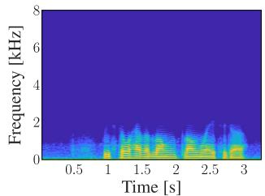  
(a) Low-resolution input

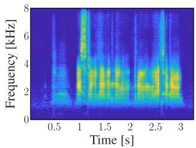  
(b) Predicted mask M'

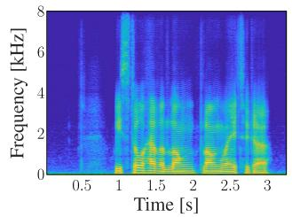  
(c) Predicted output

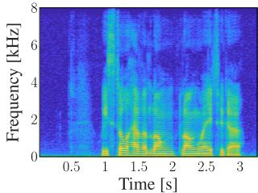  
(d) High-resolution reference

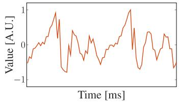  
(e) 4 kHz input segment

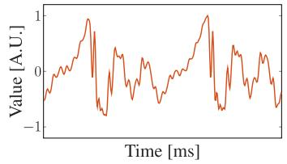  
(f) 16 kHz predicted segment

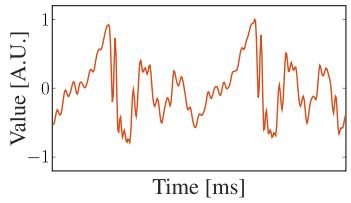  
(g) 16 kHz reference segment  
Fig. 7. Example of scale 4 super-resolution (4 kHz → 16 kHz). The upper row represents the TF-magnitude representations of the relevant spectrograms. The bottom row shows a 20 ms segment of the corresponding time-domain signals.

Recently, DNNs have been utilized for finding a subjective alternative score [124], [125], [126], [127], [128], [129]. Unlike the previous composite measure, most of these methods will take the track as an input and the network is trained to mimic the subjective ratings. Thus, the scores will not depend on non-optimal objective scores, but rather on the whole track. Additionally, these scores are non-intrusive, hence evaluating enhanced tracks without the need for clean reference is possible. The standard score used as a subjective baseline for many recent studies is the DNSMOS proposed by Microsoft in [128], [129]. The DNSMOS is trained on 75 hours of rated speech. In accordance to ITU-T P.835, listeners assign a score between 1 and 5 (higher is better) for signal distortion, background noise and overall quality. A significant correlation of 0.94 to 0.98 is reported over the three given quality assessment scores.

Due to non-availability of open-source implementations, especially in dereverberation, the MOS evaluation will focus on the denoising aspect of the SE problem. Accordingly, four different denoising use cases are included in this study to indicate the generalization capability of the network to unseen noise conditions, real noise samples and additional distortions not included in training. To this end, the frameworks will be all trained on a single use case (Voice Bank+DEMAND), then the models will be evaluated on four different datasets:

a) Voice Bank+DEMAND test set [7]: including 35 minutes (824 tracks) of noisy speech from two unseen speakers using noise types from DEMAND dataset [104] which are not included in the training as explained in Section IV-A.

b) CHiME-3 [9]: including 7.8 hours (4560 tracks) of real noisy speech recordings from 12 speakers at four different environments: bus, cafe, pedestrian area and street junction. In this data, no clean reference tracks are available.

c) DNS-Challenge [10]: the original data includes 1934 English speaker reading speech samples from Librivox3 and 181 hours of 150 different noise types from Audio Set [130] and Freesound.4 Based on this dataset, we construct 9 hours (3240 tracks) of noisy speech with SNRs from 0 to 10 dB. It is worth noting that the DNS-Challenge dataset features noises with unique spectral characteristics and harmonics, such as doorbells, church bells, squeaky chairs, and musical distortions. This stands in contrast to the predominantly wideband noises found in DEMAND.

d) DNS-Challenge+Reverb: we use the same 9 hours, but we simulate reverberant conditions on the speech, then we add the same noise in the DNS challenge part. The RIRs are chosen from openSLR26/28 [131], including 248 real and 60 k synthetic conditions. The RIRs are recorded in three different room sizes with a 60 dB reverberation time of 0.3–1.3 seconds.

All tracks are resampled to 16 kHz and the ratio of male-tofemale speakers is 50%. From Table I, we choose a representative for each denoising paradigm. The methods were chosen based on the availability of open-source implementations and the reproducibility of the reported results in the corresponding papers. As a representative for metric discriminator, we used the

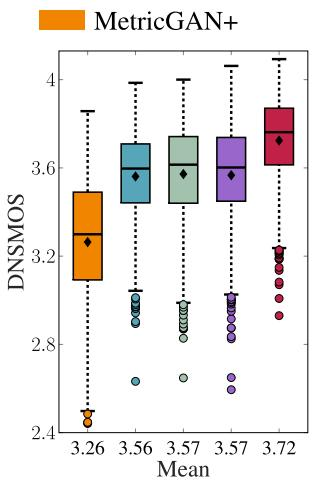  
(a) Voice Bank+DEMAND

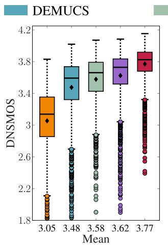  
(b) CHiME-3 (real noise)

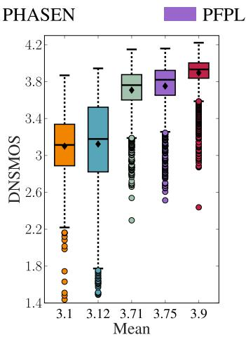  
(c) DNS-Challenge

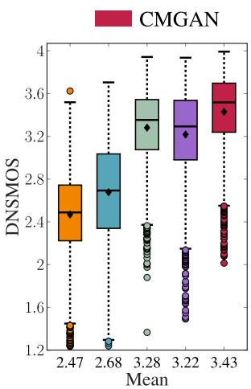  
(d) DNS-Challenge+Reverb  
Fig. 8. DNSMOS of subjective evaluation methods tested on four different datasets. In the boxplots, the mean is represented by ( ), median ( ) and the width of each box indicates the interquartile range (25th and 75th percentile). The whiskers show the maximum and minimum values excluding the outliers ( ). The mean value for each method is presented on the x-axis.

MetricGAN+ [109]. For time-domain methods, DEMUCS [17] is selected. For TF-domain complex denoising, PHASEN [12] is chosen as it attempts to correct magnitude and phase components. In addition to, PFPL [108] utilizing a deep complexvalued network to enhance both real and imaginary parts. Most ofthe papers provided an official implementation with pretrained models. PHASEN is the only exception, as a non-official code is used and we trained the model to reproduce the results in the paper. For DEMUCS, the available model is pretrained on both Voice Bank+DEMAND and DNS-Challenge data. Thus, we retrain DEMUCS using the recommended configuration on Voice Bank+DEMAND data only to ensure a fair comparison between all presented models. In this study, a DNN-based approach is used to evaluate a MOS on the aforementioned four different datasets (≈ 26 hours). Then a subset is selected from these tracks to construct a listening test experiment.

## A. DNN-Based MOS

Following the literature [62], [132], the DNSMOS of the overall speech quality will be evaluated as an objective measure to replicate the subjective evaluation metric, as shown in Fig. 8. From the boxplots, CMGAN is outperforming all methods in the four use cases. For instance, CMGAN shows an average improvement of 0.15 in comparison to the most competitive approach (PFPL) in the first three use cases. Moreover, the interquartile range of the CMGAN is much narrower than all other methods, which indicates a low variance and thus a confident prediction, especially in the DNS-Challenge (Fig. 8(c)). On the other hand, MetricGAN+ is showing the worst performance in all use cases. We hypothesize that although the PESQ score is relatively high (3.15), the SSNR score that we calculate is below 1 dB, indicating that the metric discriminator in MetricGAN+ case, is only focusing on enhancing the PESQ at the expense of other metrics. Note that the SSNR score is not reported in the original paper. DEMUCS representing the time-domain paradigm is showing a robust performance over Voice Bank+DEMAND and real CHiME-3 use cases. However, it is not generalizing to the DNS-Challenge dataset. This generalization issue is clearly mitigated in the TF-domain complex denoising methods (PHASEN, PFPL and CMGAN). From Fig. 8(d), the overall DNSMOS ofDN-Challenge with additional reverberation dropped by 0.5 on average in comparison to DNS challenge (Fig. 8(c)). This is expected as generalizing to unseen effects such as reverberation is more challenging than unseen noise types. Despite this drop, CMGAN is still showing superior performance over other competitive TF-domain approaches (PHASEN and PFPL). Audio samples5 and visualizations6 from all subjective evaluation methods are available online for interested readers.

## B. Listening Test

We organize a medium-scale listening test experiment with 25 participants and 10 samples, which were carefully selected from the Voice Bank+DEMAND, DNS-Challenge, and DNS-Challenge+Reverb datasets. Each sample has an average duration of 10 seconds, containing a complete sentence. We ensure that the tracks are of different noise types and mostly challenging conditions. During the experiment, each participant listened to both the noisy track and its clean reference. Subsequently, they were asked to assign a rating between 1 and 5 (where a higher score indicates better quality) to represent the absolute overall quality of the sample for the five methods: MetricGAN+, DEMUCS, PHASEN, PFPL and CMGAN. In compliance with the ITU-T P.835 standards [122], the methods are unknown to the participants and the order of the methods is randomly shuffled for each sample.

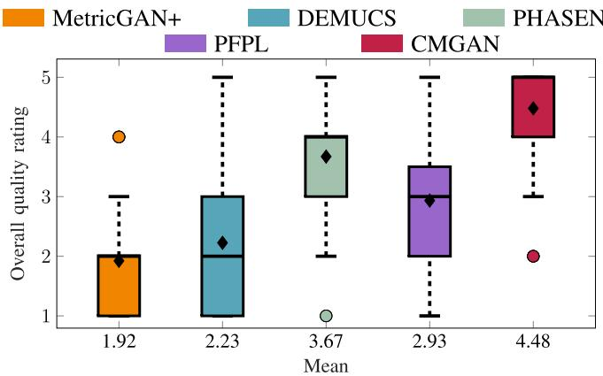  
Fig. 9. Overall speech quality ratings of listening test.

As illustrated in Fig. 9, the participants rated the CMGAN as the best method in the subjective overall quality. On average, CMGAN outperformed the second-best method (PHASEN) by 0.81. The findings obtained from the non-intrusive DNSMOS in Fig. 8 generally align with the listening test experiment, with the exception that PHASEN exhibited better performance than PFPL. This discrepancy could be attributed to the limited tracks included in the listening test experiment or the relatively non-optimal performance of the DNSMOS ratings. The performance of MetricGAN+ and time-domain DEMUCS is relatively poor, indicating that TF-domain complex denoising methods (PHASEN, PFPL and CMGAN) continue to demonstrate superior generalization capabilities and subjective quality ratings.

## VII. LIMITATIONS

Despite the above results, this study is not without limitations. For instance, CMGAN has not been tested for real-time SE, i.e., CMGAN can access the whole track. In the future, CMGAN should be modified to only access few TF bins from the old samples and not the entire track, together with an extensive study on the exact amount of floating point operations in the real-time scenario. Another point to consider is the focus of this investigation on individual task experimentation. The superimposed effect (denoising and dereverberation) is only briefly addressed in the subjective evaluation part, so training and evaluating CMGAN for this use case would be an important extension of our work. Lastly, the current evaluation does not encompass ASR performance, a dimension that would mark a promising avenue for subsequent research.

## VIII. CONCLUSION

This paper introduces CMGAN as a unified framework operating on both magnitude and complex spectrogram components for various SE tasks, including denoising, dereverberation and super-resolution. Our approach combines recent conformers that can capture long-term dependencies as well as local features in both time and frequency dimensions, together with a metric discriminator that resolves metric mismatch by directly enhancing non-differentiable evaluation scores. Experimental results demonstrate that the proposed method achieves superior or competitive performance against SOTA methods in each task with relatively few parameters (1.83 M). Additionally, we conduct an ablation study to verify the fragmented benefits of each utilized component and loss in the proposed CMGAN framework. Finally, subjective evaluation illustrates that CMGAN outperforms other methods with a robust generalization to unseen noise types and distortions.

TABLE VI CMGAN ARCHITECTURAL DETAILS

<table><tr><td></td><td>Layer</td><td>Input size</td><td>Hyperparameters</td><td>Output size</td></tr><tr><td rowspan="6">Encoder</td><td>2D-Conv.</td><td> $B \times T \times 201 \times 3$ </td><td> $1 \times 1, (1, 1), 64$ </td><td> $B \times T \times 201 \times 64$ </td></tr><tr><td>Dil. Dense-1</td><td> $B \times T \times 201 \times 64$ </td><td> $2 \times 3, (1, 1), 64, 1$ </td><td> $B \times T \times 201 \times 64$ </td></tr><tr><td>Dil. Dense-2</td><td> $B \times T \times 201 \times 64$ </td><td> $2 \times 3, (1, 1), 64, 2$ </td><td> $B \times T \times 201 \times 64$ </td></tr><tr><td>Dil. Dense-3</td><td> $B \times T \times 201 \times 64$ </td><td> $2 \times 3, (1, 1), 64, 4$ </td><td> $B \times T \times 201 \times 64$ </td></tr><tr><td>Dil. Dense-4</td><td> $B \times T \times 201 \times 64$ </td><td> $2 \times 3, (1, 1), 64, 8$ </td><td> $B \times T \times 201 \times 64$ </td></tr><tr><td>2D-Conv.</td><td> $B \times T \times 201 \times 64$ </td><td> $1 \times 3, (1, 2), 64$ </td><td> $B \times T \times 101 \times 64$ </td></tr><tr><td rowspan="5">TS-Conf. $\times 4$ </td><td>Reshape</td><td> $B \times T \times 101 \times 64$ </td><td>-</td><td> $101B \times T \times 64$ </td></tr><tr><td>Time-Conf.</td><td> $101B \times T \times 64$ </td><td>-</td><td> $101B \times T \times 64$ </td></tr><tr><td>Reshape</td><td> $101B \times T \times 64$ </td><td>-</td><td> $BT \times 101 \times 64$ </td></tr><tr><td>Freq.-Conf.</td><td> $BT \times 101 \times 64$ </td><td>-</td><td> $BT \times 101 \times 64$ </td></tr><tr><td>Reshape</td><td> $BT \times 101 \times 64$ </td><td>-</td><td> $B \times T \times 101 \times 64$ </td></tr><tr><td rowspan="7">Mask Dec.</td><td>Dil. Dense-1</td><td> $B \times T \times 101 \times 64$ </td><td> $2 \times 3, (1, 1), 64, 1$ </td><td> $B \times T \times 101 \times 64$ </td></tr><tr><td>Dil. Dense-2</td><td> $B \times T \times 101 \times 64$ </td><td> $2 \times 3, (1, 1), 64, 2$ </td><td> $B \times T \times 101 \times 64$ </td></tr><tr><td>Dil. Dense-3</td><td> $B \times T \times 101 \times 64$ </td><td> $2 \times 3, (1, 1), 64, 4$ </td><td> $B \times T \times 101 \times 64$ </td></tr><tr><td>Dil. Dense-4</td><td> $B \times T \times 101 \times 64$ </td><td> $2 \times 3, (1, 1), 64, 8$ </td><td> $B \times T \times 101 \times 64$ </td></tr><tr><td>Sub-pixel</td><td> $B \times T \times 101 \times 64$ </td><td> $1 \times 3, (1, 1), 256$ </td><td> $B \times T \times 202 \times 256$ </td></tr><tr><td>2D-Conv.</td><td> $B \times T \times 202 \times 256$ </td><td> $1 \times 2, (1, 1), 1$ </td><td> $B \times T \times 201 \times 1$ </td></tr><tr><td>PReLU</td><td>-</td><td>201</td><td>-</td></tr><tr><td rowspan="6">Complex Dec.</td><td>Dil. Dense-1</td><td> $B \times T \times 101 \times 64$ </td><td> $2 \times 3, (1, 1), 64, 1$ </td><td> $B \times T \times 101 \times 64$ </td></tr><tr><td>Dil. Dense-2</td><td> $B \times T \times 101 \times 64$ </td><td></td><td> $B \times T \times 101 \times 64$ </td></tr><tr><td>Dil. Dense-3</td><td> $B \times T \times 101 \times 64$ </td><td> $2 \times 3, (1, 1), 64, 4$ </td><td> $B \times T \times 101 \times 64$ </td></tr><tr><td>Dil. Dense-5</td><td> $B \times T \times 101 \times 64$ </td><td> $2 \times 3, (1, 1), 64, 8$ </td><td> $B \times T \times 101 \times 64$ </td></tr><tr><td>Sub-pixel</td><td> $B \times T \times 101 \times 64$ </td><td> $1 \times 3, (1,1), 256$ </td><td> $B \times T \times 202 \times 256$ </td></tr><tr><td>2D-Conv.</td><td> $B \times T \times 202 \times 256$ </td><td> $1 \times 2, (1,1), 2$ </td><td> $B \times T \times 201 \times 2$ </td></tr><tr><td rowspan="8">Metric Disc.</td><td>2D-Conv.-1</td><td> $B \times T \times 201 \times 2$ </td><td> $4 \times 4, (2,2), 16$ </td><td> $B \times T/2 \times 100 \times 16$ </td></tr><tr><td>2D-Conv.-2</td><td> $B \times T/2 \times 100 \times 16$ </td><td> $4 \times 4, (2,2), 32$ </td><td> $B \times T/4 \times 50 \times 32$ </td></tr><tr><td>2D-Conv.-3</td><td> $B \times T/4 \times 50 \times 32$ </td><td> $4 \times 4, (2,2), 64$ </td><td> $B \times T/8 \times 25 \times 64$ </td></tr><tr><td>2D-Conv.-4</td><td> $B \times T/8 \times 25 \times 64$ </td><td> $4 \times 4, (2,2), 128$ </td><td> $B \times T/16 \times 12 \times 128$ </td></tr><tr><td>Avg. Pooling</td><td> $B \times T/16 \times 12 \times 128$ </td><td>-</td><td> $B \times 128$ </td></tr><tr><td>Linear-1</td><td> $B \times 128$ </td><td>64</td><td> $B \times 64$ </td></tr><tr><td>Linear-2</td><td> $B \times 64$ </td><td>1</td><td> $B \times 1$ </td></tr><tr><td>Sigmoid</td><td>-</td><td>-</td><td>-</td></tr></table>

## ACKNOWLEDGMENT

The authors would like to thank the Institute of Natural Language Processing, University of Stuttgart for providing useful datasets to support this research.

## APPENDIX

The complete architectural details of both generator and discriminator are outlined in Table VI. The hypeparameters for 2D-Conv. layers represent kernel sizes, strides and number of channels. For dilated dense blocks, the dilation factor is appended at the end. In linear layers only the number of channels is presented. For the conformer blocks, we follow the same baseline in [30].

## REFERENCES

[1] R. Cao, S. Abdulatif, and B. Yang, “CMGAN: Conformer-based metric GAN for speech enhancement,” in Proc. Interspeech, 2022, pp. 936–940.

[2] F. Weninger et al., “Speech enhancement with LSTM recurrent neura networks and its application to noise-robust ASR,” in Proc. Int. Conf. Latent Variable Anal. Signal Separation, 2015, pp. 91–99.

[3] C. Zheng, X. Peng, Y. Zhang, S. Srinivasan, and Y. Lu, “Interactive speech and noise modeling for speech enhancement,” in Proc. AAAI Conf. Artif. Intell., 2021, vol. 35, pp. 14549–14557.

[4] J. L. Desjardins and A. K. Doherty, “The effect of hearing aid noise reduction on listening effort in hearing-impaired adults,” Ear Hear., vol. 35, no. 6, pp. 600–610, 2014.

[5] D. Wang and J. Chen, “Supervised speech separation based on deep learning: An overview,” IEEE/ACMTrans.Audio, Speech Lang. Process., vol. 26, no. 10, pp. 1702–1726, Oct. 2018.

[6] P. C. Loizou, Speech Enhancement: Theory and Practice, 2nd ed. Boca Raton, FL, USA: CRC Press, Inc., 2013.

[7] C. Valentini-Botinhao, X. Wang, S. Takaki, and J. Yamagishi, “Investigating RNN-based speech enhancement methods for noise-robust text-to-speech,” in Proc. SSW, 2016, pp. 146–152.

[8] K. Kinoshita et al., “A summary of the reverb challenge: State-of-the-art and remaining challenges in reverberant speech processing research,” J. Adv. Signal Process., vol. 7, no. 01, pp. 1–19, 2016.

[9] J. Barker, R. Marxer, E. Vincent, and S. Watanabe, “The third ‘CHiME’ speech separation and recognition challenge: Dataset, task and baselines,” in Proc. IEEE Workshop Autom. Speech Recognit. Understanding, 2015, pp. 504–511.

[10] H. Dubey et al., “ICASSP 2022 Deep noise suppression challenge,” in Proc. IEEE Int. Conf. Acoust., Speech Signal Process., 2022, pp. 9271– 9275.

[11] S.-W. Fu, C. F. Liao, Y. Tsao, and S. D. Lin, “MetricGAN: Generative adversarial networks based black-box metric scores optimization for speech enhancement,” in Proc. Int. Conf. Mach. Learn., 2019, pp. 2031–2041.

[12] D. Yin, C. Luo, Z. Xiong, and W. Zeng, “PHASEN: A phase-andharmonics-aware speech enhancement network,” in Proc. Conf. Artif. Intell., 2020, vol. 34, pp. 9458–9465.

[13] G. Yu, A. Li, C. Zheng, Y. Guo, Y. Wang, and H. Wang, “Dual-branch attention-in-attention transformer for single-channel speech enhancement,” in Proc. IEEE Int. Conf. Acoust., Speech Signal Process., 2022, pp. 7847–7851.

[14] S. Pascual, A. Bonafonte, and J. Serrà, “SEGAN: Speech enhancement generative adversarial network,” in Proc. Interspeech, 2017, pp. 3642–3646.

[15] C. Macartney and T. Weyde, “Improved speech enhancement with the Wave-U-Net,” 2018, arXiv:1811.11307.

[16] K. Wang, B. He, and W. P. Zhu, “TSTNN: Two-stage transformer based neural network for speech enhancement in the time domain,” in Proc. IEEE Int. Conf. Acoust., Speech Signal Process., 2021, pp. 7098–7102.

[17] A. Defossez, G. Synnaeve, and Y. Adi, “Real time speech enhancement in the waveform domain,” in Proc. Interspeech, 2020, pp. 3291–3295.

[18] E. Kim and H. Seo, “SE-Conformer: Time-domain speech enhancement using conformer,” in Proc. Interspeech, 2021, pp. 2736–2740.

[19] J. H. Kim, J. Yoo, S. Chun, A. Kim, and J. W. Ha, “Multi-domain processing via hybrid denoising networks for speech enhancement,” 2018, arXiv:1812.08914.

[20] J. Su, Z. Jin, and A. Finkelstein, “HiFi-GAN-2: Studio-quality speech enhancement via generative adversarial networks conditioned on acoustic features,” in Proc. IEEE Workshop Appl. Signal Process. to Audio Acoust., 2021, pp. 166–170.

[21] J. Serrà, S. Pascual, J. Pons, R. O. Araz, and D. Scaini, “Universal speech enhancement with score-based diffusion,” 2022, arXiv:2206.03065.

[22] S. Abdulatif, K. Armanious, K. Guirguis, J. T. Sajeev, and B. Yang, “AeGAN: Time-frequency speech denoising via generative adversarial networks,” in Proc. 28th Eur. Signal Process. Conf., 2020, pp. 451–455.

[23] S. Abdulatif, K. Armanious, J. T. Sajeev, K. Guirguis, and B. Yang, “Investigating cross-domain losses for speech enhancement,” in Proc. 29th Eur. Signal Process. Conf., 2021, pp. 411–415.

[24] D. S. Williamson, Y. Wang, and P. Wang, “Complex ratio masking for monaural speech separation,” IEEE Trans. Audio, Speech Lang. Process., vol. 24, no. 3, pp. 483–492, Mar. 2016.

[25] K. Tan and D. Wang, “Complex spectral mapping with a convolutional recurrent network for monaural speech enhancement,” in Proc. IEEE Int. Conf. Acoust., Speech Signal Process., 2019, pp. 6865–6869.

[26] Z. Q. Wang, G. Wichern, and J. L. Roux, “On the compensation between magnitude and phase in speech separation,” IEEE Signal Process. Lett., vol. 28, pp. 2018–2022, 2021.

[27] A. Li, C. Zheng, L. Zhang, and X. Li, “Glance and gaze: A collaborative learning framework for single-channel speech enhancement,” Appl. Acoust., vol. 187, 2022, Art. no. 108499.

[28] A. Vaswani et al., “Attention is all you need,” in Proc. Annu. Conf. Neural Inf. Process. Syst., 2017, vol. 30, pp. 1–11. [Online]. Available: https://proceedings.neurips.cc/paper\_files/paper/2017/hash/ 3f5ee243547dee91fbd053c1c4a845aa-Abstract.html

[29] F. Dang, H. Chen, and P. Zhang, “DPT-FSNet: Dual-path transformer based full-band and sub-band fusion network for speech enhancement,” in IEEE Int. Conf.Acoust., Speech Signal Process., 2022, pp. 6857–6861.

[30] A. Gulati et al., “Conformer: Convolution-augmented transformer for speech recognition,” in Proc. Interspeech, 2020, pp. 5036–5040.

[31] S. Chen et al., “Continuous speech separation with conformer,” in Proc. IEEE Int. Conf. Acoust., Speech Signal Process., 2021, pp. 5749–5753.

[32] Y. Koizumi et al., “DF-Conformer: Integrated architecture of Conv-Tasnet and conformer using linear complexity self-attention for speech enhancement,” in Proc. IEEE Workshop Appl. Signal Process. Audio Acoust., 2021, pp. 161–165.

[33] J. Chen, Q. Mao, and D. Liu, “Dual-path transformer network: Direct context-aware modeling for end-to-end monaural speech separation,” in Proc. Interspeech, 2020, pp. 2642–2646.

[34] H. Purwins, B. Li, T. Virtanen, J. Schlüter, S.-Y. Chang, and T. Sainath, “Deep learning for audio signal processing,” IEEE J. Sel. Topics Signal Process., vol. 13, no. 2, pp. 206–219, May 2019.

[35] D. Michelsanti et al., “An overview of deep-learning-based audio-visual speech enhancement and separation,” IEEE/ACM Trans. Audio, Speech, Lang. Process., vol. 29, pp. 1368–1396, 2021.

[36] D. Wang and J. Lim, “The unimportance of phase in speech enhancement,” IEEE Trans. Acoust., Speech, Signal Process., vol. 30, no. 4, pp. 679–681, Aug. 1982.

[37] K. Paliwal, K. Wójcicki, and B. Shannon, “The importance of phase in speech enhancement,” Speech Commun., vol. 53, no. 4, pp. 465–494, 2011.

[38] D. Rethage, J. Pons, and X. Serra, “A wavenet for speech denoising,” in Proc. IEEE Int. Conf. Acoust., Speech Signal Process., 2018, pp. 5069–5073.

[39] S.-W. Fu, T.-W. Wang, Y. Tsao, X. Lu, and H. Kawai, “End-to-end waveform utterance enhancement for direct evaluation metrics optimization by fully convolutional neural networks,” IEEE/ACM Trans. Audio, Speech, Lang. Process., vol. 26, no. 9, pp. 1570–1584, Sep. 2018.

[40] A. Pandey and D. Wang, “TCNN: Temporal convolutional neural network for real-time speech enhancement in the time domain,” in Proc. IEEE Int Conf. Acoust., Speech Signal Process., 2019, pp. 6875–6879.

[41] H. Phan et al., “Improving GANs for speech enhancement,” IEEE Signal Process. Lett., vol. 27, pp. 1700–1704, 2020.

[42] S. Pascual, J. Serra, and A. Bonafonte, “Towards generalized speech enhancement with generative adversarial networks,” in Proc. Interspeech, 2019, pp. 1791–1795.

[43] C. Donahue, B. Li, and R. Prabhavalkar, “Exploring speech enhancement with generative adversarial networks for robust speech recognition,” in Proc. IEEE Int. Conf. Acoust., Speech Signal Process., 2018, pp. 5024–5028.

[44] D. Michelsanti and Z. H. Tan, “Conditional generative adversarial networks for speech enhancement and noise-robust speaker verification,” in Proc. Interspeech, 2017, pp. 2008–2012.

[45] Z. Meng et al., “Adversarial feature-mapping for speech enhancement,” in Proc. Interspeech, 2018, pp. 3259–3263.

[46] Y. Luo and N. Mesgarani, “Conv-TasNet: Surpassing ideal time– frequency magnitude masking for speech separation,” IEEE/ACM Trans. Audio, Speech, Lang. Process., vol. 27, no. 8, pp. 1256–1266, Aug. 2019.

[47] S. Rickard and O. Yilmaz, “On the approximate W-disjoint orthogonality of speech,” in Proc. IEEE Int. Conf. Acoust., Speech Signal Process., 2002, pp. I-529–I-532.

[48] A. S. Bregman, Auditory Scene Analysis: The Perceptual Organization ofSound, Cambridge, MA, USA: MIT Press, 1994.

[49] O. Yilmaz and S. Rickard, “Blind separation of speech mixtures via time-frequency masking,” IEEE Trans. Signal Process., vol. 52, no. 7, pp. 1830–1847, Jul. 2004.

[50] Y. Wang and D. Wang, “Towards scaling up classification-based speech separation,” IEEE Trans. Audio, Speech, Lang. Process., vol. 21, no. 7, pp. 1381–1390, Jul. 2013.

[51] Y. Wang and D. Wang, “An algorithm to improve speech recognition in noise for hearing-impaired listeners,” J. Acoustical Soc. Amer., vol. 134, no. 4, pp. 3029–3038, 2013.

[52] C. Hummersone, T. Stokes, and T. Brookes, “On the ideal ratio mask as the goal of computational auditory scene analysis,” in Blind Source Separation: Advances in Theory, Algorithms and Applications. Berlin, Germany: Springer, 2014, pp. 349–368.

[53] S. Srinivasan, N. Roman, and D. Wang, “Binary and ratio time-frequency masks for robust speech recognition,” Speech Commun., vol. 48, no. 11, pp. 1486–1501, 2006.

[54] A. Narayanan and D. Wang, “Ideal ratio mask estimation using deep neural networks for robust speech recognition,” in Proc. IEEE Int. Conf. Acoust., Speech Signal Process., 2013, pp. 7092–7096.

[55] Y. Wang, A. Narayanan, and D. Wang, “On training targets for supervised speech separation,” IEEE/ACM Trans. Audio, Speech, Lang. Process., vol. 22, no. 12, pp. 1849–1858, Dec. 2014.

[56] K. Han, Y. Wang, D. Wang, W. S. Woods, I. Merks, and T. Zhang, “Learning spectral mapping for speech dereverberation and denoising,” IEEE/ACM Trans. Audio, Speech, Lang. Process., vol. 23, no. 6, pp. 982–992, Jun. 2015.

[57] Z. Q. Wang, J. L. Roux, D. L. Wang, and J. Hershey, “End-to-end speech separation with unfolded iterative phase reconstruction,” in Proc. Interspeech, 2018, pp. 2708–2712.

[58] Z. Q. Wang, K. Tan, and D. Wang, “Deep learning based phase reconstruction for speaker separation: A trigonometric perspective,” in Proc. IEEE Int. Conf. Acoust., Speech Signal Process., 2019, pp. 71–75.

[59] Y. Zhao, Z. Q. Wang, and D. Wang, “Two-stage deep learning for noisyreverberant speech enhancement,” IEEE/ACM Trans. Audio, Speech, Lang. Process., vol. 27, no. 1, pp. 53–62, Jan. 2019.

[60] H. Erdogan, J. R. Hershey, S. Watanabe, and J. L. Roux, “Phase-sensitive and recognition-boosted speech separation using deep recurrent neural networks,” in Proc. IEEE Int. Conf. Acoust., Speech Signal Process., 2015, pp. 708–712.

[61] Y. Hu et al., “DCCRN: Deep complex convolution recurrent network for phase-aware speech enhancement,” in Proc. Interspeech, 2020, pp. 2472–2476.

[62] G. Yu, A. Li, H. Wang, Y. Wang, Y. Ke, and C. Zheng, “DBT-Net: Dual-branch federative magnitude and phase estimation with attention-in-attention transformer for monaural speech enhancement,” in {IEEE/ACM Trans. Audio, Speech, Lang. Process., 2022, vol. 30, pp. 2629–2644.

[63] A. Li, W. Liu, C. Zheng, C. Fan, and X. Li, “Two heads are better than one: A two-stage complex spectral mapping approach for monaural speech enhancement,” IEEE/ACM Trans. Audio, Speech, Lang. Process., vol. 29, pp. 1829–1843, 2021.

[64] A. Li et al., “A simultaneous denoising and dereverberation framework with target decoupling,” in Proc. Interspeech, 2021, pp. 2801–2805.

[65] K. Tan and D. Wang, “Learning complex spectral mapping with gated convolutional recurrent networks for monaural speech enhancement,” IEEE/ACM Trans. Audio, Speech, Lang. Process., vol. 28, pp. 380–390, 2020.

[66] H. Kuttruff, Room Acoustics, 6th ed. Boca Raton, FL, USA: CRC Press, 2016.

[67] J. Bradley, H. Sato, and M. Picard, “On the importance of early reflections for speech in rooms,” J. Acoustical Soc. Amer., vol. 113, no. 6, pp. 3233–3244, 2003.

[68] T. J. Schultz, “Diffusion in reverberation rooms,” J. Sound Vib., vol. 16, no. 1, pp. 17–28, 1971.

[69] D. Gelbart and N. Morgan, “Double the trouble: Handling noise and reverberation in far-field automatic speech recognition,” in Proc. 7th Int. Conf. Spoken Lang. Process., 2002, pp. 2185–2188.

[70] Y. Luo and N. Mesgarani, “Real-time single-channel dereverberation and separation with time-domain audio separation network,” in Proc. Interspeech, 2018, pp. 342–346.

[71] N. Roman and J. Woodruff, “Intelligibility of reverberant noisy speech with ideal binary masking,” J. Acoustical Soc. Amer., vol. 130, no. 4, pp. 2153–2161, 2011.

[72] T. May and T. Gerkmann, “Generalization of supervised learning for binary mask estimation,” in Proc. 14th Int. Workshop Acoustic Signa Enhancement, 2014, pp. 154–158.

[73] Z. Jin and D. Wang, “A supervised learning approach to monaural segregation of reverberant speech,” in Proc. IEEE Int. Conf. Acoust., Speech Signal Process., 2007, pp. IV-921–IV-924.

[74] Y. Zhao, D. Wang, I. Merks, and T. Zhang, “DNN-based enhancement of noisy and reverberant speech,” in Proc. IEEE Int. Conf. Acoust., Speech Signal Process., 2016, pp. 6525–6529.

[75] X. L. Zhang and D. Wang, “A deep ensemble learning method for monaural speech separation,” IEEE/ACM Trans. Audio, Speech, Lang. Process., vol. 24, no. 5, pp. 967–977, May 2016.

[76] X. Li, J. Li, and Y. Yan, “Ideal ratio mask estimation using deep neural networks for monaural speech segregation in noisy reverberant conditions,” in Proc. Interspeech, 2017, pp. 1203–1207.

[77] D. S. Williamson and D. Wang, “Speech dereverberation and denoising using complex ratio masks,” in Proc. IEEE Int. Conf. Acoust., Speech Signal Process., 2017, pp. 5590–5594.

[78] D. S. Williamson and D. Wang, “Time-frequency masking in the complex domain for speech dereverberation and denoising,” IEEE/ACM Trans. Audio, Speech, Lang. Process., vol. 25, no. 7, pp. 1492–1501, Jul. 2017.

[79] V. Kothapally and J. H. L. Hansen, “SkipConvGAN: Monaural speech dereverberation using generative adversarial networks via complex timefrequency masking,” IEEE/ACM Trans. Audio, Speech, Lang. Process., vol. 30, pp. 1600–1613, 2022.

[80] O. Ernst, S. E. Chazan, S. Gannot, and J. Goldberger, “Speech dereverberation using fully convolutional networks,” in Proc. 26th Eur. Signa Process. Conf., 2018, pp. 390–394.

[81] V. Kothapally et al., “SkipConvNet: Skip convolutional neural network for speech dereverberation using optimally smoothed spectral mapping,” in Proc. Interspeech, 2020, pp. 3935–3939.

[82] D. Ribas et al., “Deep speech enhancement for reverberated and noisy signals using wide residual networks,” 2019, arXiv:1901.00660.

[83] X. Xiao et al., “The NTU-ADSC systems for reverberation challenge 2014,” in Proc. Reverberation Challenge Workshop, 2014, pp. 1–8.

[84] C. Dong, C. C. Loy, K. He, and X. Tang, “Image super-resolution using deep convolutional networks,” IEEE Trans. Pattern Anal. Mach. Intell., vol. 38, no. 2, pp. 295–307, Feb. 2016.

[85] J. Yu, Z. Lin, J. Yang, X. Shen, X. Lu, and T. S. Huang, “Generative image inpainting with contextual attention,” in Proc. IEEE/CVF Conf. Comput. Vis. Pattern Recognit., 2018, pp. 5505–5514.

[86] P. Ekstrand, “Bandwidth extension of audio signals by spectral band replication,” in Proc. IEEE Benelux Workshop Model Based Process. Coding Audio, 2002, pp. 53–58.

[87] V. Kuleshov, S. Z. Enam, and S. Ermon, “Audio super-resolution using neural nets,” in Proc. Int. Conf. Learn. Representations (Workshop Track), 2017, pp. 1–5. [Online]. Available: https://openreview.net/ pdf?id=S1gNakBFx

[88] T. Y. Lim, R. A. Yeh, Y. Xu, M. N. Do, and M. Hasegawa-Johnson, “Time-frequency networks for audio super-resolution,” in Proc. IEEE Int. Conf. Acoust., Speech Signal Process., 2018, pp. 646–650.

[89] S. Birnbaum, V. Kuleshov, Z. Enam, P. W. W. Koh, and S. Ermon, “Temporal FiLM: Capturing long-range sequence dependencies with featurewise modulations,” in Proc. Annu. Conf. Neural Inf. Process. Syst., 2019, vol. 32, pp. 1–12. [Online]. Available: https://papers.nips.cc/paper\_files/ paper/2019/hash/2afc4dfb14e55c6face649a1d0c1025b-Abstract.html

[90] N. C. Rakotonirina, “Self-attention for audio super-resolution,” in Proc. 31st IEEE Int. Workshop Mach. Learn. Signal Process., 2021, pp. 1–6.

[91] H. Wang and D. Wang, “Towards robust speech super-resolution,” IEEE/ACM Trans. Audio, Speech, Lang. Process., vol. 29, pp. 2058–2066, 2021.

[92] H. Liu, W. Choi, X. Liu, Q. Kong, Q. Tian, and D. L. Wang, “Neural vocoder is all you need for speech super-resolution,” in Proc. Interspeech, 2022, pp. 4227–4231.

[93] S. Braun and I. Tashev, “A consolidated view of loss functions for supervised deep learning-based speech enhancement,” in Proc. Int. Conf. Telecommun. Signal Process., 2021, pp. 72–76.

[94] J. Lee et al., “Phase-sensitive joint learning algorithms for deep learningbased speech enhancement,” IEEE Signal Process. Lett., vol. 25, no. 8, pp. 1276–1280, Aug. 2018.

[95] K. Wilson et al., “Exploring tradeoffs in models for low-latency speech enhancement,” in Proc. 16th Int. Workshop Acoustic Signal Enhancement, 2018, pp. 366–370.

[96] A. Pandey and D. Wang, “Densely connected neural network with dilated convolutions for real-time speech enhancement in the time domain,” in Proc. IEEE Int. Conf. Acoust., Speech Signal Process., 2020, pp. 6629–6633.

[97] D. Ulyanov, A. Vedaldi, and V. Lempitsky, “Instance normalization: The missing ingredient for fast stylization,” 2016, arXiv:1607.08022.

[98] K. He, X. Zhang, S. Ren, and J. Sun, “Delving deep into rectifiers: Surpassing human-level performance on ImageNet classification,” in Proc. IEEE Int. Conf. Comput. Vis., 2015, pp. 1026–1034.

[99] W. Shi et al., “Real-time single image and video super-resolution using an efficient sub-pixel convolutional neural network,” in Proc. IEEE Comput. Vis. Pattern Recognit., 2016, pp. 1874–1883.

[100] A. W. Rix, J. G. Beerends, M. P. Hollier, and A. P. Hekstra, “Perceptual evaluation of speech quality (PESQ)-a new method for speech quality assessment of telephone networks and codecs,” in Proc. IEEE Int. Conf. Acoust., Speech Signal Process., 2001, pp. 749–752.

[101] C. H. Taal, R. C. Hendriks, R. Heusdens, and J. Jensen, “A shorttime objective intelligibility measure for time-frequency weighted noisy speech,” in Proc. IEEE Int. Conf. Acoust., Speech Signal Process., 2010, pp. 4214–4217.

[102] X. Mao, Q. Li, H. Xie, R. Y. K. Lau, Z. Wang, and S. P. Smolley, “Least squares generative adversarial networks,” in Proc. IEEE Int. Conf. Comput. Vis., 2017, pp. 2813–2821.

[103] C. Veaux, J. Yamagishi, and S. King, “The voice bank corpus: Design, collection and data analysis of a large regional accent speech database,” in Proc. Oriental Int. Conf. Speech Database Assessments, 2013, pp. 1–4. [Online]. Available: https://ieeexplore.ieee.org/document/6709856

[104] J. Thiemann, N. Ito, and E. Vincent, “The diverse environments multichannel acoustic noise database: A database of multichannel environmental noise recordings,” J. Acoust. Soc. America, vol. 133, no. 5, p. 3591, 2013.

[105] T. Robinson, J. Fransen, D. Pye, J. Foote, and S. Renals, “WSJCAMO: A British English speech corpus for large vocabulary continuous speech recognition,” in Proc. IEEE Int. Conf. Acoust., Speech Signal Process., 1995, pp. 81–84.

[106] M. Lincoln, I. McCowan, J. Vepa, and H. K. Maganti, “The multi-channel wall street journal audio visual corpus (MC-WSJ-AV): Specification and initial experiments,” in Proc. IEEE Workshop Autom. Speech Recognit. Understanding, 2005, pp. 357–362.

[107] J. Yamagishi, C. Veaux, and K. MacDonald, “CSTR VCTK corpus: English multi-speaker corpus for CSTR voice cloning toolkit (version 0.92),” University of Edinburgh. The Centre for Speech Technology Research (CSTR), Edinburgh, U.K., Tech. Rep., 2019, doi: 10.7488/ds/2645.

[108] T. A. Hsieh, C. Yu, S. W. Fu, X. Lu, and Y. Tsao, “Improving perceptual quality by phone-fortified perceptual loss using Wasserstein distance for speech enhancement,” in Proc. Interspeech, 2021, pp. 196–200.

[109] S. W. Fu et al., “MetricGAN+: An improved version of MetricGAN for speech enhancement,” in Proc. Interspeech, 2021, pp. 201–205.

[110] I. Loshchilov and F. Hutter, “Decoupled weight decay regularization,” in Proc. Int. Conf. Learn. Representations, 2019, pp. 1–10. [Online]. Available: https://openreview.net/forum?id=Bkg6RiCqY7

[111] Y. Hu and P. C. Loizou, “Evaluation of objective quality measures for speech enhancement,” IEEE Trans. Audio, Speech, Lang. Process., vol. 16, no. 1, pp. 229–238, Jan. 2008.

[112] P. Isola, J.-Y. Zhu, T. Zhou, and A. A. Efros, “Image-to-image translation with conditional adversarial networks,” in Proc. IEEE Conf. Comput. Vis. Pattern Recognit., 2017, pp. 5967–5976.

[113] Z. Liu et al., “Swin transformer: Hierarchical vision transformer using shifted windows,” in Proc. IEEE/CVF Int. Conf. Comput. Vis., 2021, pp. 9992–10002.

[114] N. Virag, “Speech enhancement based on masking properties of the auditory system,” in Proc. IEEE Int. Conf. Acoust., Speech Signal Process., 1995, pp. 796–799.

[115] H. Zheng, Z. Yang, W. Liu, J. Liang, and Y. Li, “Improving deep neural networks using softplus units,” in Proc. Int. Joint Conf. Neural Netw., 2015, pp. 1–4.

[116] N. Kitawaki, H. Nagabuchi, and K. Itoh, “Objective quality evaluation for low-bit-rate speech coding systems,” IEEE J. Sel. Areas Commun., vol. 16, no. 2, pp. 242–248, Feb. 1988.

[117] J. Hansen and B. Pellom, “An effective quality evaluation protocol for speech enhancement algorithms,” in Proc. Int. Conf. Spoken Lang. Process., 1998, pp. 2819–2822.

[118] J. Tribolet, P. Noll, B. McDermott, and R. Crochiere, “A study of complexity and quality of speech waveform coders,” in Proc. IEEE Int. Conf. Acoust., Speech Signal Process., 1978, pp. 586–590.

[119] T. H. Falk, C. Zheng, and W.-Y. Chan, “A non-intrusive quality and intelligibility measure of reverberant and dereverberated speech,” IEEE Trans. Audio, Speech, Lang. Process., vol. 18, no. 7, pp. 1766–1774, Sep. 2010.

[120] R. C. Streijl, S. Winkler, and D. S. Hands, “Mean opinion score (MOS) revisited: Methods and applications, limitations and alternatives,” Multimedia Syst., vol. 22, no. 2, pp. 213–227, 2016.

[121] J. H. Friedman, “Multivariate adaptive regression splines,” Ann. Statist., vol. 19, no. 1, pp. 1–67, 1991.

[122] ITU-T Rec. P.835, “Subjective test methodology for evaluating speech communication systems that include noise suppression algorithm,” International Telecommunication Union, 2003.

[123] D. Klatt, “Prediction of perceived phonetic distance from critical-band spectra: A first step,” in Proc. IEEE Int. Conf. Acoust., Speech Signal Process., 1982, pp. 1278–1281.

[124] S. W. Fu et al., “Quality-net: An end-to-end non-intrusive speech quality assessment model based on BLSTM,” in Proc. Interspeech, 2018, pp. 1873–1877.

[125] A. R. Avila, H. Gamper, C. Reddy, R. Cutler, I. Tashev, and J. Gehrke, “Non-intrusive speech quality assessment using neural networks,” in Proc. IEEE Int. Conf. Acoust., Speech Signal Process., 2019, pp. 631–635.

[126] A. A. Catellier and S. D. Voran, “Wawenets: A no-reference convolutional waveform-based approach to estimating narrowband and wideband speech quality,” in Proc. IEEE Int. Conf. Acoust., Speech Signal Process., 2020, pp. 331–335.

[127] J. Serrà, J. Pons, and S. Pascual, “SESQA: Semi-supervised learning for speech quality assessment,” in Proc. IEEE Int. Conf. Acoust., Speech Signal Process., 2021, pp. 381–385.

[128] C. K. A. Reddy, V. Gopal, and R. Cutler, “Dnsmos: A non-intrusive perceptual objective speech quality metric to evaluate noise suppressors,” in Proc. IEEE Int. Conf. Acoust., Speech Signal Process., 2021, pp. 6493–6497.

[129] C. K. A. Reddy, V. Gopal, and R. Cutler, “DNSMOS P.835: A nonintrusive perceptual objective speech quality metric to evaluate noise suppressors,” in Proc. IEEE Int. Conf. Acoust., Speech Signal Process., 2022, pp. 886–890.

[130] J. F. Gemmeke et al., “Audio set: An ontology and human-labeled dataset for audio events,” in Proc. IEEE Int. Conf. Acoust., Speech Signal Process., 2017, pp. 776–780.

[131] T. Ko, V. Peddinti, D. Povey, M. L. Seltzer, and S. Khudanpur, “A study on data augmentation of reverberant speech for robust speech recognition,” in Proc. IEEE Int. Conf. Acoust., Speech Signal Process., 2017, pp. 5220–5224.

[132] A. Li, C. Zheng, G. Yu, J. Cai, and X. Li, “Filtering and refining: A collaborative-style framework for single-channel speech enhancement,” IEEE Trans. Audio, Speech, Lang. Process., vol. 30, pp. 2156–2172, 2022.