# DNN-Based Geometry-Invariant DOA Estimation With Microphone Positional Encoding and Complexity Gradual Training

Min-Sang Baek , Joon-Hyuk Chang , Senior Member, IEEE, and Israel Cohen , Fellow, IEEE

Abstract—Recent deep neural network (DNN)-based directionof-arrival (DOA) estimation methods demonstrate greater robustness compared to conventional methods. However, most DNNs are designed for specific microphone arrays, requiring retraining for different geometries. Although some geometry-invariant methods employ conventional features, they often incur high computational costs and are prone to interference. This paper proposes a geometryinvariant DOA estimation network (GI-DOAEnet). It employs microphone positional encodings (MPEs) that modulate microphone spherical coordinates using sinusoidal functions to provide unique geometric information. Combining MPEs and channel-wise latent features, the network captures spatio-temporal correlations through geometry-invariant modules, ultimately producing spatial spectra. To train GI-DOAEnet effectively with diverse geometries, a complexity gradual training strategy is introduced, integrating deeply supervised curriculum learning with a novel multi-stage geometry learning method. This gradually increases task difficulty by training through varying soft labels and staged transitions from fixed to dynamic geometries. GI-DOAEnet achieves superior performance over baselines in terms of degree error and accuracy across diverse acoustic environments, while reducing FLOPS and inference time by eliminating pair-wise features and employing channel-wise aggregation.

Index Terms—Direction-of-arrival, geometry-invariant, microphone positional encoding, complexity gradual training, multistage geometry learning.

## I. INTRODUCTION

D IRECTION-OF-ARRIVAL (DOA) estimation aims topredict the origins of sound sources using multi-channel signals captured by a microphone array (MA). These signals contain the cue for the DOA primarily through the time difference of arrival (TDOA) of the signal between the microphones [1]. Based on this property, several conventional methods are widely used for DOA estimation. Generalized cross-correlation phase transform (GCC-PHAT) [2] estimates the TDOA between microphone pairs by applying a weighting function to the cross-correlation of their signals, thereby emphasizing the time delay. Steered response power phase transform (SRP-PHAT) [3] calculates the output power spectrum of a beamformer steered towards different grid points in space. Multiple signal classification (MUSIC) [4] is a subspace-based method that computes a pseudo-spectrum using steering vectors and the covariance matrix of the received signals.

Recently, deep neural network (DNN)-based DOA estimation models have demonstrated robustness in challenging situations involving noise, reverberation, or simultaneous utterances by various speakers [5], [6], [7], [8], [9], [10], [11], [12], [13], [14], [15], [16], [17], [18], [19], [20], compared to conventional methods. Despite their promising results, these models are typically designed and trained for specific MA geometries, where the number and positions of the microphones remain static. Consequently, they do not operate appropriately for different geometries. Owing to the diversity in MA geometries for applications such as vehicles and wearable devices, along with the demand for adaptive beamforming [21], these models require retraining, which is both time- and resource-intensive.

Meanwhile, for tasks such as speech enhancement [22], [23], [24], [25], [26], [27], [28], separation [29], [30], and recognition [31], [32], [33], geometry-invariant DNNs have been proposed to avoid tailoring to a specific MA. These models are designed with channel-invariant structures and are trained to be agnostic for various MAs. Batch-wise processing and permutation-invariant operations on channel dimensions are widely used to achieve geometry-invariant characteristics. In batch-wise processing, identical modules, such as convolutional neural networks (CNNs) or gated recurrent units (GRUs) [34], are applied independently to each channel dimension. Although the parameters of these modules are shared across channels, the information is not shared between them. To manage this, permutation-invariant operations are used, which are defined as operations invariant to the input order, such as mean, sum, standard deviation, Softmax, and multi-head selfattention (MHSA) [35]. The MHSA was initially introduced to manage long-range dependencies in sequence data by computing the attention weights between sequence elements [35]. Adopting this concept, channel-wise MHSA (CW-MHSA) [24] has been widely used as a permutation-invariant operation for geometry-invariant DNNs [26], [27], [28]. CW-MHSA applies the MHSA to the channel dimension, computing the attention weights between channels and effectively capturing channelwise correlations in the latent space.

However, these approaches are not directly applicable to DOA estimation because they rely solely on captured signals. Geometric information, specifically the microphone coordinates, is also crucial for DOA estimation, since the microphone positions directly affect the TDOA, which is the primary cue for determining the DOA. From this perspective, DNN-based geometry-invariant DOA estimation methods incorporating geometric information have also been proposed [15], [17]. In [15], a Unet architecture was proposed that leverages the SRP-PHAT feature to address the MA mismatch. The Unet utilizes the SRP-PHAT feature directly without considering the number of channels or microphone coordinates because the size of the input is determined solely by the number of grid points, and it inherently encodes geometric information.

Meanwhile, Neural-SRP [17], initially proposed for movingsource tracking, is adaptable to different geometries. It calculates the GCC-PHAT features for all microphone pairs and stacks them along the batch dimension. They are then processed through the CNNs and GRUs using batch-wise processing. The resulting features are concatenated with the corresponding Cartesian coordinates of each pair to provide geometric information, which is further steered through multiple layers. The output is aggregated via a permutation-invariant operation, summing over each feature, with subsequent layers estimating the DOA. Although these methods are effective and robust to different geometries, conventional features require additional computation, which increases quadratically with the number of microphones [36], and remain susceptible to interference [11].

This paper proposes a novel geometry-invariant DOA estimation model, the geometry-invariant DOA estimation network (GI-DOAEnet). First, GI-DOAEnet extracts latent features from each channel independently, eliminating the need for computationally expensive and interference-prone conventional features. Importantly, recognizing the crucial role of geometric information in DOA estimation, we introduce microphone positional encodings (MPEs) to provide the DNN with microphone positions. Inspired by [35], MPEs encode spherical microphone coordinates by modulating sinusoidal functions with their azimuth, elevation, and distance values. This enables geometric information to be transformed into a vector of adjustable length, uniquely representing the MA geometry in a format suitable for DNN processing. By combining the latent features of signals with MPEs, subsequent geometry-invariant blocks are used to capture spatial and temporal correlations through CW-MHSA and frame-wise GRU (FW-GRU) with channel-wise Softmax aggregation (CWSA), respectively, ultimately generating spatial spectra.

We observed that the model struggled to converge on the training loss during the GI-DOAEnet training with MAs featuring varying microphone numbers and positions. This suggests that simultaneously estimating DOA and incorporating geometric information is too complex to learn from scratch. To address this issue, we propose a complexity gradual training (CGT) strategy. The CGT strategy steadily increases task complexity by integrating our previous work on deeply supervised curriculum learning (DSCL) [5] with a new multi-stage geometry learning (MSGL) method. MSGL involves multiple stages that progressively alter the MA geometry, transitioning from a fixed to a varying configuration. This staged approach enables the model to first focus on DOA estimation under fixed conditions and then adapt to more dynamic geometries. In parallel, DSCL provides soft labels with gradually decreasing beamwidths, depending on both the network depth and the training epoch. It encourages the model to estimate more precise spatial spectra at the deeper layers and later epochs.

We evaluated the proposed method using real recorded datasets [37], [38] and synthetic datasets configured with various MAs. Experimental results demonstrate that our method outperformed baseline approaches [15], [17] in terms of degree error and accuracy. Notably, GI-DOAEnet exhibited robust performance across diverse noise levels, reverberation times (RT60 s), and the number of channels, highlighting its adaptability to challenging acoustic environments. This robustness is attributed to its independence from conventional features, which are known to be prone to interferences such as noise and reverberation that corrupt phase coherence between signals and lead to spurious peaks in cross-correlation functions [2]. In terms of model complexity, we analyzed the number of parameters, floating-point operations per second (FLOPS), memory usage, and inference time. GI-DOAEnet demonstrated superior computational efficiency in terms of FLOPS and inference time, particularly as the number of channels increased, compared to the baseline methods. This improvement was attributed to the elimination of computationally expensive conventional features and the adoption of the CWSA mechanism.

The remainder of this paper is organized as follows. Sections II and III introduce the GI-DOAEnet and CGT strategy. Sections IV and V describe the experimental setup and results. Finally, Section VI concludes the paper and discusses future works. The open-source code of this study is available online.

## II. GEOMETRY-INVARIANT DIRECTION-OF-ARRIVAL ESTIMATION NETWORK

This section introduces GI-DOAEnet, a novel DNN architecture designed for causal geometry-invariant DOA estimation, as shown in Fig. 1. This study focuses on azimuth spatial spectra estimation using a classification method. This architecture can be expanded to estimate the elevations [10] or output the DOA using a regression method [11], [17] by modifying the output layers and loss functions.

For clarity, we denote the tensor size in the equations and figures by treating the numbers enclosed in parentheses ( ) as the batch dimension where batch-wise processing is applied. The notation denotes the tensor assignment to the variable.

## A. STFT Domain Signal Representation

Suppose that up to $N _ { S }$ speakers speak in a noisy and reverberated environment where a C-channel MA is placed. The input signal of the c-th channel is expressed in the short-time

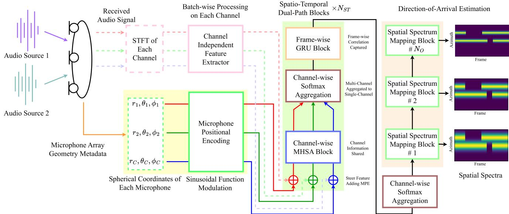  
Fig. 1. Overall architecture of GI-DOAEnet, with the number of channels and speakers set to 3 and 2 for illustration purposes. During both training and inference phases, the microphone array geometry, the location of each microphone in spherical coordinates, is provided as metadata. After combining the audio features wit the microphone positional encodings, $\dot { N } _ { S T }$ spatio-temporal dual-path blocks and spatial spectrum mapping blocks are applied to produce $N _ { O }$ spatial spectra.

Fourier transform (STFT) domain as follows:

$$
Y _ {c, t} (f) = \sum_ {s \in S _ {t}} X _ {c, t} ^ {s} (f) + V _ {c, t} (f),\tag{1}
$$

where f is the frequency bin index, t is the frame index, and $S _ { t }$ is the set of speakers speaking in the frame. Additionally, $X _ { c , t } ^ { s } ( f )$ and $V _ { c , t } ( f )$ are the components of the s-th speaker and the noise of the c-th channel, respectively. To obtain a real-valued feature, the real and imaginary parts of the STFT are concatenated along the frequency dimension. Subsequently, the inputs from all channels are stacked along the channel dimension to form the input feature $\mathbf { Y } ^ { \mathrm { S T F T } } \in \mathbb { R } ^ { C \times 2 F \times T }$ , where $F$ and $T$ are the numbers of frequency bins and frames, respectively. While the STFT input in Cartesian coordinates does not directly encode phase differences that indicate TDOA, the underlying phase relations between channels can be recovered via polar conversion. This implicit representation allows the DNN to indirectly leverage TDOA cues through learning.

## B. Channel Independent Feature Extractor

Instead of using DOA-specialized features like SRP-PHAT or GCC-PHAT, which require computationally expensive microphone pair-wise operations, a channel-independent feature extractor (CIFE) is developed to independently extract latent features from each channel, suitable for DOA estimation via batch-wise processing. Furthermore, to prevent the model from being affected by interference-prone conventional features, we propose using a simple STFT feature as input.

CIFE is composed of an initial normalization layer, an initial ConvBlock (CB), and $N _ { R }$ Residual ConvBlocks (RCBs). For the CIFE input, the channel dimension is permuted to the batch dimension as $\mathbf { Y } ^ { \mathrm { S T F T } } \in \mathbb { R } ^ { ( C ) \times 2 F \times T }$ , and this feature is treated as a 1D feature, where the frequency axis is interpreted as the feature dimension, following a similar approach of [39], [40]. The initial normalization layer is first applied to the input. Next, an initial CB, consisting of a causal 1D CNN layer, an exponential linear unit (ELU) activation [41], and a normalization layer, is applied. The 1D CNN uses a kernel size of 3 and a stride of 1 along the temporal dimension, transforming the feature size to M. This is followed by the ELU activation and an additional normalization layer. Each RCB is composed of two sequential CBs:

\- The first CB is similar to the initial CB but uses a pointwise (kernel size of 1) convolution.

The second CB also resembles the initial CB but uses a depthwise convolution with a feature group size of 1, a kernel size of 3, and a causal dilated convolution. Dilated convolution applies kernels with element-wise gaps determined by dilation factors that are set to $2 ^ { i - 1 }$ , where i is the RCB index, to increase the receptive field and capture long-sequence dependencies.

All CNNs in the RCB maintain the feature size of M, and a residual connection is added between the RCB input and the output of its second CB. Batch normalization [42] is used for all normalization layers within CIFE.

A CIFE module sequence is applied to the input in the batchwise processing to generate the output $\mathbf { Y } ^ { \mathrm { C I F E , o u t } } \in \mathbb { R } ^ { ( C ) \times M \times T }$ Then, it is permuted back to the original channel dimension $\mathbf { Y } ^ { \mathrm { C I F E , o u t } } \in \mathbf { \bar { \mathbb { R } } } ^ { C \times M \times T }$ . As the CIFE modules operate independently on each channel, the following modules are designed to focus on channel-wise correlations, combined with geometric information.

## C. Microphone Positional Encoding

As microphone coordinates are essential for DOA estimation owing to their direct impact on the TDOA, we propose MPEs to provide geometric information to GI-DOAEnet. Unlike methods that concatenate Cartesian coordinates of microphones [13], [15], MPEs employ sinusoidal modulation to encode absolute spherical coordinates, indicating the position of each microphone relative to the origin. This approach follows the original positional encoding method [35], which was initially introduced to distinguish sequence order by modulating sinusoidal functions with sequence indices for MHSA, and further developed in subsequent studies [43], [44], [45]. Positional encoding has been widely adopted in fields such as computer vision [46], [47], [48], [49], [50] for relative position information between patches and audio applications [51], [52] to encode frequency index or order of spectrogram patches.

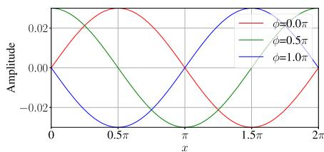  
(a) Phase modulation

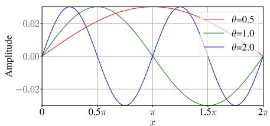  
(b) Frequency modulation

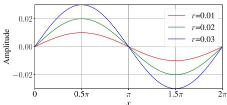  
(c) Amplitude modulation  
Fig. 2. Examples of sinusoidal modulations with $y = r \sin ( \theta \cdot x + \phi )$ . x is the input value with a range of [0, 2π]. The default parameter values are $r = 0 . 0 3 .$ $\theta \stackrel { \sim } { = } 1$ , and $\phi = 0$

Specifically, phase modulation (PM) or frequency modulation (FM) types of MPEs are proposed to encode the microphone positions. The formulation for both MPEs is as follows:

$$
\mathbf {v} = \frac {4}{M} \left[ 0, 1, \dots , \frac {M}{4} - 1 \right] ^ {\top} \in \mathbb {R} ^ {\frac {M}{4}},\tag{2}
$$

$$
\mathcal {P} _ {c} ^ {\mathrm{PM}} = \alpha   r _ {c} \left[ \begin{array}{c} \cos (2 \pi   \beta   \mathbf {v} + \theta_ {c}) \\ \sin (2 \pi   \beta   \mathbf {v} + \theta_ {c}) \\ \cos (2 \pi   \beta   \mathbf {v} + \phi_ {c}) \\ \sin (2 \pi   \beta   \mathbf {v} + \phi_ {c}) \end{array} \right],\tag{3}
$$

$$
\mathcal {P} _ {c} ^ {\mathrm{FM}} = \alpha   r _ {c}   \left[ \begin{array}{l} \cos (\theta_ {c}   \beta   \mathbf {v}) \\ \sin (\theta_ {c}   \beta   \mathbf {v}) \\ \cos (\phi_ {c}   \beta   \mathbf {v}) \\ \sin (\phi_ {c}   \beta   \mathbf {v}) \end{array} \right],\tag{4}
$$

$$
- \pi <   \theta_ {c} \leq \pi , 0 \leq \phi_ {c} \leq \pi , 0 \leq r _ {c},\tag{5}
$$

$$
0 <   \alpha , 0 <   \beta <   \frac {M}{8},\tag{6}
$$

where v is a vector uniformly sampled in the range of [0, 1) with a size of $\textstyle { \frac { M } { 4 } }$ , considering the latent feature size, and  denotes the transpose operation. $\mathcal { P } _ { c }$ is the MPE of the c-th channel, where the superscripts denote the modulation type, PM or FM. $r _ { c } , \theta _ { c } ,$ and $\phi _ { c }$ are the distance, azimuth, and elevation of the c-th microphone in spherical coordinates, respectively. These coordinates naturally fall within the ranges specified in (5). α and $\beta$ are used for amplitude and frequency scaling, respectively. They are set as (6) to ensure distinguishability and mitigate aliasing effects in the sinusoidal functions, thereby providing unique MPEs for each microphone position.

As shown in Fig. 2, PM adjusts the sinusoidal functions by adding $\theta _ { c }$ or $\phi _ { c }$ to $2 \pi \beta \mathbf { v } ,$ , altering the phase that shifts them along the sample-wise direction. Similarly, FM scales ${ \beta \mathbf { v } }$ by multiplying $\theta _ { c }$ or $\phi _ { c } ,$ , adjusting the oscillatory rate of the sinusoidal functions. Amplitude modulation (AM) controls the amplitude of the sinusoidal functions by scaling $r _ { c } .$ With these methods, MPEs do not require learnable parameters and guarantee that different microphone coordinates remain unique. Additionally, the MPEs of different channels exhibit a linear relationship and are determined solely by relative coordinates, rather than absolute positions, as verified in the Appendix. Furthermore, MPEs offer flexibility in terms of vector size, expanding from 3D coordinates to $M ,$ allowing them to be combined with latent features using various operations such as addition or concatenation. For GI-DOAEnet, each $\mathcal { P } _ { c }$ is stacked to form $\mathcal { P } \in \mathbb { R } ^ { C \times M }$ . Then, it is used to explicitly provide geometric information along with latent features from the CIFE.

## D. Spatio-Temporal Dual-Path Block

Latent features from the signals, $\mathbf { Y } ^ { \mathrm { C I F E , o u t } }$ , and MPEs, , are fed into the spatio-temporal dual-path blocks (STDPBs) to capture channel- and frame-wise correlations. STDPBs employ a dual-path processing approach [53] designed to sequentially capture correlations across different tensor dimensions. Specifically, dual-path processing alternates processing between specific dimensions while treating others as unaffected batches, a process known as batch-wise processing. This approach ensures comprehensive processing across channels and frames. It was further developed in subsequent research for multichannel applications [24], [25], [26], [27], [28], [29] to handle multi-dimensional tensors with different numbers of channels effectively.

Multiple STDPBs are stacked to configure the model, where $N _ { \mathrm { S T } }$ denotes the number of these blocks. They are sequentially applied to the input features to iteratively gather spatial and temporal information by transforming the feature dimensions at each step. Each STDPB consists of a CW-MHSA block, a CWSA, and an FW-GRU block, depicted in Fig. 3. First, MPEs are added to the input feature, and the dimensions are permuted as follows:

$$
\mathbf {Y} _ {c, t} ^ {\text { steered }} \leftarrow \mathbf {Y} _ {c, t} ^ {\text { MHSA,in }} + \mathcal {P} _ {c},\tag{7}
$$

$$
\mathbf {Y} ^ {\text { steered }} \in \mathbb {R} ^ {(T) \times C \times M} \leftarrow \mathbf {Y} ^ {\text { steered }} \in \mathbb {R} ^ {C \times M \times T},\tag{8}
$$

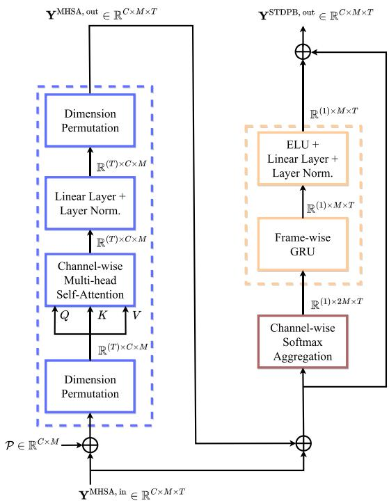  
(a) CW-MHSA block  
(b) FW-GRU block  
Fig. 3. Architecture of the spatio-temporal dual-path block.

where $\mathbf { Y } _ { c , t } ^ { \mathrm { { M H S A } , i n } }$ is the CW-MHSA block input. Initially, $\mathbf { Y } ^ { \mathrm { C I F E , o u t } }$ serves as the input, and the subsequent blocks use the output of the previous STDPB, $\mathbf { Y } ^ { \mathrm { { S T D P B , o u t } } } . \mathcal { P } _ { c }$ steers the input feature per channel to incorporate the geometric information. The dimension of tensor $\mathbf { Y } ^ { \mathrm { s t e e r e d } }$ is permuted, as shown in (8), to apply the CW-MHSA block to each frame in the batch-wise processing.

CW-MHSA is designed to capture channel-wise correlations within the latent space of $\mathbf { Y } ^ { \mathrm { s t e e r e d } }$ by using the MHSA operation:

$$
\mathbf {Q} _ {t} \leftarrow \mathbf {L} _ {Q} \left(\mathbf {Y} _ {t} ^ {\mathrm{steered}}\right),\tag{9}
$$

$$
\mathbf {K} _ {t} \leftarrow \mathbf {L} _ {K} \left(\mathbf {Y} _ {t} ^ {\text { steered }}\right),\tag{10}
$$

$$
\mathbf {V} _ {t} \leftarrow \mathbf {L} _ {V} \left(\mathbf {Y} _ {t} ^ {\text { steered }}\right),\tag{11}
$$

$$
\mathbf {A} _ {t} \leftarrow \text { Softmax } \left(\frac {\mathbf {Q} _ {t} \mathbf {K} _ {t} ^ {\top}}{\sqrt {M}}\right) \mathbf {V} _ {t},\tag{12}
$$

where $\mathbf { Q } _ { t } , \mathbf { K } _ { t } ,$ and $\mathbf { V } _ { t }$ represent the query, key, and value matrices, respectively, projected from $\mathbf { Y } _ { t } ^ { \mathrm { s t e e r e d } }$ using linear layers $\mathbf { L } _ { Q } , \mathbf { L } _ { K }$ , and $\mathbf { L } _ { V }$ . These matrices are segmented into $N _ { H }$ heads, and the CW-MHSA is applied independently to each head. The outputs from all heads are concatenated to form ${ \bf A } _ { t }$ . This output is processed further:

$$
\mathbf {Y} _ {t} ^ {\mathrm{MHSA,out}} \leftarrow \mathbf {L N} _ {A} \left(\mathbf {L} _ {A} \left(\mathbf {A} _ {t}\right)\right),\tag{13}
$$

$$
\mathbf {Y} ^ {\text { MHSA,   out }} \in \mathbb {R} ^ {C \times M \times T} \leftarrow \mathbf {Y} ^ {\text { MHSA,   out }} \in \mathbb {R} ^ {(T) \times C \times M},\tag{14}
$$

$$
\mathbf {Y} _ {t} ^ {\text { CWSA }} \leftarrow \mathbf {Y} _ {t} ^ {\text { MHSA,   out }} + \mathbf {Y} _ {t} ^ {\text { MHSA,   in }},\tag{15}
$$

where $\mathbf { L } _ { A }$ and $\mathbf { L N } _ { A }$ , respectively, denote the linear and layer normalization [54] layers applied across the feature dimension.

After processing, $\mathbf { Y } ^ { \mathrm { M H S A } , }$ out is permuted back to the same dimensions as $\mathbf { Y } ^ { \mathrm { { M H S A , i n } } }$ , denoted in (14), and added to the input, resulting in $\mathbf { Y } ^ { \mathrm { C W S A } }$ . Incorporating MPE into the CW-MHSA block ensures the acquisition of channel-wise correlations along with microphone coordinates, thereby enabling DOA estimation with enriched spatial information within the latent space. Moreover, as the CW-MHSA is a permutation-invariant operation, the channel order does not affect the output, thereby preserving geometric invariance.

After the CW-MHSA blocks, a CWSA and an FW-GRU block are followed to capture the frame-wise correlations. CWSA is introduced to aggregate the CW-MHSA block output into a single channel, thereby enhancing the computational efficiency. This process is expressed as follows:

$$
\mathbf {Y} _ {t} ^ {\text { Softmax }} \leftarrow \text { Softmax } \left(\mathbf {Y} _ {t} ^ {\text { CWSA }}\right) \odot \mathbf {Y} _ {t} ^ {\text { CWSA }},\tag{16}
$$

$$
\mathbf {Y} _ {t} ^ {\mathrm{sum}} \leftarrow \sum_ {c = 1} ^ {C} \mathbf {Y} _ {c, t} ^ {\mathrm{Softmax}},\tag{17}
$$

$$
\mathbf {Y} _ {t} ^ {\text {std}} \leftarrow \sqrt {\frac {1}{C - 1} \sum_ {c = 1} ^ {C} \left(\mathbf {Y} _ {c , t} ^ {\text {Softmax}} - \frac {\mathbf {Y} _ {t} ^ {\text {sum}}}{C}\right) ^ {2}},\tag{18}
$$

$$
\mathbf {Y} _ {t} ^ {\text { GRU,in }} \leftarrow \left[ \begin{array}{c} \mathbf {Y} _ {t} ^ {\text { sum }} \\ \mathbf {Y} _ {t} ^ {\text { std }} \end{array} \right] \in \mathbb {R} ^ {(1) \times 2 M}.\tag{19}
$$

The Softmax function is initially applied along the channel dimension, emphasizing the varying importance of each channel. Subsequently, element-wise multiplication, denoted by $\odot ,$ with $\mathbf { Y } ^ { \mathrm { { C W S A } } }$ , produces $\mathbf { Y } ^ { \mathrm { S o f t m a x } }$ $\mathbf { Y } _ { t } ^ { \mathrm { s u m } }$ and $\mathbf { Y } _ { t } ^ { \mathrm { s t d } }$ represent the sum and standard deviation of $\mathbf { Y } _ { t } ^ { \mathrm { S o f t m a x } }$ across the channel dimension, respectively, providing insights into aggregated and differentiated channel information. Finally, $\mathbf { Y } _ { t } ^ { \mathrm { G R U , i n } }$ is formed by stacking $\mathbf { Y } _ { t } ^ { \mathrm { s u m } }$ and $\mathbf { Y } _ { t } ^ { \mathrm { s t d } }$ , which serve as inputs for the subsequent GRUs. These operations reduce the tensor size from $C$ channels to a single channel, thus enhancing computational efficiency. Importantly, all operations from (16) to (19) are permutation-invariant, ensuring that the channel order does not affect the output.

YGRU, in $\mathrm { i s }$ fed into the causal uni-directional $N _ { G }$ GRUs to capture the frame-wise correlation with input and output feature sizes of 2M and $M ,$ , respectively. These operations are expressed as follows:

$$
\mathbf {Y} ^ {\text { GRU,out }} \leftarrow \mathbf {L N} _ {G} \left(\mathbf {L} _ {G} \left(\text { ELU } \left(\text { GRU } \left(\mathbf {Y} ^ {\text { GRU,in }}\right)\right)\right)\right),\tag{20}
$$

$$
\mathbf {Y} _ {c} ^ {\text { STDPB,   out }} \leftarrow \mathbf {Y} ^ {\text { GRU,   out }} + \mathbf {Y} _ {c} ^ {\text { CWSA }},\tag{21}
$$

where the ELU function is applied to the GRU output, followed by a linear layer $\mathbf { L } _ { G }$ and a layer normalization $\mathbf { L N } _ { G }$ . The FW-GRU block output, $\mathbf { Y } ^ { \mathrm { G R U , o u t } }$ , is then added to $\mathbf { Y } _ { c } ^ { \mathrm { C W S A } }$ by using a residual connection to produce $\mathbf { Y } _ { c } ^ { \mathrm { S T D P B , o u t } }$ . The final STDPB block integrates frame-wise channel correlations acquired through repeated dual-path processing of the input features. CW-MHSA captures channel-wise correlations, whereas FW-GRU captures frame-wise correlations, ensuring comprehensive processing of the input features. The output is further processed using the captured spatio-temporal correlations to generate spatial spectra.

TABLE I  
OVERALL CONFIGURATION OF GI-DOAENET WITH INPUT AND OUTPUT SIZES OF EACH MODULE

<table><tr><td>Module</td><td>#</td><td>Submodule</td><td>Configuration</td><td>Input size</td><td>Output size</td></tr><tr><td rowspan="4">Channel-Independent Feature Extractor</td><td rowspan="4">1</td><td>Init. Batch Norm.</td><td>Batch Norm.</td><td> $(C) \times 2F \times T$ </td><td> $(C) \times 2F \times T$ </td></tr><tr><td>Init. ConvBlock</td><td>ID CNN $(k=3,l=1)$ + Batch Norm. + ELU</td><td> $(C) \times 2F \times T$ </td><td> $(C) \times M \times T$ </td></tr><tr><td>Res. ConvBlock</td><td>ID CNN $(k=1,l=1)$ + Batch Norm. + ELU</td><td> $(C) \times M \times T$ </td><td> $(C) \times M \times T$ </td></tr><tr><td> $\times N_R$ </td><td>ID CNN $(k=3,l=i-1)$ + Batch Norm. + ELU</td><td> $(C) \times M \times T$ </td><td> $(C) \times M \times T$ </td></tr><tr><td rowspan="3">Spatio-Temporal Dual-Path Block</td><td rowspan="3"> $N_{ST}$ </td><td>CW-MHSA</td><td>MHSA + Lin. Layer + Layer Norm.</td><td> $(T) \times C \times M$ </td><td> $(T) \times C \times M$ </td></tr><tr><td>CWSA</td><td>Softmax + Sum &amp; Standard deviation</td><td> $C \times M \times T$ </td><td> $(1) \times 2M \times T$ </td></tr><tr><td>FW-GRU</td><td>GRU $\times N_G$ + ELU + Lin. layer + Layer Norm.</td><td> $(1) \times 2M \times T$ </td><td> $(1) \times M \times T$ </td></tr><tr><td>CWSA</td><td>1</td><td>CWSA</td><td>Softmax + Sum &amp; Standard deviation</td><td> $C \times M \times T$ </td><td> $2M \times T$ </td></tr><tr><td rowspan="3">Spatial Spectrum Mapping Block</td><td rowspan="3"> $N_O$ </td><td rowspan="2">Res. ConvBlock</td><td>ID CNN $(k=1,l=1)$ + Layer Norm. + ELU</td><td> $2M \times T$ </td><td> $2M \times T$ </td></tr><tr><td>ID CNN $(k=3,l=i-1)$ + Layer Norm. + ELU</td><td> $2M \times T$ </td><td> $2M \times T$ </td></tr><tr><td>Mapping Layer</td><td>Lin. Layer w/o Bias + Sigmoid</td><td> $2M \times T$ </td><td> $D \times T$ </td></tr></table>

## E. Spatial Spectrum Mapping Block

The final STDPB output is processed by spatial spectrum mapping blocks (SSMBs) to generate multiple spatial spectra by adopting a deep supervision (DS) approach for DOA estimation [5], as shown in the rightmost side of Fig. 1. Initially, the input is aggregated into a single channel using the CWSA, resulting in a feature size of 2M. Next, the output is passed through $N _ { O }$ SSMBs, where $N _ { O }$ is the number of output spectra. Each SSMB consists of an RCB, a linear layer without bias, and a Sigmoid function. The RCB structure mirrors that of the CIFE, but with a layer normalization layer instead of batch normalization, and the input and output feature sizes are 2M, corresponding to the CWSA output. The output from each RCB is sequentially fed into the subsequent SSMB’s RCB. Simultaneously, the output from each RCB is passed through a linear layer that projects the feature size from 2M to D, followed by a Sigmoid function to constrain the output values between 0 and 1. Here, D denotes the number of uniformly divided candidate azimuth angles covering the entire range [0, 2π). These output values form what we refer to as spatial spectra, which describe the distribution of signal energy across the D candidate directions for each time frame. In practice, the spatial spectrum serves as an angular heatmap, where peaks indicate the most likely DOAs. During training, the output spectra are compared with the reference spectra using the training strategy described in Section III-B. In the inference phase, the spectrum obtained from the last SSMB is decoded to determine the DOA for each frame through an iterative peak selection process, as elaborated in [5].

A comprehensive overview of the GI-DOAEnet configuration is provided in Table I, where k is the kernel size and l is the dilation factor with the block index i of each RCB.

## III. COMPLEXITY GRADUAL TRAINING STRATEGY

As the proposed GI-DOAEnet is designed for DOA estimation with various geometries, we initially attempted to train the model from scratch with diverse geometries. However, the training loss did not converge appropriately, highlighting the complexity of this task. The model’s dual nature, which estimates DOAs while using the geometric information provided by the MPEs, further complicates this process. To address this issue, based on our previous study [5], we propose a CGT strategy in which the model is trained effectively through multiple stages with diverse MAs and varying soft labels, thereby gradually increasing the task difficulty.

## A. Multi-Stage Geometry Learning

GI-DOAEnet struggled to converge when trained from scratch using various MAs. To address this issue, we propose an MSGL approach comprising three stages, designed to train the model progressively on varying geometries.

Stage 1: Train the model with a single MA type, focusing on straightforward configurations to ensure initial convergence on DNN parameters suitable for DOA estimation.

Stage 2: Expand the geometries from static to dynamic, with different positions, but maintaining the same number of microphones as in the first stage. This stage aims to teach the model how to use the MPEs effectively with a restricted number of microphones.

Stage 3: Train the model with dynamic MAs featuring varying numbers ofmicrophones, introducing complexity by adapting to a wide range of geometries commonly encountered in practical applications.

Each stage employs specific initial learning rates and weight decays tailored to the model parameters to ensure adequate training and mitigate overfitting risks. For the second and third stages, the microphones are dynamically placed in a 3D space, ensuring that the distances between microphone pairs fall within the ranges of $R _ { \mathrm { m i n } }$ and $R _ { \operatorname* { m a x } } ,$ which are minimum and maximum distance ranges between microphones, respectively. The exact parameterization of these ranges used in the experiments is provided in (25). These ranges are designed to prevent configurations where microphones are placed too closely, which could lead to indistinguishable TDOA, or too far apart, which may cause spatial aliasing at high frequencies, thereby degrading DOA estimation performance. Additionally, as the $C$ increases, the lower bound of $R _ { \mathrm { m i n } }$ is decreased and the upper bound of $R _ { \mathrm { m a x } }$ is increased, providing greater geometric design flexibility of larger MAs. These settings are empirically determined based on experimental results and inspired by the configurations of widely used MAs [37], [38]. Furthermore, the origin of the coordinate system is set at the center of the MA, and the microphone positions are slightly adjusted along the $x \cdot , y \cdot$ , and z-axes, each randomly selected from the $R _ { \mathrm { o r i g i n } }$ with a uniform distribution.

## B. Deeply Supervised Curriculum Learning With Soft Labels

To train the proposed GI-DOAEnet in line with the CGT strategy, we combined the MSGL with the DSCL approach [5]. The DSCL approach uses a soft label as the training objective, assigning peak and decreased values to the target and nearby azimuths. With this label, the DSCL is designed to train models from easier but ambiguous labels to harder but more distinct labels. A soft label is formed as follows:

$$
g \left(t, \gamma_ {o}\right) = \left\{ \begin{array}{l l} \max _ {\psi^ {\prime} \in \Psi_ {t}} \left\{e ^ {\kappa (\gamma_ {o}) (\cos \left(d (\psi , \psi^ {\prime})\right) - 1)} \right\}, & \text { if } | \Psi_ {t} | > 0, \\ 0, & \text { otherwise }, \end{array} \right.\tag{22}
$$

$$
d \left(\psi , \psi^ {\prime}\right) = \operatorname{abs} \left(\psi - \psi^ {\prime}\right),\tag{23}
$$

$$
\kappa (\gamma) = \frac {- \ln {\sqrt {2}}}{\cos \gamma - 1},\tag{24}
$$

where $\gamma _ { o }$ is the parameter controlling the beamwidth of the $O -$ th layer target. To avoid ambiguity due to the periodicity of the cosine function, $\gamma _ { o }$ is constrained within the range [0, 180] degrees. $\Psi _ { t }$ is the set of target azimuths for the t-th frame of the active speakers, and ψ is the vector of candidate azimuths with a size of $D . | \cdot |$ denotes the cardinality of the set, and the absolute angular distance between the target and candidate is calculated using (23). The gain function $g ( \cdot )$ is designed to assign 3 dB to angular distance $\gamma _ { o }$ based on the beamwidth definition [55].

For larger $\gamma ,$ the beamwidth becomes wider, assigning larger values to the target vicinities, smoothing the spectrum, and providing more spatial relationships between the target and the other azimuths. Wider beamwidths facilitate faster and more robust learning but result in a less distinct peak. Conversely, for smaller $\gamma ,$ the beamwidth becomes narrower, assigning smaller values to the nearby areas from the target direction, making it harder to learn but focusing more accurately on the peak. Examples of soft labels with different γ values are shown on the rightmost side of Fig. 1.

With these properties, the DSCL comprises two components: DS and curriculum learning (CL). DS is applied using different $\gamma _ { o }$ values for the corresponding layer depths to provide diverse spatial relationships simultaneously. CL is implemented by decreasing $\gamma _ { o }$ as training progresses, changing the target from a wider to narrower beamwidth, and gradually increasing the task difficulty while inducing the model output to focus on the peak spatial spectra. Specifically, $\gamma _ { o }$ is initialized with $\gamma _ { o } ^ { \mathrm { i n i t } }$ , subtracted by a specific value until it reaches $\gamma _ { o } ^ { \mathrm { e n d } }$ , and then fixed until the end of training.

Adopting the DSCL approach, GI-DOAEnet produces multiple spatial spectra in a DS manner. Furthermore, CL begins after a few epochs spent in the third MSGL stage, ensuring that the model parameters are optimized to execute the DOA estimation initially while producing peak-focused spatial spectra at the end. In conclusion, the CGT strategy, which comprises MSGL and DSCL, ensures that GI-DOAEnet is effectively trained to execute DOA estimation with diverse geometries by incrementally increasing the complexity of tasks.

## IV. EXPERIMENTAL SETUP

## A. Proposed and Baseline Model Implementation

For the STFT of GI-DOAEnet, a Hann window with 512 samples and a hop size of 128 samples were used. $F$ was set to 257, corresponding to the number of unique frequency bins from a

TABLE II  
MULTI-STAGE GEOMETRY LEARNING PARAMETERS

<table><tr><td>Stage</td><td>Microphone Array</td><td>Learning Rate (δ)</td><td>Weight Decay (λ)</td><td>Epoch</td></tr><tr><td>1</td><td>Respeaker 4-channel</td><td> $2.5 \times 10^{-4}$ </td><td> $1.0 \times 10^{-4}$ </td><td>1–5</td></tr><tr><td>2</td><td>Dynamic 4-channel</td><td> $5.0 \times 10^{-4}$ </td><td> $1.0 \times 10^{-6}$ </td><td>6–10</td></tr><tr><td>3</td><td>Dynamic 4–12-channel</td><td> $1.0 \times 10^{-3}$ </td><td> $1.0 \times 10^{-6}$ </td><td>11–300</td></tr></table>

512-point STFT of real-valued signals. The GI-DOAEnet hyperparameters were set as follows: $M = 1 2 8 ; N _ { R } = 4 ; N _ { S T } = 4 ;$ $N _ { H } = 1 6 ; N _ { G } = 2 ; N _ { O } = 3 ; \alpha = 7 ;$ and $\beta = 4 . D$ was set to 360 for all DNN-based models, which resulted in an azimuth resolution of 1◦. With these settings and a sampling rate of 16 kHz, the algorithmic latency, determined solely by the STFT hop size, was 128 samples (8 ms), which can be adjusted by modifying the hop size. To ensure reliable predictions, the GI-DOAEnet requires at least 46 frames (392 ms), which corresponds to the sum of the receptive field of the CNNs. Additionally, more frames can be used to enhance performance, as the GRU layers can process longer sequences.

In this study, MUSIC [4], SRP-PHAT [3], CRNN [5], Unet [15], and Neural-SRP [17] were used as the baselines. All were causal systems and employed the same settings as the STFT of GI-DOAEnet, resulting in a latency of 8 ms. For MUSIC and SRP-PHAT, the azimuth and elevation were equally divided into 32 and 16 points, respectively, and the maximum points were selected for DOA estimation. CRNN [5] was used to compare the performance of the model trained with only a single C-channel MA. We used $\mathrm { C R N N _ { 4 } }$ and $\mathrm { C R N N } _ { 1 2 }$ to compare the performance with a 4-channel MA, ReSpeaker,2 and 12-channel NAO robot,3 which were used to record the real datasets in [37] and the LOCATA Challenge [38], respectively. The Unet used the SRP-PHAT as the input feature. We constructed a model similar to that in [15]; however, due to the 3D MA geometries, which differ from the linear ones used in [15], the azimuth and elevation dimensions were flattened before being fed into the Unet. The outputs of the last $N _ { O }$ blocks of Unet were fed to each linear layer and a Sigmoid function to estimate the spatial spectra, resembling the SSMBs of GI-DOAEnet, to apply the DSCL. For Neural-SRP [17], we used an open-source $\mathrm { c o d e ^ { 4 } }$ and modified the regression estimator to the SSMBs of the GI-DOAEnet. All the DNN-based methods were trained with a batch size of16, except for Neural-SRP, which was set to 1 due to the computational memory constraints of the graphic processing unit (GPU), which is further discussed in Section V-D.

## B. Complexity Gradual Training Strategy Settings

The MSGL settings are listed in Table II. In the first stage, the ReSpeaker geometry was used as a fixed MA configuration. The second stage involved training with a dynamically configured 4- channel MA, maintaining the same number of microphones as in the first stage while diversifying the array geometries. In the third stage, the number of channels was increased to 12, matching the configuration ofthe NAO robot. To emphasize the importance of the third stage, the number of training epochs in the first and second stages was minimized. Nevertheless, each stage was ensured to reach a sufficient level of convergence, which was empirically achieved within 5 epochs. The initial learning rates were set to smaller values in the first stage and gradually increased in the subsequent stages, enabling smooth adaptation in the early stages. The weight decay values were set higher in the first stage to avoid overfitting to a single MA geometry, and reduced in the second and third stages to effectively accommodate dynamic MAs. Although these hyperparameters had a limited impact on the final performance, they were empirically tuned to ensure stable and consistent training. The experimental ranges for the minimum and maximum microphone pair distances, denoted as $R _ { \mathrm { m i n } }$ and $R _ { \mathrm { m a x } }$ , were set in centimeters as follows:

$$
\begin{array}{l} R _ {\min} = \left[ \max \left(1, 4 - 3 \cdot \frac {C - C _ {\min}}{C _ {\max} - C _ {\min}}\right), 6 \right], \\ R _ {\max} = \left[ 7, \max \left(7, 9 + 4 \cdot \frac {C - C _ {\min}}{C _ {\max} - C _ {\min}}\right) \right], \end{array}\tag{25}
$$

where $C _ { \mathrm { m i n } }$ and $C _ { \mathrm { m a x } }$ were set to 4 and 12, respectively, corresponding to the minimum and maximum number of microphones used in the experiments. Additionally, $R _ { \mathrm { o r i g i n } }$ was set to $[ - 0 . 5 , \ 0 . 5 ]$ cm.

For the DSCL settings, the $\gamma _ { o } ^ { \mathrm { i n i t } } \mathrm { s }$ were set to [ 16, 6, 2.5 ], and $\gamma _ { o } ^ { \mathrm { e n d } } \mathrm { s }$ were uniformly set to 2.5 across all final output layers. The CL involved fixing $\gamma _ { o } ^ { \mathrm { i n i t } } \mathrm { s }$ until the 20-th epoch to anneal the model parameters with a larger beamwidth, followed by a reduction until reaching $\gamma _ { o } ^ { \mathrm { e n d } } \mathrm { s }$ by the 45-th epoch. The binary cross-entropy loss between the target and output was calculated and summed for each layer. Ifthe validation loss did not decrease for two consecutive epochs, a learning rate scheduler reduced the learning rate by multiplying 0.9 to the current learning rate. Back-propagation was performed to update the model parameters using the Adam optimizer [56], and the gradient clipping was set to 1. The model that exhibited the best performance on the validation set was selected for the evaluation.

## C. Training Dataset

Both training and validation sets were generated using synthetic datasets that included anechoic speech, noise, and synthetic room impulse responses (RIRs) to train the DNNs. For the anechoic speech dataset, we used Librispeech [57] with train-clean-100 for training and test-clean for validation. For coherent noise, which is a directional noise source, we used MS-SNSD [58] with train for training and test for validation. Synthetic white noise generated from a Gaussian distribution was used as spatially uncorrelated noise at each microphone. We used the gpuRIR toolkit [59] to generate the synthetic RIRs. The image source method [60] was applied from the beginning to an attenuation power of 12 dB from the RIR peak, and the diffused reverberation model was used from 12 to

TABLE III  
SYNTHETIC DATASET GENERATION PARAMETERS

<table><tr><td>Parameter</td><td>Interval</td><td>Unit</td></tr><tr><td>SNR between noise &amp; speaker</td><td>[-5, 30]</td><td>dB</td></tr><tr><td>SIR between utterances</td><td>[-5, 5]</td><td>dB</td></tr><tr><td>SIR between noises</td><td>[-15, 15]</td><td>dB</td></tr><tr><td>RT60</td><td>[0.2, 1.3]</td><td>s</td></tr><tr><td>Room Size</td><td> $[3 \times 3 \times 2.5, 10 \times 8 \times 6]$ </td><td> $m^3$ </td></tr><tr><td>Distance</td><td>[0.3, 2.5]</td><td>m</td></tr><tr><td>Azimuth</td><td>[0, 360)</td><td>°</td></tr><tr><td>Elevation</td><td>[30, 150]</td><td>°</td></tr></table>

40 dB, with omni-directional microphone settings. All datasets were resampled to 16 kHz.

The synthetic dataset generation parameters selected from a uniform distribution are listed in Table III. The room size and RT60 were randomly selected. The MA configuration corresponded to the MSGL stages. Each batch was configured with the same number of channels if the MA type was dynamic. The microphone coordinates were randomly selected to ensure that the distances between them adhered to (25). The MA was randomly set in the room, maintaining a minimum distance of 0.1 m from the walls, and randomly rotated to ensure environmental diversity.

Setting $N _ { S }$ as 2, multiple anechoic utterances from different speakers were randomly selected from the dataset. The presence of utterances in each frame was determined using the WebRTC voice activity detection (VAD) tool.5 One coherent noise was randomly selected from the coherent noise dataset, and white noise was generated for each channel. All speech and noise were trimmed or padded to fit a 4 s length. Speaker positions were randomly selected in the room with the distance, azimuth, and elevation parameters selected from Table III. The minimum azimuth angular distance between speakers was set to 10◦. At elevations close to the poles of the sphere, the azimuth becomes indistinguishable because of the convergence of the longitudinal lines; therefore, the elevation was limited. The coherent noise was positioned anywhere in the room, apart from the MA, by at least 2.5 m.

The RIRs for utterances and coherent noise were generated using the abovementioned parameters and convolved with the corresponding signals. The first utterance served as a reference, and the signal-to-interference ratio (SIR) between randomly selected speakers was mixed with the reference. Additionally, the SIR between the noises was randomly chosen and mixed to create the final noise. Finally, the signal-to-noise ratio (SNR) between the reference utterance and noise was determined. Training datasets were generated on the fly, with different datasets created for each epoch during training, for a total of 28,000 noisy utterances per epoch.

Four sets were generated for validation. The first set was generated with ReSpeaker, which was used for CRNN4, and the first MSGL stage. The second set was generated using the NAO Robot used for $\mathrm { C R N N } _ { 1 2 }$ . The third set was generated using a random 4-channel MA, which was used for the second MSGL stage. Finally, the fourth set was generated with random 4–12-channel MAs used for the third MSGL stage. All four sets were generated using the same method but with different utterances and noise. From the first to the third sets, 2,000 utterances were generated, while 300 utterances were generated for each channel in the fourth set.

TABLE IV  
EVALUATION DATASET CONFIGURATION

<table><tr><td>Dataset</td><td>Type</td><td>Mic. Array</td><td># channels</td><td># speakers</td></tr><tr><td>LOCATA [38]</td><td>Real</td><td>NAO robot</td><td>12</td><td>1-2</td></tr><tr><td>RSL Dev [37]</td><td>Real</td><td>ReSpeaker</td><td>4</td><td>1</td></tr><tr><td>RSL Eval [37]</td><td>Real</td><td>ReSpeaker</td><td>4</td><td>1</td></tr><tr><td>NAO Robot</td><td>Synth.</td><td>NAO robot</td><td>12</td><td>1-2</td></tr><tr><td>ReSpeaker</td><td>Synth.</td><td>ReSpeaker</td><td>4</td><td>1-2</td></tr><tr><td>Dynamic</td><td>Synth.</td><td>Dynamic</td><td>4-12</td><td>1-2</td></tr></table>

## D. Evaluation Dataset

The proposed and baseline methods were compared using both the real and synthetic datasets. The configurations of each evaluation dataset are listed in Table IV.

Real Datasets: LOCATA, RSL Dev, and RSL Eval were used. LOCATA includes selected recordings from the LOCATA challenge dataset [38], which were recorded with the NAO robot MA in an RT60 = 0.55 s environment. Task 1 involved one active speaker, and Task 2 involved two active speakers. The RSL2019 dataset [37] was recorded using ReSpeaker, and the development and evaluation sets were used as RSL Dev and RSL Eval, respectively. RSL Dev was recorded in a natural environment characterized by minimal noise and reverberation, while RSL Eval was recorded in a natural environment with noticeable noise and reverberation. The VAD results for RSL Dev and RSL Eval were obtained using the WebRTC VAD tool.

Synthetic Datasets: The test set of the TIMIT corpus [61] was used to provide anechoic speech data, and the ESC-50 dataset [62] was used for coherent noise. These datasets were generated following the same configurations used for the synthetic training dataset generation but with different anechoic speech and coherent noise sources. NAO Robot and ReSpeaker, each comprising 2,000 utterances, were generated with the NAO robot and ReSpeaker MA, respectively, to evaluate the performance with the widely used MAs. Dynamic, comprising 300 utterances, was generated using dynamically positioned 4–12-channel MAs to evaluate the performance with various MAs.

## E. Evaluation Metrics

The model performance was evaluated using the mean absolute error (MAE) and accuracy $( \mathrm { A C C _ { 1 0 } } )$ of the DOA estimates. While identifying the number of active speakers is an important task, this study focused solely on the DOA estimation performance. Consequently, the number of active speakers was obtained from the VAD results for each utterance.

The MAE was calculated to evaluate the angular distance between the estimated and ground-truth DOAs, with lower values indicating better performance. For each utterance, the MAE was calculated as follows:

$$
\mathrm{MAE} \left(^ {\circ}\right) = \frac {1 8 0}{\pi} \frac {1}{| \mathbf {T} _ {\mathrm{act}} |} \sum_ {t \in \mathbf {T} _ {\mathrm{act}}} \frac {1}{S _ {t}} \min _ {p \in P _ {t}} \sum_ {s = 1} ^ {S _ {t}} d \left(\psi_ {s}, \hat {\psi} _ {p (s)}\right),\tag{26}
$$

where $\mathbf { T } _ { \mathrm { a c t } }$ is the set of frames with active speakers, $S _ { t }$ is the number of active speakers in the t-th frame, and $P _ { t }$ is the permutation set in $S _ { t } , \psi _ { s }$ represents the ground truth DOA of the s-th speaker, and $\hat { \psi } _ { p ( s ) }$ is the estimated DOA of the s-th speaker according to permutation $p .$ . The permutations with the minimum sum of absolute angular distances, (23), were selected.

The $\mathrm { { A C C } _ { 1 0 } }$ was defined as the percentage of frames in which the MAE is within a threshold compared to the ground truth, with higher values indicating better performance. The $\mathrm { { A C C } _ { 1 0 } }$ for each utterance is computed as follows:

$$
\mathrm{ACC} _ {1 0} (\%) = \frac {\left| \mathbf {T} _ {\mathrm{acc}} \right|}{\left| \mathbf {T} _ {\mathrm{act}} \right|} \times 1 0 0,\tag{27}
$$

where $\mathbf { T } _ { \mathrm { a c c } }$ denotes the set of frames in which the MAE of each frame was within a threshold of 10◦. The MAE and $\mathrm { { A C C } _ { 1 0 } }$ results were averaged over each evaluation dataset and analyzed to compare the model performance.

## V. RESULTS AND DISCUSSIONS

## A. Evaluation Results on Various Datasets

1) Performance of Baseline Methods: Table V presents the overall evaluation results for MAE and $\mathrm { { A C C } _ { 1 0 } }$ across the datasets and methods. Among the conventional methods, SRP-PHAT exhibited the worst performance across all datasets, followed by MUSIC. Both of these methods showed relatively better performance on the real datasets than on the synthetic datasets due to the challenging conditions in the latter. Notably, they showed similar results for RSL Dev, which has low noise and reverberation and involves a single speaker, compared to DNN-based methods, but not for other datasets. These results indicate that the conventional methods were more vulnerable to interference. CRNNs were not evaluated on some datasets owing to mismatched geometries. The results on the synthetic datasets significantly outperformed those of the other methods. For the real datasets, the CRNNs achieved the best performance in terms of $\mathrm { { A C C } _ { 1 0 } }$ for LOCATA and RSL Dev, but GI-DOAEnets performed better in terms of MAE on these datasets and RSL Eval. This suggests that training with diverse geometries helps generalize the real dataset performance.

For Unet and Neural-SRP, the first row in Table V for each model shows the results for the model trained without DSCL and with the third MSGL stage. The second row retains the same settings as the first but includes the DSCL. The third row is similar to the second but includes the full MSGL stages. For Unet, the DSCL improved the performance on the synthetic datasets but decreased it mostly on the real datasets. When MSGL was applied along with DSCL, the performance improved across all datasets, except for the MAE of RSL Eval. For Neural-SRP, applying the DSCL improved the performance on all datasets. Notably, the $\mathrm { { A C C } _ { 1 0 } }$ of the RSL Dev of the Neural-SRP with DSCL reached 98.90%, the best among geometry-invariant methods. When MSGL was also applied, the $\mathrm { { A C C } _ { 1 0 } }$ performance ofLOCATA and the MAE ofRSL Dev degraded; however, the synthetic datasets improved compared with the first row. Compared with the second row, the performance on the real datasets decreased, but it improved on the synthetic datasets. This demonstrates that the CGT strategy containing DSCL and MSGL was effective for both models on most datasets.

TABLE V  
EXPERIMENTAL RESULTS ON EACH EVALUATION DATASET. MAE (◦) AND ACC (%) WERE USED AS EVALUATION METRICS. THE BEST RESULTS ON EACH DATASET ACHIEVED WITH GEOMETRY-INVARIANT METHODS ARE INDICATED IN BOLD.

<table><tr><td rowspan="2"></td><td colspan="2">LOCATA</td><td colspan="2">RSL Dev</td><td colspan="2">RSL Eval</td><td colspan="2">NAO Robot</td><td colspan="2">ReSpeaker</td><td colspan="2">Dynamic</td></tr><tr><td> $\overline{\text{MAE}}$ </td><td> $\overline{\text{ACC}_{10}}$ </td><td> $\overline{\text{MAE}}$ </td><td> $\overline{\text{ACC}_{10}}$ </td><td> $\overline{\text{MAE}}$ </td><td> $\overline{\text{ACC}_{10}}$ </td><td> $\overline{\text{MAE}}$ </td><td> $\overline{\text{ACC}_{10}}$ </td><td> $\overline{\text{MAE}}$ </td><td> ${\mathrm{{ACC}}}_{10}$ </td><td> $\overline{\text{MAE}}$ </td><td> $\overline{\text{ACC}_{10}}$ </td></tr><tr><td>MUSIC [4]</td><td>14.19</td><td>76.65</td><td>5.46</td><td>91.29</td><td>28.44</td><td>43.82</td><td>19.29</td><td>54.91</td><td>33.88</td><td>28.09</td><td>26.71</td><td>40.18</td></tr><tr><td>SRP-PHAT [3]</td><td>20.54</td><td>72.32</td><td>9.12</td><td>67.08</td><td>31.09</td><td>43.56</td><td>29.87</td><td>42.68</td><td>39.30</td><td>25.16</td><td>35.25</td><td>33.12</td></tr><tr><td>CRNN4[5]</td><td>-</td><td>-</td><td>4.54</td><td>99.75</td><td>10.85</td><td>80.97</td><td>-</td><td>-</td><td>5.53</td><td>89.64</td><td>-</td><td>-</td></tr><tr><td>CRNN12[5]</td><td>7.48</td><td>88.31</td><td>-</td><td>-</td><td>-</td><td>-</td><td>4.67</td><td>92.49</td><td>-</td><td>-</td><td>-</td><td>-</td></tr><tr><td>Unet [15]</td><td>11.38</td><td>84.86</td><td>4.79</td><td>97.17</td><td>18.94</td><td>70.86</td><td>15.13</td><td>70.96</td><td>23.09</td><td>53.24</td><td>20.21</td><td>59.68</td></tr><tr><td>w/ DSCL</td><td>11.44</td><td>84.91</td><td>4.84</td><td>97.05</td><td>19.73</td><td>71.57</td><td>14.93</td><td>71.05</td><td>22.98</td><td>53.64</td><td>19.83</td><td>60.07</td></tr><tr><td>w/ DSCL &amp; MSGL</td><td>11.20</td><td>85.56</td><td>4.62</td><td>98.48</td><td>20.21</td><td>71.78</td><td>14.51</td><td>71.99</td><td>22.71</td><td>54.30</td><td>19.60</td><td>60.74</td></tr><tr><td>Neural-SRP [17]</td><td>16.87</td><td>77.56</td><td>5.25</td><td>89.28</td><td>18.15</td><td>52.47</td><td>22.29</td><td>52.20</td><td>22.40</td><td>48.20</td><td>24.95</td><td>43.63</td></tr><tr><td>w/ DSCL</td><td>14.39</td><td>80.78</td><td>4.54</td><td>98.90</td><td>14.39</td><td>71.72</td><td>19.65</td><td>58.07</td><td>19.75</td><td>55.45</td><td>22.26</td><td>49.40</td></tr><tr><td>w/ DSCL &amp; MSGL</td><td>15.16</td><td>75.31</td><td>5.29</td><td>96.72</td><td>17.00</td><td>71.81</td><td>17.52</td><td>63.72</td><td>18.07</td><td>60.24</td><td>21.09</td><td>52.29</td></tr><tr><td>GI-DOAEnet $^{\text{PM}}$ </td><td>7.82</td><td>82.48</td><td>4.38</td><td>98.35</td><td>9.17</td><td>85.96</td><td>11.56</td><td>74.98</td><td>13.76</td><td>67.60</td><td>14.59</td><td>66.08</td></tr><tr><td>w/ Mag. &amp; Phase input</td><td>19.06</td><td>57.88</td><td>7.54</td><td>85.97</td><td>8.18</td><td>84.46</td><td>21.37</td><td>53.50</td><td>22.83</td><td>49.83</td><td>24.77</td><td>46.23</td></tr><tr><td>δ: 1.0×10-3, λ: 1.0×10-6</td><td>16.25</td><td>82.42</td><td>4.67</td><td>98.18</td><td>8.69</td><td>85.38</td><td>11.81</td><td>74.25</td><td>13.98</td><td>67.01</td><td>15.04</td><td>64.75</td></tr><tr><td>w/o Deep Supervision</td><td>12.87</td><td>87.25</td><td>5.06</td><td>96.89</td><td>9.82</td><td>85.15</td><td>13.31</td><td>69.99</td><td>16.02</td><td>62.31</td><td>17.21</td><td>58.64</td></tr><tr><td>w/o Curriculum Learning</td><td>14.62</td><td>83.53</td><td>4.52</td><td>97.69</td><td>8.98</td><td>85.44</td><td>12.99</td><td>68.66</td><td>14.46</td><td>64.15</td><td>16.64</td><td>58.55</td></tr><tr><td>w/o std. dev. in CWSA</td><td>15.31</td><td>82.37</td><td>5.21</td><td>96.57</td><td>9.84</td><td>83.36</td><td>13.93</td><td>67.87</td><td>16.54</td><td>60.98</td><td>17.68</td><td>58.16</td></tr><tr><td>w/o Softmax in CWSA</td><td>16.18</td><td>74.35</td><td>5.37</td><td>95.69</td><td>9.86</td><td>84.76</td><td>15.72</td><td>63.84</td><td>17.76</td><td>58.15</td><td>19.43</td><td>53.79</td></tr><tr><td>GI-DOAEnet $^{\text{PM}}$ </td><td>7.22</td><td>85.67</td><td>4.58</td><td>97.34</td><td>8.26</td><td>86.83</td><td>12.23</td><td>72.17</td><td>15.02</td><td>64.01</td><td>15.54</td><td>62.76</td></tr><tr><td>w/ Mag. &amp; Phase input</td><td>11.06</td><td>76.86</td><td>6.03</td><td>92.11</td><td>11.06</td><td>76.86</td><td>19.59</td><td>58.81</td><td>22.30</td><td>52.53</td><td>23.98</td><td>49.04</td></tr><tr><td>δ: 1.0×10-3, λ: 1.0×10-6</td><td>14.32</td><td>82.91</td><td>4.43</td><td>98.30</td><td>8.26</td><td>86.78</td><td>12.79</td><td>71.54</td><td>15.21</td><td>64.34</td><td>15.97</td><td>62.82</td></tr><tr><td>w/o Deep Supervision</td><td>8.70</td><td>88.25</td><td>4.69</td><td>96.80</td><td>8.31</td><td>88.51</td><td>13.63</td><td>68.78</td><td>16.18</td><td>61.40</td><td>17.69</td><td>58.94</td></tr><tr><td>w/o Curriculum Learning</td><td>12.50</td><td>85.66</td><td>4.62</td><td>97.43</td><td>7.88</td><td>86.83</td><td>13.10</td><td>68.28</td><td>14.63</td><td>63.47</td><td>16.25</td><td>59.67</td></tr><tr><td>w/o std. dev. in CWSA</td><td>14.23</td><td>80.70</td><td>4.18</td><td>98.56</td><td>10.01</td><td>82.78</td><td>12.65</td><td>71.44</td><td>14.24</td><td>65.40</td><td>16.09</td><td>60.83</td></tr><tr><td>w/o Softmax in CWSA</td><td>10.26</td><td>84.90</td><td>4.89</td><td>97.01</td><td>10.17</td><td>84.48</td><td>14.23</td><td>68.85</td><td>16.82</td><td>60.94</td><td>17.34</td><td>59.47</td></tr></table>

2) Analysis of the Proposed GI-DOAEnet: The first row of each GI-DOAEnet entry in Table V presents the results using default settings. The second row applies the same configuration but replaces the input features with concatenated magnitude and phase components of the STFT. From the third to the seventh rows, results on ablation studies with various configurations of the proposed modules are reported, as discussed in Section V-B. GI-DOAEnetPM with default settings exhibited the best performance across all synthetic datasets. GI-DOAEnetFM also performed competitively, showing the best MAE on $L O _ { - }$ CATA and adept results across most synthetic datasets, except for $\mathrm { { A C C } _ { 1 0 } }$ on ReSpeaker and Dynamic compared to its variations. All GI-DOAEnet variants outperformed the baseline methods on all datasets, with the exception of $\mathrm { { A C C } _ { 1 0 } }$ on RSL Dev, demonstrating the effectiveness of the proposed framework. Despite being trained on 4 s audio segments, GI-DOAEnets maintained robust performance on real datasets containing variable-length segments. When the magnitude and phase ofthe STFT were used as input features, the performance degraded across all datasets except for the RSL Eval of the PM case. These results indicate that using the real and imaginary parts of the STFT as input features was more effective than using magnitude and phase.

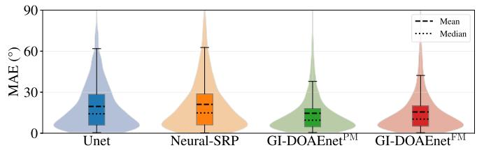  
Fig. 4. Box and violin plot of MAE result on the Dynamic dataset. The box plots with higher chroma indicate the interquartile range. The violin plots with lower chroma illustrate the distribution shape of the estimation errors.

In Fig. 4, the box and violin plots of the MAE results on the Dynamic dataset for Unet and Neural-SRP trained with DSCL and MSGL, as well as GI-DOAEnets with default settings, are presented to assess the reliability and consistency of the models. The box plots, shown with higher chroma, represent the interquartile range (IQR) of the results, with the black solid lines indicating 1.5 times the IQR. The violin plots, depicted with lower chroma, illustrate the distribution of the results. Both the mean and median values, indicated by the dashed and dotted lines, respectively, were lower for GI-DOAEnets compared to Unet and Neural-SRP, indicating that the proposed methods achieved better average performance. In addition, the IQRs of GI-DOAEnets were narrower, suggesting more consistent and reliable predictions. The violin plots further reveal that the distributions for GI-DOAEnets were more concentrated around the median, demonstrating that the proposed methods exhibit lower uncertainty than baselines. These findings confirm that GI-DOAEnets outperformed the baselines not only in terms of average MAE but also in terms of consistency and robustness.

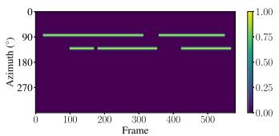  
(a) Oracle

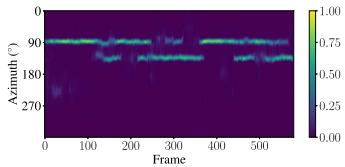  
(b) Unet

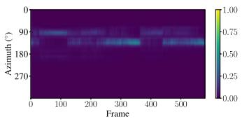

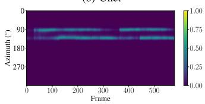  
(d) GI-DOAEnetPM

(c) Neural-SRP  
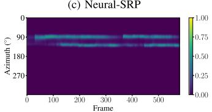  
(e) GI-DOAEnetFM  
Fig. 5. Spatial spectra of the oracle and estimates from the models.

In Fig. 5, the spatial spectra of the oracle and estimates for an utterance from the LOCATA dataset are presented. The oracle was generated using $\gamma = 2 . 5$ in (22). The Unet output displayed a clear, distinctive peak; however, some ripples interfered with the formation of a straight line in the spatial spectrum, which could disrupt the DOA estimation. Additionally, some voiceactive regions were missing. The Neural-SRP output had the most ambiguous peak and omitted several voice-active regions compared to the oracle, resulting in the worst performance. Conversely, the GI-DOAEnet outputs exhibited a more defined peak with significantly fewer ripples, closely resembling the oracle spatial spectrum. This resemblance to the oracle demonstrates the effectiveness of the proposed method and explains its superior performance.

## B. Ablation Studies on Proposed Methods

1) Analysis of Different Geometry Encoding Methods: To investigate the effectiveness of the proposed MPEs, we conducted several alternative experiments by replacing MPEs with other geometry encoding methods. First, GI-DOAEnet without any geometric information was evaluated. As expected, it worked only for a single type of MA and failed to generalize to other MAs due to the absence of microphone position cues. Next, we experimented by directly adding the spherical or Cartesian coordinates to the first three elements of the feature; however, this approach led to divergence during training. We also explored encoding the spherical or Cartesian coordinates using a linear layer with trainable parameters, mapping them into an M-dimensional vector. Despite this modification, the models still failed to train properly.

To further analyze these failures, we compared the validation loss curves of the models using MPEs and a microphone learnable encoder (MLE), as shown in Fig. 6(a). The blue and green lines indicate the loss of GI-DOAEnetPM with the default settings and without CL, respectively. For comparison, the MLE replaced MPEs, where a learnable linear layer was used to transform the 3D Cartesian coordinates into an M-size vector. The orange and red lines represent the loss of GI-DOAEnetPM using the MLE, with and without CL, respectively. During the first stage (gray background), where only a single MA was used, all models converged to similar loss values, since geometric information was not crucial. At the beginning of the second stage (purple background), the validation loss increased for all models as various MAs were introduced. Shortly after, the models with MPEs successfully converged, whereas those with the MLE diverged, indicating that the MLE representation was insufficient for conveying geometric information. In the third stage (yellow background) without CL, the model with MPEs continued to converge, while the model with the MLE diverged. When CL was applied (diagonal pattern), the model with MPEs achieved lower loss than its non-CL counterpart, as the target beamwidth decreased, which reduced the lower bound of the binary cross-entropy loss, plotted in the purple dashed line. Although the MLE-based models appeared to converge at this stage, this was attributed to the CL effect rather than effective geometry encoding.

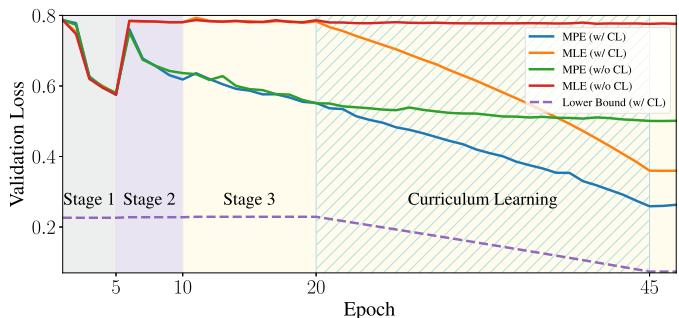  
(a) Validation loss graph of GI-DOAEnetPM with MPE and learnable encoder

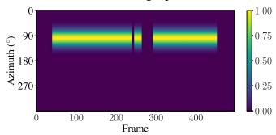  
(b) Oracle

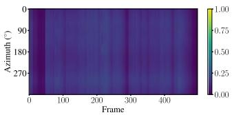  
(c) MLE-based Esimate  
Fig. 6. Loss graph and spatial spectra of the validation set.

Fig. 6(b) and (c) show the spatial spectra of the oracle and the MLE-based model estimate, respectively, for a validation utterance. The oracle was generated using γ = 16 in (22), and the estimate was obtained at the 10-th epoch, the end of the second stage. While the estimate was able to distinguish voice-active regions, it failed to localize a specific direction, displaying similar patterns across almost all directions. These results demonstrate that the MLE failed to effectively represent geometric information, whereas the proposed MPE successfully provided meaningful positional cues to the model. Moreover, other alternative methods that failed to converge exhibited similar behavior, further emphasizing the essential role of MPEs in the proposed GI-DOAEnet.

2) Ablation Study on MSGL: To analyze the contribution of each component in the CGT strategy, different settings of MSGL and DSCL were applied to GI-DOAEnets. For MSGL, when only the third stage was applied or the second stage was omitted, the training loss failed to converge properly, similar to the case of using MLE instead of MPE. This indicates that gradually modifying the MA types across stages was essential for training the model. The third row of each GI-DOAEnet in Table V evaluates the effect of fixed initial parameters across all stages, where learning rate $\delta = 1 . 0 \times 1 0 ^ { - 3 }$ and weight decay $\lambda = 1 . 0 \times 1 0 ^ { - 6 }$ were used. For $\mathrm { G I \mathrm { - D O A E n e t } ^ { P M } }$ , the performance on the RSL Eval dataset slightly improved; however, results on the remaining datasets deteriorated compared to the default configuration. For GI-DOAEnetFM, $\mathrm { { A C C } _ { 1 0 } }$ on ReSpeaker and Dynamic improved slightly, while the MAE on RSL Eval remained unchanged. Nonetheless, performance declined on most other datasets. Additionally, setting the weight decay to $1 . 0 \times 1 0 ^ { - 4 }$ resulted in training divergence, and using smaller learning rates led to insufficient convergence. These results suggest that alternating the learning rate and weight decay across stages was generally effective, although not strictly required for acceptable performance.

3) Ablation Study on DSCL: For DSCL, alternative settings were tested by applying single or multiple static targets with $\gamma = 2 . 5$ in (22), but none of these configurations resulted in successful convergence, like the MLE case. This indicates that a soft label with a large beamwidth was essential for training the model. Further ablation was conducted by individually removing the DS and CL components, as shown in the fourth and fifth rows of each GI-DOAEnet. When the DS was removed from GI-DOAEnet, the PM variant showed improved $\mathrm { { A C C } _ { 1 0 } }$ on some real datasets, whereas the FM variant recorded the best $\mathrm { { A C C } _ { 1 0 } }$ on LOCATA and RSL Eval. However, the overall performance declined across most datasets. Similarly, removing the CL resulted in the best MAE performance on RSL Eval with FM and exhibited improved results with both methods on some datasets. Despite this, it also led to decreased performance for the majority of datasets. Overall, the combined application of DS and CL was generally beneficial for the GI-DOAEnets performance.

4) Ablation Study on CWSA: To analyze the contribution of each component in the CWSA, different settings of CWSA were applied to GI-DOAEnets. When both the standard deviation and Softmax function were removed, the experiment was unsuccessful, similar to the case of using MLE. The results of removing the standard deviation and Softmax function from CWSA are shown in the sixth and seventh rows of each GI-DOAEnet. Removing the standard deviation changed the CWSA output feature size to M from 2M, thereby changing the feature size of the GRUs and SSMBs to M from 2M. The performance declined across all datasets for PM. For FM, the results for LOCATA and RSL Eval improved, achieving the best MAE result for RSL Dev among the compared methods. However, the performance declined significantly in the other cases compared with the default settings. Removing the Softmax function in the CWSA led to performance degradation across all datasets for both PM and FM. These findings suggest that using the standard deviation and an attention mechanism through the Softmax function effectively aggregated the channels and improved the GI-DOAEnet performance.

## C. Analysis of Different SNR, RT60, and Number of Channels

We analyzed the proposed method’s performance under various conditions, including different SNRs, RT60 values, and numbers of channels, using the Dynamic dataset to evaluate the robustness of the proposed method. For Unet and Neural-SRP, we used the models with DSCL and MSGL settings that exhibited the best performance for Dynamic. For GI-DOAEnet, the default settings with PM or FM were used in the analysis. To evaluate the impact of the SNR and RT60, we equally divided each parameter into ten bins, covering the entire SNR and RT60 ranges. Each channel was used as a bin to evaluate the number of channels. The MAE and $\mathrm { { A C C } _ { 1 0 } }$ values were calculated for each utterance, and the nearest values within each bin were averaged. The results are presented as line graphs in Fig. 7.

For the SNR, both the MAE and $\mathrm { { A C C } _ { 1 0 } }$ improved as the SNR increased for all models. At SNR levels above 15 dB, the Unet performed similarly or slightly better than $\mathrm { G I \mathrm { - D O A E n e t } ^ { P M } }$ . In contrast, when the SNR was below 15 dB, the GI-DOAEnets significantly outperformed the Unet and Neural-SRP in terms of both metrics. In scenarios where the SNR was below 5 dB, Neural-SRP had a better MAE than Unet, whereas Unet exhibited a better $\mathrm { { A C C } _ { 1 0 } }$ than Neural-SRP. This indicates that the SRP-PHAT features used in Unet provided an advantage at higher SNR levels, whereas GI-DOAEnets were more robust at lower SNR levels.

For RT60, the model performance degraded as RT60 increased for all models. In terms of MAE, the GI-DOAEnets outperformed Unet and Neural-SRP across all RT60 bins. For $\mathrm { A C C _ { 1 0 } , }$ GI-DOAEnetPM consistently exhibited the best performance across all RT60 bins, while $\mathrm { G I \mathrm { - D O A E n e t } ^ { F M } }$ also performed better than the baseline methods, except in the bin near 0.7 s. Like the SNR analysis, the GI-DOAEnets were more robust to higher RT60 values than the other methods.

For the number of channels, performance improved as the number increased due to enhanced spatial resolution. Additionally, the increased computational complexity associated with a higher number of channels affected the performance, discussed in Section V-D. Specifically, at the 8-channel configuration, Unet and $\mathrm { G I \mathrm { - D O A E n e t } ^ { P M } }$ achieved comparable performance in terms of $\mathrm { { A C C } _ { 1 0 } } .$ , while the proposed GI-DOAEnets consistently outperformed the other methods. Notable performance improvements were primarily observed up to 7-channel, beyond which the gains tended to plateau. This indicates that increasing the number of channels provided richer spatial information for DOA estimation up to a certain point. However, since the microphone spacing was constrained by (25), excessive redundancy can reduce spatial diversity, while too large spacing may cause spatial aliasing, ultimately limiting performance gains.

In conclusion, the GI-DOAEnets consistently outperformed the other methods under almost all conditions, including different SNRs, RT60 s, and channel configurations. This consistent superiority under diverse acoustic environments demonstrates the robustness and generalizability of the proposed method, rather than indicating a particular advantage limited to specific scenarios.

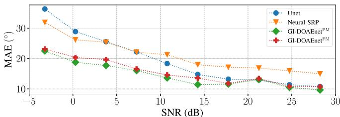

(a) MAE vs. SNR  
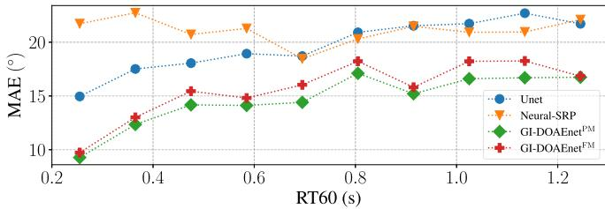  
(c) MAE vs. RT60

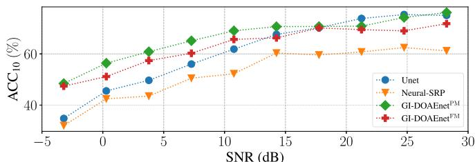

(b) ACC10 vs. SNR  
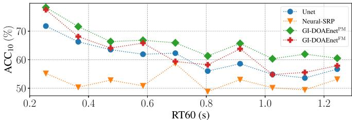  
(d) ACC10 vs. RT60

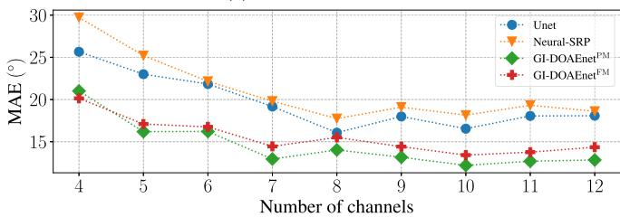  
(e) MAE vs. Number of channels

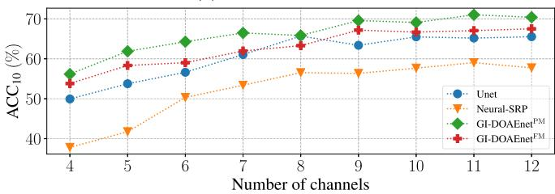  
(f) $\mathrm { A C C _ { 1 0 } }$ vs. Number of channels  
Fig. 7. Mean absolute error (MAE) and accuracy $( \mathrm { A C C _ { 1 0 } } )$ results across different signal-to-noise ratios (SNRs), reverberation times (RT60s), and number of channels.

## D. Analysis of Model Size and Computational Complexity

We evaluated the complexity of the proposed and baseline methods by examining the number of parameters, FLOPS, memory usage, and inference times. The number of parameters indicates the capacity of the model, while FLOPS reflects the number of operations during inference. Memory usage refers to the runtime consumption of both model parameters and intermediate operations. Inference time measures the actual processing latency in a real device, which is crucial for practical applications. These metrics collectively provide a comprehensive understanding of the computational complexity and practicality of each method. For SRP-PHAT, which has no trainable parameters, the FLOPS was obtained from [36, Eq. (12)], and memory usage was measured using Memory Profiler6. For the DNNs, the number of parameters and FLOPS were analyzed using fvcore7, while memory usage was measured with the Pytorch Profiler8. Inference times were measured on an Intel(R) Core(TM) i7-12700 K central processing unit (CPU) with a single thread and an NVIDIA RTX 3090 GPU, averaged over 1,000 trials with a 1-second input. The results are presented in Table VI, where the second column presents the number of parameters for each method. To assess the impact of varying the number ofchannels, FLOPS, memory usage, and inference times were reported for 4-, 8-, and 12-channel configurations. For each method and channel configuration, the first row reports FLOPS and memory usage, while the second row presents inference times for both CPU and GPU. Importantly, SRP-PHAT and Unet were evaluated separately, though they should be considered together since Unet depends on SRP-PHAT outputs as its input.

TABLE VI  
EXPERIMENTAL RESULTS FOR DIFFERENT NUMBERS OF CHANNELS. NUMBER OF PARAMETERS, FLOPS, MEMORY USAGE, AND INFERENCE TIME.

<table><tr><td rowspan="3"></td><td rowspan="3"># params. (M)</td><td colspan="3">FLOPS (G) / Memory Usage (MB)</td></tr><tr><td colspan="3">Inference Time on CPU / GPU (ms)</td></tr><tr><td>4 ch.</td><td>8 ch.</td><td>12 ch.</td></tr><tr><td rowspan="2">SRP-PHAT</td><td rowspan="2">-</td><td>0.10 / 23.75</td><td>0.45 / 79.45</td><td>1.06 / 172.79</td></tr><tr><td>24.23 / -</td><td>89.56 / -</td><td>197.36 / -</td></tr><tr><td>Unet</td><td rowspan="2">7.64</td><td>0.97 / 26.57</td><td>0.97 / 26.57</td><td>0.97 / 26.57</td></tr><tr><td>w/o SRP-PHAT</td><td>15.40 / 0.49</td><td>15.40 / 0.49</td><td>15.40 / 0.49</td></tr><tr><td rowspan="2">Neural-SRP</td><td rowspan="2">0.87</td><td>1.81 / 705.43</td><td>8.38 / 3276.18</td><td>19.72 / 7724.27</td></tr><tr><td>86.31 / 3.42</td><td>514.22 / 6.39</td><td>1395.94 / 11.44</td></tr><tr><td rowspan="2">GI-DOAEnet</td><td rowspan="2">2.07</td><td>0.46 / 115.70</td><td>0.85 / 211.475</td><td>1.25 / 310.03</td></tr><tr><td>37.99 / 2.60</td><td>47.19 / 2.65</td><td>66.47 / 2.69</td></tr></table>

Among the DNNs, Unet had the largest number ofparameters, GI-DOAEnet had an intermediate number, and Neural-SRP had the fewest. In [15], the number of parameters for Unet was reported as 18 M, but in our implementation, a version with

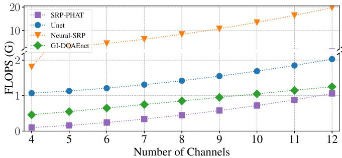  
Fig. 8. FLOPS comparison with respect to the number of channels.

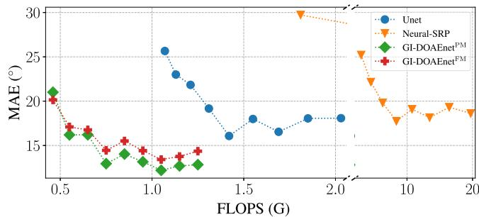  
Fig. 9. Comparison of mean absolute error (MAE) across models with varying FLOPS.

7.64 M parameters achieved the best performance. Therefore, we adopted this configuration for the evaluation.

SRP-PHAT demonstrated the lowest FLOPS, with GI-DOAEnet achieving the lowest FLOPS among the DNN-based methods. The exact relationship between the number ofchannels and FLOPS is depicted in Fig. 8. It can be observed that the FLOPS of SRP-PHAT and Neural-SRP increase quadratically with the number of microphones, due to the pair-wise computations among all microphone combinations, which grow $\mathrm { { \bar { a s } } ~ } \frac { C ( C - 1 ) } { 2 }$ . In contrast, the computational complexity of GI-DOAEnet exhibited linear growth with increasing channels. Although the CW-MHSA operations are characterized by $O ( C ^ { 2 } )$ complexity, they were selectively employed within the GI-DOAEnet, while the channel aggregation performed by CWSA further contributed to the stability of FLOPS across different channel configurations. In Fig. 9, the results between FLOPS and MAE are shown. As the FLOPS increased due to the number of channels, the MAE decreased, highlighting that more channels with higher computational complexity were associated with better performance. Notably, among the DNN-based methods, GI-DOAEnets achieved the best performance while maintaining the lowest FLOPS, highlighting the computational efficiency and precision of the proposed approach.

For the memory usage, SRP-PHAT exhibited the lowest value, followed by Unet, GI-DOAEnet, and Neural-SRP in all cases. However, the memory usage of SRP-PHAT and Neural-SRP increased quadratically with the number of channels. The memory usage of Unet without SRP-PHAT remained static, while GI-DOAEnet exhibited a linear increase, maintaining a stable memory footprint. In addition, due to the large memory usage ofNeural-SRP, the train batch size was limited to 1, as mentioned in Section IV-A.

For the CPU inference time, SRP-PHAT achieved the fastest performance in the 4-channel case, followed by GI-DOAEnet and Unet, which showed similar inference times, while Neural-SRP recorded the longest inference time. In the 8- and 12-channel cases, GI-DOAEnet outperformed the others, as the SRP-PHAT and GCC-PHAT operations required by Unet and Neural-SRP scaled quadratically with the number of channels, resulting in longer inference times. For GPU inference, only the DNN components were measured since SRP-PHAT was executed on the CPU. When considering only the DNN operations, Unet exhibited the lowest inference time. However, when the entire pipeline including SRP-PHAT was taken into account, GI-DOAEnet achieved the lowest overall inference time due to GPU acceleration. Furthermore, the inference time of GI-DOAEnet remained nearly constant from 4–12-channel, demonstrating its scalability. Neural-SRP also benefited from GPU acceleration, outperforming in terms of inference time compared to Unet with SRP-PHAT.

In summary, GI-DOAEnet exhibited a moderate number of parameters and memory usage compared to other methods, while achieving superior performance in terms of FLOPS and inference time in most cases. Furthermore, by avoiding the quadratic complexity associated with conventional pair-wise features, the FLOPS, memory usage, and inference time remained stable as the number of channels increased, demonstrating the scalability of the proposed approach.

## VI. CONCLUSION

In this paper, we have introduced GI-DOAEnet, a novel geometry-invariant DOA estimation model, along with the CGT strategy, a new training paradigm for geometry-sensitive tasks. A key contribution of this work is the introduction of MPEs, which encode spherical microphone positions into sinusoidal vectors. While previous studies employing CW-MHSA have primarily focused on acquiring spatial relationships without geometric information of the array, our proposed MPEs naturally integrate microphone coordinates into the latent representation of multi-channel audio signals, effectively bridging the gap between DNN usage and array signal processing. Beyond DOA estimation, we believe that the concept of MPEs holds potential for a wide range of tasks where spherical coordinate information is critical, as MPEs are not restricted by specific sequence indexing.

The CGT strategy gradually increases the complexity of both target labels and array geometries during training. This approach significantly enhances the robustness and generalizability of GI-DOAEnet and has also demonstrated improvements when applied to other baseline models, suggesting a promising direction for geometry-sensitive learning problems. Experimental results confirm that GI-DOAEnet consistently outperforms baseline methods in both precision and computational efficiency across various array configurations and diverse scenarios, highlighting its practicality for real-world applications.

In future work, we plan to enhance the model for 3D location estimation and tracking of moving sound sources across various array geometries. In addition, we will explore applying both MPE and CGT strategy to other array signal-processing tasks, including beamforming, to further validate their versatility and effectiveness.

## APPENDIX

## A. Linearity and Relative Property of the MPE With PM

In [45], it was shown that the sinusoidal positional encoding possesses both linearity and relative properties. In a similar manner, we verify that the MPE with PM also satisfies these properties. Reordering the elements of the original MPE with PM in (3), the azimuth component can be expressed as:

$$
\tilde {\mathcal {P}} _ {c, \theta} ^ {\mathrm{PM}} = \alpha r _ {c} \left[ \begin{array}{c} \cos \left(2 \pi \beta v _ {0} + \theta_ {c}\right) \\ \sin \left(2 \pi \beta v _ {0} + \theta_ {c}\right) \\ \cos \left(2 \pi \beta v _ {1} + \theta_ {c}\right) \\ \sin \left(2 \pi \beta v _ {1} + \theta_ {c}\right) \\ \vdots \\ \cos \left(2 \pi \beta v _ {\frac {M}{4} - 1} + \theta_ {c}\right) \\ \sin \left(2 \pi \beta v _ {\frac {M}{4} - 1} + \theta_ {c}\right) \end{array} \right] \in \mathbb {R} ^ {\frac {M}{2}},\tag{28}
$$

where $v _ { m }$ is the m-th element of v. Assuming that the p-th and q-th MPEs are linearly related, their relationship can be described by:

$$
\tilde {\mathcal {P}} _ {q, \theta} ^ {\mathrm{PM}} = \mathcal {T} _ {\theta} ^ {p, q} \cdot \tilde {\mathcal {P}} _ {p, \theta} ^ {\mathrm{PM}},\tag{29}
$$

$$
\mathcal {T} _ {\theta} ^ {p, q} = \left[ \begin{array}{c c c c} \boldsymbol {\Omega} _ {0} ^ {p, q, \theta} & \boldsymbol {0} & \dots & \boldsymbol {0} \\ \boldsymbol {0} & \boldsymbol {\Omega} _ {1} ^ {p, q, \theta} & \dots & \boldsymbol {0} \\ \vdots & \vdots & \ddots & \vdots \\ \boldsymbol {0} & \boldsymbol {0} & \dots & \boldsymbol {\Omega} _ {\frac {M}{4} - 1} ^ {p, q, \theta} \end{array} \right] \in \mathbb {R} ^ {\frac {M}{2} \times \frac {M}{2}},\tag{30}
$$

where $\mathcal { T } _ { \theta } ^ { p , q }$ is a block diagonal matrix and $\mathbf { 0 } \in \mathbb { R } ^ { 2 \times 2 }$ is a zero matrix. Each m-th block $\Omega _ { m } ^ { p , q , \theta }$ is assumed to be a rotation matrix, given by:

$$
\Omega_ {m} ^ {p, q, \theta} = \frac {r _ {q}}{r _ {p}} \left[ \begin{array}{c c} \cos \omega_ {m} & - \sin \omega_ {m} \\ \sin \omega_ {m} & \cos \omega_ {m} \end{array} \right] \in \mathbb {R} ^ {2 \times 2},\tag{31}
$$

where $\omega _ { m }$ is a rotation angle. Focusing on the m-th block in (29), we obtain:

$$
\boldsymbol {\Omega} _ {m} ^ {p, q, \theta} \cdot \alpha r _ {p} \left[ \begin{array}{c} \cos (2 \pi \beta v _ {m} + \theta_ {p}) \\ \sin (2 \pi \beta v _ {m} + \theta_ {p}) \end{array} \right] = \alpha r _ {q} \left[ \begin{array}{c} \cos (2 \pi \beta v _ {m} + \theta_ {q}) \\ \sin (2 \pi \beta v _ {m} + \theta_ {q}) \end{array} \right].\tag{32}
$$

Simplifying (32), we obtain:

$$
\begin{array}{l} \cos \omega_ {m} \cos (2 \pi \beta v _ {m} + \theta_ {p}) - \sin \omega_ {m} \sin (2 \pi \beta v _ {m} + \theta_ {p}) \\ = \cos (2 \pi \beta v _ {m} + \theta_ {q}), \\ \sin \omega_ {m} \cos (2 \pi \beta v _ {m} + \theta_ {p}) + \cos \omega_ {m} \sin (2 \pi \beta v _ {m} + \theta_ {p}) \\ = \sin (2 \pi \beta v _ {m} + \theta_ {q}). \end{array}\tag{33}
$$

By applying the trigonometric addition formulas to (33), we derive:

$$
\begin{array}{r l} & {\cos (\omega_ {m} + 2 \pi \beta v _ {m} + \theta_ {p}) = \cos (2 \pi \beta v _ {m} + \theta_ {q}),} \\ & {\sin (\omega_ {m} + 2 \pi \beta v _ {m} + \theta_ {p}) = \sin (2 \pi \beta v _ {m} + \theta_ {q}).} \end{array}\tag{34}
$$

From (34), it follows that:

$$
\omega_ {m} = \theta_ {q} - \theta_ {p},\tag{35}
$$

where $\omega _ { m }$ represents the relative azimuth difference between the p-th and q-th microphones, assumes the principal solution of $\omega _ { m }$ within [0, 2π). Thus, the transformation matrix $\mathcal { T } _ { \theta } ^ { p , q }$ depends solely on the relative azimuth difference and the ratio of the microphone distances. Since the elevation component $\phi _ { c }$ can be derived analogously, we conclude that the MPE with PM preserves both the linearity and relative properties with respect to microphone positions.

## B. Linearity and Relative Property of the MPE With FM

Similar to the PM case, the MPE with FM in (4) can be expressed as:

$$
\tilde {\mathcal {P}} _ {c, \theta} ^ {\mathrm{FM}} = \alpha r _ {c} \left[ \begin{array}{c} \cos \left(\theta_ {c} \beta v _ {0}\right) \\ \sin \left(\theta_ {c} \beta v _ {0}\right) \\ \cos \left(\theta_ {c} \beta v _ {1}\right) \\ \sin \left(\theta_ {c} \beta v _ {1}\right) \\ \vdots \\ \cos \left(\theta_ {c} \beta v _ {\frac {M}{4} - 1}\right) \\ \sin \left(\theta_ {c} \beta v _ {\frac {M}{4} - 1}\right) \end{array} \right] \in \mathbb {R} ^ {\frac {M}{2}}.\tag{36}
$$

Assuming that the p-th and q-th MPEs are linearly related, the transformation, similar to (32), can be expressed as:

$$
\boldsymbol {\Omega} _ {m} ^ {p, q, \theta} \cdot \alpha r _ {p} \left[ \begin{array}{c} \cos (\theta_ {p} \beta v _ {m}) \\ \sin (\theta_ {p} \beta v _ {m}) \end{array} \right] = \alpha r _ {q} \left[ \begin{array}{c} \cos (\theta_ {q} \beta v _ {m}) \\ \sin (\theta_ {q} \beta v _ {m}) \end{array} \right].\tag{37}
$$

Simplifying (37), we obtain:

$$
\begin{array}{l} \cos \omega_ {m} \cos (\theta_ {p} \beta v _ {m}) - \sin \omega_ {m} \sin (\theta_ {p} \beta v _ {m}) = \cos (\theta_ {q} \beta v _ {m}), \\ \sin \omega_ {m} \cos (\theta_ {p} \beta v _ {m}) + \cos \omega_ {m} \sin (\theta_ {p} \beta v _ {m}) = \sin (\theta_ {q} \beta v _ {m}). \end{array}\tag{38}
$$

By applying the trigonometric addition formulas to (38), we can rewrite it as:

$$
\begin{array}{l} \cos (\omega_ {m} + \theta_ {p} \beta v _ {m}) = \cos (\theta_ {q} \beta v _ {m}), \\ \sin (\omega_ {m} + \theta_ {p} \beta v _ {m}) = \sin (\theta_ {q} \beta v _ {m}). \end{array}\tag{39}
$$

From (39), it directly follows that:

$$
\omega_ {m} = (\theta_ {q} - \theta_ {p}) \beta v _ {m},\tag{40}
$$

where $\omega _ { m }$ is the principal solution proportional to the azimuth difference, scaled by $\beta v _ { m }$ . As the elevation component $\phi _ { c }$ can be treated in the same way, it follows that the MPE with FM also exhibits linear and relative properties.

## REFERENCES

[1] J. Benesty, J. Chen, and Y. Huang, Microphone Array Signal Processing. Berlin, Germany: Springer, 2008.

[2] C. Knapp and G. Carter, “The generalized correlation method for estimation of time delay,” IEEE Trans. Acoust., Speech, Signal Process., vol. TASSP-24, no. 4, pp. 320–327, Aug. 1976.

[3] J. H. Dibiase, “A high-accuracy, low-latency technique for talker localization in reverberant environments using microphone arrays,” Ph.D. thesis, Brown Univ., Providence, RI, USA, 2000.

[4] R. Schmidt, “Multiple emitter location and signal parameter estimation,” IEEE Trans. Antennas Propag., vol. 34, no. 3, pp. 276–280, Mar. 1986.

[5] M.-S. Baek, J.-Y. Yang, and J.-H. Chang, “Deeply supervised curriculum learning for deep neural network-based sound source localization,” in Proc. Interspeech, 2023, pp. 3744–3748.

[6] P.-A. Grumiaux, S. Kiti´c, L. Girin, and A. Guérin, “A survey of sound source localization with deep learning methods,” J. Acoust. Soc. Amer., vol. 152, no. 1, pp. 107–151, 2022.

[7] X. Xiao et al., “A learning-based approach to direction of arrival estimation in noisy and reverberant environments,” in Proc. IEEE Int. Conf. Acoust., Speech Signal Process., 2015, pp. 2814–2818.

[8] W. He, P. Motlicek, and J.-M. Odobez, “Deep neural networks for multiple speaker detection and localization,” in Proc. IEEE Int. Conf. Robot., Autom., 2018, pp. 74–79.

[9] S. Chakrabarty and E. A. P. Habets, “Multi-speaker DOA estimation using deep convolutional networks trained with noise signals,” IEEE J. Sel. Topics Signal Process., vol. 13, no. 1, pp. 8–21, Mar. 2019.

[10] S. Adavanne, A. Politis, and T. Virtanen, “Direction of arrival estimation for multiple sound sources using convolutional recurrent neural network,” in Proc. Eur. Signal Process. Conf., 2018, pp. 1462–1466.

[11] D. D.-Guerra, A. Miguel, and J. R. Beltran, “Robust sound source tracking using SRP-PHAT and 3D convolutional neural networks,” IEEE/ACM Trans. Audio, Speech, Lang. Process., vol. 29, pp. 300–311, 2021.

[12] D. D.-Guerra, A. Miguel, and J. R. Beltran, “Direction of arrival estimation of sound sources using icosahedral CNNs,” IEEE/ACM Trans. Audio, Speech, Lang. Process., vol. 31, pp. 313–321, 2023.

[13] U. Kowalk, S. Doclo, and J. Bitzer, “Geometry-aware DOA estimation using a deep neural network with mixed-data input features,” in Proc. IEEE Int. Conf. Acoust., Speech Signal Process., 2023, pp. 1–5.

[14] J.-H. Cho and J.-H. Chang, “SR-SRP: Super-resolution based SRP-PHAT for sound source localization and tracking,” in Proc. Interspeech, 2023, pp. 3769–3773.

[15] A. Schwartz, E. Hadad, S. Gannot, and S. E. Chazan, “Array configuration mismatch in deep DOA estimation: Towards robust training,” in Proc. IEEE Workshop Appl. Signal Process. Audio Acoust., 2023, pp. 1–5.

[16] A. S. Roman, I. R. Roman, and J. P. Bello, “Robust DoA estimation from deep acoustic imaging,” in Proc. IEEE Int. Conf. Acoust., Speech Signal Process., 2024, pp. 1321–1325.

[17] E. Grinstein, C. M. Hicks, T. van Waterschoot, M. Brookes, and P. A. Naylor, “The Neural-SRP method for universal robust multi-source tracking,” IEEE Open J. Signal Process., vol. 5, pp. 19–28, 2024.

[18] R. Varzandeh, S. Doclo, and V. Hohmann, “Speech-aware binaural DOA estimation utilizing periodicity and spatial features in convolutional neural networks,” IEEE/ACM Trans. Audio, Speech, Lang. Process., vol. 32, pp. 1198–1213, 2024.

[19] O. B. Zaken, A. Kumar, V. Tourbabin, and B. Rafaely, “Neural-networkbased direction-of-arrival estimation for reverberant speech - the importance of energetic, temporal, and spatial information,” IEEE/ACM Trans. Audio, Speech, Lang. Process., vol. 32, pp. 1298–1309, 2024.

[20] D. A. Krause, G. G. a-Barrios, A. Politis, and A. Mesaros, “Binaural sound source distance estimation and localization for a moving listener,” IEEE/ACM Trans. Audio, Speech, Lang. Process., vol. 32, pp. 996–1011, 2024.

[21] J. Benesty, I. Cohen, and J. Chen, Fundamentals ofSignal Enhancement and Array Signal Processing. Hoboken, NJ, USA: Wiley, 2018.

[22] Y. Luo, C. Han, N. Mesgarani, E. Ceolini, and S.-C. Liu, “FaSNet: Lowlatency adaptive beamforming for multi-microphone audio processing,” in Proc. IEEE Autom. Speech Recognit. Understand. Workshop, 2019, pp. 260–267.

[23] A. Kovalyov, K. Patel, and I. Panahi, “DFSNet: A steerable neural beamformer invariant to microphone array configuration for real-time, lowlatency speech enhancement,” in Proc. Interspeech, 2023, pp. 2493–2497.

[24] A. Pandey et al., “TPARN: Triple-path attentive recurrent network for time-domain multichannel speech enhancement,” in Proc. IEEE Int. Conf. Acoust., Speech Signal Process., 2022, pp. 6497–6501.

[25] W. Zhang, K. Saijo, Z.-Q. Wang, S. Watanabe, and Y. Qian, “Toward universal speech enhancement for diverse input conditions,” in Proc. IEEE Autom. Speech Recognit. Understand. Workshop, 2023, pp. 1–6.

[26] A. Pandey et al., “Time-domain ad-hoc array speech enhancement using a triple-path network,” in Proc. Interspeech, 2022, pp. 729–733.

[27] W. Zhang, J.-w. Jung, and Y. Qian, “Improving design of input condition invariant speech enhancement,” in Proc. IEEE Int. Conf. Acoust., Speech Signal Process., 2024, pp. 10696–10700.

[28] D. Lee and J.-W. Choi, “DeFTAN-AA: Array geometry agnostic multichannel speech enhancement,” in Proc. Interspeech, 2024, pp. 3360–3364.

[29] Y. Luo, Z. Chen, N. Mesgarani, and T. Yoshioka, “End-to-end microphone permutation and number invariant multi-channel speech separation,” in Proc. IEEE Int. Conf. Acoust., Speech Signal Process., 2020, pp. 6394–6398.

[30] T. Yoshioka et al., “VarArray: Array-geometry-agnostic continuous speech separation,” in Proc. IEEE Int. Conf. Acoust., Speech Signal Process., 2022, pp. 6027–6031.

[31] N. Kanda et al., “Vararray meets T-sot: Advancing the state of the art of streaming distant conversational speech recognition,” in Proc. IEEE Int. Conf. Acoust., Speech Signal Process., 2023, pp. 1–5.

[32] F.-J. Chang, M. Radfar, A. Mouchtaris, B. King, and S. Kunzmann, “Endto-end multi-channel transformer for speech recognition,” in Proc. IEEE Int. Conf. Acoust., Speech Signal Process., 2021, pp. 5884–5888.

[33] B. Mu et al., “Automatic channel selection and spatial feature integration for multi-channel speech recognition across various array topologies,” in Proc. IEEE Int. Conf. Acoust., Speech Signal Process., 2024, pp. 11396–11400.

[34] K. Cho et al., “Learning phrase representations using RNN encoder– decoder for statistical machine translation,” in Proc. Conf. Empir. Methods Nat. Lang. Process., 2014, pp. 1724–1734.

[35] A. Vaswani et al., “Attention is all you need,” in Proc. Adv. Neural Inf. Process. Syst., 2017, vol. 30, pp. 5998–6008.

[36] T. Dietzen, E. De Sena, and T. van Waterschoot, “Low-complexity steered response power mapping based on nyquist-shannon sampling,” in Proc. IEEE Workshop Appl. Signal Process. Audio Acoust., 2021, pp. 206–210.

[37] R. Sheelvant et al., “RSL2019: A realistic speech localization corpus,” in Proc. IEEE Conf. Oriental COCOSDA Int. Committee Co-Ordination Standardisation Speech Databases Assess. Tech., 2019, pp. 1–6.

[38] H. W. Löllmann et al., “The LOCATA challenge data corpus for acoustic source localization and tracking,” in Proc. IEEE Sens. Array, Multichannel Signal Process. Workshop, 2018, pp. 410–414.

[39] T. Lan, Y. Qian, Y. Lyu, R. Mokhosi, W. Tai, and Q. Liu, “Improved speech separation with time-and-frequency cross-domain feature selection,” in Proc. Interspeech, 2021, pp. 3525–3529.

[40] Y. Hu, Y. Chen, W. Yang, L. He, and H. Huang, “Hierarchic temporal convolutional network with cross-domain encoder for music source separation,” IEEE Signal Process. Lett., vol. 29, pp. 1517–1521, 2022.

[41] D.-A. Clevert, T. Unterthiner, and S. Hochreiter, “Fast and accurate deep network learning by exponential linear units (ELUs),” in Proc. Int. Conf. Learn. Representations, 2016.

[42] S. Ioffe and C. Szegedy, “Batch normalization: Accelerating deep network training by reducing internal covariate shift,” in Proc. Int. Conf. Mach. Learn., 2015, pp. 448–456.

[43] P. Dufter, M. Schmitt, and H. Schütze, “Position information in transformers: An overview,” Comput. Linguist., vol. 48, no. 3, pp. 733–763, 2022.

[44] P.-C. Chen et al., “A simple and effective positional encoding for transformers,” in Proc. Conf. Empir. Methods Nat. Lang. Process., 2021, pp. 2974–2988.

[45] J. Su et al., “RoFormer: Enhanced transformer with rotary position embedding,” Neurocomputing, vol. 568, 2024, Art. no. 127063.

[46] Z. Liu et al., “Swin transformer: Hierarchical vision transformer using shifted windows,” in Proc. IEEE/CVF Conf. Comput. Vis. Pattern Recognit., 2021, pp. 10012–10022.

[47] A. Athwale et al., “DarSwin: Distortion aware radial swin transformer,” in Proc. IEEE/CVF Conf. Comput. Vis. Pattern Recognit., 2023, pp. 5929–5938.

[48] K. Ning, L. Xie, F. Wu, and Q. Tian, “Polar relative positional encoding for video-language segmentation,” in Proc. Int. Joint Conf. Artif. Intell., 2020, pp. 948–954.

[49] X. Chu, Z. Tian, B. Zhang, X. Wang, and C. Shen, “Conditional positional encodings for vision transformers,” in Proc. Int. Conf. Learn. Representations, 2023.

[50] R. Xu, X. Wang, K. Chen, B. Zhou, and C. C. Loy, “Positional encoding as spatial inductive bias in GANs,” in Proc. IEEE/CVF Conf. Comput. Vis. Pattern Recognit., 2021, pp. 13569–13578.

[51] U. Isik et al., “PoCoNet: Better speech enhancement with frequencypositional embeddings, semi-supervised conversational data, and biased loss,” in Proc. Interspeech, 2020, pp. 2487–2491.

[52] L. Pepino, P. Riera, and L. Ferrer, “Study of positional encoding approaches for audio spectrogram transformers,” in Proc. IEEE Int. Conf. Acoust., Speech Signal Process., 2022, pp. 3713–3717.

[53] Y. Luo, Z. Chen, and T. Yoshioka, “Dual-path RNN: Efficient long sequence modeling for time-domain single-channel speech separation,” in Proc. IEEE Int. Conf. Acoust., Speech Signal Process., 2020, pp. 46–50.

[54] J. L. Ba, J. R. Kiros, and G. E. Hinton, “Layer normalization,” 2016, arXiv:1607.06450.

[55] J. Choi and J.-H. Chang, “Supervised learning approach for explicit spatia filtering of speech,” IEEE Signal Process. Lett., vol. 29, pp. 1412–1416, 2022.

[56] D. P. Kingma and J. Ba, “Adam: A method for stochastic optimization,” in Proc. Int. Conf. Learn. Representations, 2014, pp. 1–15.

[57] V. Panayotov, G. Chen, D. Povey, and S. Khudanpur, “Librispeech: An ASR corpus based on public domain audio books,” in Proc. IEEE Int. Conf. Acoust., Speech Signal Process., 2015, pp. 5206–5210.

[58] C. K. A. Reddy et al., “A scalable noisy speech dataset and online subjective test framework,” in Proc. Interspeech, 2019, pp. 1816–1820.

[59] D. D.-Guerra, A. Miguel, and J. R. Beltran, “gpuRIR: A python library for room impulse response simulation with GPU acceleration,” Multimedia Tools Appl., vol. 80, no. 4, pp. 5653–5671, 2021.

[60] J. B. Allen and D. A. Berkley, “Image method for efficiently simulating small-room acoustics,” J. Acoust. Soc. Amer., vol. 65, no. 4, pp. 943–950, 1979.

[61] J. S. Garofolo, L. F. Lamel, W. M. Fisher, J. G. Fiscus, and D. S. Pallett, “DARPA TIMIT acoustic-phonetic continous speech corpus CD-ROM. NIST speech disc 1-1.1,” NASA STI/Recon Tech. Rep., vol. 93, 1993, Art. no. 27403.

[62] K. J. Piczak, “ESC: Dataset for environmental sound classification,” in Proc. ACM Int. Conf. Multimedia, 2015, pp. 1015–1018.