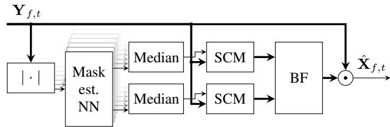

# EXPLORING PRACTICAL ASPECTS OF NEURAL MASK-BASED BEAMFORMING FOR FAR-FIELD SPEECH RECOGNITION

Christoph Boeddeker1,2, Hakan Erdogan1, Takuya Yoshioka1, and Reinhold Haeb-Umbach2

1Microsoft AI and Research, Redmond, WA, USA

2Paderborn University, Department of Communications Engineering, Paderborn, Germany

## ABSTRACT

This work examines acoustic beamformers employing neural networks (NNs) for mask prediction as front-end for automatic speech recognition (ASR) systems for practical scenarios like voice-enabled home devices. To test the versatility of the mask predicting network, the system is evaluated with different recording hardware, different microphone array designs, and different acoustic models of the downstream ASR system. Significant gains in recognition accuracy are obtained in all configurations despite the fact that the NN had been trained on mismatched data. Unlike previous work, the NN is trained on a feature level objective, which gives some performance advantage over a mask related criterion. Furthermore, different approaches for realizing online, or adaptive, NN-based beamforming are explored, where the online algorithms still show significant gains compared to the baseline performance.

Index Terms— Far-field speech recognition, acoustic beamforming, neural networks, time-frequency masks, online processing

## 1. INTRODUCTION

The demand for distant speech recognition technology is surging as voice-enabled home devices, such as gaming consoles and the so-called smart speakers, are gaining popularity among consumers. Far-field audio capture, however, imposes challenges on automatic speech recognition (ASR) systems because the captured speech signals can be severely degraded by both background noise and reverberation. A popular and effective approach to render ASR robust against such acoustic distortions is to train or adapt the acoustic model by using noise-corrupted speech data. While such multicondition models can significantly reduce the word error rate (WER) in noisy reverberant environments, there is still a significant performance gap between close-talking and distant speech recognition.

To further close this performance gap, many distant speech recognition systems employ multiple microphones to perform beamforming and/or dereverberation. In recent distant ASR challenges, such as REVERB [1] and CHiME-3/4 [2, 3], the use of multiple microphones was shown to significantly improve the speech recognition accuracy [4, 5]. As a matter of fact, multi-channel beamforming and dereverberation turned out to be two of the few front-end signal processing techniques which improved recognition rates even in the presence of strong neural-network based ASR backends [6, 7, 8, 9]. Indeed, practically all commercial devices that are capable of recognizing distant speech are equipped with multiple microphones for performing sound source localization, beamforming, dereverberation, or multi-channel acoustic modeling [10].

While the recognition gains from acoustic beamforming reported for CHiME were very impressive, they may not be directly transferable to commercial usage scenarios. Some important differences between CHiME and typical usage scenarios is that test utterances are much longer in CHiME (6.9 s on average) than most voice queries and the speaker to microphone distances were less than 1 m, whereas they are usually much larger in home-device scenarios which typically involve more speaker mobility as well. Furthermore, in practice, it is almost impossible to consistently use the same set of training and test data for beamforming and acoustic modeling. In usual development setups, acoustic models are trained on a large quantity of single-channel data obtained from traffic of existing services, which may contain non-negligible acoustic distortion. In contrast, in order to train beamforming systems, we resort to simulated far-field data or collect multi-channel recordings obtained with a target device.

The objective of this paper is to evaluate practical aspects of neural mask-based beamforming, a class of beamforming approaches, which achieved huge success for CHiME [11, 4, 12, 9] and has been gaining a lot of attention in the past two years. In this approach, a neural network (NN) is employed to predict soft time-frequency masks, which indicate for each time-frequency point whether it is dominated by either speech or noise. Then, these masks are used to compute spatial covariance matrices for speech and noise, from which beamforming coefficients can be derived. Our contributions can be summarized as follows:

• Contrary to CHiME-3/4, which used a single recording hardware and datasets which were all derived from the Wall Street Journal (WSJ) task, we carry out experiments with two different microphone arrays as recording devices, several different beamforming alternatives, and two different acoustic models, both trained on much larger datasets than the CHiME training set. These experiments allow us to not only examine the practical relevance of the neural mask-based beamforming but also investigate the modularity of the system components, i.e., if any recording device can be combined with any beamformer and any acoustic model.

• We discuss different training criteria for the mask estimation NN and propose a new criterion, mean squared error between noisy and reference clean features, which requires complex-valued network operations as in [13].

• We explore both offline and online beamforming performance and discuss their differences whereas most of the previous work addressed offline beamforming, with only a few exceptions [14].

## 2. NEURAL MASK-BASED BEAMFORMING

Fig. 1 shows a block diagram of the neural mask-based beamformer considered in [11, 12, 15], where $\textbf { Y } _ { f , t }$ denotes a multi-channel microphone signal in the short-time Fourier transform (STFT) domain with f and t being frequency bin and time frame indices, respectively. The beamformer output, denoted by $\hat { \mathbf { X } } _ { f , t } .$ , is an estimate of speech signal $\mathbf { X } _ { f , t }$ , which may include reverberation effects. The number of microphones is represented as K.

  
Fig. 1: Block diagram of neural mask-based beamformer. SCM: spatial covariance matrix. BF: beamforming.

## 2.1. Mask-estimation neural network

The mask-estimation NN produces speech and noise masks interpreted as speech and noise presence probabilities. Each microphone channel signal is forwarded through the NN, which yields K different versions of speech and noise masks. The K masks for each time-frequency bin are then consolidated into a single mask with a median operation.

The network structure employed in our work is similar to [11]. The input layer splices the observed magnitude spectrum of the current frame with those of ±3 neighboring frames. The spliced feature vector is then fed into a normalization layer. In [11, 15], an utterance-based batch normalization was proposed, which converts input feature $x _ { f , t }$ into $y _ { f , t }$ t with $y _ { f , t } = \gamma \tilde { x } _ { f , t } + \beta$ , where $\begin{array} { r } { \tilde { x } _ { f , t } = } \end{array}$ $\begin{array} { r } { ( x _ { f , t } - \mu _ { f } ) / \sigma _ { f } , \mu _ { f } = \sum _ { t } x _ { f , t } / T } \end{array}$ , and $\begin{array} { r } { \sigma _ { f } ^ { 2 } = \sum _ { t } \left( x _ { f , t } - \mu _ { f } \right) ^ { 2 } / T } \end{array}$ Variables γ and β are parameters that are learned during training while T denotes the utterance length. Note that this normalization requires an entire utterance to be seen. After the normalization layer comes a unidirectional LSTM layer with 513 units1, followed by two 513-unit fully connected layers with ReLU nonlinearity. On top, there is a 1026-unit fully connected output layer with sigmoid nonlinearity. The output activations represent predicted speech and noise masks, taking values between 0 and 1.

The mask estimation NN can be trained by minimizing the binary cross entropy (BCE) between the network output and ideal binary masks for speech and noise as in [11, 15]. We also explore alternative training criteria as discussed later.

## 2.2. Beamforming

A beamformer estimates the speech signal by multiplying the microphone signal with beamforming coefficient vector $\mathbf { w } _ { f }$ as $\hat { \mathbf { X } } _ { f , t } =$ $\mathbf { w } _ { f } ^ { \mathrm { H } } \mathbf { Y } _ { f , t }$ . With the mask-based approach, the beamforming coefficient vector is calculated based on speech and noise spatial covariance matrices, which may be estimated using the time-frequency masks as follows:

$$
\boldsymbol {\Phi} _ {\nu \nu f} = \frac {1}{\sum_ {t} M _ {f , t} ^ {\nu}} \sum_ {t} M _ {f, t} ^ {\nu} \mathbf {Y} _ {f, t} \mathbf {Y} _ {f, t} ^ {\mathrm{H}}, \quad \nu \in \{\mathbf {X}, \mathbf {N} \}.\tag{1}
$$

Here, $M _ { f , t } ^ { \mathbf { X } }$ and $M _ { f , t } ^ { \mathbf { N } }$ are the estimated speech and noise masks, respectively, and $( \cdot ) ^ { \mathrm { H } }$ is a conjugate transpose operator.

In one form of mask-based beamforming, called the Generalized Eigen-Value (GEV) beamformer, $\mathbf { w } _ { f }$ is calculated by maximizing the output SNR. After GEV, it is customary to apply normalization filters that compensate for the distortions introduced by the beamforming operation. We use Blind Analytic Normalization (BAN) [16] and group delay normalization [17], which modify the magnitude and phase responses, respectively.

An alternative scheme is the MVDR beamformer, which we employ in most of our experiments. The MVDR beamformer can be calculated as [12, 18] $\begin{array} { r } { \dot { \mathbf { w } } _ { f } ^ { \mathrm { M V D R } } = \Phi _ { \mathbf { N N } _ { f } ^ { - 1 } } \Phi _ { \mathbf { x x } _ { f } \mathbf { r } / \lambda } } \end{array}$ , where λ is a normalization factor, calculated as the trace of $\Phi _ { \mathbf { N N } _ { f } } ^ { } { - } ^ { 1 } \Phi _ { \mathbf { X X } _ { f } } ,$ , and r is a unit vector associated with a reference microphone. The reference can be chosen as the one that maximizes the output SNR as suggested in [12]. While MVDR has built-in capability of regularization, MVDR followed by BAN processing provided the best performance in our experiments.

## 2.3. Feature-level training criteria

In [11, 15] the neural network for mask estimation is trained by using the binary cross entropy (BCE) between the network output and the ideal binary masks as the loss function. However, with the complex-valued algorithmic differentiation rules introduced in [13], it is possible to backpropagate gradients through the beamforming operation and use a loss function that depends on data computed after the beamformer. Here we experimented with an ASR featurelevel criterion. LogMel MSE loss function is defined as $L ( \theta ) =$ $\begin{array} { r l } { } & { { } \sum _ { k } \sum _ { t } \sum _ { d } ( \hat { \mathbf { F } } _ { d , t } ( \theta ) - \mathbf { F } ^ { * } { } _ { d , t , k } ) ^ { 2 } } \end{array}$ , where Fˆ represents normalized logarithm of mel-filterbank features obtained from the beamformed signal, $\mathbf { F } ^ { \ast }$ is the same for the clean signal, d and k denote the feature and channel dimension, respectively, and θ represents neural network parameters.

## 3. FROM OFFLINE TO ONLINE BEAMFORMING

Because the neural mask-based beamformer described in the previous section assumed a whole utterance to be available beforehand, several changes must be made to let it work in scenarios where online processing is desirable. We consider two different ways to perform online beamforming, frame-level and segment-level which we discuss in the following.

## 3.1. Frame-level online beamforming

In frame-level online beamforming, we calculate beamforming coefficients for each frame considering statistics accumulated in time. We also need to use online normalization methods for the mask prediction NN.

## Two online normalization schemes:

In our preliminary investigations, the utterance-based normalization described in the previous section was found to be essential for obtaining a good beamformer especially in a far-field scenario where an input signal power can be highly variant mainly because of the varying distance between the user and microphones. To avoid the whole-utterance batch normalization described in Section 2.1, we experiment with two alternative normalization schemes.

The first one, which we call online batch normalization, recursively computes the statistics as

$$
\mu_ {f, t} = \frac {\tilde {\mu} _ {f , t}}{c _ {t}}, \qquad \sigma_ {f, t} ^ {2} = \frac {\tilde {P} _ {f , t}}{c _ {t}} - \mu_ {f, t} ^ {2},\tag{2}
$$

where $\tilde { \mu } _ { f , t } = \alpha \tilde { \mu } _ { f , t - 1 } + x _ { f , t } , \tilde { P } _ { f , t } = \alpha \tilde { P } _ { f , t - 1 } + x _ { f , t } ^ { 2 }$ , and $c _ { t } =$ $\textstyle \sum _ { n = 1 } ^ { t } { \alpha } ^ { n }$ . Constant α is a forgetting factor and can be reasonably set to 1 when test utterances are rather short. The second normalization scheme is what we call intra-frame normalization, which is defined as

$$
\mu_ {t} = \frac {1}{F} \sum_ {f} x _ {f, t}, \quad \sigma_ {t} ^ {2} = \frac {1}{F} \sum_ {f} (x _ {f, t} - \mu_ {t}) ^ {2}.\tag{3}
$$

Note that normalization takes place within each frame by calculating the statistics along the frequency axis instead of the time axis.

## Recursive spatial covariance matrix estimation:

The offline spatial covariance matrix estimation of Eq. (1) also needs to be modified to accommodate for online processing. We propose the following online estimation, which employs a ”burn-in” period of length $T _ { i n i t }$ as follows:

$$
\boldsymbol {\Phi} _ {\nu \nu f, t} = \left\{ \begin{array}{l l} \sum_ {\tau = 1} ^ {T _ {\text { init }}} M _ {f, \tau} ^ {\nu} \mathbf {Y} _ {f, \tau} \mathbf {Y} _ {f, \tau} ^ {\text { H}}, & \text { if } t \leq T _ {\text { init }}, \\ \boldsymbol {\Phi} _ {\nu \nu f, t - 1} + M _ {f, t} ^ {\nu} \mathbf {Y} _ {f, t} \mathbf {Y} _ {f, t} ^ {\text { H}}, & \text { otherwise }. \end{array} \right.\tag{4}
$$

After the burn-in period, the spatial covariance matrix estimates are updated with no latency, while [19] updates in chunks. This burn-in period prevents the noise covariance matrix from becoming singular. Beamforming coefficients are calculated at each frame using the MVDR formula with the spatial covariance matrix estimates.

## Reference microphone selection:

SNR-based reference microphone selection for MVDR mentioned in Section 2.2 also needs to observe an entire utterance. While it is possible to select the reference microphone at each frame, this may lead to additional time-dependent variations in beamformer output, which an acoustic model has not seen during training and is harmful for ASR. To curb such variations, a fixed, i.e., the first, microphone is used as the reference microphone for the online setup.

## 3.2. Segment-level online beamforming on streaming data

Our second approach to online beamforming is to use fixed beamforming coefficients for a certain duration of incoming audio instead of calculating a beamformer at every frame. Our whole test data were recorded at a single session with short silences between utterances. ${ \mathrm { S o } } ,$ we could process the whole recording by beamforming on fixed duration segments of this data. We performed utterance segmentation after processing the whole recording whereas, in framebased online beamforming, we worked with individual single utterances. One advantage of this approach is that we can make use of previous context in finding speech and noise spatial covariance matrices. Another advantage is that we do not update the beamformer coefficients every frame but only after a fixed duration and we can use offline batch normalization. On the other hand, from a practical point of view, this approach may incur much more computational cost because the entire input audio needs to be processed before utterance segmentation.

We consider a $T _ { s }$ -second long segment and include a $T _ { c } .$ -second portion preceding the current segment as context. We obtain masks from a mask-prediction NN and we extract speech and noise statistics from the region including $T _ { s } + T _ { c }$ seconds where we weight masks in the context region with an exponentially decaying scale function $e ^ { - t / \tau _ { x } }$ for speech masks and $e ^ { - \displaystyle \dot { t } / \tau _ { n } }$ for noise masks, as we get away from the central segment boundary. Typically $\tau _ { n }$ is higher than $\tau _ { x }$ since we would like to make use of the context more to obtain better noise statistics. After obtaining beamformer coefficients from the statistics, we apply the beamformer to the central segment of length $T _ { s }$ seconds. We move to the next central segment after this and continue processing similarly. So, in this approach, there is a processing delay of $T _ { s }$ seconds. We also experimented with a zero delay version where we apply the beamformer obtained in one segment to the next segment so that there is no delay in processing, making this a fully online method.

Table 1: WER of beamformers trained with different loss functions.

<table><tr><td rowspan="2">Loss function</td><td rowspan="2">Device</td><td colspan="2">Acoustic models</td></tr><tr><td>Near-field</td><td>Far-field</td></tr><tr><td>BCE</td><td rowspan="2">7-mic</td><td>19.19 %</td><td>11.26 %</td></tr><tr><td>LogMel MSE</td><td>17.69 %</td><td>10.42 %</td></tr></table>

## 4. EXPERIMENTS

We performed a series of experiments to evaluate the effectiveness of the variants of the neural mask-based beamformer described in the previous sections by using far-field utterances we collected. Our test set consisted of utterances recorded with two different circular microphone arrays, one with seven microphones and one with eight microphones. The 7-channel array had a radius of 4.25 cm. It had six microphones equally spaced along its perimeter and one microphone at the center. The 8-channel array was a 8 cm-radius uniform circular microphone array. These two arrays are referred to as 7-mic and 8-mic, respectively. The test utterances were spoken by four people, two male and two female, and recorded in a conference room with various speaker-to-microphone distances. The test set consisted of 800 utterances, 400 of which were spoken by moving speakers. The room had some ambient noise. In addition, some utterances were spoken when background music was being played.

For mask estimation NN training with the CNTK framework [20], the CHiME 3 simulated training data was used [2]. We also experimented with larger training sets, but it had little impact on the recognition accuracy. These results are not reported here.

Two LSTM acoustic models were built for ASR. One model was trained on 3.4K hours of audio collected from Microsoft Cortana traffic. The other model was obtained by adapting this near-field model to simulated far-field data, which were obtained by adding reverberation and background noise to the original 3.4K-hour data. The teacher-student (TS) adaptation technique [21] was used, which uses near-field data as a teacher to obtain soft senone posterior targets and far-field counterpart as the student. The student model trained this way was used as a far-field acoustic model. In the following, we refer to the two acoustic models as near-field and far-field models, respectively.

## 4.1. Training criteria for mask estimation network

Table 1 shows the WERs for the conventional (BCE) and improved (LogMel MSE) objective functions, which clearly shows the superiority of the latter. Therefore, for all subsequent experiments, we employed an NN trained with an offline beamformer to optimize the LogMel MSE loss, except for frame-based online beamforming, where it did not improve performance as compared to the BCE trained model. The number of Mel filters used was $D = 8 0$ , where the frame size and frame shift were 1024 and 256 samples, respectively.

## 4.2. Different microphone arrays

To show that the neural mask-based beamformers can be applied to different microphone arrays with no modification, we performed experiments by using the 7-mic and 8-mic arrays described earlier. We also benchmarked our beamformers against two conventional ones. One is BeamformIt [22], which performs weighted delay-and-sum beamforming and has often been used in previous studies. Another one is a differential beamformer [23] which was optimally designed for the 7-mic array. It consists of 12 fixed differential beams and switches the beams to use based on SNR estimates. This beamformer is capable of online processing. Benchmarking against such a well-engineered beamformer can reveal the true value of the neural mask-based beamformer in the application scenario considered.

Table 2: WERs of different beamformers for different microphone arrays. NMBF refers to neural mask-based beamformer.

<table><tr><td rowspan="2">Methods</td><td rowspan="2">Device</td><td colspan="2">Acoustic models</td></tr><tr><td>Near-field</td><td>Far-field</td></tr><tr><td>Raw (Channel #0)</td><td rowspan="4">7-mic</td><td>39.42 %</td><td>17.58 %</td></tr><tr><td>BeamformIt [22]</td><td>31.38 %</td><td>17.29 %</td></tr><tr><td>Differential [23]</td><td>22.51 %</td><td>11.76 %</td></tr><tr><td>NMBF</td><td>17.69 %</td><td>10.42 %</td></tr><tr><td>Raw (Channel #0)</td><td rowspan="3">8-mic</td><td>48.42 %</td><td>17.24 %</td></tr><tr><td>BeamformIt [22]</td><td>35.46 %</td><td>15.95 %</td></tr><tr><td>NMBF</td><td>19.14 %</td><td>11.39 %</td></tr></table>

Table 2 lists the WERs obtained with different beamformers using the two microphone arrays. The following observations can be made.

• The neural mask-based beamformer significantly improved the ASR performance even for the far-field acoustic model regardless of the array geometry. Also, this beamformer significantly outperformed BeamformIt. These are consistent with previous findings obtained on CHiME data.

• The performance of the neural mask-based beamformer surpassed that of the differential beamformer even for the 7-mic array, to which the differential beamformer was tuned. However, it should be noted that the differential beamformer is online whereas the neural mask-based beamformer used in this experiment was based on offline processing.

Overall, the results demonstrate the robustness of the neural maskbased beamforming approach to changes in microphone array geometry as well as the high beamforming capability even when the characteristics of the training data for the mask estimation NN significantly differ from those of the test environment.

## 4.3. Frame-level online beamforming

Table 3 shows the impact on the WER of the modifications that we made to derive a frame-level online beamformer. This experiment was carried out with the 7-mic array. Note that the BCE model was used as it performed better for this setup.

By comparing the first and last rows, the overall performance degradation resulting from the online operation was 16.2%. Both of the changes made to covariance estimation and normalization contributed to this degradation. Compared with the differential beamformer used in the previous experiment, the online version of the neural mask-based beamformer performed equally well on the nearfield acoustic model and slightly worse on the far-field model.

## 4.4. Segment-level online beamforming

The experiments reported above worked with individual utterances already segmented out from an original recording. In this part, we process the original recording in fixed length segments from beginning to end as described in Section 3.2. We chose a segment size of $T _ { s } ~ = ~ 0 . 7$ seconds and a context size of $T _ { c } = 5$ seconds after briefly experimenting with different durations. The noise and speech time-constants for weighting masks in the context region were chosen as $\tau _ { n } = 5$ and $\tau _ { x } = 0 . 5$ seconds, respectively. We present the WERs of the segment-based beamforming in Table 4. Contrary to the frame-level online beamforming, we obtained better results with a LogMel MSE trained and offline batch normalized NN model followed by MVDR+BAN beamformer with a fixed reference microphone, which contributed to getting better results especially with the far-field ASR model. It appears the gains in WER are mostly from the ability to be able to use a better offline model in addition to being able to use previous context, not available to offline or frame-level online methods, but is fair to assume availability in certain scenarios. If we allow for a processing delay of $T _ { s } ~ = ~ 0 . 7$ seconds, we can get better results but even a zero delay version where we apply a beamformer calculated using previous segment’s data, to a current segment, also performed well with a far-field ASR model. Offline neural mask-based beamforming was still better for the 7-mic array since it had access to utterance boundary information and processes a single utterance as a whole.

Table 3: WERs of frame-level online beamforming. Only two conditions, with superscript ∗ are truly based on online processing.

<table><tr><td rowspan="2">Covariance estimation</td><td rowspan="2">Normalization scheme</td><td colspan="2">Acoustic models</td></tr><tr><td>Near-field</td><td>Far-field</td></tr><tr><td rowspan="3">Offline</td><td>Batch</td><td>19.19 %</td><td>11.26 %</td></tr><tr><td>Online batch</td><td>21.97 %</td><td>12.57 %</td></tr><tr><td>Intra-frame</td><td>21.12 %</td><td>12.71 %</td></tr><tr><td rowspan="3"> $Online T_{init} \cong 0.64 s$ </td><td>Batch</td><td>19.97 %</td><td>11.82 %</td></tr><tr><td>Online batch*</td><td>23.16 %</td><td>13.85 %</td></tr><tr><td>Intra-frame*</td><td>22.62 %</td><td>13.08 %</td></tr></table>

Table 4: WERs obtained of segment-level online beamformers.

<table><tr><td rowspan="2">Device</td><td rowspan="2">Delay (sec)</td><td colspan="2">Acoustic models</td></tr><tr><td>Near-field</td><td>Far-field</td></tr><tr><td rowspan="2">7-mic</td><td>0.7</td><td>23.08 %</td><td>11.29 %</td></tr><tr><td>0.0</td><td>28.57 %</td><td>12.04 %</td></tr><tr><td rowspan="2">8-mic</td><td>0.7</td><td>18.93 %</td><td>11.42 %</td></tr><tr><td>0.0</td><td>23.75 %</td><td>11.84 %</td></tr></table>

## 5. CONCLUSIONS

This paper analyzed the robustness of neural mask-based beamforming as a front-end for an ASR system with respect to changes in the recording hardware, a mismatch between the characteristics of the data used for training the neural mask estimator and the test data, under different ASR backend models and with and without online processing constraints. Rather than using the BCE between the predicted and the target masks, a new feature level objective function, the MSE between clean and noisy ASR features was introduced, which led to 8 % relative WER improvement. The NN-based beamformer also outperformed an engineered beamformer tuned to the recording hardware when batch offline processing was considered. For online processing, better results were obtained with a segment-level online beamforming technique for a far-field acoustic model than with frame-level processing while the frame-level approach might be favorable in certain scenarios and still yielded ASR performance gains.

## 6. REFERENCES

[1] K. Kinoshita, T. Yoshioka, T. Nakatani, A. Sehr, W. Kellermann, and R. Maas, “The REVERB challenge: a common evaluation framework for dereverberation and recognition of reverberant speech,” in Proc. IEEE Worksh. Appl. Signal Process. Audio, Acoust., 2013.

[2] J. Barker, R. Marxer, E. Vincent, and S. Watanabe, “The third ’CHiME’ speech separation and recognition challenge: dataset, task and baselines,” in Proc. Worksh. Automat. Speech Recognition, Understanding, 2015, pp. 504–511.

[3] E. Vincent, WS. atanabe, A. Nugraha, J. Barker, and R. Marxer, “An analysis of environment, microphone and data simulation mismatches in robust speech recognition,” Computer Speech & Language, vol. 46, pp. 535–557, 2017.

[4] J. Du, Y.-H. Tu, L. Sun, F. Ma, H.-K. Wang, J. Pan, C. Liu, J.-D. Chen, and C.-H. Lee, “The USTC-iFlytek system for CHiME-4 challenge,” in In Proc. CHiME Worksh., 2016.

[5] T. Menne, J. Heymann, A. Alexandridis, K. Irie, A. Zeyer, M. Kitza, P. Golik, I. Kulikov, L. Drude, R. Schluter, H. Ney, R. Haeb-Umbach, and A. Mouchtaris, “The RWTH/UPB/FORTH system combination for the 4th CHiME challenge evaluation,” in In Proc. CHiME Worksh., 2016.

[6] T. Yoshioka and M. J. F. Gales, “Environmentally robust ASR front-end for deep neural network acoustic models,” Comp. Speech, Language, vol. 31, no. 1, pp. 65–86, 2015.

[7] T. Yoshioka, N. Ito, M. Delcroix, A. Ogawa, K. Kinoshita, M. Fujimoto, C. Yu, W. J. Fabian, M. Espi, T. Higuchi, S. Araki, and T. Nakatani, “The NTT CHiME-3 system: advances in speech enhancement and recognition for mobile multi-microphone devices,” in Proc. Worksh. Automat. Speech Recognition, Understanding, 2015, pp. 436–443.

[8] M. Delcroix, T. Yoshioka, A. Ogawa, Y. Kubo, M. Fujimoto, I. Nobutaka, K. Kinoshita, M. Espi, T. Hori, T. Nakatani, and A. Nakamura, “Linear prediction-based dereverberation with advanced speech enhancement and recognition technologies for the REVERB challenge,” in Proc. REVERB Worksh., 2014.

[9] Takaaki Hori, Zhuo Chen, Hakan Erdogan, John R Hershey, Jonathan Le Roux, Vikramjit Mitra, and Shinji Watanabe, “Multi-microphone speech recognition integrating beamforming, robust feature extraction, and advanced dnn/rnn backend,” Computer Speech & Language, 2017.

[10] T. N. Sainath, R. J. Weiss, K. W. Wilson, A. Narayanan, and M. Bacchiani, “Factored spatial and spectral multichannel raw waveform cldnns,” in Acoustics, Speech and Signal Processing (ICASSP), 2016 IEEE International Conference on. IEEE, 2016, pp. 5075–5079.

[11] J. Heymann, L. Drude, A. Chinaev, and R. Haeb-Umbach, “BLSTM supported GEV beamformer front-end for the 3rd CHiME challenge,” in Proc. Worksh. Automat. Speech Recognition, Understanding, 2015, pp. 444–451.

[12] H. Erdogan, J. R. Hershey, S. Watanabe, M. Mandel, and J. Le Roux, “Improved MVDR beamforming using single-channel mask prediction networks,” in Proc. Interspeech, 2016, pp. 1981–1985.

[13] C. Boeddeker, P. Hanebrink, L. Drude, J. Heymann, and R. Haeb-Umbach, “Optimizing neural network supported acoustic beamforming by algorithmic differentiation,” in Proc. Int. Conf. Acoust., Speech, Signal Process., 2017, pp. 171–175.

[14] M. Kitza, A. Zeyer, R. Schlueter, J. Heymann, and R. Haeb-Umbach, “Robust online multi-channel speech recognition,” in 12. ITG Symposium in Speech Communication, 2016, pp. 1–5.

[15] J. Heymann, L. Drude, and R. Haeb-Umbach, “Neural network based spectral mask estimation for acoustic beamforming,” in Proc. Int. Conf. Acoust., Speech, Signal Process., 2016, pp. 196–200.

[16] E. Warsitz and R. Haeb-Umbach, “Blind acoustic beamforming based on generalized eigenvalue decomposition,” IEEE Transactions on audio, speech, and language processing, vol. 15, no. 5, pp. 1529–1539, 2007.

[17] J. Schmalenstroeer, J. Heymann, L. Drude, C. Boeedeker, and R. Haeb-Umbach, “Multi-stage coherence drift based sampling rate synchronization for acoustic source extraction,” in 2017 IEEE 19th International Workshop on Multimedia Signal Processing (MMSP), 2017, submitted.

[18] M. Souden, J. Benesty, and S. Affes, “On optimal frequencydomain multichannel linear filtering for noise reduction,” IEEE Trans. Audio, Speech, Language Process., vol. 18, no. 2, pp. 260–276, 2007.

[19] T. Higuchi, N. Ito, T. Yoshioka, and T. Nakatani, “Robust mvdr beamforming using time-frequency masks for online/offline asr in noise,” in Acoustics, Speech and Signal Processing (ICASSP), 2016 IEEE International Conference on. IEEE, 2016, pp. 5210–5214.

[20] D. Yu, A. Eversole, M. Seltzer, K. Yao, Z. Huang, B. Guenter, O. Kuchaiev, Y. Zhang, F. Seide, H. Wang, et al., “An introduction to computational networks and the computational network toolkit,” Microsoft Technical Report MSR-TR-2014–112, 2014.

[21] J. Li, M. L. Seltzer, X. Wang, R. Zhao, and Y. Gong, “Largescale domain adaptation via teacher-student learning,” in Proc. Interspeech 2017, 2017, pp. 2386–2390.

[22] X. Anguera, C. Wooters, and J. Hernando, “Acoustic beamforming for speaker diarization of meetings,” IEEE Trans. Audio, Speech, Language Process., vol. 15, no. 7, pp. 2011–2022, 2007.

[23] Z. Chen, J. Li, X. Xiao, T. Yoshioka, H. Wang, Z. Wang, and Y. Gong, “Cracking the cocktail party problem by multi-beam deep attractor network,” in Proc. ASRU, 2017.