Received 2 December 2025, accepted 21 December 2025, date of publication 25 December 2025, date of current version 14 January 2026.

Digital Object Identifier 10.1109/ACCESS.2025.3648340

RESEARCH ARTICLE

# Designing an Open-Back Enclosure to Mitigate Sound Leakage for Open-Ear Headphones

HIRONOBU CHIBA , TATSUYA KAKO , (Member, IEEE),

AND NOBORU HARADA , (Senior Member, IEEE)

NTT Inc., Tokyo 100-8116, Japan

Corresponding author: Hironobu Chiba (hironobu.chiba@ntt.com)

ABSTRACT Small open-ear headphones are comfortable because they do not block the auricle or ear canal, which eliminates the occlusion effect and enables users to hear ambient sounds naturally and achieve accurate binaural reproduction in principle. However, their significant sound leakage makes them less suitable for use in public spaces. While mitigating sound leakage is desirable, existing near-field reproduction technologies, such as speaker arrays, are costly to use in such compact acoustic devices. Hence, we designed an enclosure with a back air cavity and side-openings for small open-ear headphones that use a single speaker unit. This enclosure design can mitigate sound leakage by emitting opposite-phase sound waves from the back of the speaker unit. The headphone designs that achieve dipole radiation by emitting opposite-phase sound waves are well-suited for near-field reproduction, as the proximity effect enhances the low-frequency response in the near field. Moreover, this enclosure design enables the frequency characteristics of the opposite-phase sound waves to be controlled by altering the volume or the area and position of the openings in the enclosure at the back of the speaker unit. Evaluations were conducted using finite element method (FEM) simulations and measurements with a dummy head wearing headphones. Consequently, we found that the proposed side-opening enclosure design mitigated sound leakage to a greater extent than the studied alternatives, sealed and back-opening enclosures. Specifically, the proposed design achieved an average reduction of 7.6 dB in normalized sound leakage level in the 1,000–7,000 Hz range compared to the sealed enclosure.

INDEX TERMS Open-ear headphones, acoustic enclosure design, sound leakage mitigation, near-field reproduction, dipole acoustic radiation, wearable audio devices, personal audio systems.

## I. INTRODUCTION

Both opportunities to use and the time spent using earphones and headphones have significantly increased because of remote work, online classes, and access to digital audiovisual content in recent years. This trend has put a spotlight on small, lightweight headphones that do not block the ear, referred to as open-ear headphones (also known as open-ear earphones, open-ear earbuds, etc.) [1]. Current commercially available open-ear headphones have a similar design to the ‘‘supra-aural type’’ [2], in which the pads are positioned to press against the ears rather than around them, but they are characterized by the use of small driver units or the careful positioning of the driver units to increase the opening area around the ears.

Open-ear headphones are considered a more suitable wearable audio device for continuous daily wear and use than closed-type inner earphones or closed-back headphones because they have four advantages. First, open-ear headphones are suitable for long-term use, including online and real-world conversations due to their design that does not block the ear canal. Traditional in-ear earphones, which are inserted into the ear canal, tend to cause feelings of ear pressure after prolonged use due to their design that blocks the external ear canal [3]. Additionally, completely blocking the external auditory canal causes an occlusion effect, in which one’s own voice is emphasized at low frequencies and sounds muffled during speech [4]. Open-ear headphones do not block the ear canal or auricle, thereby fundamentally avoiding the occlusion effect that causes one’s own voice to sound muffled. A large-scale review in the hearing aid field also identifies the occlusion effect reduction as the primary factor contributing to improved user satisfaction [5]. Note that the occlusion effect also occurs with closed-back headphones and that fully open headphones exhibit the least effect [6]. Therefore, digital processing methods have been proposed for cancelling the occlusion effect in earphones that block the ear canal, but these require additional microphones and adaptive processing [7]. Therefore, the ability to eliminate the occlusion effect solely through hardware is a significant advantage of open-ear headphones. Second, because open-ear headphones do not go into the ear, they are more hygienic than traditional headphones, thereby reducing the risk of ear diseases such as otitis externa caused by bacteria on headphones [8]. Third, the design of open-ear headphones avoids physically occluding the pinna and ear canal, allowing external sounds to reach the ear. This enables users to safely listen to audio content such as music, radio, or navigation withou significantly attenuating important environmental sounds like approaching cars. Recent sealed wireless headphones and earphones implement hear-through functionality [9], [10] to enable users to hear surrounding sounds. However, compared to open-type headphones, a hear-through earphone system compromises sound localization because it poorly reproduces spectral cues [11]. While open-ear headphones offer better acoustic transparency than sealed or hear-through devices, it is well established that the spectral cues generated by the pinna are essential for accurate sound localization [12]. Consequently, even structures positioned near the pinna can alter these cues by modifying the acoustic path of external sounds, potentially degrading localization accuracy even for open designs [13], [14], [15]. Nevertheless, because they minimize ear occlusion while maintaining environmental awareness, open-ear headphones remain a promising form factor for immersive and spatial audio applications. In particular, in Audio AR, which extends real-world sounds by allowing users to hear both device-generated sounds and real-world sounds [16], [17], acoustic transparency influences the subjective impression of the Audio AR experience [18]. Finally, small open-ear headphones are potentially suitable for binaural reproduction. This is because the headphones that do not block the ear can potentially achieve Free-air Equivalent Coupling (FEC), in which the transfer function between the blocked ear canal entrance and the eardrum of the open ear is identical for a given headphone and a free-field sound source [19], [20]. This characteristic allows open-ear headphones to offer a faithful reproduction of binaural signals, potentially without the need for the complex equalization often required for headphones that do not achieve FEC.

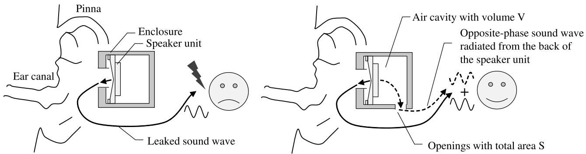  
FIGURE 1. A conventional open-ear headphone with a fully sealed enclosure (left) and our design for an open-ear enclosure that mitigates leakage using opposite-phase wave from the back of speaker unit (right). The latter has a back air cavity of volume V and side-openings of area S that emit opposite-phase waves.

However, because the space between the headphone enclosure and the ear canal is open, sound waves radiated from the headphones can easily leak into the surroundings [21], [22], [23]. This phenomenon, generally referred to as sound leakage, occurs when part of the radiated sound escapes into the surrounding environment rather than reaching the listener’s ear. Although the term ‘‘sound leakage’’ is sometimes also used to describe the intrusion of external noise (i.e., poor sound isolation), in this paper we strictly define it as the outward radiation of sound from the headphones into the surrounding environment. This sound leakage makes them difficult to use in public spaces where there are people around. Therefore, mitigating sound leakage is a significant challenge for open-ear headphones.

Audio signal processing and speaker array signal processing have been used as methods to mitigate sound leakage to achieve local reproduction. In audio signal processing, there is a method that mitigates sound leakage by controlling the volume and positioning of groups of instruments in an object-based audio signal, especially at frequencies prone to leakage [24]. However, such methods may result in limiting the volume or altering the timbre during listening as a side effect of mitigating sound leakage. Methods based on loudspeaker arrays include parametric loudspeakers [25], methods based on evanescent waves [26], [27], and methods using linear or circular arrays [28], [29], [30]. However, since these require many speakers, they are difficult to commercialize as an audio device for general consumers from a cost perspective. In addition, there is a method that amplifies ultrasonic waves in the high-frequency range and modulates them to produce audible sounds that vibrate the earlobe, enabling audible sound reproduction while mitigating sound leakage [31]. However, issues remain regarding sound quality, individual differences between users, dependence on the wearing position, and system complexity. Other techniques using small speaker arrays include end-fire wearable speakers [32], adaptive active noise control [33], non-adaptive active noise control [34], and enclosure-less speaker arrays [35]. In particular, enclosureless speaker arrays can realize near-field reproduction with only two speaker units per ear by adding a speaker unit that emits the opposite-phase sound waves to cancel out sound leakage through wave interference. However, speaker arrays are difficult to use in small open-ear headphones, which require portability, light weight, and low power consumption.

Therefore, this study proposes a method for designing enclosures for open-ear headphones that can mitigate sound leakage using only a single speaker unit. This method is based on the principle of mitigating sound leakage by radiating opposite-phase sound waves, as proposed by Fukui et al. [35]. Since the speaker unit radiates sound waves in the opposite-phase from its back, sound leakage can probably be cancelled by directing this opposite-phase sound wave to the outside of the enclosure. However, it is assumed that the sound leakage mitigation performance varies at each position due to the characteristics of the speaker unit itself, the transmission characteristics of the leaked sound waves, and the sound waves that cancel the leakage. Therefore, we propose an open enclosure design for open-ear headphones, as shown in Fig. 1, which can mitigate sound leakage even with a single speaker unit [36]. This is achieved by controlling the sound waves emitted from the back of the speaker unit using the enclosure’s structure. Particularly, the volume of the air cavity and the area of the openings in the enclosure at the back of the speaker unit can modify the resonance frequency within the housing at the back of the enclosure. In addition, the position of the openings in the back enclosure affects the directionality of opposite-phase sound waves. Thus, these parameters of the enclosure allow the frequency characteristics of the opposite-phase sound waves to be controlled without requiring a digital signal processor (DSP) or analog electronic circuits. Therefore, this paper investigates the feasibility of adjusting these enclosure design port positions and size to mitigate sound leakage without enlarging the enclosure. Because the size of the enclosure does not need to be changed, this paper focuses on the area and position of the openings.

## II. PRINCIPLE OF SOUND LEAKAGE CANCELLATION A. NEAR-FIELD REPRODUCTION IN DIPOLE RADIATION

The fundamental principle of our design is based on modeling the sound radiated from the front (positive-phase)

and back (opposite-phase) of a single speaker unit as an acoustic dipole. This approach is advantageous because dipole radiation exhibits distinct characteristics in the near and far fields, which can be leveraged to secure the necessary listening level for audio reproduction while simultaneously mitigating sound leakage.

To discuss near-field reproduction and sound leakage reduction performance, we use the magnitude ratio computed from the sound pressures of monopole and dipole sound sources with the same center o [37], [38]. This ratio at a near-field listening point u and a far-field leakage point v can be expressed by Eqs. (1) and (2), respectively.

$$
\frac { \left| p _ { u } \right| } { \left| p _ { u } ^ { ( m o n o ) } \right| } = k D \left| \cos \theta _ { u } \right| \sqrt { 1 + \frac { 1 } { k ^ { 2 } r _ { u } ^ { 2 } } } ,\tag{1}
$$

$$
\frac { | p _ { \nu } | } { | p _ { \nu } ^ { ( m o n o ) } | } = k D \left| \cos \theta _ { \nu } \right| ,\tag{2}
$$

where k is the wavenumber and D is the distance between the dipole sources. For the near-field listening point $u , ~ r _ { u }$ and $\theta _ { u }$ denote the distance and angle from the source center, respectively. Similarly, for the far-field leakage point v, $\theta _ { \nu }$ denotes the angle from the source center. A graphical representation of these equations is provided in Appendix A.

The key insight of our approach lies in the strategic use of the term $\sqrt { 1 + 1 / ( k ^ { 2 } r _ { u } ^ { 2 } ) }$ in Eq. (1). This term, which represents the proximity effect well-known in pressuregradient microphones [39], [40], is significant only in the near field $\begin{array} { r l r l } { ( k r _ { u } } & { { } \ll } & { 1 ) } \end{array}$ . We leverage this effect to enhance the low-frequency response at the listening point, counteracting the inherent high-pass nature of the dipole’s far-field radiation (the kD |cos $\theta _ { \nu } |$ term). This allows for a sufficient sound pressure level for the listener at close range, ensuring the required listening level. In contrast, at the farfield leakage point, this proximity term vanishes as shown in Eq. (2), and the sound pressure level attenuates with decreasing frequency, which is advantageous for reducing sound leakage.

However, as the frequency increases, both the enclosure housing the speaker unit and the shape of the ear can affect sound leakage especially. Therefore, a model that takes these factors into account should be designed.

## B. TRANSFER FUNCTION MODEL CONSIDERING SOUND FIELD IN REAL SPACE

To analyze sound leakage in a practical usage scenario, we model the acoustic paths from the headphone to an external observation point, considering the effects of the enclosure, head, and pinna. Assuming a linear time-invariant system as depicted in Fig. 2, the sound pressure $Y ( f , r )$ at an observation point r is the sum of the contributions from the front and back of the speaker driver. The sound pressure is given by

$$
\begin{array} { r } { Y ( f , r ) = H _ { + , o } ( f , r ) H _ { + , i } ( f ) S _ { + } ( f ) } \\ { + H _ { - , o } ( f , r ) H _ { - , i } ( f ) S _ { - } ( f ) , } \end{array}\tag{3}
$$

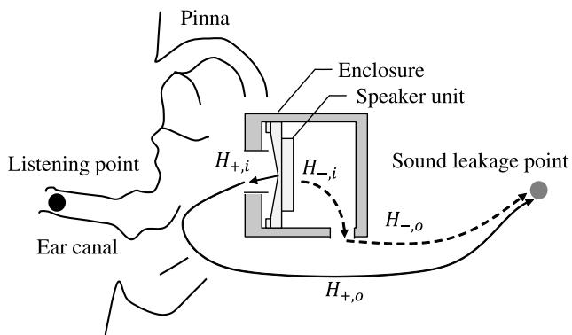  
FIGURE 2. Transfer function models in the open-back enclosure for open-ear headphones. ${ \pmb { H } } _ { \cdot , { \pmb { i } } }$ is a transfer function from the inside of the enclosure to the sound wave radiation opening of the enclosure. H·,o is a transfer function from the opening to sound leakage points. + and − denote the sound phase emitted from the front of the speaker unit and opposite-phase sound emitted from the back of the speaker unit, respectively.

where the subscripts + and − denote the positive-phase wave from the front of the driver and the opposite-phase wave from the back, respectively. $H _ { \cdot , i } ( f )$ is the internal transfer function from the driver to the enclosure’s opening, and $H _ { \cdot , o } ( f , r )$ is the external transfer function from the opening to the observation point r. The source signals S·(f) include the electro-mechano-acoustical characteristics of the driver.

The principle of sound leakage mitigation is to minimize the sound pressure $Y ( f , r )$ at the observation point. According to Eq. (3), this is achieved when the two terms on the right-hand side are approximately equal in amplitude and opposite in phase, causing destructive interference. Assuming $\begin{array} { l l l } { S _ { + } ( f ) } & { \approx } & { - S _ { - } ( f ) } \end{array}$ in the target frequency range, the ideal internal transfer function for the opposite-phase wave, $H _ { - , i } ( f )$ , is given by

$$
H _ { - , i } ( f ) = \frac { H _ { + , o } ( f , r ) H _ { + , i } ( f ) } { H _ { - , o } ( f , r ) } .\tag{4}
$$

The external transfer functions $H _ { + , o }$ and $H _ { - , o }$ are determined by the head and pinna geometry and are difficult to control. The internal function $H _ { + , i }$ should be designed to be approximately unity to preserve the listening sound quality. Therefore, we focus on designing $H _ { - , i }$ to satisfy Eq. (4). This equation implies that $H _ { - , i } ( f )$ must compensate for the mismatch between the external paths. At a leakage point behind the listener, the path from the front opening is longer than from the back opening. This path difference requires that $H _ { - , i } ( f )$ introduce a corresponding delay to the opposite-phase wave. Furthermore, at high frequencies, especially those exceeding 10 kHz, the short wavelength makes phase-based cancellation sensitive to small geometrical variations, increasing the risk of constructive interference. To prevent this, $H _ { - , i } ( f )$ should ideally exhibit low-pass characteristics. Our enclosure design, detailed in the next section, aims to realize such a transfer function acoustically.

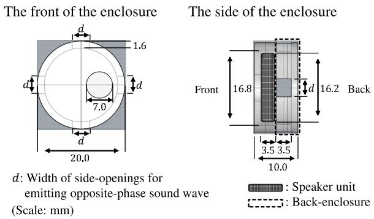  
FIGURE 3. Front (left) and side (right) views show our enclosure design that contains a single speaker unit for open-ear headphones. The 7.0-mm-diameter opening on the front view radiates sound waves from the front of the speaker unit toward the ear. The parameter d is the width of the side openings for emitting opposite-phase sound waves from the back of the speaker.

## III. ENCLOSURE DESIGN TO MITIGATE SOUND LEAKAGE FOR OPEN-EAR HEADPHONES

## A. OPPOSITE-PHASE SOUND WAVES RADIATION FROM SIDE-OPENINGS

To acoustically realize the ideal transfer function $H _ { - , i }$ discussed in Sec. II, we propose the enclosure design shown in Fig. 3. The core of this design lies in the geometric arrangement of the radiation openings. Two factors are critical: the distance between the positive and opposite-phase openings, and the orientation of the resulting dipole axis.

First, reducing the distance between the openings enhances far-field cancellation, which is an effective principle for mitigating sound leakage. However, if the openings are excessively close, the cancellation effect extends to the near field and degrades the low-frequency response for the listener. Therefore, the openings must be positioned at an appropriate distance to balance far-field leakage reduction with near-field listening quality.

Second, the dipole radiation is strongest along its axis. To minimize leakage in the horizontal plane, which is critical in practical use, the dipole axis should be oriented away from this plane. The side-opening configuration addresses this by orienting the dipole axis vertically.

The purpose of incorporating four side-openings, placed symmetrically at $9 0 ^ { \circ }$ intervals, is to mitigate performance variations caused by differences in wearing position and individual ear shapes. This symmetrical configuration is intended to average out directional radiation biases, thereby aiming for more consistent leakage mitigation across various use cases.

## B. CONTROL OF OPPOSITE-PHASE SOUND WAVES BY AIR CAVITY DESIGN AT THE BACK OF THE ENCLOSURE

While the geometric arrangement of the openings discussed in Sec. III primarily controls the radiation directivity, it is insufficient to fully realize the frequency-dependent characteristics required by the ideal transfer function $H _ { - , i }$ derived in Sec. II. To acoustically shape this frequency response, we design the back air cavity and its openings to function as a Helmholtz resonator.

The resonance frequency fH of this resonator is given by [41]

$$
f _ { H } = \frac { c } { 2 \pi } \sqrt { \frac { S } { V ( L + \delta ) } } ,\tag{5}
$$

where c is the speed of sound, V is the cavity volume, S is the opening area, L is the duct length, and δ is the end correction. In this paper, we use $\delta = \sqrt { S }$ . The total opening area S is defined as

$$
S \approx N _ { S } h d ,\tag{6}
$$

where $N _ { S } = 4$ is the number of openings, and the height of each opening is 3.5 mm, as shown in Fig. 3. The enclosure has a fixed volume $\begin{array} { r l r } { V } & { { } \approx } & { 5 8 3 ~ \mathrm { \ m m } ^ { 3 } } \end{array}$ and duct length $L = 1 . 6$ mm. Given the constraints on enclosure size, which fix V and L, we control $f _ { H }$ by adjusting the opening width d, thereby changing the total area S.

This resonator design provides two key acoustic effects required for $H _ { - , i } .$ First, the phase of the opposite-phase wave changes rapidly around $f _ { H }$ , which introduces the necessary group delay. Second, for frequencies above $f _ { H }$ , the resonator acts as a low-pass filter, attenuating the opposite-phase wave. This attenuation is crucial for preventing constructive interference at high frequencies where phase-based cancellation becomes unreliable. The subsequent sections will evaluate how adjusting the opening width d affects leakage mitigation performance through simulations and measurements.

## IV. SIMULATION EVALUATION A. CONDITIONS

To simulate the effect of the characteristics of opposite-phase sound waves emitted from the side-opening enclosures on sound leakage, finite element method (FEM) analysis using Actran [42] was performed on five models with different opening widths d on the air cavity of the back enclosure shown in Fig. 3. The mesh size was set to 2.8 mm. The vibration conditions were given a velocity frequency response, calculated using an equivalent circuit derived from the amplitude characteristics of the speaker unit at 0.5 Vrms input. The frequency response of this loudspeaker unit was modeled to match the front-side characteristics of that used in the actual experiment. Note that the opposite-phase sound waves from the back of the speaker unit have the same frequency characteristics as the positive-phase sound waves from the front of the speaker unit in this simulation. The five different 3D models used in our FEM simulation at the top of Fig. 4 are based on the enclosure model shown in Fig. 3. The models have a cylindrical shape with a diameter of 20 mm, and a 7.0 mm diameter opening for radiating positive-phase sound waves on the front surface of the cylinder. The four side-openings for the opposite-phase wave, equally spaced at 90◦ intervals, each have a height of 3.5 mm. The width d was set to 0.0, 2.0, 4.0, or 6.0 mm for each model. Here, $d = 0 . 0$ mm is a back-sealed enclosure that does not emit opposite-phase sound waves. In addition, an enclosure model with back openings was also prepared. This model has four openings, corresponding to the side-opening models with $d ~ = ~ 4 . 0 ~ \mathrm { m m }$ , to investigate the effects of the positions of the openings for opposite-phases. From Eqs. (5) and (6) in Sec. III, as the models have the openings for oppositephase, the resonant frequency of the air cavity at the rear of the enclosure increases as the area (proportional to the side-opening width d) increases, and the characteristics of the opposite-phase sound waves change in accordance with resonant frequency. Therefore, the amplitude and phase characteristics of the opposite-phase sound waves emitted from the side of the enclosure are expected to change at lower frequencies with smaller opening areas of the back air cavity than in the enclosure with a larger area.

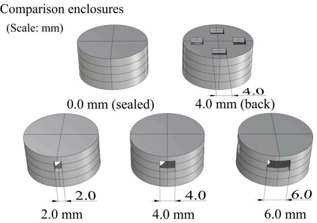

Measurement environment  
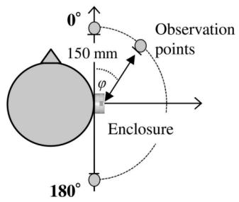

Position of the enclosure relative to the ear  
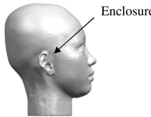  
(a) Side view

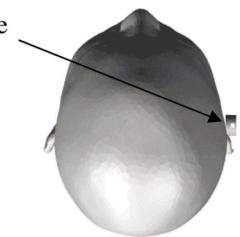  
(b) Top view  
FIGURE 4. Overview of the experimental conditions and enclosure designs used in the FEM simulations. The top blueprint shows five enclosure models with different side-opening widths (0.0 mm (sealed), 2.0 mm, 4.0 mm, 6.0 mm, and 4.0 mm (back)), all with a cylindrical shape and specified openings configurations. The middle diagrams illustrate the measurement setup for the condition where the enclosure is attached to the right ear of a dummy head. Observation positions for sound leakage evaluation are arranged on a semicircular plane 150 mm from the rear of the enclosure at various angles. The bottom images show the relative position of the enclosure to the ear from side and top views.

TABLE 1. A comparison of the theoretical and simulated values of the Helmholtz resonance frequency of opposite-phase sound waves in enclosure models with an opening width of d.
<table><tr><td>d of the enclosures</td><td>2.0 mm</td><td>4.0mm</td><td>6.0mm</td></tr><tr><td>Theoretical values</td><td>4,517 Hz</td><td>5,565 Hz</td><td>6,260 Hz</td></tr><tr><td>with Eq. (5) and (6)</td><td></td><td></td><td></td></tr><tr><td>Simulated values</td><td>4,559 Hz</td><td>5,744 Hz</td><td>6,752 Hz</td></tr></table>

This study focuses on the head-attached condition, which represents the practical use case for headphones. The analysis under free sound field conditions, which confirms the fundamental acoustic principles of the dipole radiation and the enclosure characteristics, is provided in Appendix D. The observation points for evaluating the sound pressure level of sound leakage L(f, φ) were computed by placing the observation points 150 mm away on a semicircular horizontal plane at the back of the enclosure at 5-degree intervals, as shown in the middle of Fig. 4. Here, φ represents the angle of an observation point in our measurement coordinate system, which is distinct from the theoretical angles $\theta _ { u }$ and $\theta _ { \nu }$ used in Sec. II. For the condition in which the enclosure was attached to the right ear of the dummy head, the analysis was performed using the mean male head model [43], as shown at the bottom of Fig. 4. In the condition with the dummy head, the sound pressure level at the listening point $L _ { r e f } ( f )$ was also computed. These levels are used as reference values for evaluating listening sound quality as well as sound leakage, as described in Sec. VI. Note that $L _ { r e f }$ was computed at the entrance of the external ear canal, since the ear canal of the head model is blocked. In other words, this simulation does not take into account the acoustic characteristics of the ear canal and eardrum. In the evaluation at the listening point, the frequency spectrum of the sound pressure level without frequency weighting is evaluated in order to confirm whether the headphones have unnatural frequency characteristics. On the other hand, since sound leakage is considered noise, the sound pressure level is weighted using the A-weighting to incorporate auditory characteristics. In this paper, the A-weighted sound pressure level at the point where sound leakage is observed is referred to as the sound leakage level. The simulation calculates the amplitude characteristics of the positive and negative waves, as well as their mixed waves. From these results, we investigate how closely the amplitude characteristics of the positive and negative waves match, and how this affects the amplitude characteristics of the listening sound and sound leakage. Additionally, at the sound-leakage observation points, we calculate the phase difference between the positive and negative waves without considering their amplitude characteristics. By examining this phase difference, we can analyze whether the phase relationship at each frequency is appropriate for soundleakage mitigation. In the analysis of the listening sound, we also determine the phase characteristics of the mixed wave that influence sound quality.

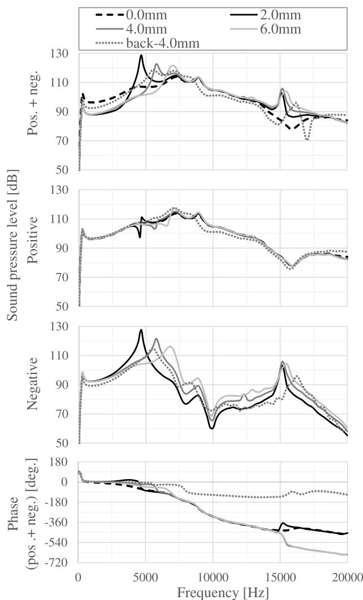  
FIGURE 5. Sound pressure levels and phases on listening under the head-attached simulation with five enclosure models with 0.0 mm (sealed), 2.0 mm, 4.0 mm, 6.0 mm, and 4.0 mm (back). From top to bottom, the graphs show the sound pressure level of the sum of positive-phase and opposite-phase sound waves (Pos. + Neg.), the positive-phase sound waves only (Positive), the opposite-phase sound waves only (Negative), and the phase of the mixed wave (Pos. + Neg.). The sound leakage level is shown in dB, and the phase difference is shown in degrees. These results simulate the frequency characteristics of the listening sound at the entrance of the external ear canal on the open-ear headphones with the enclosure models.

## B. SIMULATION RESULTS UNDER HEAD-ATTACHED CONDITIONS

We now evaluate the listening sound volume and sound leakage under the head-attached condition, which is the primary focus of this study.

Fig. 5 shows the simulated listening sound characteristics for five enclosure models under head-attached conditions.

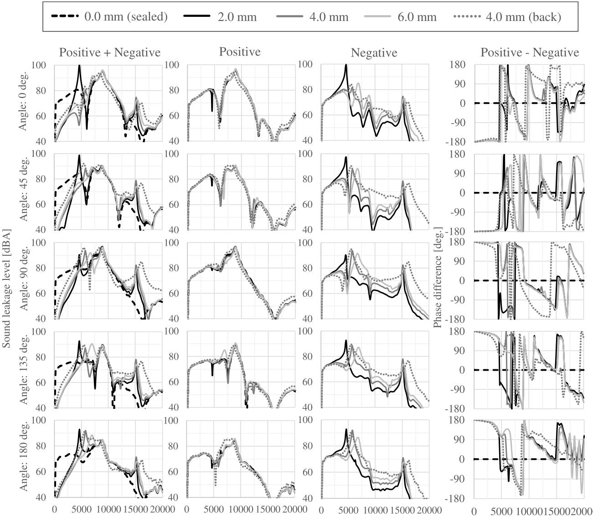  
FIGURE 6. Sound leakage levels and phases under the head-attached simulation with five enclosure models with 0.0 mm (sealed), 2.0 mm, 4.0 mm, 6.0 mm, and 4.0 mm (back). From left to right, the graphs show the sound pressure level of the sum of positive-phase and opposite-phase sound waves (Pos. + Neg.), the positive-phase sound waves only (Positive), the opposite-phase sound waves only (Negative), and the phase of the mixed wave (Pos. + Neg.). Each row corresponds to the observation angle (0◦, 45◦, 90◦, 135◦, and 180◦ relative to the rear of the dummy head. The sound leakage level is shown in dBA, and the phase difference is shown in degrees.

From top to bottom, the graphs show the sound pressure level of the sum of positive-phase and opposite-phase sound waves (Pos. + Neg.), the positive-phase sound waves only (Positive), the opposite-phase sound waves only (Negative), and the phase of the mixed wave (Pos. + Neg.). These results show that the low-frequency sound pressure level of the listening sound is highest in closedback headphones, followed by rear-open headphones and side-open headphones. This trend is consistent with the discussion of dipole sources in Sec. II. Additionally, near the Helmholtz resonance frequency of the back cavity, the sound pressure level of the received sound is also high. Here, Table 1 shows the theoretical and simulated resonance frequencies of Helmholtz resonance in the cavity behind the enclosure. The former is calculated from Eqs.(5) and (6), and the latter is the peak frequency of the opposite-phase wave in the simulations. These frequencies correspond well with the peaks observed in the listening sound and sound leakage characteristics. Therefore, in practical terms, to reduce the influence of opposite-phase waves on the listening sound, the Helmholtz resonance may need to be controlled so that it does not have a sharp peak.

Fig. 6 shows the simulated sound leakage characteristics for five enclosure models under head-attached conditions. From left to right, each column shows the sum of positiveand negative-phase sound waves, positive-phase sound waves only, negative-phase sound waves only, and the phase difference between positive- and negative-phase sound waves. Each row corresponds to a different observation angle, 0, 45, 90, 135, and 180 degrees, relative to the back of the enclosure.

At all angles, the back-sealed enclosure (0.0 mm) exhibits significantly greater sound leakage than the open-type models at frequencies below approximately 4,000 Hz. This result demonstrates that the principle of emitting an oppositephase wave contributes to the reduction of sound leakage, particularly in the low-frequency range. In the models with openings, the behavior of the negative-phase waves and the resulting mixed waves clearly shows the effect of Helmholtz resonance, with the peak frequencies corresponding well to the values in Table 1. This confirms that the amplitude and phase characteristics of the opposite-phase wave can be controlled by adjusting the Helmholtz resonance frequency of the back air cavity. It is important to note, however, that this comparison is based on absolute sound pressure levels, and as shown in Fig. 5, the listening point sound level also varies between models. A more practical evaluation considering this difference will be discussed in Sec. VI.

The acoustic properties are also strongly influenced by the head and ears, causing the frequency characteristics to vary with the observation angle φ. Specifically, at an angle of 180 degrees, where the observation point is shielded by the pinna, sound leakage tends to be suppressed compared to other angles. The phase difference plots (rightmost column) show that for models with a smaller opening width d, the phase relationship deviates more from the ideal anti-phase at low frequencies. However, the phase inverts near the resonance frequency, bringing it closer to the anti-phase relationship required for cancellation. A significant leakage peak remains near the resonance frequency itself, where the level of the opposite-phase wave is highest. The steepness of this peak should be considered in the design, although it is expected to be gentler in a real environment due to acoustic damping effects. It should also be noted that a lower Helmholtz resonance frequency acts as a low-pass filter for the opposite-phase wave, which can help mitigate sound leakage at high frequencies where cancellation by interference is difficult.

These results suggest that the opening width d is an effective parameter for controlling the leakage characteristics. By adjusting the enclosure’s Helmholtz resonance, the sound pressures of the positive- and opposite-phase waves can be balanced at the observation point, and their phase relationship can be brought closer to an ideal anti-phase, resulting in enhanced cancellation. Furthermore, a comparison between the d = 4.0 mm and d = 4.0 mm (back) models reveals that side-openings are more advantageous for mitigating sound leakage below 7,000 Hz, even at the same Helmholtz resonance frequency. This is likely because, as discussed with dipole sources, a smaller distance between the positive and negative radiation points reduces the sound pressure level in the far field.

Overall, these simulation results demonstrate that the enclosure design can effectively control sound leakage and phase relationships under head-attached conditions, and highlight the necessity of evaluating performance under realistic wearing conditions.

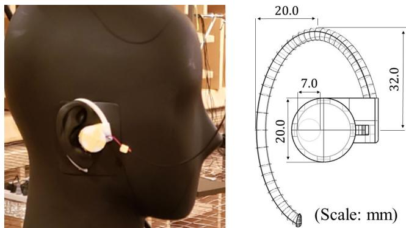  
FIGURE 7. Measurement jig with an ear hook for measurements when the enclosure is mounted on a dummy head, including a schematic with dimensions. This jig was fabricated using a stereolithography (SLA) 3D printer to ensure consistent and accurate positioning of the enclosures during the experiments.

## V. ACTUAL MEASUREMENT

## A. CONDITIONS

To investigate the performance of our enclosure design method in a more practical environment, actual sound leakage was measured in an anechoic chamber for the enclosure models and conditions shown in Fig. 4. The measuring microphone was a dbx RTA-M, the audio analyzer was an APx517B running APx500 v6.0 Audio Measurement Software, and the dummy head was the SAMREC 2700Pro. We placed microphones at each observation point shown in Fig. 4 and conducted measurements. To facilitate evaluations through actual measurement, necessary jigs and enclosures were fabricated using a stereolithography (SLA) 3D printer, Form3 from Formlabs.

Measurements were conducted with the headphone mounted on a dummy head to evaluate performance under practical conditions. The results from free-field measurements, which were used for fundamental validation, are provided in Appendix D. For the head-attached measurements, each back enclosure was attached to an earhook-equipped jig containing a speaker unit with a diameter of 16.2 mm, as shown in Fig. 7. The sound pressure level for each frequency was measured by playing a time-stretched pulse (TSP) signal from the speaker unit of the enclosure. During the measurements using the dummy head, the reference sound pressure level $L _ { r e f }$ was measured with the ear microphone of the dummy head.

## B. MEASUREMENT RESULTS UNDER HEAD-ATTACHED CONDITIONS

To evaluate the frequency response under head-attached conditions, Fig. 8 presents the listening sound characteristics for five enclosure models using a dummy head. A comparison with the simulation results in Fig. 5 shows that the sharp amplitude peaks observed near the Helmholtz resonance frequency in the simulation are attenuated and broadened in the measurement. Similarly, the overall sound pressure level at higher frequencies is lower in the measurement.

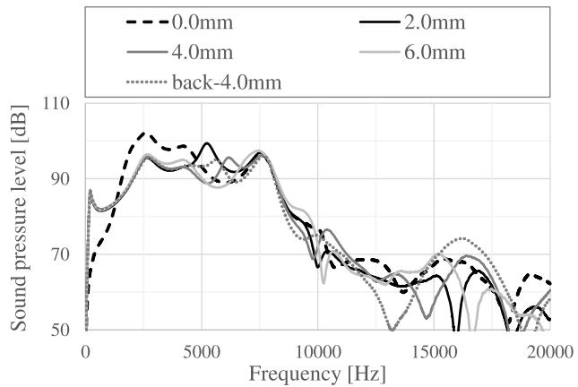  
FIGURE 8. Measured sound pressure levels at the listening point under the head-attached measurement conditions with five enclosure models with 0.0 mm (sealed), 2.0 mm, 4.0 mm, 6.0 mm, and 4.0 mm (back). The sound leakage level is shown in dB, and the phase difference is shown in degrees. These results are equivalent to the frequency characteristics of the listening sound at the eardrum on the open-ear headphones with the enclosure models.

These discrepancies are attributed to several factors not fully captured by the idealized simulation model. These factors include various acoustic damping mechanisms (e.g., viscous losses in the openings, absorption by the enclosure material, and atmospheric absorption during propagation) and the non-ideal behavior of the speaker unit at high frequencies. Therefore, the influence of the rear enclosure design on the listening sound quality is sufficiently small in a real environment. Furthermore, particularly at low frequencies below 1,000 Hz, the sound pressure level does not fall off, suggesting that the device performs sufficiently for near-field reproduction. In terms of tone color, the frequency characteristics are comparable to those of commercially available headphones [20]. Note that the back-sealed enclosure $( d = 0 . 0 \ : \mathrm { m m } )$ exhibits significantly different characteristics below 2,500 Hz compared to the simulation. In a loudspeaker with a back-sealed enclosure, the low-frequency resonance of the loudspeaker unit varies depending on the volume of the back air cavity. If the compliance of the air cavity is very small, this resonance frequency increases, and the loudspeaker’s efficiency at low frequencies decreases significantly [44]. In the simulation, the results differ from the actual measurements because the excitation signal is not properly coupled with the back cavity.

Fig. 9 shows the sound leakage characteristics for five enclosure models under head-attached conditions. From top to bottom, each row corresponds to a different observation angles (0, 45, 90, 135, and 180 degrees) relative to the back of the enclosure. Similar to the simulation results shown in Fig. 6, the measured models with side-openings radiating opposite-phase waves exhibit less sound leakage than the sealed enclosure (d = 0.0 mm) at all angles below 4,000 Hz. This indicates that the radiation of opposite-phase waves is effective in reducing sound leakage. It was also found that, at higher frequencies, the side-openings tend to result in lower sound leakage than the rear openings. In contrast to the simulation, the sharp leakage peaks observed near the Helmholtz resonance frequency are substantially damped in the measurement. This damping is due to the same real-world acoustic damping effects discussed for the listening point, which weaken the influence of the oppositephase wave. In particular, the opening width $d \ : = \ : 2 . 0$ mm showed the smallest sound leakage at frequencies below 7,000 Hz. Therefore, it is suggested that adjusting the amplitude and phase characteristics of the opposite-phase sound waves with the opening width is effective in reducing sound leakage affected by the head and ears.

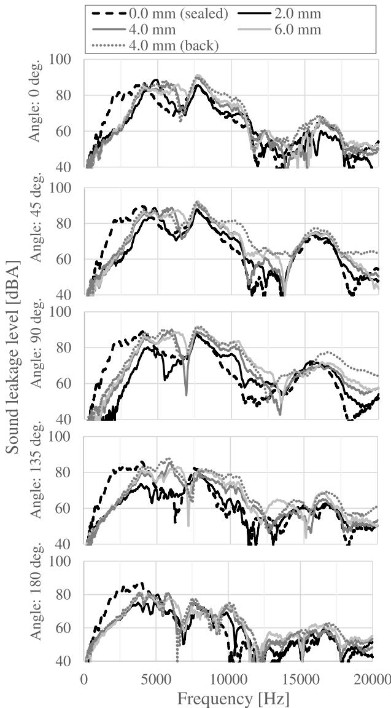  
FIGURE 9. Measured sound leakage levels under the head-attached simulation with five enclosure models with 0.0 mm (sealed), 2.0 mm, 4.0 mm, 6.0 mm, and 4.0 mm (back). Each row corresponds to the observation angle (0◦, 45◦, 90◦, 135◦, and 180◦) relative to the rear of the dummy head. The sound leakage level is shown in dBA, and the phase difference is shown in degrees.

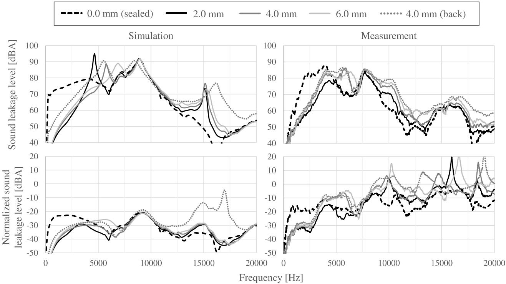  
FIGURE 10. The means of sound leakage levels across all angles for five enclosure models under head-attached conditions. The left and right graphs show simulation and actual measurement results, respectively. The upper row presents the means of A-weighted sound leakage levels, while the lower row shows the means of A-weighted sound leakage levels normalized by the sound pressure level at the listening point.

## VI. SOUND LEAKAGE EVALUATION

To demonstrate that the enclosure with openings for emitting opposite-phase sound waves exhibits low sound leakage, the sound leakage characteristics of each enclosure were compared in the simulation in Sec.IV and the actual measurement in Sec.V. However, several issues were identified. In particular, when attached to the head, the sound leakage characteristics varied with both angle and frequency due to the effects of the head and ear shape. Despite such trade-offs, for practical purposes, enclosure design decisions should be based on a small number of representative metrics. Additionally, the sound pressure levels at the listening points differed among enclosures. While this study primarily focuses on a passive enclosure design for reducing baseline sound leakage, it is recognized that practical applications may involve further acoustic tuning. For instance, perceived timbre can be refined through passive means like strategic use of damping materials or minor enclosure geometry adjustments. Beyond such passive measures, equalization via an audio player or headphone DSP could be employed for user-specific preferences or to address remaining variations, which can also indirectly aid in managing perceived leakage by ensuring appropriate listening levels. Therefore, to evaluate the inherent sound leakage characteristics of the passive designs, this study considers these potential practical adjustments when analyzing both simulation and measurement results.

For each enclosure, the means of A-weighted sound pressure level $L _ { \mathrm { A , m e a n } }$ are calculated as

$$
L _ { \mathrm { A , m e a n } } ( f ) = W _ { \mathrm { A } } ( f ) + { \frac { 1 } { N _ { \Phi } } } \sum _ { \phi \in \Phi } L ( f , \phi ) ,\tag{7}
$$

$$
\Phi = \{ \phi _ { k } | \phi = 1 5 k , k = 0 , 1 , \cdot \cdot \cdot , 1 2 \} ,\tag{8}
$$

where $W _ { \mathrm { A } } , L , N _ { \Phi }$ are A-weighting function in dB, sound pressure level that observed as sound leakage, and the number of angles. Here, the sound leakage angle φ was set at 15- degree intervals $( \mathrm { i . e . , ~ 0 ^ { \circ } , ~ 1 5 ^ { \circ } , ~ . . . , ~ 1 8 0 ^ { \circ } } )$ as shown in the middle of Fig. 4. In addition, the means of A-weighted sound pressure level normalized by the listening points $L _ { \mathrm { A , m e a n } } ^ { \mathrm { n o r m } }$ are calculated as

$$
L _ { \mathrm { A , m e a n } } ^ { \mathrm { n o r m } } ( f ) = W _ { \mathrm { A } } ( f ) + \frac { 1 } { N _ { \Phi } } \sum _ { \phi \in \Phi } ( L ( f , \phi ) - L _ { \mathrm { r e f } } ( f ) ) ,\tag{9}
$$

where $L _ { \mathrm { r e f } }$ is the sound pressure level of the listening point. Therefore, $L _ { \mathrm { A , m e a n } }$ and $L _ { \mathrm { A , m e a n } } ^ { \mathrm { n o r m } }$ represent the mean A-weighted sound leakage levels across various angles.

Furthermore, the frequency band means of sound leakage of each enclosure are calculated as

$$
S _ { \mathrm { A } , F } ( \phi ) = \frac { 1 } { N _ { F } } \sum _ { f \in F } ( W _ { \mathrm { A } } ( f ) + L ( f , \phi ) ) ,\tag{10}
$$

$$
S _ { \mathrm { A } , F } ^ { \mathrm { n o r m } } ( \phi ) = \frac { 1 } { N _ { F } } \sum _ { f \in F } ( W _ { \mathrm { A } } ( f ) + L ( f , \phi ) - L _ { \mathrm { r e f } } ( f ) ) ,\tag{11}
$$

$$
{ S } _ { \mathrm { A , \Phi } } = \frac { 1 } { N _ { \Phi } } \sum _ { \phi \in \Phi } { S } _ { \mathrm { A , F } } ( \phi ) ,\tag{12}
$$

$$
S _ { \mathrm { A , \Phi } } ^ { \mathrm { n o r m } } = \frac { 1 } { N _ { \Phi } } \sum _ { \phi \in \Phi } S _ { \mathrm { A , F } } ^ { \mathrm { n o r m } } ( \phi ) ,\tag{13}
$$

$$
F = \{ f _ { k } | f _ { k } = 1 0 0 0 + 2 5 0 k , k = 0 , 1 , \cdots , 2 4 \} ,\tag{14}
$$

where F and $N _ { F }$ are a set of linear discrete frequencies in the frequency band for evaluating sound leakage and the number of linear discrete frequencies. This frequency band is limited to frequencies where sound leakage can be mitigated by interference of the opposite-phase sound waves and was set from 1,000 up to 7,000 Hz in consideration of the results in Sects. IV and V.

The means of sound leakage levels over all angles that are calculated using Eqs. 7 and 9 for five enclosure models under head-attached conditions are shown in Fig. 10. The left and right graphs show simulation and measuremen results, respectively. The upper and lower graphs presen the means of A-weighted sound leakage levels and the means of A-weighted sound leakage levels normalized by the sound pressure level at the listening point, respectively. A notable difference exists between the simulation and measurement results. The most prominent difference is that the sharp resonance peaks observed in the simulation are significantly broader and lower in the measurement. This discrepancy is primarily attributed to various acoustic damping effects present in the real world, such as viscous losses in the openings and absorption by the enclosure material, which are not fully captured by the idealized simulation model. Despite these differences around the resonance peaks, the simulation successfully captures the key trends, including the approximate frequency of the resonances and the overall behavior as the opening width d is varied. This demonstrates the simulation’s value as a predictive tool for exploring design parameters in the frequency range below 10 kHz. Furthermore, as frequency increases, the model error tends to grow because the shorter wavelengths make the sound field more sensitive to minor geometrical details (e.g., the mountingjig, surface roughness) and non-ideal speaker behavior (e.g., diaphragm breakup modes) that are not included in the model. This explains the increasing divergence between simulation and measurement above approximately 10 kHz, reinforcing that the normalized leakage levels in this range should be interpreted with caution. Focusing on the effect of the enclosure geometry, several key trends are consistent across both simulation and measurement. Sound leakage is largest in the sealed enclosure at frequencies below approximately 4 kHz. In addition, sound leakage is smaller through side-openings than through back openings. Furthermore, with regard to the opening width $d ,$ sound leakage is smaller when the opening width is small, i.e., when the Helmholtz resonance frequency is low, except around the resonance peak. This consistency suggests that the phase delay in the opposite-phase wave, induced by the Helmholtz resonance, is effective in reducing sound leakage. However, $\ d \ = \ 4 . 0$ mm (back) has larger sound leakage than $\ d \quad = \quad 4 . 0$ mm. From this, it can be considered that the resonance frequency of Helmholtz resonance suitable for mitigating sound leakage differs depending on the relative opening position of the positive and negative phases. In particular, considering the high sensitivity of human hearing at 2-4 kHz, the proposed side-opening design is an effective structure for mitigating sound leakage. Above 7 kHz, the sealed type exhibits less sound leakage than the open types. This result suggests that more sound leaks from open enclosures due to opposite-phase radiation at these high frequencies. However, as the Helmholtz resonance frequency in the enclosure decreases, the Helmholtz resonance acts as a low-pass filter, mitigating sound leakage. In addition, it is considered possible to adjust the high-frequency characteristics of opposite-phase sound waves by using sound-absorbing materials, which are often used to improve headphone sound quality and prevent sound leakage, for high frequencies exceeding 10,000 Hz.

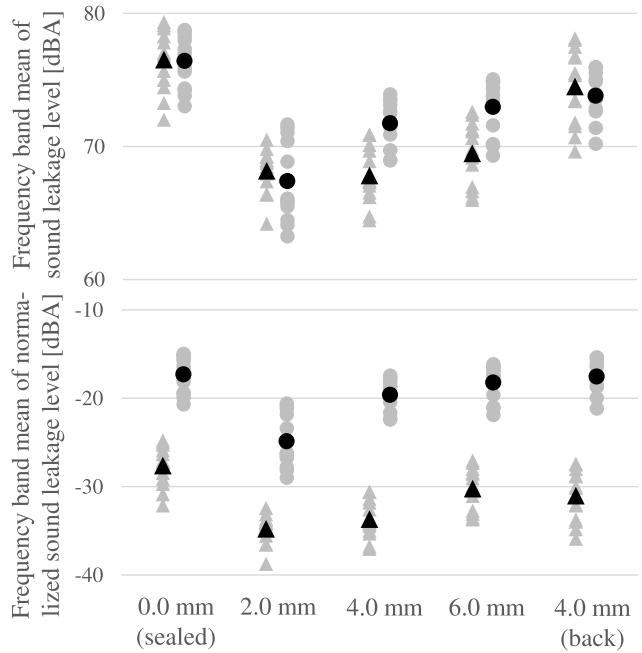  
FIGURE 11. The frequency band means of A-weighted sound leakage levels for five enclosure models under head-attached conditions. The triangles and circles represent simulation and actual measurement results, respectively. The gray and black markers show the mean for each angle and the overall means (averaged over all angles), respectively. The upper and lower rows present the angle-averaged A-weighted sound leakage levels and the angle-averaged A-weighted sound leakage levels normalized by the sound pressure level at the listening point, respectively.

Finally, to compare the sound leakage of each enclosure comprehensively, the sound leakage levels at each frequency are averaged to calculate scalar values as the sound leakage evaluation value. Fig. 11 presents the frequency band means of A-weighted sound leakage levels and normalized sound leakage levels for five enclosure models in the 1000-7000 Hz range, based on both the simulation and measurement. The results clearly show that the side-opening enclosure with an opening width of 2.0 mm achieves the lowest sound leakage among all models in measurements, in both the absolute and normalized metrics. This indicates that the 2.0 mm side-opening design is particularly effective at utilizing the Helmholtz resonance and opposite-phase radiation to reduce sound leakage in the frequency range where human hearing is most sensitive. In contrast, the back-opening model (4.0 mm back) exhibits higher sound leakage than the side-openings model with the same opening width, highlighting the importance of the opening positions. The sealed model, 0.0 mm (sealed), also shows higher leakage than the optimal side-opening design. These trends are consistent between simulation and measurement, demonstrating the validity of the proposed side-opening structure for practically mitigating sound leakage in the critical frequency band. Quantitatively, the side-opening model with a 2.0 mm opening width reduced the average normalized sound leakage level by 7.6 dB compared to the sealed model and 7.3 dB compared to the back-opening model with a 4.0 mm opening width in the 1,000–7,000 Hz range.

## VII. CONCLUSION

We designed enclosures for open-ear headphones that can mitigate sound leakage even with a single speaker unit. The proposed enclosure design mitigates sound leakage more effectively by controlling the characteristics of the opposite-phase sound wave to adjust several parameters in the enclosure structure. Specifically, its radiation characteristics are altered by placing the opening position on the side of the enclosure. Moreover, its amplitude and phase characteristics are controlled by changing the opening area and volume of the back cavity. In the finite element method (FEM) simulation, not only synthetic waves but also positive and negative waves were generated independently, enabling observation of changes in their frequency characteristics due to Helmholtz resonance occurring in the rear cavity. Specifically, the negative waves were found to have a peak of magnitude and phase inversion near the resonance frequency caused by Helmholtz resonance in the back air cavity. Furthermore, the resonance frequencies caused by Helmholtz resonance were proportional to the opening area of the rear enclosure. Therefore, we demonstrated the possibility of controlling the frequency characteristics of the opposite-phase sound waves by changing the opening area of the back enclosure. From the evaluation using simulation and measurement, we found that the side-opening enclosures we designed mitigate sound leakage up to 7 kHz more effectively than the sealed enclosure and the design with back-openings. We also demonstrated that by changing the opening area and adjusting the resonance frequency of the back air cavity, the sound leakage up to 7 kHz can be efficiently mitigated when the side-opening enclosure is attached to a head. In addition, by comparing the sound pressure of the dummy head ear microphones, we found that our enclosure minimally affects the sound received by the listener. Furthermore, both the simulation and measurement confirmed the occurrence of the proximity effect, where the low-frequency response was enhanced in the near field due to the dipole radiation characteristics of the proposed design. These results suggest that adjusting the parameters related to the back air cavity of the enclosure such as the area and positions is an effective way to mitigate sound leakage when the enclosure is worn on the ear.

Note that we evaluated sound leakage using a dummy head. However, high accuracy has been reported for personal authentication using sound leakage signals from open-ear headphones [45]. Therefore, sound leakage mitigation performance may differ due to individuals’ ear shapes. Moreover, the sound quality evaluation in this paper is based on the sound pressure level of the dummy head at the listening point within the audible frequency band. Specifically, we found in the proposed design that there were no significant distortions in the low-frequency levels or spectral shapes at audible frequencies during near-field reproduction. Nevertheless, subjective evaluation experiments should be conducted to evaluate tone and other characteristics in more detail. However, conducting comprehensive subjective evaluations remains a challenge. In particular, it is difficult to define appropriate reference sounds or target responses for open-ear headphone enclosures, since there are few standardized benchmarks for evaluating the perceived sound quality or leakage of such devices. Moreover, the perceptual impression of sound leakage may depend not only on the physical characteristics of the enclosure but also on the listening environment and the subjective sensitivity of each user. These factors complicate the design of a controlled and repeatable evaluation procedure. Future work should consider designing listening tests with appropriate anchors and evaluation metrics to investigate the perceptual characteristics of the proposed enclosures in more realistic scenarios.

## APPENDIX A GRAPHICAL REPRESENTATION OF THE DIPOLE RADIATION MODEL

This section provides the graphical representation of the dipole radiation model discussed in Sec. II of the main paper. Fig. 12 illustrates the concept of dipole radiation and the frequency characteristics of the magnitude ratio described by Eqs. (1) and (2).

The left panel of Fig. 12 compares a monopole source (a) with a dipole source (b), where the latter treats sound waves from the front and back of a speaker as two point sources with opposite phases. The right panel shows the calculated magnitude ratio for various dipole parameters. These include the source separation D, the distances $r _ { u }$ and $r _ { \nu }$ from the source center to the near-field listening point u and the far-field leakage point v, and their respective observation angles $\theta _ { u }$ and $\theta _ { \nu }$ . The plots visually confirm the key characteristics discussed in the main text, namely the low-frequency boost at the near-field listening point u due to the proximity effect, and the attenuation of low frequencies at the far-field leakage point v. This visualization supports the theoretical foundation that dipole radiation is inherently advantageous for open-ear headphone design, enabling sufficient low-frequency response for the listener while naturally reducing low-frequency sound leakage to the surroundings.

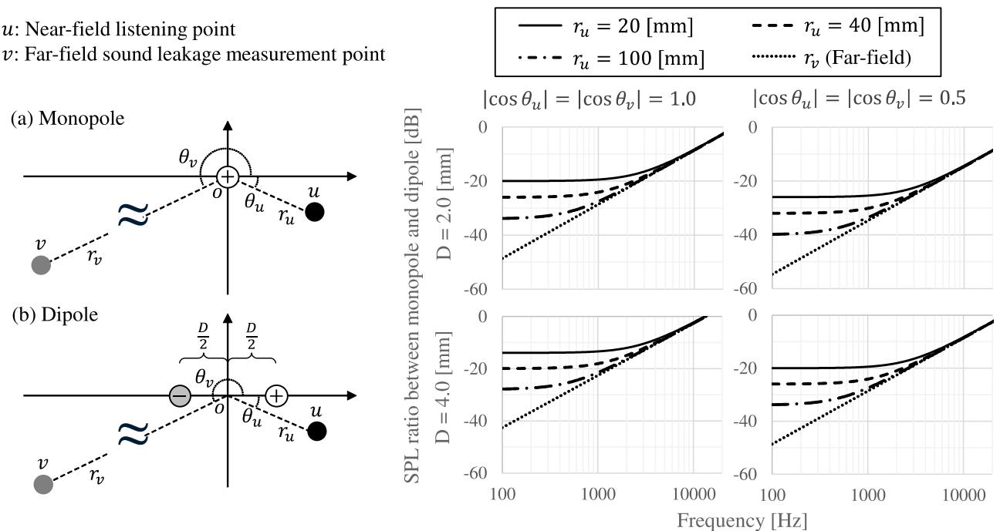

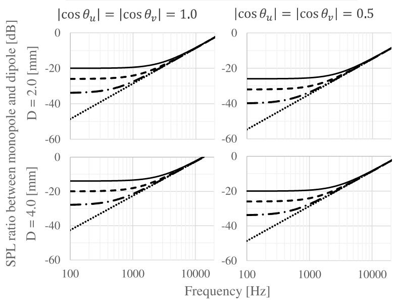  
FIGURE 12. Comparison for monopole radiation and dipole radiation (left), and relationship between listening levels and sound leakage levels using their magnitude ratio (right). The latter depends on the distance and center angle between dipole sound sources. As the distance increases o the angle approaches 0◦ or 180◦, both listening levels and sound leakage levels increase.

## APPENDIX B CHARACTERISTICS OF THE SPEAKER UNIT

This appendix shows the characteristics of sound waves emitted from the front and opposite-phase waves emitted from the back of the speaker unit used in Sec. V. This measurement was conducted in an anechoic chamber. The speaker unit was fixed in a sealed box with a sufficiently large volume, and only the sound waves from one side of the speaker unit were measured. The speaker unit is a dynamic type with a circular shape and a diameter of 16.2 mm. By using the same microphone and audio analyzer as in Sec. V, the sound pressures were measured. The microphone position is 5 cm away from the surface of the speaker unit. To compare amplitude characteristics, sound pressure levels and their differences were computed. Additionally, phase differences independent of amplitude characteristics were computed to compare phase characteristics. Fig. 13 shows the sound pressure level, sound pressure level difference, and phase difference. The first and third quartiles at 100 to 7,000 Hz are shown as dashed and dash–dot lines, respectively, for the pressure level difference and phase difference. The median, first quartile, and third quartile are shown in Table 2. These results suggest that from 100 to 7,000 Hz, the characteristics of the front and back of the speaker units used in this paper are approximately equal. On the other hand, above 7,000 Hz, the differences in amplitude and phase are large. This may be because the mechanical and acoustic characteristics of the speaker unit, such as the magnetic circuit, differ between the front and back surfaces.

TABLE 2. Summary of the distributions for sound pressure level (dBSPL) and phase (degrees) differences. Values shown are the median, first quartile, and third quartile over frequencies from 100 to 7,000 Hz.
<table><tr><td>Metric</td><td>Median</td><td>1st Quartile</td><td>3rd Quartile</td></tr><tr><td>dBSPL</td><td>0.35</td><td>-0.84</td><td>1.09</td></tr><tr><td>Phase [deg.]</td><td>179.50</td><td>174.04</td><td>185.64</td></tr></table>

## APPENDIX C SURVEY OF CONDITIONS FOR SIDE-OPENING AREAS

To clarify in more detail the relationship between the side-opening width d and Helmholtz resonance on the back cavity shown as the top-right panel of Fig. 10, the sound leakage characteristics are discussed with additional measurement shown in Fig. 14. This result presents the measured angle-averaged A-weighted sound leakage levels for side-opening enclosures under head-attached conditions, with added data for opening widths d = 3.0 mm and d = 5.0 mm. When viewed in conjunction with the measured results for d = 2.0 mm, d = 4.0 mm, and d = 6.0 mm, this figure more clearly shows the continuous trend in the measured data. As the opening width d varies, the peak frequency of sound leakage reduction and the overall leakage levels shift smoothly. This reinforces that the enclosure’s opening width d is an effective design parameter for continuously adjusting sound leakage characteristics in practical scenarios.

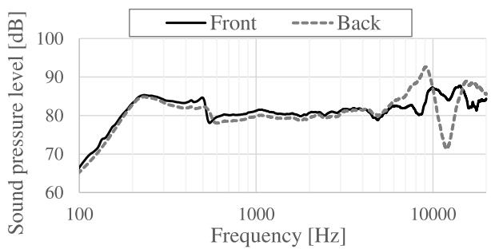

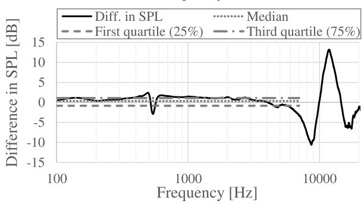

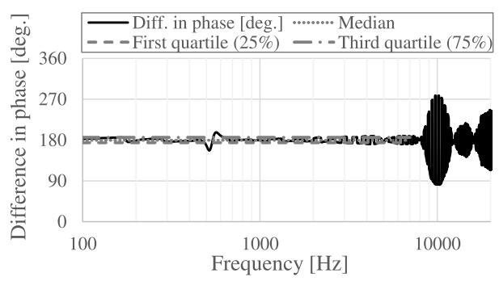  
FIGURE 13. Characteristics of one surface of the speaker unit used in Sec. V. The dashed curve named ‘‘Back’’ corresponds to a sound wave of opposite-phase. The sound pressure level (top), difference in sound pressure level (middle), and phase difference (bottom) were computed. For the differences in sound pressure level and phase, the median (dotted), 1st quartile (dashed), and 3rd quartile (dash–dot) are shown over frequencies from 100 Hz to 7,000 Hz.

## APPENDIX D ANALYSIS UNDER FREE SOUND FIELD CONDITIONS

This survey provides the results of simulations and actual measurements conducted in a free sound field. This analysis was performed for the fundamental validation of the proposed enclosure design, confirming the basic acoustic principles of dipole radiation and Helmholtz resonance in an idealized environment, free from the complex acoustic effects of the head and pinna.

## A. SIMULATION IN A FREE SOUND FIELD

The simulation conditions, including the five enclosure models, were identical to those described in Sec. IV of the main paper. For the free sound field analysis, the enclosure models were placed in an anechoic environment. The observation points for sound leakage were arranged on a semicircular plane 150 mm from the rear of the enclosure, consistent with the setup shown in Fig. 15. Due to the symmetry of the free sound field, results are presented for angles of 0◦, 45◦, and 90◦.

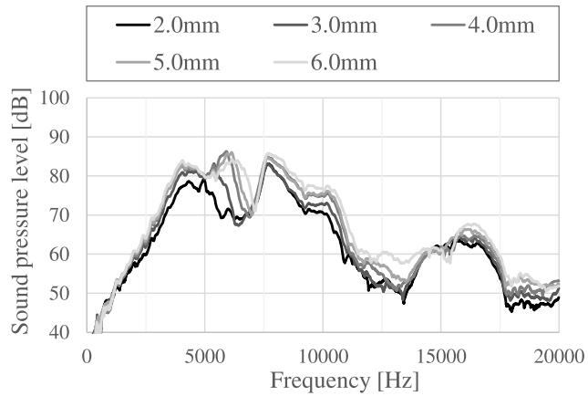  
FIGURE 14. Measured angle-averaged A-weighted sound leakage levels for side-opening enclosures with varying opening widths d (2.0, 3.0, 4.0, 5.0, and 6.0 mm) under head-attached conditions. This figure supplements the measurement data shown in the top-right panel of Fig. 10 by including d = 3.0 mm and d = 5.0 mm, illustrating the smooth transition of sound leakage characteristics with changes in d based on actual measurements.

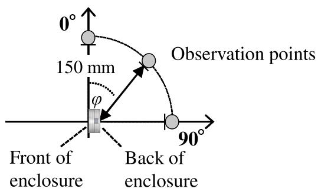  
FIGURE 15. The measurement setup for the free sound field condition. Observation positions for sound leakage evaluation are arranged on a semicircular plane 150 mm from the rear of the enclosure at various angles.

Fig. 16 shows the simulated sound leakage characteristics in a free sound field. The back-sealed enclosure (0.0 mm) exhibits greater sound leakage than the open-type models at frequencies below approximately 3,000 Hz at all angles. This result confirms that in an idealized environment, the principle of emitting opposite-phase sound waves contributes to reducing sound leakage at low frequencies. However, it can also be confirmed that the sound pressure level has angular dependence. In these models, there is a tendency that the sound pressure level at the most leaky observation point is small at 0 degrees, and the sound pressure level increases as the observation point approaches the axis formed by the dipole at 90 ◦.

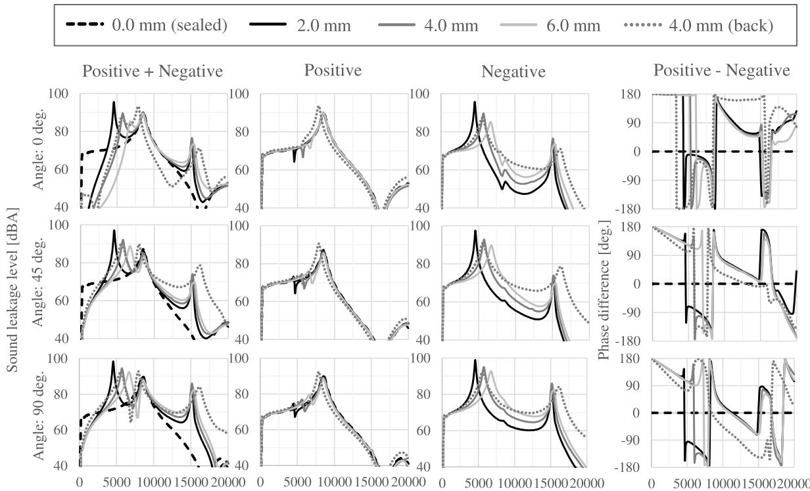  
FIGURE 16. Sound leakage characteristics in a free sound field for five enclosure models with different side-opening widths (0.0 mm (sealed), 2.0 mm, 4.0 mm, 6.0 mm, and 4.0 mm (back)). Each column shows, from left to right: the sum of positive- and negative-phase sound waves (Positive + Negative), positive-phase sound waves only (Positive), negative-phase sound wave only (Negative), and the phase difference between positive- and negative-phase sound waves (Positive - Negative). Each row corresponds to the observation angle (0◦, 45◦, and 90◦) relative to the rear of the enclosure. The sound leakage level is shown in dBA, and the phase difference is shown in degrees.

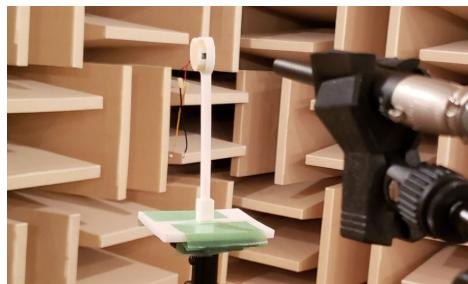  
FIGURE 17. Measurement jig for free-field conditions, fabricated using a stereolithography (SLA) 3D printer.

In the models with openings, the peak frequencies of the negative-phase waves correspond well with the theoretical Helmholtz resonance frequencies listed in Table 1 in the main paper. This demonstrates that the enclosure design effectively controls the characteristics of the opposite-phase wave via Helmholtz resonance. The phase difference plots show that near the resonance frequency, the phase inverts, bringing the relationship between the positive and negative waves closer to the ideal anti-phase required for cancellation. However, since the amplitude characteristic near the resonance frequency has a sharp peak, sound leakage is large.

Furthermore, a comparison between the $d = 4 . 0$ mm and $d \ = \ 4 . 0$ mm (back) models reveals that the side-opening configuration is more advantageous for mitigating sound leakage. This aligns with the dipole theory discussed in

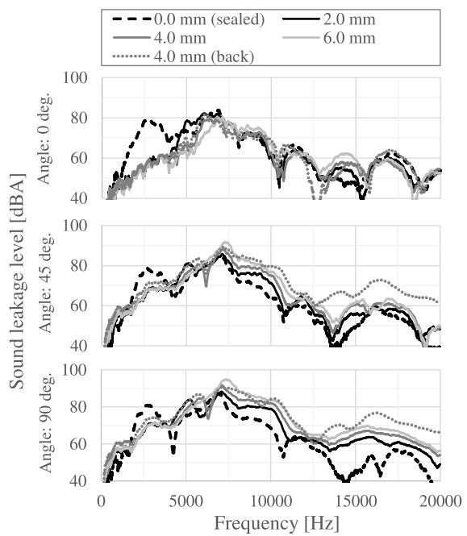  
FIGURE 18. Under actual measurement, sound leakage characteristics in a free sound field for five enclosure models with different side-opening widths (0.0 mm (sealed), 2.0 mm, 4.0 mm, 6.0 mm, and 4.0 mm (back)). Each row corresponds to the observation angle (0◦, 45◦, and 90◦) relative to the rear of the enclosure. The sound leakage level is shown in dBA.

Sec. II, as a smaller distance between the positive and negative radiation points reduces the sound pressure level in the far field. These findings validate the fundamental acoustic principles underlying our design in a controlled, free-field environment.

## B. ACTUAL MEASUREMENT IN A FREE SOUND FIELD

Actual measurements were conducted in an anechoic chamber using the same five enclosure models and measurement equipment described in Sec. V. For the free sound field measurements, we placed microphones at each observation point shown in Fig. 15 and conducted measurements. The jig shown in Fig. 17, fabricated by the SLA 3D printer, has a base added so that each enclosure in the top of Fig. 4 can be placed. The microphone was placed 150 mm from the rear of the enclosure at angles of $0 ^ { \circ } , 4 5 ^ { \circ }$ , and 90◦.

Fig. 18 shows the measured sound leakage characteristics in a free sound field. Note that only the mixed wave (the sum of positive- and negative-phase waves) can be observed in actual measurements. The results show a strong correspondence with the simulation results in Fig. 16 as a global trend in frequency characteristics. A key difference from the simulation is that the sharp resonance peaks are not observed in the measurement; instead, the response is smoother. This is attributed to the various acoustic damping effects present in the real world, as discussed in Sec. V of the main paper.

The back-sealed enclosure (0.0 mm) has a higher sound leakage level than the open-type models below approximately 4,000 Hz, confirming the effectiveness of the opposite-phase cancellation principle in a real-world free-field setting. The general trends, such as the superior performance of the side-opening configuration compared to the backopening one, are also consistent with the simulation. These measurement results provide experimental validation for the fundamental principles of the proposed enclosure design.

## REFERENCES

[1] Bose. (2025). What Are Open-Ear Headphones?. Accessed: Oct. 3, 2025. [Online]. Available: https://www.bose.com/stories/what-are-open-earheadphones

[2] Sound System Equipment—Part 7: Headphones and Earphones, IEC 60268-7, Geneva, Switzerland, Jan. 2010.

[3] H. Song, G. W. Shin, Y. Yoon, and S. Bahn, ‘‘The effects of ear dimensions and product attributes on the wearing comfort of wireless earphones,’ Appl. Sci., vol. 10, no. 24, p. 8890, Dec. 2020.

[4] S. Stenfelt and S. Reinfeldt, ‘‘A model of the occlusion effect with boneconducted stimulation,’’ Int. J. Audiology, vol. 46, no. 10, pp. 595–608, Jan. 2007.

[5] A. Winkler, M. Latzel, and I. Holube, ‘‘Open versus closed hearing-aid fittings: A literature review of both fitting approaches,’’ Trends Hearing, vol. 20, Jan. 2016, Art. no. 2331216516631741.

[6] J. Wang, S. Stenfelt, S. Wu, Z. Yan, J. Sang, C. Zheng, and X. Li, ‘‘The effect of stimulation position and ear canal occlusion on perception of bone conducted sound,’’ Trends Hearing, vol. 26, Jan. 2022, Art. no. 23312165221130185.

[7] S. Liebich and P. Vary, ‘‘Occlusion effect cancellation in head phones and hearing devices—The sister of active noise cancellation,’ IEEE/ACM Trans. Audio, Speech, Language Process., vol. 30, pp. 35–48, 2022.

[8] C. Mukhopadhyay, S. Basak, S. Gupta, K. Chawla, and I. Bairy, ‘‘A comparative analysis of bacterial growth with earphone use,’’ Online J. Health Allied Sci., vol. 7, no. 2, p. 4, 2008.

[9] F. Mueller and M. Karau, ‘‘Transparent hearing,’’ in Proc. CHI Extended Abstr. Human Factors Comput. Syst., Apr. 2002, pp. 730–731.

[10] F. Denk, H. Schepker, S. Doclo, and B. Kollmeier, ‘‘Acoustic transparency in hearables—Technical evaluation,’’ J. Audio Eng. Soc., vol. 68, nos. 7–8, pp. 508–521, Sep. 2020.

[11] G. Marentakis and R. Liepins, ‘‘Evaluation of hear-through sound localization,’’ in Proc. SIGCHI Conf. Human Factors Comput. Syst., Apr. 2014, pp. 267–270.

[12] J. Hebrank and D. Wright, ‘‘Spectral cues used in the localization of sound sources on the median plane,’’ J. Acoust. Soc. Amer., vol. 56, no. 6, pp. 1829–1834, Dec. 1974.

[13] D. Satongar, C. Pike, Y. Lam, and E. Al, ‘‘The influence of headphones on the localization of external loudspeaker sources,’’ J. Audio Eng. Soc., vol. 63, no. 10, pp. 799–810, Nov. 2015.

[14] C. Schneiderwind, A. Neidhardt, and D. C. Meyer, ‘‘Comparing the effect of different open headphone models on the perception of a real sound source,’’ in Proc. 150th Conv. Audio Eng. Soc., May 2021, Art. no. 10489. [Online]. Available: https://aes.org/publications/elibrary-page/?id=21082

[15] P. Lladó, R. Barumerli, R. Baumgartner, and P. Majdak, ‘‘Predicting the effect of headphones on the time to localize a target in an auditoryguided visual search task,’’ Frontiers Virtual Reality, vol. 5, Jun. 2024, Art. no. 1359987.

[16] R. Gupta, J. He, R. Ranjan, W.-S. Gan, F. Klein, C. Schneiderwind, A. Neidhardt, K. Brandenburg, and V. Välimäki, ‘‘Augmented/mixed reality audio for hearables: Sensing, control, and rendering,’’ IEEE Signal Process. Mag., vol. 39, no. 3, pp. 63–89, May 2022.

[17] J. Yang, A. Barde, and M. Billinghurst, ‘‘Audio augmented reality: A systematic review of technologies, applications, and future research directions,’’ J. Audio Eng. Soc., vol. 70, no. 10, pp. 788–809, Nov. 2022.

[18] Y. Watanabe, H. Chiba, K. Noguchi, H. Itou, and T. Kako, ‘‘Effects of acoustic transparency of wearable audio devices on audio AR,’’ in Proc. CHI Conf. Human Factors Comput. Syst., Apr. 2025, pp. 1–15.

[19] H. Møller, ‘‘Fundamentals of binaural technology,’’ Appl. Acoust., vol. 36, nos. 3–4, pp. 171–218, 1992.

[20] H. Møller, D. Hammershøi, C. B. Jensen, and M. F. Sørensen, ‘‘Transfer characteristics of headphones measured on human ears,’’ J. Audio Eng. Soc., vol. 43, no. 4, pp. 203–217, 1995.

[21] M. Avis and L. J. Kelly, ‘‘Principles of headphone design—A tutorial review,’’ in Proc. 21st Conf. Audio Home Audio Eng. Soc., 2006, pp. 1–11.

[22] C. Poldy. (2006). Headphone Fundamentals. Tutorial presented in the AES 120th Convention, Paris, France. [Online]. Available: http://www.aes.org/tutorials

[23] T. Welti, ‘‘Improved measurement of leakage effects for circum-aural and supra-aural headphones,’’ in Proc. 138th Conv. Audio Eng. Soc., May 2015, Art. no. 9275. [Online]. Available: https://aes.org/publications/elibrary page/?id=17699

[24] S. Suzuki, S. Miyabe, N. Kamado, H. Saruwatari, K. Shikano, and T. Nomura, ‘‘Audio object individual operation and its application to earphone leakage noise reduction,’’ in Proc. 4th Int. Symp. Commun., Control Signal Process. (ISCCSP), Mar. 2010, pp. 1–5.

[25] M. Nakayama, R. Konabe, T. Fukumori, and T. Nishiura, ‘‘Near-sound field propagation based on individual beam-steering for carrier and sideband waves with parametric array loudspeaker,’’ in Proc. Asia–Pacific Signal Inf. Process. Assoc. Annu. Summit Conf. (APSIPA), Dec. 2016, pp. 1–8.

[26] H. Itou, K. Furuya, and Y. Haneda, ‘‘Evanescentwave reproduction using linear array of loudspeakers,’’ in Proc. IEEE Workshop Appl. Signal Process. Audio Acoust. (WASPAA), Oct. 2011, pp. 37–40.

[27] H. Itou, K. Furuya, and Y. Haneda, ‘‘Localized sound reproduction using circular loudspeaker array based on acoustic evanescent wave,’’ in Proc. IEEE Int. Conf. Acoust., Speech Signal Process. (ICASSP), Mar. 2012, pp. 221–224.

[28] T. Okamoto, ‘‘Localized sound zone generation based on external radiation canceller,’’ J. Inf. Hiding Multimedia Signal Process., vol. 8, no. 6, pp. 1335–1351, 2017.

[29] T. Okamoto, ‘‘Horizontal local sound field propagation based on sound source dimension mismatch,’’ J. Inf. Hiding Multimedia Signal Process., vol. 8, no. 5, pp. 1069–1081, 2017.

[30] T. Okamoto, ‘‘3D localized sound zone generation with a planar omni directional loudspeaker array,’’ in Proc. IEEE Workshop Appl. Signal Process. to Audio Acoust. (WASPAA), Oct. 2019, pp. 110–114.

[31] M. Okamoto, ‘‘Open-air type ultrasonic earphone system combined with audible-band bone-conduction vibration,’’ IEICE Trans. Fundam. Electron., Commun. Comput. Sci. A, vol. 90, no. 52, pp. 73–82, 2007.

[32] K. Imaizumi and Y. Haneda, ‘‘Wearable sound reproduction system using two end-fire arrays,’’ in Proc. 142th Conv. Audio Eng. Soc., 2017, Art. no. 9768. [Online]. Available: https://aes.org/publications/elibrarypage/?id=18644

[33] A. Cha, S. W. Jeon, D. H. Youn, Y. Park, J. W. Choi, G. W. Lee, S. H. Kim, and Y. Kim, ‘‘Active control of sound leakage in handheld sound devices,’ in Proc. INTER-NOISE NOISE-CON Congr. Conf., 2012, pp. 5009–5018.

[34] G. W. Lee, A. Cha, S. H. Kim, Y. T. Kim, and J. W. Choi, ‘‘Reduction of sound leakage in handheld devices using open loop control,’’ Proc. Meetings Acoust., vol. 19, no. 1, May 2013, Art. no. 030056.

[35] M. Fukui, K. Kobayashi, and N. Kamado, ‘‘A seat headrest loudspeaker system with personalized sound zone capabilities,’’ in Proc. IEEE Int. Conf. Consum. Electron. (ICCE), Jan. 2024, pp. 1–2.

[36] H. Chiba, T. Kako, H. Ito, K. Noguchi, N. Kamado, and A. Nakayama, ‘‘PSZ spot-sound-reproduction technology: New sound-confinement method using opposite-phase sound waves,’’ NTTTech. Rev., vol. 22, no. 6, pp. 23–29, Jun. 2024.

[37] E. G. Williams, Fourier Acoustics: Sound Radiation and Nearfield Acoustical Holography. Cambridge, U.K.: Academic, 1990.

[38] D. A. Russell, J. P. Titlow, and Y.-J. Bemmen, ‘‘Acoustic monopoles, dipoles, and quadrupoles: An experiment revisited,’’ Amer. J. Phys., vol. 67, no. 8, pp. 660–664, Aug. 1999.

[39] J. Eargle, Electroacoustical Reference Data. Cham, Switzerland: Springer, 2012.

[40] A. Clifford and J. D. Reiss, ‘‘Proximity effect detection for directional microphones,’’ in Proc. 131th Conv. Audio Eng. Soc., 2011, Art. no. 8475. [Online]. Available: https://aes.org/publications/elibrary-page/?id=16001

[41] D. R. Raichel, The Science and Applications of Acoustics. Cham, Switzerland: Springer, 2006.

[42] Hexagon. Actran | Hexagon. Accessed: Mar. 14, 2024. [Online]. Available: https://hexagon.com/products/product-groups/computer-aidedengineering-software/actran/

[43] Digital Human Technology Inc. Accessed: Jan. 7, 2023. [Online]. Available: https://www.digitalhuman-tech.com

[44] B. T. G. Tan, ‘‘Fundamental resonant frequency of a loudspeaker,’’ Amer. J. Phys., vol. 50, no. 4, pp. 348–351, Apr. 1982.

[45] T. Amesaka, H. Watanabe, Y. Sugiura, M. Sugimoto, and B. Shizuki, ‘‘Ear-Lock: Personal authentication system for hearables using sound leakage signals,’’ IEEE Trans. Mobile Comput., vol. 24, no. 7, pp. 6183–6196, Jul. 2025.

HIRONOBU CHIBA received the B.E. and M.E. degrees in computer science from the University of Tsukuba, Japan, in 2013 and 2015, respectively. He started his career as a Research and Development Engineer at Pioneer Corporation, in 2015. In 2019, he joined NTT Computer and Data Science Laboratories, where he is currently a Research Engineer. His current research interests include acoustic devices and acoustic signal processing. He is a member of the Acoustical Society

of Japan (ASJ). He received the Technical Development Award from ASJ, in 2023.

TATSUYA KAKO (Member, IEEE) received the B.E. and M.E. degrees in information science from Nagoya University, Nagoya, Japan, in 2009, and 2011, respectively. He joined NTT, in 2011, and is currently a Senior Research Engineer with NTT Computer and Data Science Laboratories. He has been engaged in research on microphone array signal processing. He is a member of the Acoustic Society of Japan (ASJ) and the Institute of Electronics, Information and Communication

Engineers. He received the Awaya Prize Young Researcher Award and the Technical Development Award from ASJ, in 2023.

NOBORU HARADA (Senior Member, IEEE) received the B.S. and M.S. degrees in computer science and systems engineering from the Kyushu Institute of Technology, Fukuoka, Japan, in 1995 and 1997, respectively, and the Ph.D. degree in computer science from the University of Tsukuba, Ibaraki, Japan, in 2017. Since joining NTT, in 1997, he has been involved in research on speech and audio signal processing, such as high-efficiency coding, lossless compression, and

acoustic event detection, including anomaly sound detection. He is currently a Senior Distinguished Researcher at NTT and a Visiting Professor at Hokkaido University, Japan.