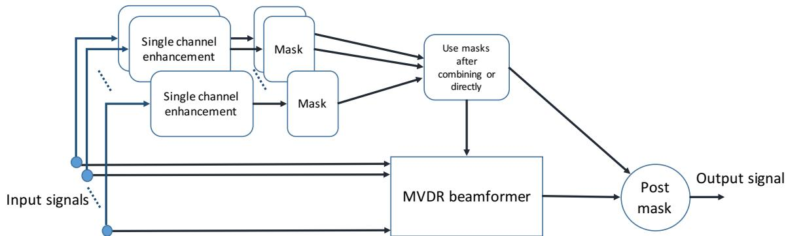

# Improved MVDR beamforming using single-channel mask prediction networks

Hakan Erdogan1, John Hershey2, Shinji Watanabe2, Michael Mandel3, Jonathan Le Roux2

1Sabanci University, Istanbul, Turkey

2MERL, Cambridge, MA, USA

3Brooklyn College, CUNY, New York, NY, USA

## Abstract

Recent studies on multi-microphone speech databases indicate that it is beneficial to perform beamforming to improve speech recognition accuracies, especially when there is a high level of background noise. Minimum variance distortionless response (MVDR) beamforming is an important beamforming method that performs quite well for speech recognition purposes especially if the steering vector is known. However, steering the beamformer to focus on speech in unknown acoustic conditions remains a challenging problem. In this study, we use singlechannel speech enhancement deep networks to form masks that can be used for noise spatial covariance estimation, which steers the MVDR beamforming toward the speech. We analyze how mask prediction affects performance and also discuss various ways to use masks to obtain the speech and noise spatial covariance estimates in a reliable way. We show that using a single mask across microphones for covariance prediction with minima-limited post-masking yields the best result in terms of signal-level quality measures and speech recognition word error rates in a mismatched training condition.

Index Terms: Microphone arrays, neural networks, speech enhancement, MVDR beamforming, LSTM

## 1. Introduction

Since close-talking and noise-free speech recognition accuracies are closely approaching human speech recognition performance, recent research efforts have focused more on far-field and noisy scenarios. For far-field speech recognition, an important factor is the use of multiple microphones for speech acquisition along with multichannel techniques for noise reduction and speech quality improvement for better speech recognition.

Recent work on multi-microphone databases such as the AMI database [1, 2, 3] and recent challenges such as REVERB [4], CHiME-2 [5], and CHiME-3 [6] indicate that performing beamforming of multiple microphone data improves performance as compared to other direct techniques for speech recognition. We believe more studies are necessary to analyze various beamforming techniques for speech recognition.

Deep learning has produced unprecedented gains in performance for speech recognition. Recent work on speech enhancement and source separation also indicate that deep neural networks [7, 8, 9, 10, 11], especially deep recurrent neural networks such as long short-term memory (LSTM) networks yield much better performance than the closest competitor in speech enhancement of single-channel noisy speech [12, 13]. These enhancement networks also help improve speech recognition accuracy [14]. For multi-channel data, there are various directions to explore using deep learning and in this paper we describe one such approach.

Single-channel source separation algorithms can provide a mask that assigns a proportion of each time-frequency bin to each of the sources. When applied for speech enhancement, the mask indicates the relative magnitude of speech with respect to the noisy data at each time-frequency bin. The form of MVDR beamforming described in [15] requires an estimate of the spatial covariance matrix for the noise signal and the source signal of interest. In this paper, we consider using time-frequency masks for estimating these covariance matrices and analyze the effects of using various mask combination techniques for noise covariance prediction.

Predicting time-frequency masks and utilizing them for beamforming have been considered in other recent studies as well [16, 17, 18, 19]. Time-frequency masks are either derived from generative models of spatial signals for each time-frequency bin [19, 18, 16] or using single channel enhancement with neural networks [17]. The idea in [17] is quite similar to our idea in this paper. We became aware of [17] recently and we plan to quantitatively compare their approach with ours in the future. The differences between our approach and [17] are as follows. We evaluate various alternative ways of using single-channel masks and we also consider the possibility of post-masking after beamforming. We use a signal domain loss function whereas [17] uses a mask domain loss function with binary mask targets for train ing single-channel mask-prediction networks. In [17], a steering vector for MVDR is predicted, but we do not explicitly predict a steering vector since we use a different formulation of MVDR beamforming. In the mask-prediction neural network, [17] uses spectral magnitude as input, whereas we use log-Mel-filterbank inputs. Finally, we perform mismatched speech recognition experiments and use signal distortion ratio (SDR) in addition to PESQ for evaluating our results.

## 2. Single-channel enhancement using LSTMs

Previous studies [12, 13] have shown that LSTMs and BLSTMs are particularly effective at dealing with highly challenging nonstationary noises for speech enhancement. LSTM enhancement systems have performed significantly better than other alternatives such as nonnegative matrix factorization (NMF) and DNNs in [12].

The speech enhancement problem can be mathematically expressed in the short-time Fourier transform (STFT) domain as:

$$
\hat {y} _ {t, f} = g _ {f} s _ {t, f} + n _ {t, f},
$$

where $\hat { y } _ { t , f } , s _ { t , f }$ and $n _ { t , f }$ are the STFT coefficients of the noisy, clean and noise signals respectively, at time frame t and frequency $f ,$ and $g _ { f }$ is the reverberation $\mathrm { \ f i t e r ^ { 1 } }$ . We would like to recover the reverberant clean signal from the noisy signal. We can use a neural network trained with noisy and clean signal stereo pairs.

LSTM neural networks are a type of recurrent neural network (RNN) that utilize memory cells that can potentially remember their contents for an indefinite amount of time. In recurrent networks such as LSTMs, there are connections that pass information from a time-step to the next time-step in addition to connections from a layer to an upper layer. LSTMs additionally feature a cell structure that avoids the problems of vanishing and exploding gradients that commonly arise in regular RNN training. In bidirectional LSTMs (BLSTMs), there are two sequences of layers at each level, one running forward in time as in classical RNNs, and another running backwards, both feeding to the layers above at each time step.

## 2.1. Mask prediction

It has been shown in earlier studies of source separation that it is beneficial for estimating the target signal to predict a mask that multiplies the STFT of the mixed signal [12, 20, 9]. In such approaches, the output of the network is a mask or filter function $\left[ \hat { a } _ { t , f } \right] _ { ( t , f ) \in B } = f _ { W } \bigl ( \hat { y } \bigr )$ ), where B is the set of all time-frequency bins and $W$ represents the neural network parameters. In this case, the enhanced speech is obtained as $\hat { s } _ { t , f } = \hat { a } _ { t , f } \hat { y } _ { t , f }$ . The input to the network is usually a set of features extracted from the STFT of the noisy signal yˆ. In earlier studies, it was shown that using the logarithm of mel-filterbank energies with 100 mel-frequency bins gave good results on a challenging speech enhancement task [12].

In the case of mask prediction, the network’s loss function $\begin{array} { r } { \mathcal { L } ( \hat { a } ) = \sum _ { ( t , f ) \in B } \bar { D ( a _ { t , f } ) } } \end{array}$ can be a mask approximation (MA) or a magnitude spectrum approximation (MSA) loss, corresponding to using distortion measures $D _ { \mathrm { m a } } ( \hat { a } ) = | \hat { a } - a ^ { * } | ^ { 2 }$ and $D _ { \mathrm { m s a } } \bar { ( } \hat { a } ) = ( \hat { a } \bar { | } \hat { y } | - | s | ) ^ { 2 }$ , respectively, where $a ^ { * }$ is the ideal ratio mask. Training involving the MSA loss has been found to result in better performance [12].

## 3. Conventional beamforming

## 3.1. Linear observation model

A multi-channel linear data model with a single static source and diffuse noise can be written as follows:

$$
y _ {i} (\tau) = b _ {i} (\tau) * s (\tau) + v _ {i} (\tau), \text { for } i = 1, \dots , M
$$

where M is the number of microphones, $y _ { i } ( \tau )$ the signal at microphone $i , s ( \tau )$ the source signal, $b _ { i } ( \tau )$ ) the channel between the source and microphone i, and $v _ { i } ( \tau )$ the noise signal at microphone i. Here ∗ denotes the convolution operator. We call $x _ { i } ( \tau ) = b _ { i } ( \tau ) { * s ( \tau ) }$ the image of the source at each microphone. Typically, we would like to estimate $x _ { \mathrm { r e f } } ( \tau )$ for a reference microphone.

If the environment can be assumed to be anechoic, then we can simplify the model to the following:

$$
y _ {i} (\tau) = b _ {i} s (\tau - \tau_ {i}) + v _ {i} (\tau)
$$

where $\tau _ { i }$ are the time-delays of arrival at each microphone.

These models are idealized and in real recordings we may see time-varying behavior as well as nonlinearities where the linear time-invariant model is only approximately correct. The signals at each microphone can be combined using “beamforming” techniques to enhance the source estimate and to reduce diffuse and directional noise. We have experimented with weighted delay-and-sum (WDAS) and minimum variance distortionless response (MVDR) beamforming.

## 3.2. Weighted delay-and-sum beamforming

We use the BeamformIt implementation of weighted delayand-sum beamforming [21]. It uses GCC-PHAT [22] crosscorrelation to determine candidate time delays of arrival (TDOA) between each microphone and a reference microphone. The reference microphone is chosen based on pairwise crosscorrelations. These time delay candidates are calculated for each segment of the signal and reconciled across segments using a Viterbi search [21]. Furthermore, weights for each microphone are determined based on cross-correlation of each microphone signal with the other microphones for each segment [21]. After finally determining TDOAs $\gamma _ { i }$ and weights w for each micro phone, the beamformed signal for each segment is obtained as

$$
\hat {x} _ {\mathrm{ref}} (\tau) = \sum_ {i = 1} ^ {M} w _ {i} y _ {i} (\tau - \gamma_ {i}).
$$

## 3.3. MVDR beamforming

An alternative beamforming method is the MVDR beamformer which minimizes the estimated noise level under the condition of no distortion in the desired signal [23, 15]. MVDR is a filter-andsum beamformer whose filters can be obtained in the frequency domain as

$$
\left[ h _ {1} (f), \dots , h _ {M} (f) \right] ^ {T} = \frac {1}{\lambda (f)} \left(\boldsymbol {G} (f) - \boldsymbol {I} _ {M \times M}\right) \boldsymbol {e} _ {\text { ref }},\tag{1}
$$

where $\begin{array} { c c l } { G ( f ) } & { = } & { \Phi _ { \mathrm { n o i s e } } ^ { - 1 } ( f ) \Phi _ { \mathrm { n o i s y } } ( f ) } \end{array}$ is computed from the $M \times M$ spatial covariance matrices $\Phi _ { \mathrm { n o i s e } } ( f )$ of the noise and $\Phi _ { \mathrm { n o i s y } } ( f )$ of the noisy signal, and $\lambda ( f ) = \operatorname { t r a c e } ( G ( f ) ) - M$ [23, 15]. $e _ { \mathrm { r e f } }$ is the standard unit vector for the reference microphone, which can be chosen using maximum a posteriori expected SNR. The STFT of the filter-and-sum beamformed signal can then be obtained using STFTs $y _ { i , t , f }$ of microphone signals $y _ { i } ( \tau )$ as $\begin{array} { r } { \hat { x } _ { t , f } = \sum _ { i = 1 } ^ { M } h _ { i } ( f ) y _ { i , t , f } , } \end{array}$

To obtain estimates of noise spatial covariance matrices, we must estimate where only the noise is active in the measurements. This is typically done by using an edge-mask, which assumes a certain percentage or length of the utterance in the beginning and end contain only noise. Another possibility is to use speech presence probability estimation or voice activity detection (VAD) to get noise estimates. These noise estimates are used to obtain noise spatial covariances as follows. Assume we have obtained an estimate $\hat { v } _ { i , t , f }$ of the STFT of the noise component of the signal at microphone i through some method. We form Mdimensional spatial noise vectors at each time-frequency bin $( t , f )$ as:

$$
\hat {V} _ {t, f} = [ \hat {v} _ {1, t, f} \dots \hat {v} _ {M, t, f} ] ^ {T},\tag{2}
$$

and can use them to get a noise spatial covariance estimate as:

$$
\hat {\Phi} _ {\mathrm{noise}} (f) = \frac {1}{T} \sum_ {t = 0} ^ {T - 1} \hat {V} _ {t, f} \hat {V} _ {t, f} ^ {H},\tag{3}
$$

where $T$ is the number of frames in the utterance, and $( . ) ^ { H }$ indicates Hermitian transpose.

Similarly, we can obtain a speech covariance estimate from speech estimates, or just obtain the noisy signal spatial covariance directly from measurements:

$$
\hat {\Phi} _ {\text { noisy }} (f) = \frac {1}{T} \sum_ {t = 0} ^ {T - 1} Y _ {t, f} Y _ {t, f} ^ {H}
$$

where $\boldsymbol { Y _ { t , f } } ~ = ~ \left[ y _ { 1 , t , f } \ldots y _ { M , t , f } \right] ^ { T }$ is the spatial vector of the observed noisy signals for each time-frequency bin, and use the fact that $\hat { \Phi } _ { \mathrm { n o i s y } } ( f ) = \hat { \Phi } _ { \mathrm { s p e e c h } } ( f ) + \hat { \Phi } _ { \mathrm { n o i s e } } ( f )$

## 4. Using single-channel enhancement masks for beamforming

Apart from being applied to the output of beamforming as in [24], LSTM enhancement can also be used to drive beamforming. The main idea of this approach is illustrated in Figure 1. We first enhance each microphone signal separately using LSTM enhancement. The enhanced signals and the original signals are used to obtain a robust beamformer. In this work, we use predicted masks to estimate noise spatial covariances for MVDR beamforming.

We experimented with several time-frequency domain masks for estimating noise statistics from single-channel enhanced signals. We obtain time-frequency masks through an LSTM network that uses a magnitude spectrum approximation (MSA) loss function. The network is trained from single-channel (CH5) data only and applied to each channel separately to obtain several single-channel masks.

We use the masks in the following fashion. We obtain timefrequency masks $\hat { a } _ { i , t , f }$ from single-channel networks. These masks are constrained to be in the range [0, 1]. We use these masks to obtain initial noise and speech components which are used to calculate spatial covariance matrices. Namely, we define

$$
\hat {v} _ {i, t, f} = (1 - \hat {a} _ {i, t, f}) y _ {i, t, f}
$$

as the noise estimate used in calculating Equations (2) and (3).

We consider the following masking approaches to obtain noise spatial covariances in MVDR:

1. Use the beginning and end parts of utterances as noise mask (edge-mask scenario). Here $\hat { a } _ { i , t , f } = 0 \mathrm { o n l y }$ for the first and last half second of the utterance and equal to one elsewhere.

2. Use a separate “single-channel LSTM enhancement” mask for each channel to obtain noise spatial covariance estimates (multi-mask scenario). Here, $\hat { a } _ { i , t , f }$ is different for each i obtained separately for each channel.

3. Use a single mask $( \mathrm { e . g . }$ ., by combining channel masks using maximum or mean of all masks) to obtain noise spatial covariance estimates (single-mask scenario). Here $\hat { a } _ { i , t , f } = \hat { a } _ { j , t , f } = \hat { a } _ { t , f }$ for $i \neq j$ . The common mask is obtained as $\hat { a } _ { t , f } = \operatorname* { m a x } \{ \tilde { a } _ { 1 , t , f } , \tilde { a } _ { 2 , t , f } , \dots , \tilde { a } _ { M , t , f } \}$ where $\tilde { a } _ { i , t , f }$ is the mask obtained from a single channel network.

4. (Optionally) Apply a post-mask after beamforming using the reference microphone’s mask $\hat { a } _ { \mathrm { r e f } , t , f }$ , with two approaches:

(a) Tone down the mask to have a minimum floor (postmask:minfloor)

(b) Apply the mask directly (post-mask:direct)

Note that, the reference microphone is chosen based on the average estimated a posteriori SNR as follows:

$$
\mathrm{SNR} _ {\text { post }, r} = \frac {\sum_ {f = 0} ^ {F - 1} \boldsymbol {h} _ {r} ^ {H} (f) \boldsymbol {\Phi} _ {\text { speech }} (f) \boldsymbol {h} _ {r} (f)}{\sum_ {f = 0} ^ {F - 1} \boldsymbol {h} _ {r} ^ {H} (f) \boldsymbol {\Phi} _ {\text { noise }} (f) \boldsymbol {h} _ {r} (f)},
$$

where $h _ { r } ( f )$ is the M-dimensional multi-channel filter response (see Equation (1)) at discrete frequency index $f = 0 , \ldots , \bar { F }$ 1 when reference microphone is chosen as $^ { r } \cdot$ . Hence re $: =$ arg maxr $\mathrm { S N R } _ { \mathrm { p o s t } , r }$ . So, initial masking choice effects which microphone is chosen as a reference for each utterance. The set of reference microphones are different for each masking choice.

## 5. Experiments and discussion

We performed beamforming using various masks and obtained SDR results for the CHiME-3 data as shown in Table 1. The results indicate that using a single mask reconciled over microphones works better than using multiple masks. The single mask is obtained by taking the maximum value of all $M = 6$ masks in this case. By taking the maximum, we make sure that the noise covariance estimates are obtained in regions of the timefrequency plane where there is only noise according to all the microphones. We also experimented with taking the mean of all microphone masks and obtained slightly worse numbers (not shown). Since speech signal arrives at the microphones with varying delays, it may seem unnatural to combine the masks, but since the delays are quite short with respect to the frame sizes due to the CHiME-3 setup used, it is not a problem in this case.

The results also show that using post-masking after beamforming (with the same single mask in the single-mask case, and with the channel mask obtained from the reference microphone in the multi-mask case) with a minimum floor is better than not doing post-masking and it is also better than directly applying the post-mask. We chose a minimum floor value of 0.3 for the post-mask.

The intuition for using a post-mask with a minimum allowed value is due to artifacts caused by sharp-masking which effect perceptual quality and speech recognition accuracies. Sharp zeros in the STFT domain introduces artifacts and we can avoid some of the artifacts either by no post-masking or limiting the masking artifacts by having a mimimum allowed value of the mask. The SDR values obtained using single-channel LSTM enhancement masks for beamforming are quite promising and they clearly indicate that performance can be gained by using masks for beamforming.

Table 1: CHiME-3 SDRs (dB) using MVDR beamforming with various masks

<table><tr><td>mask</td><td>post-mask</td><td>sim-dev</td><td>real-dev</td><td>sim-test</td><td>real-test</td></tr><tr><td>Edge-mask</td><td>none</td><td>11.78</td><td>3.70</td><td>12.02</td><td>4.20</td></tr><tr><td>Single-mask</td><td>none</td><td>15.04</td><td>5.87</td><td>14.36</td><td>5.02</td></tr><tr><td>Single-mask</td><td>minfloor</td><td>15.79</td><td>6.72</td><td>15.12</td><td>5.52</td></tr><tr><td>Single-mask</td><td>direct</td><td>15.80</td><td>6.72</td><td>15.10</td><td>5.36</td></tr><tr><td>Multi-mask</td><td>none</td><td>13.42</td><td>3.94</td><td>13.00</td><td>3.75</td></tr><tr><td>Multi-mask</td><td>minfloor</td><td>14.82</td><td>5.57</td><td>14.22</td><td>4.71</td></tr><tr><td>CH5 LSTM-enh</td><td>n/a</td><td>10.44</td><td>4.41</td><td>10.41</td><td>3.11</td></tr><tr><td>CH5 noisy</td><td>n/a</td><td>5.79</td><td>1.09</td><td>6.50</td><td>1.69</td></tr></table>

A note of caution here is that. for SDR measurement for real data sets, since we do not know the exact clean speech data, we use close-talking microphone data, channel adapted to the reference microphone, as the presumed clean data to obtain the SDR values. Thus, the SDR results for real data-sets should be taken with a grain of salt, since the target is not totally clean. In addition, for MVDR beamforming, since we do not use a fixed reference microphone for each utterance, the reference microphone changes for each utterance and mask choice. The set of reference signals are different from row to row in the table due to reference microphone selection differences and hence the SDR numbers may not be directly comparable.

  
Figure 1: System diagram illustrating the basic idea of using single-channel enhancement for beamforming.

Table 2 shows the results using the PESQ measure. The results mostly follow the pattern of SDRs and indicate that using a single mask is better and using a post-mask with a minimum allowed mask value of 0.3 is also better than direct post-masking. For the case of the challenging real test set, it seems to be better not to apply any post-filtering at all. For this dataset, even the noisy single-channel data obtains a better PESQ score than the single-channel enhanced data since enhancement introduces artifacts which cause perceptual quality problems in the reconstructed speech signal.

Table 2: CHiME-3 PESQ results using MVDR beamforming with various masks.

<table><tr><td>mask</td><td>post-mask</td><td>sim-dev</td><td>real-dev</td><td>sim-test</td><td>real-test</td></tr><tr><td>Edge-mask</td><td>none</td><td>1.58</td><td>1.42</td><td>1.67</td><td>1.72</td></tr><tr><td>Single-mask</td><td>none</td><td>1.83</td><td>1.65</td><td>1.91</td><td>1.85</td></tr><tr><td>Single-mask</td><td>minfloor</td><td>2.19</td><td>1.68</td><td>2.29</td><td>1.79</td></tr><tr><td>Single-mask</td><td>direct</td><td>2.15</td><td>1.58</td><td>2.27</td><td>1.54</td></tr><tr><td>Multi-mask</td><td>none</td><td>1.73</td><td>1.50</td><td>1.77</td><td>1.70</td></tr><tr><td>Multi-mask</td><td>minfloor</td><td>2.13</td><td>1.57</td><td>2.22</td><td>1.70</td></tr><tr><td>CH5 LSTM-enh</td><td>n/a</td><td>1.62</td><td>1.35</td><td>1.67</td><td>1.33</td></tr><tr><td>CH5 noisy</td><td>n/a</td><td>1.27</td><td>1.28</td><td>1.27</td><td>1.45</td></tr></table>

In Table 3, we present the word error rates (WER) when we use a recognition system trained from WDAS-beamformed AMI data [2] and decode using MVDR-beamformed CHiME-3 data. The results are only provided for the more challenging real data sets. The results show that using a single mask with minima-limited post-masking yields the best result in WERs in this mismatched training and test set scenario. The best WER we obtain is better than the one obtained using WDAS beamforming on CHiME-3 data.

We conjecture that using a single mask is better than using multiple masks due to having less errors in actual combined prediction of the masks. In addition, having separate masks could cause some noise estimates at a time-frequency bin to be zero and some others to be much higher than zero. This could cause unstable estimation of noise spatial covariance matrices due to partial observation of data and it seems it is better to take fullyobserved time-frequency bins to estimate these covariances. This idea suggests combining the masks by taking their maximum to obtain a single mask as we have done in our experiments.

Table 3: CHiME-3 WERs using MVDR beamforming with various masks. The ASR system is trained on AMI multiple distant microphone data (using WDAS beamforming) with a DNN acoustic model trained with sMBR training criterion. The training data is a significantly mismatched training set since AMI data has almost no noise and the speech characteristics such as accent, content and style are different.

<table><tr><td>mask</td><td>post-mask</td><td>real-dev</td><td>real-test</td></tr><tr><td>Edge-mask</td><td>none</td><td>31.30</td><td>43.59</td></tr><tr><td>Single-mask</td><td>none</td><td>22.41</td><td>36.23</td></tr><tr><td>Single-mask</td><td>minfloor</td><td>21.20</td><td>34.78</td></tr><tr><td>Single-mask</td><td>direct</td><td>21.55</td><td>36.87</td></tr><tr><td>Multi-mask</td><td>none</td><td>26.18</td><td>43.18</td></tr><tr><td>Multi-mask</td><td>minfloor</td><td>24.20</td><td>40.93</td></tr><tr><td>CH5 LSTM-enh</td><td>n/a</td><td>28.02</td><td>49.33</td></tr><tr><td>CH5 noisy</td><td>n/a</td><td>34.79</td><td>55.53</td></tr><tr><td>WDAS beamforming</td><td>n/a</td><td>22.67</td><td>36.19</td></tr></table>

## 6. Conclusion

We obtained experimental results showing that using masks obtained from single-channel enhancements can improve the performance of MVDR beamforming as compared to using edge masks. Using a single mask seems to be more helpful than using multiple masks. We reported SDR, PESQ and speech recognition results in a mismatched scenario. In the future, we plan to investigate a matched training scenario. An important extension of this work could be to iteratively perform single channel enhancement and beamforming. We plan to feed in noisy signals and the beamformed signal along with the first round enhanced signal to a second round single-channel enhancement network.

## 7. Acknowledgements

The work reported here was carried out during the 2015 Jelinek Memorial Summer Workshop on Speech and Language Technologies at the University of Washington, Seattle, and was supported by Johns Hopkins University via NSF Grant No IIS 1005411, and gifts from Google, Microsoft Research, Amazon, Mitsubishi Electric, and MERL. Hakan Erdogan was partially supported by TUBITAK BIDEB-2219 program. Michael Mandel was partially supported by NSF Grant No IIS-1409431.

## 8. References

[1] J. Carletta, “Unleashing the killer corpus: experiences in creating the multi-everything ami meeting corpus.” Language Resources and Evaluation, vol. 41, no. 2, pp. 181–190, 2007.

[2] S. Renals, T. Hain, and H. Bourlard, “Recognition and understanding of meetings the ami and amida projects,” in Proc. ofthe IEEE Workshop on Automatic Speech Recognition and Understanding, ASRU’07, Kyoto, 12 2007, iDIAP-RR 07-46.

[3] P. Swietojanski, A. Ghoshal, and S. Renals, “Convolutional neural networks for distant speech recognition,” Signal Processing Letters, IEEE, vol. 21, no. 9, pp. 1120–1124, September 2014.

[4] K. Kinoshita, M. Delcroix, T. Yoshioka, T. Nakatani, A. Sehr, W. Kellermann, and R. Maas, “The reverb challenge: A common evaluation framework for dereverberation and recognition of reverberant speech,” in Proc. WASPAA, Oct 2013, pp. 1–4.

[5] E. Vincent, J. Barker, S. Watanabe, J. Le Roux, F. Nesta, and M. Matassoni, “The second CHiME speech separation and recognition challenge: Datasets, tasks and baselines,” in Proc. ICASSP, May 2013, pp. 126–130.

[6] J. Barker, R. Marxer, E. Vincent, and S. Watanabe, “The third ’CHiME’ speech separation and recognition challenge: Dataset, task and baselines,” in Proc. ASRU, 2015.

[7] A. L. Maas, Q. V. Le, T. M. O’Neil, O. Vinyals, P. Nguyen, and A. Y. Ng, “Recurrent neural networks for noise reduction in robust ASR."in INTERSPEECH. 2012

[8] X. Lu, Y. Tsao, S. Matsuda, and C. Hori, “Speech enhancement based on deep denoising autoencoder.” in INTERSPEECH, 2013, pp. 436–440.

[9] A. Narayanan and D. Wang, “Ideal ratio mask estimation using deep neural networks for robust speech recognition,” in Proc. of ICASSP, Vancouver, Canada, 2013, pp. 7092–7096.

[10] Y. Xu, J. Du, L.-R. Dai, and C.-H. Lee, “An experimental study on speech enhancement based on deep neural networks,” Signal Processing Letters, IEEE, vol. 21, no. 1, pp. 65–68, 2014.

[11] P.-S. Huang, M. Kim, M. Hasegawa-Johnson, and P. Smaragdis, “Deep learning for monaural speech separation,” in Acoustics, Speech and Signal Processing (ICASSP), 2014 IEEE International Conference on, 2014, pp. 1562–1566.

[12] F. Weninger, J. Le Roux, J. R. Hershey, and B. Schuller, “Discriminatively trained recurrent neural networks for single-channel speech separation,” in Proc. GlobalSIP Symposium on Machine Learning Applications in Speech Processing, Dec. 2014.

[13] H. Erdogan, J. R. Hershey, J. Le Roux, and S. Watanabe, “Phasesensitive and recognition-boosted speech separation using deep recurrent neural networks,” in Proc. ofICASSP, Apr. 2015.

[14] F. Weninger, H. Erdogan, S. Watanabe, E. Vincent, J. Le Roux, J. R. Hershey, and B. Schuller, “Speech enhancement with LSTM recurrent neural networks and its application to noise-robust ASR,” in Proc. International Conference on Latent Variable Analysis and Signal Separation (LVA/ICA), Aug. 2015.

[15] M. Souden, J. Benesty, and S. Affes, “On optimal frequencydomain multichannel linear filtering for noise reduction,” IEEE Transactions on Audio, Speech, and Language Processing, vol. 18, no. 2, pp. 260–276, 2010.

[16] L. Drude, A. Chinaev, D. H. T. Vu, and R. Haeb-Umbach, “Towards online source counting in speech mixtures applying a variational em for complex watson mixture models,” in Acoustic Signal Enhancement (IWAENC), 2014 14th International Workshop on, Sept 2014, pp. 213–217.

[17] J. Heymann, L. Drude, and R. Haeb-Umbach, “Neural network based spectral mask estimation for acoustic beamforming,” in Proc. IEEE Intl. Conf. on Acoustics, Speech and Signal Processing (ICASSP), 2016.

[18] T. Higuchi, N. Ito, T. Yoshioka, and T. Nakatani, “Robust MVDR beamforming using time-frequency masks for online/offline asr in noise,” in Proc. IEEE Intl. Conf. on Acoustics, Speech and Signal Processing (ICASSP), 2016.

[19] T. Yoshioka, N. Ito, M. Delcroix, A. Ogawa, K. Kinoshita, M. Fujimoto, C. Yu, W. J. Fabian, M. Espi, T. Higuchi, S. Araki, and T. Nakatani, “The NTT CHiME-3 system: Advances in speech enhancement and recognition for mobile multi-microphone devices,” in 2015 IEEE Workshop on Automatic Speech Recognition and Understanding (ASRU), Dec 2015, pp. 436–443.

[20] Y. Wang, A. Narayanan, and D. Wang, “On training targets for supervised speech separation,” IEEE/ACM Transactions on Audio, Speech, and Language Processing, vol. 22, no. 12, pp. 1849–58, 2014.

[21] X. Anguera, C. Wooters, and J. Hernando, “Acoustic beamforming for speaker diarization of meetings,” IEEE Transactions on Audio, Speech, and Language Processing, vol. 15, no. 7, pp. 2011–2022, 2007.

[22] M. S. Brandstein and H. F. Silverman, “A robust method for speech signal time-delay estimation in reverberant rooms,” in Proc. ICASSP, 1997, pp. 375–378.

[23] J. Benesty, J. Chen, and Y. Huang, Microphone Array Signal Processing. Springer-Verlag, Berlin, Germany, 2008.

[24] T. Hori, Z. Chen, H. Erdogan, J. R. Hershey, J. Le Roux, V. Mitra, and S. Watanabe, “The MERL/SRI system for the 3rd CHiME challenge using beamforming, robust feature extraction, and advanced speech recognition,” in Proc. ASRU, 2015.