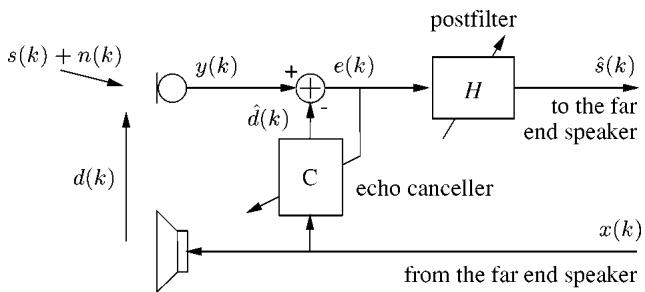
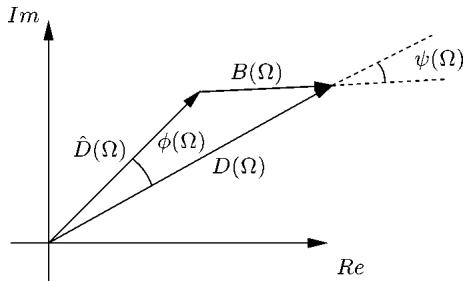
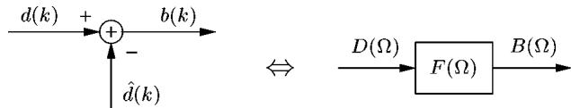
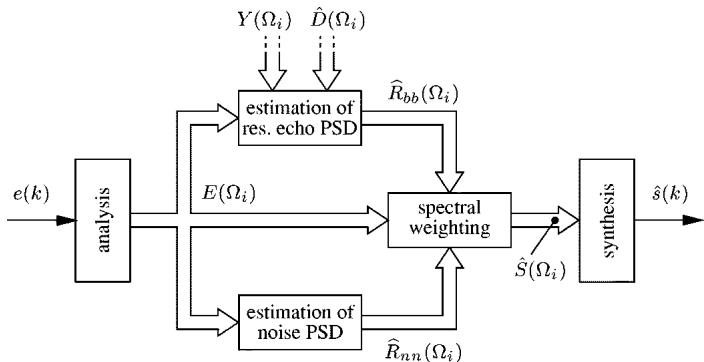
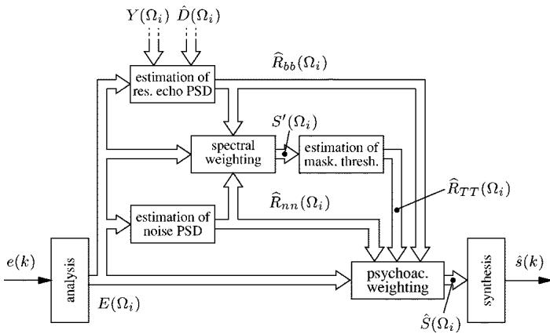
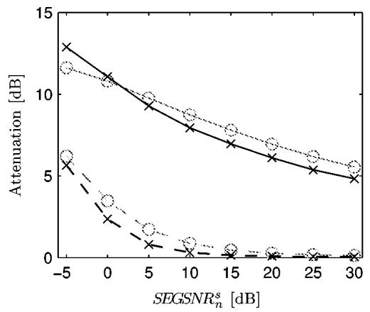
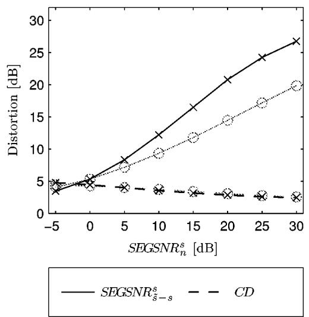
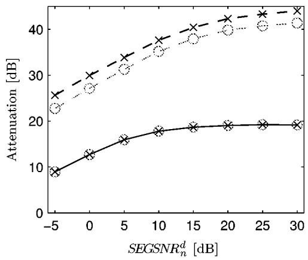
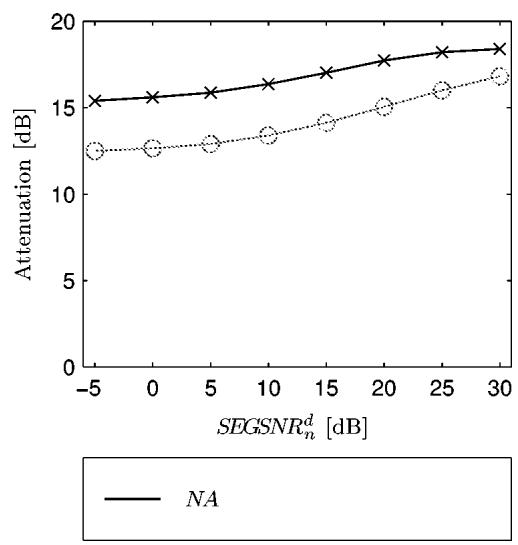
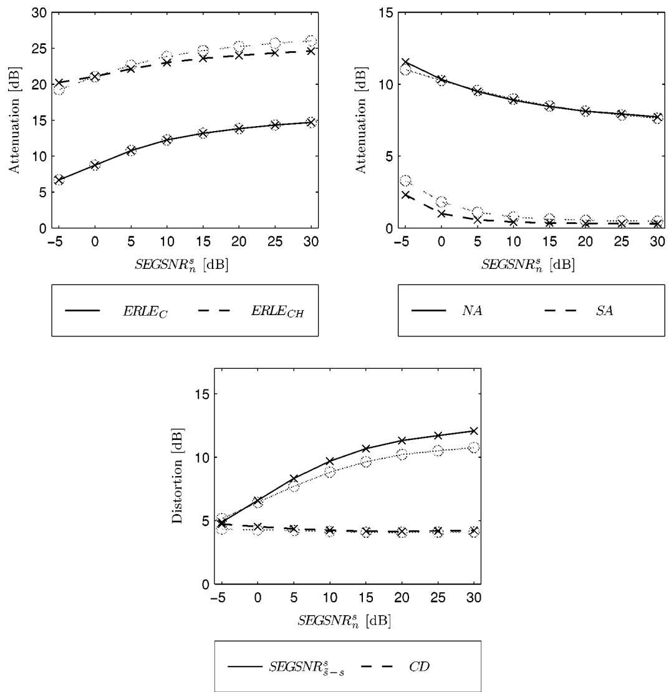

# A Psychoacoustic Approach to Combined Acoustic Echo Cancellation and Noise Reduction

Stefan Gustafsson, Member, IEEE, Rainer Martin, Senior Member, IEEE, Peter Jax, Student Member, IEEE, and Peter Vary

Abstract—This paper presents and compares algorithms for combined acoustic echo cancellation and noise reduction for hands-free telephones. A structure is proposed, consisting of a conventional acoustic echo canceler and a frequency domain postfilter in the sending path of the hands-free system. The postfilter applies the spectral weighting technique and attenuates both the background noise and the residual echo which remains after imperfect echo cancellation.

Two weighting rules for the postfilter are discussed. The first is a conventional one, known from noise reduction, which is extended to attenuate residual echo as well as noise. The second is a psychoacoustically motivated weighting rule. Both rules are evaluated and compared by instrumental and auditive tests. They succeed about equally well in attenuating the noise and the residual echo. In listening tests, however, the psychoacoustically motivated weighting rule is mostly preferred since it leads to more natural near end speech and to less annoying residual noise.

Index Terms—Acoustic echo cancellation, noise reduction, postfilter, psychoacoustics, speech enhancement.

## I. INTRODUCTION

O VER THE last years, the development of telephones wasprimarily directed by the demand for mobility and more primarily directed by the demand for mobility and more comfort, especially the desire for hands-free operation. A logical continuation which at the same time constitutes a big challenge, is the integration of hands-free functionality into mobile phones.

The main problem of hands-free telephony is the acoustic echo: at the near-end the loudspeaker signal is picked up by the microphone and transmitted back to the far-end participant. The acoustic echo is especially disturbing when large transmission delays occur. Therefore, the very nature of the mobile phone environment with its long transmission delays (e.g., the GSM system has a round trip delay of approximately 180 ms) makes the cancellation of the acoustic echo a critical issue.

Another problem arises when a hands-free telephone is used in a noisy environment, for example, in a car. Even moderate background noise levels can lead to very low signal-to-noise ratios (SNRs). Typically, the SNR is about 20 dB lower compared to using a handset. For this reason, the reduction of background noise in the signal to be transmitted is highly desirable, especially when a low to medium bit rate speech codec is used for transmission. These codecs are not transparent with respect to background noise, and the speech quality may be significantly degraded in the presence of strong background noise [1].

  
Fig. 1. System with echo canceler C and postfilter H. The postfilter is placed in the sending path to attenuate both, residual echo and noise.

## A. Combined Echo Cancellation and Noise Reduction

In this paper we propose a system for combined acoustic echo cancellation and noise reduction, which consists of a conventional adaptive echo canceler and a second adaptive filter in the sending path, as illustrated in Fig. 1. The purpose of this postfilter is to attenuate both, the residual echo remaining after an imperfect echo cancellation and the noise. Thanks to the second filter, the demands on the echo canceler can be lowered, and, consequently, the order of the adaptive filter can be reduced. A filter of lower order has three distinctive advantages: it converges faster, it is less sensitive to noise and interfering near-end speech, and the computational complexity is reduced. Actually, adding the postfilter, the performance in terms of echo attenuation can be increased while the total computational complexity of the system is reduced.

The combination of an echo canceler with a residual echo and noise reduction postfilter was originally proposed in [2]–[5]. Related structures have been described in other papers, see, e.g., [6]–[14], and also in [15]–[17], where masking properties of the human ear are considered. In some of these proposals [6], [13] the postfilter was designed for noise reduction only.

## B. Motivation for a New Weighting Rule

The postfilter is implemented in the frequency domain, which basically means that the spectrum of the input signal is multiplied by weighting coefficients $H ( \Omega _ { i } ) , i = 0 \cdots N - 1 ,$ calculated according to a weighting rule. As it is well known, a common disadvantage of many weighting rules for noise reduction (e.g., “spectral subtraction” [18] or the Wiener rule [19]) is that the result suffers from “musical noise,” i.e., randomly distributed, time-variant spectral peaks in the residual noise spectrum [18], [20]. Some weighting rules, e.g., the “minimum mean-square error short-time spectral amplitude estimator” (MMSE-STSA) [21] and the “minimum mean-square error log-spectral amplitude estimator” (MMSE-LSA) [22] lead to a markedly reduced amount of musical noise. Yet, the residual noise usually loses much of its original characteristics and still sounds to a certain extent unnatural.

In [23], a psychoacoustically motivated weighting rule based on simultaneous masking was proposed. The most important property of this weighting rule is that the background noise characteristics are preserved, i.e., the residual noise sounds like the original noise at a lower power level. This is only partly due to the psychoacoustic approach, but much more an effect of the uncompromising design objective of the weighting rule, which is to preserve a natural sounding background noise at a reduced level.

Because of the positive results achieved with this weighting rule, it is desirable to extend it to attenuate echoes as well. It has long been recognized [24] that simultaneous masking plays an important role during double talk (the far-end and the near-end speakers are active at the same time), and that simultaneous masking effects can be actively exploited in the echo suppression algorithm [2], [4], [5]. The main purpose of this paper is to describe the psychoacoustically motivated weighting rule for the combined attenuation of the residual acoustic echo and background noise, and to present extensive instrumental and auditive test results. Furthermore, this paper intends to summarize the somewhat scattered results on the performance of the psychoacoustic approach, and to compare them with the conventional MMSE-LSA weighting rule.

## C. Organization of the Paper

The remainder of this paper is organized as follows. In Section II, we give a brief overview of the postfilter implementation. In Section III, algorithms for estimating the power spectral density (PSD) of the residual echo are outlined. The description is kept relatively short, as this part of the algorithm has already been described in [12] and [25], but is still included because it is a very important part of the system, independent of the weighting rule chosen for the postfilter.

In Section IV, a minimum mean square error (“conventional,” nonpsychoacoustically motivated) algorithm for residual echo and noise reduction is described, and in Section V, the psychoacoustically motivated weighting rule is derived. In Section VI, the two algorithms are compared. Results from both, instrumental evaluations and informal listening tests are discussed. Finally, Section VII concludes the paper with a summary.

## II. SYSTEM OVERVIEW

The system for combined residual echo and noise reduction is illustrated in Fig. 1.

$x ( k )$ denotes the far-end signal and $y ( k )$ the near-end microphone signal, consisting of near-end speech $s ( k )$ , near-end noise $n ( k )$ , and the acoustic echo $d ( k )$ . The adaptive echo canceler tries to identify the loudspeaker–room–microphone (LRM) system and to produce an estimate ${ \hat { d } } ( k )$ of the echo. The estimated echo is then subtracted from the microphone signal to obtain the “echo-canceled” signal $e ( k )$

$$
\begin{array}{r l} & {e (k) = y (k) - \hat {d} (k)} \\ & {\qquad = s (k) + n (k) + d (k) - \hat {d} (k).} \end{array}\tag{1}
$$

We define the residual echo $b ( k )$ as the difference between the echo $d ( k )$ and the estimated echo ${ \hat { d } } ( k )$

$$
b (k) = d (k) - \hat {d} (k).\tag{2}
$$

Ideally, $b ( k )$ should be zero. Since this is rarely the case, we employ the postfilter to further suppress the echo.

Postfiltering is performed by frequency domain processing on a frame-by-frame basis. For the analysis, frames of $M$ consecutive samples are taken every $L$ samples $( L / M$ is the overlap ratio). These are multiplied with, e.g., a Hamming window, zero padded to a total length of $N _ { \cdot }$ , and then transformed into the frequency domain with an -point discrete Fourier transform (DFT). The result is denoted by $E ^ { ( \lambda ) } ( \Omega _ { i } )$ , where is the frame index and $\Omega _ { i } = 2 \pi ( i / N ) , i \in \{ 0 , 1 , 2 , . . . , N - 1 \}$ , are the discrete frequency bins. This spectrum is then multiplied by real valued weighting coefficients $H ^ { ( \lambda ) } ( \Omega _ { i } ) \geq 0$

$$
\hat {S} ^ {(\lambda)} (\Omega_ {i}) = H ^ {(\lambda)} (\Omega_ {i}) E ^ {(\lambda)} (\Omega_ {i}).\tag{3}
$$

The result $\hat { S } ^ { ( \lambda ) } ( \Omega _ { i } )$ is transformed back into the time domain by an -point inverse discrete Fourier transform, and the output signal ${ \hat { s } } ( k )$ is then synthesized with the overlap-and-add method.

For simplicity, in the following we will disregard the frame index whenever possible, and instead of the discrete frequency notation $\Omega _ { i }$ we will use the continuous frequency .

## III. ECHO CANCELER AND THE RESIDUAL ECHO

In this section, we discuss the properties of the residual echo $b ( k )$ when the echo canceler $C$ is adapted by the NLMS algorithm [26] (for comprehensive bibliographies on acoustic echo cancellation, see [27]–[30]). We also discuss methods for estimating the power spectral density (PSD) of the residual echo. The PSD of the residual echo is required for the computation of the postfilter. As the residual echo is a speech like signal and thus time-variant, its PSD can only be estimated on a short term basis, which is in general not easy to accomplish in the presence of noise and near-end speech.

## A. Residual Echo in the Frequency Domain

A closer look at the residual echo in the frequency domain provides some valuable information about the performance of the echo canceler. We define , , and $B ( \Omega )$ as the discrete time Fourier transforms of the echo $d ( k )$ , the estimated echo ${ \hat { d } } ( k )$ , and the residual echo $b ( k )$ , respectively. Applying these definitions, (2) corresponds to

$$
B (\Omega) = D (\Omega) - \hat {D} (\Omega).\tag{4}
$$

For each frequency , this relation can be interpreted as an addition of complex vectors. This is illustrated in Fig. 2, where the phase error $\phi ( \Omega ) = \arg D ( \Omega ) - \arg \hat { D } ( \Omega )$ and the phase deviation $\psi ( \Omega ) = \arg B ( \Omega ) - \arg D ( \Omega )$ are shown as well. The magnitude error is defined as the difference $\vert \vert D ( \Omega ) \vert - \vert \hat { D } ( \Omega ) \vert \vert$

  
Fig. 2. Frequency domain vector representation of the echo $D ( \Omega )$ , the estimated echo $\hat { D } ( \Omega )$ , the residual echo $\bar { B } ( \Omega )$ , the phase error ( ), and the phase deviation $\psi ( \Omega )$ for an arbitrary frequency .

Extensive simulations have been performed for several different scenarios in order to observe the distribution of the phase error and phase deviation on a short-term basis. In short, the observations can be summarized in two cases [12], [31], [48].

1) The adaptive filter succeeds in approximating the unknown room impulse response. A good estimate of the echo is obtained and the echo attenuation is generally sufficient. In this case, the magnitude error is very small, as is the phase error . This leads to a phase of $B ( \Omega )$ which might be totally different from the phase of $D ( \Omega )$ Actually, may take any value between 0 and .

2) The adaptive filter $C$ does not succeed in identifying the LRM system well enough due to interference (near-end speech or noise) or a changing LRM system. Only a rough estimation of the echo $d ( k )$ is achieved.—The simulation showed that in this case the residual echo is mainly due to the magnitude error. The echo canceler estimates the phase of the echo quite well and thus the phase error $\phi ( \Omega )$ is usually close to zero or . Large phase errors are only found at frequencies with a relatively weak echo, i.e., in the case of insignificant excitation. As a consequence, at frequencies of relevance, $\psi ( \Omega )$ is close to zero and for this situation we may choose the approximation

$$
\arg B (\Omega) \approx \arg D (\Omega).\tag{5}
$$

From these observations we can draw the conclusion that whenever there is some residual echo which should be reduced, the phase of the residual echo $B ( \Omega )$ and the phase of the echo $D ( \Omega )$ are close to each other.

## B. Modeling the Echo Cancellation by an Equivalent Transfer Function

In the time domain, the echo cancellation is performed by subtracting the estimated echo ${ \hat { d } } ( k )$ from the microphone signal $y ( k )$ . Another way to treat the echo cancellation problem is to define a linear system with the echo $d ( k )$ as input and the residual echo $b ( k )$ as output. If we call this system $F ,$ , in the frequency domain we have

$$
B (\Omega) = F (\Omega) D (\Omega)\tag{6}
$$

  
Fig. 3. Interpretation of the echo cancellation as a virtual system with transfer function $F ( \Omega )$ .

where $F ( \Omega )$ is the transfer function of the system. The relation is illustrated in Fig. 3. No restrictions are placed on the time domain equivalent to $F ( \Omega )$ ; it may be noncausal and complex.

Note that $F ( \Omega )$ is equal to the phase deviation $\psi ( \Omega )$ Therefore, based on the previous conclusion that $\psi ( \Omega ) \approx \mathrm { { 0 } }$ in situations where the residual echo should be attenuated, we may approximate $F ( \Omega )$ as a real valued function

$$
F (\Omega) \in \mathbb {R}.\tag{7}
$$

C. Estimation ofthe Residual Echo PSD Using the Equivalent Transfer Function Method

To attenuate the residual echo by means of a frequency domain filter, we need an estimate of the power spectral density of the residual echo.

In [25], [12] a procedure to estimate the residual echo PSD $R _ { b b } ( \Omega )$ was presented. It is based on a relation between $F ( \Omega )$ and the PSD of the microphone signal $R _ { y y } ( \Omega )$ , the PSD of the echo canceled signal $R _ { e e } ( \Omega )$ , and the PSD of the estimated echo signal $R _ { \hat { d } \hat { d } } ( \Omega )$ , which are all PSDs of measurable signals

$$
F (\Omega) = \frac {R _ {y y} (\Omega) - R _ {e e} (\Omega) - R _ {\hat {d} \hat {d}} (\Omega)}{R _ {y y} (\Omega) - R _ {e e} (\Omega) + R _ {\hat {d} \hat {d}} (\Omega)}.\tag{8}
$$

Equation (8) is derived by assuming statistical independence between the near-end speech, the noise, and the echo or the residual echo, and with $F ( \Omega ) \in \mathbb { R }$ (see the Appendix). Equation (8) is only valid for $F ( \Omega ) \neq 1$ , which practically means that the echo canceler must output some estimate $\hat { d } ( k ) \neq 0$

Having an estimate $\hat { F } ( \Omega )$ for $F ( \Omega )$ , we might compute the residual echo as

$$
\hat {R} _ {b b} ^ {(F)} (\Omega) = \left(\frac {\hat {F} (\Omega)}{1 - \hat {F} (\Omega)}\right) ^ {2} R _ {\hat {d} \hat {d}} (\Omega), \quad \hat {F} (\Omega) \neq 1\tag{9}
$$

whenever the echo canceler is sufficiently excited. Although this method avoids the estimation of cross power spectral densities it is numerically sensitive and might have a high variance. It can be shown [32], however, that it is closely related to the coherence method as outlined in the following.

## D. Estimation of the Residual Echo PSD Using the Coherence Function

Another method for estimating the residual echo was proposed in [17] and [33]. This method is based on the coherence function. In this case, the residual echo estimate $\hat { R } _ { b b } ^ { ( C ) } ( \Omega )$ is given by

$$
\hat {R} _ {b b} ^ {(C)} (\Omega) = \Gamma_ {x e} (\Omega) R _ {e e} (\Omega)\tag{10}
$$

where $\Gamma _ { x e } ( \Omega )$ is the magnitude squared coherence function between the far-end signal $x ( k )$ and the echo-canceled microphone signal $e ( k )$

$$
\Gamma_ {x e} (\Omega) = \frac {| R _ {x e} (\Omega) | ^ {2}}{R _ {x x} (\Omega) R _ {e e} (\Omega)}.\tag{11}
$$

$R _ { x e } ( \Omega )$ denotes the cross power spectral density between the far-end signal and the echo-canceled microphone signal. Equation (11) implicitly makes use of the magnitude squared transfer function between the far-end signal $x ( k )$ and the echo-canceled signal $e ( k )$ . The magnitude squared transfer function and the power spectral density of the far-end signal can then be used to compute the power spectral density of the residual echo.

As both the transfer function and the coherence method are subject to errors the minimum of both estimates results in a conservative but also very stable estimate for the residual echo. In this study, we therefore use the minimum of both residual echo estimates as the final residual echo estimate, i.e.,

$$
\hat {R} _ {b b} (\Omega) = \min \left(\hat {R} _ {b b} ^ {(F)} (\Omega), \hat {R} _ {b b} ^ {(C)} (\Omega)\right).\tag{12}
$$

Further analysis and improved estimation procedures for the residual echo power spectral density may be found in [32], [34].

## IV. COMBINED REDUCTION OF RESIDUAL ECHO AND NOISE

The MMSE spectral amplitude estimators [21], [22] provide spectral weighting rules with good performance and a low level of “musical noise” [35]. They have therefore found widespread use in speech and audio signal enhancement applications. The MMSE-STSA and the MMSE-LSA weighting rules were developed for noise reduction, but can be modified to attenuate both, residual echo and noise as outlined below. In particular, we will use the MMSE-LSA weighting rule [22], denoted by $H ^ { L S A } ( \Omega )$ , later on as a reference “conventional” (nonpsychoacoustic) weighting rule.

The MMSE-LSA weighting rule minimizes the mean squared error of the logarithmic magnitude of the estimated DFT coefficients with respect to the logarithmic magnitude of the clean speech DFT coefficients

$$
\mathcal {E} \left\{\left(\lg | S (\Omega) | - \lg | \widehat {S (\Omega)} |\right) ^ {2} \right\} \to \min.\tag{13}
$$

With the definition

$$
\Psi (\Omega) = \frac {S N R _ {b + n} ^ {s} (\Omega)}{1 + S N R _ {b + n} ^ {s} (\Omega)} \gamma_ {b + n} ^ {e} (\Omega)\tag{14}
$$

it can be written as

$$
H ^ {L S A} (\Omega) = \frac {S N R _ {b + n} ^ {s} (\Omega)}{S N R _ {b + n} ^ {s} (\Omega) + 1} \exp \left(\frac {1}{2} \int_ {\Psi (\Omega)} ^ {\infty} \frac {e ^ {- \tau}}{\tau} d \tau\right).\tag{15}
$$

The MMSE-LSA weighting rule for combined residual echo and noise reduction thus is a function of the a priori SNR, referring to both residual echo and noise

$$
\begin{array}{r} S N R _ {b + n} ^ {s} (\Omega) = \frac {\mathcal {E} \left\{| S (\Omega) | ^ {2} \right\}}{\mathcal {E} \left\{| B (\Omega) | ^ {2} \right\} + \mathcal {E} \left\{| N (\Omega) | ^ {2} \right\}} \\ = \frac {R _ {s s} (\Omega)}{R _ {b b} (\Omega) + R _ {n n} (\Omega)} \end{array}\tag{16}
$$

and of the a posteriori SNR, also referring to both residual echo and noise

$$
\begin{array}{r} \gamma_ {b + n} ^ {e} (\Omega) = \frac {| E (\Omega) | ^ {2}}{\mathcal {E} \left\{| B (\Omega) | ^ {2} \right\} + \mathcal {E} \left\{| N (\Omega) | ^ {2} \right\}} \\ = \frac {| E (\Omega) | ^ {2}}{R _ {b b} (\Omega) + R _ {n n} (\Omega)} \end{array}\tag{17}
$$

where $R _ { s s } ( \Omega )$ , $R _ { b b } ( \Omega )$ , and $R _ { n n } ( \Omega )$ are the power spectral densities of the speech $s ( k )$ , the residual echo $b ( k )$ , and the noise $n ( k )$ , respectively. $| E ( \Omega ) | ^ { 2 }$ denotes the magnitude squared spectrum of the input signal to the postfilter.

To account for the different statistical properties of residual echo and noise when estimating $S N R _ { b + n } ^ { s } ( \Omega )$ , it was proposed in [10]–[12] and [25] to first estimate individual SNRs with respect to either the residual echo or the noise. These SNRs are defined as

$$
S N R _ {b} ^ {s} (\Omega) = \frac {\mathcal {E} \left\{| S (\Omega) | ^ {2} \right\}}{\mathcal {E} \left\{| B (\Omega) | ^ {2} \right\}} = \frac {R _ {s s} (\Omega)}{R _ {b b} (\Omega)}\tag{18}
$$

$$
S N R _ {n} ^ {s} (\Omega) = \frac {\mathcal {E} \left\{| S (\Omega) | ^ {2} \right\}}{\mathcal {E} \left\{| N (\Omega) | ^ {2} \right\}} = \frac {R _ {s s} (\Omega)}{R _ {n n} (\Omega)}\tag{19}
$$

and

$$
\gamma_ {b} ^ {e} (\Omega) = \frac {| E (\Omega) | ^ {2}}{\mathcal {E} \left\{| B (\Omega) | ^ {2} \right\}} = \frac {| E (\Omega) | ^ {2}}{R _ {b b} (\Omega)}\tag{20}
$$

$$
\gamma_ {n} ^ {e} (\Omega) = \frac {\left| E (\Omega) \right| ^ {2}}{\mathcal {E} \left\{| N (\Omega) | ^ {2} \right\}} = \frac {| E (\Omega) | ^ {2}}{R _ {n n} (\Omega)}.\tag{21}
$$

They can then be combined to $S N R _ { b + n } ^ { s }$ and $\gamma _ { b + n } ^ { e } ( \Omega )$ with

$$
S N R _ {b + n} ^ {s} (\Omega) = \frac {1}{[ S N R _ {b} ^ {s} (\Omega) ] ^ {- 1} + [ S N R _ {n} ^ {s} (\Omega) ] ^ {- 1}}\tag{22}
$$

and

$$
\gamma_ {b + n} ^ {e} (\Omega) = \frac {1}{[ \gamma_ {b} ^ {e} (\Omega) ] ^ {- 1} + [ \gamma_ {n} ^ {e} (\Omega) ] ^ {- 1}}.\tag{23}
$$

The individual a priori SNRs of the th signal frame can advantageously be estimated with the decision directed approach [21]

$$
\begin{array}{r l} & {\widehat {S N R} _ {b} ^ {s, (\lambda)} (\Omega_ {i}) = (1 - \alpha_ {b}) P \left(\hat {\gamma} _ {b} ^ {e, (\lambda)} (\Omega_ {i}) - 1\right)} \\ & {\qquad + \alpha_ {b} \frac {\left| \hat {S} ^ {(\lambda - 1)} (\Omega_ {i}) \right| ^ {2}}{\hat {R} _ {b b} ^ {(\lambda)} (\Omega_ {i})}, \quad 0 \leq \alpha_ {b} <   1} \end{array}\tag{24}
$$

$$
\begin{array}{r l} & {\widehat {S N R} _ {n} ^ {s, (\lambda)} (\Omega_ {i}) = (1 - \alpha_ {n}) P \left(\hat {\gamma} _ {n} ^ {e, (\lambda)} (\Omega_ {i}) - 1\right)} \\ & {\qquad + \alpha_ {n} \frac {\left| \hat {S} ^ {(\lambda - 1)} (\Omega_ {i}) \right| ^ {2}}{\hat {R} _ {n n} ^ {(\lambda)} (\Omega_ {i})}, \quad 0 \leq \alpha_ {n} <   1} \end{array}\tag{25}
$$

where $P ( x ) = ( 1 / 2 ) \left( | x | + x \right)$ , and $\alpha _ { b }$ and $\alpha _ { n }$ are smoothing factors. In order to compute the current a priori SNR estimate, (24) and (25) combine a nonnegative instantaneous SNR estimate with an SNR estimate derived from the previous frame. The a posteriori SNR estimates can be calculated directly from the input spectrum $E ( \Omega )$ and estimates of the residual echo PSD and the noise PSD of the th signal frame

$$
\hat {\gamma} _ {b} ^ {e, (\lambda)} (\Omega_ {i}) = \frac {\left| E ^ {(\lambda)} (\Omega_ {i}) \right| ^ {2}}{\hat {R} _ {b b} ^ {(\lambda)} (\Omega_ {i})}\tag{26}
$$

$$
\hat {\gamma} _ {n} ^ {e, (\lambda)} (\Omega_ {i}) = \frac {\left| E ^ {(\lambda)} (\Omega_ {i}) \right| ^ {2}}{\hat {R} _ {n n} ^ {(\lambda)} (\Omega_ {i})}.\tag{27}
$$

Having the individual SNRs, these can be combined according to (22) and (23) and then used for the $H ^ { L S A }$ rule.

The main difficulty in trying to attenuate both, residual echo and noise, is to balance the attenuation such that a constant level of background noise remains. For example, when strong near-end noise is present, much of the residual echo will be masked by the noise (even after noise reduction) and hence a low residual echo attenuation is sufficient. Too strong an attenuation would lead to unpleasant fluctuations in the remaining background noise spectrum. On the other hand, if there is no or only weak near-end noise, the attenuation should be much stronger in order to render the echo inaudible.

Such balancing can be achieved by limiting the individual SNR estimates before they are combined into $\widehat { S N R } _ { b + n } ^ { s , ( \lambda ) } ( \Omega _ { i } )$ For limiting the a priori SNR estimate with respect to the noise, a constant threshold $T _ { n }$ (typically around $T _ { n } = 0 . 1 5 )$ is sufficient [35]

$$
\widetilde {S N R} _ {n} ^ {s, (\lambda)} (\Omega_ {i}) = \max \left(\widehat {S N R} _ {n} ^ {s, (\lambda)} (\Omega_ {i}), T _ {n}\right).\tag{28}
$$

For the a priori SNR referring to the residual echo, a time and frequency dependent threshold $\tilde { T } _ { b } ^ { ( \lambda ) } ( \Omega _ { i } )$ is useful

$$
\widetilde {S N R} _ {b} ^ {s, (\lambda)} \left(\Omega_ {i}\right) = \max \left(\widehat {S N R} _ {b} ^ {s, (\lambda)} \left(\Omega_ {i}\right), \tilde {T} _ {b} ^ {(\lambda)} \left(\Omega_ {i}\right)\right).\tag{29}
$$

The threshold $\tilde { T } _ { b } ^ { ( \lambda ) } ( \Omega _ { i } )$ should be low when near-end noise is weak in order to allow for a strong attenuation of the residual echo; it should be high when the near-end noise is strong to prevent additional attenuation. Such an adaptive threshold is given, for example, by

$$
\tilde {T} _ {b} ^ {(\lambda)} (\Omega_ {i}) = \frac {2 T _ {b}}{1 + 2 \hat {R} _ {b b} ^ {(\lambda)} (\Omega_ {i}) \bigg / \hat {R} _ {n n} ^ {(\lambda)} (\Omega_ {i})}\tag{30}
$$

where $T _ { b }$ (typically around $T _ { b } = 0 . 0 2 )$ is constant.

Having the combined SNR estimates available, we can use any weighting rule defined as a function of these quantities for the attenuation of residual echo and noise.

A simplified block diagram of a postfilter for the combined attenuation of residual echo and noise is shown in Fig. 4. The block “spectral weighting” includes the procedures described in this section. The noise PSD is estimated directly from the input signal with the “minimum statistics” method [36], which tracks the spectral minima over time and does not need a voice activity detector.

  
Fig. 4. Block diagram of a system for combined residual echo and noise reduction.

## V. A PSYCHOACOUSTICALLY MOTIVATED ALGORITHM

Auditory masking is a phenomenon where one signal, the masker, can render other, weaker signals inaudible (masked), if they are close enough to the masker in frequency or time. The phenomenon of masking is widely exploited in audio coding to reduce the effects of quantization noise [37], [38].

The masking properties of the ear may advantageously be used in the field of speech enhancement, as well. Obviously, for a mix of speech and noise, only noise which is not already masked by the speech needs to be reduced. Those noise components which lie below the masked threshold are inaudible and can thus be left unchanged. As a result, the distortion of the speech will be lower.

Such an approach has been proposed in several studies on psychoacoustically motivated noise reduction: first, a preliminary spectral weighting is performed to obtain a rough estimate of the speech spectrum, and from this preliminary spectrum the masked threshold is estimated. Then, a conventional weighting rule is modified to attenuate the signal only at those frequencies where the noise is not completely masked by the speech [15], [17], [39].

Other studies have concentrated on estimating that part of the noise which is audible in the presence of a masker, and on reducing it with minimal impact on the speech [40]–[42].

In contrast to most previous noise reduction algorithms, the main goal of the approach described in [23] is not a complete removal of the noise, but instead to only attenuate the audible noise by a constant factor. A distinguishing feature of this algorithm is that it succeeds in preserving the background noise characteristics, whereas other algorithms introduce some kind of artifacts such as musical noise. In this section, we describe how this weighting rule can be extended to simultaneously attenuate residual echo and noise [16], [31], [43], [48]. An important difference compared to the noise reduction case is that often a very strong attenuation of the residual echo is necessary (45 dB echo attenuation during single talk and 30 dB during double talk, according to [44]).

## A. Attenuation Factors and Distortion Components

We begin with defining attenuation factors $\zeta _ { b }$ and $\zeta _ { n }$ for the residual echo and the noise, respectively. Both factors are in the range between zero and one. Typical values are $\zeta _ { b } =$ $- 3 5$ and $\zeta _ { n } = - 1 5$ , respectively, depending on how well the echo canceler works, on the required attenuation of residual echo and noise, and on the tolerated near-end speech distortion.

We can express the desired output signal of the system as the sum of the undistorted speech, the attenuated residual echo, and the attenuated noise

$$
\check {S} (\Omega) = S (\Omega) + \zeta_ {b} B (\Omega) + \zeta_ {n} N (\Omega).\tag{31}
$$

However, the actual output with the weighting coefficients $H ( \Omega )$ is

$$
\hat {S} (\Omega) = H (\Omega) \left[ S (\Omega) + B (\Omega) + N (\Omega) \right].\tag{32}
$$

The difference between the desired and the actual signal, i.e., the error $Q ( \Omega ) = \check { S } ( \Omega ) - \hat { S } ( \Omega )$ , then is

$$
\begin{array}{c} Q (\Omega) = S (\Omega) \left[ 1 - H (\Omega) \right] + B (\Omega) \left[ \zeta_ {b} - H (\Omega) \right] \\ + N (\Omega) \left[ \zeta_ {n} - H (\Omega) \right]. \end{array}\tag{33}
$$

As near-end speech $s ( k ) ,$ , noise $n ( k )$ , and residual echo $b ( k )$ are assumed to be mutually independent, the power spectral density of $Q ( \Omega )$ can be split into three components

$$
R _ {q q} (\Omega) = R _ {q _ {s} q _ {s}} (\Omega) + R _ {q _ {b} q _ {b}} (\Omega) + R _ {q _ {n} q _ {n}} (\Omega)\tag{34}
$$

where

$$
R _ {q _ {s} q _ {s}} (\Omega) = [ 1 - H (\Omega) ] ^ {2} R _ {s s} (\Omega)\tag{35}
$$

$$
R _ {q _ {b} q _ {b}} (\Omega) = [ \zeta_ {b} - H (\Omega) ] ^ {2} R _ {b b} (\Omega)\tag{36}
$$

$$
R _ {q _ {n} q _ {n}} (\Omega) = [ \zeta_ {n} - H (\Omega) ] ^ {2} R _ {n n} (\Omega).\tag{37}
$$

All components are quadratic functions of . The first one, $R _ { q _ { s } q _ { s } } ( \Omega )$ , is the distortion of the speech and is minimized by $H ( \Omega ) = 1$ , which means, of course, that the filter does not suppress any signal. The second component, $R _ { q _ { n } q _ { n } } ( \Omega )$ , is the “noise distortion,” i.e., the power of the difference between the desired and the actual noise. It is optimal when $H ( \Omega ) = \zeta _ { n }$ . In the following, we will call $R _ { q _ { n } q _ { n } } ( \Omega )$ the “excess noise.” Similarily, $R _ { q _ { b } q _ { b } } ( \Omega )$ is the power of the difference between the desired and the actual residual echo, the residual echo distortion. It is minimized by choosing $H ( \Omega ) = \zeta _ { b }$ , and we call it the $\because \mathrm { e x } .$ cess residual echo.” The sum $R _ { q q } ( \Omega )$ is minimized for some $H ^ { o p t } ( \Omega )$ in $\{ \zeta _ { n } , \zeta _ { b } \} \le H ^ { o p t } ( \Omega ) \le 1$

## B. Design Objective: Mask the Residual Echo and Noise Distortions

In [23], we argued that to achieve a perceived noise reduction equal to the noise attenuation factor $\zeta _ { n } ,$ one should choose the weighting rule such that the excess noise is masked by the near-end speech. The same argumentation can also be used here, but the design objective is now extended to mask both, the residual echo and the excess noise. This goal is achieved with minimum impact on the near-end speech, , when the sum of the residual echo distortion and the noise distortion equals the masked threshold, in the following denoted by $R _ { T T } ( \Omega )$

$$
\begin{array}{c} R _ {q _ {b} q _ {b}} (\Omega) + R _ {q _ {n} q _ {n}} (\Omega) \stackrel {!} {=} R _ {T T} (\Omega) \\ \Leftrightarrow \end{array}\tag{38}
$$

$$
\bigl [ \zeta_ {b} - H (\Omega) \bigr ] ^ {2} R _ {b b} (\Omega) + \bigl [ \zeta_ {n} - H (\Omega) \bigr ] ^ {2} R _ {n n} (\Omega) \overset {!} {=} R _ {T T} (\Omega).
$$

Solving this second-order equation with the constraint $H ( \Omega ) \leq$ leads to

$$
\begin{array}{r l} & H (\Omega) = \min \left(1, \frac {1}{R _ {b b} (\Omega) + R _ {n n} (\Omega)} \left[ \zeta_ {b} R _ {b b} (\Omega) + \zeta_ {n} R _ {n n} (\Omega) \right. \right. \\ & \left. \left. \pm \sqrt {[ R _ {b b} (\Omega) + R _ {n n} (\Omega) ] R _ {T T} (\Omega) - [ \zeta_ {b} - \zeta_ {n} ] ^ {2} R _ {b b} (\Omega) R _ {n n} (\Omega)} \right]\right). \end{array}\tag{39}
$$

Since $H ( \Omega )$ must not be negative, only the “ ”-solution in (39) is allowed.

To avoid a complex solution, the argument of the square root must be greater than or equal to zero. This is in general not guaranteed. However, as practical values for $\zeta _ { b }$ and $\zeta _ { n }$ are much smaller than one, and assuming that $R _ { T T } ( \Omega )$ is not too small compared to $R _ { n n } ( \Omega )$ and $R _ { b b } ( \Omega )$ (which is the predominant situation), the negative term $- [ \zeta _ { b } - \zeta _ { n } ] ^ { 2 } R _ { b b } ( \Omega ) R _ { n n } ( \Omega )$ can be neglected in favor of the dominant, positive term $[ R _ { b b } ( \Omega ) + R _ { n n } ( \Omega ) ] R _ { T T } ( \Omega )$ . With this simplification, (39) is approximated by

$$
\tilde {H} ^ {I N D} (\Omega) = \min \left(1, \sqrt {\frac {R _ {T T} (\Omega)}{R _ {b b} (\Omega) + R _ {n n} (\Omega)}} \right.
$$

$$
\left. + \frac {\zeta_ {n} R _ {n n} (\Omega) + \zeta_ {b} R _ {b b} (\Omega)}{R _ {n n} (\Omega) + R _ {b b} (\Omega)}\right)\tag{40}
$$

where $\mathrm { \Omega ^ { 6 6 } I N D } ^ { \prime }$ stands for inaudible noise distortion since the weighting rule is designed to leave the noise perceptually undistorted [23], [31], [48].

Note that if excess residual echo and excess noise are already masked by the near-end speech, the first term is greater than one, and $\tilde { H } ^ { I N D } ( \Omega ) = 1$ . Thus, in contrast to conventional weighting rules, the speech is not distorted.

Note also that if neither near-end speech nor a residual echo is present, (40) can be reduced to $\tilde { H } ^ { I \tilde { N } D } ( \Omega ) = \zeta _ { n } \forall \Omega$ . Consequently, the output signal of the postfilter equals the input signal multiplied by the constant factor $\zeta _ { n }$ . It is thus guaranteed that the result is free from musical noise and other artifacts.

A block diagram of the system is shown in Fig. 5. The upper left part of the structure is identical to the one in Fig. 4. This part of the system performs a preliminary estimation $S ^ { \prime } ( \Omega )$ of the near-end speech. For this, a conventional weighting rule for combined residual echo and noise reduction is used, for example, the MMSE-LSA weighting rule with SNRs estimated as described in Section IV. From $S ^ { \prime } ( \Omega )$ , the masked threshold $R _ { T T } ( \Omega )$ is estimated, and finally the weighting with $\tilde { H } ^ { I N D } ( \Omega )$ is performed.

## VI. EVALUATION

To evaluate the $\tilde { H } ^ { I N D }$ weighting rule, the echo canceler and the frequency domain postfilter were implemented in C++ on a general purpose computer. The $H ^ { L S A }$ weighting rule for combined residual echo and noise reduction, which was presented in Section IV, is considered as a state-of-the-art “conventional” (nonpsychoacoustically motivated) weighting rule and serves as a reference.

  
Fig. 5. Block diagram of the combined residual echo and noise reduction system using the psychoacoustically motivated weighting rule.

We considered three different operating modes in our evaluation.

• Noise Reduction: the far-end speaker is inactive $( x ( k ) =$ ) and the microphone signal consists of only near-end speech and noise.

• Single Talk: only the far-end speaker is active, but near-end noise may be present.

• Double Talk: both, near-end and far-end speakers are active, near-end noise may be present.

The sampling rate was 8 kHz and the parameters of the spectral analysis/synthesis as defined in Section II were as follows: overlap length $L = 1 2 8$ , frame length $M = 2 5 6$ , and frame length after zero padding $N = 5 1 2$

For the psychoacoustically motivated weighting rule, the noise attenuation factor $\zeta _ { n }$ and the residual echo attenuation factor $\zeta _ { b }$ are the parameters with which the attenuation of noise and residual echo can be adjusted. When these parameters are set to $\zeta _ { n } ~ = ~ 0 . 0 1$ and to $\zeta _ { b } ~ = ~ 0 . 0 0 0 3 ,$ a sufficient and well-balanced attenuation results. For the $H ^ { L S A }$ weighting rule, the parameters $T _ { n } = 0 . 1 6$ and $T _ { b } = 0 . 0 2 5$ were chosen to achieve approximately the same residual echo and noise reduction for the double talk condition at 0 dB SNR. Hence, the instrumental distortion measures and the listening test results can be directly compared.

For the noise reduction case, the decision directed approach for estimating the a posteriori SNR is one of the key elements for reducing the amount of musical noise [35]. It is important that the factor $\alpha _ { n }$ in (25) is chosen correctly. It determines the tradeoff between musical noise suppression and speech distortion. In our simulations, we use $\alpha _ { n } = 0 . 9 8$ in (25) for estimating $S N R _ { n } ^ { s } ( \Omega )$

As residual echo and noise have inherently different characteristics, a different smoothing factor $\alpha _ { b }$ must be used for estimating $S N R _ { b } ^ { s } ( \Omega )$ . We found that $\alpha _ { b } = 0 . 9 0$ leads to a good compromise between residual echo attenuation and near-end speech quality degradation during double talk.

The masked threshold was estimated with the algorithm from the “Psychoacoustic Model $2 ^ { \circ }$ of the MPEG-1 audio coding standard [38] adapted to the sampling rate of 8 kHz.

To simulate the echo, the loudspeaker-room-microphone system was modeled by a time-invariant FIR filter of about

400 coefficients. The filter coefficients of the room impulse response were measured in a small car.

To identify the LRM system and to estimate the echo, an echo canceler with filter length $N _ { c } = 2 0 0$ was used, i.e., with only half the necessary number of coefficients to perfectly identify . The filter coefficients were adapted by the NLMS algorithm with adaptive step-size control according to [45] and prewhitening filters to speed up the adaptation [46], [49]. Because of its low order and the variable step-size, the adaptive filter converges fast and the adaptation is also very robust in presence of noise and near-end speech.

For the noise reduction tests a set of eight phonetically balanced speech sentences uttered by both, male and female speakers was used. Noise recorded in a car moving at about 100 km/h on a dry highway was added to the microphone signal and its level adjusted such that the input signal-to-noise ratio (measured as the segmental SNR, $S E G S N R _ { n } ^ { s } )$ was between 5 dB and 30 dB.

For the single talk simulations, another set of eight sentences was used. The level of the near-end noise was varied such that the segmental echo-to-noise ratio $( S E G S N R _ { n } ^ { d } )$ at the microphone was between 5 dB and 30 dB.

For the double talk simulations, a setup with near-end speech, near-end noise, and far-end speech was used. The input $S E G S N R _ { n } ^ { s }$ was between 5 dB and 30 dB and the amplitude of the far-end signal was adjusted such that the echo had the same mean power as the near-end speech.

## A. Instrumental Evaluations

In simulations where noise, speech, and echo are available separately we can perform instrumental evaluations which are otherwise not possible. In particular, to study the effect of the postfilter on these signal components, the separate components of the input signal can be processed using several copies of the postfilter.

For the instrumental evaluations we use the following measures:

• the noise attenuation , defined as the mean ratio between the input noise power and the output noise power;

• speech attenuation , defined as the mean ratio between the input speech power and the output speech power;

• segmental signal-to-noise ratio $S E G S N R _ { \tilde { s } - s } ^ { s } ,$ as a measure for the speech distortion using the clean near-end speech as the reference [47] (the lower the $S E G S N R _ { \tilde { s } - s } ^ { s } .$ the stronger the distortion);

• cepstral distance , also as a measure for the speech distortion [47] (the higher the , the stronger the distortion);

$E R L E _ { C }$ , the echo return loss enhancement achieved by the echo canceler $C , \mathrm { i . e . }$ , the mean ratio between the echo power and the residual echo power;

$E R L E _ { C H }$ , the echo return loss enhancement resulting from both, echo cancelling and postfiltering, i.e., the mean ratio between the echo power and the power of the residual echo after attenuation by the postfilter; the contribution of the postfilter itself then is $E R L E _ { C H } - E R L E _ { C }$ (measured in decibels).

  
Fig. 6. Noise reduction—instrumental measurement data obtained from simulations of the $\tilde { H } ^ { I N D }$ weighting rule (-) and the $H ^ { L S A }$ weighting rule ().

1) Noise Reduction Results: In Fig. 6, the instrumental measures $N A , S A , S E G S N R _ { \tilde { s } - s } ^ { s }$ , and are plotted as functions of the input SNR for the noise reduction situation. By comparing the values of we see that with the previous parameter choice and for $S E G S N R _ { n } ^ { s } \geq 5 \mathrm { d B }$ , the psychoacoustic rule results in about 1 dB less noise reduction. This can be explained by the fact that if less noise is present a relatively larger part of it is already masked by the near-end speech and, consequently, less noise reduction is necessary. For the high-SNR cases, the significant increase in the $S E G S N R _ { \tilde { s } - s } ^ { s }$ measure is also due to the more effective masking of noise by speech, and corresponds well to results reported in [40]. The speech attenuation of the $\tilde { H } ^ { I N D }$ rule is generally somewhat lower than the speech attenuation of the $\bar { H } ^ { L S A }$ rule. The measurement values are almost exactly the same for both weighting rules.

2) Single Talk Results: The mean results for single talk simulations $( s ( k ) = 0 )$ are plotted in Fig. 7 as functions of the echo-to-noise ratio. Since the echo canceler has only half of the necessary filter coefficients (with respect to the LRM impulse response), it does not achieve a sufficient echo attenuation; $E R L E _ { C }$ is only 10 dB to 20 dB. Together with the postfilter, however, when there is only weak noise, the system achieves an echo attenuation of about 40 dB for both weighting rules.1 Note that the difference $E R L E _ { C H } - E R L E _ { C }$ does not entirely reach the desired attenuation of 35 dB. This can be explained by an imperfect estimation of the residual echo PSD and the presence of noise.

  
Fig. 7. Single talk—instrumental measurement data obtained from simulations of the $\tilde { H } ^ { I N D }$ weighting rule (-) and the $H ^ { L S A }$ weighting rule ().

The stronger the noise, the lower is both, the additional echo attenuation caused by the postfilter and the total echo attenuation. This is a desired effect of the weighting rule, as the strong noise already masks much of the residual echo. The noise attenuation depends on the echo attenuation and is between 15 dB and 20 dB for the $\tilde { H } ^ { I N D }$ rule.

3) Double Talk Results: The double talk results are summarized in three plots in Fig. 8. Note that the total echo attenuation

  
Fig. 8. Double talk—instrumental measurement data obtained from simulations of the $\tilde { H } ^ { I N D }$ weighting rule (-) and the $H ^ { L S A }$ weighting rule ().

$E R L E _ { C H }$ and the noise attenuation $N A$ are practically identical for both, the $\tilde { H } ^ { I N D }$ and the $H ^ { L S A }$ weighting rules. The overall speech attenuation is again lower for the $\mathbf { \check { \cal H } } ^ { I N D }$ rule.

Viewed from the echo canceler, the interference is now not only the near-end noise, but also the near-end speech. This is reflected by a lower $E R L E _ { C }$ than for single talk. As expected, the total attenuation $E R L E _ { C H }$ is much stronger than $E R L E _ { C }$ , yet again not as strong as for single talk. This effect of the weighting rules is desirable, since the near-end speech also masks some of the residual echo, and the lower additional attenuation by the postfilter causes less distortions of the near-end speech.

## B. Auditive Evaluations

From the previous instrumental measures we hardly find objectively measurable advantages for the psychoacoustically motivated weighting rule. All measurement curves for both weighting rules coincide relatively well for all operating modes except for higher $S E G S N R _ { n } ^ { s }$ values for the noise reduction condition, where the $\tilde { H } ^ { I N D }$ weighting rule leads to less speech distortion.

Since none of the weighting rules can be given the preference on the basis of instrumental evaluations, we have to rely on listening tests to find the decisive difference between the two methods.

In the noise reduction mode, the $\tilde { H } ^ { I N D }$ weighting rule results in a more natural speech reproduction than the $H ^ { L \bar { S } A }$ rule. The naturalness and spectral characteristics of the original noise are preserved with both approaches and for stationary noise no artifacts are audible. As a matter of fact, the residual noise sounds like an attenuated version of the original noise.

During single talk and if no near-end noise is present, there is no significant difference between the results of the two weighting rules. Both succeed well in attenuating the residual echo; depending on the level of background noise, only a very weak “whispering” can be heard.

For the double talk situation, the differences between both weighting rules are most notable since both noise and residual echo are present. We performed informal listening tests for stationary conditions (0 dB $S E G S N R _ { n } ^ { s } )$ and conditions with rapid changes in the echo path. The latter condition results in a higher level of residual echo. Nine expert listeners (only one of them familiar with echo cancellation algorithms) participated in these tests. Eight phonetically balanced speech samples were offered for each condition. The listeners were asked to select the weighting rule which appeared to have the highest output quality and the least annoying remaining echo. For the stationary condition the psychoacoustically motivated weighting rule $\check { \tilde { H } } ^ { I N D }$ was preferred in 97% of all cases. For the nonstationary echo path the $\tilde { H } ^ { I N D }$ rule was preferred in 75% of all cases. Questioned after the tests, all listeners reported that the psychoacoustic rule delivered a more natural speech signal and that the remaining echo was more noise-like and less annoying than for the $H ^ { L S A }$ rule. In contrast, the remaining echo using the $H ^ { L S A }$ was clearly recognizable as a speech signal and the near-end speech sounded more metallic and less natural. It can be argued that this perceived improvement is to some extent caused by computing the $\tilde { H } ^ { I N D }$ weighting rule partly in the critical band domain rather than in FFT bins $( \bar { H } ^ { L S A } )$ . The calculations in the critical band domain, i.e., the calculation of the masked threshold, lead to perceived improvements in the reproduction of the near end signal as they smooth out some of the annoying residual echo and noise fluctuations.

## VII. SUMMARY AND CONCLUSIONS

In this paper, algorithms for combined acoustic echo cancellation and noise reduction were studied. The proposed system consists of a conventional, NLMS-adapted echo canceler of relatively low order and a frequency domain postfilter in the sending path of the system. The postfilter attenuates both residual echo and noise.

First, it was described how a “conventional” (nonpsychoacoustically motivated) weighting rule for noise reduction can be extended to also attenuate residual echo. The main idea is that residual echo and noise should be treated separately. This is achieved by first estimating “separate” signal-to-residual-echo and signal-to-noise ratios and by then calculating a “combined” estimate.

Secondly, a psychoacoustically motivated weighting rule was derived. The objective was to attenuate the residual echo and the ambient noise with some predefined factor. The weighting rule was then designed such that the residual echo and noise components deviating from the desired level were just masked by the near-end speech.

For both weighting rules, a major challenge consists in “balancing” the attenuation such that only a constant level of noise can be heard in the output signal even when the residual echo is relatively strong.

By adjusting the attenuation parameters, both weighting rules were tuned such that no significant difference could be found in instrumental (objective) evaluations: all measures for noise attenuation, residual echo attenuation, and speech distortion are close to each other (except for the noise reduction condition where the $\tilde { H } ^ { I N D }$ rule shows a clear advantage).

However, listening tests revealed that the psychoacoustically motivated weighting rule is mostly preferred by listeners. It results in less annoying residual echo, better speech quality, and no artifacts in the residual noise.

It should be pointed out that the postfilter approach can actually help reducing the total computational complexity of a system for acoustic echo cancellation and noise reduction. In environments in which normally an echo canceler of very high order would be required to achieve a sufficient echo attenuation, an echo canceler of considerably reduced order and thus of much lower complexity can be used instead. The lower-order echo canceler converges faster and is also more robust in the presence of strong background noise and near-end speech. The remaining residual echo and the noise are then attenuated by the postfilter. Using a state-of-the-art NLMS-adapted variable-stepsize echo canceler with 200 coefficients, the proposed echo and noise reduction algorithm runs in real-time (floating point) on a 600 MHz Alpha $\mathrm { P C }$

## APPENDIX

## DERIVATION OF THE TRANSFER FUNCTION $F ( \Omega )$

By combining (4) and (6) and solving for $D ( \Omega )$ we get

$$
D (\Omega) = \frac {1}{1 - F (\Omega)} \hat {D} (\Omega), \qquad F (\Omega) \neq 1.\tag{41}
$$

$B ( \Omega )$ can now be written as a function of $F ( \Omega )$ and $\hat { D } ( \Omega )$ by combining the previous result with (6)

$$
B (\Omega) = \frac {F (\Omega)}{1 - F (\Omega)} \hat {D} (\Omega).\tag{42}
$$

Assuming that $F ( \Omega )$ is constant, the power spectral density of the residual echo $\mathrm { i } \mathrm { s } ^ { 2 }$

$$
R _ {b b} (\Omega) = \left| \frac {F (\Omega)}{1 - F (\Omega)} \right| ^ {2} R _ {\hat {d} \hat {d}} (\Omega).\tag{43}
$$

On the assumption of a real transfer function $F ( \Omega )$ , we then have

$$
R _ {b b} (\Omega) = \left(\frac {F (\Omega)}{1 - F (\Omega)}\right) ^ {2} R _ {\hat {d} \hat {d}} (\Omega), \quad F (\Omega) \in \mathbb {R}, \mathrm{F} (\Omega) \neq 1\tag{44}
$$

where $R _ { \hat { d } \hat { d } } ( \Omega )$ can be estimated directly from the estimated echo $\hat { d } ( k ) \rrangle$

In the same way, we can write the PSD of the echo as a function of $F ( \Omega )$ and $R _ { \hat { d } \hat { d } } ( \Omega )$ 1

$$
\begin{array}{r l r} & & {R _ {d d} (\Omega) = \left| \frac {1}{1 - F (\Omega)} \right| ^ {2} R _ {\hat {d} \hat {d}} (\Omega)} \\ & & {= \left(\frac {1}{1 - F (\Omega)}\right) ^ {2} R _ {\hat {d} \hat {d}} (\Omega),} \\ & & {F (\Omega) \in \mathbb {R}, \mathrm{F} (\Omega) \neq 1.} \end{array}\tag{45}
$$

Equations (44) and (45) are well defined for any $F ( \Omega ) \neq 1$ which in practice means that the echo canceler delivers a nonzero estimate so that $B ( \Omega ) \ne D ( \Omega )$ for all frequencies where $D ( \Omega ) \neq 0$

Assuming mutual statistical independence between the near-end speech $s ( k )$ , the noise $n ( k )$ , and the echo $d ( k )$ or the residual echo $b ( k )$ , we can write the power spectral densities of the microphone signal $y ( k )$ and the echo compensated signal $e ( k )$ as

$$
R _ {y y} (\Omega) = R _ {s s} (\Omega) + R _ {n n} (\Omega) + R _ {d d} (\Omega)\tag{46}
$$

$$
R _ {e e} (\Omega) = R _ {s s} (\Omega) + R _ {n n} (\Omega) + R _ {b b} (\Omega).\tag{47}
$$

2The assumption is motivated by observations showing that $F ( \Omega )$ generally changes much slower than the spectrum of the estimated echo.

By subtracting (47) from (46) and inserting the expressions (44) and (45) for $R _ { b b } ( \Omega )$ and $R _ { d d } ( \Omega )$ , respectively, we get

$$
\begin{array}{r l} & R _ {y y} (\Omega) - R _ {e e} (\Omega) = R _ {d d} (\Omega) - R _ {b b} (\Omega) \\ & \qquad = \frac {1 - F ^ {2} (\Omega)}{[ 1 - F (\Omega) ] ^ {2}} R _ {\hat {d} \hat {d}} (\Omega) \\ & \qquad = \frac {1 + F (\Omega)}{1 - F (\Omega)} R _ {\hat {d} \hat {d}} (\Omega), \quad F (\Omega) \neq 1. \end{array}\tag{48}
$$

Solving

$$
[ 1 - F (\Omega) ] [ R _ {y y} (\Omega) - R _ {e e} (\Omega) ] = [ 1 + F (\Omega) ] R _ {\hat {d} \hat {d}} (\Omega)\tag{49}
$$

for directly leads to (8).

## ACKNOWLEDGMENT

The authors would like to thank A. Kamphausen and M. Mönster for performing some of the computer simulations presented in this paper. They are also grateful to the anonymous reviewers for their comments, and to H. Hagena for pointing out improvements with respect to the literary presentation.

## REFERENCES

[1] J. S. Collura, “Speech enhancement and coding in harsh acoustic environments,” in Proc. IEEE Workshop on Speech Coding, Porvoo, Finland, 1999, pp. 162–164.

[2] R. Martin, “Combined acoustic echo cancellation, spectral echo shaping, and noise reduction,” in Proc. Int. Workshop on Acoustic Echo and Noise Control (IWAENC), Røros, Norway, June 1995, pp. 48–51.

[3] R. Martin and J. Altenhöner, “Coupled adaptive filters for acoustic echo control and noise reduction,” in Proc. Int. Conf. Acoustics, Speech, Signal Processing, Detroit, MI, May 1995, pp. 3043–3046.

[4] R. Martin and S. Gustafsson, “The echo shaping approach to acoustic echo control,” Speech Commun., vol. 20, no. 3–4, pp. 181–190, Dec. 1996.

[5] R. Martin and P. Vary, “Combined acoustic echo control and noise reduction for hands-free telephony—State of the art and perspectives,” in Proc. Eur. Signal Processing Conf., Trieste, Italy, Sept. 1996, pp. 1107–1110.

[6] B. Ayad and G. Faucon, “Acoustic echo and noise cancelling for hands-free communication systems,” in Proc. 4th Int. Workshop on Acoustic Echo and Noise Control (IWAENC), Røros, Norway, June 1995, pp. 91–94.

[7] B. Ayad and R. Le Bouquin-Jeannès, “Acoustic echo and noise reduction: A novel approach,” in Proc. Int. Workshop on Acoustic Echo and Noise Control (IWAENC), London, U.K., Sept. 1997, pp. 168–171.

[8] C. Beaugeant and P. Scalart, “Combined systems for noise reduction and echo cancellation,” in Proc. Eur. Signal Processing Conf., Rhodos, Greece, Sept. 1998, pp. 957–960.

[9] P. Dreiseitel and H. Puder, “A combination of noise reduction and improved echo cancellation,” in Proc. Int. Workshop on Acoustic Echo and Noise Control (IWAENC), London, U.K., Sept. 1997, pp. 180–183.

[10] S. Gustafsson, “Combined frequency domain acoustic echo attenuation and noise reduction,” in Proc. 9th Aachener Kolloquium Signaltheorie, Aachen, Germany, Mar. 1997, pp. 271–274.

[11] S. Gustafsson and R. Martin, “Combined acoustic echo control and noise reduction for mobile communications,” in Proc. Eurospeech, Rhodes, Greece, Sept. 1997, pp. 1403–1406.

[12] S. Gustafsson, R. Martin, and P. Vary, “Combined acoustic echo control and noise reduction for hands-free telephony,” Signal Process., vol. 64, no. 1, pp. 21–32, Jan. 1998.

[13] R. Le Bouquin Jeannès, G. Faucon, and B. Ayad, “How to improve acoustic echo and noise cancelling using a single talk detector,” Speech Commun., vol. 20, no. 3–4, pp. 191–202, December 1996.

[14] V. Turbin, A. Gilloire, and P. Scalart, “Comparison of three post-filtering algorithms for residual acoustic echo reduction,” in Proc. Int. Conf. Acoustics, Speech, and Signal Processing, München, Germany, Apr. 1997, pp. 307–310.

[15] C. Beaugeant, V. Turbin, P. Scalart, and A. Gilloire, “New optimal filtering approaches for hands-free telecommunication terminals,” Signal Process., vol. 64, no. 1, pp. 33–47, Jan. 1998.

[16] S. Gustafsson and P. Jax, “Combined residual echo and noise reduction: A novel psychoacoustically motivated algorithm,” in Proc. Eur. Signal Processing Conf., Rhodos, Greece, Sept. 1998, pp. 961–964.

[17] V. Turbin, A. Gilloire, P. Scalart, and C. Beaugeant, “Using psychoacoustic criteria in acoustic echo cancellation algorithms,” in Proc. Int. Workshop on Acoustic Echo and Noise Control (IWAENC), London, U.K., Sept. 1997, pp. 53–56.

[18] S. F. Boll, “Suppression of acoustic noise in speech using spectral subtraction,” IEEE Trans. Acoust., Speech, Signal Processing, vol. ASSP-27, pp. 113–120, Apr. 1979.

[19] S. V. Vaseghi, Advanced Signal Processing and Digital Noise Reduction. Chichester, U.K.: Wiley and Teubner, 1996.

[20] P. Vary, “Noise suppression by spectral magnitude estimation—Mechanism and theoretical limits,” Signal Process., vol. 8, no. 4, pp. 387–400, 1985.

[21] Y. Ephraim and D. Malah, “Speech enhancement using a minimum mean-square error short-time spectral amplitude estimator,” IEEE Trans. Acoust., Speech, Signal Processing, vol. ASSP-32, pp. 1109–1121, Dec. 1984.

[22] , “Speech enhancement using a minimum mean-square error logspectral amplitude estimator,” IEEE Trans. Acoust., Speech, Signal Processing, vol. ASSP-33, pp. 443–445, Apr. 1985.

[23] S. Gustafsson, P. Jax, and P. Vary, “A novel psychoacoustically motivated audio enhancement algorithm preserving background noise characteristics,” in Proc. Int. Conf. Acoustics, Speech, and Signal Processing, Seattle, WA, May 1998, pp. 397–400.

[24] A. Gilloire, “Performance evaluation of acoustic echo control: Required values and measurement procedures,” Annales des Télécommunications, vol. 49, no. 7–8, pp. 368–372, 1994.

[25] S. Gustafsson and R. Martin, “Combined acoustic echo control and noise reduction based on residual echo estimation,” in Proc. Int. Workshop on Acoustic Echo and Noise Control (IWAENC), London, U.K., Sept. 1997, pp. 160–163.

[26] S. Haykin, Adaptive Filter Theory, 3rd ed. Upper Saddle River, NJ: Prentice-Hall, 1996.

[27] C. Breining, P. Dreiseitel, E. Hänsler, A. Mader, B. Nitsch, H. Puder, T. Schertler, G. Schmidt, and J. Tilp, “Acoustic echo control,” IEEE Signal Processing Mag., vol. 16, pp. 42–69, July 1999.

[28] E. Hänsler, “The hands-free telephone problem—An annotated bibliography,” Signal Process., vol. 27, no. 3, pp. 259–271, 1992.

[29] , “The hands-free telephone problem: An annotated bibliography update,” Annales des Télécommunication, vol. 49, no. 7–8, pp. 360–367, 1994.

[30] , “The hands-free telephone problem: A second annotated bibliograhy update,” in Proc. 4th Int. Workshop on Acoustic Echo and Noise Control (IWAENC), Røros, Norway, June 1995, pp. 115–134.

[31] S. Gustafsson, “Enhancement of audio signals by combined acoustic echo cancellation and noise reduction,” Ph.D. dissertation, RWTH, Aachen, Germany, 1999.

[32] G. Enzner, R. Martin, and P. Vary, “On spectral estimation of residual echo in hands-free telephony,” in Proc. Int. Workshop on Acoustic Echo and Noise Control (IWAENC), 2001, pp. 211–214.

[33] C. Beaugeant, “Réduction de Bruit et contrôle d’Echo pour les Applications Radiomobiles,” Ph.D. dissertation, Université de Rennes 1, Rennes, France, 1999.

[34] G. Enzner, R. Martin, and P. Vary, “Partitioned residual echo estimation for frequency domain acoustic echo control,” Eur. Trans. Telecommun., vol. 13, no. 2, pp. 103–114, 2002.

[35] O. Cappé, “Elimination of the musical noise phenomenon with the Ephraim and Malah noise suppressor,” IEEE Trans. Speech Audio Processing, vol. 2, no. 2, pp. 345–349, 1994.

[36] R. Martin, “Spectral subtraction based on minimum statistics,” in Proc. Eur. Signal Processing Conf., Edinburgh, U.K., Sept. 1994, pp. 1182–1185.

[37] J. Johnston, “Transform coding of audio signals using perceptual noise criteria,” IEEE J. Select. Areas Commun., vol. 6, pp. 314–323, Feb. 1988.

[38] ISO/IEC Int. Std. 11172-3:1993, Information Technology—Coding of Moving Pictures and Associated Audiofor Digital Storage Media at Up to About 1.5 Mbit/s—Part 3, Audio, 1993.

[39] N. Virag, “Speech enhancement based on masking properties of the auditory system,” in Proc. Int. Conf. Acoustics, Speech, and Signal Processing, Detroit, MI, May 1995, pp. 796–799.

[40] A. Akbari Azirani, R. Le Bouquin Jeannès, and G. Faucon, “Optimizing speech enhancement by exploiting masking properties of the human ear,” in Proc. Int. Conf. Acoustics, Speech, and Signal Processing, Detroit, MI, May 1995, pp. 800–803.

[41] D. E. Tsoukalas, J. Mourjopoulos, and G. Kokkinakis, “Speech enhancement based on audible noise suppression,” IEEE Trans. Speech Audio Processing, vol. 5, pp. 497–514, Nov. 1997.

[42] D. E. Tsoukalas, M. Paraskevas, and J. Mourjopoulos, “Speech enhancement using psychoacoustic criteria,” in Proc. Int. Conf. Acoustics, Speech, and Signal Processing, Minneapolis, MN, Apr. 1993, pp. 359–362.

[43] S. Gustafsson, P. Jax, A. Kamphausen, and P. Vary, “A postfilter for echo and noise reduction avoiding the problem of musical tones,” in Proc. Int. Conf. Acoustics, Speech, and Signal Processing, Phoenix, AZ, Mar. 1999.

[44] ITU-T Recommend. G.167, Acoustic Echo Controllers, Mar. 1993.

[45] R. Frenzel, Freisprechen in gestörter Umgebung. Düsseldorf: VDI-Verlag, 1992, Fortschritt-Berichte VDI, Reihe 10, Nr. 228.

[46] C. Antweiler, “Orthogonalisierende Algorithmen für die digitale Kompensation akustischer Echos,” Ph.D. dissertation, RWTH, Aachen, Germany, 1995.

[47] P. Vary, U. Heute, and W. Hess, “Digitale Sprachsignalverarbeitung,” Teubner, Stuttgart, Germany, 1998.

[48] S. Gustafsson, Enhancement of Audio Signals by Combined Acoustic Echo Cancellation and Noise Reduction, P. Vary, Ed. Aachen, Germany: Wissenschaftsverlag Mainz, ISBN 3-86 073-830-5, ABDN 11.

[49] C. Antweiler, Orthogonalisierende Algorithmen für die digitale Kompensation akustischer Echos, P. Vary, Ed. Aachen, Germany: Verlag der Augustinus Buchhandlung.

Stefan Gustafsson (M’96) was born in Sweden in 1970. He received the M.Sc. degree in applied physics and electrical engineering from the University of Linköping, Sweden, in 1995. He received the Dr.-Ing. degree in electrical engineering and information technology from the Aachen University of Technology, Germany, in 1999.

The subject of his doctoral thesis was combined acoustic echo cancellation and noise reduction for hands-free telephony. Since 1999 he has been with KPN Research, Leidschendam, The Netherlands, as

a Scientific Advisor. His interests lie in the area of mobile communications, especially radio access network technology and planning. Current activities focus on algorithms for radio network planning and optimization for UMTS. He is the inventor or co-inventor of several patents.

Rainer Martin (S’86–M’90–SM’01) received the Dipl.-Ing. and Dr.-Ing. degrees from Aachen University of Technology, Germany, in 1988 and 1996, respectively, and the M.S.E.E. degree from Georgia Institute of Technology, Atlanta, in 1989.

From 1996 to March 2002 he was a Senior Research Engineer with the Institute of Communication Systems and Data Processing, Aachen University of Technology. From 1998 to 1999, he was with the AT&T Speech and Image Processing Services Research Lab, Florham Park, NJ. Since April 2002,

he has been a Professor of signal processing at the Technical University of Braunschweig, Braunschweig, Germany. His research interests are acoustic signal processing, such as noise reduction and acoustic echo cancellation, and robustness issues in speech and audio processing.

Peter Jax (S’99) received the Dipl.-Ing. degree from Aachen University of Technology, Germany, in 1997, where he is currently pursuing the Ph.D. degree.

His main research interests are in the areas of speech and audio processing, particularly in speech enhancement by artificial bandwidth extension and noise reduction.

Peter Vary received the Dipl.-Ing. degree in electrical engineering in 1972 from the University of Darmstadt, Germany. In 1978 he received the Ph.D. degree from the University of Erlangen-Nuremberg.

In 1980, he joined Philips Communication Industries (PKI), Nuremberg, Germany. He became head of the Digital Signal Processing Group which made substantial contributions to the development of the GSM System. Since 1988, he has been Professor at Aachen University of Technology, Germany, and head of the Institute of Communication Systems

and Data Processing. His main research interests are speech coding, channel coding, error concealment, adaptive filtering for acoustic echo cancellation and noise reduction, and concepts of mobile radio transmission.