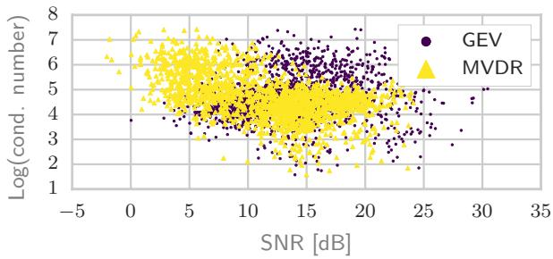
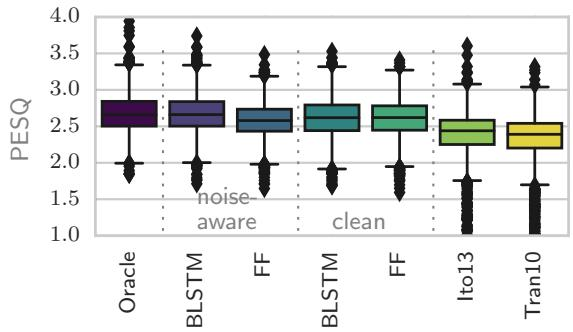
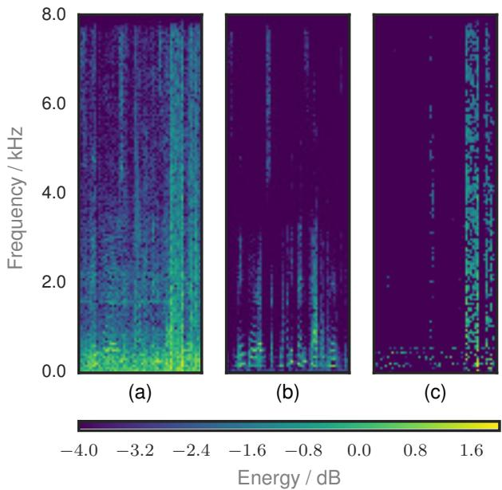

# NEURAL NETWORK BASED SPECTRAL MASK ESTIMATION FOR ACOUSTIC BEAMFORMING

Jahn Heymann, Lukas Drude, Reinhold Haeb-Umbach

University of Paderborn, Department of Communications Engineering, Paderborn, Germany

## ABSTRACT

We present a neural network based approach to acoustic beamforming. The network is used to estimate spectral masks from which the Cross-Power Spectral Density matrices of speech and noise are estimated, which in turn are used to compute the beamformer coefficients. The network training is independent of the number and the geometric configuration of the microphones. We further show that it is possible to train the network on clean speech only, avoiding the need for stereo data with separated speech and noise. Two types of networks are evaluated. One small feed-forward network with only one hidden layer and one more elaborated bi-directional Long Short-Term Memory network. We compare our system with different parametric approaches to mask estimation and using different beamforming algorithms. We show that our system yields superior results, both in terms of perceptual speech quality and with respect to speech recognition error rate. The results for the simple feed-forward network are especially encouraging considering its low computational requirements.

Index Terms— Robust Speech Recognition, Acoustic Beamforming, Feature Enhancement, Deep Neural Network

## 1. INTRODUCTION

Automatic Speech Recognition (ASR) performance experienced a big boost in recent years with the rise of Deep Neural Networks (DNNs) combined with ever increasing computational power and the availability of hundreds of hours of transcribed speech data for training. Trained in a noise-aware scenario with enough data, the modeling power of DNNs rendered many of the signal or feature enhancement techniques developed for GMM-HMM systems superfluous. Only some pre-processing steps are still able to bring noticeable improvements. Especially if multi-channel audio data is available, acoustic beamforming is one technique to achieve substantial gains. And despite recent attempts to take advantage of multi-channel data within a (convolutional) DNN or even training a network directly on multi-channel waveforms, model-based beamforming still proved to be superior [1] [2].

The model-based data-dependent beamforming operation requires an estimate of either the Direction-of-Arrival (DoA) or the (relative) transfer functions from the acoustic source to the microphones. For the first, the geometry of the microphone array has to be known, while the latter usually requires an estimation of the statistics of the target speech signal. Further, advanced beamforming operations require an estimate of the Cross-Power Spectral Density (PSD) matrix of the noise. These statistics can be obtained by estimating spectral masks for speech and noise, and this is where data-driven approaches can be incorporated, as is shown in this paper.

While many model-based methods exist for spectral mask estimation (i.e. [3, 4, 5, 6, 7, 8]), we want to leverage the power of a discriminatively trained data-driven approach to estimate a spectral mask for the speech and the noise component. A distinctive advantage of the proposed neural network based mask estimation is that we are able to jointly estimate a spectral mask for all frequencies, whereas it is common practice to treat individual frequencies separately in conventional parametric mask estimation. We show by example that this property better captures speech charateristics, such that the beamformer cannot be easily fooled by high-energy noise sources and take them inadvertently as speech.

Due to their very nature, data-driven approaches usually perform best when they are exposed to all test time variety at training time. In our scenario, this noise-aware training requires separated speechand noise data. This requirement is often used to argue against such an approach. We show that this requirement can be relaxed to some extent and that even with only (clean) speech data available for mask estimation good results can be achieved.

Apart from a comparison of parametric versus data-driven mask estimation, we also compare two beamformer designs. Namely the well known Minimum Variance Distortionless Response (MVDR) and the Generalized Eigenvalue (GEV) beamformer with an optional distortion reduction filter [9].

## 2. MASK ESTIMATION

## 2.1. Neural mask estimation

Our proposed mask estimator consists of multiple neural networks with shared weights – one for each microphone channel. In this paper we experimented with a small feed-forward (FF) network and a bi-directional Long Short-Term Memory (BLSTM) network. Tables 1 and 2 show the configuration of their layers. The input (yt) for each network is a single frame of the spectral magnitude of one channel. Note that this means that the FF network has no temporal context. The output size of the network depends on the training method.

In case of noise-aware training, two masks are estimated: the first indicates which time frequency (tf) bins are presumably dominated by speech, while the second one indicates which are dominated by noise. When trained on clean speech only, we estimate solely the mask for the speech component, $M \mathbf { x }$ , and calculate the mask for the noise component as $1 - M \mathbf { x }$ for each tf bin. The masks for each channel are then condensed to a single speech and a single noise mask using a median operation. The median is preferred over a mean computation because of its resilience to outliers. Outliers may be caused by broken or occluded microphones. The resulting condensed masks are used to estimate the PSD matrices $\Phi _ { \mathbf { X } \mathbf { X } }$ of speech, and $\Phi _ { \mathrm { N N } }$ of noise, from which the beamformer coefficients are obtained. Note that by treating each channel separately, spatial information is not exploited for mask estimation.

Table 1: BLSTM network configuration for mask estimation

<table><tr><td></td><td>Units</td><td>Type</td><td>Non-Linearity</td><td> $p_{\text{dropout}}$ </td></tr><tr><td>L1</td><td>256</td><td>BLSTM</td><td>Tanh</td><td>0.5</td></tr><tr><td>L2</td><td>513</td><td>FF</td><td>ReLU</td><td>0.5</td></tr><tr><td>L3</td><td>513</td><td>FF</td><td>ReLU</td><td>0.5</td></tr><tr><td>L4</td><td>513/1026</td><td>FF</td><td>Sigmoid</td><td>0.0</td></tr></table>

Table 2: FF network configuration for mask estimation

<table><tr><td></td><td>Units</td><td>Type</td><td>Non-Linearity</td><td> $p_{\text{dropout}}$ </td></tr><tr><td>L1</td><td>513</td><td>FF</td><td>ReLU</td><td>0.5</td></tr><tr><td>L4</td><td>513/1026</td><td>FF</td><td>Sigmoid</td><td>0.0</td></tr></table>

## 2.1.1. Weight initialization & optimization

For the BLSTM layer, weights are drawn from a uniform distribution ranging from 0 04 to 0 04, while the Rectified Linear Unit (ReLU) layers and the last layer are initialized according to [10]. The biases are all initialized with zeros.

We employ RMSProp [11] for training. A fixed learning-rate of 0 001, a momentum of 0 9 and, for the BLSTM network, full backpropagation through time [12] is used. If the norm of a gradient is greater than one, we divide the gradient by its norm [13].

To achieve a better generalization, we use dropout for the inputhidden connection of the BLSTM units [14] and for the input of the ReLU layers [15]. The dropout rate is fixed at $p _ { \mathrm { d r o p o u t } } = 0 . 5$ for every layer during the whole training. Additionally we use the development data for cross-validation, stopping the training when the loss does not decrease anymore after 10 epochs of patience.

We apply batch normalization for all but the output layers [16]. We normalize each frequency separately. Since we define a minibatch to comprise the frames of one utterance, we can use the minibatch instead of the population estimates for the mean and variance normalization at decoding time [17].

## 2.1.2. Binary masks as targets

For the noise-aware training, the ideal binary mask for noise $( \mathrm { I B M } _ { \mathbf { N } } )$ is defined by

$$
\operatorname{IBM} _ {\mathbf {N}} (t, f) = \left\{ \begin{array}{l l} 1, & \frac {| | \mathbf {X} | |}{| | \mathbf {N} | |} <   1 0 ^ {\operatorname{th} _ {\mathbf {N}} (f)}, \\ 0, & \text {else}, \end{array} \right.\tag{1}
$$

where $| | \cdot | |$ is the Euclidean norm.

Correspondingly, the ideal binary mask for the target signal $\left( \mathrm { I B M } \mathbf { x } \right)$ is defined by

$$
\operatorname{IBM} _ {\mathbf {X}} (t, f) = \left\{ \begin{array}{l l} 1, & \frac {| | \mathbf {X} | |}{| | \mathbf {N} | |} > 1 0 ^ {\operatorname{th} \mathbf {x} (f)}, \\ 0, & \text { else }. \end{array} \right.\tag{2}
$$

The two thresholds th and th are not identical. They are chosen such that a decision in favor of speech or noise is only taken if the instantaneous signal-to-noise ratio (SNR) is high or low enough, respectively, to ensure a low false acceptance rate. This will result in more reliable PSD matrix estimates at the expense of discarding some time-frequency bins which are categorized to be neither speech nor noise.

For the training on clean speech only, we obtain the mask for speech by sorting the time-frequency bins according to their contribution to the signal power and then retaining the bins until their summed contribution to the signal power equals 99%.

The cost of each batch is calculated using the cross-entropy between the binary mask(s) and the one(s) estimated by the network.

## 2.2. Model-based mask estimation

As a comparison we employed a parametric mask estimation, which is based on an Expectation-Maximization (EM) algorithm for complex Watson mixture models [7]. The EM algorithm is an iterative two step approach which operates on each frequency bin independently. This approach is referred to as Tran10 in the following.

In the E-step the a posteriori probabilities of an observation belonging to either a speech source or noise are updated. In the M-step the class dependent mode direction and concentration parameters of the components are updated based on the results of the E-step.

In contrast to the proposed algorithm, the EM algorithm can directly make use of spatial information contained in the multi-channel observations. A further difference is that the algorithm does not require a training phase since all necessary statistics are captured during runtime. Its main drawback is obviously the fact, that, due to the independent treatment of each frequency, it does not make use of the typical spectral structure of speech.

As a second comparison, we employ our implementation of the algorithm of [8] and refer to it as Ito13 in the following. It is a permutation free frequency domain source separation algorithm, also employing complex Watson mixture models. The method simultaneously processes all frequency bins by using a mixture model with time-varying, frequency-independent mixture weights.

## 2.3. Acoustic beamforming

In the following, we describe the MVDR and GEV beamformer. Note that although both operate frequency-wise, we omit the dependency in the notation for better readabilty. For both beamformers the PSD matrices are obtained from the estimated masks $M \mathbf { x }$ and $M _ { \mathbf { N } }$ as follows:

$$
\boldsymbol {\Phi} _ {\nu \nu} = \sum_ {t = 1} ^ {T} M _ {\nu} (t) \mathbf {Y} (t) \mathbf {Y} (t) ^ {\mathrm{H}} \quad \text { where } \quad \nu \in \{X, N \}.\tag{3}
$$

## 2.3.1. MVDR beamformer

Perhaps the most frequently used beamformer for speech recognition as of now is the MVDR beamformer. It minimizes the residual noise with the constraint, that any signal impining from the source direction remains distortionless:

$$
\mathbf {F} _ {\mathrm{MVDR}} = \underset {\mathbf {F}} {\operatorname{argmin}} \mathbf {F} ^ {\mathrm{H}} \boldsymbol {\Phi} _ {\mathbf {N N}} \mathbf {F} \qquad \text {s.t.} \qquad \mathbf {F} ^ {\mathrm{H}} \mathbf {d} = 1.\tag{4}
$$

which leads to the following beamforming coefficients:

$$
\mathbf {F} _ {\mathrm{MVDR}} = \frac {\boldsymbol {\Phi} _ {\mathbf {N N}} ^ {- 1} \mathbf {d}}{\mathbf {d} ^ {H} \boldsymbol {\Phi} _ {\mathbf {N N}} ^ {- 1} \mathbf {d}}.\tag{5}
$$

The response vector d can be obtained from an estimate of the DoA. This, however, implicitly assumes an anechoic sound propagation.

An alternative, which is valid for reverberation and used in this paper, is to use the principal component of the estimated power spectral density matrix of speech: $\mathbf { d } = \mathcal { P } \left\{ \Phi \mathbf { x } \mathbf { x } \right\}$

## 2.3.2. GEV beamformer

The objective of the GEV beamformer is to maximize the SNR for each frequency bin [9]:

$$
\mathbf {F} _ {\mathrm{GEV}} = \underset {\mathbf {F}} {\operatorname{argmax}} \frac {\mathbf {F} ^ {\mathrm{H}} \boldsymbol {\Phi} _ {\mathbf {X X}} \mathbf {F}}{\mathbf {F} ^ {\mathrm{H}} \boldsymbol {\Phi} _ {\mathbf {N N}} \mathbf {F}}.\tag{6}
$$

The cost function in Eq. (6) is known as the Rayleigh coefficient. The optimization problem leads to the well known generalized eigenvalue problem

$$
\Phi_ {\mathbf {X X}} \mathbf {F} = \lambda \Phi_ {\mathbf {N N}} \mathbf {F},\tag{7}
$$

where λ is an eigenvalue and F is an eigenvector. The optimal beamformer is then the generalized principal component.

Please note that this does not require any assumptions regarding the nature of the acoustic transfer function from the speech source to the sensors (e.g., being anechoic) or regarding the spatial correlation of the noise [9]. The only assumption which needs to be made is that the target signal is prevalent in the target PSD matrix $\Phi _ { \mathbf { X } \mathbf { X } }$ whereas noise is prevalent in the noise PSD matrix $\Phi _ { \mathrm { N N } }$

Unlike the MVDR beamformer, the GEV beamformer can introduce arbitrary speech distortions. These, however, can be reduced using a single channel post-filter [9]:

$$
g _ {\mathrm{BAN}} = \frac {\sqrt {\mathbf {F} _ {\mathrm{GEV}} ^ {\mathrm{H}} \boldsymbol {\Phi} _ {\mathrm{NN}} \boldsymbol {\Phi} _ {\mathrm{NN}} \mathbf {F} _ {\mathrm{GEV}} / D}}{\mathbf {F} _ {\mathrm{GEV}} ^ {\mathrm{H}} \boldsymbol {\Phi} _ {\mathrm{NN}} \mathbf {F} _ {\mathrm{GEV}}}.\tag{8}
$$

The filter performs a Blind Analytic Normalization (BAN) to obtain a distortionless response in the direction of the speaker. If speech distortions were removed perfectly, one would eventually arrive at the MVDR beamformer [18, 19].

We now obtain an estimate for the source signal as:

$$
Z (t) = g _ {\mathrm{BAN}} \mathbf {F} _ {\mathrm{GEV}} ^ {\mathrm{H}} \mathbf {Y} (t).\tag{9}
$$

## 3. RESULTS

In the following we present results obtained using the data from the third CHiME challenge [20]. It features real and simulated 6-channel audio data of prompts taken from the 5k WSJ0-Corpus [21] with 4 different types of real-world background noise. Details are described on the challenge website1 and in [20].

## 3.1. MVDR vs. GEV

Although the GEV with the BAN postfilter is (under some circumstances) equal to the MVDR beamformer in theory, our results obtained with our proposed system were constantly better when using the GEV beamformer. We investigated this issue and found that this is caused by the inversion of the noise PSD matrix when calculating the beamforming coefficients (Eq. 5) for the MVDR beamformer. This operation is numerically sensitive if the mask is very sparse for some frequencies. To illustrate this, Fig. 1 displays the condition number of ΦNN versus the SNR at the beamformer output with masks estimated by the BLSTM network for the development set. It is clearly visible that if the condition number is high, the MVDR beamformer achieves a smaller SNR at its output than the GEV. This may be attributed to the fact that the GEV avoids the explicit matrix inversion by solving the generalized eigenvalue problem which seems to be numerically more stable2. Because of this issue, all further results were obtained using the GEV beamformer.

  
Fig. 1: Logarithm of the condition number of $\Phi _ { \mathrm { N N } }$ plotted against the SNR of the MVDR and GEV beamformer output.

  
Fig. 2: PESQ scores on the development set for the different models using the GEV beamformer with BAN

## 3.2. Speech enhancement

To assess the speech enhancement performance of the different approaches, we measure the PESQ score after the beamforming operation. Note that this can only be evaluated if the speech and noise images are available separately. Thus, all results presented here are obtained using the simulated development data of the CHiME dataset. This also allows us to give an oracle score where we calculated the PSD of the speech and noise signal directly on the images without any masking.

Figure 2 shows the box plots for the PESQ score obtained with the GEV beamformer with BAN to reduce speech distortions. The noise-aware trained BLSTM is able to achieve performance nearly equal to the oracle ones. When trained only on clean speech, the performance drops slightly, on average by about 0.2 points. Surprisingly good performance is achieved with the simple FF network. Especially when trained on clean speech, the difference to the BLSTM is negligible. This changes for noise-aware mask training. We suspect that in this case the model is unable to capture the full variety induced by the noise due to its limited number of parameters. All parametric approaches show noticeably worse performance. They have a significant number of outliers, where the beamforming operation deteriorates the signal quality instead of improving it due to wrong spectral masks.

  
Fig. 3: Spectrogram of channel 5 of the utterancef06 440c020b bus (a). Estimation of the speech spectrogram using the mask of the proposed BLSTM network (b) and the Tran10 approach (c). Note how the high energy noise at the end has no effect on the neural network, while the parametric approach concentrates on this part.

We found that the parametric approaches are very sensitive to high-energy noise sources concentrated on some frequency bins. The networks on the other hand are able to ignore these noises. Fig. 3 shows the different masks for such an example. The network is able to leverage inter-frequency (and in case of the BLSTM also temporal) dependencies and thus can distinguish between speech and noise from their different time-frequency characteristics and not from their energy alone.

## 3.3. Speech recognition

We evaluate the speech recognition performance using the CHiME baseline DNN-HMM backend [20] without any further modifications 3. We did not use sequence training though due to its high computational demands. From our experience with the CHiME challenge, sequence training leads to further improvements but is not able to compensate for wrong masks.

For this scenario, we also compare two other (parametric) systems: BeamformIt! [22] and the CHiME baseline beamformer [20]. BeamformIt! employs a Delay-and-Sum beamformer where the DoA estimate is obtained from GCC-PHAT [23] and post-processed to avoid instabilities. The CHiME baseline beamformer is a MVDR beamformer, where the speaker location is estimated from a nonlinear SRP-PHAT pseudo-spectrum with the help of the Viterbi algorithm and the noise PSD is estimated from a short context before the utterance. In all cases we perform a matched training where we train the recognizer using the training data after applying the beamformer model in question to it. Note that the noise-aware training of the BLSTM and FF networks are still only possible with simulated data. For speech recognition, we did not use the BAN postfilter as the results without are slightly better, indicating that the acoustic model does compensate for the distortions introduced by the GEV beamformer.

Table 3: Overview of the WERs for different beamforming systems

<table><tr><td rowspan="2" colspan="2"></td><td colspan="2">Development</td><td colspan="2">Evaluation</td></tr><tr><td>simu</td><td>real</td><td>simu</td><td>real</td></tr><tr><td colspan="2">Baseline</td><td>9.27</td><td>20.14</td><td>12.75</td><td>40.17</td></tr><tr><td>LSTM</td><td rowspan="2">noise-aware</td><td>9.13</td><td>9.27</td><td>9.73</td><td>15.42</td></tr><tr><td>FF</td><td>9.70</td><td>11.21</td><td>10.65</td><td>17.85</td></tr><tr><td>LSTM</td><td rowspan="2">clean</td><td>10.05</td><td>11.77</td><td>11.20</td><td>22.28</td></tr><tr><td>FF</td><td>10.01</td><td>11.99</td><td>11.65</td><td>21.93</td></tr><tr><td colspan="2">BeamformIt!</td><td>12.97</td><td>12.16</td><td>23.53</td><td>22.65</td></tr><tr><td colspan="2">Ito13</td><td>18.79</td><td>19.98</td><td>27.34</td><td>27.32</td></tr><tr><td colspan="2">Tran10</td><td>18.19</td><td>16.09</td><td>20.62</td><td>22.70</td></tr></table>

The results are shown in Table 3. Although the results for all data sets are given, the result for the real evaluation set is surely the most important one as it relates to real-world performance. They show that our approach also performs very well on real data. It consistently outperforms the other methods, mostly by a large margin4. Even the systems trained only on clean speech are able to achieve better WERs than the parametric approaches. However, the gap to the systems using noise-aware mask estimation is non-negligible. Further, we again want to emphasize the good performance obtained with the simple FF network.

## 4. CONCLUSIONS AND RELATION TO PRIOR WORK

In this paper we present a new approach to acoustic beamforming which employs neural networks for spectral mask estimation. A key feature of the data-driven mask estimation is that it considers all frequency bins simultaneously, while most parametric mask estimation methods operate on a per frequency bin basis. The approach outperforms beamforming based on parametric mask estimation in terms of speech quality score as well as speech recognition performance. Even a very small network is able to achieve remarkably good performance using only a single frame input. This makes it very well suitable for low-resource applications. We also show that the training of the neural network is independent of the microphone configuration, and that even a training on clean speech only delivers remarkably good results, waiving the necessity to know the intended noise scenario during training time.

The work presented here is a follow-up of our CHiME challenge contribution [17]. While the proposed neural network-based mask estimation was used there for the first time, the paper at hand provides an in-depth analysis of its properties, and proposes a much simpler network structure which achieves comparable results. Further it shows that the system is also competitive for speech enhancement, and the possibility to use clean speech only at training time.

## 5. REFERENCES

[1] P. Swietojanski, A. Ghoshal, and S. Renals, “Convolutional neural networks for distant speech recognition,” IEEE Signal Processing Letters, vol. 21, no. 9, pp. 1120–1124, 2014.

[2] Y. Hoshen, R. J. Weiss, and K. W. Wilson, “Speech acoustic modeling from raw multichannel waveforms,” in IEEE International Conference on Acoustics, Speech, and Signal Processing (ICASSP), Brisbane, Australia, Apr. 2015, pp. 5053–5057.

[3] M. I. Mandel, D. P. W. Ellis, and T. Jebara, “An em algorithm for localizing multiple sound: Sources in reverberant environments,” in Proceedings ofthe 2006 Conference on Advances in Neural Information Processing Systems. MIT Press, 2007, pp. 953–960.

[4] S. Araki, T. Nakatani, H. Sawada, and S. Makino, “Blind sparse source separation for unknown number of sources using gaussian mixture model fitting with dirichlet prior,” in IEEE International Conference on Acoustics, Speech and Signal Processing (ICASSP). IEEE, 2009, pp. 33–36.

[5] H. Sawada, S. Araki, and S. Makino, “Underdetermined convolutive blind source separation via frequency bin-wise clustering and permutation alignment,” IEEE Transactions on Audio, Speech, and Language Processing, vol. 19, no. 3, pp. 516–527, 2011.

[6] N. Ito, S. Araki, T. Yoshioka, and T. Nakatani, “Relaxed disjointness based clustering for joint blind source separation and dereverberation,” in International Workshop on Acoustic Signal Enhancement (IWAENC), 2014, pp. 268–272.

[7] D. H. Tran Vu and R. Haeb-Umbach, “Blind speech separation employing directional statistics in an expectation maximization framework,” in IEEE International Conference on Acoustics, Speech, and Signal Processing (ICASSP), 2010.

[8] N. Ito, S. Araki, and T. Nakatani, “Permutation-free convolutive blind source separation via full-band clustering based on frequency-independent source presence priors,” in IEEE International Conference on Acoustics, Speech, and Signal Processing (ICASSP), 2013, pp. 3238–3242.

[9] E. Warsitz and R. Haeb-Umbach, “Blind acoustic beamforming based on generalized eigenvalue decomposition,” IEEE Transactions on Audio, Speech, and Language Processing, vol. 15, no. 5, pp. 1529–1539, 2007.

[10] X. Glorot and Y. Bengio, “Understanding the difficulty of training deep feedforward neural networks,” in International conference on artificial intelligence and statistics, 2010, pp. 249–256.

[11] T. Tielman and G. Hinton, “Lecture 6.5 - RMSProp,” COURS-ERA: Neural Networksfor Machine Learning, 2012.

[12] Paul J. Werbos, “Backpropagation through time: what it does and how to do it,” Proceedings of the IEEE, vol. 78, no. 10, pp. 1550–1560, 1990.

[13] R. Pascanu, T. Mikolov, and Y. Bengio, “Understanding the exploding gradient problem,” CoRR, vol. abs/1211.5063, 2012.

[14] W. Zaremba, I. Sutskever, and O. Vinyals, “Recurrent neural network regularization,” CoRR, vol. abs/1409.2329, 2014.

[15] N. Srivastava, G. Hinton, A. Krizhevsky, I. Sutskever, and R. Salakhutdinov, “Dropout: A simple way to prevent neural networks from overfitting,” Journal of Machine Learning Research, vol. 15, pp. 1929–1958, 2014.

[16] S. Ioffe and C. Szegedy, “Batch normalization: Accelerating deep network training by reducing internal covariate shift,” CoRR, vol. abs/1502.03167, 2015.

[17] J. Heymann, L. Drude, A. Chinaev, and R. Haeb-Umbach, “LSTM supported GEV beamformer front-end for the 3rd CHiME challenge,” in IEEE 2015 Automatic Speech Recognition and Understanding Workshop (ASRU), 2015.

[18] B. D. Van Veen and K. M. Buckley, “Beamforming techniques for spatial filtering,” Digital Signal Processing Handbook, 1997.

[19] U. K. Simmer, J. Bitzer, and C. Marro, “Post-filtering techniques,” in Microphone Arrays, pp. 39–60. Springer, 2001.

[20] J. Barker, R. Marxer, E. Vincent, and S. Watanabe, “The third ’CHiME’ speech separation and recognition challenge: Dataset, task and baselines,” in IEEE 2015 Automatic Speech Recognition and Understanding Workshop (ASRU), 2015.

[21] J. Garofalo et al., “CSR-I (WSJ0) complete,” Linguistic Data Consortium, Philadelphia, 2007.

[22] X. Anguera, C. Wooters, and J. Hernando, “Acoustic beamforming for speaker diarization of meetings,” IEEE Transactions on Audio, Speech, and Language Processing, vol. 15, no. 7, pp. 2011–2022, 2007.

[23] C. Knapp and G. Clifford Carter, “The generalized correlation method for estimation of time delay,” IEEE Transactions on Acoustics, Speech and Signal Processing, vol. 24, no. 4, pp. 320–327, Aug 1976.