TCE-2026-04-1595

# Integrated Active Noise Control and Hear-Through for Speech Clarity Under Low-Frequency Ambient Noise

Chong-Rui Huang, Cheng-Yuan Chang, and Sen M. Kuo

Abstract—Active noise cancellation (ANC) is widely used to reduce low-frequency ambient noise, while hear-through (HT) aims to preserve the perception of external sounds for environmental awareness in headphones. Many commercial headphones incorporate both functionalities as individual operating modes. However, the HT operation fails to reduce the noise, degrading speech clarity in low-frequency noisy environments. To address this limitation, this paper proposes an acoustic equalization system (AES) to enable integrated operation of ANC and HT within a single framework. The proposed system improves speech clarity in low-frequency noisy environments by allowing flexible control of ANC, while preserving the HT functionality. The proposed AES is realized on a real-time digital signal processor (DSP) platform for in-ear headphone applications. The effectiveness is validated through objective and subjective evaluations.

Index Terms—Active noise cancellation, acoustic equalization system, feedforward control, hear-through, speech clarity.

## I. INTRODUCTION

ctive noise cancellation (ANC) and hear-through (HT) are standard features in most modern headphones [1]. ANC attenuates low-frequency noise via destructive interference [2], while HT restores environmental awareness by reproducing ambient sounds [3]. In many conventional headphone implementations, ANC and HT have been provided as distinct operating modes, although recent research and commercial systems increasingly support adjustable, adaptive, or simultaneous operation of these functions [4]–[9]. When operated independently, the ANC mode attenuates lowfrequency noise but may also suppress external speech components and environmental cues, whereas the HT mode restores ambient sound perception but leaves low-frequency noise largely unattenuated [10], [11]. This mutual exclusivity limits low-frequency information when speech audibility is required.

Existing ANC and HT systems range from conventional headphones providing separate ANC and transparency modes to more integrated approaches incorporating acoustic transparency, speech enhancement, or joint ANC/HT processing. However, relatively few studies have addressed the combined use of ANC and HT to enhance speech perception while maintaining environmental awareness in challenging acoustic environments. Patel et al. [5] developed an over-ear ANC headphone incorporating an HT filter to preserve speech arriving from a target direction while suppressing noise from other directions, thereby improving situational awareness. More recently, Kwong et al. [6] proposed a tunable ANC circuit topology combining a commercial ANC chipset with an external audio codec, enabling simultaneous ANC and pass-through (PT) operation with adjustable acoustic responses. Merz [7] proposed a hybrid ANC system that provides multiple intermediate attenuation levels between noise cancellation and transparency modes while preserving consistent sound characteristics across all attenuation settings. For hearing-aid applications, Serizel et al. [8] proposed an integrated ANC and noise reduction (NR) framework for open-fitting devices based on a filtered-X multichannel Wiener filter (FxMWF) that accounts for acoustic leakage and secondary-path effects. This approach was subsequently extended using remote-point and zone-ofquiet optimization to improve noise control at the eardrum and over a desired spatial region [9].

Despite these advances, previous approaches have primarily focused on spatially selective sound reproduction, tunable acoustic responses, or advanced noise-reduction algorithms. Relatively limited attention has been given to unified ANC/HT control for compact in-ear headphones with the joint objectives of suppressing low-frequency noise, preserving speech-relevant ambient sounds, and providing user-adjustable acoustic control. Such implementation is particularly challenging because the short acoustic path between the reference microphone and secondary loudspeaker imposes stringent causality constraints on feedforward ANC design [12]. Moreover, although some commercial products support adaptive switching or simultaneous ANC and transparency operation, their signal-processing architectures and implementation details remain largely proprietary. Therefore, the novelty of the present work lies not in the general concept of simultaneous ANC and HT operation, but in developing a practical and tunable in-ear acoustic-control system specifically designed to improve speech clarity in lowfrequency-dominant noise.

To this end, this study proposes an acoustic equalization system (AES) that coordinates ANC and HT processing through frequency-band allocation. Unlike our previous HTonly system [13], which focused on compensating for passive isolation to reproduce open-ear acoustic characteristics, the present work incorporates a feedforward ANC controller to suppress low-frequency noise while preserving speechrelevant ambient sounds through HT processing. Independently adjustable ANC gain, HT gain, and crossover frequency provide flexible control of the tradeoff between noise reduction and environmental awareness. To address the causality and computational constraints of compact in-ear implementation, the ANC filter is trained offline and approximated by a reduced-order IIR filter for real-time operation. The proposed AES is implemented on a real-time DSP platform and validated through objective spectral measurements, subjective speech-clarity evaluations, and comparisons with commercial in-ear headphones.

This paper is organized as follows. Section II presents the proposed AES, including its architecture, signal flow, and the integrated design of ANC and HT via band allocation, filter design, and control strategy. Section III presents the real-time DSP implementation and evaluates the system performance in terms of speech clarity under low-frequency ambient noise using both objective spectral analysis and subjective listening tests. Finally, Section IV concludes the paper and discusses potential directions for future work.

## II. DESIGNING PROCESSES OF AES

## A. System Overview and Signal Flow

Fig. 1 illustrates the operating principle of an in-ear headphone equipped with the AES. For clarity, all analog components are omitted in Fig. 1. The external ambient sound is denoted as $x ( t )$ , which is composed of a desired sound $s ( t )$ and an undesired low-frequency noise $n ( t )$ . Under the openear condition, $x ( t )$ propagates to the eardrum without attenuation from the in-ear headphone and is referred to as the open-ear ambient sound, denoted as

$$
\hat {d} (t) = \hat {s} (t) + \hat {n} (t),\tag{1}
$$

where $\hat { s } ( t )$ and $\hat { n } ( t )$ represent the desired sound and the lowfrequency noise, respectively. Besides, when wearing an inear headphone, passive material of the headphone attenuates the high-frequency components of $x ( t )$ , resulting in the residual ambient sound $d ( t )$ , which consists of attenuated sounds $s ^ { \prime } ( t )$ and low-frequency noise $n ^ { \prime } ( t )$ . As low-frequency components are only minimally affected by passive isolation, n t ( ) is approximately equal to n t( ) .

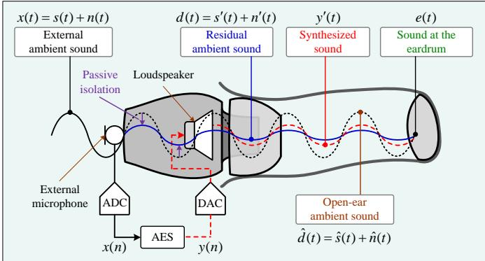  
Fig. 1. Setup of an in-ear headphone integrating with AES.

AES applies an external microphone to measure the ambient sound x t( ) , followed by preamplifier, anti-aliasing filter, and analog-to-digital converter (ADC); the discrete-time reference signal is denoted as x n( ) . Then x n( ) is processed to generate a synthesized output signal, denoted as $y ( n )$ , which is converted back to the analog signal through a digital-toanalog converter (DAC), followed by a reconstruction filter and a power amplifier, and reproduced by the headphone loudspeaker as the output signal, denoted as $y ^ { \prime } ( t )$ . Therefore, the received sound at the eardrum is expressed as

$$
e (t) = d (t) + y ^ {\prime} (t).\tag{2}
$$

Depending on the selected operating mode, the synthesized output signal $y ^ { \prime } ( t )$ is controlled to realize different acoustic responses at the eardrum. For notational clarity, the corresponding output signals in the HT, ANC, and ANC+HT modes are denoted as $y _ { \mathrm { H T } } ^ { \prime } ( t ) ~ , ~ y _ { \mathrm { A N C } } ^ { \prime } ( t )$ , and $y _ { \mathrm { A N C + H T } } ^ { \prime } ( t )$ respectively. In the HT mode, $y _ { \mathrm { H T } } ^ { \prime } ( t )$ makes $e ( t )$ match the open-ear ambient sound when wearing an in-ear headphone. Hence, the sound at the eardrum can be expressed as

$$
e (t) = d (t) + y _ {\mathrm{HT}} ^ {\prime} (t) \approx \hat {d} (t).\tag{3}
$$

This configuration preserves the audibility of environmental sounds while wearing the headphones. Besides, ANC mode attenuates the low-frequency noise components of the ambient sound. Therefore, the resulting sound is given by

$$
e (t) = d (t) + y _ {\mathrm{ANC}} ^ {\prime} (t) \ll \hat {d} (t).\tag{4}
$$

Both the HT and ANC modes are common in commercial headphones. This paper presents the ANC+HT mode, not only to attenuate low-frequency noise but also to perfectly restore the desired sound components. Accordingly, the sound at the eardrum is

$$
e (t) = d (t) + y _ {\mathrm{ANC+HT}} ^ {\prime} (t) \approx \hat {s} (t).\tag{5}
$$

Relevant transfer functions under the open-ear and in-ear headphone conditions are illustrated in Fig. 2. A G.R.A.S. KEMAR was used for the measurements. An external microphone is attached to the outside of a commercial in-ear headphone to capture ambient sound and enable AES.

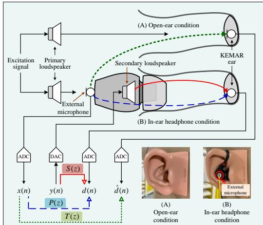  
Fig. 2. Relevant transfer functions under open-ear and in-ear headphone conditions measured using a KEMAR.

Taking the right ear of the KEMAR as an example, the primary path $P ( z )$ denotes the transfer function from the external microphone to the KEMAR ear under the in-ear headphone condition. The target path T z( ) is defined as the relative transfer function (RTF) under the open-ear condition, representing the desired acoustic transfer characteristic for ambient sound reproduction. The secondary path S z( ) corresponds to the transfer function from the secondary loudspeaker to the KEMAR ear. The estimated models, $\hat { S } ( z )$ and $\hat { T } ( z )$ , obtained offline, are incorporated into the filter adaptation process for designing the ANC and HT filters. Acoustic feedback is neglected due to strong passive isolation. A loudspeaker is used to generate excitation signals for measurement. Methods for measuring these paths are well established, and the derivation of the target path has been presented in our previous work [13].

## B. Frequency Band Allocation

In practical listening scenarios, noise may arrive from multiple directions. To improve clarity of the speech when wearing a headphone under low-frequency ambient noise, the frequency band allocation of the AES is designed based on the frequency of measured passive isolation and the primary speech. In this work, passive isolation was quantified as the difference between the open-ear condition ${ \hat { d } } ( t )$ and in-ear headphone condition d t( ) . The open-ear condition was taken as the 0 dB reference.

To evaluate passive isolation under different directions of arrival (DOAs), the experimental setup is illustrated in Fig. 3. For the DOA measurements, the in-ear headphone was inserted into the right side of the KEMAR ear, while the primary loudspeaker positioned 50 cm away from the KEMAR, generated pink noise as the excitation signal.

Passive isolation was measured at different DOAs, as shown in Fig. 4. The shaded region represents the passive isolation measured at the right ear of the KEMAR for incident angles from $0 ^ { \circ }$ to $3 1 5 ^ { \circ }$ in $4 5 ^ { \circ }$ increments, with the median curve provided for reference. Passive isolation is relatively ineffective below 500 Hz; therefore, the nominal ANC operating band is initially defined as 100–500 Hz. This frequency range also corresponds to the dominant spectral region of many low-frequency environmental noises considered in this study. The HT band is defined from 500 Hz to 4 kHz, where passive isolation becomes significant while exhibiting relatively limited variation across the measured DOAs. Above 4 kHz, the acoustic response becomes increasingly sensitive to DOA; therefore, HT compensation is intentionally limited to avoid excessive high-frequency amplification under acoustic conditions different from those used for HT filter design.

It should be emphasized that this frequency-band allocation represents a practical engineering approximation rather than a strict spectral separation between speech and noise. As commonly illustrated by the speech-banana representation [14], speech information spans a broad frequency range. Voiced speech contains fundamental-frequency and harmonic components that may overlap with the ANC operating band, whereas perceptually important consonant cues, including fricatives and plosives, can extend beyond the 4-kHz upper limit adopted for HT processing. Therefore, the crossover frequency represents a tradeoff between low-frequency noise suppression and preservation of speech-relevant components rather than a fixed boundary separating noise from speech. Its appropriate value depends on the spectral relationship between the desired speech and ambient noise, and is therefore made adjustable in the proposed AES.

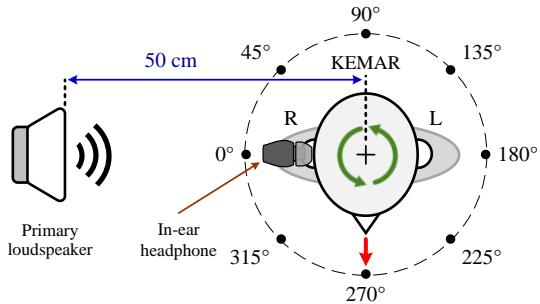

Fig. 3. DOA measurements using a KEMAR.  
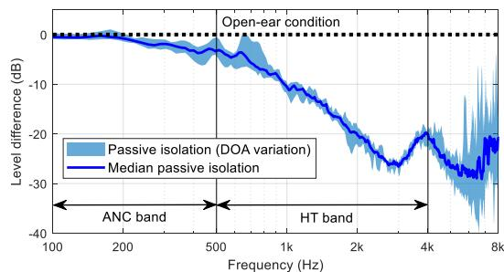  
Fig. 4. Passive isolation of the in-ear headphone at the right ear of the KEMAR for different DOAs.

The present implementation specifically targets acoustic environments dominated by low-frequency noise. In such environments, suppressing dominant low-frequency noise can also reduce its upward spread of masking on higher-frequency speech components [15]. Nevertheless, the 4 kHz HT upper cutoff adopted in this study does not imply that speech components above 4 kHz are perceptually unimportant; rather, it reflects a design tradeoff between preserving speechrelevant ambient sounds and maintaining controlled HT compensation under DOA variations. More complex acoustic environments with substantial spectral overlap between speech and noise may require adaptive bandwidth selection or more advanced speech-enhancement and source-separation techniques.

## C. ANC Filter Design

The ANC filter W z( ) is designed to suppress the ambient signal d n( ) at the KEMAR ear. In the steady state, the optimal ANC filter $W ^ { \circ } ( z )$ , which achieves complete disturbance cancellation, is defined as [16]

$$
W ^ {\circ} (z) = \frac {P (z)}{S (z)} = \frac {D (z) / X (z)}{S (z)},\tag{6}
$$

where X z( ) and $D ( z )$ are the Z –transforms of the external and residual ambient signals x n( ) and $d ( n )$

The practical ANC filter $W ( z )$ is trained offline, shown in Fig. 5. This process requires synchronized recordings of the x n( ) and $d ( n )$ , and an estimated secondary path model $\hat { S } ( z )$ which is obtained offline [16]. The generated output signal $y _ { b } ( n )$ is expressed as

$$
y _ {b} (n) = \mathbf {w} ^ {T} (n) \mathbf {x} (n),\tag{7}
$$

where $\mathbf { x } ( n ) \equiv \left[ x ( n ) x ( n - 1 ) \cdots x ( n - L + 1 ) \right] ^ { T }$ is the vector of external ambient signal, and $\mathbf { w } ( n ) \equiv \lbrack w _ { 0 } ( n ) w _ { 1 } ( n ) \cdots w _ { L - 1 } ( n ) \rbrack ^ { T }$ is the weighting vector of $W ( z )$ with filter length L . Therefore, the error signal is defined as

$$
e _ {b} (n) = d (n) + y _ {b} ^ {\prime} (n),\tag{8}
$$

where $y _ { b } ^ { \prime } ( n )$ is the output of the ANC filter. The weights of W z( ) are updated by the filtered-X least mean square (FxLMS) algorithm given by

$$
\mathbf {w} (n + 1) = \mathbf {w} (n) - \mu [ \hat {\mathbf {s}} (n) * \mathbf {x} (n) ] e _ {b} (n),\tag{9}
$$

where  denotes linear convolution and $\hat { \mathbf { s } } ( n )$ is the impulse response vector of $\hat { S } ( z )$ . The w( ) n converges to its optimal value with a sufficiently small step size $\mu$

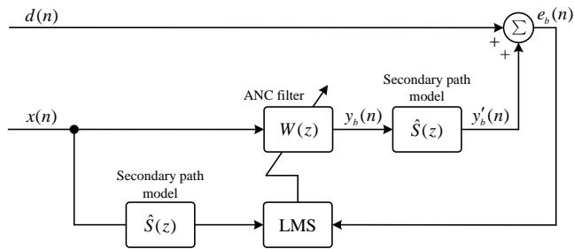  
Fig. 5. Block diagram for offline training of the ANC filter using the FxLMS algorithm.

The high-order FIR ANC filter obtained from offline training results in considerable computational burden for realtime DSP implementation. To address this limitation, the balanced truncation (BT) method [17]–[19] is employed to obtain a reduced-order IIR ANC filter W z( ) . This IIR filter is implemented using a cascaded second-order section (SOS) structure, expressed as:

$$
\tilde {W} (z) = g \prod_ {i = 1} ^ {K} \frac {b _ {0 , i} + b _ {1 , i} z ^ {- 1} + b _ {2 , i} z ^ {- 2}}{a _ {0 , i} + a _ {1 , i} z ^ {- 1} + a _ {2 , i} z ^ {- 2}},\tag{10}
$$

where g is the gain, K is the number of SOSs, $b _ { m , i }$ and $a _ { m , i } \ ( m = 0 , 1 , 2 ; \ a _ { 0 , i } = 1 )$ are the filter coefficients. The W z( ) approximates the frequency response of the original FIR filter W z( ) over the frequency range of interest, while significantly reducing computational cost.

## D. HT Filter Design

The HT filter H z( ) is designed to compensate for the passive isolation of the headphones to reproduce the ambient signal $\hat { d } ( n )$ . The HT filter design has been developed and validated in our previous work [13]. HT serves an opposite function to ANC by enabling acoustic transparency. To derive $H ( z )$ , the residual ambient signal $d ( n )$ is assumed to be zero, as it contains only low-frequency components of the ambient sound below 500 Hz that are outside the frequency range of interest. According to Fig. 2, the optimal HT filter $H ^ { \circ } ( z )$ to achieve complete compensation for the passive isolation is defined as

$$
H ^ {\circ} (z) = \frac {T (z)}{S (z)}.\tag{11}
$$

To address the inherent delay introduced by the secondary path S z( ) , a delay of  samples is included to satisfy the causality constraint of the broadband feedforward control system [16]. Hence, the desired HT filter is defined as

$$
H (z) = \frac {\hat {T} (z) z ^ {- \Delta}}{\hat {S} (z)}.\tag{12}
$$

The HT filter $H ( z )$ is then trained offline using the FxLMS algorithm to approximate the desired transfer function in (12), as illustrated in Fig. 6. The adaptive filter takes the external ambient signal x n( ) as input and generates the output signal $y _ { c } ( n )$ , expressed as

$$
y _ {c} (n) = \mathbf {h} ^ {T} (n) \mathbf {x} (n).\tag{13}
$$

The x( )n is the input vector of the external ambient signal, and $\mathbf { h } ( n ) \equiv [ h _ { 0 } ( n ) h _ { 1 } ( n ) \cdots h _ { L - 1 } ( n ) ] ^ { T }$ is the coefficient vector of $H ( z )$ with filter length L . The error signal is defined as

$$
e _ {c} (n) = d _ {c} (n - \Delta) + y _ {c} ^ {\prime} (n),\tag{14}
$$

where $y _ { c } ^ { \prime } ( n )$ is the filtered output. Thus, H z( ) can be obtained by using the FxLMS algorithm with a sufficiently small step size $\mu$

$$
\mathbf {h} (n + 1) = \mathbf {h} (n) - \mu [ \hat {\mathbf {s}} (n) * \mathbf {x} (n) ] e _ {c} (n).\tag{15}
$$

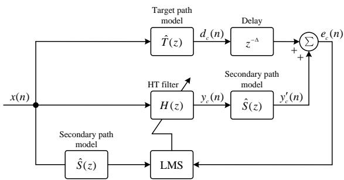  
Fig. 6. Block diagram for offline training of the HT filter using the FxLMS algorithm.

Unlike the ANC controller, which is initially designed as a high-order FIR filter, the HT filter adopted from our previous work is analytically derived and incorporates a low-order FIR filter for band-limited equalization. Therefore, the HT filter is already suitable for real-time implementation and does not require additional model-order reduction.

## E. ANC+HT Mode Design and AES Strategy

In the ANC+HT mode, AES integrates ANC and HT functions to provide simultaneous noise reduction and ambient sound compensation, shown in Fig. 7. The x n( ) denotes the reference signal measured by the external microphone, d n( ) denotes the residual ambient noise at the eardrum, y n( ) denotes the synthesized control signal generated by the AES, and e n( ) denotes the resulting acoustic signal received at the eardrum. The music or speech signal, denoted as a n( ) , is included solely to indicate compatibility with standard headphone playback.

The integration of the HT filter H z( ) is realized by a bandpass shaping filter C z( ) , whose lower and upper cutoff frequencies are $f _ { L }$ and $f _ { H }$ for ambient sound compensation. Besides, according to the frequency band allocation for ANC, a low-pass filter (LPF) L z( ) with cutoff frequency $f _ { c }$ is applied to integrate with ANC filter W z( ) to enforce the noise suppressing performance in the designated frequency range. Two adjustable gains $g _ { a }$ and $g _ { h }$ are also applied. The parameter $0 \leq g _ { a } \leq 1$ is introduced to adjust the strength of the ANC, allowing users to adapt the noise reduction level to different acoustic environments. Larger $g _ { a }$ is preferred in environments dominated by low-frequency noise, such as aircraft cabins; meanwhile, the parameter $0 \leq g _ { h } \leq 1$ is introduced to adjust the ambient sound compensation level, enabling users to control the degree of environmental awareness. Higher $g _ { h }$ can improve awareness of surrounding sounds especially in outdoor. Accordingly, the composite system behavior in the ANC+HT mode can be expressed as follows:

$$
E (z) = D (z) + S (z) [ g _ {h} H (z) C (z) + g _ {a} \tilde {W} (z) L (z) ] X (z).\tag{16}
$$

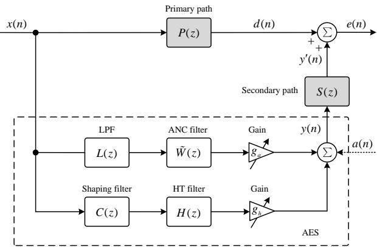  
Fig. 7. Signal flow diagram of the proposed AES.

As shown in Table I, three operating modes are supported by the proposed AES. In the ANC mode, the feedforward ANC filter W z( ) is designed to suppress residual ambient noise with $g _ { h } = 0$ . In the HT mode, the feedforward HT filter H z( ) is designed to compensate for the passive isolation introduced by the headphones with $g _ { a } = 0$ . In the ANC+HT mode, integrated operation of ANC and HT functions is realized to provide simultaneous noise reduction and ambient sound compensation for speech clarity enhancement under lowfrequency ambient noise.

TABLE I  
FILTER CONFIGURATIONS AND GAIN PARAMETERS FOR AESOPERATING MODES

<table><tr><td>Modes</td><td>ANC</td><td>HT</td><td>ANC+HT</td></tr><tr><td>ANC filter  $\tilde{W}(z)$ </td><td> $\surd$ </td><td></td><td> $\surd$ </td></tr><tr><td>LPF  $L(z)$ </td><td> $\surd$ </td><td></td><td> $\surd$ </td></tr><tr><td>HT filter  $H(z)$ </td><td></td><td> $\surd$ </td><td> $\surd$ </td></tr><tr><td>Shaping filter  $C(z)$ </td><td></td><td> $\surd$ </td><td> $\surd$ </td></tr><tr><td>Gain  $g_{a},g_{h}$ </td><td> $0 \leq g_{a} \leq 1$  $g_{h}=0$ </td><td> $g_{a}=0$  $0 \leq g_{h} \leq 1$ </td><td> $0 \leq g_{a},g_{h} \leq 1$ </td></tr></table>

## III. EXPERIMENTAL VALIDATION

## A. Experimental Setup

The experimental setup is shown in Fig. 8(a). All measurements were conducted in an anechoic chamber to ensure accurate transfer function estimation. The primary loudspeaker was placed 50 cm away from the KEMAR right ear. It was used to generate pink noise for filter training for AES, and to reproduce recorded low frequency ambient noise from aircraft cabin, as well as clean speech from the TIMIT corpus [20], for speech clarity evaluation. All playback levels were calibrated using the A-weighted equivalent sound pressure level measured by a Class-1 sound level meter placed close to the right side of the KEMAR ear. The levels of the pink noise, aircraft-cabin noise, and clean speech were set to 80, 77, and 71 dBA, respectively. These fixed levels were used to provide a consistent reference condition for comparing the different AES operating modes; systematic evaluation across different SNRs was not performed in the present study. Besides, a rotatable platform is used to evaluate the performance of the AES under different noise DOAs. A MEMS microphone was mounted on the headphone shell to serve as the reference microphone to evaluate the performance of the presented AES. For fair comparison, two other commercial in-ear headphones were evaluated, shown in Fig. 8(b).

The proposed AES was implemented on a TMS320C6713 DSP Starter Kit (DSK) equipped with a DSK6713IF-B ADC/DAC daughterboard at a sampling rate of 48 kHz. The complete real-time signal path consists of the microphone preamplifier, ADC, DSP, DAC, power amplifier, and in-ear headphone. The cutoff frequencies of the anti-aliasing and reconstruction filters were both set to 20 kHz. A digital recorder was used to synchronously acquire the reference and target signals, which were subsequently used to estimate the corresponding transfer functions. To reduce the computational burden of real-time implementation, the original 3000-tap FIR ANC filter was approximated by a 50th-order IIR filter using the BT method and implemented as 25 cascaded second-order sections (SOSs). For a conventional biquad realization, this model-order reduction decreases the computational requirement from approximately 3000 to 125 multiplications per sample, corresponding to approximately 144 and 6 million multiplications per second, respectively, at the 48-kHz sampling rate. Besides, the cutoff frequency of the LPF L z( ) is 3 kHz using a $1 ^ { \mathrm { s t } }$ order IIR filter to shorten the latency; also, the shaping filter $C ( z )$ has a passband from 500 Hz to 4 kHz and uses a $6 ^ { \mathrm { { t h } } }$ order IIR filter to satisfy the speech frequency allocation. The filter lengths for FIR filters $H ( z ) , \hat { S } ( z )$ and $\hat { T } ( z )$ are 350, 400 and 350, respectively. In this work, all measurements were conducted at a fixed noise incidence direction of $2 7 0 ^ { \circ }$ , except for the DOA analysis. These setups were used to assess the proposed AES through both objective and subjective evaluations. This direction was selected as a representative lateral incidence to provide a consistent reference condition for quantitative comparisons among the different operating modes. Accordingly, results obtained at 270° should be interpreted as a controlled reference condition rather than as representative of all incidence directions. The robustness of the proposed AES with respect to sound incidence direction is separately investigated in the DOA experiments.

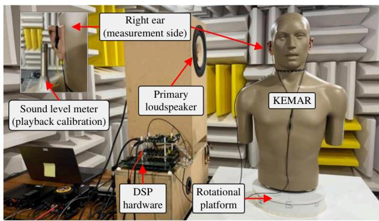

(a)  
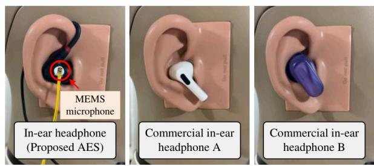  
(b)  
Fig. 8. Experimental setup: (a) system configuration; (b) an inear headphone with AES and two commercial headphones.

The end-to-end hardware group delay from the ADC input to the DAC output, including DSP processing, was measured to be 37 μs at a frequency of 1 kHz. The hardware group delay was obtained by applying a white noise signal to the ADC input and measuring the group delay between the ADC input and DAC output using a dynamic signal analyzer. This relatively small processing delay facilitates real-time feedforward ANC implementation, for which the available acoustic causality margin is particularly limited in compact inear configurations. In addition, Fig. 9 compares the measured time responses under the open-ear and in-ear headphone conditions. A 1-kHz sinusoidal signal was used in both measurements, and the playback and recording processes were synchronized. The time-delay measurement followed the procedure described in [6]. The difference between the two measured waveforms, denoted by t , was approximately 292 μs. This value represents the time difference between the open-ear and in-ear headphone acoustic responses and is distinct from the 37 μs ADC–DSP–DAC hardware group delay measured separately.

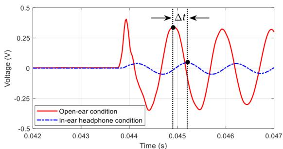  
Fig. 9. Measured time delay ( t ) under the open-ear and inear headphone conditions.

The present AES was implemented on the DSK platform to validate the proposed algorithm and system architecture rather than to optimize power consumption. The total input current of the DSK platform was measured with a supply voltage of 5 VDC. The measured current was approximately 0.484 A at idle and increased to approximately 0.602 A during real-time AES operation, corresponding to approximately 2.42 W and 3.01 W, respectively. These measurements represent the power consumption of the DSK platform and are not representative of that of commercial battery-powered in-ear headphones. Furthermore, the BT-based IIR realization substantially reduces the computational complexity of the ANC controller compared with its original FIR implementation. In practical products, the proposed framework can be implemented on low-power embedded audio DSPs or dedicated audio SoCs. Additional reductions in power consumption are expected through fixed-point implementation, hardware-specific optimization, and adaptive processing strategies that dynamically adjust computational resources according to the acoustic environment.

## B. Objective Performance Evaluation

Fig. 10 shows the spectra of the proposed AES measured at the right ear of the KEMAR. The black and blue lines depict the open-ear and in-ear headphone conditions, respectively. Obviously, the passive isolation is above 500 Hz. The ANC mode provides attenuation primarily at frequencies below 500 Hz, shown in red. This observation confirms that the ANC operation is effectively confined to the low-frequency region. Besides, the HT mode restores ambient sound transparency up to 4 kHz, producing a spectrum almost identical to the openear condition, shown in green. The ambient sound compensation is shaped by the bandpass filter $C ( z )$ for the speech frequency allocation. In this work, the lower cutoff frequency $f _ { L }$ can be set from 300 Hz to 700 Hz corresponding to different noise environments, while the upper cutoff frequency is fixed at 4 kHz in the present implementation based on the frequency-band allocation discussed in Sec. II-B, considering both speech-relevant ambient sound reproduction and DOA-dependent variations in the high-frequency acoustic response. Taking $f _ { L } = 3 0 0$ as an example, the ANC+HT mode attenuates low-frequency components below 300 Hz, while ambient sound is compensated from 300 Hz to 4 kHz, shown in pink.

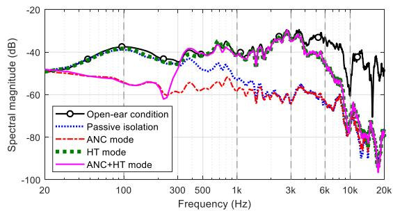  
Fig. 10. Measured spectra at the right ear of the KEMAR for different modes of AES.

Fig. 11 verifies ANC+HT mode performance with different DOAs. In this experiment, $f _ { L }$ of C z( ) was set to 700 Hz, thereby extending the ANC operating band to 700 Hz. The results indicate that the attenuation below 700 Hz varies with the DOA of the incident sound, but noticeable attenuation is consistently observed despite DOA. Meanwhile, the measured results for HT function remain close to the open-ear condition from 700 Hz to approximately 4 kHz across DOAs. The median curve is shown for reference. Above 4 kHz, HT compensation is intentionally limited to prevent unnecessary high-frequency amplification caused by DOA.

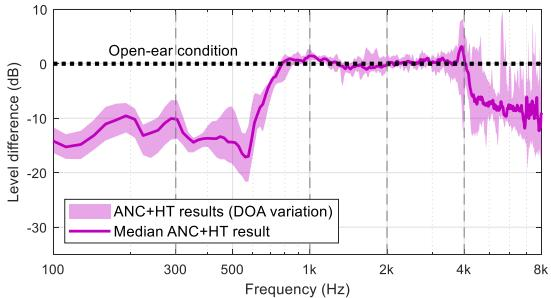  
Fig. 11. Measured results of the ANC+HT mode with different DOAs.

Fig. 12 shows the effects of parameters $g _ { a } , g _ { h }$ , and $f _ { L }$ These parameters are introduced to allow flexible tuning of the AES in different acoustic environments. All results were plotted relative to the open-ear condition. As shown in Fig. 12(a) and 12(b), the ANC gain $g _ { a }$ controls the overall level of active attenuation, whereas the HT gain $g _ { h }$ governs the degree of ambient sound transparency. Fig. 12(c) shows the influence of the lower cutoff frequency $f _ { L }$ of the shaping filter C z( ) on the effective noise reduction bandwidth. The adjustable gains and crossover frequency provide flexibility to accommodate different acoustic environments and listening preferences. The parameter variations in Fig. 12 are intended to demonstrate the controllability of the proposed AES rather than to identify an optimal parameter combination.

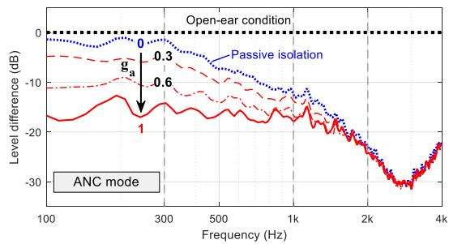  
(a)

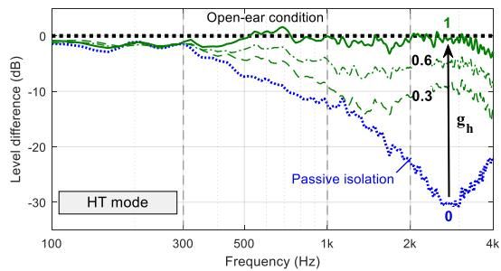  
(b)

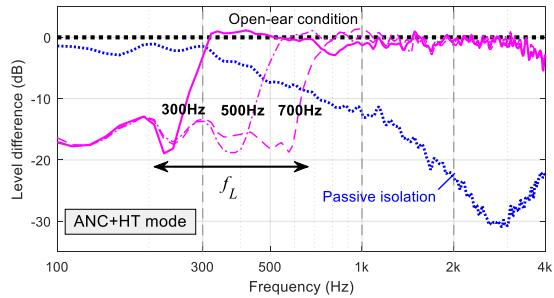  
(c)  
Fig. 12. Effects of gain and filter configuration: (a) $g _ { a } \mathrm { ~ } ;$ ; (b) $g _ { h }$ ; (c) lower cutoff frequency $f _ { L }$ of the shaping filter C z( ) .

To evaluate speech clarity under low-frequency ambient noise, Fig. 13 shows the spectrogram of the signal measured at the KEMAR right ear under different operating modes. The first part (0–5 s) depicts the speech signal selected from the TIMIT corpus [20] (SI1573 sentence), and the second part (5– 10 s) shows the speech signal combined with recorded aircraft cabin noise. The 0–10 s data serves as the reference signal for subsequent comparisons of speech clarity when wearing an inear headphone.

The performance of the proposed method is shown in 10–30 s. The 10–15 s interval depicts the sound under passive isolation, while the 15–30 s interval shows the results for AES with the ANC, HT, and ANC+HT modes. Obviously, speech clarity in low-frequency noisy environment is poor because the passive isolation or activating ANC function will suppress low-frequency components (10–20 s). In contrast, the HT mode (20–25 s) restores mid- to high-frequency components, which are important for speech perception, while concurrently reintroducing aircraft noise. In the ANC+HT mode (25–30 s), with the lower cutoff frequency $f _ { L }$ of C z( ) , the aircraft noise below 300 Hz is effectively attenuated, while ambient sound components between 300 Hz and 4 kHz are compensated, corresponding to the primary speech frequency range. Although speech contains perceptually relevant components above 4 kHz, the selected HT bandwidth preserves a substantial portion of the speech-relevant spectrum while maintaining controlled high-frequency behavior under variations in sound incidence direction. Based on the spectrogram analysis, the results indicate that the ANC+HT mode can effectively preserve speech clarity in the presence of low-frequency noise. An audio demonstration is available at https://doi.org/10.21227/nf6k-nv50.

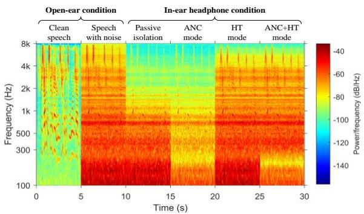  
Fig. 13. Spectrogram of the signal with different operating modes.

To further evaluate speech intelligibility, the updated version of the speech-to-reverberation modulation energy ratio (SRMR) metric [21], a non-intrusive measure of speech quality and intelligibility, referred to as $\operatorname { S R M R } _ { \operatorname { n o r m } }$ [22], was considered. $\operatorname { S R M R } _ { \operatorname { n o r m } }$ was adopted for the conditions shown in Fig. 13 because it provides improved speech intelligibility prediction and lower variability compared with the original SRMR [22]. The signals recorded at the KEMAR ear were resampled from 48 kHz to 16 kHz, a sampling rate at which the SRMR implementations have been shown to perform well. The $\operatorname { S R M R } _ { \operatorname { n o r m } }$ score is 0.878 for open-ear speech with aircraft cabin noise. For the passive isolation condition, ANC, HT, and ANC+HT modes, the corresponding scores are 0.723, 0.717, 0.833, and 0.974, respectively. The HT mode achieved a score comparable to that of the open-ear condition, whereas the ANC+HT mode yielded the highest score among the four headphone conditions and surpassed that obtained for open-ear speech with aircraft cabin noise, indicating that the proposed AES can improve speech intelligibility in low-frequency noise environments.

To evaluate speech clarity in the presence of recorded aircraft cabin noise, an in-ear headphone with the proposed AES was compared with two commercial in-ear headphones. For this comparison, ten utterances from the TIMIT corpus [20] (five female and five male) were concatenated into a single speech test signal and mixed with recorded aircraft cabin noise. Fig. 14 shows the measured spectra for the proposed AES operating in the ANC+HT mode and two commercial in-ear headphones operating in HT mode, with the open-ear condition included as a reference. The red line shows that commercial headphone A exhibited a spectral response close to the open-ear condition up to approximately 4 kHz, whereas the blue line illustrates that commercial headphone B showed similar behavior only up to 2 kHz. The proposed AES operating in the ANC+HT mode, shown in green, suppressed low frequency noise while preserving the spectral characteristics from 300 Hz to 4 kHz, close to the open-ear condition. This demonstrates a good balance between noise reduction and voice preservation, especially when traveling.

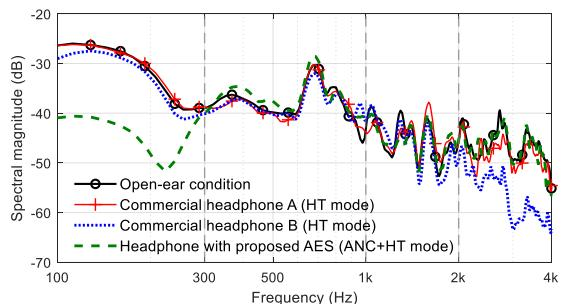  
Fig. 14. Comparison of measured spectra for the proposed AES and two commercial in-ear headphones under mixed speech and recorded low frequency noise.

## C. Subjective Hearing Evaluation

A subjective listening test was conducted with 25 participants (14 males and 11 females; mostly in their 20s, with a few over 50 years old) to evaluate perceived speech clarity. The listening stimuli for the subjective listening test consisted of the recorded signals measured at the KEMAR ear under passive isolation, ANC, HT, and ANC+HT modes. The AES parameters were fixed at $g _ { a } = 1 , \ g _ { h } = 1 ,$ , and $f _ { L } = 3 0 0$ Hz for all participants and test signals. These recorded signals were reproduced through a playback loudspeaker in a conference room for group-based subjective evaluation, as schematically illustrated in Fig. 15. Each recorded sound under those four conditions was played for 5 seconds for evaluation of speech clarity in low-frequency noisy environments.

The subjective evaluation was conducted in a conference room with dimensions of approximately $1 0 \times 4 \times 3 ~ \mathrm { m }$ . The reverberation time was not independently characterized during the experiment. All test signals were reproduced using the same loudspeaker, seating arrangement, and room conditions to ensure consistent acoustic conditions across the evaluated modes. Nevertheless, the influence of room acoustics represents a limitation of the present group-based listening evaluation. In addition, the test signals were recorded using a fixed KEMAR/headphone configuration rather than through direct headphone listening by individual participants. Therefore, the primary and secondary paths correspond to the controlled KEMAR configuration and do not account for listener-dependent variations in ear anatomy, insertion depth, headphone fit, or movement. Accordingly, the present listening test should be interpreted as a proof-of-concept evaluation under controlled conditions, which assumes more accurate and stationary knowledge of the acoustic transfer paths than would typically be available in practical applications.

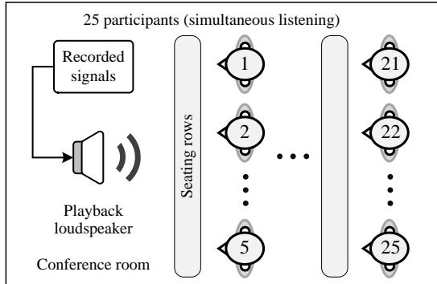

Fig. 15. Group-based subjective listening evaluation setup in a conference room using recorded signals.  
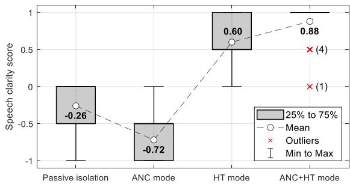  
Fig. 16. Boxplots of subjective speech clarity ratings under the four listening conditions.

The four listening conditions were presented in a fixed order of passive isolation, ANC, HT, and ANC+HT. Each condition consisted of a single 5-second speech sample and was presented once without a separate training session. Randomization, counterbalancing, and repeated trials were not employed in the present proof-of-concept evaluation. Therefore, potential order, learning, and short-duration effects cannot be excluded and should be considered when interpreting the subjective results.

Speech clarity was rated using a five-point rating scale with scores of −1 (extremely unclear), −0.5 (unclear), 0 (neutral), 0.5 (clear), and 1 (extremely clear). Fig. 16 shows boxplots of the clarity ratings under the four listening conditions. The mean scores were −0.26, −0.72, 0.60, and 0.88 for passive isolation, ANC, HT, and ANC+HT, respectively, with corresponding standard deviations of 0.293, 0.292, 0.289, and 0.261. The median scores were 0, −0.5, 0.5, and 1.0, respectively.

Because the same 25 participants evaluated all four conditions using an ordinal five-point rating scale, a Friedman test was employed to examine the effect of operating mode on perceived speech clarity [23]. The Friedman test revealed a significant difference among the four conditions, $\chi ^ { 2 } ( 3 ) = 6 9 . 6 6 , \ p < 0 . 0 0 1$ , with a large effect size (Kendall’s $W { = } 0 . 9 2 9 )$ . Post-hoc pairwise comparisons were subsequently performed using Wilcoxon signed-rank tests with Holm correction for multiple comparisons [24]. All six pairwise comparisons were statistically significant $\left( \ p _ { \mathrm { H o l m } } < 0 . 0 0 1 \right)$ ). In particular, ANC+HT yielded significantly higher clarity ratings than HT $( \begin{array} { r } { \begin{array} { r } { W = 1 9 } \end{array} } \end{array} , \begin{array} { r } { p _ { \mathrm { H o l m } } < 0 . 0 0 1 } \end{array}$ , rank-biserial correlation $r _ { \mathrm { r b } } = 0 . 7 7 8 \ )$ , indicating a substantial difference between the two modes under the evaluated low-frequencynoise condition.

All 25 participant ratings were retained in the statistical analysis; observations outside the boxplot whiskers reflect the conventional $1 . 5 \times \mathrm { I Q R }$ visualization criterion and were not treated as invalid data. Overall, the subjective speech clarity results are consistent with the objective $\operatorname { S R M R } _ { \operatorname { n o r m } }$ results in Sec. III-B, with ANC+HT achieving the highest scores in both evaluations.

## IV. CONCLUSION

This study demonstrated the effectiveness of an integrated ANC and HT system for improving speech clarity in lowfrequency noisy environments. The proposed AES enables simultaneous low-frequency noise suppression and ambient sound reproduction, with independently adjustable ANC and HT gains and a tunable crossover frequency. Experimental results showed that the ANC+HT mode provided greater lowfrequency noise attenuation than two commercial headphones operating in HT mode while preserving ambient sounds up to 4 KHz. Furthermore, the ANC+HT mode achieved the highest objective $\operatorname { S R M R } _ { \operatorname { n o r m } }$ score and subjective speech-clarity ratings among the evaluated headphone operating modes. These findings demonstrate the potential of integrated ANC and HT processing to improve speech clarity while maintaining environmental awareness. Nevertheless, the present evaluation was conducted under controlled conditions using KEMAR-recorded signals and a limited set of acoustic scenarios. Consequently, the effects of individual ear characteristics, headphone fit, and varying noise conditions require further investigation. Future work will focus on direct headphone listening evaluations involving diverse users and acoustic environments, together with more rigorous subjective testing procedures. Incorporating advanced speech enhancement and source separation techniques may further improve system robustness and speech intelligibility in complex acoustic environments.

## REFERENCES

[1] J. Harrison, A. W. Archer-Boyd, and D. T. Murphy, “Measurement of insertion loss and gain in variable hear-through and noise cancellation modes of true wireless earbuds,” Acta Acust., vol. 9, Apr. 2025, Art. no. 28, doi: 10.1051/aacus/2025013.

[2] Z. Cheng, Y. Zhou, Y. Liu, Y. Zhao, and L. Shi, “Selective fixed-filter active noise control based on parallel structure and bayesian tracking,” IEEE Trans. Consum. Electron., vol. 72, no. 1, pp. 957–970, Feb. 2026, doi: 10.1109/TCE.2025.3642789.

[3] V. Valimaki, A. Franck, J. Ramo, H. Gamper, and L. Savioja, “Assisted listening using a headset: Enhancing audio perception in real, augmented, and virtual environments,” IEEE Signal Process. Mag., vol. 32, no. 2, pp. 92–99, Mar. 2015, doi: 10.1109/MSP.2014.2369191.

[4] F. Denk, H. Schepker, S. Doclo, and B. Kollmeier, “Acoustic transparency in hearables—Technical evaluation,” J. Audio Eng. Soc., vol. 68, nos. 7–8, pp. 508–521, Jul. 2020, doi: 10.17743/jaes.2020.0042.

[5] V. Patel, J. Cheer, and S. Fontana, “Design and implementation of an active noise control headphone with directional hear-through capability,” IEEE Trans. Consum. Electron., vol. 66, no. 1, pp. 32–40, Feb. 2020, doi: 10.1109/TCE.2019.2956634.

[6] T. C. Kwong, Y. S. Choy, C. C. H. Chan, and S. W. Y. Mung, “Tunable active noise control circuit topology for multiple-feature applications,” Sci. Rep., vol. 14, Aug. 2024, Art. no. 18629, doi: 10.1038/s41598-024- 69485-2.

[7] P. Merz, “A volume knob for ambient sound: seamless ambient sound adjustment in wireless headphones using hybrid active noise control,” in Proc. AES Int. Conf. Headphone Technol., Espoo, Finland, Aug. 2025, Paper 9. [Online]. Available: https://aes.org/publications/elibrarypage/?id=22935

[8] R. Serizel, M. Moonen, J. Wouters, and S. H. Jensen, “Integrated active noise control and noise reduction in hearing aids,” IEEE Trans. Audio, Speech, Lang. Process., vol. 18, no. 6, pp. 1137–1146, Aug. 2010, doi: 10.1109/TASL.2009.2030948.

[9] R. Serizel, M. Moonen, J. Wouters, and S. H. Jensen, “A zone-of-quiet based approach to integrated active noise control and noise reduction for speech enhancement in hearing aids,” IEEE Trans. Audio, Speech, Lang. Process., vol. 20, no. 6, pp. 1685–1697, Aug. 2012, doi: 10.1109/TASL.2012.2187193.

[10] M. Rane, P. Coleman, R. Mason, and S. Bech, “Survey of user perspectives on headphone technology,” in Proc. 152nd Conv. Audio Eng. Soc. (AES), The Hague, Netherlands, May 2022, doi: 10.15126/900449.

[11] D. Shi, B. Lam, W.-S. Gan, J. Cheer, and S. J. Elliott, “Active noise control in the new century: The role and prospect of signal processing,” in Proc. 52nd Int. Congr. Expo. Noise Control Eng. (INTERNOISE), Chiba, Japan, Aug. 2023, pp. 5141–5151.

[12] C.-Y. Chang, C.-N. Chiou, and S. M. Kuo, “A complete design of smart pad that reduces snoring,” IEEE Trans. Consum. Electron., vol. 69, no. 3, pp. 649–656, Aug. 2023, doi: 10.1109/TCE.2023.3265660.

[13] C.-R. Huang, C.-Y. Chang, and S. M. Kuo, “Time-shift modeling-based hear-through system for in-ear headphones,” IEEE Trans. Consum. Electron., vol. 68, no. 3, pp. 273–280, Aug. 2022, doi: 10.1109/TCE.2022.3190422.

[14] G. Fant, Speech Acoustics and Phonetics. Dordrecht, The Netherlands: Springer, 2004, pp. 216–220.

[15] B. C. J. Moore, An Introduction to the Psychology of Hearing, 6th ed. Bingley, U.K.: Emerald Group Publishing, 2012, pp. 89–94.

[16] S. M. Kuo and D. R. Morgan, Active Noise Control Systems: Algorithms and DSP Implementations. New York, USA: Wiley, 1996, pp. 58–65.

[17] B. Moore, “Principal component analysis in linear systems: Controllability, observability, and model reduction,” IEEE Trans. Autom. Control, vol. 26, no. 1, pp. 17–32, Feb. 1981, doi: 10.1109/TAC.1981.1102568.

[18] B. Beliczynski, I. Kale, and G. D. Cain, “Approximation of FIR by IIR digital filters: an algorithm based on balanced model reduction,” IEEE Trans. Signal Process., vol. 40, no. 3, pp. 532–542, Mar. 1992, doi: 10.1109/78.120796.

[19] F. Hilgemann, C. Weyer, and P. Jax, “Design of low-order IIR filters based on Hankel nuclear norm regularization for achieving acoustic transparency,” in Proc. Speech Communication; 15th ITG Conf., Aachen, Germany, Sep. 2023, pp. 136–140.

[20] J. S. Garofolo et al., “TIMIT acoustic-phonetic continuous speech corpus LDC93S1,” Linguistic Data Consortium, Philadelphia, PA, USA, 1993, doi: 10.35111/17gk-bn40.

[21] T. H. Falk, C. Zheng, and W.-Y. Chan, “A non-intrusive quality and intelligibility measure of reverberant and dereverberated speech,” IEEE Trans. Audio, Speech, Lang. Process., vol. 18, no. 7, pp. 1766–1774, Sep. 2010, doi: 10.1109/TASL.2010.2052247.

[22] J. F. Santos, M. Senoussaoui, and T. H. Falk, “An improved nonintrusive intelligibility metric for noisy and reverberant speech,” in Proc. 14th Int. Workshop Acoust. Signal Enhancement (IWAENC), Juan-les-Pins, France, Sep. 2014, pp. 55–59.

[23] G. W. Corder and D. I. Foreman, Nonparametric Statistics: A Step-by-Step Approach, 2nd ed. Hoboken, NJ, USA: Wiley, 2014, pp. 104–105.

[24] S. Holm, “A simple sequentially rejective multiple test procedure,” Scand. J. Stat., vol. 6, no. 2, pp. 65–70, 1979.

  
Chong-Rui Huang was born in Taiwan in 1993. He received the B.S. degree in electronic engineering from Chien Hsin University of Science and Technology, Taoyuan, Taiwan, in 2017, and the M.S. and Ph.D. degrees in electrical

engineering from Chung Yuan Christian University (CYCU), Taoyuan, Taiwan, in 2019 and 2026, respectively. He is currently a postdoctoral researcher with the Department of Electrical Engineering, CYCU. His research interests include active noise control, digital signal processing, acoustic signal processing, and real-time digital system implementation.

Cheng-Yuan Chang was born in Taiwan in 1968. He received the B.S. and M.S. from National Chiao Tung University, Taiwan, in 1990 and 1994, respectively, and the Ph.D. from National Central University, Taiwan, in 2000. In 2007, he joined the Department of Electrical

Engineering at Chung Yuan Christian University, where he has been a Distinguished Professor since 2021. He served as Department Chairman from 2013 to 2019, and as Dean from 2022 to 2024. He was a Visiting Professor at Northern Illinois University in 2012. He was the recipient of the 2018 Future Tech Award from the National Science and Technology Council, Taiwan. He also served as Secretary of the IEEE Taipei Section and holds multiple international patents. His research interests include signal processing applications and active noise control system design.

Sen M. Kuo received the B.S. degree from National Taiwan Normal University, Taipei, Taiwan, in 1976, and the M.S. and Ph.D. degrees from the University of New Mexico, Albuquerque, NM, USA, in 1983 and 1985, respectively. From 1985 to 2014, he was with Northern Illinois University,

DeKalb, and served as the Department Chair from 2002 to 2008. From 2014 to 2021, he was an Honorary Chair Professor with the Department of Electrical Engineering, Chung Yuan Christian University. In 1993, he was with Texas Instruments, Houston, TX, and in 2008, he was with Chung-Ang University. He is the leading author of three books: Active Noise Control Systems (Wiley, 1996), Real-Time Digital Signal Processing (Wiley, 2001, 2007, and 2013), and Digital Signal Processors (Prentice-Hall, 2005), and the coauthor of three books: Embedded Signal Processing with the Micro Signal Architecture (Wiley, 2007), Subband Adaptive Filtering (Wiley, 2009), and Secondary-Path Modeling Techniques for Active Noise Control Systems (Springer). He holds ten U.S. patents. His research focuses on active noise and vibration control, real-time DSP applications, digital audio applications, and biomedical signal processing. He was a recipient of the 1993 IEEE Chester Sall Award for the firstplace transactions paper award in the IEEE Transactions on Consumer Electronics and the faculty-of-year award in 2001 for accomplishments in research and scholarly areas.