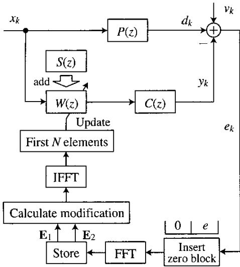
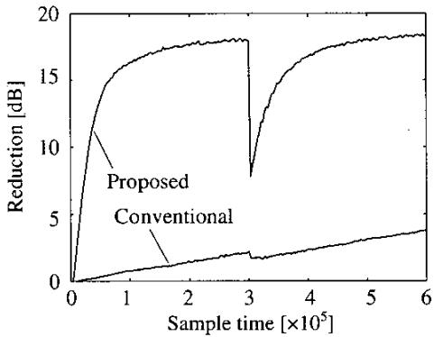
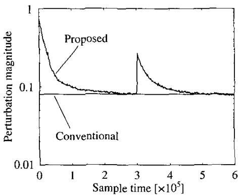
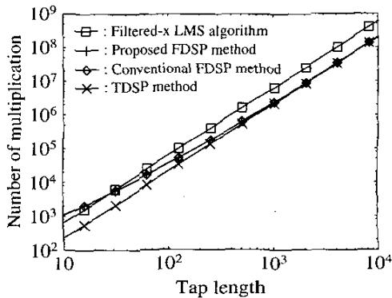

# ACTIVE NOISE CONTROL WITHOUT A SECONDARY PATH MODEL BY USING A FREQUENCY-DOMAIN SIMULTANEOUS PERTURBATION METHOD WITH VARIABLE PERTURBATION

Y. Kajikawa and Y. Nomura

Department of Electronics, Faculty of Engineering,
Kansai University
3-3-35, Sutai-shi, Osaka 564-8680, JAPAN

## ABSTRACT

In this paper, we propose a frequency domain active noise control (ANC) system without a secondary path model. The proposed system is based on the frequency domain simultaneous perturbation (FDSP) method with variable perturbation. In this system, the coefficients of the adaptive filter are updated only by error signals. The conventional ANC system using the filtered-x algorithm becomes unstable due to the error between the secondary path, from secondary source to error sensor, and its model. In contrast, the proposed ANC system has the advantage not to use the model. Furthermore, the variable perturbation brings the fast convergence. Simulation results demonstrate the efficiency of the proposed ANC system compared with the conventional ANC systems.

## 1. INTRODUCTION

Active noise control (ANC) [1] has recently been applied to a wide variety of acoustic noise problems. In the single-channel feedforward ANC system, the filtered-x algorithm is usually used as an algorithm to update the adaptive filter coefficients. The filtered-x algorithm requires an estimation of the secondary path (from the secondary source generating anti-noise to the error sensor detecting residuals) prior to the operation of the ANC system. The estimated model is often called a secondary path model. However, the secondary path model generally differs from the physical one. In this case, the errors between the secondary path and its model can lead to system instability or suboptimal performance [2, 3]. The modeling error of the secondary path model is consequently the most significant problem in the ANC system.

Some approaches to solve this problem include ANC systems without secondary path models. One of these approaches involves a technique that employs the simultaneous equations method [4]. In this technique, another auxiliary filter is used to create the noise control filter. This technique has the advantage of converging faster than the conventional ANC system using the filtered-x LMS algorithm. However, this technique requires a complex system composition.

Another technique uses the time-domain simultaneous perturbation (TDSP) or the frequency-domain simultaneous perturbation (FDSP) method $[5, 6]$ . In the TDSP and FDSP methods, the coefficients of the adaptive filter are updated by two error signals: one is the error between the output of the adaptive filter and the desired signal; the other is the error between the output of the adaptive filter, with a little perturbation, and the desired signal. The advantage of this technique is its ability to update the filter coefficients using only error signals. Hence, the ANC system using this technique does not require the secondary path model. Moreover, the system composition is smaller than that of the conventional ANC system using the filtered-x algorithm. However, this technique converges more slowly than the conventional ANC system. This disadvantage is due to the perturbation and the step-size parameter. In this system, the step-size parameter depends on the perturbation. That is, if the magnitude of the perturbation is large, then the step-size parameter can be set to large value. However, the large perturbation value affects the cancellation performance because the perturbation is another additive noise in the ANC system. Hence, the magnitude of the perturbation must be set to small value as enough cancellation performance is obtained. As a result, the step-size parameter becomes small and the convergence speed consequently becomes much slow. Therefore, variable perturbation is needed in order to improve the convergence speed.

This paper proposes a novel ANC system using the FDSP method with variable perturbation. This system can improve the convergence speed and suppress the additive noise due to the perturbation.

## 2. PROPOSED ANC SYSTEM

## 2.1. ANC System without a Secondary Path by Using the Conventional FDSP Method

Figure 1 shows the system arrangement of the ANC system using the FDSP method. In this system, the filtering operation is done in the time domain, and the updating operation is done in the frequency domain, in order that the ANC system must reduce noise in real time. In Fig. 1, the perturbation filter is added to the time-domain control filter (TDCF) within a half period of a given block and not during the block's rest period. The error signals within each period are transformed to two different error vectors. Moreover, the vectors are transformed into the frequency domain by means of the FFT algorithm. The updating algorithm at the n'th block in the proposed ANC system can be given as follows.

$$
\begin{array}{r c l} \mathbf {w} _ {n + 1} & = & \mathbf {w} _ {n} - \mu \boldsymbol {\Delta} \mathbf {w} _ {n} \\ \boldsymbol {\Delta} \mathbf {w} _ {n} & = & f i r s t N e l e m e n t s o f I F F T [ \mathbf {U} _ {n} ] \\ \mathbf {U} _ {n} & = & d i a g [ \mathbf {S} _ {n} ] \frac {d i a g [ \mathbf {E} _ {2 , n} ^ {*} ] \mathbf {E} _ {2 , n} - d i a g [ \mathbf {E} _ {1 , n} ^ {*} ] \mathbf {E} _ {1 , n}}{c} \\ \mathbf {E} _ {1, n} & = & F F T [ \mathbf {e} _ {1, n} ], \mathbf {E} _ {2, n} = F F T [ \mathbf {e} _ {2, n} ] \\ \mathbf {e} _ {1, n} & = & [ 0 \dots 0 e _ {n L + 1} \dots e _ {k} \dots e _ {(2 n + 1) L / 2} ] ^ {T} \\ \mathbf {e} _ {2, n} & = & [ 0 \dots 0 e _ {(2 n + 1) L / 2 + 1} \dots e _ {k} \dots e _ {(n + 1) L} ] ^ {T} \\ \mathbf {w} _ {n} & = & [ w _ {n} (1) w _ {n} (2) \dots w _ {n} (i) \dots w _ {n} (N) ] ^ {T} \\ \mathbf {S} _ {n} & = & [ S _ {n} (1) S _ {n} (2) \dots S _ {n} (i) \dots S _ {n} (2 N) ] ^ {T} \end{array} \tag {1}
$$

where $L(=2N)$ is the block length, c the perturbation value, $\mu$ the step-size parameter, and $S_{n}$ a complex vector whose elements are -1 or 1 in both real and imaginary parts and that have the following characteristics.

$$
\begin{array}{l} E \left[ R e \left\{S _ {n} (i) \right\} \right] = 0, E \left[ I m \left\{S _ {n} (i) \right\} \right] = 0 \\ R e \left\{S _ {n} (i) \right\} ^ {2} = 1, I m \left\{S _ {n} (i) \right\} ^ {2} = 1 \\ E \left[ R e \left\{S _ {n} (i) \right\} R e \left\{S _ {m} (i) \right\} \right] = 0 (n \neq m) \\ E \left[ I m \left\{S _ {n} (i) \right\} I m \left\{S _ {m} (i) \right\} \right] = 0 (n \neq m) \\ E \left[ R e \left\{S _ {n} (i) \right\} I m \left\{S _ {n} (i) \right\} \right] = 0 \end{array}\tag{3}
$$

where $E[\cdot]$ is an expected value. The perturbation value is given by

$$
c <   \sqrt {\frac {P _ {v}}{P _ {x}}}\tag{4}
$$

where $P_{v}$ and $P_{x}$ are the power of the additive noise and the input signal. Now, the operation of the proposed ANC system is concluded as follows:

1. The perturbation filter is added to the time-domain control filter (TDCF).

2. Cancellation is done by the TDCF generated by procedure 1 within a half period of a given block (k = nL + 1 \~ (2n + 1)L/2).

3. Error signals at $k = nL + 1 \sim (2n + 1)L / 2$ are saved on memory.

4. At $k = (2n + 1)L/2 + 1$ , the perturbation filter is removed from the TDCF.

5. Cancellation is done by the TDCF without the perturbation filter within the rest half period of the same given block $(k = (2n + 1)L/2 + 1 \sim (n + 1)L)$ .

6. Error signals at $k = (2n + 1)L/2 + 1 \sim (n + 1)L$ are saved on memory.

7. At $k = (n + 1)L$ , two time domain error signal vectors saved on memory are transformed into the frequency domain by means of the FFT algorithm.

8. The frequency domain modification is calculated by using the two frequency domain error signal vectors and the perturbation filter according to Eq. (2).

9. The frequency domain modification is transformed into the time domain by means of the IFFT algorithm.

10. The TDCF is updated by the time domain modification obtained at procedure 9.

11. Procedures 1 \~ 10 are repeated.

## 2.2. FDSP Method with Variable Perturbation

In order to make the convergence speed of the previous system fast, we need to vary the perturbation value. The procedure of the FDSP method with the variable perturbation is shown in Fig. 2 and is as follows:

1. Cancellation is done by the TDCF without the perturbation within a half period of a given block (k = nL + 1 \~ (2n + 1)L/2).

2. Error signals at $k = (2n + 1)L/2 + 1 \sim (n + 1)L$ are saved on memory.

3. At $k = (2n + 1)L/2 + 1$ , the perturbation value is calculated by the following equation and the perturbation filter is generated.

$$
c = \sqrt {\frac {\alpha P _ {e 2}}{G ^ {2} P _ {x}}}\tag{5}
$$

where $P_{e2}$ is the power of the error signal obtained at procedure 2. G the gain of the secondary path. $\alpha$ a constant value. From the above equation, the magnitude of the perturbation varies in proportion to square error. That is, the perturbation becomes smaller as the noise becomes smaller.

1 block  
  
$P(z)$ : Primary Path, $C(z)$ : Secondary Path $W(z)$ : Time Domain Control Filter $S(z)$ : Perturbation Filter

Fig. 1. Block diagram of the ANC system using the FDSP method.

<table><tr><td>First half</td><td>Rest half</td></tr><tr><td>(1) Not add perturbation</td><td>(3) Add perturbation</td></tr></table>

Fig. 2. A control scheme of the perturbation magnitude.

4. Cancellation is done by the TDCF with the perturbation filter within the rest half period of the same given block $(k = (2n + 1)L/2 + 1 \sim (n + 1)L)$ .

5. Error signals at $k = (2n + 1)L/2 + 1 \sim (n + 1)L$ are saved on memory.

6. At $k = (n + 1)L$ , two time domain error signal vectors saved on memory are transformed into the frequency domain by means of the FFT algorithm.

7. The frequency domain modification is calculated by using the two frequency domain error signal vectors and the perturbation filter according to Eq. (2).

8. The frequency domain modification is transformed into the time domain by means of the IFFT algorithm.

Table 1. Simulation conditions.

<table><tr><td>Input signal</td><td>White noise (Power1)</td></tr><tr><td>Sampling frequency</td><td>2000[Hz]</td></tr><tr><td>Tap length of primary path</td><td>128</td></tr><tr><td>Tap length of secondary path</td><td>128</td></tr><tr><td>Tap length of control filter</td><td>128</td></tr><tr><td>Tap length of perturbation filter</td><td>128</td></tr><tr><td>Block length</td><td>256</td></tr><tr><td>S/N</td><td>20[dB]</td></tr></table>

  
Fig. 3. Comparison of convergence properties between the proposed and the conventional ANC systems using FDSP method.

9. The TDCF is updated by the time domain modification obtained at procedure 8.

10. Procedures $1 \sim 9$ are repeated.

## 3. SIMULATION RESULTS

We show our simulation results in order to demonstrate the effectiveness of the proposed system. Simulation conditions are shown in Table 1. The vertical axis for the convergence properties below indicates the reduction in noise (Reduction) defined as follows.

$$
\mathrm{Reduction[dB]} = 1 0 \log_ {1 0} \frac {\sum_ {i = 1} ^ {2 N} d _ {i} ^ {2}}{\sum_ {i = 1} ^ {2 N} e _ {i} ^ {2}}\tag{6}
$$

We compare the convergence property between the ANC systems using the conventional FDSP method (fixed perturbation) and the proposed FDSP method (variable perturbation) with the following experiment. First, each parameter in both systems is selected so that the fastest convergence speed is obtained. In the proposed system, $\alpha = 0.5$ and $\mu = 6.0 \times 10^{-5}$ . On the other hand, in the conventional system, c = 0.08 and step-size parameter $8.0 \times 10^{-7}$ . Next, the secondary path is changed at 300000 sample. The results of this experiment are shown in Figs. 3 and 4. From Figs. 3 and 4, the proposed system can converge much faster than the conventional system.

  
Fig. 4. Comparison of the perturbation magnitudes between the proposed and the conventional ANC systems using the FDSP method.

Table 2. The number of multiplication in each algorithm required during 2N samples.

<table><tr><td>Proposed FDSP method</td><td> $2N^{2} + 34N + 16N \log_{2} N + 4$ </td></tr><tr><td>Conventional FDSP method</td><td> $2N^{2} + 32N + 16N \log_{2} N$ </td></tr><tr><td>Filtered-x LMS algorithm</td><td> $6N^{2} + 2N$ </td></tr><tr><td>TDSP method</td><td> $2N^{2} + 2N + 3$ </td></tr></table>

## 4. COMPUTATIONAL COMPLEXITY

In this section, we compare the computational complexity of the proposed and conventional ANC systems using the conventional FDSP, the TDSP, and the Filtered-x algorithm. The number of multiplication in each algorithm required during 2N samples is shown in Table 2 and Fig. 5. From Fig. 5, the number of multiplication of the proposed system is nearly equal to that of the conventional FDSP method and is smaller than that of the Filtered-x LMS algorithm. From the above, the proposed system can improve the convergence speed without increasing the computational complexity.

## 5. CONCLUSIONS

In this paper, we have proposed a novel frequency domain ANC system to solve the problem of conventional ANC systems. The proposed system is advantageous in that the secondary path model is not needed. The proposed system, therefore, is very simple and avoids the modeling errors that can be introduced by the secondary path model. In addition, the proposed ANC system can converge much faster than the ANC system using the conventional FDSP method because of the variable perturbation.

  
Fig. 5. Comparison of the number of multiplication in each algorithm.

## 6. REFERENCES

[1] P. A. Nelson and S. J. Eliott, Active Control of Sound, Academic Press Ltd., London, 1992.

[2] C. C. Boucher, et al., "Effect of Errors in the Plant Model on the Performance of Algorithms for Adaptive Feedforward Control," IEE Proc. F. Radar Signal Process., vol. 138, no. 8, pp. 313-319, Aug. 1991.

[3] S. D. Synder, et al., "The Effect of Transfer Function Estimation Errors on the Filtered-x LMS Algorithm", IEEE Trans. Signal Process., vol. SP-42, no. 4, pp. 950-953, April 1994.

[4] K. Fujii, et al., "Simultaneous Equations Method not Requiring the Secondary Path Filter," ACTIVE99, Florida, U.S.A., pp. 941-948, Sep. 1999.

[5] Y. Kajikawa, et al., "Active Noise Control System without Secondary Path Model," Proc. of the IS-CAS2000, Geneva, Switzerland, pp. 349-352, May 2000.

[6] Y. Kajikawa, et al., "Frequency Domain Active Noise Control System without a Secondary Path Model via Perturbation Method," IEICE Trans., vol.E84-A, no.12, pp.3090-3098, Dec. 2001.