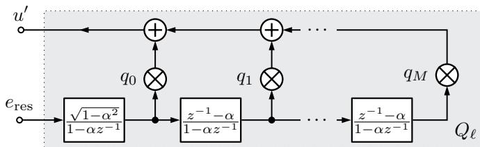
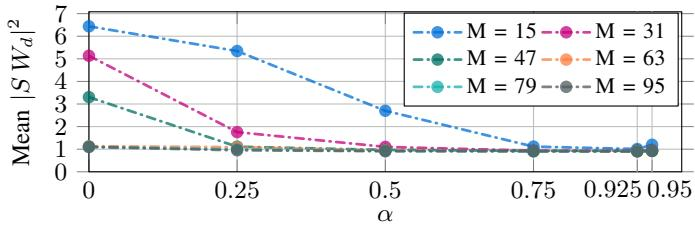
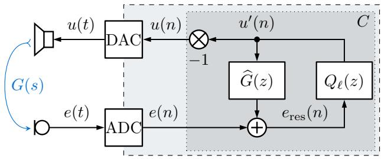
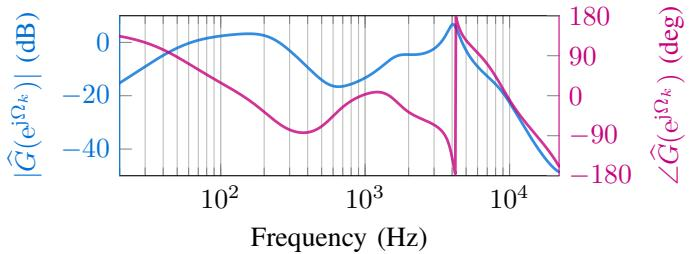
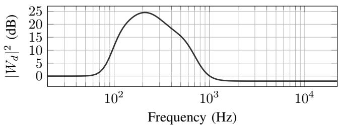
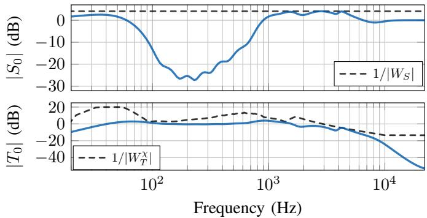
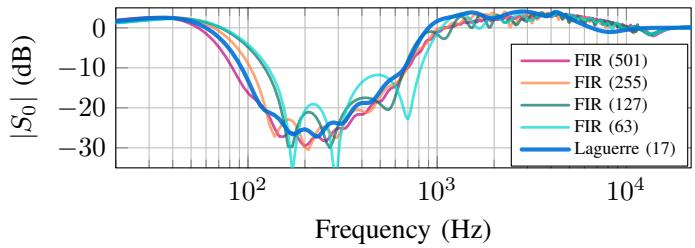
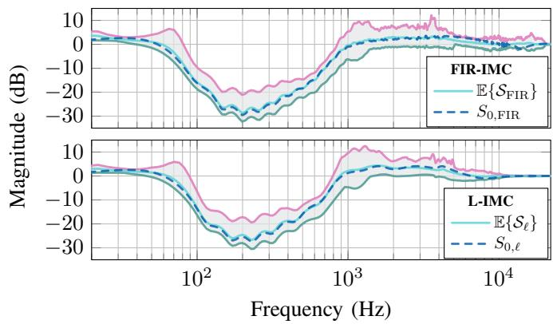

# Laguerre Filter-based Robust Feedback Active Noise Control

Willem Alexander Klatt and Rainer Martin

Institute of Communication Acoustics, Ruhr-Universitat Bochum, Bochum, Germany¨ {willem.klatt, rainer.martin}@ruhr-uni-bochum.de

Abstract—In this paper, we describe an alternative approach to design the internal model control (IMC) principle for feedback active noise control (FBANC) by means of Laguerre filters. For this, we discuss the adequate choice of the Laguerre parameter and the filter order. It turns out that the Laguerre filter coefficients can be optimized in the same fashion as IMC designs that utilize finite impulse response (FIR) filters. Furthermore, when compared to FIR-based IMC designs, the proposed approach also has the advantage that significantly fewer filter coefficients need to be optimized. At the same time, the noise reduction performance is on par with higher order FIR-based designs. In terms of robust stability, our approach achieves good results in both nominal and non-nominal scenarios.

Index Terms—Active Noise Control, Robust Feedback Control, Filter Optimization, Filter Design, Laguerre Filter

## I. INTRODUCTION

In modern headphones and headsets, active noise control (ANC) is a well established technique to minimize disturbing noise in the listener’s ears. Over time, numerous approaches to ANC have been proposed that are based on open-loop control (feedforward) filters and both conventional and machine learning-based signal processing methods [1], [2]. In particular for sinusoidal noise, feedforward ANC (FFANC) achieves high degrees of attenuation. However, FFANC requires a reference signal to create the anti-noise signal and a sufficiently accurate estimation of the acoustic system to be controlled. In addition, signal processing must be performed with the least possible delay [3]. In contrast, feedback (closed-loop control) ANC (FBANC) generates the anti-noise signal directly by filtering the error signal, which is ideally measured at the point where the zone of silence needs to be generated [4]. A state-of-theart approach to parameterize robustly stable FBANC control filters is the internal model control (IMC) principle [5], which allows one to optimize the control filter coefficients with respect to requirements regarding noise attenuation and robust stability [6]. Typically, the control filter is a finite impulse response (FIR) filter. However, at higher sampling rates, the filter order has to be high in order to achieve sufficient noise attenuation at lower frequencies. In this paper, we propose an approach for the design of IMC filters that utilizes Laguerre networks. In ANC research, the utilization of Laguerre filters has already been investigated, but only for feedforward and feedback filters without IMC topology [7], [8].

This paper is structured as follows: In Section II, we discuss the key aspects of Laguerre filters and explain how to choose the Laguerre parameter in the context of FBANC. In

Section III, we revisit the characterizing properties of the IMC approach for FBANC. This is followed by Section IV, where we describe the consolidation of the Laguerre filter approach and the IMC filter structure. This includes a discussion of relevant design parameters and the optimization procedure. Lastly, in Section V, we evaluate a specific Laguerre filter design for IMC-FBANC and compare the results to conventional FIRbased IMC designs.

## II. LAGUERRE FILTERS FOR FEEDBACK ANC

## A. Laguerre Networks

In the conventional IMC filter design for FBANC, the control filter $Q$ is an FIR filter, which is optimized by minimizing a cost function subject to constraints that ensure robust stability and prescribed nominal performance. The cost function directly depends on the frequency-wise summation of the magnitude squared nominal sensitivity [6]:

$$
\left| S (\mathrm{e} ^ {\mathrm{j} \Omega_ {\mathrm{k}}}) \right| ^ {2} = \left| 1 - Q (\mathrm{e} ^ {\mathrm{j} \Omega_ {\mathrm{k}}}) \widehat {G} (\mathrm{e} ^ {\mathrm{j} \Omega_ {\mathrm{k}}}) \right| ^ {2},\tag{1}
$$

where $\widehat { G }$ is the secondary path model and $\begin{array} { r l } { \Omega _ { k } , } & { { } k } \end{array} =$ $0 , \ldots , N _ { \Omega } \mathrm { ~ - ~ } 1$ is the normalized discretized angular frequency. Clearly, we have $| S ( \mathrm { e } ^ { \mathrm { j } \Omega _ { \mathbf { k } } } ) | ^ { 2 }  0 , \forall \Omega _ { k }$ if $Q ( \mathrm { e } ^ { \mathrm { j } \Omega _ { \mathbf { k } } } ) $ $\widehat { G } ^ { - 1 } ( \mathrm { e } ^ { \mathrm { j } \Omega _ { \mathrm { k } } } )$ , $\forall \Omega _ { k }$ with the optimum at $Q ( { \mathrm { e } } ^ { \mathrm { j } \Omega _ { \mathrm { k } } } ) = \widehat { G } ^ { - 1 } ( { \mathrm { e } } ^ { \mathrm { j } \Omega _ { \mathrm { k } } } )$ This only results in a stable solution if the model is minimumphase, which is not true for modeled systems with a certain spatial distance between the secondary source (loudspeaker) and the sensor (microphone). Additionally, robust stability constraints may prevent $Q$ from reaching the optimal value. Therefore, the optimization of $Q$ can be interpreted as the following system identification task: Find the coefficients of the control filter $Q$ under consideration of the robust stability and noise reduction requirements such that the inverse minimumphase component of $\widehat { G } ( \mathrm { e } ^ { \mathrm { j } \Omega _ { \mathrm { k } } } )$ is best approximated. To ensure good ANC performance, the order of the FIR filter has to be chosen sufficiently high. Especially at higher sampling rates, the order has to be large in order to achieve sufficient noise attenuation at lower frequencies. To overcome this problem, we propose to design $Q$ as a Laguerre network. Generally, for system identification problems, Laguerre networks offer lower order filters than FIR with comparable approximation errors [9]. Any discrete-time system $Q _ { 0 } ( z )$ with a specified frequency response can be represented by the series

$$
Q _ {0} (z) \triangleq Q _ {\ell} ^ {\star} (z) = \sum_ {m = 0} ^ {\infty} q _ {m} (\alpha) \Lambda_ {m} (z, \alpha),\tag{2}
$$

where subscript ℓ indicates the Laguerre series representation and $\Lambda _ { m } ( z , \alpha )$ is the z-Transform of a discrete-time Laguerre polynomial [10], [11]:

$$
\Lambda_ {m} (z, \alpha) = \sqrt {1 - \alpha^ {2}} \frac {(z ^ {- 1} - \alpha) ^ {m}}{(1 - \alpha z ^ {- 1}) ^ {m + 1}}.\tag{3}
$$

α is called the Laguerre parameter, which can be chosen arbitrarily within the open interval $\alpha \in ( - 1 , 1 )$ . Note that for the time being, we consider α to be real-valued. In fact, when selecting $\alpha = 0 ,$ , the entire network reduces to an M-th order FIR filter. $q _ { m }$ is the m-th Laguerre coefficient, which, in general, can be obtained by integrating $Q _ { 0 } ( z ) \Lambda _ { m } ( z ^ { - 1 } , \alpha )$ over a closed contour $\Gamma \in \mathbb { C } \mathrm { : }$

$$
q _ {m} (\alpha) = \frac {\sqrt {1 - \alpha^ {2}}}{2 \pi \mathrm{j}} \oint_ {\Gamma} Q _ {0} (z) \frac {(z - \alpha) ^ {m}}{(1 - \alpha z) ^ {m + 1}} \frac {\mathrm{d} z}{z}.\tag{4}
$$

However, when modeling physical systems or designing digital filters, an infinitely long response may cause computational difficulties. Thus, we use the truncated approximation of $Q _ { \ell } ^ { \star } ( z )$ , i.e.,

$$
Q _ {\ell} ^ {\star} (z) \approx Q _ {\ell} (z) = \sum_ {m = 0} ^ {M} q _ {m} (\alpha) \Lambda_ {m} (z, \alpha),\tag{5}
$$

where M is the order (number of stages) of the Laguerre approximation. It becomes obvious that $\begin{array} { r l } { \mathbf { q } ( \alpha ) } & { { } = } \end{array}$ $[ q _ { 0 } ( \alpha ) , q _ { 1 } ( \alpha ) , \ldots , q _ { M } ( \alpha ) ] ^ { \mathsf { T } }$ resembles transversal filter coefficients and $\mathbf { \Lambda } \Lambda ( z , \alpha ) = [ \Lambda _ { 0 } ( z , \alpha ) , \Lambda _ { 1 } ( z , \alpha ) , \ldots , \Lambda _ { M } ( z , \alpha ) , ] ^ { \top }$ can be interpreted as a generalized delay operator. In addition, we might simply write $Q _ { \ell } ( z ) = \mathbf { q } ^ { \mathsf { T } } \pmb { \Lambda } ( z , \alpha )$ . The series in (5) can be realized as a filter network composed of all-pass filters with a first-order low-pass filter as the input stage (see Fig. 1). To obtain the frequency response, one can evaluate the expression in (5) on the unit circle. That is, by using $z = \mathrm { e } ^ { \mathrm { j } \Omega _ { k } }$ for $k = 0 , 1 , \ldots , N _ { \Omega } - 1$ , we can write

$$
Q _ {\ell} \left(\mathrm{e} ^ {\mathrm{j} \Omega_ {k}}\right) = \mathbf {q} ^ {\top} (\alpha) \boldsymbol {\Lambda} \left(\mathrm{e} ^ {\mathrm{j} \Omega_ {\mathrm{k}}}, \alpha\right) = \sum_ {m = 0} ^ {M} q _ {m} (\alpha) \boldsymbol {\Lambda} _ {m} \left(\mathrm{e} ^ {\mathrm{j} \Omega_ {k}}, \alpha\right).\tag{6}
$$

The idea we propose here is to use the Laguerre network to restructure the filter Q inside the IMC feedback control topology. Therefore, we drop the dependency of the coefficients on α. By explicitly choosing $\alpha \in ( - 1 , 1 )$ , one can preset the pole of the all-pass elements and the input low-pass filter. This will be discussed in more detail in the next section.

  
Fig. 1. Laguerre network with coefficients $\mathbf { q } = q _ { 0 } , q _ { 1 } , \dots , q _ { M }$ that resemble a transversal filter of order M.

  
Fig. 2. Mean values of the $W _ { d } .$ -weighted nominal sensitivity spectrum.

## B. Selecting the Laguerre Parameter

When using the Laguerre network in the classical filter design context, the Laguerre parameter, i.e., the pole position α, can be optimized in advance, based on the target system response the Laguerre filter should reproduce. This is discussed, for example, in [16]. In the context of feedback ANC using IMC, however, there are different boundary conditions in the sense that we want to minimize the sensitivity function as much as possible given a secondary path model. In addition, the filter complexity should be as small as possible. Usually, the desired frequency range of noise control lies below 1 kHz. Thus, we suggest to set α as close to 1 as possible. Since α is the pole of the first-order low-pass filter in the Laguerre sequence, a value close to 1 yields a strongly pronounced low-pass characteristic. During optimization of the coefficients $q _ { m } , m = 0 , \ldots , M$ , this pre-emphasizes the transversal component of the Laguerre filter on the lower frequency range. At the same time, this pre-emphasis benefits the required filter order in the sense that a lower order is required to achieve the same low-pass shaped transfer function. To support this statement, we conducted a preliminary investigation, where we created $( \alpha , M )$ -pairs according to the Cartesian product $\alpha \times M$ , where $\alpha = \{ 0 , 0 . 2 5 , 0 . 5 , 0 . 7 5 , 0 . 9 2 5 , 0 . 9 5 \}$ and $M =$ $\{ 1 5 , 3 1 , 4 7 , 6 3 , 7 9 , 9 5 \}$ . This resulted in 36 Laguerre control filters $Q _ { \ell }$ . To model the uncertainty, we used the convex setbased approach presented in [14]. To assess the impact of different $( \alpha , M )$ -values, we evaluated the mean value of the absolute weighted nominal sensitivity, i.e., $| S ( \mathrm { e } ^ { \mathrm { j } \Omega _ { \mathbf { k } } } ) W _ { d } ( \mathrm { e } ^ { \mathrm { j } \Omega _ { \mathbf { k } } } ) | ^ { 2 }$ across frequencies $\Omega _ { k }$ , where $k = 0 , \ldots , N _ { \Omega - 1 }$ . Note that $W _ { d } ( \mathrm { e } ^ { \mathrm { j } \Omega _ { \mathrm { k } } } )$ is the same weighting that was used in the optimization. The results are shown in Fig. 2. Evidently, the disturbance attenuation performance improves with increasing α-value. More specifically, in the interval $0 . 7 5 \leq \alpha < 1$ , the mean values converge to their respective minimum. Thus, it has been verified that α should be chosen close to 1 to achieve good noise attenuation.

## III. FEEDBACK ACTIVE NOISE CONTROL MODEL

For the filter topology, we consider the feedback ANC model given Fig. 3, where the controller, C, has a more refined structure according to the IMC principle. That is, the feedback controller includes an internal feedback path that contains a model of the secondary path denoted by ${ \widehat { G } } ,$ which provides an estimate of the signal emitted by the loudspeaker into the ear canal. Neglecting the impact of the ADC and DAC and using (6), the controller has the following transfer function and frequency response, respectively:

  
Fig. 3. Block diagram of the feedback active noise control system with the internal model filter topology of the controller C. The secondary path G(s) is highlighted in blue.

$$
C (z) = \frac {Q _ {\ell} (z)}{1 - Q _ {\ell} (z) \widehat {G} (z)} \stackrel {{z = \mathrm{e} ^ {\mathrm{j} \Omega_ {k}}}} {{\Longrightarrow}} \frac {Q _ {\ell} (\mathrm{e} ^ {\mathrm{j} \Omega_ {k}})}{1 - Q _ {\ell} (\mathrm{e} ^ {\mathrm{j} \Omega_ {k}}) \widehat {G} (\mathrm{e} ^ {\mathrm{j} \Omega_ {k}})},\tag{7}
$$

From robust control theory it is known that the feedback loop can be characterized by the sensitivity function [12]

$$
S (z) = \frac {1 - Q _ {\ell} (z) G (z)}{1 + Q _ {\ell} (z) \Delta_ {G} (z)},\tag{8}
$$

which is the transfer function from disturbance d to the error e, and the complementary sensitivity function

$$
T (z) = \frac {Q _ {\ell} (z) G (z)}{1 + Q _ {\ell} (z) \Delta_ {G} (z)},\tag{9}
$$

which describes the transfer function from measurement noise to the error signal. In this paper, we neglect the influence of measurement noise. We will use the complementary sensitivity function to assess the robust stability property of the associated feedback control loop. Both in (8) and (9), $\Delta _ { G } ( z ) ~ = ~ G ( z ) ~ - ~ \widehat { G } ( z )$ describes the model mismatch. In the nominal case, where we have $\Delta _ { G } ( z ) ~ = ~ 0$ , the IMC topology reduces to a feedforward configuration and we have $S _ { 0 } ( z ) = 1 - Q _ { \ell } ( z ) \widehat { G } ( z )$ and $T _ { 0 } ( z ) = Q _ { \ell } ( z ) \widehat { G } ( z )$ , where the subscript zero indicates the nominal quantity. Lastly, (8) and (9) are related by $S ( z ) + T ( z ) = 1$ . This identity constitutes the fundamental dilemma of control, which implies that S and T cannot be made arbitrarily small at the same time. As shown in [6], the synthesis of filter FIR filter Q with coefficient vector $\mathbf { q } ^ { \mathsf { T } } \ = \ [ q _ { 0 } , q _ { 1 } , \dots , q _ { M } ]$ can be formulated as a nonlinear convex optimization problem. The advantage here is that performance requirements can be stated directly in the frequency domain by means of discretized spectra. Adopting this approach, the convex optimization problem may be stated as follows:

$$
\min _ {\mathbf {q}} \frac {1}{N _ {\Omega}} \sum_ {k = 0} ^ {N _ {\Omega} - 1} \left| \left[ 1 - Q _ {\ell} (\mathrm{e} ^ {\mathrm{j} \Omega_ {k}}) \widehat {G} (\mathrm{e} ^ {\mathrm{j} \Omega_ {k}}) \right] W _ {d} (\mathrm{e} ^ {\mathrm{j} \Omega_ {k}}) \right| ^ {2}\tag{10a}
$$

$$
\text { s.t. } \quad \left| Q _ {\ell} (\mathrm{e} ^ {\mathrm{j} \Omega_ {k}}) \widehat {G} (\mathrm{e} ^ {\mathrm{j} \Omega_ {k}}) W _ {T} ^ {\chi} (\mathrm{e} ^ {\mathrm{j} \Omega_ {k}}) \right| ^ {2} - 1 <   0  ,\tag{10b}
$$

$$
\left| \left[ 1 - Q _ {\ell} (\mathrm{e} ^ {\mathrm{j} \Omega_ {k}}) \widehat {G} (\mathrm{e} ^ {\mathrm{j} \Omega_ {k}}) \right] W _ {S} (\mathrm{e} ^ {\mathrm{j} \Omega_ {k}}) \right| ^ {2} - 1 <   0,\tag{10c}
$$

where (10b) and (10c) apply for all $k = 0 , \ldots , N _ { \Omega } - 1$ and $\mathbf { q } \in \mathbb { R } ^ { M + 1 }$ . Since (6) is an affine function in q, the convexity of the optimization problem is maintained [13]. $W _ { d }$ is a spectral weighting representing the expected noise power spectrum. $W _ { S }$ is the nominal performance weight and allows to limit the noise amplification due to the waterbed effect [12]. $W _ { T }$ is a weighting function characterizing the secondary path uncertainty. Conventionally, it is modeled by the multiplicative uncertainty model $\widetilde { G } ( \mathrm { e } ^ { \mathrm { i } \dot { \Omega } _ { k } } ) = \widehat { G } ( \mathrm { e } ^ { \mathrm { i } \Omega _ { k } } ) \left[ \dot { 1 } + W _ { T } ( \mathrm { e } ^ { \mathrm { i } \dot { \Omega } _ { k } } ) \Delta ( \mathrm { e } ^ { \mathrm { j } \Omega _ { k } } ) \right]$ where $| \Delta ( \mathrm { e } ^ { \mathrm { j } \Omega _ { k } } ) | \le 1 , \ \forall \Omega _ { k }$ and $\widehat { G } ( \mathrm { e } ^ { \mathrm { j } \bar { \Omega } _ { k } } )$ is the secondary path model. For this paper, we use a rational system function of the form N

$$
\widehat {G} (z) = \frac {\sum_ {\mu = 0} ^ {N _ {G}} b _ {\mu} z ^ {- \mu}}{1 + \sum_ {\nu = 1} ^ {N _ {G}} a _ {\nu} z ^ {- \nu}}.\tag{11}
$$

This modeling approach creates disk-shaped uncertainty regions with frequency-dependent radii around each point of the model frequency response. The individual radii are determined by the maximum deviation of measured secondary path responses from the secondary path model [12]. However, the maximum achievable noise reduction is unnecessarily limited by the assumption of disk-shaped distributed uncertainty. A method to model the uncertainty more efficiently was recently proposed in [14], where the uncertainty regions are dynamically computed during filter optimization as frequencydependent convex sets surrounding the nominal open-loop response $L _ { 0 } ( \mathrm { e } ^ { \mathrm { j } \Omega _ { k } } ) = C ( \mathrm { e } ^ { \mathrm { j } \Omega _ { k } } ; Q ) \cdot \widehat { G } ( \mathrm { e } ^ { \mathrm { j } \Omega _ { k } } )$ . Throughout this paper, we will use this modeling approach and denote the associated weight as $W _ { T } ^ { \chi } ( \mathrm { e } ^ { \mathrm { j } \Omega _ { k } } )$ . As described in more detail in [14], the uncertainty weight stems from the final iteration of the algorithm. Another option to make the optimization more efficient is to use a non-uniform discretization of the unit circle, as proposed in [15]. This has the advantage to allocate optimization resources to the frequency range where feedback ANC is physically feasible.

## IV. LAGUERRE FILTER OPTIMIZATION FOR IMC FBANC A. Quantities used for Optimization

For the filter design, we choose a target sample rate of $f _ { s } ~ = ~ 4 8 \mathrm { { k H z } } .$ . To obtain a secondary path model, we used the measurement data from [17], which provides secondary path responses for different persons and fitting scenarios. We averaged over all responses corresponding to normal wearing positions to get an average normally-fitted secondary path impulse response, that is, $\begin{array} { r } { \overline { { g } } ( n ) = { ^ { 1 } } / { | \mathcal { G } | } \sum _ { l = 1 } ^ { | \mathcal { G } | } g _ { l } ( n ) } \end{array}$ , where |G| stands for the cardinality of the set of available responses with a normal fit. We then used $\overline { { g } } ( n )$ as the target response for the iterative identification of linear systems as proposed in [18]. The model order was set to $N _ { G } = 1 0$ . The resulting secondary path model frequency response $\widehat { G } ( \mathrm { e } ^ { \mathrm { j } \Omega _ { \mathrm { k } } } )$ is shown in Fig. 4. It can be seen from the magnitude plot $( - )$ that $\widehat { G } ( \mathrm { e } ^ { \mathrm { j } \bar { \Omega } _ { \mathrm { k } } } )$ has resonances at 150 Hz and 4 kHz. As indicated by the phase response $( - )$ , the model is non-minimum phase, as there are zeros of ${ \widehat { G } } ,$ , which lie outside the unit circle. For the weighting term $W _ { d }$ in the objective function in (10), we utilized the method described [15] and designed a magnitude spectrum with band-pass characteristic in the frequency range between 77 Hz and 850 Hz. The resulting weighting is shown in Fig. 5. For the upper limit of noise amplification, we set $W _ { S }$ to a constant value of 0.625 such that $1 / W _ { S }$ corresponds to 4 dB. We calculated the uncertainty dynamically using convex sets [14] and solved the optimization problem in (10) by implementing a sequential quadratic program (SQP) based on an active-set line-search algorithm. For numerical stability, we extended the algorithm with an adaptive step size control and used the BFGS-method to obtain estimates of the Hessian matrix [19]. Instead of stopping after a fixed number of iterations, we set a target objective function value of 0.0001 that has to be reached for the SQP algorithm to stop. We set the order of the Laguerre approximation to $M = 1 7$ and placed the pole at $\alpha = 0 . 9 2$

  
Fig. 4. Frequency response of the secondary path model with order 10.

  
Fig. 5. Objective weighting function $W _ { d }$ with strong emphasis on the frequency range between 80 Hz and 950 Hz.

## V. EVALUATION

## A. Nominal Performance

In the following we refer to Laguerre-filter-based IMC as L-IMC, and to FIR-based IMC as FIR-IMC. The nominal sensitivity and complementary sensitivity functions of L-IMC are shown in Fig. 6. The optimized Laguerre filter complies with the robust stability and nominal performance criteria. That is, both $| T | < 1 / | W _ { T } ^ { \chi } |$ and $| S | < 1 / | W _ { S } |$ are fulfilled for each frequency. Furthermore, we observe that the 3 dB noise attenuation bandwidth, that is, all frequencies where $| S | < 0 . 7 0 7$ , is about 700 Hz wide. The 20 dB noise attenuation bandwidth is about 250 Hz wide. In Fig. 7, we also compare the nominal sensitivity of the L-IMC to different order FIR-IMC designs. In terms of maximum attenuation the L-IMC is on par with the order 501 and 255 FIR-IMC designs. However, regarding low-frequency attenuation, the L-IMC achieves better results than FIR-IMC designs with order 255, 127 and 63. Not shown here, we also noticed that, although we did not pose further regularization regarding the magnitude response of $Q _ { \ell }$ at higher frequency, the L-IMC design has significantly less gain than the FIR-IMC designs for frequencies above ${ 9 \mathrm { k H z } } ,$ with a maximum difference of 24 dB at 20 kHz. Large magnitude values of the FIR-IMC designs arise from the fact that Q approximates $\widehat { G } ^ { - 1 }$ (see discussion in Section $\mathrm { I I - A } )$ . Not having to use additional measures to prevent this behavior is, in our opinion, an advantage of the Laguerre approach. Lastly, we want to relate the computational complexity of the Laguerre approach to the FIR method. In terms of multiply and accumulate (MAC) operations, the Laguerre filter requires 2 + 4M MACs whereas the FIR filter requires $M _ { \mathrm { F I R } }$ MACs. Here, M and $M _ { \mathrm { F I R } }$ denote the filter orders with $M \ll M _ { \mathrm { F I R } }$

Fig. 6. Top: Nominal sensitivity function of the Laguerre-based IMC design with noise amplification limit $1 / W _ { S } .$ . Bottom: Nominal complementary sensitivity function of L-IMC with their associated uncertainty bound $1 / W _ { T } ^ { \chi }$  
  
Fig. 7. Comparison of nominal IMC sensitivity functions of optimized FIR filters with order M = 63, 127, 255, 501 and the Laguerre filter with order $M = 1 7$

## B. Non-Nominal Performance

To analyze the stability properties, we simulated scenarios where ${ \widehat { G } } \neq G .$ . We employed the data augmentation procedure described in [14] to generate additional secondary path data and to avoid evaluating the filter design with secondary path data that were used during optimization. We used the following operation on a pair of measured impulse responses $g _ { 1 } , g _ { 2 } \in { \mathcal { G } } \colon$

$$
\check {G} \left(\mathrm{e} ^ {\mathrm{j} \Omega_ {k}}\right) = \frac {1}{2} \sum_ {j = 1} ^ {2} \mathrm{DFT} \left[ \gamma_ {j} g _ {j} (n + \Delta_ {j}) \right].\tag{12}
$$

Here, DFT[·] denotes the discrete Fourier transform. Furthermore, $\gamma _ { j } \sim \overset { \cdot } { \mathcal { N } } ( 1 , 0 . 1 ^ { 2 } )$ and $\Delta _ { j } \sim \mathcal { U } ( - 2 , 2 ) , ~ j = 1 , 2$ , where $\mathcal { N }$ and U indicate the normal and uniform distributions, respectively. Using (12), we created $I = 1 0 0$ artificial secondary path frequency responses. For each $\breve { G } _ { i } , ~ i = 1 , 2 , \ldots , I$ we evaluated the resulting sensitivity function

  
Fig. 8. Set of sensitivity functions ( ) in the non-nominal case. Top: FIR filter-based IMC design. Bottom: Laguerre filter-based IMC design. The green and red lines indicate the minimum and maximum values of ${ \cal { S } } _ { \delta } ,$ respectively.

$$
S _ {i, \delta} (\mathrm{e} ^ {\mathrm{j} \Omega_ {k}}) = \frac {1 - Q _ {\delta} (\mathrm{e} ^ {\mathrm{j} \Omega_ {k}}) \widehat {G} (\mathrm{e} ^ {\mathrm{j} \Omega_ {k}})}{1 + Q _ {\delta} (\mathrm{e} ^ {\mathrm{j} \Omega_ {k}}) \left[ \breve {G} _ {i} (\mathrm{e} ^ {\mathrm{j} \Omega_ {k}}) - \widehat {G} (\mathrm{e} ^ {\mathrm{j} \Omega_ {k}}) \right]},\tag{13}
$$

where $\delta = \{ \mathrm { F I R } , \ell \}$ indicates the filter design used for $Q .$ The results are shown in Fig. 8. For each filter design, we combine individual $S _ { i , \delta }$ to the sets $S _ { \delta }$ for which we compute the minimum, mean and maximum values per frequency. It appears that for both FIR-IMC and L-IMC, the nominal sensitivity ( ) is similar to the expected value of the nonnominal sensitivity functions ( ). In direct comparison, both designs perform similarly for frequencies below 800 Hz. Yet, L-IMC yields slightly more noise amplification in the frequency range between 1 kHz and 2 kHz. With FIR-IMC there is a peak at 3.6 kHz, which becomes particularly significant when considering in-the-ear hearing devices, where the ear canal resonance lies in this frequency range. Towards frequencies above 2 kHz, the induced model mismatch causes less noise amplification for L-IMC, and for frequencies above 10 kHz there is no noise amplification at all.

We also analyzed the gain margin (GM) and phase margin (PM) for each secondary path and each design. The minimum, average and maximum values are listed in Table I. On average, the GMs for both designs differ only by 0.3 dB, although L-IMC achieves lower PM values overall. During our numerical experiments, both designs remained stable. Thus, we conclude that both designs provide a comparable level of robustness.

TABLE I  
GAIN AND PHASE MARGINS FOR L-IMC AND FIR-IMC DESIGNS

<table><tr><td></td><td></td><td>FIR-IMC</td><td>L-IMC</td></tr><tr><td rowspan="3">Gain Margin (dB)</td><td>min.</td><td>2.34</td><td>3.69</td></tr><tr><td>max.</td><td>17.17</td><td>16.06</td></tr><tr><td>mean</td><td>9.06</td><td>8.73</td></tr><tr><td rowspan="3">Phase Margin (deg)</td><td>min.</td><td>19.61</td><td>16.11</td></tr><tr><td>max.</td><td>74.56</td><td>68.47</td></tr><tr><td>mean</td><td>45.87</td><td>36.95</td></tr></table>

## VI. CONCLUSION & OUTLOOK

In this paper, we demonstrated that the IMC filter approach for FBANC can successfully be combined with Laguerre IIR control filter designs. We discussed the appropriate choice of the Laguerre parameter α, which affects the low-frequency emphasis of the Laguerre filter. Furthermore, in direct comparison to conventional FIR filter-based IMC designs, we found that the Laguerre filter achieves a similar level of nominal active noise reduction with a much smaller filter order. Thus, we see potential in further research of Laguerre filter-based IMC for FBANC. For instance, global optimization techniques that work well with a small number of parameters could now be considered. In addition, one could also use Laguerre filters to model the secondary path.

## REFERENCES

[1] L. Lu et al.,“A survey on active noise control in the past decade—Part I: Linear systems,” Signal Processing, vol. 183, pp. 108039, 2021, doi: 10.1016/j.sigpro.2021.108039.

[2] L. Lu et al.,“A survey on active noise control in the past decade—Part II: Linear systems,” Signal Processing, vol. 181, pp. 107929, 2021, doi: 10.1016/j.sigpro.2020.107929.

[3] S.M. Kuo, and D.R. Morgan, Active Noise Control Systems : Algorithms and DSP Implementations, New York: Wiley, 1996

[4] S.J. Elliott, Signal Processing for Active Control, London: Academic Press, 2001, doi: 10.1016/B978-0-12-237085-4.X5000-5

[5] M. Morari and E. Zafiriou, Robust Process Control, Upper Saddle River: Prentice Hall, 1989

[6] B. Rafaely, S.J. Elliott, $^ { * } H _ { 2 } / H _ { \infty }$ Active Control of Sound in a Headrest: Design and Implementation,” IEEE Transactions on Control Systems Technology, vol. 7, pp. 79-84, 1999, doi: 10.1109/87.736757

[7] J. Yuan, “Adaptive Laguerre filters for active noise control,” Applied Acoustics, vol. 68 no. 1, pp. 86-96, 2007, doi: 10.1016/j.apacoust.2006.01.009

[8] S. Veena, S.V. Narasimhan, “Laguerre escalator lattice and feedforward/feedback active noise control,” Signal Processing, vol. 87 no. 4, pp. 725-738, 2007, doi: 10.1016/j.sigpro.2006.07.008

[9] B. Wahlberg, “System identification using Laguerre models,” IEEE Transactions on Automatic Control, vol. 36 no. 5, pp. 551-562, 1991, doi: 10.1109/9.76361.

[10] M.A. Masnadi-Shirazi, M. Aleshams ,“Laguerre Discrete-Time Filter Design,” Computers & Electrical Engineering, vol. 29 1, pp. 173-192, 2003, doi: 10.1016/S0045-7906(01)00028-3

[11] R.E. King, P.N. Paraskevopoulos, “Digital Laguerre Filters,” Int. J. Circ. Theor. Appl., vol. 5, pp. 81-91, 1997, doi: 10.1002/cta.4490050108

[12] S. Skogestad and I. Postlethwaite, Multivariable feedback control: Analysis and Design, 2nd ed. Chichester: John Wiley & Sons, 2010

[13] S. Boyd and L. Vandenberghe, Convex Optimization, Cambridge: Cambridge University Press, 2004

[14] W.A. Klatt, R. Martin, “Control Filter Design with Convex-setbased Uncertainty Model for Robust Feedback Active Noise Control,” EURASIP Journal on Advances in Signal Processing, vol. 8, 2025, doi: 10.1186/s13634-025-01208-9

[15] W.A. Klatt, M. Burger, R. Martin, H. Puder, “Filter Synthesis for¨ Robust Feedback Active Noise Control Using Non-Uniformly Discretized Fourier Spectra,” in 32nd European Signal Processing Conference (EUSIPCO), Lyon, 2024, pp. 206-210, doi: 10.23919/EU-SIPCO63174.2024.10715049

[16] T. Oliveira e Silva ,“On the Determination of the optimal Pole Position of Laguerre Filters,” IEEE Transactions On Signal Processing vol. 43 no. 9, pp. 2079-2087, 1995, doi: 10.1109/78.414769

[17] S. Liebich, J. Fabry, P. Jax, P. Vary, “Acoustic Path Database for ANC In-Ear Headphone Development,” in Proceedings of the 23rd International Congress on Acoustics, Berlin, 2019, pp. 4326-4333

[18] K. Steiglitz, L. McBride, “A technique for the identification of linear systems,” IEEE Transactions on Automatic Control, vol. 10 no. 4, pp. 461-464, 1965, doi: 10.1109/TAC.1965.1098181

[19] J. Nocedal and S.J. Wright, Numerical Optimization, 2nd ed., New York: Springer, 2006