Correspondance

# Low-complexity bone conduction-aided speech enhancement leveraging sub-band and full-band architecture

Kelan Kuang a,b, , Feiran Yang c, ,∗, Mou Wang a, Jun Yang a, b

a Laboratory of Noise and Audio Research, Institute ofAcoustics, Chinese Academy of Sciences, Beijing, 100190, China

b School of Electronic, Electrical and Communication Engineering, University of Chinese Academy of Sciences, Beijing, 100049, China

c State Key Laboratory ofAcoustics and Marine Information, Institute ofAcoustics, Chinese Academy of Sciences, Beijing, 100190, China

## A R T I C L E I N F O

Keywords: Bone-conducted speech Deep learning Speech enhancement Low-complexity

## A B S T R A C T

This paper presents a low-complexity speech enhancement model that jointly utilizes sub-band and full-band features of bone-conducted (BC) and air-conducted (AC) speech. A two-step speech enhancement procedure is considered. In the first step, the proposed model estimates a set of gains of pre-defined sub-bands to enhance the spectral envelope of noisy AC speech, whereas in the second step, the proposed model estimates a set of coeficients to apply deep filtering to the output of the previous step. Specifically, sub-band gains and deep filtering coeficients are estimated from sub-band and full-band features of both AC and BC speech by two sets of encoder-decoder. Additionally, attention-based feature fusion modules are employed to fuse features of AC and BC at an early and intermediate stage. The multiply-accumulate operations per second of the proposed model are 40.3 M, which is lower than that of most existing BC-aided speech enhancement methods. Experimental results on AC and BC speech recorded from 109 individuals demonstrate that the proposed model efectively balances the noise reduction performance and the computational complexity.

## 1. Introduction

Speech enhancement aims to recover target speech component from noisy audio recordings, which is crucial in applications such as speech communication systems and hearing aids. Speech enhancement has been studied for over sixty years. Most existing methods work well in moderate and high signal-to-noise ratio (SNR) conditions [1], but they cannot handle the very low SNR scenarios [2].

Air-conducted (AC) microphone is among the most widely used sen sors, which captures the target speech and other interferences indistin guishably. On the contrary, bone-conducted (BC) microphone picks up vibration signals from skin or tissues on the surface of human body, and hence it is resistant to ambient noise [3]. However, as shown in Fig. 1, BC speech sufers from limited bandwidth, which results in reduced speech intelligibility and quality. Recently, a class of deep neural network (DNN) based speech enhancement algorithms have been devel oped by joint utilization of BC and AC speech [4--7]. In [4], a DNN-based multi-modal speech enhancement model is proposed, which introduces two concatenate-based feature fusion strategies, i.e., early fusion and late fusion, to integrate BC and AC speech. In [5], an attention-based feature fusion module is employed to fuse BC and AC speech, which demonstrates more efective than concatenate-based early fusion and late fusion. In [6], an end-to-end multi-modal involution neural network is proposed to estimate clean AC speech from the recorded BC and AC speech. In [7], attention gate-based skip-connection is proposed to allow decoder to selectively focus on relevant spectral features extracted by encoder. Although the aforementioned DNN-based bone-air fusion speech enhancement models deliver satisfactory results, they are computationally expensive and hard to deploy on low-resource platforms.

Many strategies have been proposed to reduce the model complexity of monaural speech enhancement [8--12]. One approach involves adaptively determining whether to skip the update of the hidden state in a recurrent neural network (RNN), which reduces the average complexity significantly [8] but does not reduce the peak complexity. Another class of strategies aims to utilize auditory filterbank features. In [9], a combination feature of noisy speech, including Bark-frequency cepstral coeficients (BFCC), their derivative and pitch is used as input instead of a full-band spectrum. Subsequently, several band compression-based methods have been developed to reduce the dimensionality of high frequency features. In [10] and [11], spectrogram of the noisy speech is compressed into multiple sub-band according to Equivalent Rectan gular Bandwidth (ERB) [13] scale, and a DNN is employed to estimate band gains, which is in turn used to suppress noise on a low-resolution spectral envelope. Moreover, additional DNNs are employed to suppress noise at finer spectral resolution. In [12], the frequencies above 2 kHz of full-band features are compressed into multiple sub-bands to reduce the dimension of input features. These band compression-based methods are designed based on human auditory perception and have been used in monaural AC speech enhancement and blind restoration of BC speech [14,15]. These approaches typically exhibit low complexity, which motivates us to utilize band compression-based method for BCaided speech enhancement. However, when band compression-based method is directly applied to BC-aided speech enhancement models, these models cannot efectively suppress high-frequency narrowband noise. This is because such methods typically merge multiple high frequency bins into a single sub-band, and the application of sub-band gain is not efective at suppressing noise in specific frequency bins within that sub-band.

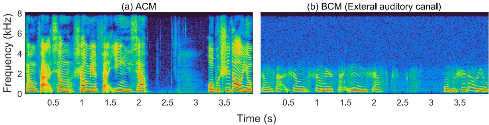  
Fig. 1. Spectrograms of air-conducted speech and bone-conducted speech (external auditory canal points).

To address these limitations, this paper proposes a lightweight boneair fusion speech enhancement framework that jointly utilizes sub-band and full-band processing. The proposed method achieves a favorable balance between computational complexity and noise suppression performance. Specifically, a two-step speech enhancement procedure is considered, namely coarse- and fine-grained noise reduction. In the first step, the spectrum of AC and BC speech are divided into multiple sub-bands according to ERB scale and the proposed model estimates sub-band gains to enhance the spectral envelope of noise AC speech. In the second step, deep filtering [16] is applied to suppress residue noise. The sub-band gains and deep filtering coeficients are estimated by a lightweight backbone network that comprises two encoder-decoder sets. One set of encoder-decoder takes sub-band features of BC and AC speech as input, while the other takes full-band features as input. Moreover, the iterative attentional feature fusion (iAFF) [17] module is used to integrate features of BC and AC speech in the input and embedding space, as it has been shown to facilitate the fusion of BC and AC speech features [7]. The complexity of the presented model is lower than that of most existing BC-aided speech enhancement methods.

## 2. Problem formulation

The short-time Fourier transform (STFT) of the speech signals received by the AC microphone and BC microphone in the �-th frame are represented as $\mathbf { y } _ { A C } ( t ) = [ Y _ { A C } ( t , 1 ) , \cdots , Y _ { A C } ( t , F ) ] ^ { T } \in \mathbb { C } ^ { F \times 1 }$ and $\mathbf { y } _ { B C } ( t ) =$ $[ Y _ { B C } ( t , 1 ) , \cdots , Y _ { B C } ( t , F ) ] ^ { T } \in \mathbb { C } ^ { F \times 1 }$ , respectively, where � denotes the frequency bin index. In this work, it is assumed that the BCM is not afected by the ambient noise but contains self-noise $V _ { s } ( t , f )$ generated by the friction between the sensor and human body [18], whereas the AC speech is afected by the background noise $V _ { b } ( t , f )$ . The AC and BC speech are modeled as

$$
Y _ {A C} (t, f) = S (t, f) + V _ {b} (t, f),\tag{1}
$$

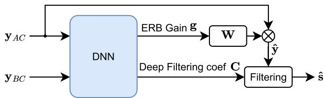  
Fig. 2. Overview of the two-step speech enhancement framework.

$$
Y _ {B C} (t, f) = \phi (S (t, f)) + V _ {s} (t, f),\tag{2}
$$

where $S ( t , f )$ denotes the STFT of target speech, and �(⋅) is the timevariant nonlinear mapping function from AC speech to BC speech [19].

The framework of the proposed model is presented in Fig. 2, which enhances the noisy AC speech in two steps. In the first step, the noisy AC speech is enhanced by sub-band gains

$$
\hat {\mathbf {y}} (t) = \mathbf {W} \mathbf {g} (t) \otimes \mathbf {y} _ {A C} (t),\tag{3}
$$

where $\mathbf { g } ( t ) = [ G ( t , 1 ) , \cdots , G ( t , B ) ] ^ { T } \in \mathbb { R } ^ { B \times 1 }$ is composed of � sub-band gains, $\hat { \mathbf { y } } ( t ) = [ \hat { Y } _ { A C } ( t , 1 ) , \cdots , \hat { Y } _ { A C } ( t , F ) ] ^ { T } \in \mathbb { C } ^ { F \times 1 }$ is gain-enhanced spectrogram of AC speech, and $\mathbf { W } \in \mathbb { R } ^ { F \times B }$ is an interpolation matrix which transforms �(�) into an �-dimensional representation. The sub-band is divided according to ERB scale, as depicted in Fig. 3. In the second step, the deep filtering is applied to the output of the previous step

$$
\hat {S} (t, f) = \sum_ {i = 1} ^ {N} C (t, f, i) \cdot \hat {Y} (t - i + 1, f),\tag{4}
$$

where $C ( t , f , i ) \in \mathbb { C } , i = 1 , \cdots , N$ is the deep filtering [16] coeficient and $\hat { S } ( t , f )$ is the enhanced speech.

In this work, we need to train a low-complexity DNN model that estimates the sub-band gains � and the �-th order deep filtering coefficients from �-th frame BC and AC speech

$$
[ \mathbf {g} (t), \mathbf {C} (t) ] = \mathcal {F} \{\mathbf {y} _ {A C} (t), \mathbf {y} _ {B C} (t) \},\tag{5}
$$

where $\mathcal { F } \{ \cdot \}$ represents the mapping function of the DNN model, and $\mathbf { C } ( t ) = [ \mathbf { c } ( t , 1 ) , \cdots , \mathbf { c } ( t , F ) ] ^ { T } \in \mathbb { C } ^ { F \times N }$ is the deep filtering coeficients matrix with the �-th row � $( t , f ) = [ C ( t , f , 1 ) , \cdots , C ( t , f , N ) ] \in \mathbb { C } ^ { 1 \times N }$ . For simplicity, subscripts (�, �) will be omitted in the following.

## 3. Proposed model

## 3.1. Overview

The structural diagram of the proposed model is presented in Fig. 4. The sub-band energy of AC and BC speech is calculated by

$$
e ^ {(k)} = \frac {1}{N} \sum_ {f = f _ {k, m i n}} ^ {f _ {k, m a x}} | Y (f) |,\tag{6}
$$

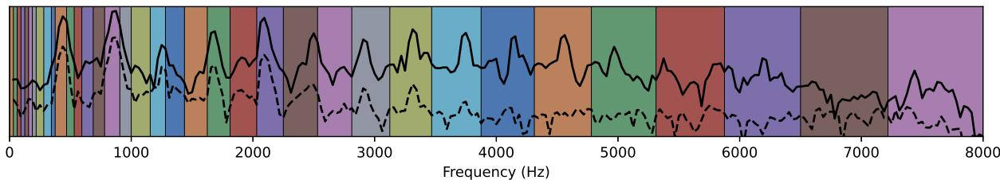  
Fig. 3. Sub-bands defined according to the ERB scale. The solid line and the dashed line represent the AC and BC speech spectra of vowel $/ \mathrm { e } / ,$ respectively.

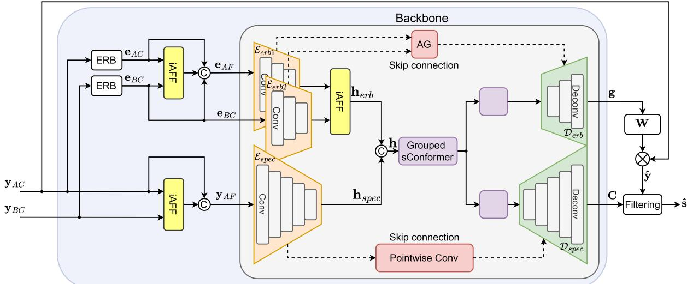  
Fig. 4. The structural diagram of the proposed model, including ERB feature extractors, feature fusion modules (iAFF), and a backbone network

where $e ^ { ( k ) }$ denotes �-th sub-band energy of signal $Y , f _ { k , m i n }$ and $f _ { k , m a x }$ represent frequency range of �-th sub-band according to the ERB scale, and � is the number of frequency bins in the range. Let ${ \bf e } _ { A C } =$ $[ e _ { A C } ^ { ( 1 ) } , \cdots , e _ { A C } ^ { ( B ) } ] ^ { T } \in \mathbb { R } ^ { B \times 1 }$ and $\mathbf { e } _ { B C } = [ e _ { B C } ^ { ( 1 ) } , \cdots , e _ { B C } ^ { ( B ) } ] ^ { T } \in \mathbb { R } ^ { B \times 1 }$ denote subband energy vector of AC and BC speech, respectively. The proposed model first fuses ${ \bf e } _ { A C }$ and $\mathbf { e } _ { B C }$ by a feature fusion module iAFF [17], and the output of iAFF is concatenated with ${ \bf e } _ { A C }$ and $\mathbf { e } _ { B C }$

$$
\mathbf {e} _ {A F} = \operatorname{cat} (\mathcal {F} _ {i A F F} \{\mathbf {e} _ {A C}, \mathbf {e} _ {B C} \}, \mathbf {e} _ {A C}, \mathbf {e} _ {B C}),\tag{7}
$$

where the subscript AF indicates the fused feature, cat(⋅) represents tensor concatenation, and $\mathcal { F } _ { i A F F } \{ \cdot \}$ is the mapping function of the iAFF. The full-band feature $\mathbf { y } _ { A C }$ and $\mathbf { y } _ { B C }$ are also fused by the iAFF. However, to reduce the computational burden, the output of iAFF is only concatenated with the $\mathbf { y } _ { A C }$

$$
\mathbf {y} _ {A F} = \operatorname{cat} (\mathcal {F} _ {i A F F} \{\mathbf {y} _ {A C}, \mathbf {y} _ {B C} \}, \mathbf {y} _ {A C}).\tag{8}
$$

The fused ERB features ${ \bf e } _ { A F } .$ , the features of BC speech ERB $\mathbf { e } _ { B C }$ and the fused complex spectrogram $\mathbf { y } _ { A F }$ are fed into the backbone network. The backbone network employs three convolutional encoders, i.e., $\mathcal { E } _ { e r b 1 } ( \cdot ) , \mathcal { E } _ { e r b 2 } ( \cdot )$ and $\mathcal { E } _ { s p e c } ( \cdot ) ,$ , to extract high-level features from the input and maps them into an embedding space. In the embedding space, ERB features of AC and BC speech are further fused using another iAFF

$$
\mathbf {h} _ {e r b} = \mathcal {F} _ {i A F F} \{\mathcal {E} _ {e r b 1} (\mathbf {e} _ {A F}), \mathcal {E} _ {e r b 2} (\mathbf {e} _ {B C}) \}.\tag{9}
$$

The embedding feature $\mathbf { h } _ { s p e c } = \mathcal { E } _ { s p e c } ( \mathbf { y } _ { A F } )$ and $\mathbf { h } _ { e r b }$ are concatenated and subsequently fed into the bottleneck layer to model temporal dependencies. The bottleneck layer consists of a grouped sConformer block, followed by two parallel blocks. The grouped sConformer block comprises temporal convolution and self-attention mechanism, and these blocks are utilized to characterize temporal dependencies of the embedding features. Finally, the decoders $\boldsymbol { D _ { e r b } }$ and $\mathcal { D } _ { s p e c }$ estimate the ERB gain � and deep filtering coeficient � from the output of two parallel grouped sConformer blocks.

## 3.2. Modality fusion

BC and AC speech can be considered as diferent modalities, and multimodal fusion paradigms can be classified into early, intermediate and late fusion [20]. In the early fusion approach, features of two modalities are fused at an early stage and then extract high-level features through a single model, while the late fusion approach integrates each modality after two separate models have independently extracted high-level features. The intermediate fusion approach integrates representations of each modality in an embedding space, which has shown a better perfor mance than both early and late fusion [21]. However, the early fusion approach can still deliver satisfactory performance in bone-air fusion speech enhancement tasks $[ 4 , 5 ]$ , probably because the diferences between BC and AC speech are not as pronounced as those between audio and visual signals. Also, the early fusion approach ofers comparable performance than the late fusion but has lower complexity. Therefore, we employ two early fusion modules for fusing sub-band features of BC and AC speech, as well as full-band features of them. Additionally, we employ an intermediate fusion module for fusing ERB features of AC and BC speech in the embedding space.

Here, feature fusion is achieved by using the iterative attention feature fusion module (iAFF) [17]. Fig. 5 presents the structure of the iAFF, which fuses diferent modalities twice by two attention modules. Each attention module generates attention coeficient of two modalities by aggregating local and global context of the two modalities. The first attention modules calculate the attention coeficient $\alpha ^ { \prime }$ from the summation of two modalities

$$
\boldsymbol {\alpha} ^ {\prime} = \mathcal {F} _ {a 1} \left\{\mathbf {m} _ {a} + \mathbf {m} _ {b} \right\},\tag{10}
$$

where $\mathcal { F } _ { a 1 } \{ \cdot \}$ denotes the mapping function of an attention module. Vectors ${ \mathbf { m } } _ { a }$ and $\mathbf { m } _ { b }$ are features of the two modalities. The attention coeficient $\alpha ^ { \prime }$ is then used to fuse features of two modalities

$$
\mathbf {m} ^ {\prime} = \boldsymbol {\alpha} ^ {\prime} \cdot \mathbf {m} _ {a} + (1 - \boldsymbol {\alpha} ^ {\prime}) \cdot \mathbf {m} _ {b},\tag{11}
$$

Table 1  
Detailed information of the backbone network. The input and output of each layer are represented as (channels × frames × feature dimensions), and the parameters are represented as (channels, stride).

<table><tr><td>Layer name</td><td>Input size</td><td>parameter</td><td>Output size</td><td>Layer name</td><td>Input size</td><td>parameter</td><td>Output size</td></tr><tr><td>ERB_Encoder_1_1</td><td>3×T×36</td><td>12,1</td><td>12×T×33</td><td>sConformer</td><td>T×144</td><td>-</td><td>T×144</td></tr><tr><td>ERB_Encoder_1_2</td><td>12×T×33</td><td>12, 2</td><td>12×T×15</td><td>sConformer_ERB</td><td>T×144</td><td>-</td><td>T×72</td></tr><tr><td>ERB_Encoder_1_3</td><td>12×T×15</td><td>12, 2</td><td>12×T×6</td><td>sConformer_Spec</td><td>T×144</td><td>-</td><td>T×72</td></tr><tr><td>ERB_Encoder_2_1</td><td>1×T×36</td><td>12, 1</td><td>12×T×33</td><td>Reshape</td><td>T×72</td><td>-</td><td>12×T×6</td></tr><tr><td>ERB_Encoder_2_2</td><td>12×T×33</td><td>12, 2</td><td>12×T×15</td><td>ERB_Decoder_1</td><td>24×T×6</td><td>12, 2</td><td>12×T×15</td></tr><tr><td>ERB_Encoder_2_3</td><td>12×T×15</td><td>12, 2</td><td>12×T×6</td><td>ERB_Decoder_2</td><td>24×T×15</td><td>12, 2</td><td>12×T×33</td></tr><tr><td>Spec_Encoder_1</td><td>4×T×257</td><td>12, 2</td><td>12×T×127</td><td>ERB_Decoder_3</td><td>24×T×33</td><td>1, 1</td><td>1×T×36</td></tr><tr><td>Spec_Encoder_2</td><td>12×T×127</td><td>12, 2</td><td>12×T×62</td><td>Spec_Decoder_1</td><td>24×T×6</td><td>12, 2</td><td>12×T×14</td></tr><tr><td>Spec_Encoder_3</td><td>12×T×62</td><td>12, 2</td><td>12×T×30</td><td>Spec_Decoder_2</td><td>24×T×14</td><td>12, 2</td><td>12×T×30</td></tr><tr><td>Spec_Encoder_4</td><td>12×T×30</td><td>12, 2</td><td>12×T×14</td><td>Spec_Decoder_3</td><td>24×T×30</td><td>12, 2</td><td>12×T×62</td></tr><tr><td>Spec_Encoder_5</td><td>12×T×14</td><td>12, 2</td><td>12×T×6</td><td>Spec_Decoder_4</td><td>24×T×62</td><td>12, 2</td><td>12×T×127</td></tr><tr><td>Concatenate and reshape</td><td>24×T×6</td><td>-</td><td>T×144</td><td>Spec_Decoder_5</td><td>24×T×127</td><td>6, 2</td><td>6×T×257</td></tr></table>

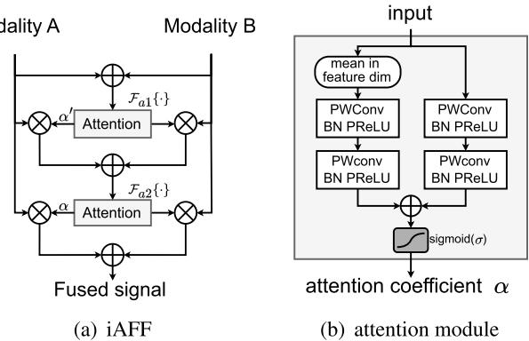  
Fig. 5. Iterative Attentional Feature Fusion Module. (a) Coarse and refined fusion of bone-conducted and air-conducted information. (b) Attention module for generating attention coeficients in the iAFF. PWConv for pointwise convo lution.

where �′ is the coarse fused feature. The second attention module takes �′ as input and calculates another attention coeficient

$$
\boldsymbol {\alpha} = \mathcal {F} _ {a 2} \left\{\mathbf {m} ^ {\prime} \right\}.\tag{12}
$$

The final fused feature � is given by

$$
\mathbf {m} = \boldsymbol {\alpha} \cdot \mathbf {m} _ {a} + (1 - \boldsymbol {\alpha}) \cdot \mathbf {m} _ {b}.\tag{13}
$$

## 3.3. Backbone network

The proposed backbone network consists of two small encoders $\varepsilon _ { e r b 1 } ,$ $\mathcal { E } _ { e r b 2 } ,$ , a large encoder $\mathcal { E } _ { s p e c } ,$ a small decoder $\mathit { D _ { e r b } } ,$ , a large decoder  , and a bottleneck layer consisting of three grouped sConformers [22]. The two small encoders are used to extract high-level features from the fused ERB feature ${ \bf e } _ { A F }$ and BC ERB feature $\mathbf { e } _ { B C }$ . The small decoder $\boldsymbol { D _ { e r b } }$ aims to estimate the ERB band gains for AC speech. The large encoder $\mathcal { D } _ { s p e c }$ is used to extract the fused full-band features ${ \bf y } _ { A F } .$ . Accordingly, the large decoder $\boldsymbol { D } _ { s p e c }$ estimates the �-order deep filtering coeficients on each TF bin. Bottleneck layers and skip-connection are placed be tween encoders and decoders, as shown in Fig. 4.

The small encoders $\mathcal { E } _ { e r b 1 } , ~ \mathcal { E } _ { e r b 2 }$ and the small decoder $\boldsymbol { D _ { e r b } }$ are composed of three convolutional blocks, integrated with AG skip connections [7] between encoder and decoder. The two small encoders extract high-level features from the input ERB features, which are then fused at an intermediate stage. The large encoder $\mathcal { E } _ { s p e c }$ and large decoder $\mathcal { D } _ { s p e c }$ are composed of five convolutional blocks, and pointwise convolution-based skip-connections are used between corresponding layers of the encoder and decoder. Each convolutional block of the encoder is a cascade of a convolution layer, a Batch Normalization (BN) and an activation function. In contrast, the convolution layer is replaced by a deconvolution layer in the convolutional blocks of the decoder. The convolutional channel of all the encoder and decoder blocks is set to a small number, leading to a low-dimensional embedding space. The ReLU activation function may cause information loss in low-dimensional embedding spaces [23]. We hence employ HardSwish [24] as the activation function of convolutional blocks. Also, standard convolutions are replaced with depthwise separable convolutions [25] in decoders to reduce the complexity.

## 4. Experiments

## 4.1. Dataset

We conduct experiments using air and four bone-conducted speech (A4BS) dataset [7], which comprises 109 speakers, each reading in Mandarin for approximately 1 hour. All speech and noise data are resampled to 16 kHz and segmented into 4-second clips. For the training and validation sets, background noise clips are sourced from ICASSP2022 DNS Challenge [26], QUT Noise [27], Environmental Background Noise dataset [28], and music data in MUSAN [29]. For the test set, noise clips are selected from Nonespeech115 [30], NOISEX-92 [31], CHiME-3 [32] and MUSAN. From the A4BS dataset, speech data from 87 speakers are selected to synthesize the training set, while data from the remaining 22 speakers are evenly split to synthesize the validation and test sets. The SNR of the noisy AC speech is sampled from uniform distribution in the range [−15 dB, 5 dB]. In total, approximately 200 h of training set, 25 h of validation set, and 25 h of test set are synthesized.

## 4.2. Model details and training objectives

A 512-point FFT (� = 257) with 50% overlap is used to compute the spectrogram of BC and AC speech. We set ERB bands � = 32 and a deep filtering order of � = 3. The first layer of each encoder and the last layer of each decoder utilize a convolutional kernel size of (2,4), while all other convolution layers adopt (1,4). The strides of the first convolution layer of encoder $\mathcal { E } _ { e r b 1 }$ and $\mathcal { E } _ { e r b 2 } .$ , and the last convolution layer of decoder $\boldsymbol { D _ { e r b } }$ are set to 1 in both the frequency and time dimensions, while strides of other convolution layers are set to 2 and 1, respectively. The convolution channels of the last layer of decoder $\mathcal { D } _ { s p e c }$ are set to $2 \times N$ , which represent real and imaginary components of the N-order deep filtering coeficients. The sConformers in the bottleneck layer are divided into four groups with channel shufle mechanisms [33] between each layer. Table 1 summarizes the input and output dimensions across the backbone network layers.

The loss function $\mathcal { L } _ { R I - M a g }$ can be expressed as

$$
\begin{array}{r l} & {\mathcal {L} _ {R I} = \left\| \hat {\mathbf {S}} _ {r} - \mathbf {S} _ {r} \right\| _ {F} + \left\| \hat {\mathbf {S}} _ {i} - \mathbf {S} _ {i} \right\| _ {F},} \\ & {\mathcal {L} _ {M a g} = \left\| \left| \hat {\mathbf {S}} \right| - | \mathbf {S} | \right\| _ {F},} \\ & {\mathcal {L} _ {R I - M a g} = 0. 5 \mathcal {L} _ {R I} + 0. 5 \mathcal {L} _ {M a g},} \end{array}\tag{14}
$$

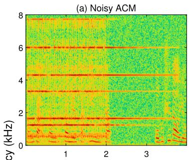

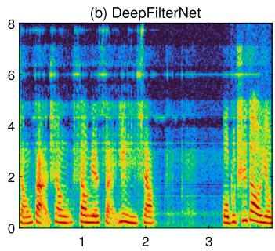

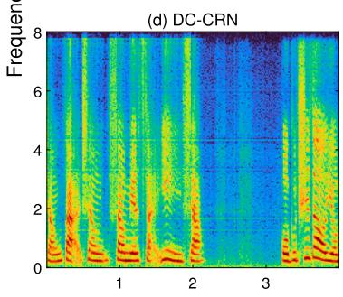

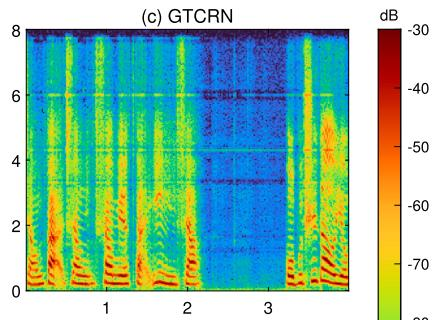

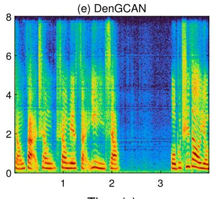  
Time (s)

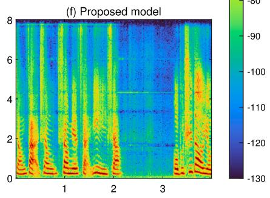  
Fig. 6. Enhanced speech of the proposed model and competitive models in a harmonic noise scenario

where $\lVert \cdot \rVert _ { F }$ denotes Frobenius norm, and subscript � and � denote the real and imaginary component of the complex spectrogram. Adam optimizer with weight decay is used in training. A linear warm-up and a cosine decay learning rate schedulers are employed. Specifically, the learning rate increases linearly from 2e-5 to 2e-4, and then decays back to 2e-5. The proposed model is trained for 250 epochs. If the validation loss does not decrease over 20 consecutive epochs, training will stop.

## 5. Results and discussions

In this section, we evaluate performance and computational speed of the proposed model. Wideband perceptual evaluation speech quality (wb-PESQ) [34], extended short-term objective intelligibility (eS-TOI) [35] and scale invariant signal-to-distortion ratio (SI-SDR) [36] are adopted as objective metrics. The following experiments use BC speech from the external auditory canal position.

## 5.1. Compare with existing models

## 5.1.1. Competitive model

The proposed model is compared with two bone-air fusion enhancement models, i.e., densely connected convolutional recurrent network (DC-CRN) [5] and DenGCAN [7], and two low-complexity single-channel speech enhancement models, i.e., DeepFilterNet [10] and grouped temporal convolutional recurrent network (GTCRN) [12]. The iAFF is incorporated into DeepFilterNet and GTCRN to enable fusion of BC and AC speech. That is, DeepFilterNet, GTCRN, DC-CRN and DenG-CAN adopt the same modality fusion strategy. To evaluate the merit of incorporating BC speech into a low-complexity model, we additionally include the original version of GTCRN, which takes only AC speech as input, in the comparison, namely GTCRN-AC. For a fair comparison, we adjust the numbers of convolutional channel of DeepFilterNet, DC-CRN, and DenGCAN, so that their computational complexity is comparable to that of the proposed model. Table 2 summarizes the details of the competitive models.

## 5.1.2. Result of enhanced speech on A4BS

Table 3 lists average wb-PESQ, eSTOI and SI-SDR for enhanced speech of the involved models. It can be observed that GTCRN significantly outperforms GTCRN-AC in terms of wb-PESQ, eSTOI and SI-SDR, which indicates that BC speech is highly beneficial for single-channel speech enhancement. The MACs of DenGCAN and DC-CRN is approximately 4 times more than that of GTCRN. But GTCRN shows significantly better speech quality than DC-CRN and DenGCAN, with only a slight decline in intelligibility. Notably, the proposed model not only provides the best speech quality and intelligibility but also the lowest complexity. This can be attributed to the architecture of the proposed model, which assigns sub-band and full-band enhancement tasks to sep arate encoders and decoders.

Table 2  
Details of the competitive models. Parameters and MACs are reported in K and M, respectively. T for true.

<table><tr><td>Model name</td><td>Modality</td><td>Causal</td><td>Param.</td><td>MACs</td></tr><tr><td>GTCRN-AC</td><td>air</td><td>T</td><td>23.7</td><td>33.8</td></tr><tr><td>GTCRN [12]</td><td>bone-air</td><td>T</td><td>24.9</td><td>42.8</td></tr><tr><td>DeepFilterNet [10]</td><td>bone-air</td><td>T</td><td>755.6</td><td>88.7</td></tr><tr><td>DC-CRN [5]</td><td>bone-air</td><td>T</td><td>205.5</td><td>181.1</td></tr><tr><td>DenGCAN [7]</td><td>bone-air</td><td>T</td><td>231.3</td><td>162.9</td></tr><tr><td>Proposed model</td><td>bone-air</td><td>T</td><td>256.4</td><td>40.3</td></tr></table>

To visualize the characteristics of diferent models, we randomly select a noisy speech clip with an SNR = -8.5 dB harmonic noise from the test set and presents spectrograms of the enhanced speech in Fig. 6. It can be observed that the enhanced speech of DeepFilterNet and GTCRN have a higher high-frequency residual noise level than that of DC-CRN, DenGCAN and the proposed model. The residual noise may be attributed to the fact that DeepFilterNet and GTCRN do not apply fine-grained noise reduction at high frequencies. As the proposed model adopts both coarse- and fine-grained noise reduction in all frequencies, the residual noise level of the proposed model is lower than that of GTCRN. However, while the presented sub-band and full-band approach achieves a favorable trade-off between the computational complexity and the noise suppression performance, it does lead to slightly higher residual noise level than the more computationally intensive DC-CRN and DenGCAN.

## 5.1.3. Computational speed on diferent platforms

The real-time factor (RTF) is defined as the ratio of processing time to the duration of the audio. A smaller RTF value indicates a faster computation speed. Table 4 presents the RTF values of models measured on quad-core ARM and x86 platforms. Although the MACs of GTCRN and the proposed model are nearly identical, GTCRN exhibits a noticeably higher RTF. This is because dual-path RNN (DPRNN) is used in the bottleneck of GTCRN and is typically hard to parallelize. The proposed model demonstrates a clear advantage in RTF over other competitive models on both platforms. But it should be mentioned that the proposed model may require more memory during real-time inference. The RNNbased structure of GTCRN, DC-CRN and DeepFilterNet only needs to cache the state tensor, whereas the sConformer in the proposed model requires caches for the queries and keys in each self-attention layer.

Table 3  
Objective evaluation results for the proposed model and other competitive models

<table><tr><td rowspan="2">Model name</td><td colspan="3">wb-PESQ</td><td colspan="3">eSTOI (%)</td><td colspan="3">SI-SDR</td></tr><tr><td>[-15, -9]</td><td>[-9, -2]</td><td>[-2, 5]</td><td>[-15, -9]</td><td>[-9, -2]</td><td>[-2, 5]</td><td>[-15, -9]</td><td>[-9, -2]</td><td>[-2, 5]</td></tr><tr><td>Noisy AC speech</td><td>1.116</td><td>1.106</td><td>1.165</td><td>36.00</td><td>48.84</td><td>63.01</td><td>-11.34</td><td>-4.95</td><td>1.96</td></tr><tr><td>BC speech</td><td>1.576</td><td>1.575</td><td>1.581</td><td>59.46</td><td>59.59</td><td>59.66</td><td>-12.49</td><td>-13.00</td><td>-12.74</td></tr><tr><td>GTCRN-AC</td><td>1.393</td><td>1.649</td><td>2.024</td><td>50.27</td><td>64.70</td><td>76.69</td><td>3.78</td><td>7.90</td><td>12.10</td></tr><tr><td>DeepFilterNet [10]</td><td>1.820</td><td>2.102</td><td>2.433</td><td>72.96</td><td>78.40</td><td>83.35</td><td>6.60</td><td>9.39</td><td>12.22</td></tr><tr><td>DC-CRN [5]</td><td>1.896</td><td>2.189</td><td>2.541</td><td>74.00</td><td>79.23</td><td>84.10</td><td>6.44</td><td>9.65</td><td>13.07</td></tr><tr><td>DenGCAN [7]</td><td>1.842</td><td>2.143</td><td>2.531</td><td>73.95</td><td>79.24</td><td>84.40</td><td>6.45</td><td>9.77</td><td>13.47</td></tr><tr><td>GTCRN [12]</td><td>2.002</td><td>2.300</td><td>2.652</td><td>73.56</td><td>78.88</td><td>83.98</td><td>7.14</td><td>10.40</td><td>14.02</td></tr><tr><td>Proposed model</td><td>2.102</td><td>2.396</td><td>2.747</td><td>74.82</td><td>79.84</td><td>84.61</td><td>7.08</td><td>10.18</td><td>13.55</td></tr></table>

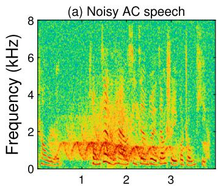

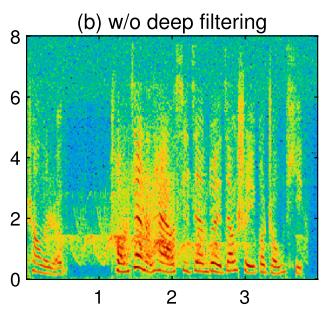  
Time (s)

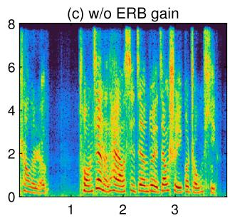

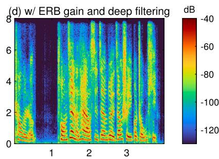

Fig. 7. Enhanced speech of the proposed model using deep filtering and ERB gain in siren noise scenario, where the SNR is 0 dB.  
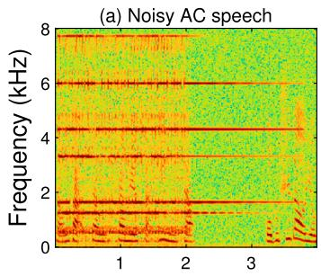

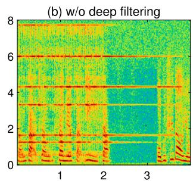

Time (s)  
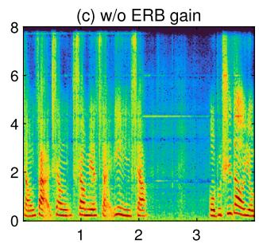

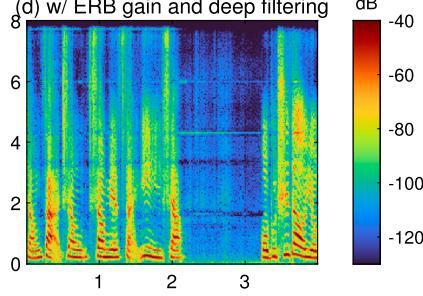  
Fig. 8. Enhanced speech of the proposed model using deep filtering and ERB gain in ringing noise scenario, where the SNR is -8.5 dB.

MACs and RTF value of models on ARM and x86 platform.

<table><tr><td rowspan="2">Model name</td><td rowspan="2">MACs (M)</td><td colspan="2">RTF</td></tr><tr><td>ARM</td><td>x86</td></tr><tr><td>DeepFilterNet [10]</td><td>88.7</td><td>0.579</td><td>0.109</td></tr><tr><td>DC-CRN [5]</td><td>181.1</td><td>0.271</td><td>0.039</td></tr><tr><td>DenGCAN [12]</td><td>162.9</td><td>0.291</td><td>0.050</td></tr><tr><td>GTCRN [12]</td><td>42.8</td><td>0.446</td><td>0.097</td></tr><tr><td>Proposed model</td><td>40.3</td><td>0.159</td><td>0.043</td></tr></table>

## 5.2. Ablation study

We first conduct an ablation study to examine the efectiveness of ERB gain and deep filtering in the proposed model. The results of three objective metrics are presented in Table 5. It can be observed that there is a significant decrease in all objective metrics after removing deep filtering from the proposed model. However, there remains a noticeable gap in speech quality of the proposed model and proposed model w/o ERB gain. Such a performance gap indicates that the cascade of coarseand fine-grained noise reduction is beneficial. Also, the estimation of ERB gain introduces approximately 2.5 MMACs but delivers significant performance improvements. To visualize the efect of ERB gain and deep filtering, we plot the spectrograms of enhanced speech in a siren and a ringing noise scenario in Figs. 7 and 8, respectively. As ERB gains are employed to enhance the spectral envelope, broadband noise is considerably suppressed but harmonic noise remains suppressed inadequately, as shown in Figs. 7b and 8b. This is attributed to the low resolution of ERB bands. When deep filtering is applied, the residual noise level of enhanced speech is significantly reduced.

We then investigate the merits of deep filtering over cRM by substi tuting � in Eq. (4) with 1, and the objective metrics of enhanced speech are listed in Table 6. It can be observed that deep filtering is more ad vantageous than cRM since deep filtering performs better in all objective metrics at the cost of slightly increased complexity.

Table 5  
Effects of deep filtering and ERB gain on enhanced speech of the proposed model.

<table><tr><td rowspan="2">Model name</td><td rowspan="2">MACs (M)</td><td colspan="3">wb-PESQ</td><td colspan="3">eSTOI (%)</td><td colspan="3">SI-SDR (dB)</td></tr><tr><td>[-15, -9]</td><td>[-9, -2]</td><td>[-2, 5]</td><td>[-15, -9]</td><td>[-9, -2]</td><td>[-2, 5]</td><td>[-15, -9]</td><td>[-9, -2]</td><td>[-2, 5]</td></tr><tr><td>Noisy AC speech</td><td>-</td><td>1.116</td><td>1.106</td><td>1.165</td><td>36.00</td><td>48.84</td><td>63.01</td><td>-11.34</td><td>-4.95</td><td>1.96</td></tr><tr><td>Proposed model</td><td>40.3</td><td>2.102</td><td>2.396</td><td>2.747</td><td>74.82</td><td>79.84</td><td>84.61</td><td>7.08</td><td>10.18</td><td>13.55</td></tr><tr><td>w/o deep filtering</td><td>24.9</td><td>1.126</td><td>1.219</td><td>1.420</td><td>57.13</td><td>67.16</td><td>76.91</td><td>-1.88</td><td>3.59</td><td>9.18</td></tr><tr><td>w/o ERB gain</td><td>37.8</td><td>1.809</td><td>2.061</td><td>2.359</td><td>73.10</td><td>78.45</td><td>83.48</td><td>5.93</td><td>9.32</td><td>12.82</td></tr></table>

Table 6  
Effects of deep filtering and cRM on enhanced speech of the proposed model.

<table><tr><td rowspan="2">Model name</td><td rowspan="2">MACs (M)</td><td colspan="3">wb-PESQ</td><td colspan="3">eSTOI (%)</td><td colspan="3">SI-SDR (dB)</td></tr><tr><td>[-15, -9]</td><td>[-9, -2]</td><td>[-2, 5]</td><td>[-15, -9]</td><td>[-9, -2]</td><td>[-2, 5]</td><td>[-15, -9]</td><td>[-9, -2]</td><td>[-2, 5]</td></tr><tr><td>deep filtering</td><td>40.3</td><td>2.102</td><td>2.396</td><td>2.747</td><td>74.82</td><td>79.84</td><td>84.61</td><td>7.08</td><td>10.18</td><td>13.55</td></tr><tr><td>cRM</td><td>39.6</td><td>2.031</td><td>2.322</td><td>2.670</td><td>74.31</td><td>79.39</td><td>84.19</td><td>6.76</td><td>9.71</td><td>12.80</td></tr></table>

Table 7  
Impact of using diferent activation functions on the proposed model.

<table><tr><td rowspan="2">Proposed model with activate function</td><td colspan="3">wb-PESQ</td><td colspan="3">eSTOI (%)</td></tr><tr><td>[-15, -9]</td><td>[-9, -2]</td><td>[-2, 5]</td><td>[-15, -9]</td><td>[-9, -2]</td><td>[-2, 5]</td></tr><tr><td>HardSwish</td><td>2.102</td><td>2.396</td><td>2.747</td><td>74.82</td><td>79.84</td><td>84.61</td></tr><tr><td>ReLU</td><td>2.073</td><td>2.355</td><td>2.700</td><td>74.46</td><td>79.49</td><td>84.35</td></tr><tr><td>PReLU</td><td>2.067</td><td>2.355</td><td>2.711</td><td>74.36</td><td>79.47</td><td>84.39</td></tr></table>

Table 8  
Impact of removing feature fusion module iAFF on the proposed model.

<table><tr><td rowspan="2">Model name</td><td rowspan="2">MACs (M)</td><td colspan="3">wb-PESQ</td><td colspan="3">eSTOI (%)</td></tr><tr><td>[-15, -9]</td><td>[-9, -2]</td><td>[-2, 5]</td><td>[-15, -9]</td><td>[-9, -2]</td><td>[-2, 5]</td></tr><tr><td>Proposed Model</td><td>40.26</td><td>2.102</td><td>2.396</td><td>2.747</td><td>74.82</td><td>79.84</td><td>84.61</td></tr><tr><td>w/o iAFF in early fusion</td><td>39.10</td><td>2.088</td><td>2.380</td><td>2.725</td><td>74.82</td><td>79.86</td><td>84.58</td></tr><tr><td>w/o iAFF in intermediate fusion</td><td>40.14</td><td>2.096</td><td>2.387</td><td>2.731</td><td>74.69</td><td>79.73</td><td>84.45</td></tr><tr><td>w/o iAFF in both stage</td><td>38.98</td><td>2.075</td><td>2.376</td><td>2.729</td><td>74.72</td><td>79.84</td><td>84.61</td></tr><tr><td>w/ cross attention</td><td>44.21</td><td>2.050</td><td>2.337</td><td>2.681</td><td>74.24</td><td>79.29</td><td>84.13</td></tr></table>

We evaluate the impact of replacing the HardSwish activation function with PReLU or ReLU in the convolutional encoder and decoder and retrain the model. The wb-PESQ and eSTOI results are presented in Table 7, which demonstrate that the HardSwish activation function is better suited for models with lower convolutional channels.

To validate the advantages of the iAFF module for early and in termediate fusion of BC and AC speech, we evaluate the performance of the proposed model by removing iAFF for early fusion, iAFF for mid fusion, and all iAFFs, respectively. Specifically, when removing the iAFF for early fusion, we replace the iAFF with a concatenate op eration, i.e., Eqs. (7) and (8) are modified to $\mathbf { e } _ { A F } = \mathrm { c a t } ( \mathbf { e } _ { A C } , \mathbf { e } _ { B C } )$ and $\mathbf { y } _ { A F } = \mathbf { c a t } ( \mathbf { y } _ { B C } , \mathbf { y } _ { A C } )$ , respectively. When removing the iAFF for intermediate fusion, we replace the iAFF with an add operation, i.e., Eq. (9) is modified to $\mathbf { h } _ { e r b } = \mathcal { E } _ { e r b 1 } ( \mathbf { e } _ { A F } ) + \mathcal { E } _ { e r b 2 } ( \mathbf { e } _ { B C } ) .$ , It should be mentioned that other fusion strategies can be used and we here compare the performance of presented iAFF with that of the cross attention in [37]. The BC speech features are treated as the Query in cross attention, while the AC speech features are treated as the Key and Value. The aver age wb-PESQ and eSTOI results on the test set are listed in Table 8. After all iAFF modules are removed, the wb-PESQ score of enhanced speech decreases slightly. Furthermore, the iAFF module exhibits a more pronounced efect on the wb-PESQ score than on eSTOI, and hence its incorporation can moderately enhance the speech quality. Compared to cross attention, the iAFF has lower MACs and improved speech quality and intelligibility, and hence we adopt iAFF as a better feature fusion.

Finally, we evaluate the impact of diferent band compression strategies on speech quality and intelligibility. The band compression strategy of the proposed model is replaced with that of GTCRN (denoted as Proposed Model with merged high frequencies). Accordingly, the two sets of encoder-decoder of the backbone network are merged into a single set. Moreover, we adjust the numbers of convolution channels of the new encoder-decoder to ensure that the complexity of new encoder-decoder is comparable to the original one. The average wb-PESQ and eSTOI results on the test set are listed in Table 9. A decrease of 0.146 in average wb-PESQ and 1.64% in eSTOI can be observed when the band compression strategy of the proposed model is replaced by that of GTCRN, which demonstrates the advantages of the proposed model.

## 6. Conclusion

This paper proposed a BC-aided speech enhancement model that integrates sub-band and full-band processing. In the proposed model, two sets of encoder-decoder are employed to estimate sub-band gains and deep filtering coeficients, which are used to coarse- and fine-grained noise reduction, respectively. Attention-based feature fusion modules are employed to fuse features of AC and BC at an early and intermediate stage. The MACs of the proposed model is only 40.3 M, which is wellsuited to low-resource processors. Experimental results have demonstrated the performance advantage of the presented model.

Table 9  
Impact of using diferent input features on the proposed model.

<table><tr><td rowspan="2">Model name</td><td rowspan="2">MACs (M)</td><td colspan="3">wb-PESQ</td><td colspan="3">eSTOI (%)</td></tr><tr><td>[-15, -9]</td><td>[-9, -2]</td><td>[-2, 5]</td><td>[-15, -9]</td><td>[-9, -2]</td><td>[-2, 5]</td></tr><tr><td>Proposed Model</td><td>40.3</td><td>2.102</td><td>2.396</td><td>2.747</td><td>74.82</td><td>79.84</td><td>84.61</td></tr><tr><td>Proposed Model with band merge</td><td>44.3</td><td>1.969</td><td>2.251</td><td>2.588</td><td>72.80</td><td>78.20</td><td>83.29</td></tr></table>

CRediT authorship contribution statement

Kelan Kuang: Writing -- original draft, Methodology, Visualization, Formal analysis, Writing -- review & editing, Software, Conceptualiza tion, Validation, Data curation. Feiran Yang: Writing -- review & edit ing, Supervision, Funding acquisition. Mou Wang: Conceptualization, Writing -- original draft. Jun Yang: Project administration, Writing - review & editing, Conceptualization, Resources, Supervision.

## Declaration of competing interest

The authors declare that they have no known competing financial interests or personal relationships that could have appeared to influence the work reported in this paper.

## Acknowledgements

This work was supported in part by Beijing Natural Science Foundation under Grant 4242013 and in part by National Natural Science Foundation of China under Grant 62171438.

## Data availability

The authors do not have permission to share data.

## References

[1] Zheng C, Zhang H, Liu W, Luo X, Li A, Li X, et al. Sixty years of frequency-domain monaural speech enhancement: from traditional to deep learning methods, Trends Hear 2023;27:1 52.

[2] Shetu SS, Habets EA, Brendel A. Comparative analysis of discriminative deep learning-based noise reduction methods in low snr scenarios. In: International workshop on acoustic signal enhancement (IWAENC). IEEE; 2024. p. 36--40.

[3] Letowski T, Mermagen T, Vause N, Henry P. Bone conduction communication in noise: a preliminary study. In: Proceedings of the XXI international congress on sound and vibrations, vol. 37. 2004. p. 3037 44.

[4] Yu C, Hung K-H, Wang S-S, Tsao Y, Hung J-w. Time-domain multi-modal bone/air conducted speech enhancement. IEEE Signal Process Lett 2020;27:1035 9.

[5] Wang H, Zhang X, Wang D. Fusing bone-conduction and air-conduction sensors for complex-domain speech enhancement. IEEE/ACM Trans Audio Speech Lang Process 2022:30:3134-43

[6] Wang M, Chen J, Zhang X, Huang Z, Rahardja S. Multi-modal speech enhancement with bone-conducted speech in time domain. Appl Acoust 2022:200:109058

[7] Kuang K, Yang F, Yang J. A lightweight speech enhancement network fusing boneand air-conducted speech. J Acoust Soc Am 2024;156(2):1355--66.

[8] Campos V, Jou B, Giró-i Nieto X, Torres J, Chang S-F, Skip RNN. Learning to skip state updates in recurrent neural networks. Preprint. arXiv:1708.06834, 2017.

[9] Valin J-M. A hybrid dsp/deep learning approach to real-time full-band speech enhancement. In: Proceedings of IEEE 20th international workshop on multimedia signal processing (MMSP). IEEE: 2018, p. 1–5.

[10] Schröter H, Maier A, Escalante-B AN, Rosenkranz T. Deepfilternet2: towards realtime speech enhancement on embedded devices for full-band audio. In: Proceedings of international workshop on acoustic signal enhancement (IWAFNC) JFFF: 2022 p. 1--5.

[11] Yu G, Wang H, Li A, Liu W, Zhang Y, Wang Y, et al. FSI-Net: a dual-stage fulland sub-band integration network for full-band speech enhancement. Appl Acoust 2023:211:109539

[12] Rong X, Sun T, Zhang X, Hu Y, Zhu C, Lu J. GTCRN: a speech enhancement model requiring ultralow computational resources. In: Proceedings of IEEE international con ference on acoustics, speech and signal processing (ICASSP). JEEE: 2024, p. 971–5

[13] Moore BC, Glasberg BR. Suggested formulae for calculating auditoryfilter bandwidths and excitation patterns. J Acoust Soc Am 1983;74(3):750--3.

[14] Liu H-P, Tsao Y, Fuh C-S. Bone-conducted speech enhancement using deep denoising autoencoder. Speech Commun 2018;104:106--12.

[15] Nguyen Q-H, Unoki M. Bone-conducted speech enhancement using vector-quantized variational autoencoder and gammachirp filterbank cepstral coefficients. In: Euro: pean signal processing conference (EUSIPCO). IEEE; 2022. p. 21--5.

[16] Mack W, Habets EA. Deep filtering: signal extraction and reconstruction using complex time-frequency filters. IEEE Signal Process Lett 2019;27:61--5

[17] Dai Y, Gieseke F, Oehmcke S, Wu Y, Barnard K. Attentional feature fusion. In: Proceedings of the IEEE/CVF winter conference on applications of computer vision; 2021. p. 3560--9.

[18] Richard J, Zimpfer V, Roth S. Comparison of objective and subjective methods for evaluating speech quality and intelligibility recorded through bone conduction and in-ear microphones. Appl Acoust 2023;211:109576.

[19] Richard J. Zimpfer V. Blondé-Weinmann C. Roth S. Change in transfer function between air and bone conduction microphones due to mouth opening variation. Appl Acoust 2025;228:110293.

[20] Michelsanti D, Tan Z-H, Zhang S-X, Xu Y, Yu M, Yu D, et al. An overview of deeplearning-based audio-visual speech enhancement and separation. IEEE/ACM Trans Audio Speech Lang Process 2021:29:1368–96

[21] Joze HRV, Shaban A, Iuzzolino ML, Koishida K. Mmtm: multimodal transfer module for cnn fusion. In: Proceedings of the JEEE/CVE conference on computer vision and pattern recognition; 2020. p. 13289--99.

[22] Kuang K, Yang F, Li J, Yang J. Three-stage hybrid neural beamformer for multichannel speech enhancement., J Acoust Soc Am 2023:153(6):3378

[23] Sandler M Howard A Zhu M Zhmoginov A. Chen L-C Mobilenety2: inverted residuals and linear bottlenecks. In: Proceedings of the IEEE conference on computer vision and pattern recognition; 2018. p. 4510--20.

[24] Howard A, Sandler M, Chu G, Chen L-C, Chen B, Tan M, et al. Searching for mobilenetv3. In: Proceedings of the IEEE/CVF international conference on computer vision; 2019. p. 1314--24.

[25] Chollet F. Xception: deep learning with depthwise separable convolutions. In: Proceedings of the IEEE conference on computer vision and pattern recognition; 2017. p. 1251--8.

[26] Dubey H, Gopal V, Cutler R, Aazami A, Matusevych S, Braun S, et al. ICASSP 2022 deep noise suppression challenge, In: Proceedings of IEEE international conference on acoustics, speech and signal processing (ICASSP); 2022. p. 9271--5.

[27] Dean D, Sridharan S, Vogt R, Mason M. The qut-noise-timit corpus for evaluation of voice activity detection algorithms. In: Proceedings of the 11th annual conference of the international speech communication association, international speech communication association; 2010. p. 3110--3.

[28] Saki E. Sehgal A. Panahi L. Kehtarnavaz N. Smartphone-based real-time classification of noise signals using subband features and random forest classifier. In: Proceedings of IEEE international conference on acoustics, speech and signal processing (ICASSP). JEEE: 2016. p. 2204–8

[29] Snyder D, Chen G, Povey D. Musan: a music, speech, and noise corpus. Preprint. arXiv:1510.08484, 2015

[30] Hu G, Wang D. A tandem algorithm for pitch estimation and voiced speech segregation. IEEE/ACM Trans Audio Speech Lang Process 2010;18(8):2067--79.

[31] Varga A, Steeneken HJ. Assessment for automatic speech recognition: II. Noisex-92: a database and an experiment to study the efect of additive noise on speech recognition systems. Speech Commun 1993;12(3):247--51

[32] Barker J. Marxer R. Vincent E. Watanabe S. The third chime' speech separation and recognition challenge: dataset, task and baselines. In: Proceedings of IEEE workshop on automatic speech recognition and understanding (ASRU): 2015. p. 504–11.

[33] Zhang X. Zhou X. Lin M. Sun J. Shufflenet: an extremely efficient convolutional neural network for mobile devices. In: Proceedings of the IEEE conference on computer vision and pattern recognition: 2018, p. 6848–56

[34] Rix AW, Beerends JG, Hollier MP, Hekstra AP. Perceptual evaluation of speech quality (pesq)—a new method for speech quality assessment of telephone networks and codecs. In: Proceedings of IEEE international conference on acoustics, speech, and signal processing (ICASSP), vol. 2. 2001. p. 749--52.

[35] Jensen J, Taal CH. An algorithm for predicting the intelligibility of speech masked by modulated noise maskers. IEEE/ACM Trans Audio Speech Lang Process 2016;24(11):2009--22.

[36] Le Roux J, Wisdom S, Erdogan H, Hershey JR. Sdr–half-baked or well done? In: Proceedings of IEEE international conference on acoustics, speech and signal processing (ICASSP); 2019. p. 626--30.

[37] Chen C-FR, Fan Q, Panda R. Crossvit: cross-attention multi-scale vision transformer for image classification. In: Proceedings of the JEEE/CVF international conference on computer vision: 2021 p. 357–66