# Packet Loss Concealment Based on Deep Neural Networks for Digital Speech Transmission

Bong-Ki Lee and Joon-Hyuk Chang, Senior Member, IEEE

Abstract—In this paper, we propose the regression-based packet loss concealment (PLC) for digital speech transmission by using deep neural networks (DNNs) with a multiple-layer deep architecture. For the DNN training, log-power spectra and phases are employed as features in the input layer for the large training set, which ensures non-linear mapping the frames from the last correctly received frame to the missing frame. Once the training is accomplished by the restricted Boltzmann machine (RBM)-based pre-training to initialize the DNN, minimum mean square error (MMSE)-based fine tuning is then performed based on the back-propagation algorithm. In the reconstruction stage, the trained DNN model is fed with the features of the previous frames in order to estimate the log-power spectra and phases of the missing frames. Reconstruction is further improved by using the cross-fading technique to mitigate discontinuity between the reconstruction signal and good frame signal in the time-domain. To demonstrate the performance of the proposed algorithm, hidden Markov model (HMM)-based PLC algorithm and the PLC algorithm standardized in adaptive multi-rate wideband (AMR-WB) Appendix I were used for comparison. The experimental results show that the proposed approach provides better speech quality and speech recognition accuracy than the conventional approaches.

Index Terms—Adaptive multi-rate wideband, deep neural network (DNN), network speech recognition, packet loss concealment (PLC), regression model, speech quality.

## I. INTRODUCTION

R ECENTLY, voice signals are transmitted as packetsin many voice-over-long-term evolution (VoLTE), in many voice-over-long-term evolution (VoLTE), voice-over-IP (VoIP), and bluetooth applications. For instance, in VoIP systems, bits produced by speech codecs such as international telecommunication union telecommunication standardization sector (ITU-T) G.726, G.729, adaptive multi-rate wideband (AMR-WB), and speex [1] are grouped into packets having a regular frame size (e.g., 10 ms) on a sender side [2]. These packets are then sent over the IP network to the receiver side where they are decoded. In contrast to traditional circuit-switched transmission, IP packets may be lost due to delay and jitter during transmission, which degrades speech quality [3]. The jitter buffer is usually designed to mitigate the packet loss problem at the receiver side and intentionally delays the arriving packets so that a stable connection can be experienced with very little sound distortion for the user. However, the jitter buffer delay cannot be increased too long because the users do not tolerate the longer delay. To solve the packet loss problem which cannot be addressed by the jitter buffer, a packet loss concealment (PLC) algorithm that reconstructs missing frames is indispensable for the VoLTE and VoIP systems [4]. The earliest PLC algorithms such as the ‘zero-fill’, ‘ramp-down-to-zero’, and ‘frame repeat’ approaches [5] were developed and further have been improved to be adopted by standardizing bodies [6]. Most of the modern speech codecs standardized in the last two decades are based on the predictive coding principle and most of them have PLC algorithm specified as part of the standard. Indeed, PLC algorithms consist of various mixtures of sender-based and receiver-based schemes [7]. Sender-based schemes including packet retransmission, interleaving, and sending error correction bits in voice packets using the forward error correction (FEC) technique lead to increase in bandwidth and modifications of the transmitter [8].

Most published PLC algorithms thus have not been based on sender-based methods because they can be used when the additional bit allocation for side information is available. On the other hand, the receiver-based PLC schemes make a compromise between clean-channel overhead and concealment quality, which is usually applied as a post-processing step after the decoding operation without affecting bit-stream compatibility. For example, a pitch waveform replication [9] and overlap-add interpolation [10] have been proposed as receiver-based PLC schemes. Although these waveform-based PLC schemes are easy to implement, they may lead to mismatch of both the phase and envelope so that speech quality may be degraded at high packet loss rates. Gündüzhan et al. [11] proposed the linear prediction (LP)-based PLC algorithm which estimates the excitation signal of the missing segment by repeating the excitation signal of the previous received speech using periodicity which the pitch period has. In [12], Zhang et al. devised the high-order autoregressive (AR) model-based PLC algorithm using minimum mean square error (MMSE) approach to capture both short-term and long-term speech correlations where the missing speech samples are predicted recursively by running the AR model. However, these conventional methods based on the LP model tend to encounter the perceptually annoying artifacts created during recovery especially consecutive losses because the excitation signal received in the last “good frame” of a compressed bit-stream are used to regenerate the missing segments. A variety of time-scale modification (TSM) algorithms, which changes the duration of the speech signal without changing the pitch period, have been applied to the PLC using synchronized overlap-and-add (SOLA) [13] and waveform similarity OLA (WSOLA) [14] techniques. These TSM-based PLC algorithms fill in the lost packets preserving the natural sound, except for high packet loss rates and when the packet losses are at the signal transitions. Advanced techniques utilize more sophisticated signal processing techniques tend to achieve better output audio quality. In [15], a method for estimating parameters of missing line spectral frequency (LSF) using Gaussian mixture models (GMMs) was proposed by Lindblom et al. where the intra-frame correlation of the encoded LSF parameters and a priori information are used to find an MMSE estimate of missing LSF parameters. Rodbro et al. also presented the hidden Markov model (HMM)-based PLC [16], which estimates the relevant codec parameters such as pitch lag and LSFs by using their specific models. However, modeling the acoustic features which have a non-linear characteristic based on the shallow model (i.e., GMM or HMM) [17] has a serious shortcoming that they are statistically inefficient.

On the other hand, most ofthe standard codecs such as G.722 [18], [19], G.718 [20], AMR-WB [21], and enhanced voice services (EVS) [22] embrace their specific PLC algorithm. Among them, the EVS codec [23] has been recently standardized by 3rd generation partnership project (3GPP), which shows substantially enhanced voice quality for conversational use and music signal and improved transmission efficiency with optimized behavior in IP environments through channel aware coding mode [24]. The PLC algorithm in the EVS codec [25] operates on various modes at which the side information at the encoder is transmitted to the decoder side at specific bit-rate and coding mode conditions. On the other hand, AMR-WB codec [26], also known as G.722.2, is one of the most popular codec and has been widely used in the HD voice system. The PLC algorithm in AMR-WB Appendix I [21] is carried out according to the state machine and detailed review is given in Section II for further understanding of the conventional PLC algorithms including the AMR-WB and HMM-based PLCs.

In this paper, we present a novel PLC algorithm using a deep neural network (DNN)-based regression approach. This algorithm builds on the recent progress presented in [28] in which greedy layer-wise unsupervised learning is performed by the pre-training and is followed by the fine-tuning based on the back-propagation algorithm, which trains the DNN in a supervised manner. The motivation behind our approach is based on the superior generative modeling capability of the DNN, which is widely used in the classification and regression tasks particular in the voice activity detection (VAD) [27], speech enhancement [28], [29], bandwidth extension (BWE) [30], and automatic speech recognition [31].

For example, Zhang and Wu [27] proposed a non-linear combination method of multiple features by the DNN for the VAD and inspired the potential on using the DNN for the classification task. Also, the regression-based speech enhancement algorithm using a log-power spectra feature was proposed in the method of Xu et al. [28] by using the DNN with a multiple-layer deep architecture at which the powerful modeling capability of the DNN is employed to estimate the non-linear function between the noisy speech and clean speech based on the large training set. Furthermore, the BWE system using the DNN was proposed by Li et al. [30] where the log-power spectra of wideband were estimated by the log-power spectra of narrow-band using the DNN.

As mentioned above, our study, for the first time as far as we know, proposes to use the DNN-based regression technique in order to conceal the degradation caused by lost frames in digital speech transmission. For this, we first establish deep generative models of features such as the log-power spectra and phases, which are core parameters for representing a speech signal. On using the log-power spectra is based on that the observation the log-power spectra feature have been successfully applied with the DNN regression model in many applications [28]–[30]. In the concealment stage, the trained DNN models are fed with the features of good frames in order to generate the estimated logpower spectra and phases at the missing frames. By passing the estimated parameters through the decoder, the error concealed waveform is finally synthesized. To demonstrate the superiority of the proposed algorithm, we compare it to the HMM-based PLC algorithm [16] and predominant standard PLC algorithm including the AMR-WB Appendix I [21].

We conducted tests ofobjective measures including log-spectral distance (LSD) [32] and perceptual evaluation of speech quality (PESQ) [33] and subjective mean opinion score (MOS) [34] tests. We also tested the proposed algorithm to verify that it can be used as a front-end processor for speech recognition. According to the experiments, it turns out that the proposed method employing the DNN technique outperforms the conventional PLC algorithms in terms of various speech quality measures and the recognition accuracy. The rest of this paper is organized as follows: Section II and Section III describe the conventional PLC algorithms and the proposed DNN-based PLC algorithm. A series ofsimulations to evaluate the system performance are presented in Section IV. Then, Section V summarize our contributions.

## II. CONVENTIONAL PLC ALGORITHMS

This section describes the conventional PLC algorithms including which will be compared with the proposed PLC algorithm. At first, the AMR-WB Appendix I [21] as a standard PLC algorithm is our focus at which the AMR-WB is a wideband speech audio coder based on adaptive multi-rate encoding using algebraic code excited linear prediction (ACELP) and it was specified by ITU-T [26]. Basically, the AMR-WB provides improved speech quality due to a wider speech bandwidth of 50–7000 Hz compared to narrowband speech coders such as G.711, G.726, and G.723.1. In particular, the AMR-WB offers Appendix I as the PLC algorithm using substitution and muting of parameters according to the state machine with seven states. The codec parameters including long-term prediction (LTP) gain, fixed codebook (FC) gain, immittance spectral frequencies (ISFs), and LTP lag are estimated by using the codec parameters obtained from the last correctly received frame and the state machine. Then, pre-fixed muting factors are multiplied to the estimated parameters in order to prevent annoying artifacts which are produced in concealing consecutive frame losses. Thus, estimated parameters are almost zero after six consecutive frame losses.

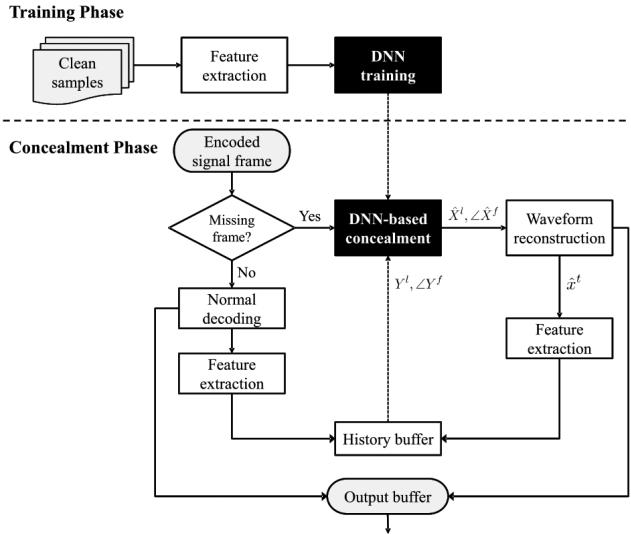  
Fig. 1. Flow chart of the proposed PLC algorithm.

When an error is detected in the received speech frame, the substitution or muting procedure is started. The LTP gain $g ^ { p }$ and FC gain $g ^ { c }$ are substituted with attenuated values from the previous subframes such that

$$
g ^ {p} (n) = P ^ {p} (s t a t e) \cdot \mathrm{median5} (g ^ {p} (n - 1), \ldots , g ^ {p} (n - 5))\tag{1}
$$

$$
g ^ {c} (n) = \left\{ \begin{array}{c} P ^ {c} (\text {state}) \cdot \operatorname{median5} \left(g ^ {c} (n - 1), \dots , g ^ {c} (n - 5)\right) \\ , \text {VAD\_HIST} \leq 2 \\ \operatorname{median5} \left(g ^ {c} (n - 1), \dots , g ^ {c} (n - 5)\right) \\ , \text {VAD\_HIST} > 2 \end{array} \right. \tag {2}
$$

where denotes the subframe index, and $P ^ { p } ( s t a t e )$ and $P ^ { c } ( s t a t e )$ denote the attenuation factors for LTP gain and FC gain, respectively. The and indicate the 5-point median operation and number of consecutive $\mathrm { V A D } = 0$ decisions, respectively. Consequently, the concealment of the ISF vector with 16-dimension $I S F _ { q }$ is given as follows:

$$
\begin{array}{c} I S F _ {q} (i) = \alpha \cdot p a s t \_ I S F _ {q} (i) + (1 - \alpha) \cdot I S F _ {\text {mean}} (i), \\ i = 1 \ldots 1 6 \end{array}\tag{3}
$$

where $\alpha = 0 . 9$ and ${ \cal I S F } _ { q } ( i )$ and $I S F _ { \mathrm { m e a n } } ( i )$ denote ISF vector from the previous frame and combination of adaptive mean and constant mean of ISF-vectors, respectively. Finally, the concealment of the LTP lag is expressed as follows:

$$
T (n) = \left\{ \begin{array}{c} T (n - 1), Q _ {\text {lag\_t-1}} = 1 \\ \frac {1}{3} \sum (T _ {\text {max}} + T _ {\text {max-1}} + T _ {\text {max-2}}) \\ + R N D (T _ {\text {max}} - T _ {\text {max-2}}), Q _ {\text {lag\_t-1}} = 0 \end{array} \right.\tag{4}
$$

where $Q _ { \mathrm { l a g \mathrm { - } t \mathrm { - } 1 } }$ indicates the LTP lag from the last good frame and $T _ { \mathrm { m a x } } , \ T _ { \mathrm { m a x } - 1 }$ and $T _ { \mathrm { m a x - 2 } }$ denote the largest value, second largest value, and third largest value in $T _ { \mathrm { b u f f e r } } ,$ , which is the history buffer of five last good LTP-lags, respectively, and $R N D ( x )$ is random value generated to range $\textstyle [ - { \frac { x } { 2 } } , + { \frac { x } { 2 } } ]$ . This substitution and muting-based PLC is vulnerable to the burst error since it does not consider a statistical evolution of the speech signal.

In addition, there have been a number of PLC algorithms using machine learning techniques such as the GMM [15] and

HMM. As in [16], the PLC algorithm using the HMM technique was proposed as the state-of-the-art algorithm to offer high speech quality. The codec parameters including LTP gain, FC gain, ISFs, and LTP lag as provided in the AMR-WB Appendix I are estimated by using the HMM which can capture the larger context ofthe speech signal in terms ofthe statistical evolution. When a frame is lost, the HMM-based PLC uses the state and probability density function (PDF) information to estimate the missing codec parameters. Then, a decoder tracks the evolution of the speech signal through the HMM, so it can determine the most probable signal state at each time instant. First of all, using the correctly received parameter vectors $\phi _ { 1 } ^ { t - 1 }$ the conditional probability $\mathbf { \tilde { \psi } } _ { P ( s _ { t } = n | \mathbf { \dot { \phi } } _ { 1 } ^ { t - 1 } ) }$ can be determined by using the Bayes’s rule [16], where $s _ { t }$ denotes the state of the HMM at time . After that, the PDF for the missing parameter vector at time conditioned on the correctly received vectors $p ( \phi _ { t } | \phi _ { 1 } ^ { t - 1 } )$ can be derived such that

$$
p (\phi_ {t} | \phi_ {1} ^ {t - 1}) = \sum_ {n = 1} ^ {N} P (s _ {t} = n | \phi_ {1} ^ {t - 1}) p (\phi_ {t} | s _ {t} = n).\tag{5}
$$

Based on the MMSE approach, the missing parameter vector $\hat { \phi } _ { t }$ is finally estimated as follows:

$$
\hat {\phi} _ {t} = \sum_ {n = 1} ^ {N} P (s _ {t} = n | \phi_ {1} ^ {t - 1}) \cdot E [ \phi_ {t} | s _ {t} = n ].\tag{6}
$$

The estimated parameters $\hat { \phi } _ { t }$ can simply be used in place of those of the missing frame so that the algorithm using the machine learning technique is shown to increase perceptual quality during consecutive losses due to the more natural evolution of parameters. However, using the shallow models like the HMM for modeling the acoustic features will be inefficient since they may fail to capture the non-linearities of the feature data. In order to check the performance of the PLC algorithm proposed in [16], it is integrated into the AMR-WB codec and 288 states to voiced frames and 42 states to unvoiced frames are assigned which is the same as [16] and used for performance comparison with our approach in Section IV.

## III. DNN-BASED PLC ALGORITHM

Since we present a method to use the DNN for the PLC, we first describe how to adopt the DNN for the PLC algorithm. As shown in Fig. 1, we develop three major steps in the DNN-based PLC such as the feature extraction, DNN training, and DNNbased concealment.

First of all, features that are particularly well-suited to the dynamic representation ofspeech must be chosen for successful concealment. One of the popular features are the speech coding parameters such as LSF and immittance spectral frequency (ISF), which are not selected in this work because they are more sensitive to error during regression. When the speech coding parameters do not yield the smooth contour over time after the regression, speech quality is severely degraded even though they are known to be robust to quantization error [35]. Secondly, it is found beneficial to represent speech in the transform domain such as the discrete Fourier transform (DFT) and modified discrete cosine transform (MDCT). It has been reported that the log-power spectra in the DFT domain are relevant from the perceptual viewpoint so that they are used to train in many DNN-based regression tasks [28]–[30]. However, the MDCT are generally less effective in the regression because the MDCT coefficients in a frame exhibit higher dynamic range incurred by the energy compaction capability [36], which is not trained well in the DNN regression. Based on this, the log-power spectra and phases in the DFT domain from the good frame data that are decoded without packet losses are selected as the features to train the DNN in our approach. In order to support this, comparison of the phase information, ISF, MDCT, and DFT coefficients is performed and will be described in Section IV-A.

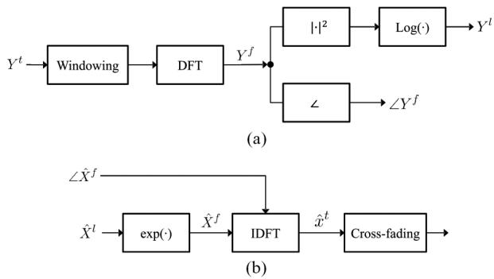  
Fig. 2. The processes of(a) feature extraction and (b) waveform reconstruction

As shown in Fig. 2(a), the log-power spectra $Y ^ { l } ( k )$ and phases $\angle Y ^ { f } ( k )$ are computed based on the short-time Fourier analysis for each windowed frame and are used in building the two DNNs, i.e., one for the log-power spectra and one for the phases. Specifically, in the feature extraction step, the short-time Fourier transform (STFT) is first carried out for speech to obtain DFT coefficients of each windowed frame such that

$$
Y ^ {f} (k) = \sum_ {m = 0} ^ {M - 1} y ^ {t} (m) h (m) e ^ {- j 2 \pi k m / M}, k = 0, 1, \dots , M - 1\tag{7}
$$

where $k$ is the frequency bin index, $h ( m )$ denotes the window function, and is the window length. After the STFT, the logpower spectra are given as

$$
Y ^ {l} (k) = \log | Y ^ {f} (k) | ^ {2}, k = 0, 1, \dots , K - 1\tag{8}
$$

where $K = M / 2 + 1$ . For $k = K , \ldots , M - 1 , Y ^ { l } ( k )$ may be obtained using the symmetric property like $Y ^ { l } ( k ) = Y ^ { l } ( M$ $- k )$ so that the dimension of the log-power spectra and phases is given as $M / 2 + 1$

As shown in Fig. 3, in addition to extracting the log-power spectra and phases from the previous frames prior to the target frame and using them as input features for training the DNN, the algorithm computes the log-power spectra and phases of the target frame to be used as the target features in the DNN training step. Later, when a frame is missing in the test step, the DNN captures the context information prior to the missing frame along the multiple frames and then leads to successful concealment on the target frame through the non-linear mapping functions. We note that, for the DNN training, two

DNNs are used, where the first one is based on the log-power spectra and the second one is established for the phases. Each DNN is a feed-forward neural network with many levels allowing it to map the previous speech frame features to current speech frame features. Since the input features are real-valued, a Gaussian-Bernoulli RBM is used in which the hidden units are binary but the input units are linear with Gaussian noise [37]. Then, the multiple Bernoulli-Bernoulli RBMs are stacked on the Gaussian-Bernoulli RBM. Also, the features are normalized to zero mean and unit variance. The DNN training stage has two steps: unsupervised pre-training part and supervised fine-tuning part. We first initialize the parameters through pretraining based on contrastive divergence (CD) approximation as the objective criterion [38]. They are trained layer-by-layer in a unsupervised greedy manner to maximize the likelihood over training samples in the following. Given the model parameters $\theta = ( \mathbf { w } , \mathbf { h } ; \theta )$ , the energy function of RBM can be defined as

$$
E (v, h, \theta) = - \sum_ {i} b _ {i} v _ {i} - \sum_ {i} a _ {i} h _ {j} - \sum_ {i} \sum_ {j} w _ {i j} v _ {i} h _ {j}\tag{9}
$$

where $w _ { i j }$ represents the weights between the visible unit and hidden unit while $b _ { i }$ and $c _ { i }$ are their bias terms. The probability that the model assigns to a visible vector is given by

$$
p (\mathbf {v}; \theta) = \frac {\sum_ {h} e ^ {(- E (\mathbf {v} , \mathbf {h} ; \theta))}}{\sum_ {v} \sum_ {h} e ^ {- E (\mathbf {v} , \mathbf {h} ; \theta)}}.\tag{10}
$$

The parameters of RBMs are optimized to maximize log likelihood (MLL) log $p ( \mathbf { v } ; \boldsymbol { \theta } )$ and thus the update rule for the weights is given by

$$
\Delta w _ {i j} \propto <   v _ {i} h _ {j} > _ {\mathrm{data}} - <   v _ {i} h _ {j} > _ {\mathrm{model}}\tag{11}
$$

where $< v _ { i } h _ { j } > _ { \mathrm { d a t a } }$ and $< \ v _ { i } h _ { j } > _ { \mathrm { m o d e l } }$ represent the expectation that $v _ { i }$ and $h _ { j }$ occur together in the training set and expectation under the distribution defined by the model, respectively. Time to take $< v _ { i } h _ { j } > _ { \mathrm { m o d e l } }$ grows exponentially for exact computing, the CD approximation to the gradient is employed instead so that $< \ v _ { i } h _ { j } > _ { \mathrm { m o d e l } }$ is replaced by running the Gibbs sampler initialized at the data for single full step [39]. A logistic sigmoid function is used for the activation function ofthe hidden unit and the type of the output is linear. After the pre-training part, a supervised learning algorithm using back-propagation is then carried out in the fine-tuning part [40]. As for the first DNN, using mini-batches, the MMSE between the estimated log-power spectra and the reference target log-power spectra is used for the objective criterion as follows:

$$
E _ {\mathrm{lps}} = \frac {1}{N} \sum_ {n = 1} ^ {N} \sum_ {d = 1} ^ {D} [ \hat {X} _ {n} ^ {d} (\mathbf {W} ^ {1}, \mathbf {b} ^ {1}) - X _ {n} ^ {d} ] ^ {2}\tag{12}
$$

where $E _ { \mathrm { l p s } }$ is the mean squared error of the log-power spectra, $\hat { X } _ { n } ^ { d } ( \mathbf { W } ^ { 1 } , \mathbf { \hat { b } } ^ { \mathrm { 1 } } )$ and $X _ { n } ^ { d }$ denote the -th estimated and target frequency bins of the log-spectral feature at the sample index $n ,$ respectively, with representing the mini-batch size, being the size of the log-power spectra feature vector, $( \mathbf { W } ^ { 1 } , \mathbf { b } ^ { 1 } )$ denoting the weights and bias parameters to be learned at the -th layer. Since an overestimation of spectral components causes more annoying artifacts than underestimation [41], slight modification to the error criterion was applied in such a way to give the penalty for the case of the overestimation:

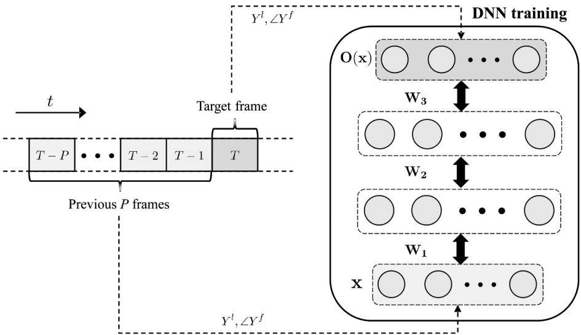  
Fig. 3. The structure of the proposed DNN training.

$$
\widetilde {e} _ {\mathrm{lps}} = \left\{ \begin{array}{c c} e _ {\mathrm{lps}} & , e _ {\mathrm{lps}} \leq 0 \\ \sqrt {2} e _ {\mathrm{lps}} & , e _ {\mathrm{lps}} > 0 \end{array} \right.\tag{13}
$$

where $e _ { \mathrm { l p s } } = \hat { X } _ { n } ^ { d } ( \mathbf { W } ^ { 1 } , \mathbf { b } ^ { \mathrm { l } } ) - X _ { n } ^ { d } ,$ , which denotes the difference between the output of the DNN and the target value computed from the training data. The modified error measure $\widetilde { e } _ { \mathrm { l p s } }$ was used for the calculation of the fitness value.

As for the DNN for phases, the MMSE between the estimated phases and reference target phases is represented as follows:

$$
E _ {\mathrm{phase}} = \frac {1}{N} \sum_ {n = 1} ^ {N} \sum_ {d = 1} ^ {D} [ \angle \hat {X} _ {n} ^ {d} (\mathbf {W} ^ {1}, \mathbf {b} ^ {1}) - \angle X _ {n} ^ {d} ] ^ {2}\tag{14}
$$

where $E _ { \mathrm { p h a s e } }$ is the mean squared error of the phases, $\angle { \hat { X } } _ { n } ^ { d } ( \mathbf { W } ^ { 1 } , \mathbf { b } ^ { 1 } )$ and $\angle X _ { n } ^ { d }$ denote the -th estimated and target frequency bins of the phases at the sample index , respectively. Then, the updated estimated weights and bias of each DNN, with a learning rate $\lambda ,$ can be computed iteratively, as follows:

$$
\left(\mathbf {W} ^ {1}, \mathbf {b} ^ {1}\right) \leftarrow \left(\mathbf {W} ^ {1}, \mathbf {b} ^ {1}\right) - \lambda \frac {\partial E}{\partial \left(\mathbf {W} ^ {1} , \mathbf {b} ^ {1}\right)}, 1 \leq l \leq L + 1\tag{15}
$$

with indicating the total number of hidden layers and $L + 1$ representing the output layer.

The DNN-based packet loss concealment is performed in a similar manner to the DNN training in that the log-power spectra and phases are estimated for the missing frame by using the log-power spectra and phases of the previous frames. The type of the packet loss can be divided into two cases such as a single packet loss and burst packet losses. In the case of single packet loss, the log-power spectra and phases are simply estimated by which the log-power spectra and phases obtained from the previous good frames are fed into the trained DNNs. Subsequently, as shown in Fig. 2(b), the waveform is then reconstructed as follows:

$$
\hat {X} ^ {f} (k) = e ^ {\hat {X} ^ {l} (k) / 2} e ^ {j \angle \hat {X} ^ {f} (k)}.\tag{16}
$$

Then, the signals of the missing frame are reconstructed by applying inverse DFT (IDFT) to the reconstructed spectrum ${ \hat { X } } ^ { f } ( k )$ as given by

$$
\hat {x} ^ {t} (m) = \frac {1}{M} \sum_ {k = 0} ^ {M - 1} \hat {X} ^ {f} (k) e ^ {j 2 \pi k m / M}.\tag{17}
$$

After the reconstruction process, cross-fading is performed to mitigate the discontinuity in the time-domain between the estimated frame signal and previous or next good frame signal. The cross-fading window [42] is given by

$$
w (n) = \left\{ \begin{array}{l l} 1 - \frac {1}{2} (2 u (n)) ^ {\alpha} & , u (n) \leq \frac {1}{2} \\ \frac {1}{2} (2 - 2 u (n)) ^ {\alpha} & , u (n) > \frac {1}{2} \end{array} \right.\tag{18}
$$

where $u ( n ) = ( n - n _ { s } ) / ( n _ { e } - n _ { s } )$ , with $n _ { s }$ and $n _ { e }$ are indices of the beginning and end of the missing frame, respectively, and denotes the roll-off parameter of the window function $( \alpha = 3$ here).

In the event of a burst of packet losses, first, the waveform in the first missing frame is reconstructed in the same way as in the case of a single packet loss. Then, the log-power spectra and phases extracted from the reconstructed signal in the first missing frame are used as the input features to estimate the following missing frames as represented in Fig. 1. In contrast to the AMR-WB Appendix I with its simple muting-based approach, the DNN-based approach exhibits its superiority when multiple frames are lost.

It is noted that the proposed DNN-based PLC algorithm has no algorithmic delay and the computational complexity of this model is dominated by $D _ { I } \cdot N _ { H } + L \cdot N _ { H } ^ { 2 } + N _ { H } \cdot D _ { O }$ multiplications, where $D _ { I }$ and $D _ { O }$ denote dimensions of input and output features, respectively, and $N _ { H }$ and denote the number of hidden nodes and hidden layers, respectively. In time, the computational complexity ofthe DNN model can be effectively reduced to 40% approximately without any performance loss by the node-pruning approach [43].

## IV. EXPERIMENTS AND RESULTS

To verify the performance, the proposed DNN-based PLC algorithm was integrated into the AMR-WB and compared with the AMR-WB Appendix I and HMM-based PLC algorithm introduced in Section II. Note that the AMR-WB PLC method runs in an independent manner with the proposed method, which was described in Section II [21]. We used native Korean speech databases which consist of 7,560 utterances (8.4 hours long in total) for a training set and 1,890 utterances (2.1 hours long in total) for an objective evaluation set. The speech databases were sampled at 16 kHz and were obtained using a 512-point DFT with the Hamming window and the size of packet (frame) was set to be 20 ms (320 samples for the wideband signal) with 192-point zero-padding. In case of the DNN training, 257 dimensions of log-power spectra and phases extracted from the clean signals encoded and decoded by the AMR-WB were used. Also, random and burst frame losses were inserted to the speech files at various rates (5, 10, 15, 20, 30%) by using error insertion device (EID) in the ITU-T G.191 software tool [44] with zero bit error rate and 0.5 of burst factor $( \gamma = 0 . 5 )$ in which 0 and 1 indicate the totally random and burst error, respectively.

Practically, the DNNs were constructed by varying the number ofthe hidden layer from 1 to 4 to check the performance according to the number of the hidden layers. The number of nodes in each hidden layers was set to 2048 and these were determined empirically to describe the complicated relations between input and output well enough while avoiding over-fitting. We ran 50 epochs to pre-training of each hidden layers and 200 epochs to the fine-tuning when learning the DNNs. It is worthwhile to mention that the proposed approach can be easily integrated into other codecs such as G.722 which is the representative pulse-code modulation (PCM)-based codec [45] or contemporary EVS codec [23] with a slight modification of the input frame size in the DNN training stage. The simulation performed on various experiments including feature selection, graphical comparisons, speech quality measures, and speech recognition verified the superiority of the proposed algorithm.

## A. Feature Selection

To validate the regression of the phase component by using the DNN, we compared the proposed PLC algorithm with the method where the phase information of the previous frame is copied to the current missing frame. As an example, Fig. 4 shows the waveform results, where dotted boxes indicate the packet loss periods, when using the phase of the previous frame and the phase estimated by the DNN, respectively, in case that the log-power spectra are estimated by the DNN in both cases. Fig. 4(b) takes into account that the estimated waveform is likely to be repeated during the packet loss period (see $t = 0 . 0 2 - 0 . 0 4 \mathrm { ~ s ~ }$ , which is invisible from the proposed method given in Fig. 4(c). This repeated waveform yields a severe degradation of the speech quality, thus the estimated phase using the DNN turns out to be successful for the PLC algorithm.

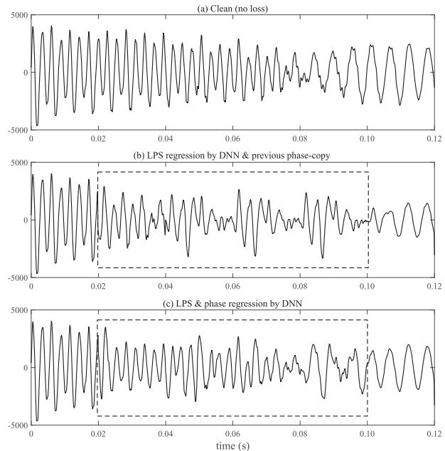  
Fig. 4. Waveform results of (a) clean signal and signals by using the (b) logpower spectra regression by DNN & previous phase-copy and (c) log-power spectra & phase regression by DNN.

On the other hand, we measured the regression error with respect to the features such as the ISF, MDCT, and log-power spectra we chose in this PLC algorithm. At first, we examined the regression error of the ISF vector achieved by the DNNbased regression as in Fig. 5(a). It turns out that the small regression error of the ISF, as illustrated in Fig. 5(d), causes the greater signal distortion than the AMR-WB Appendix I which uses simple approach given in (3). Secondly, the MSE performances of the DFT and MDCT were evaluated to validate the benefit on using the DFT. Furthermore, the method using the single DNN to estimate both the log-power spectra and phase was performed to compare with the method using two DNNs to separately estimate both the log-power spectra and phase. For this, the number ofinput frames $P$ used in this paper varied from 1 to 13 in increments of 2 while fixing the number of hidden layers to 4. Notice that, as shown in Fig. 6, the MSEs of the log-power spectra and phase in the DFT domain (LPS, phase) decrease as the number ofprevious frames increases and is saturated at 11, the number ofprevious frames was thus chosen as 11 in the subsequent tests. It is seen that the MSEs of the phase regression were much larger than that ofthe log-power spectra regression because of inherent characteristics of the phase which has low correlation over successive frames and values of it are largely changed than the log-power spectra within intra-frame. In addition, the MSE ofthe log-power spectra and phase regression using the single DNN (LPS+phase) was larger than sum of the MSEs between log-power spectra and phase using each DNN model since the log-power spectra has a strong correlation but phase does not, which may aggravate the performance ofthe DNN regression. Finally, the MSE of the log-power spectra in the MDCT domain (MDCT) was the largest among that of the other cases because the dynamic range of the MDCT is higher than that ofthe DFT, which is prejudicial to the DNN regression.

Based on the comprehensive feature selection tests, the logpower spectra and phase in the DFT domain are chosen for the DNN regression features.

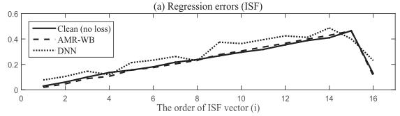

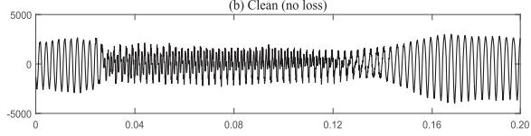

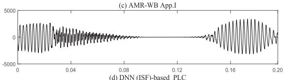

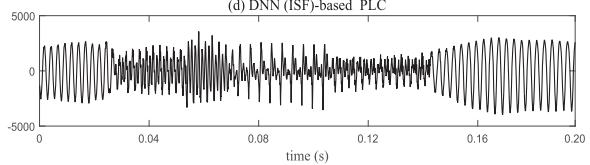  
Fig. 5. Results of the (a) regression errors, (b) clean speech, (c) output speech from AMR-WB App. I, and (d) output speech from DNN (ISF)-based PLC.

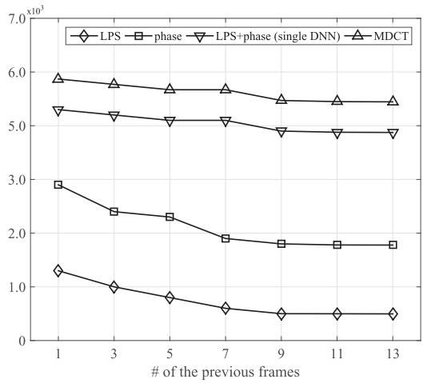  
Fig. 6. MSEs of the LPS, phase, LPS+pahse (single DNN), and MDCT according to the number of previous frames .

## B. Graphical Comparisons

To evaluate the performance of the proposed method, the AMR-WB Appendix I and HMM-based PLC algorithm were graphically compared to the proposed algorithm as illustrated in Figs. 7 and 8, where the solid line indicates the desired signal and the dashed line indicates the signal processed by each of the PLC algorithms. From the result of the log-power spectra in Fig. 7, it is seen that discrepancies of the log-power spectra between the AMR-WB App. I and clean signal. Especially, overestimation of the log-power spectra was observed in the case of the HMM-based PLC, which may introduce annoying artifacts, however, it cannot be seen in the case of the proposed method since the overestimation problem was addressed in the fine-tuning ofthe DNN training. In case ofthe result ofthe phase spectrum in Fig. 8, the proposed method turned out to be slightly more similar to the clean signal than the conventional methods.

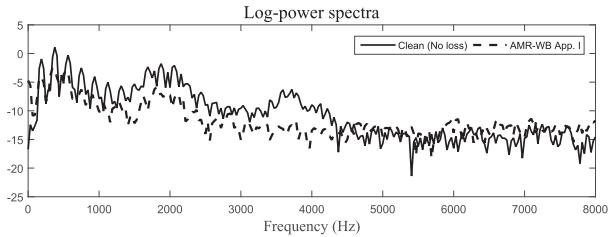

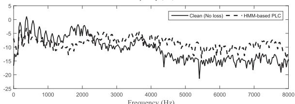

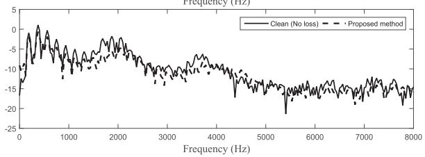  
Fig. 7. Comparisons of the log-power spectra processed by the AMR-WB App. I, HMM-based PLC, and proposed PLC algorithm.

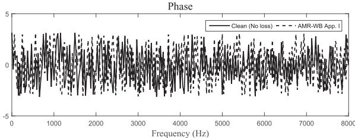

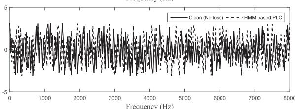

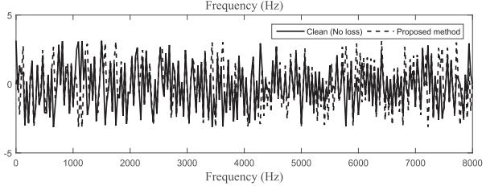  
Fig. 8. Comparisons of the phases processed by the AMR-WB App. I, HMMbased PLC, and proposed PLC algorithm.

Thus, the proposed PLC algorithm yields better estimates of the desired log-power spectra and phases than the conventional PLC algorithms.

Accordingly, the reconstructed speech signal using the proposed algorithm achieves better similarity to the desired speech signal than the conventional methods including the AMR-WB Appendix I and HMM-based PLC as shown in Fig. 9, where dotted boxes indicate the packet loss periods. Because the waveform of the proposed algorithm looks more like the desired signal than those ofconventional methods at not only short-term losses (0–0.02 s and 0.03–0.07 s) but also long-term loss (see

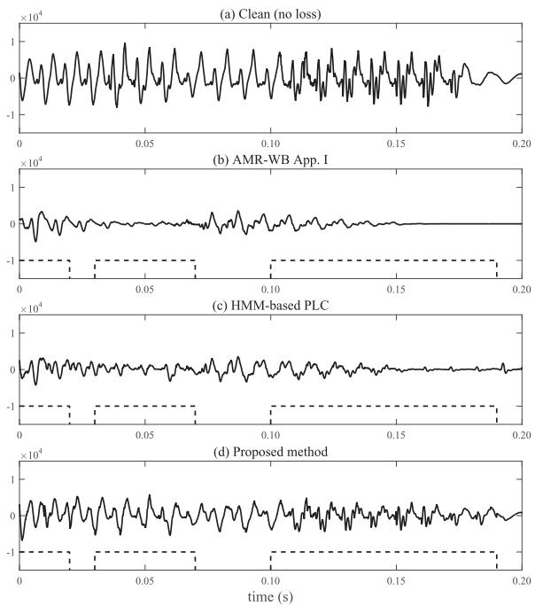  
Fig. 9. Waveform comparison of (a) clean speech and speech processed by (b) the AMR-WB App. I (c) HMM-based PLC, and (d) proposed algorithm.

TABLE I  
LSD RESULTS OBTAINED FROM THE CONVENTIONAL METHODS AND PROPOSED ALGORITHM

<table><tr><td rowspan="2">Packet Loss Rate</td><td colspan="8">LSD</td></tr><tr><td>Baseline</td><td>AMR-WB App.I</td><td>HMM [16]</td><td> $DNN_1$ </td><td> $DNN_2$ </td><td> $DNN_3$ </td><td> $DNN_4$ </td><td> $DNN_4 +Dropout$ </td></tr><tr><td>5%</td><td>0.16</td><td>0.11</td><td>0.13</td><td>0.16</td><td>0.10</td><td>0.05</td><td>0.05</td><td>0.05</td></tr><tr><td>10%</td><td>0.21</td><td>0.15</td><td>0.16</td><td>0.23</td><td>0.13</td><td>0.13</td><td>0.09</td><td>0.09</td></tr><tr><td>15%</td><td>0.37</td><td>0.21</td><td>0.19</td><td>0.26</td><td>0.18</td><td>0.15</td><td>0.14</td><td>0.16</td></tr><tr><td>20%</td><td>0.44</td><td>0.32</td><td>0.28</td><td>0.38</td><td>0.25</td><td>0.18</td><td>0.19</td><td>0.21</td></tr><tr><td>30%</td><td>0.72</td><td>0.43</td><td>0.41</td><td>0.61</td><td>0.37</td><td>0.35</td><td>0.32</td><td>0.33</td></tr></table>

0.1–0.19 s), it is clear that our approach estimates the information of the missing frames using the DNN is better than the conventional methods.

## C. Speech Quality Measures

The performance of the proposed method compared to the conventional methods was evaluated via objective speech quality measures including LSD and PESQ which are significantly correlated with perceptual speech quality. In addition, we used the dropout technique [46] in training the DNN to mitigate the overfitting problem, which was named as in Tables I–II. When using the dropout training, a certain percentage of the DNN nodes are randomly dropped in the input and each of the hidden layers. In this paper, 10% for input layer and 20% for each of the hidden layers are dropped for the fine-tuning, which is the same as in [28].

At first, Table I gives the LSD comparisons of the baseline PLC at which lost packets are concealed by padding zeros, AMR-WB Appendix I, HMM-based PLC, and PLC algorithm using the $\mathrm { D N N } _ { L }$ where we examined the effects of varying the number of hidden layers ( ). Based on this, the best results were mostly obtained with the 4 hidden layers, i.e., $\mathrm { D N N } _ { 4 } .$ We therefore focus on the study of the concealment results on this 4 layers based on the subjective quality test. In addition,

TABLE II  
PESQ RESULTS OBTAINED FROM THE CONVENTIONAL METHODS AND PROPOSED ALGORITHM

<table><tr><td rowspan="2">Packet Loss Rate</td><td colspan="8">PESQ</td></tr><tr><td>Baseline</td><td>AMR-WB App.I</td><td>HMM [16]</td><td> $DNN_1$ </td><td> $DNN_2$ </td><td> $DNN_3$ </td><td> $DNN_4$ </td><td> $DNN_4 +Dropout$ </td></tr><tr><td>5%</td><td>3.01</td><td>3.27</td><td>3.28</td><td>3.16</td><td>3.21</td><td>3.34</td><td>3.37</td><td>3.38</td></tr><tr><td>10%</td><td>2.45</td><td>2.86</td><td>2.88</td><td>2.75</td><td>2.77</td><td>2.91</td><td>2.94</td><td>2.94</td></tr><tr><td>15%</td><td>2.14</td><td>2.71</td><td>2.74</td><td>2.37</td><td>2.45</td><td>2.75</td><td>2.79</td><td>2.78</td></tr><tr><td>20%</td><td>1.82</td><td>2.34</td><td>2.31</td><td>2.19</td><td>2.27</td><td>2.38</td><td>2.42</td><td>2.40</td></tr><tr><td>30%</td><td>1.32</td><td>1.79</td><td>1.74</td><td>1.68</td><td>1.83</td><td>2.04</td><td>2.08</td><td>2.06</td></tr></table>

PESQ was measured, as summarized in Table II. The PESQ results were similar to the LSD results. Therefore, the proposed PLC algorithm consistently outperformed the conventional PLC algorithms in the AMR-WB Appendix I and using the HMM technique in terms of perceptual speech quality. From the objective speech quality tests, the performance of the HMM-based PLC is mostly better than that of the AMR-WB App. I and $\mathrm { D N N _ { 2 } }$ , however, the proposed PLC using 4 hidden layers $\mathrm { ( D N N _ { 4 } ) }$ gives the best results among the algorithms. Furthermore, the performances of using the dropout case $\mathrm { ( D N N _ { 4 } + }$ ) are similar or slightly fall in comparison to the $\mathrm { D N N } _ { 4 }$ case which implies the dropout technique is not effective in this task but has some potential when the huge database are used as described in [46].

To validate the objective performance evaluation, we further conducted a subjective speech quality test by using absolute category rating (ACR) tests which use the five-point MOS [34]. Fourteen native Korean expert listeners performed listening tests using a headphone and each listener gave for each test file a score from one to five: 5 (Excellent), 4 (Good), 3 (Fair), 2 (Poor) and 1 (Bad). All the scores were then averaged to yield the final MOS results. For speech materials, we randomly selected total 40 files spoken by four male and four female native Korean speakers from the NTT Korean speech database [47] and each file with 8 sec long consists of two meaningful sentences. The results with 95% confidence interval under various packet loss rates are presented in Table III. It is noted that the performance ofthe HMM-based PLC algorithm has become worse in the MOS test caused by that the training DB and test DB is different, which implies using the shallow models like the HMM is not preferable to conceal the lost parameters of speech. On the other hand, the proposed PLC algorithm using the DNN still exhibits the best result even in the MOS test. These results including objective and subjective speech quality tests confirm that the proposed PLC method provides the best speech quality compared to the conventional methods.

## D. Speech Recognition Results

Over the past few decades, there has been a growing interest in automatic speech recognition (ASR) technologies for mobile environments which enable access to remote speech recognition (RSR) services [48]. Since the RSR system runs targeting at the client such as mobile devices, they have been restricted by a computing power, small memories, and short battery time. Among many techniques for the RSR system, a network-based speech recognition (NSR) is one of the good approaches to the RSR system. In this approach, the whole recognition system resides behind the network, and the client thus sends the speech signal by employing a speech codec to the server at which recognition is carried out. However, the NSR is designed to use data packets transmitted from the client to the server, a lost packet can severely degrade speech recognition accuracy. Thus, it is worthwhile to use the PLC algorithm as a pre-processing stage to improve the recognition accuracy for the real-time NSR system. In contrast to the VoIP and VoLTE systems, the NSR system can be less sensitive to delay, we thus use look-ahead frames for the training and test of the HMM and DNN-based PLC algorithms. This is indeed accomplished by which the past ten frames and future one frame of the missing frame are used to estimate the information of the missing frame. If the future frame is unavailable due to the loss, only the past frames are used for the DNN concealment.

TABLE III  
MOS RESULTS IN LANGUAGE-MISMATCHED ENVIRONMENTS OBTAINED FROM THE CONVENTIONAL METHODS AND PROPOSED ALGORITHM (95% CONFIDENCE INTERVAL)

<table><tr><td rowspan="2">Packet Loss Rate</td><td colspan="4">MOS</td></tr><tr><td>Baseline</td><td>AMR-WB App.I</td><td>HMM [16]</td><td> $DNN_4$ </td></tr><tr><td>5%</td><td>2.81 ± 0.04</td><td>3.21 ± 0.03</td><td>3.23 ± 0.04</td><td>3.32±0.05</td></tr><tr><td>10%</td><td>2.30 ± 0.06</td><td>2.88 ± 0.05</td><td>2.91 ± 0.06</td><td>2.97±0.06</td></tr><tr><td>15%</td><td>1.85 ± 0.06</td><td>2.61 ± 0.07</td><td>2.65 ± 0.11</td><td>2.82±0.09</td></tr><tr><td>20%</td><td>1.53 ± 0.09</td><td>2.34 ± 0.08</td><td>2.26 ± 0.13</td><td>2.48±0.06</td></tr><tr><td>30%</td><td>1.14 ± 0.11</td><td>1.87 ± 0.08</td><td>1.85 ± 0.12</td><td>2.17±0.11</td></tr></table>

TABLE IV

RESULTS OF THE WER OBTAINED FROM THE CONVENTIONAL METHODS AND PROPOSED ALGORITHM

<table><tr><td rowspan="2">Packet Loss Rate</td><td colspan="5">WER (%)</td></tr><tr><td>AMR-WB App.I</td><td>HMM [16]</td><td>DNN4</td><td>HMM[16] + Look-ahead</td><td>DNN4 + Look-ahead</td></tr><tr><td>5%</td><td>23.8</td><td>23.1</td><td>20.2</td><td>22.8</td><td>19.8</td></tr><tr><td>10%</td><td>34.5</td><td>33.6</td><td>21.9</td><td>31.4</td><td>20.6</td></tr><tr><td>15%</td><td>53.0</td><td>51.4</td><td>29.7</td><td>49.7</td><td>28.3</td></tr><tr><td>20%</td><td>65.7</td><td>59.6</td><td>44.6</td><td>57.1</td><td>42.5</td></tr><tr><td>30%</td><td>87.8</td><td>74.1</td><td>61.6</td><td>72.6</td><td>58.2</td></tr></table>

Based on this, the proposed algorithm was implemented into the task of speech recognition using the Kaldi speech recognition toolkit [49], which corresponds to a speaker-independent phone recognition system using the HMM-based recognizer and the standard TIMIT corpus [50]. The word error rate (WER) results for various packet loss rates are summarized in Table IV. As the table shows, the proposed approach exhibits significant improvements in terms of recognition rates for all cases, compared to the conventional methods so that it is found suitable for the pre-processor of the NSR system. Furthermore, using the look-ahead methods result in a better performance in every cases since the strong correlations can be considered between the previous and later frames of missing frame. It is noted that the recognition results of the proposed method using the DNN is much better than that of speech quality tests, which indicates the DNN has a powerful performance in modeling the dynamic characteristics of speech features for the PLC technique. This result gives promise of good potential in DNN-based PLC for NSR system. To summarize, the results show that the performance of the proposed algorithm is clearly better than those of the conventional PLC algorithms especially for higher packet loss rates, which confirms that the proposed algorithm is robust under adverse network conditions.

## V. CONCLUSIONS

In this paper, a DNN-based regression approach was proposed for the PLC algorithm to estimate the features of a missing frame. For this, two separate DNNs were built by incorporating the log-power spectra and phases based on the unsupervised pretraining and the supervised fine-tuning. Then, in the concealment step, the trained DNN models are fed with the features of good frames and lead to estimated log-power spectra and phases at the missing frames. In addition, cross-fading is performed to mitigate the discontinuity in the time-domain when the waveform is finally synthesized. When designing the DNN, it was discovered that large numbers of input dimensions and hidden layers exhibit better performance in regression. As a result, it was found that on using the DNN for the PLC achieves the significant improvements in terms of the objective measure, subjective perceptual quality, and the speech recognition accuracy when compared to the AMR-WB Appendix I and HMM-based PLC algorithms. Future studies may include the additional techniques such as the dropout, adaptation to consider the diverse acoustic conditions, and the recurrent neural network (RNN) to investigate the potential on using the new architecture of the DNN.

## REFERENCES

[1] D. Villacis, F. R. Acosta, and R. A. Lara Cueva, “Performance analysis of VoIP services over WiFi-based systems,” in Proc. IEEE Colombian Conf. Commun. Comput., May 2013, pp. 1–6.

[2] S. Karapantazis and F. Pavlidou, “VoIP: A comprehensive survey on a promising technology,” Comput. Netw., vol. 53, no. 12, pp. 2050–2090, Aug. 2009.

[3] A. Takahashi, H. Yoshino, and N. Kitawaki, “Perceptual QoS assessment technologies for VoIP,” IEEE Commun. Mag., vol. 42, no. 7, pp. 28–34, Jul. 2004.

[4] S. Floyd, V. Jacobson, S. McCanne, L. Ching-Gung, and Z. Lixia, “A reliable multicast framework for light-weight sessions and application level framing,” IEEE Trans. Netw., vol. 25, no. 4, pp. 342–356, Oct. 1995.

[5] B. W. Wah, X. Su, and D. Lin, “A survey on error-concealment schemes for real-time audio and video transmissions over the internet,” in Proc. Int. Symp. Multimedia Software Eng., 2000, pp. 17–24.

[6] “A high quality low-complexity algorithm for packet loss concealment with G.711,” ITU-T Rec. G.711 Appendix I, Sep. 1999.

[7] C. Perkins, O. Hodson, and V. Hardman, “A survey of packet loss recovery techniques for streaming audio,” IEEE Netw., vol. 12, no. 5, pp. 40–48, Sep. 1998.

[8] T. Chua and D. Pheanis, “QoS evaluation of sender-based loss-recovery techniques for VoIP,” IEEE Netw., vol. 20, no. 6, pp. 14–22, Nov.–Dec. 2006.

[9] N. Aoki, “Modification of two-side pitch waveform replication technique for VoIP packet loss concealment,” IEICE Trans. Commun., vol. E87-B, no. 4, pp. 1041–1044, Apr. 2004.

[10] J. Lindblom and P. Hedelin, “Packet loss concealment based on sinusoidal modeling,” in Proc. IEEE Workshop Speech Coding, Oct. 2002, pp. 65–67.

[11] E. Gunduzhan and K. Momtahan, “A linear prediction based packet loss concealment algorithm for PCM coded speech,” IEEE Trans. Speech Audio Process., vol. 9, pp. 778–785, Nov. 2001.

[12] K. Kondo and K. Nakagawa, “A packet loss concealment method using linear prediction,” IEICE Trans. Inf. Syst., vol. E89, no. 2, pp. 806–813, Feb. 2006.

[13] S. Agnihotri, K. Aravindhan, H. S. Jamadagni, and B. I. Pawate, “A new technique for improving quality of speech in voice over IP using time-scale modification,” in Proc. IEEE Int. Conf. Acoust., Speech, Signal Process., Apr. 2002, pp. 2085–2088.

[14] M. K. Lee, S. K. Jung, H. G. Kang, Y. C. Park, and D. H. Youn, “A packet loss concealment algorithm based on time-scale modification for CELP-type speech coders,” in Proc. IEEE Int. Conf. Acoust., Speech, Signal Process., Apr. 2003, pp. 116–119.

[15] J. Lindblom, J. Samuelson, and P. Hedelin, “Model based spectrum prediction,” in Proc. IEEE Workshop Speech Coding, Oct. 2000, pp. 117–119.

[16] C. A. Rodbro, M. N. Murthi, S. V. Andersen, and S. H. Jensen, “Hidden Markov model-based packet loss concealment for voice over IP,” IEEE Trans. Audio, Speech, Lang. Process., vol. 14, no. 5, pp. 1609–1623, Sep. 2006.

[17] L. Deng, G. E. Hinton, and B. Kingsbury, “New types of deep neural network learning for speech recognition and related applications: An overview,” in Proc. IEEE Int. Conf. Acoust., Speech, Signal Process., May 2013, pp. 8599–8603.

[18] J. Thyssen, R. Zopf, J.-H. Chen, and N. Shetty, “A candidate for the ITU-T G.722 packet loss concealment standard,” in Proc. IEEE Int. Conf. Acoust., Speech, Signal Process., Apr. 2007, pp. IV-549-IV–552.

[19] B. Kovesi and S. Ragot, “A low complexity packet loss concealment algorithm for ITU-T G.722,” in Proc. IEEE Int. Conf. Acoust., Speech, Signal Process., Apr. 2008, pp. 4769–4772.

[20] M. Jelinek, T. Vaillancourt, and J. Gibbs, “G.718: A new embedded speech and audio coding standard with high resilience to error-prone transmission channels,” IEEE Commun. Mag., vol. 47, no. 10, pp. 117–123, Oct. 2009.

[21] “Error concealment of erroneous or lost frames,” ITU-T Rec. G.722.2 Appendix I, Jan. 2002.

[22] “Codec for enhanced voice services (EVS); Error concealment of lost packets,” 3GPP, 3GPP TS 26.447.

[23] S. Bruhn, H. Pobloth, M. Schnell, B. Grill, J. Gibbs, L. Miao, K. Jarvinen, L. Laaksonen, N. Harada, N. Naka, S. Ragot, S. Proust, T. Sanda, I. Varga, C. Greer, M. Jelinek, M. Xie, and P. Usai, “Standardization of the new 3GPP EVS codec,” in Proc. IEEE Int. Conf. Acoust., Speech, Signal Process., Apr. 2015, pp. 5703–5707.

[24] V. Atti, D. J. Sinder, S. Subasingha, V. Rajendran, D. Dewasurendra, V. Chebiyyam, I. Varga, V. Krishnan, B. Schubert, J. Lecomte, X. Zhang, and L. Miao, “Improved error resilience for Volte and VoIP with 3GPP EVS channel aware coding,” in Proc. IEEE Int. Conf. Acoust., Speech, Signal Process., Apr. 2015, pp. 5713–5717.

[25] J. Lecomte, T. Vaillancourt, S. Bruhn, S. Hosang, P. Ke, K. Kikuiri, W. Bin, S. Subasingha, and J. Faure, “Packet-loss concealment technology advances in EVS,” in Proc. IEEE Int. Conf. Acoust., Speech, Signal Process., Apr. 2015, pp. 5708–5712.

[26] B. Bessette, R. Salami, R. Lefebvre, M. Jelinek, J. Rotola-Pukkila, J. Vainio, H. Mikkola, and K. Jarvinen, “The adaptive multi-rate wideband speech codec (AMR-WB),” IEEE Trans. Speech Audio Process., vol. 10, no. 8, pp. 620–636, Nov. 2002.

[27] X.-L. Zhang and J. Wu, “Deep belief networks based voice activity detection,” IEEE Trans. Audio, Speech, Lang. Process., vol. 21, no. 4, pp. 697–710, Apr. 2013.

[28] Y. Xu, J. Du, L.-R. Dai, and C.-H. Lee, “A regression approach to speech enhancement based on deep neural networks,” IEEE/ACM Trans. Audio, Speech, Lang. Process., vol. 23, no. 1, pp. 7–19, Jan. 2015.

[29] K. Han, Y. Wang, D.-L. Wang, W. S. Woods, I. Merks, and T. Zhang, “Learning spectral mapping for speech dereverberation and denoising,” IEEE/ACM Trans. Audio, Speech, Lang. Process., vol. 23, no. 6, pp. 982–992, Jun. 2015.

[30] K. Li and C.-H. Lee, “A deep neural network approach to speech bandwidth expansion,” in Proc. IEEE Int. Conf. Acoust., Speech, Signal Process, Apr. 2015, pp. 4395–4399.

[31] G. E. Hinton, L. Deng, D. Yu, and G. E. Dahl, “Deep neural networks for acoustic modeling in speech recognition: The shared views of four research groups,” IEEE Signal Process. Mag., vol. 29, no. 6, pp. 82–97, Nov. 2012.

[32] A. Bayya and M. Vis, “Objective measures for speech quality assessment in wireless communications,” in Proc. IEEE Int. Conf. Acoust., Speech, Signal Process., 1996, pp. 495–498.

[33] Y. Hu and P. Loizou, “Evaluation of objective quality measures for speech enhancement,” IEEE Trans. Audio, Speech, Lang. Process., vol. 16, no. 1, pp. 229–238, Jan. 2008.

[34] “Methods for subjective determination of transmission quality,” ITU-T Rec. P.800, Jun. 1998

[35] Y. Bistritz and S. Peller, “Immittance spectral pairs (ISP) for speech encoding,” in Proc. IEEE Int. Conf. Acoust., Speech, Signal Process., 1993, pp. 9–12.

[36] S. Zhang, W. Dou, and H. Yang, “MDCT sinusoidal analysis for audio signals analysis and processing,” IEEE Trans. Audio, Speech, Lang Process., vol. 21, no. 7, pp. 1403–1414, Jul. 2013.

[37] A. Mohamed, T. Sainath, G. Dahl, B. Ramabhadran, G. E. Hinton, and A. Picheny, “Deep belief networks using discriminative features for phone recognition,” in Proc. IEEE Int. Conf. Acoust., Speech, Signal Process., 2011, pp. 5060–5063.

[38] G. E. Hinton, S. Osindero, and Y. W. Teh, “A fast learning algorithm for deep belief nets,” Neural Comput., vol. 18, no. 7, pp. 1527–1554, Jul. 2006.

[39] G. E. Hinton, “Training products of experts by minimizing contrastive divergence,” Neural Comput., vol. 14, pp. 1771–1800, Aug. 2002.

[40] A. Mohamed, G. E. Dahl, and G. E. Hinton, “Acoustic modeling using deep beliefnetworks,” IEEE Trans. Audio, Speech, Lang. Process., vol. 20, no. 1, pp. 14–22, Jan. 2012.

[41] B. Iser and G. Schmidt, “Bandwidth extension of telephony speech,” EURASIP Newslett., vol. 16, no. 2, pp. 2–24, Jun. 2005.

[42] I. Kauppinen and J. Kauppinen, “Reconstruction method for missing or damaged long portions in audio signal,” J. Audio Eng. Soc., vol. 50, no. 7/8, pp. 594–602, Jul./Aug. 2002.

[43] T. He, Y. Fan, Y. Qian, T. Tan, and K. Yu, “Reshaping deep neural network for fast decoding by node-pruning,” in Proc. IEEE Int. Conf. Acoust., Speech, Signal Process., May 2014, pp. 245–249.

[44] “Software tools for speech and audio coding standardization,” ITU-T Rec. G.191, Mar. 2010.

[45] P. Mermelstein, “G.722: A new CCITT coding standard for digital transmission of wideband audio signals,” IEEE Commun. Mag., vol. 26, no. 1, pp. 8–15, 1988.

[46] N. Srivastava, G. E. Hinton, A. Krizhevsky, I. Sutskever, and R. R. Salakhutdinov, “Dropout: A simple way to prevent neural networks from overfitting,” J. Mach. Learn. Res., vol. 15, pp. 1929–1958, 2014.

[47] “Multi-lingual speech database for telephonometry,” NTT Adv. Technol. Corp., 1994 [Online]. Available: http://www.ntt-at.com/products\_e/speech/index.html

[48] D. Zaykovskiy, “Survey of the speech recognition techniques for mobile devices,” in Proc. Int. Conf. Speech Comput., Jun. 2006, pp. 88–93.

[49] D. Povey, A. Ghoshal, G. Boulianne, L. Burget, O. Glembek, N. Goel, M. Hannemann, P. Motlicek, Y. Qian, P. Schwarz, J. Silovsky, G. Stemmer, and K. Veselyk, “The Kaldi speech recognition toolkit,” in Proc. IEEE Workshop Autom. Speech Recog. Understand., Dec. 2011.

[50] J. S. Garofolo, Getting started with the DARPA TIMIT CD-ROM: An acoustic phonetic continuous speech database. Gaithersburg, MD USA: Nat. Inst. of Standards and Technol. (NIST), 1988.

  
Bong-Ki Lee was born in Seoul, Korea, in 1986. He received the B.S. degree in electrical and communication engineering from Hanyang University, Ansan, Korea, in 2010 and the M.S. degree in electronics and computer engineering from Hanyang University, Seoul, Korea, in 2012. Since 2012, he has been currently pursuing the Ph.D. degree at the Department of Electronics and Computer Engineering, Hanyang University, Seoul, Korea. His research interests include speech coding, speech enhancement, and machine learning applied to speech signal processing.

Joon-Hyuk Chang received the B.S. degree in electronics engineering from Kyungpook National University, Daegu, Korea, in 1998 and the M.S. and Ph.D. degrees in electrical engineering from Seoul National University, Korea, in 2000 and 2004, respectively. From March 2000 to April 2005, he was with Netdus Corp., Seoul, as a Chief Engineer. From May 2004 to April 2005, he was with the University of California, Santa Barbara, in a postdoctoral position to work on adaptive signal processing and audio coding. In May 2005, he joined

Korea Institute of Science and Technology, Seoul, as a Research Scientist to work on speech recognition. From August 2005 to February 2011, he was an Assistant Professor in the school of Electronic Engineering at Inha University, Incheon, Korea. Currently, he is an Associate Professor in the School of Electronic Engineering at Hanyang University, Seoul, Korea. His research interests are in speech coding, speech enhancement, speech recognition, audio coding, and adaptive signal processing.