# Scale-aware dual-branch complex convolutional recurrent network for monaural speech enhancement

Yihao Li a, Meng Sun a,∗, Xiongwei Zhang a, Hugo Van hamme b

a Lab of Intelligent Information Processing, Army Engineering University, Nanjing, 210007, China

b Center for Processing Speech and Images (PSI), Electrical Engineering Department (ESAT), KU Leuven, 3001 Leuven, Belgium

## A R T I C L E I N F O

Keywords: Speech enhancement Attention mechanism Dual-branch network Noise estimation Scale-aware SNR

## A B S T R A C T

A key step to single channel speech enhancement is the orthogonal separation of speech and noise. In this paper, a dual branch complex convolutional recurrent network (DBCCRN) is proposed to separate the complex spectrograms of speech and noises simultaneously. To model b h l l d l b l i f i i f d l i k h orthogonality of the outputs of the two branches can be improved by optimizing the Signal to-Noise Ratio (SNR) related losses. However, we found the models trained by two existing versions of SI-SNRs will yield enhanced speech at a very different scale from that of its clean counterpart. SNR loss will lead to a shrink amplitude of enhanced speech as well. A solution to this problem is to simply normalize the output, but it only works for off-line processing, not for the streaming one. When streaming speech enhancement is required, the error scale will lead to the degradation of speech quality. From an analytical inspection of the weakness of the models trained by SNR and SI-SNR losses, a new loss function called scale-aware SNR (SA-SNR) is proposed to cope with the scale variations of the enhanced speech. SA-SNR improves over SI-SNR by introducing an extra regularization term that encourages the model to produce signals of similar scale as the input, which has little influence on the perceptual quality of the enhanced speech. In addition, the commonly used evaluation recipe for speech enhancement may not be sufficient to comprehensively reflect the performance of the speech enhancement methods using SI-SNR losses, where amplitude variations of input speech should be carefully considered. A new evaluation recipe called ScaleError is introduced. Experiments show that our proposed method improves over the existing baselines on the evaluation sets of the voice bank corpus, DEMAND and the Interspeech 2020 Deep Noise Suppression Challenge, by obtaining higher scores for PESQ, STOI, SSNR, CSIG, CBAK and COVL.

## 1. Introduction

Speech enhancement is a technique to improve the perceptual quality and intelligibility of voices (Karthikeyan et al., 2023), and has been widely used in speech communications (Sun et al., 2017), hearing aids (Sun et al., 2020), and other speech processing tasks (Nian et al., 2021). Compared with multi-channel speech enhancement, single-channel speech enhancement is more challenging given that only one microphone is used to collect speech signals (Tan and Wang, 2020). Traditional single-channel speech enhancement methods, such as spectral subtraction (Boll, 1979), Wiener filtering (Lim and Oppenheim, 1978) and minimum mean square error estimation (Ephraim and Malah, 1985), suffer from the stationary assumptions of noises. In the non-stationary noise scenarios of real-world applications the performance of those traditional methods will deteriorate severely (Hao et al., 2020).

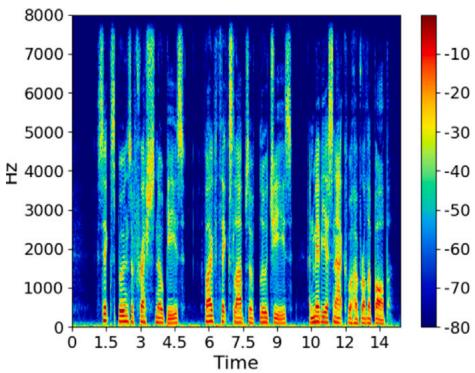  
(a) Magnitude Spectra (in dB)

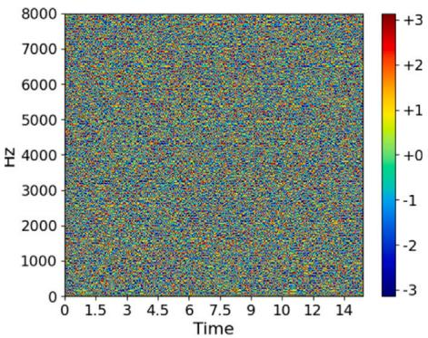  
(b) PhaseSpectra (in dB)  
Fig. 1. Comparison of magnitude spectrogram and phase spectrogram. (a) An example of magnitude spectrogram. (b) The corresponding phase spectrogram.

With the rapid developments and implementations of deep learning, single-channel speech enhancement has been improved significantly to cope with non-stationary noises. Miscellaneous network structures have been proposed to estimate clean speech from noisy inputs, e.g., dilated convolutional networks (Xiang et al., 2021), self-attention mechanisms (Ashutosh and Wang, 2021) and convolutional recurrent networks (Hsieh et al., 2020). The deep learning methods above actually learn a nonlinear mapping from noisy speech to its clean counterpart, which do not pay special attention to the types and levels of noises. An alternative solution is to model unseen dynamic noises, where adaptive noise estimation is conducted firstly and the estimated noises are subsequently subtracted from the noisy inputs to predict clean speech in Wang and Mike (2018). However, the single estimate of either speech or noise could hinder the estimate of the other by possibly leaking one’s residuals to the other, which would result in poor performance.

The dual-branch structure of deep learning proposed in Chen and Zhang (2021) is able to learn speech and noise simultaneously and has obtained excellent performance in speech dereverberation and separation. In this structure, two interactive branches are used to represent clean speech and noise correspondingly. The interactions are performed on the hidden layers of the two branches to promote orthogonality of the representations of the two branches, i.e., to remove noises from the speech branch and to remove speech from the noise branch. Notice that DBNet (Zhang et al., 2021a) also has a two-branch structure, but the two branches model the frequency and waveform representations respectively, while the two branches in Chen and Zhang (2021) model speech and noises respectively. Inspired by these architectures, we propose a complex version by introducing phase information to the dual-branch separation, called dual-branch complex convolutional recurrent networks (DBCCRN) in this paper. The motivation to use complex spectrum is presented below.

Though earlier studies have shown that human ear is not sensitive to phase information (Wang. and Lim. 1982). recent studies find that phase could be helpful to recover clean speech waveforms from noisy signals, especially at low SNR conditions (Swetha et al., 2020). However, the success of speech enhancement using magnitude spectra is attributed to the predictable structure of either speech or noise (Zheng and Zhang, 2019), as shown in (a) of Fig. 1, but the phase spectra do not hold such properties as illustrated in (b) of Fig. 1 which are quite noisy.

There are two existing solutions to utilize phase information without predicting the apparently unstructured signals in (b) of Fig. 1. One is using complex time-frequency spectra as features and the other is using the original waveform signals directly. For the first solution, complex spectra mappings are investigated by using deep neural networks (DNN) in Takeuchi et al. (2020) and convolutional recurrent networks (CRN) in Hu et al. (2020). For the second one, end-to-end frameworks are proposed, such as Speech Enhancement Generative Adversarial Network (SEGAN) (Pascual et al., 2017b), where inputs and outputs are both waveforms. Being similar to the first one, the complex spectrogram is taken as the input of our model. Furthermore, the complex spectrum and raw f b d d b h f l l d b l l k h l h h makes our model work in an end-to-end fashion (Hu et al., 2020) and directly generates clean speech waveforms for hearing.

Early studies have used Signal-to-Noise Ratio (SNR) as an evaluation metric to evaluate the performance of speech enhancement methods. However, its value will vary with the scale of estimated clean speech. In order to solve this problem, Scale-Invariant Signal-to-Noise Ratio (SI-SNR) (Isik et al., 2016) is proposed to evaluate the performance of speech enhancement methods. SI-SNR only implicitly evaluates the angle between the estimated clean speech and the ground-truth clean speech, and is unrelated with the scale of signals. Latter, an improved version of SI-SNR, optimal SI-SNR (OSI-SNR) is proposed to scale the estimated speech adaptively to relax the contribution of signal energy to the total loss (Ma et al., 2020).

With the emergence of deep learning, these evaluation metrics are used as training objectives to train neural networks to directly improve their performances on speech enhancement. For example, SI-SNR has become a popular choice for speech enhancement methods in recent years and has been applied in many State-of-the-art (SOTA) models, $\mathrm { e . g . }$ , TasNet (Luo and Nima, 2018), Conv-Tasnet (Luo and Nima, 2019) and DCCRN (Hu et al., 2020)

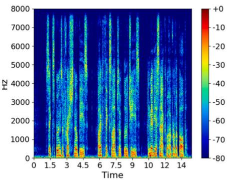  
(a) Real Components Spectra (in dB)

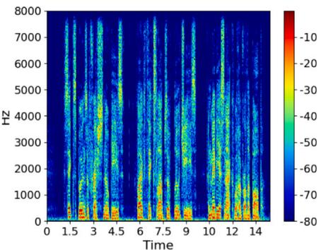  
(b) Imaginary Components Spectra (in dB)  
Fig. 2. An example of the imaginary (a) and real (b) parts of the complex spectrogram of an utterance.

However, when performing speech enhancement in real-world settings, we find the outputs of neural networks trained by SI-SNR (Isik et al., 2016) or OSI-SNR (Ma et al., 2020) are scale-sensitive, where the amplitude of enhanced speech is very different from that of clean speech. The scale sensitivity is also reported in Morten et al. (2020), which studies multiple loss functions in speech enhancement task. In addition, taking SNR as a training objective also leads to errors in scale prediction, as depicted in Section 4. SNR loss function seeks to minimize the difference between enhanced speech and clean speech. When there is an Angle error between the enhanced speech vector and the ground-truth speech vector, the scale of enhanced speech will be smaller than that of clean speech, as shown in Fig. 9. A possible solution is to normalize the signal, but this patchwork approach will not work for streaming process on speech enhancement (Caroselli et al., 2022) due to the unpredictable scale of the clean counterpart.

In this paper, from an analytical inspection of the weakness of the models trained by SI-SNR losses, a new loss function called scale-aware SNR (SA-SNR) is proposed to make a balance between scale invariance in training and scale keeping in testing. SA-SNR improves the existing SI-SNR losses by introducing an extra regularization term to train models which vields an enhanced speech with an amplitude similar to the clean speech. In addition, a new evaluation metric called ScaleError is introduced to measure the amplitude variations between the input and output signals.

We propose the following novelties:

(1) A noise-aware dual-branch complex network architecture to simultaneously estimate clean speech and noise, which considers phase information and works in an end-to-end way.

(2) A new loss called SA-SNR to address the scale sensitivity problem encountered with SI-SNR losses.

(3) A new evaluation metric to measure the amplitude variations between the input and output signals, and an evaluation recipe by using a scaled test set to evaluate the scale sensitivity of the algorithms.

The rest of this paper is organized as follows. Section 2 introduces the background including the existing SI-SNR and OSI-SNR loss functions. The architecture of the proposed DBCCRN is presented in detail in Section 3. In Section 4, the scale sensitivity problems associated with the SI-SNR and OSI-SNR losses are first analyzed and the derivation of the SA-SNR loss is described subsequently Experimental settings and results are given in Sections 5 and 6, respectively. Section 7 concludes the paper.

## 2. Background

In this section, the signal model to generate noisy speech is firstly introduced, and SI-SNR and OSI-SNR are subsequently presented.

## 2.1. Signal model of noisy speech

Speech enhancement aims to extract clean speech from noisy inputs. The conventional additive assumption of clean speech, noises and noisy speech is given in Eq. (1),

$$
x (t) = s (t) + n (t),\tag{1}
$$

where x is noisy speech, s is clean speech, n refers to noises, and t is the time index in sampling points, In the task of speech enhancement, the �(�) are known but the �(�) have to be estimated. With Short-Time Fourier transformation (STFT), the additive equation in Eq. (1) is rewritten into Eq. (2),

$$
X (T, F) = S (T, F) + N (T, F)\tag{2}
$$

where �, � and � refer to the complex spectrograms of noisy speech, clean speech and noises, respectively. � is the time index in frames, and � refers to the frequency index in bins. An example of the absolute values of the complex spectrogram’s real and imaginary parts is shown in Fig. 2, where clear structures are observed in both parts which is beneficial for the learning process (Zhang et al., 2021). This avoids computing gradients regarding the phase parameters in the conventional magnitude and phase representations.

## 2.2. SI-SNR and OSI-SNR

Scale-invariant signal-to-noise ratio (SI-SNR) tends to replace Mean Square Errors (MSE) or $L _ { 1 }$ which may lead to artificial artifacts in waveform regression (Wang et al., 2021) as the loss function to optimize deep neural networks in speech enhance ment (Ashutosh and Wang, 2021). SI-SNR is expected to have strong abilities on source separation by suppressing the artifacts and interferences introduced during the separation of speech and noises. The SI-SNR loss function is defined in Eq. (3),

$$
\begin{array}{c} s _ {t a r g e t} = \frac {\langle \hat {s} , s \rangle}{\| s \| ^ {2}} \cdot s, \\ e _ {n o i s e} = \hat {s} - s _ {t a r g e t}, \\ \text { SI - SNRLoss } = - 1 0 \log_ {1 0} \left(\frac {\| s _ {t a r g e t} \| ^ {2}}{\| e _ {n o i s e} \| ^ {2}}\right), \end{array}\tag{3}
$$

where � represents the ground-truth clean speech, ̂� denotes the estimated clean speech, ⟨⋅, ⋅⟩ denotes the inner product of two vectors, and $\| \cdot \| ^ { 2 }$ is the $L _ { 2 }$ norm.

As an improvement over SI-SNR, optimal SI-SNR (OSI-SNR) is investigated to train models by adaptively scaling the estimated speech to relax the contribution of signal energy to the total loss (Ma et al., 2020). The definition is given in Eq. (4),

$$
\begin{array}{c} s _ {t a r g e t} = \frac {\| \hat {s} \| ^ {2}}{\langle \hat {s} , s \rangle} \cdot s, \\ e _ {n o i s e} = \hat {s} - s _ {t a r g e t}, \\ \text { OSI - SNRLoss } = - 1 0 \log_ {1 0} \left(\frac {\| s _ {t a r g e t} \| ^ {2}}{\| e _ {n o i s e} \| ^ {2}}\right). \end{array}\tag{4}
$$

## 3. Dual-branch complex convolutional recurrent networks

In this section, the architecture of our proposed DBCCRN is introduced. DBCCRN consists of a noise branch and a speech branch, and each branch has an encoder–decoder architecture as shown in Fig. 3.

Noisy speech waveforms are converted into its time-frequency spectrogram through a differentiable STFT front-end realized by a convolutional layer, called ‘Conv-STFT’ (Choi et al., 2019). The noisy spectrogram is then fed into two encoder–decoder branches with a complex convolution block, a deconvolution block and a complex LSTM block. The corresponding blocks are coupled by bridge blocks. The outputs of the two decoders are multiplied with complex noisy inputs. Finally, the waveforms of estimated noises and speech are obtained by passing each complex spectrogram to a differentiable inverse STFT (iSTFT).

In addition, several conformer structures (Gulati et al., 2021) which are combinations of CNN and Transformer are used to connect the corresponding layers of the encoder and the decoder. By combining the advantages of CNN for extracting local features and the advantages of Transformer for extracting global correlation information, conformer has achieved good results in speech recognition (Lahiru and Tsun-Yat, 2022). Therefore, conformer is used in this paper to improve the model’s performance on speech enhancement.

The detailed configurations of the complex convolutional/deconvolutional blocks, the complex LSTM block, the bridge block and the conformer block are given in details in the following subsections.

## 3.1. Complex convolutional/deconvolutional blocks

Each complex convolutional block consists of a complex convolutional layer, a complex batch normalization layer (Trabelsi et al., 2017) and a complex parametric rectified linear unit (PReLU) layer (He et al., 2015), as shown in Fig. 4. The complex convolution layer is used to extract high-level features, the complex batch normalization layer reduces the change in the input distributions of h hidd l d i i i d h l l i h d l’ bili f fi i li f i

The complex convolution is realized by coupling the real and imaginary parts of the complex input and the complex kernel, which actually involves four traditional convolutional operations as shown in Eq. (5),

$$
\begin{array}{c} X \circledast W \\ = (X _ {r} + i X _ {i}) \circledast (W _ {r} + i W _ {i}) \\ = (X _ {r} * W _ {r} - X _ {i} * W _ {i}) + i (X _ {r} * W _ {i} + X _ {i} * W _ {r}), \end{array}\tag{5}
$$

where � is the complex input of the layer, $W$ is the complex kernel, g represents the complex convolution and ∗ represents the real convolution.

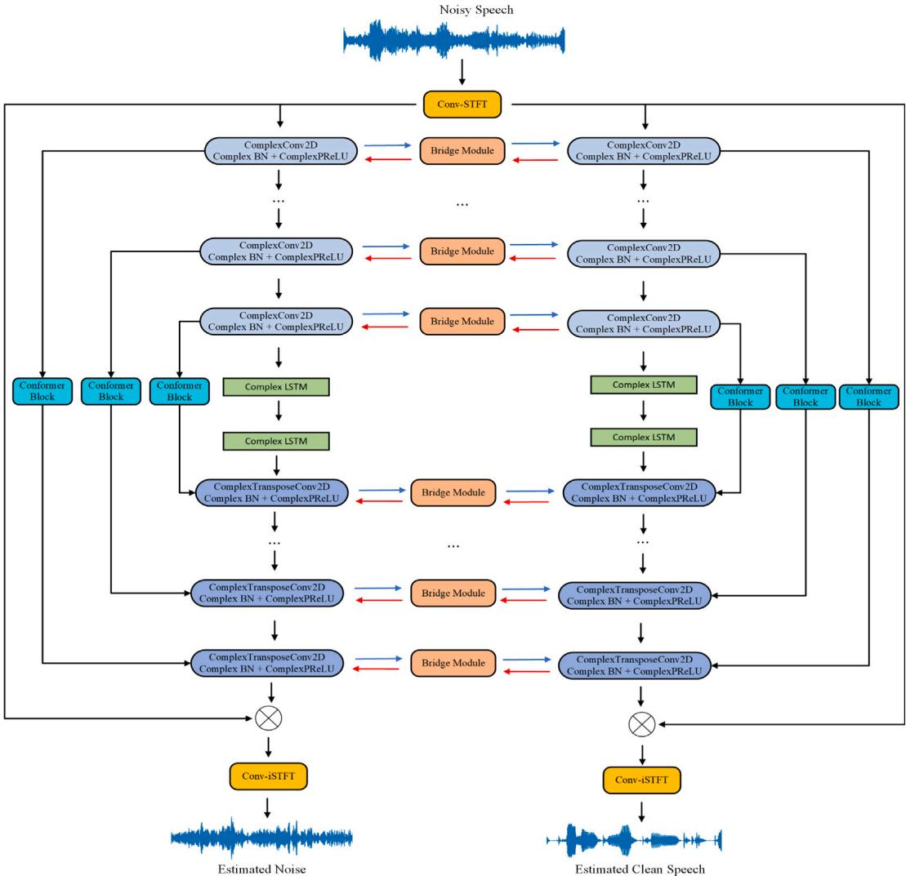  
Fig. 3. The architecture of DBCCRN with two branches. Each branch is an encoder–decoder network and consists of a complex convolution block, a deconvolution block, a complex LSTM block. The corresponding blocks are coupled by bridge blocks.

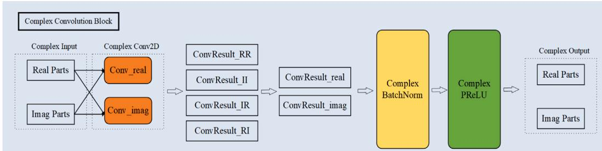  
Fig. 4. The configuration of a complex convolutional block where the complex convolution is realized by coupling the real and imaginary parts of the complex input and the complex kernel. Complex batch normalization and PReLU are also taken to replace their real counterparts

A complex PReLU (He et al., 2015) is obtained by applying a PReLU to the real part $X _ { r }$ and the input imaginary part $X _ { i }$ of the input, as shown in $\operatorname { E q . }$ (6),

$$
c P R e L U (X) = P R e L U \left(X _ {r}\right) + i \left(P R e L U \left(X _ {i}\right)\right)\tag{6}
$$

where $c P R e L U ( \cdot )$ denotes the complex PReLU.

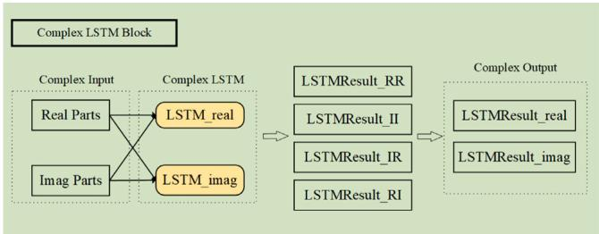  
Fig. 5. The configuration of a complex LSTM block. The complex inputs are firstly split into their real and imaginary parts, where each part is modeled by a LSTM branch. The outputs of the two LSTM branches are then combined to form the complex output.

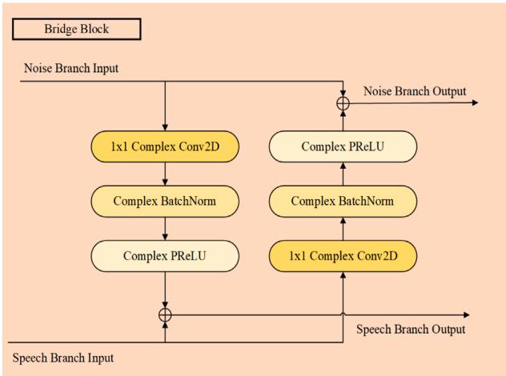  
Fig. 6. The configuration of bridge blocks. Information in noise branch and speech branch interacts through the bridge blocks

By extending real operations to complex ones, the complex batch normalization can be configured similarly. Please refer to Trabelsi et al. (2017) for details.

The basic configuration layers in the complex deconvolutional block are the same as those in the complex convolutional block presented above.

## 3.2. Complex LSTM blocks

The complex LSTM block has two complex LSTM branches to extract temporal features from the complex feature maps of the l l l bl k

Each complex LSTM block consists of two conventional LSTM layers for modeling the dynamic change of the real parts and the imaginary parts, respectively, as shown in Fig. 5.

The complex inputs are firstly split into their real and imaginary parts, where each part is modeled by a LSTM. The outputs of the two LSTMs are then combined to form the complex output. Given the complex input $X = X _ { r } + i X _ { i }$ and let $L S T M _ { r }$ and $L S T M _ { i }$ denote the two LSTM branches for modeling the real and imaginary parts respectively, the output of the complex LSTM layer $c L S T M _ { o u t }$ is defined in Eq. (7),

$$
\begin{array}{r} o u t _ {r r} = L S T M _ {r} (X _ {r}), \quad o u t _ {i r} = L S T M _ {r} (X _ {i}) \\ o u t _ {r i} = L S T M _ {i} (X _ {r}), \quad o u t _ {i i} = L S T M _ {i} (X _ {i}) \\ c L S T M _ {o u t} = (o u t _ {r r} - o u t _ {i i}) + i (o u t _ {r i} + o u t _ {i r}) \end{array}\tag{7}
$$

## 3.3. Bridge blocks

A bridge block is a complex convolutional block with a $1 \times 1$ kernel which keeps the shape of the input unchanged.

By introducing the bridge blocks, data can flow from the speech branch to the noise branch and vise versa, as depicted in Fig. 6. With these configurations, the information in the noise branch and the speech branch can interact with each other to remove noises from the speech branch and to remove speech from the noise branch.

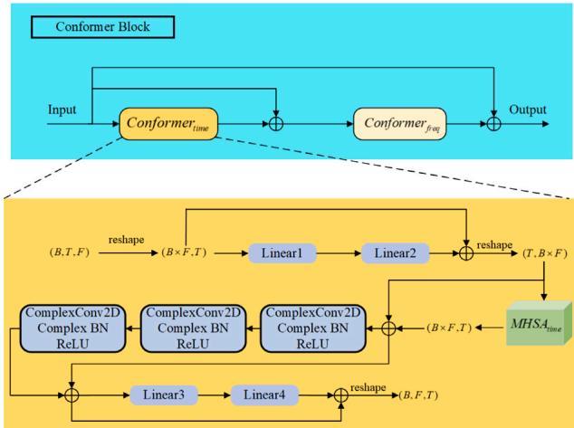  
Fig. 7. The configuration of a Conformer block. Local and global features are extracted from both time and frequency dimensions

## 3.4. Conformer blocks

Conformer can exploit the local and global features from inputs. In this paper, a conformer block is designed which consists of two conformers paying attention on time and frequency dimensions respectively, as shown in Fig. 7. In Fig. 7, the details of the conformer in time dimension is given, and the conformer of frequency dimension is different from it in the input reshaping dimensions and the embedding dimensions of multi-head self-attention (MHSA). Conformer contains several convolutional layers that can extract local features, and a MHSA layer that can extract global information. Conformer extracts local and global information from the encoder, and passes it to the corresponding laver of the decoder to reconstruct speech accurately

## 4. Scale-aware signal-to-noise ratio

In this section, the scale sensitivity and the risk of data clipping possibly happened in the enhanced speech are first analyzed for SI-SNR and OSI-SNR. Our proposed loss SA-SNR is then presented.

## 4.1. Analysis of SI-SNR and OSI-SNR

Although SI-SNR and OSI-SNR have achieved great performance on speech enhancement, there is still a problem of scaling ambiguity (Morten et al., 2020). Specifically, when the input noisy speech is amplified, SI-SNR and OSI-SNR could lead the model to generate estimated clean speech with large amplitudes. If the scale of the output was not fixed, most existing audio softwares (e.g., Adobe Audition and Audacity) would deal with the over-steering by clipping signals to [−1, 1], which may lead to degraded perceptual quality and intelligibility, as shown in (c) and (d) of Fig. 8. One may argue that normalization of the amplitudes of an output signal would solye this problem. However, in the streaming processing of speech enhancement, if each segment of an utterance is normalized separately and the normalized segments are then concatenated together, the overall speech quality will be degraded, as also observed in Table 5.

A careful inspection of the scale sensitivity of neural networks trained by SI-SNR or OSI-SNR will be firstly discussed below. We firstly introduce a real factor � to arbitrarily scale the estimated clean speech, i.e., � ⋅ ̂�. The SI-SNR loss in Eq. (3) is hereby rewritten into the following one,

$$
\begin{array}{l} \text { SI - SNRLoss } (\alpha \hat {s}, s) \\ = - 1 0 \log_ {1 0} \left(\frac {\| s _ {t a r g e t} \| ^ {2}}{\| e _ {n o i s e} \| ^ {2}}\right) \\ = - 1 0 \log_ {1 0} \left(\frac {(\alpha | \hat {s} | c o s \theta \bar {s}) ^ {2}}{\alpha^ {2} \hat {s} ^ {2} + \alpha^ {2} \| \hat {s} \| ^ {2} c o s ^ {2} \theta - 2 \alpha^ {2} \| \hat {s} \| ^ {2} c o s ^ {2} \theta}\right) \\ = - 1 0 \log_ {1 0} \left(\frac {c o s ^ {2} \theta}{s i n ^ {2} \theta}\right) = - 1 0 \log_ {1 0} \left(\frac {1}{t a n ^ {2} \theta}\right), \end{array}\tag{8}
$$

with

$$
s _ {t a r g e t} = \frac {\langle \alpha \hat {s} , s \rangle}{\| s \| ^ {2}} \cdot s,\tag{9}
$$

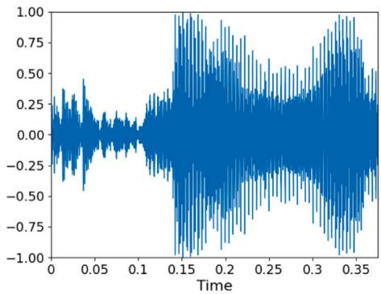  
(a) Noisy Speech

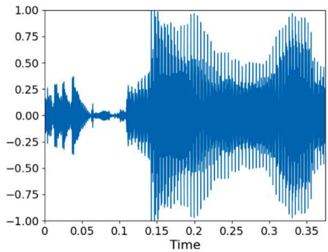  
(b) Clean Speech

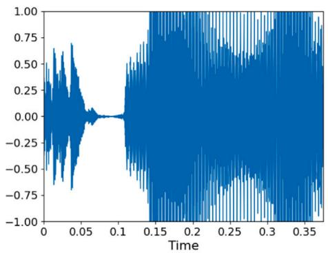  
(c) Estimated Clean Speech With SI-SNR

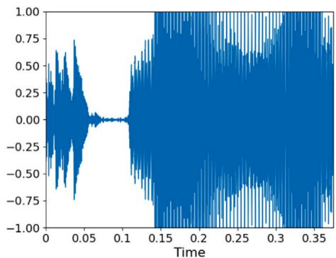  
(d) Estimated CleanSpeech With OSI-SNR  
Fig. 8. The data clipping phenomena appearing in speech enhancement using Hu et al. (2020) without normalization. (a) is the input noisy speech. (b) is the oracle clean speech. (c) and (d) are the enhanced speech of DCCRN for SI-SNR and OSI-SNR, respectively.

and

$$
e _ {n o i s e} = \alpha \hat {s} - s _ {t a r g e t},\tag{10}
$$

where $\vec { s }$ is the unit vector of � and � is the angle between ̂� and �. From Eq. (8) we conclude that the SI-SNR loss depends only on the angle � between the estimated clean speech ̂� and the ground-truth speech � and is independent of the scaling factor $\alpha ,$ as also reported in Robin (2022). The amplification or reduction of ̂� has no contribution to the training loss. OSI-SNR holds a similar property as shown in the following definition. The OSI-SNR loss in Eq. (4) can be rewrited.

$$
\text { OSI - SNRLoss } (\alpha \hat {s}, s)
$$

$$
\begin{array}{l} = - 1 0 \log_ {1 0} \left(\frac {\| s _ {t a r g e t} \| ^ {2}}{\| e _ {n o i s e} \| ^ {2}}\right) \\ = - 1 0 \log_ {1 0} \left(\frac {(\frac {| \alpha | \| \hat {s} \| \vec {s}}{c o s \theta}) ^ {2}}{\alpha^ {2} \hat {s} ^ {2} + (\frac {| \alpha | \| \hat {s} \| \vec {s}}{c o s \theta}) ^ {2} + 2 \alpha \hat {s} \frac {\| \hat {s} \| \alpha \vec {s}}{c o s \theta}}\right) \\ = 1 0 \log_ {1 0} \left(\frac {1}{s i n ^ {2} \theta}\right), \end{array}\tag{11}
$$

with

$$
s _ {t a r g e t} = \frac {\| \alpha \hat {s} \| ^ {2} s}{\langle \alpha \hat {s} , s \rangle},\tag{12}
$$

and

$$
e _ {n o i s e} = \alpha \hat {s} - s _ {t a r g e t}.\tag{13}
$$

The SI-SNR and OSI-SNR loss functions are able to separate noise and speech due to the gradient direction is the same as Logarithmic MSE loss function (Jens et al., 2020). However, during inference, it will introduce unpredictable scaling coefficient � possibly leading to signal clipping. If its scale is controlled by an operation of normalization, its performance in streaming speech enhancement will be significantly reduced.

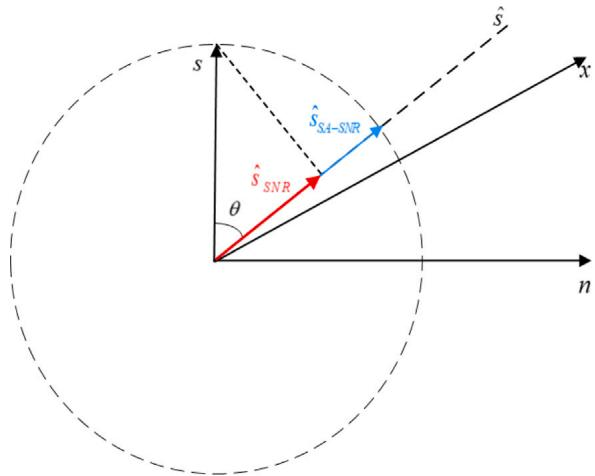  
Fig. 9. The comparison between SNR and SA-SNR with a fixed � (It is not actually fixed, but let us use this as an example). The red arrow denotes the estimated speech by using the SNR loss, while the blue one is from the SA-SNR loss. SNR tries to minimize the noise estimate (s – ) while SA-SNR tends to find a solution sharing a similar modulus of the ground truth.

## 4.2. SA-SNR

To make enhanced speech as similar as possible to clean speech including their scales, we propose the Scale-Aware Signal-to-Noise Ratio (SA-SNR) loss to optimize the DBCCRN presented in 3 as shown in Eq. (14),

SA-SNRLoss( ̂�, �)

$$
= - 1 0 \log_ {1 0} \left(\frac {\| s _ {t a r g e t} \| ^ {2}}{\| e _ {n o i s e} \| ^ {2}} \frac {\min (\frac {\| \hat {s} \|}{\| s \|} , 1)}{\max (\frac {\| \hat {s} \|}{\| s \|} , 1)}\right),\tag{14}
$$

where ̂� is the estimated clean speech and � is the ground-truth clean speech.

In Eq. (14), a regularization factor $\frac { \operatorname* { m i n } ( \frac { | \hat { s } | } { | s | } , 1 ) } { \operatorname* { m a x } ( \frac { | \hat { s } | } { | s | } , 1 ) }$ is introduced to adjust the scales of the enhanced clean speech. If the power of ̂� is higher than that of $s ,$ the regularization factor is $\frac { | s | } { | \hat { s } | }$ , which will reduce the amplitude of the generated speech. On the contrary, if the power of ̂� is lower than that of $s ,$ the regularization factor is $\frac { | { \hat { s } } | } { | s | }$ , which will increase the amplitude of the generated speech.

By imposing SA-SNRs on the branches of speech and noises in DBCCRN, the total loss function turns out to be,

$$
\mathcal {L} = \mathrm{SA-SNRLoss} (\hat {s}, s) + \mathrm{SA-SNRLoss} (\hat {n}, n)\tag{15}
$$

where ̂� is the estimated clean speech, � is the ground-truth clean speech, ̂� is the estimated noise, and � is the ground-truth noise. There are some alternative solutions to keep the scaling of the noisy inputs which are presented as below. These solutions are treated as baselines of our method in the ablation study.

## 4.2.1. The SNR loss

A simple solution to avoid the scaling sensitivity in SI-SNR is turning back to the SNR loss as shown in Eq. (16).

$$
\text { SNRLoss } = - 1 0 \log_ {1 0} \left(\frac {\| s \| ^ {2}}{\| s - \hat {s} \| ^ {2}}\right)\tag{16}
$$

In order to illustrate how SNR and SA-SNR work, the comparison between the two given a fixed � is depicted in Fig. 9, where � is the angle between � and ̂� which is the ground-truth clean speech and the estimated clean speech respectively. It is seen that ${ \hat { s } } _ { S N R }$ is the projection of the ground truth � on the scale-adjusted ${ \hat { s } } ,$ while ${ \hat { s } } _ { S A - S N R }$ shares the same modulus as �. From the figure, we see that $\| \hat { s } _ { S N R } \|$ is smaller than or equal to $\| s \| .$ In addition, the lower bound of SNR loss function becomes $- \| s \| ^ { 2 }$ . The lower bound depends on the value of $s ,$ which will lead to fluctuations of the loss values during training (Choi et al., 2019).

## 4.2.2. Regularized SI-SNRs

Additionally, we have explored the possibility of introducing $L _ { 1 }$ regularization and the energy-constrained items to constrain the scale of estimated speech. Therefore, two alternative loss function are proposed in Eqs. (17) and (18),

$$
\mathcal {L} _ {\mathrm{SI-SNR} + L _ {1}} = \mathrm{SI-SNRLoss} (\hat {s}, s) + \eta \| \hat {s} - s \|,\tag{17}
$$

and

$$
\mathcal {L} _ {\mathrm{SI-SNR+EC}} = \mathrm{SI-SNRLoss} (\hat {s}, s) + \eta \left(\frac {\| \hat {s} \|}{\| s \|} - 1\right) ^ {2}.\tag{18}
$$

It is worth noting that the differences between $\mathcal { L } _ { \mathrm { S I - S N R + } L _ { 1 } }$ in Eq. (17) and SA-SNRLoss in Eq. (14) are two fold: one is OSI-SNR versus SI-SNR in the SNR part and the other is log $\| { \hat { s } } \| ) - \log ( \| s \| )$ versus $\| { \hat { s } } - s \|$ in the regularization part.

We experimentally set the regularization coefficient � in both Eqs. (17) and (18) to 100 to sufficiently emphasize on the amplitudes, after the failed attempts using $\eta = 1$ and $\eta = 1 0$

## 5. Experiments

## 5.1. Datasets

The datasets used in this paper are commonly used in the research community of speech enhancement (Morten et al., 2020; Takeuchi et al., 2020; Pascual et al., 2017b). Clean speech is taken from the voice bank corpus (Christophe et al., 2013), which includes 12,396 utterances from 30 speakers. We follow the official split of 11,572 utterances from 28 speakers for training and 824 utterances from the remaining 2 speakers for testing. The noises in the training set includes 2 artificial noises and 8 noises from the DEMAND corpus (Thiemann et al., 2013). The noisy speech in the training set is synthesized with signal-to-noise ratios f d d d d d d l h f d h d dd l f h DEMAND corpus are used to construct noisy speech for testing with signal-to-noise ratios of 2.5 dB, 7.5 dB, 12.5 dB and 17.5 dB. The validation set is sampled from the training set at a rate of 10%.

In addition, in order to evaluate the transferability of the proposed model to other datasets, experiments are also conducted on the Interspeech DNS Challenge 2020 dataset (KA et al., 2020). The experimental results and discussions are shown in Section 6.3. The dataset has 180 h data for noises and over 500 h of clips from 2150 speakers for speech with a 44.1 kHz sampling rate. We use the official program from KA et al. (2020) to generate 100 h of noisy-clean paired data for training, whose SNRs are randomly taken between −5 and 20 dB with a uniform distribution. The official testing set without reverberation is used for evaluation.

## 5.2. Conventional metrics and the proposed one

To illustrate the performance of the proposed model, six objective metrics are used. Perceptual evaluation of speech quality (PESQ) ranges from −0.5 to 4.5 (Rix et al., 2001), short-time objective intelligibility (STOI) ranges from 0 to 1 (Taal. et al., 2011) and SSNR is the segmental SNR, ranging from −∞ to ∞ (Quackenbush et al., 1988). CSIG, CBAK and COVL are the mean opinion score prediction of signal distortion, intrusiveness of background noise and overall effect respectively, and their values range from 1 to 5 (Hu and Loizou, 2018). For the six objective metrics mentioned above, the higher the value is, the better the speech enhancement performance is.

In order to quantify the scale error, we proposed a new metric ScaleError to calculate the mean square error between the maximum amplitude of the enhanced speech and that of the clean speech, as shown in Eq. (19). A lower value reflects better preservation of the scale of the input signal.

$$
\text { ScaleError } (\hat {s}, s) = \left(\max _ {0 \leq i \leq n} | \hat {s} _ {i} | - \max _ {0 \leq i \leq n} | s _ {i} |\right) ^ {2}\tag{19}
$$

where ̂� is the estimated clean speech and � is the ground-truth clean speech. Both ̂� and � are �-dimensional vectors. | ⋅ | means the absolute value. $\mathrm { m a x } _ { 0 \leq i \leq n } | s _ { i } |$ and $\mathrm { m a x } _ { 0 \leq i \leq n } | \hat { s _ { i } } |$ represent the maximal values of the amplitudes of � and ̂� respectively.

Furthermore, a scaled test set is constructed by normalizing the scales of input noisy waveforms. The scaled test set is a normalized version of the original test set such that all the values in the waveforms lie in −1 and 1. This dataset is useful to cope with possible variations of noisy inputs in real-world settings.

## 5.3. Network settings

The configurations of both the speech branch and the noise branch in our proposed DBCCRN are based on DCCRN (Pascual et al., b) f h d d d d l d l l l d l h k l f h l convolutional layers is [3,3], and the stride is [2,1] with padding of [1,2]. The first dimension is for frequency while the second one for time. The number of channels of the encoder in each branch is {16, 32, 64, 128, 256}. Due to the skip connections, the number of channels of the decoder is twice as many as that of the corresponding layer in the encoder. Both the real and imaginary versions of LSTM have 1024 hidden units. Two continuous linear layers in conformer enlarge and shrink the number of input features by a factor of 4 respectively, and three complex convolution layers shrink and enlarge the first dimension of input feature by 4 times respectively. The MHSA layers consists of 8 heads. The number of parameters of DBCCRN is 8.31M.

## 5.4. Training settings

All the utterances in the dataset are downsampled from the original 48 kHz (for the voice bank corpus) or 44.1 kHz (for the DNS Challenge dataset) to 16 kHz. The utterances in the training set are spit into 1 s segments with 50% overlap to maintain the same length for neural network training, and the utterances in test sets are also spit into 1 s segments, but without overlapping.

Both the Hanning window length and the FFT points are 512 sample points, and the hop size is 128 for STFT. Pytorch is used to train DBCCRN, and the optimizer is RMSProp. The initial learning rate is set to 0.01, and is multiplied by 0.5 when the validation loss increases, with a floor on the learning rate of 0.00025.

## 5.5. Baselines

In this study, we compared the proposed DBCCRN models and the SA-SNR loss with multiple baselines including traditional methods and deep learning-based methods: Wiener filtering (Lim and Oppenheim, 1979), SEGAN (Pascual et al., 2017b), SER-GAN (Deepak and Sarah, 2019), TSN (Juntae and Minsoo, 2019), MetricGAN (Fu et al., 2019), Wave-U-Net (Giri et al., 2019), WaveCRN (Hsieh et al., 2020), DCCRN (Hu et al., 2020), TSEGAN (Morten et al., 2020), NSNet (Xia et al., 2020) and RNNoise (Valin, 2018). The baselines are briefly described below.

Wiener Filter: A traditional speech enhancement method with Wiener filters.

SEGAN: A fully 1-D convolutional generative adversarial network which shares its architecture with Pascual et al. (2017b). SEGAN is an end-to-end method which works in time domain.

SERGAN: The network architecture is the same as SEGAN, but the relative GAN is used to perform speech enhancement, i.e., it uses an adapted relative loss function for training. Being similar with SEGAN, SERGAN also works in an end-to-end fashion.

TSN: TSN uses DNN to enhance speech with a boosting strategy, which works in log-power spectral domain.

MetricGAN: The discriminator in this method is designed to predict PESQ scores. The generator has two bidirectional LSTM layers, and the discriminator is a fully convolutional network. The input and output of this model are both magnitude spectra.

Wave-U-Net: A fully convolutional network with U-Net architecture is used in Wave-U-Net. This model also works on magnitude spectra.

WaveCRN: This network uses convolutional layers and LSTM layers to perform speech enhancement, and works in the time domain.

DCCRN: An encoder–decoder architecture with complex LSTMs, which works in complex spectral domain. Our DBCCRN improves DCCRN by introducing dual branches and using bridge connections to promote the separation of speech and noise.

TSEGAN: A generative adversarial network. The generator is the Conv-TasNet (Luo and Nima, 2019), and the discriminator is a convolutional network. TSEGAN comes up with the idea that adding a discriminator to control the scale of enhanced speech is useful, which works in time domain.

NSNet: A neural network trained by weighted speech distortion losses for real-time speech enhancement, which is provided by the DNS challenge organizer as an official baseline (Xia et al., 2020).

RNNoise: RNNoise combines traditional methods and deep learning ones to estimate clean speech, which pursues lower complexity (Valin, 2018).

## 6. Results and analysis

In this section, extensive experiments are conducted to compare our method with the baselines. Ablation studies are also conducted to evaluate the advantages of the architecture of DBCCRN and the SA-SNR loss as the objective function.

## 6.1. Performance comparison

Table 1 shows the 6 conventional objective metrics of the 9 baselines and our DBCCRN trained with SA-SNR loss. Except for DCCRN, all numbers are collected from the corresponding publications. Since they are evaluated on the same dataset, they are all comparable. The results of DCCRN are obtained by re-running experiments with its open source code.1

As shown in Table 1, DBCCRN achieves the best scores on all metrics. The PESQ score is improved by 1.19 compared with noisy speech and is 0.3 points higher than the competitive baseline MetricGAN. Significant improvements are also observed on other metrics in Table 1. It is worth noting that, in order to make a fair comparison between DCCRN and our method, the number of LSTM layers is increased to match that in DBCCRN. Compared with the noisy speech, neural network-based methods improve the performance on PESQ, STOI, SSNR, CSIG, CBAK, and CVOL significantly, while the traditional Wiener filtering gets slightly worse performance on CSIG.

SEGAN, SERGAN and Wave-U-Net are fully convolutional neural networks whose input and output are both time domain signals. Such kind of time domain processing consists of phase information, which benefits the performance of speech enhancement. However, these models do not involve long-term temporal modeling like RNNs or LSTMs, which may be the reason why their PESC scores are worse than those of DCCRN and DBCCRN.

By comparing with respect to the performance of DCCRN, the dual-branch architecture and the bridge connections in DBCCRN would benefit the prediction of speech and noises simultaneously, which leads to the significant improvements on all the six objective metrics. Detailed analysis will be given in the following section about ablation studies.

Table 1  
Comparison with the existing baselines where the best result are highlighted in bold texts.

<table><tr><td>Model</td><td>Parameters</td><td>PESQ</td><td>STOI</td><td>SSNR</td><td>CSIG</td><td>CBAK</td><td>CVOL</td></tr><tr><td>NOISY</td><td>/</td><td>1.97</td><td>0.921</td><td>1.68</td><td>3.35</td><td>2.44</td><td>2.63</td></tr><tr><td>Wiener (Pascual et al., 2017b)</td><td>/</td><td>2.22</td><td>/</td><td>5.07</td><td>3.23</td><td>2.68</td><td>2.67</td></tr><tr><td>SEGAN (Pascual et al., 2017b)</td><td>43.2M</td><td>2.16</td><td>0.925</td><td>7.73</td><td>3.48</td><td>2.94</td><td>2.80</td></tr><tr><td>SERGAN (Deepak and Sarah, 2019)</td><td>43.2M</td><td>2.51</td><td>0.938</td><td>/</td><td>3.79</td><td>3.24</td><td>3.14</td></tr><tr><td>TSN (Huy et al., 2020)</td><td>/</td><td>2.68</td><td>0.925</td><td>2.89</td><td>3.96</td><td>2.94</td><td>3.32</td></tr><tr><td>MetricGAN (Fu et al., 2019)</td><td>1.86M</td><td>2.86</td><td>/</td><td>/</td><td>3.99</td><td>3.18</td><td>3.42</td></tr><tr><td>Wave-U-Net (Giri et al., 2019)</td><td>/</td><td>2.62</td><td>/</td><td>10.05</td><td>3.91</td><td>3.35</td><td>3.27</td></tr><tr><td>WaveCRN (Hsieh et al., 2020)</td><td>4.65M</td><td>2.64</td><td>/</td><td>10.26</td><td>3.94</td><td>3.37</td><td>3.29</td></tr><tr><td>DCCRN</td><td>8.40M</td><td>2.75</td><td>0.931</td><td>8.87</td><td>3.82</td><td>2.72</td><td>3.28</td></tr><tr><td>TSEGAN (Morten et al., 2020)</td><td>/</td><td>2.52</td><td>/</td><td>10.16</td><td>3.67</td><td>3.27</td><td>3.08</td></tr><tr><td>DBCCRN</td><td>8.31M</td><td>3.16</td><td>0.940</td><td>10.98</td><td>4.07</td><td>3.68</td><td>3.62</td></tr></table>

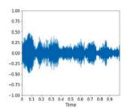

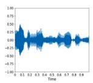

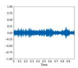

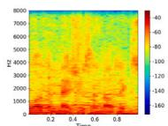  
(a) Noisy Speech

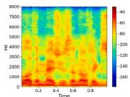  
(b) Clean Speech

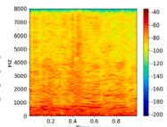  
(c) Noise

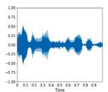

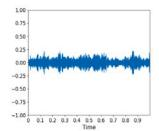

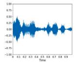

(d) Output of Speech Branch by DBCCRN  
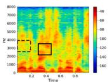

(e) Output of Noise Branch by DBCCRN  
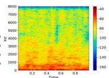

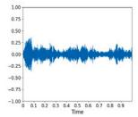

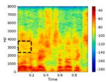  
(f) Output of Speech Branch by  
'W/O Noise Branch'

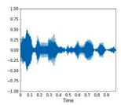

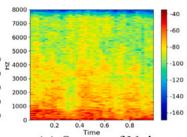  
'W/O Noise Branch'

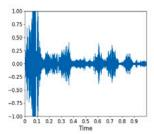

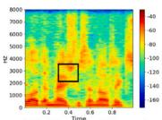  
(h) Output of Speech Branch by  
'W/O Bridge Module

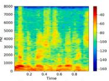  
'W/O Bridge Module'  
Fig. 10. Ablation studies on network architecture. (a), (b) and (c) represent the noisy speech, clean speech and noise respectively. (d)–(i) show the waveforms of the estimated speech and noises under different model configurations. The rectangles emphasize the areas where DBCCRN outperforms its counterparts.

## 6.2. Ablation study

In this section, ablation studies are conducted to demonstrate the superiority of our proposed network architecture and the loss function.

## 6.2.1. Network architecture

In this subsection, two groups of ablation experiments are carried out to show the advantages of the dual-branch architecture and the bridge module.

The ‘- noise branch’ model explores the effectiveness of the noise branch. The architecture of this model is the same as DBCCRN, but it is trained by only minimizing the loss between the output of speech branch and the ground-truth speech, i.e., without the noise branch.

The ‘- bridge module’ is to explores the effectiveness of the bridge module. In ‘- bridge module’, the bridge connection is replaced by element-wise addition, i.e., without the bridge module.

The ‘- conformer’ is to explores the effectiveness of the conformer blocks. In ‘- conformer’, the conformer block is removed to evaluate the necessit of the conformer block.

The results of the ablation experiments are shown in Table 2, where the best results are highlighted in bold.

Some examples on this ablation studies are visualized in Fig. 10. Compared with the DBCCRN without the noise branch, the proposed DBCCRN achieves better performance on PESQ, STOI, SSNR, CSIG, CBAK and CVOL.

(j) DBCCRN  
(m) DBCCRN  
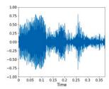

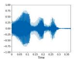

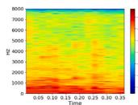  
(a) Noisy Speech

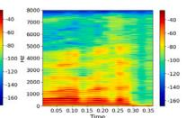  
(b) Clean Speech

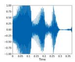

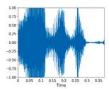

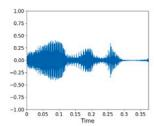  
(c) DCCRN with SI-SNR

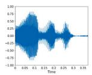

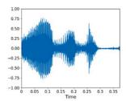

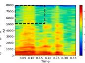  
(d) DCCRN with OSI-SNR

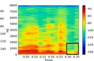  
(e) DCCRN with SI-SNR+L1

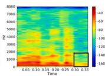  
(f) DCCRN with SI-SNR+EC

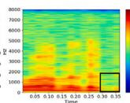  
(g) DCCRN with SNR

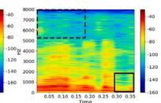  
(h) DCCRN with SA-SNR

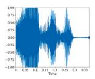

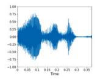

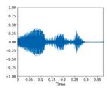

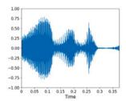

  
(i) DBCCRN with SI-SNR

  
with OSI-SNR

  
(k) DBCCRN with SI-SNR+L1

  
(1) DBCCRN with SI-SNR+EC

  
(n) DBCCRN with SA-SNR  
Fig. 11. Visualization of examples about the ablation studies on the loss functions. (a) and (b) are noisy speech and clean speech respectively. (c)–(h) represent the estimated clean speech through DCCRN with different loss functions. (j)–(n) represent the estimated clean speech through DBCCRN with different loss functions.

Table 2  
Results of ablation experiments on network architectures.

<table><tr><td>Model</td><td>Parameters</td><td>PESQ</td><td>STOI</td><td>SSNR</td><td>CSIG</td><td>CBAK</td><td>CVOL</td></tr><tr><td>NOISY</td><td>/</td><td>1.97</td><td>0.921</td><td>1.68</td><td>3.35</td><td>2.44</td><td>2.63</td></tr><tr><td>DBCCRN</td><td>8.31M</td><td>3.16</td><td>0.940</td><td>10.98</td><td>4.07</td><td>3.68</td><td>3.62</td></tr><tr><td>- conformer</td><td>8.09M</td><td>2.98</td><td>0.940</td><td>10.38</td><td>3.93</td><td>3.51</td><td>3.45</td></tr><tr><td>- noise branch</td><td>8.09M</td><td>2.84</td><td>0.931</td><td>9.98</td><td>3.84</td><td>2.63</td><td>3.34</td></tr><tr><td>- bridge module</td><td>7.40M</td><td>2.87</td><td>0.935</td><td>9.48</td><td>3.67</td><td>3.01</td><td>3.25</td></tr></table>

In the dashed boxes in Figs. 10(d) and 10(f), it is seen that DBCCRN removes more noises than DCCRN which does not have a noise branch. By comparing Figs. 10(e) and 10(g), the DBCCRN model also generates good estimates for noise and contains far less speech components than for the single-branch model.

Compared with the DBCCRN without bridge module in Table $^ { 2 , }$ the DBCCRN with bridge module obtains better performance on speech enhancement. It can be seen from Figs. 10(d) and 10(h) that the contents in the bounding boxes show that DBCCRN retains more speech components than that without the bridge module. The bridge module enables information interaction between the speech branch and the noise one, which helps eliminate noises from the estimated clean speech and vice versa.

## 6.2.2. Loss functions

To better illustrate the impacts of scaling of the inputs, both the original test set and the scaled test set are used to evaluate the performance of all the methods. The results are shown in Tables 3 and 4 respectively, where the best scores are shown in bold.

As shown in Table 3, the SA-SNR loss function achieves the best scores for all metrics.

Compared with the SI-SNR and OSI-SNR loss functions, SA-SNR keeps the amplitude of the input speech, which alleviates the problem of arbitrary scaling. Compared with $\mathbf { S I - S N R + } L _ { 1 }$ and SI-SNR+EC, SA-SNR achieves better performance, which is probably because SA-SNR does not introduce unknown artifacts in the enhanced speech. In addition, it can be observed that the results using the $L _ { 1 }$ loss and the MSE loss are worse than those using the proposed loss, due to the artifacts they introduce.

Table 3  
Results of ablation experiments on loss functions (original test set).

<table><tr><td>Model</td><td>Loss</td><td>PESQ</td><td>STOI</td><td>SSNR</td><td>CSIG</td><td>CBAK</td><td>COVL</td><td>ScaleError(%)</td></tr><tr><td>/</td><td>Noisy</td><td>1.97</td><td>0.921</td><td>1.68</td><td>3.35</td><td>2.44</td><td>2.63</td><td>——</td></tr><tr><td>Wiener</td><td>/</td><td>2.22</td><td>/</td><td>5.07</td><td>3.23</td><td>2.68</td><td>2.67</td><td>0.183</td></tr><tr><td rowspan="8">DCCRN</td><td>L1</td><td>2.68</td><td>0.924</td><td>9.41</td><td>3.80</td><td>3.37</td><td>3.23</td><td>0.019</td></tr><tr><td>MSE</td><td>2.76</td><td>0.921</td><td>9.81</td><td>3.90</td><td>3.37</td><td>3.32</td><td>0.026</td></tr><tr><td>SNR</td><td>2.76</td><td>0.922</td><td>10.07</td><td>3.80</td><td>3.42</td><td>3.27</td><td>0.032</td></tr><tr><td>SI-SNR</td><td>2.75</td><td>0.931</td><td>-0.68</td><td>3.82</td><td>2.72</td><td>3.28</td><td>16.106</td></tr><tr><td>OSI-SNR</td><td>2.79</td><td>0.931</td><td>1.31</td><td>3.81</td><td>2.82</td><td>3.29</td><td>20.614</td></tr><tr><td>SI-SNR+L1</td><td>2.84</td><td>0.932</td><td>9.98</td><td>3.77</td><td>3.46</td><td>3.30</td><td>0.018</td></tr><tr><td>SI-SNR+EC</td><td>2.70</td><td>0.923</td><td>7.89</td><td>3.73</td><td>3.20</td><td>3.20</td><td>0.129</td></tr><tr><td>SA-SNR</td><td>2.88</td><td>0.935</td><td>10.02</td><td>3.89</td><td>3.47</td><td>3.40</td><td>0.019</td></tr><tr><td rowspan="8">DBCCRN</td><td>L1</td><td>2.83</td><td>0.922</td><td>10.11</td><td>3.61</td><td>3.43</td><td>3.20</td><td>0.017</td></tr><tr><td>MSE</td><td>2.82</td><td>0.910</td><td>9.69</td><td>3.72</td><td>3.33</td><td>3.22</td><td>0.037</td></tr><tr><td>SNR</td><td>3.03</td><td>0.926</td><td>10.13</td><td>3.65</td><td>3.51</td><td>3.29</td><td>0.035</td></tr><tr><td>SI-SNR</td><td>2.89</td><td>0.930</td><td>1.87</td><td>3.36</td><td>2.22</td><td>2.98</td><td>18.653</td></tr><tr><td>OSI-SNR</td><td>2.96</td><td>0.931</td><td>0.96</td><td>3.69</td><td>3.42</td><td>3.28</td><td>19.791</td></tr><tr><td>SI-SNR+L1</td><td>2.92</td><td>0.930</td><td>9.16</td><td>3.95</td><td>3.02</td><td>3.41</td><td>0.017</td></tr><tr><td>SI-SNR+EC</td><td>2.94</td><td>0.923</td><td>7.91</td><td>3.56</td><td>2.51</td><td>3.45</td><td>0.107</td></tr><tr><td>SA-SNR</td><td>3.16</td><td>0.940</td><td>10.98</td><td>4.07</td><td>3.68</td><td>3.62</td><td>0.014</td></tr></table>

Table 4  
Results of ablation experiments on loss functions (scaled test set)

<table><tr><td>Model</td><td>Loss</td><td>PESQ</td><td>STOI</td><td>SSNR</td><td>CSIG</td><td>CBAK</td><td>COVL</td><td>ScaleError(%)</td></tr><tr><td>/</td><td>Noisy</td><td>1.97</td><td>0.921</td><td>1.68</td><td>3.35</td><td>2.44</td><td>2.63</td><td>——</td></tr><tr><td>Wiener</td><td>/</td><td>2.22</td><td>/</td><td>5.24</td><td>3.15</td><td>2.61</td><td>2.59</td><td>0.518</td></tr><tr><td rowspan="8">DCCRN</td><td>L1</td><td>2.68</td><td>0.920</td><td>9.96</td><td>3.73</td><td>3.33</td><td>3.18</td><td>0.132</td></tr><tr><td>MSE</td><td>2.73</td><td>0.917</td><td>9.35</td><td>3.79</td><td>3.31</td><td>3.24</td><td>0.162</td></tr><tr><td>SNR</td><td>2.74</td><td>0.920</td><td>9.98</td><td>3.71</td><td>3.38</td><td>3.21</td><td>0.101</td></tr><tr><td>SI-SNR</td><td>2.48</td><td>0.928</td><td>-0.86</td><td>3.48</td><td>2.61</td><td>2.97</td><td>5.424</td></tr><tr><td>OSI-SNR</td><td>2.38</td><td>0.912</td><td>1.13</td><td>3.39</td><td>2.53</td><td>2.86</td><td>6.129</td></tr><tr><td>SI-SNR+L1</td><td>2.82</td><td>0.930</td><td>9.53</td><td>3.77</td><td>3.42</td><td>3.25</td><td>0.092</td></tr><tr><td>SI-SNR+EC</td><td>2.68</td><td>0.921</td><td>7.53</td><td>3.75</td><td>3.11</td><td>3.20</td><td>0.310</td></tr><tr><td>SA-SNR</td><td>2.84</td><td>0.935</td><td>10.01</td><td>3.81</td><td>3.45</td><td>3.32</td><td>0.076</td></tr><tr><td rowspan="8">DBCCRN</td><td>L1</td><td>2.84</td><td>0.920</td><td>10.07</td><td>3.73</td><td>3.42</td><td>3.27</td><td>0.072</td></tr><tr><td>MSE</td><td>2.80</td><td>0.912</td><td>9.49</td><td>3.70</td><td>3.33</td><td>3.22</td><td>0.174</td></tr><tr><td>SNR</td><td>3.01</td><td>0.924</td><td>10.07</td><td>3.74</td><td>3.47</td><td>3.33</td><td>0.154</td></tr><tr><td>SI-SNR</td><td>2.50</td><td>0.933</td><td>-0.87</td><td>3.47</td><td>2.20</td><td>2.97</td><td>5.769</td></tr><tr><td>OSI-SNR</td><td>2.49</td><td>0.933</td><td>1.66</td><td>3.49</td><td>2.58</td><td>2.97</td><td>5.962</td></tr><tr><td>SI-SNR+L1</td><td>2.82</td><td>0.936</td><td>10.24</td><td>3.89</td><td>3.43</td><td>3.35</td><td>0.074</td></tr><tr><td>SI-SNR+EC</td><td>2.93</td><td>0.922</td><td>7.59</td><td>3.51</td><td>2.53</td><td>3.41</td><td>0.106</td></tr><tr><td>SA-SNR</td><td>3.15</td><td>0.938</td><td>10.87</td><td>4.07</td><td>3.66</td><td>3.62</td><td>0.057</td></tr></table>

By comparing Tables 3 and $^ { 4 , }$ it is found that the results of the models with the SI-SNR loss function and the OSI-SNR loss function differ greatly, while the results for $\mathsf { S I } { - } \mathsf { S N R } { + } L _ { 1 }$ and SA-SNR have only tiny differences. This shows that the scale-aware loss functions can improve the speech enhancement performance substantially for input signals with relatively large amplitudes. Unlike for SA-SNR, clipping distortion happens for SI-SNR and OSI-SNR as observed in (c). (d). (i), and (i) in Fig. 11. By contrasting the dashed boxes in (c), (d), (i), (j) and the ones in (h), (n) of Fig. 11, we find that clippings in time domain lead to smearing of the spectrum, which induces poor perception of speech quality for the models trained by SI-SNR and OSI-SNR. On the other hand, the DCCRNs trained by the SI-SNR losses with penalty terms $L _ { 1 }$ and EC or by the conventional SDR do not have the clipping problem, but cannot remove the noise components completely, as highlighted by the boxes in (e)–(h) of Fig. 11. Only the proposed DBCCRN together with proper losses yield satisfactory results in this case, as shown in the boxes in (k)–(n) of Fig. 11.

Tables 3 and 4 show that, due to the scaling sensitivity, the enhanced speech for the models optimized with SI-SNR and OSI-SNR obtain terrible SSNR scores and ScaleError values. Our proposed DBCCRN model with the SA-SNR loss is able to reduce the scaling errors and obtains consistent improvements on all the evaluation metrics. Some of the enhanced audio examples can be found from https://liyihao17.github.io/DualBranchComplexCRN/.

In streaming speech enhancement, the model generally obtains a small piece of noisy speech, and outputs the small piece of enhanced speech after processing. The power of the whole speech is unpredictable in the streaming speech enhancement scenario. Due to the error output scale of speech caused by the models trained with SI-SNR or OSI-SNR, if normalization is adopted for each d l f h d h h ll h l f d b l ll b h h h bl

Table 5  
Results of ablation experiments on loss functions about normalization.

<table><tr><td>Model</td><td>PESQ</td><td>STOI</td><td>SSNR</td><td>CSIG</td><td>CBAK</td><td>CVOL</td></tr><tr><td>SI-SNR(seg norm.)</td><td>2.10</td><td>0.913</td><td>-7.96</td><td>2.96</td><td>1.89</td><td>2.49</td></tr><tr><td>OSI-SNR(seg norm.)</td><td>2.13</td><td>0.913</td><td>-6.38</td><td>2.84</td><td>1.93</td><td>2.47</td></tr><tr><td>SA-SNR</td><td>2.48</td><td>0.934</td><td>6.77</td><td>3.19</td><td>2.95</td><td>2.75</td></tr></table>

Table 6  
Comparison with the existing baselines where the best result are highlighted in bold texts.

<table><tr><td>Model</td><td>Parameters</td><td>PESQ</td><td>CSIG</td><td>CBAK</td><td>CVOL</td></tr><tr><td>Noisy</td><td>/</td><td>1.582</td><td>3.186</td><td>2.533</td><td>2.350</td></tr><tr><td>NSNet (Isik et al., 2020)</td><td>1.3M</td><td>1.811</td><td>2.781</td><td>2.003</td><td>2.235</td></tr><tr><td>RNNoise (Isik et al., 2020)</td><td>/</td><td>1.973</td><td>2.692</td><td>3.463</td><td>2.789</td></tr><tr><td>DCCRN</td><td>8.40M</td><td>2.204</td><td>3.039</td><td>3.007</td><td>2.613</td></tr><tr><td>DBCCRN(transfer)</td><td>8.31M</td><td>2.220</td><td>2.950</td><td>3.071</td><td>2.262</td></tr><tr><td>DBCCRN(retrain)</td><td>8.31M</td><td>2.638</td><td>3.316</td><td>3.213</td><td>3.015</td></tr></table>

## 6.3. Extension to the DNS challenge dataset

The comparison of our DBCCRN and the related baselines on four objective metrics are shown in Table 6. The results of NSNet and RNNoise are collected from the corresponding publications. For fair comparison, DCCRN is trained here by using the same amount of data as for DBCCRN. ‘‘DBCCRN(transfer)’’ denotes the DBCCRN model trained on the voice bank and DEMAND dataset but evaluated directly on the DNS challenge dataset. ‘‘DBCCRN(retrain)’’ denotes the re-trained DBCCRN model with the SA-SNR loss on the DNS challenge dataset.

From the ‘‘DBCCRN(transfer)’’ row of Table 6, it can be observed that the proposed DBCCRN shows reasonable transferability across different datasets. In general, the retrained DBCCRN achieves better scores for PESQ, CSIG, and CVOL than the DCCRN baseline with the same amount of training data.

## 7. Conclusion

In this paper, we proposed a dual-branch version of DCCRN for speech enhancement, which is able to estimate speech and noise simultaneously. By merging the reconstruction losses of speech and noises and by introducing the bridge modules, the separation of speech and noises had been improved. Moreover, a new loss function scale-aware SNR is proposed to cope with the scale sensitivity of the popular used SI-SNR and OSI-SNR losses. Experimental results on the voice bank speech and DEMAND noise datasets showed the superiority of our method with respect to the existing baselines. Ablation studies also illustrated the necessity of the using of the DBCCRN architecture and the SA-SNR loss.

## CRediT authorship contribution statement

Yihao Li: Methodology, Software, Writing – original draft, Data curation, Investigation. Meng Sun: Conceptualization, Funding acquisition, Investigation, Writing – original draft, Writing – review & editing. Xiongwei Zhang: Funding acquisition, Supervision, Writing – review & editing. Hugo Van hamme: Validation, Writing – review & editing.

## Declaration of competing interest

The authors declare that they have no known competing financial interests or personal relationships that could have appeared to influence the work reported in this paper.

## Data availability

Data will be made available on request.

## Acknowledgments

The work was supported by the Natural Science Foundation of China (62071484, 62371469) and the Natural Science Foundation of Jiangsu Province, China for Excellent Young Scholars (BK20180080).

## References

Ashutosh, P., Wang, D., 2021. Dense CNN with self-attention for time-domain speech enhancement. IEEE/ACM Trans. Audio Speech Lang. Process. 29, 1270–1279. http://dx.doi.org/10.1109/TASLP.2021.3064421.

Boll, S., 1979. Suppression of acoustic noise in speech using spectral subtraction. IEEE Trans. Acoust. Speech Signal Process. 27 (2), 113–120. http: //dx.doi.org/10.1109/TASSP.1979.1163209.

Caroselli, J., Narayanan, A., Huang, Y., 2022. Streaming noise context aware enhancement for automatic speech recognition in multi-talker environments. In: 2022 International Workshop on Acoustic Signal Enhancement. IWAENC, pp. 1–5. http://dx.doi.org/10.1109/IWAENC53105.2022.9914731.

Chen, H., Zhang, P., 2021. A dual-stream deep attractor network with multi-domain learning for speech dereverberation and separation. Neural Netw. 141, 238–248. http://dx.doi.org/10.1016/j.neunet.2021.04.023, URL www.sciencedirect.com/science/article/pii/S089360802100160X.

Choi, H.-S., Kim, J.-H., Huh, J., Kim, A., Ha, J.-W., Lee, K., 2019. Phase-aware speech enhancement with deep complex U-Net. In: ICLR 2017.

Christophe, V., Junichi, Y., Simon", K., 2013. The voice bank corpus: Design, collection and data analysis of a large regional accent speech database. In: 2013 International Conference Oriental COCOSDA Held Jointly with 2013 Conference on Asian Spoken Language Research and Evaluation. O-COCOSDA/CASLRE. IEEE, pp. 1–4.

Deepak, B., Sarah, V., 2019. SERGAN: speech enhancement using relativistic generative adversarial networks with gradient penalty. In: ICASSP 2019 - 2019 IEEE International Conference on Acoustics, Speech and Signal Processing. ICASSP, IEEE, pp. 106–110. http://dx.doi.org/10.1109/ICASSP.2019.8683799.

Ephraim, Y., Malah, D., 1985. Speech enhancement using a minimum mean-square error log-spectral amplitude estimator. IEEE Trans. Acoust. Speech Signal Process. 33 (2), 443–445. http://dx.doi.org/10.1109/TASSP.1985.1164550.

Fu, S.-W., Liao, C.-F., Tsao, Y., Lin, S.-D., 2019. MetricGAN: generative adversarial networks based black-box metric scores optimization for speech enhancement. In: INTERSPEECH 2019. pp. 2031–2041.

Giri, R., Isik, U., Krishnaswamy, A., 2019. Attention wave-u-net for speech enhancement. In: 2019 IEEE Workshop on Applications of Signal Processing To Audio and Acoustics. WASPAA, pp. 249–253. http://dx.doi.org/10.1109/WASPAA.2019.8937186.

Gulati, A., Qin, J., Chiu, C.-C., Parmar, N., Zhang, Y., Yu, J., Han, W., Wang, S., Zhang, Z., Wu, Y., Pang, R., 2021. Conformer: Convolution-augmented transformer for speech recognition. arXiv preprint arXiv:2005.08100.

Hao, X., Su, X., Wen, S., Wang, Z., Pan, Y., Bao, F., Chen, W., 2020. Masking and inpainting: A two-stage speech enhancement approach for low SNR and non-stationary noise. In: ICASSP 2020 - 2020 IEEE International Conference on Acoustics, Speech and Signal Processing. ICASSP, pp. 6959–6963. http://dx.doi.org/10.1109/ICASSP40776.2020.9053188.

He, K., Zhang, X., Ren, S., Sun, J., 2015. Delving deep into rectifiers: Surpassing human-level performance on ImageNet classification. In: 2015 IEEE International Conference on Computer Vision. ICCV, pp. 1026–1034. http://dx.doi.org/10.1109/ICCV.2015.123.

Hsieh, T.-A., Wang, H.-M., Lu, X., Tsao, Y., 2020. WaveCRN: An efficient convolutional recurrent neural network for end-to-end speech enhancement. IEEE Signal Process. Lett. 27, 2149–2153. http://dx.doi.org/10.1109/LSP.2020.3040693.

Hu. Y., Liu. Y., Lv. S., Xing. M., Zhang, S., Fu. Y., Wu. J., Zhang, B., Xie. L., 2020. DCCRN: Deep complex conyolution recurrent network for phase-aware speech enhancement. In: INTERSPEECH 2020.

Hu. Y., Loizou. P.C., 2018. Evaluation of obiective quality measures for speech enhancement, JEEE Trans, Audio Speech Lang, Process, 16 (1). 229–238

Huy, P., V., M.I., Lam, P., Y., C.O., Philipp, K., Maarten, D.V., Alfred, M., 2020. Improving GANs for speech enhancement. IEEE Signal Process. Lett. 27, 1700–1704. http://dx.doi.org/10.1109/LSP.2020.3025020.

Isik, U., Giri, R., Phansalkar, N., Valin, J.-M., Helwani, K., Krishnaswamy, A., 2020. PoCoNet: Better speech enhancement with frequency-positional embeddings, semi-supervised conversational data, and biased loss. In: INTERSPEECH 2020.

Isik, Y., Roux, J.L., Chen, Z., Watanabe, S., Hershey, J.R., 2016. Single-channel multi-speaker separation using deep clustering. In: INTERSPEECH 2016

Jens, H., Darius, J., Christoph, B., Lukas, D., Reinhold, H.-U., 2020. Demystifying TasNet: A dissecting approach. In: ICASSP 2020 - 2020 IEEE Internationa Conference on Acoustics, Speech and Signal Processing. ICASSP, pp. 6359–6363. http://dx.doi.org/10.1109/ICASSP40776.2020.9052981.

Juntae, K., Minsoo, H., 2019. Speech enhancement using a two-stage network for an efficient boosting strategy. IEEE Signal Process. Lett. 26 (5), 770–774. http://dx.doi.org/10.1109/LSP.2019.2905660.

KA, R.C., Vishak, G., Ross, C., Ebrahim, B., Roger, C., Harishchandra, D., Sergiy, M., Robert, A., Ashkan, A., Sebastian, B., et al., 2020. The interspeech 2020 deep noise suppression challenge: Datasets, subjective testing framework, and challenge results. arXiv preprint arXiv:2005.13981.

Karthikeyan, C., Rajesh Kumar, T., Vijendra Babu, D., Baskar, M., Jayaraman, R., Shahid, M., 2023. Speech enhancement approach for body-conducted unvoiced speech based on Taylor-Boltzmann machines trained DNN. Comput. Speech Lang. 101549.

Lahiru, S., Tsun-Yat, L., 2022. Conformer-based speech recognition with linear nyström attention and rotary position embedding. In: ICASSP 2022 - 2022 IEEE International Conference on Acoustics, Speech and Signal Processing. ICASSP, pp. 8012–8016. http://dx.doi.org/10.1109/ICASSP43922.2022.9747691.

Lim, J., Oppenheim, A., 1978. All-pole modeling of degraded speech. IEEE Trans. Acoust. Speech Signal Process. 26 (3), 179–210. http://dx.doi.org/10.1109/ TASSP 1978.1163086

Lim, J., Oppenheim, A., 1979. Enhancement and bandwidth compression of noisy speech. Proc. IEEE 67 (12), 1586–1604. http://dx.doi.org/10.1109/PROC.1979. 11540.

Luo, Y., Nima, M., 2018. TaSNet: Time-domain audio separation network for real-time, single-channel speech separation. In: 2018 IEEE International Conference on Acoustics, Speech and Signal Processing. ICASSP, pp. 696–700. http://dx.doi.org/10.1109/ICASSP.2018.8462116.

Luo, Y., Nima, M., 2019. Conv-TasNet: Surpassing ideal time–frequency magnitude masking for speech separation. IEEE/ACM Trans. Audio Speech Lang. Process. 27 (8). 1256–1266. http://dx.doi,org/10.1109/TASLP.2019.2915167.

Ma, C., Li, D., Jia, X., 2020. Optimal scale-invariant signal-to-noise ratio and curriculum learning for monaural multi-speaker speech separation in noisy environment. In: 2020 Asia-Pacific Signal and Information Processing Association Annual Summit and Conference. APSIPA ASC, pp. 711–715.

Morten, K.. Tan, Z.-H., Jensen, S.H., Jensen, J., 2020, On loss functions for supervised monaural time-domain speech enhancement. JEEE/ACM Trans, Audio Speech Lang. Process. 28, 825–838. http://dx.doi.org/10.1109/TASLP.2020.2968738.

Nian, Z., Tu, Y.-H., Du, J., Lee, C.-H., 2021. A progressive learning approach to adaptive noise and speech estimation for speech enhancement and noisy speech recognition. In: ICASSP 2021 - 2021 IEEE International Conference on Acoustics, Speech and Signal Processing. ICASSP, pp. 6913–6917. http://dx.doi.org/10.1109/ICASSP39728.2021.9413395.

Pascual, S., Bonafonte, A., Serr, J. 201Zb. SEGAN: Speech Enhancement Generative Adversarial Network, In: INTERSPEECH 2017

Quackenbush, S.R., Barnwell, T.P., Clements, M.A., 1988. Objective measures of speech quality.

Rix, A., Beerends, J., Hollier, M., Hekstra, A., 2001. Perceptual evaluation of speech quality (PESQ)-a new method for speech quality assessment of telephone networks and codecs. In: 2001 IEEE International Conference on Acoustics, Speech, and Signal Processing. Proceedings (Cat. No.01CH37221), Vol. 2. IEEE, pp. Z49–Z52. http://dx.doi.org/10.1109/ICASSP.2001.941023

Robin, S., 2022. SDR — Medium Rare with Fast Computations. In: ICASSP 2022 - 2022 IEEE International Conference on Acoustics, Speech and Signal Processing. ICASSP, pp. 701–705. http://dx.doi.org/10.1109/ICASSP43922.2022.9747473.

Sun, L., Du, J., Dai, L.-R., Lee, C.-H., 2017. Multiple-target deep learning for LSTM-RNN based speech enhancement. In: 2017 Hands-Free Speech Communications and Microphone Arrays. HSCMA, pp. 136–140. http://dx.doi.org/10.1109/HSCMA.2017.7895577.

Sun, Z., Li, Y., Jiang, H., Chen, F., Xie, X., Wang, Z., 2020. A supervised speech enhancement method for smartphone-based binaural hearing aids. IEEE Trans Biomed. Circuits Syst. 14 (5), 951–960. http://dx.doi.org/10.1109/TBCAS.2020.2988121.

Swetha, R.P., Sivaganesh, A., Rama, M.K.S., 2020. Significance of phase in DNN based speech enhancement algorithms. In: 2020 National Conference on Communications. NCC, pp. 1–5. http://dx.doi.org/10.1109/NCC48643.2020.9056089.

Taal., C.H., C., H.R., Richard, H., Jesper, J., 2011. An algorithm for intelligibility prediction of time–frequency weighted noisy speech. IEEE Trans. Audio Speech Lang. Process. 19 (7), 2125–2136.

Takeuchi, D., Yatabe, K., Koizumi, Y., Oikawa, Y., Harada, N., 2020. Invertible DNN-based nonlinear time-frequency transform for speech enhancement. In: ICASSP 2020 - 2020 IEEE International Conference on Acoustics, Speech and Signal Processing. ICASSP, pp. 6644–6648. http://dx.doi.org/10.1109/ICASSP40776 2020.9053723.

Tan, K., Wang, D., 2020. Learning complex spectral mapping with gated convolutional recurrent networks for monaural speech enhancement. IEEE/ACM Trans. Audio Speech Lang. Process. 28, 380–390. http://dx.doi.org/10.1109/TASLP.2019.2955276.

Thiemann, J., Ito, N., Vincent, E., 2013. The diverse environments multi-channel acoustic noise database (DEMAND): A database of multichannel environmental noise recordings. In: Meetings on Acoustics, Vol. 19. pp. 35–81.

Trabelsi, C., Bilaniuk, O., Zhang, Y., Serdyuk, D., Subramanian, S., Santos, J.F., Mehri, S., Rostamzadeh, N., Bengio, Y., Pal, C.J., 2017. Deep complex networks. arXiv preprint arXiv:1705.09792.

Valin, J.-M., 2018. A hybrid DSP/deep learning approach to real-time full-band speech enhancement. In: 2018 IEEE 20th International Workshop on Multimedia Signal Processing. MMSP, pp. 1–5. http://dx.doi.org/10.1109/MMSP.2018.8547084.

Wang, Z.-Q., Gordon, W., Jonathan, L.R., 2021. On the compensation between magnitude and phase in speech separation. IEEE Signal Process. Lett. 28, 2018–2022. http://dx.doi.or /10.1109/LSP.2021.3116502.

Wang., D., Lim, J., 1982. The unimportance of phase in speech enhancement. IEEE Trans. Acoust. Speech Signal Process. 30 (4), 679–681. http://dx.doi.org/10 1109/TASSP.1982.1163920.

Wang, Y., Mike, B., 2018. Model-based speech enhancement in the modulation domain. IEEE/ACM Trans. Audio Speech Lang. Process. 26 (3), 580–594 http://dx.doi.org/10.1109/TASLP.2017.2786863.

Xia, Y., Braun, S., Reddy, C.K.A., Dubey, H., Cutler, R., Tashev, I., 2020. Weighted speech distortion losses for neural-network-based real-time speech enhancement. In: ICASSP 2020 - 2020 IEEE International Conference on Acoustics, Speech and Signal Processing. ICASSP, pp. 871–875.

Xiang, X., Zhang, X., Chen, H., 2021. Two-stage learning and fusion network with noise aware for time-domain monaural speech enhancement. IEEE Signal Process. Lett. 28, 1754–1758. http://dx.doi.org/10.1109/LSP.2021.3105925.

Zhang, K., He, S., Li, H., Zhang, X., 2021a. DBNet: A dual-branch network architecture processing on spectrum and waveform for single-channel speech enhancement. In: INTERSPEECH 2021.

Zhang, L.. Wang, M.. Zhang, O.. Liu. X.W.M., 2021. PhaseDCN: A phase-enhanced dual-path dilated convolutional network for single-channel speech enhancement IEEE/ACM Trans. Audio Speech Lang. Process. 29, 2561–2574. http://dx.doi.org/10.1109/TASLP.2021.3092585.

Zheng, N., Zhang, X.-L., 2019. Phase-aware speech enhancement based on deep neural networks. IEEE/ACM Trans. Audio Speech Lang. Process. 27 (1), 63–76. http://dx.doi.org/10.1109/TASLP.2018.2870742.