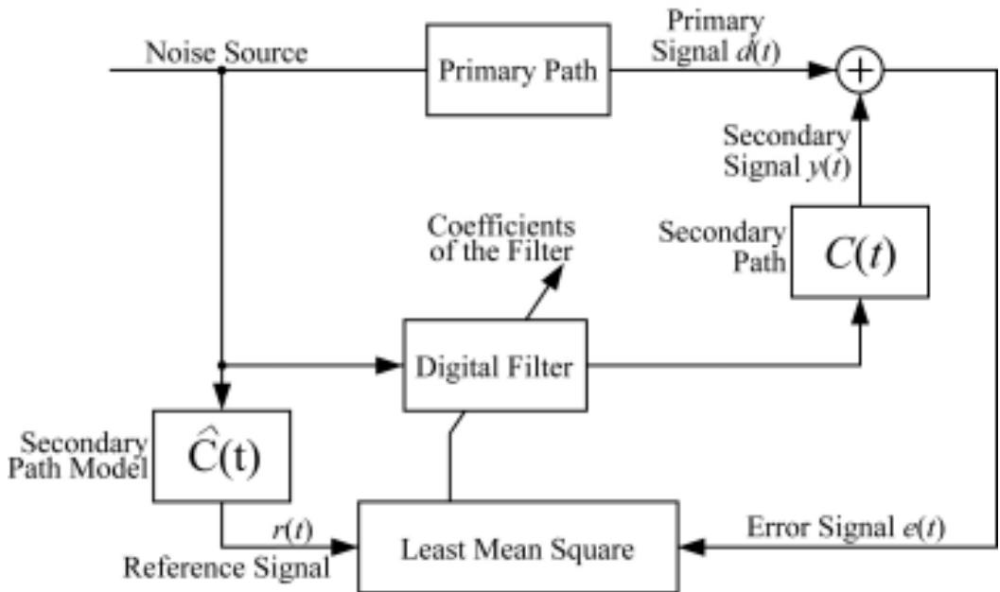
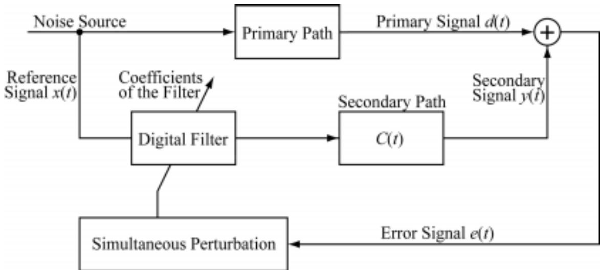
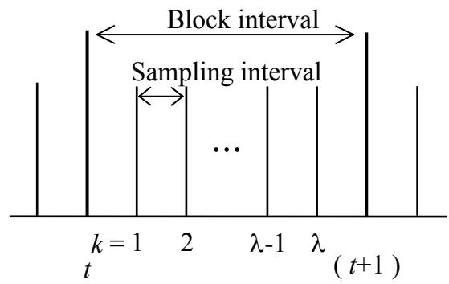
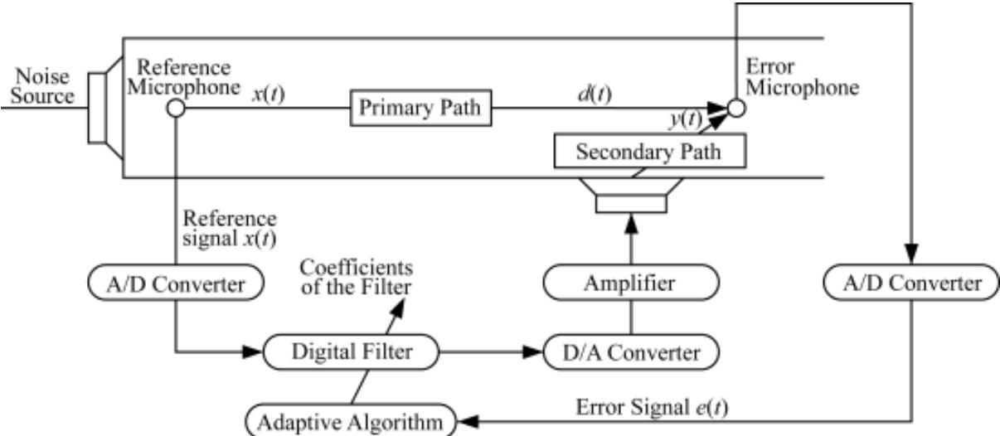
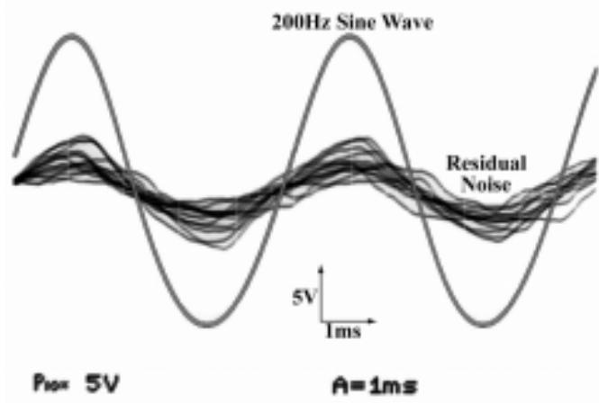
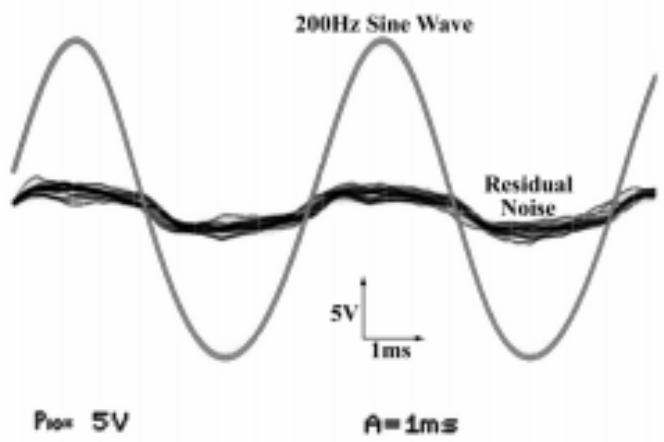
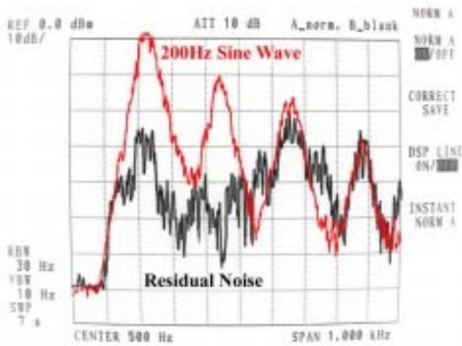
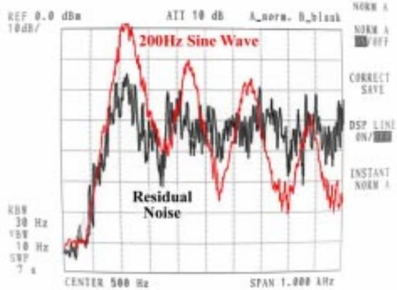

# AN ACTIVE NOISE CONTROL WITHOUT ESTIMATION OF SECONDARY-PATH – ANC USING SIMULTANEOUS PERTURBATION –

Yutaka MAEDA and Takao YOSHIDA

Department of Electrical Engineering,

Faculty of Engineering, Kansai University

3-3-35, Yamate-cho, Suita

Osaka, 535-8680 JAPAN

## INTRODUCTION

The active noise control (ANC) is used to reduce noise generated by engines, air conditioners or the other industrial equipment. In ANC, a primary unwanted noise and an anti-noise of equal amplitude and opposite phase are superimposed and cancelled each other. Then, it is important to produce the anti-noise exactly.

The filtered-x least mean square (LMS) algorithm is widely used to ANC. In this algorithm, estimation of the so-called secondary-path is essential to generate the precise anti-noise. However, characteristics of the secondary-path vary with respect to temperature or the other environments. Therefore, it is difficult to know the exact characteristics of the secondary-path. On-line estimation is more difficult.

This paper proposes an ANC system without the estimation of the secondary-path. An algorithm proposed here is based on the simultaneous perturbation types of recursive optimization method. The methods was proposed by J. C. Spall[1],[2]. J. Alespector et al. [3] and G. Cauwenberghs[4]. Y. Maeda also independently proposed the algorithm using the simultaneous perturbation as a learning rule of neural networks and reported feasibility and usefulness of the learning rule in control problems[5],[6],[7]. At the same time, the merit of the learning rule was demonstrated in VLSI implementation of analog neural networks using this rule[8],[9].

These optimization methods do not require gradient of an objective function to find a minimum point, but requires only values of the function. Using a kind of difference approximation, the method estimates the gradient of the function and updates estimator.

We apply the method to the ANC system. Then, the proposed system performs modification of coefficients in an adaptive filter, which generates the anti-noise, using only information measured by sensor microphone. Therefore, there is no need to estimate the characteristics of the secondary-path.

Some preliminary experimental results for a duct system are also shown to confirm feasibility of the proposed methods.

  
Figure 1 Schematic diagram of ANC system.  
ANC USING THE LMS ALGORITHM

ANC is recently used in many fields such as ear protectors, noise reduction of airconditioning duct and noise reduction in cabin of jet plains and trains[10].

In these applications of ANC, the filtered-x LMS algorithm[11][12][13] is ordinary used.

Figure 1 shows schematic diagram of an ANC system using the filtered-x LMS algorithm. Since basic idea of noise canceling is superimposition of two waves with opposite phase, it is important to predict a primary unwanted wave at a point where the noise should be reduced.

## THE SIMULTANEOUS PERTURBATION

The simultaneous perturbation method. There are several versions in the simultaneous perturbation types of optimization methods; simultaneous perturbation method, onemeasurement simultaneous perturbation and time difference simultaneous perturbation. In this section, we describe details of the simultaneous perturbation method and the time difference simultaneous perturbation method.

Now, we consider an unknown objective function $J ( w ) { \in } \Re$ given by parameters $\pmb { w } \in \Re ^ { n }$ , our problem is to find a minimum point without using derivatives of the function $J ( w )$

The simplest solution for the problem is the finite difference. We estimate the derivative of the function using the finite difference. The recursive algorithm for the problem is as follows; 1 i)

$$
\Delta w ^ {i} = \alpha \frac {J (\pmb {w} + c \pmb {e} ^ {i}) - J (\pmb {w})}{c}\tag{1}
$$

where, $\boldsymbol { w } ^ { i }$ is a modifying quantity for the i-th parameter. c represents a magnitude of the perturbation and a is a positive coefficient. $e ^ { i }$ is the fundamental vector whose i-th component is one and the others are all zero.

However, this algorithm is not efficient, because the method requires i-times measurements for the function. If the dimension n of the parameters is large, we have to make many observations for the objective function.

In order to overcome this problem, the simultaneous perturbation method was introduced. The advantage of the simultaneous perturbation method is its simplicity. The simultaneous perturbation can estimate the gradient vector using only two values of the objective function. The simultaneous perturbation algorithm is described as follows;

$$
\pmb {w} _ {t + 1} = \pmb {w} _ {t} - \alpha \Delta \pmb {w} _ {t}\tag{2}
$$

$$
\Delta w _ {t} ^ {i} = \frac {J (\pmb {w} _ {t} + c \pmb {s} _ {t}) - J (\pmb {w} _ {t})}{c} s _ {t} ^ {i}\tag{3}
$$

where, w is a modifying vector and $w ^ { i }$ represents the i-th element of the vector w. $\pmb { S } _ { t }$ and ${ S } _ { t } ^ { \ i }$ denote the sign vector and its i-th element that is 1 $\mathrm { o r - } 1$ , respectively. The sign of ${ \boldsymbol { S } } _ { t } ^ { i }$ is

## Fort Lauderdale, Florida, USA ACTIVE 99 1999 December 02-04

randomly determined. Moreover, the sign of ${ \boldsymbol { S } } _ { t } ^ { i }$ is independent of the sign of the j-th element $\boldsymbol { s } _ { \iota } ^ { j }$ of the sign vector. That is, E $( s _ { \ t } ^ { i } ) { = } 0 , \mathrm { ~ E ~ } ( s _ { \ t } ^ { i } s _ { \ t } ^ { j } ) { = } 0 \ ( i \ j )$ . E denotes the expectation, c is a magnitude of the perturbation.

Let us briefly consider the algorithm. We expand $J ( w _ { t + } c s _ { t } )$ in the right-hand side of Eq.(3) at the point ${ \pmb w } _ { t }$ . Then, there exist ${ \pmb w } _ { \mathrm { s l } }$ such that

$$
\Delta w _ {t} ^ {i} = s _ {t} ^ {i} \boldsymbol {s} _ {t} ^ {T} \frac {\partial J (\boldsymbol {w} _ {t})}{\partial \boldsymbol {w}} + \frac {C s _ {t} ^ {i}}{2} \boldsymbol {s} _ {t} ^ {\mathrm{T}} \frac {\partial^ {2} J (u (\boldsymbol {w} _ {\mathrm{S1}}))}{\partial \boldsymbol {w} ^ {2}} \boldsymbol {s} _ {t}\tag{4}
$$

We take an expectation of the above quantity. From the conditions of the sign vector $\mathbf { \boldsymbol { s } } _ { t } ,$ we have

$$
E \left(\Delta w _ {t} ^ {i}\right) = \frac {\partial J \left(\boldsymbol {w} _ {t}\right)}{\partial w _ {t} ^ {i}}\tag{5}
$$

That is, $\Delta w _ { \ t } ^ { i }$ approximates $\partial J _ { p } ( \pmb { \nu } _ { t } ) / \partial w _ { t } ^ { i }$ . Since the right-hand side of Eq.(3) is an estimated value of the first-differential coefficient in the sense of the expectation, the algorithm is a type of a stochastic gradient method[7],[8].

An important point is that this algorithm requires only two values of the function; $J ( w )$ and $J ( w { + } c s )$ . That is, it requires only two measurements of the function in order to obtain estimator of the gradient vector of the objective function.

Time difference simultaneous perturbation method. Two measurements are required in the simultaneous perturbation algorithm. On the other hand, an algorithm that requires only one measurement at every iterations is proposed. In this section, we describe the time difference simultaneous perturbation algorithm proposed by Y. Maeda[14]. The algorithm is shown as follows;

$$
\boldsymbol {w} _ {t + 1} = \boldsymbol {w} _ {t} - \alpha \Delta \boldsymbol {w} _ {t} + c \boldsymbol {s} _ {t}\tag{6}
$$

$$
\Delta w _ {t} ^ {i} = \left\{ \begin{array}{l l} \Delta w _ {\max} & \text { if } \frac {J (\boldsymbol {w} _ {t}) - J (\boldsymbol {w} _ {t - 1})}{(c s _ {t - 1} ^ {i})} > \Delta w _ {\max} \\ - \Delta w _ {\max} & \text { if } \frac {J (\boldsymbol {w} _ {t}) - J (\boldsymbol {w} _ {t - 1})}{(c s _ {t - 1} ^ {i})} <   - \Delta w _ {\max} \\ \frac {J (\boldsymbol {w} _ {t}) - J (\boldsymbol {w} _ {t - 1})}{(c s _ {t - 1} ^ {i})} & \text { if   else } \end{array} \right.\tag{7}
$$

where, $\Delta w _ { \mathrm { m a x } }$ restricts maximum quantity of modification. $\pmb { S } _ { t }$ is the sign vector. ${ S _ { t - 1 } } ^ { i }$ defined previously. The sign vector has the same properties explained in the simultaneous perturbation algorithm. By means of the term $c \pmb { S } _ { t }$ , random perturbation $+ c \ 0 \Gamma \ { - } c$ are added to all weights.

Note that the algorithm requires only one measurement of the objective function at every iteration unlike the simultaneous perturbation algorithm.

In (6), the vector $\Delta { w _ { t } }$ means an estimated gradient vector derived from the second procedure (7). Perturbations are added to all weights simultaneously by the third term of (6). Since expectation of the sign matrix is zero, the weight ${ \pmb w } _ { t }$ is updated only by the second term in the sense of expectation.

In (7), a difference of the values of the function at time t and time (t-1) is divided by the magnitude of the perturbation. This gives an estimated gradient. However, $\boldsymbol { J } ( \boldsymbol { w } _ { t } )$ includes an effect of $\Delta { \pmb { \mu } } _ { t - 1 }$ . When we expand $\boldsymbol { J } ( \boldsymbol { w } _ { t } )$ at $w _ { t - 1 }$ , there exists ${ \pmb w } _ { m }$ such that

$$
\begin{array}{l} J \left(\boldsymbol {w} _ {t}\right) = J \left(\boldsymbol {w} _ {t - 1}\right) - \left(\alpha \Delta \boldsymbol {w} _ {t - 1} - c \boldsymbol {s} _ {t - 1}\right) ^ {T} J ^ {\prime} \left(\boldsymbol {w} _ {t - 1}\right) \\ \quad + \left(\alpha \Delta \boldsymbol {w} _ {t - 1} - c \boldsymbol {s} _ {t - 1}\right) ^ {T} J ^ {\prime \prime} \left(\boldsymbol {w} _ {m}\right) \left(\alpha \Delta \boldsymbol {w} _ {t - 1} - c \boldsymbol {s} _ {t - 1}\right) \end{array}\tag{8}
$$

Therefore, since ${ s _ { t - 1 } } ^ { i = \pm 1 }$ , we have

$$
\begin{array}{l} \Delta w _ {t} ^ {i} = \frac {J (\boldsymbol {w} _ {t}) - J (\boldsymbol {w} _ {t - 1})}{c} s _ {t - 1} ^ {i} = \frac {\left(\alpha \Delta \boldsymbol {w} _ {t - 1} + c \boldsymbol {s} _ {t - 1}\right) ^ {T} J ^ {\prime} (\boldsymbol {w} _ {t - 1})}{c} s _ {t - 1} ^ {i} \\ \quad + \frac {\left(\alpha \Delta \boldsymbol {w} _ {t - 1} + c \boldsymbol {s} _ {t - 1}\right) ^ {T} J ^ {\prime \prime} (\boldsymbol {w} _ {m}) \left(\alpha \Delta \boldsymbol {w} _ {t - 1} + c \boldsymbol {s} _ {t - 1}\right)}{c} s _ {t - 1, i} \\ = \frac {\left(\alpha \Delta w _ {t - 1 , 1} + c s _ {t - 1} ^ {1}\right)}{c} s _ {t - 1} ^ {i} J _ {1} ^ {\prime} (\boldsymbol {w} _ {t - 1}) + \dots + \frac {\left(\alpha \Delta w _ {t - 1 , i} + c s _ {t - 1} ^ {i}\right)}{c} s _ {t - 1} ^ {i} J _ {i} ^ {\prime} (\boldsymbol {w} _ {t - 1}) \\ \quad + \dots + \frac {\left(\alpha \Delta w _ {t - 1 , n} + c s _ {t - 1} ^ {n}\right)}{c} s _ {t - 1} ^ {i} J _ {n} ^ {\prime} (\boldsymbol {w} _ {t - 1}) \\ \quad + \frac {\left(\alpha \Delta \boldsymbol {w} _ {t - 1} + c \boldsymbol {s} _ {t - 1}\right) ^ {T} J ^ {\prime \prime} (\boldsymbol {w} _ {m}) \left(\alpha \Delta \boldsymbol {w} _ {t - 1} + c \boldsymbol {s} _ {t - 1}\right)}{\mathcal {C}} s _ {t - 1} ^ {i} \end{array}\tag{9}
$$

where, $J _ { i } ^ { \prime } ( \pmb { w } _ { t - 1 } ) { = } ^ { \hat { \alpha } J \left( \pmb { w } _ { t - 1 } \right) } \bigg / \sum _ { \hat { \alpha } w _ { t - } ^ { i } }$ . Since $\mathrm { E } ( s _ { t - 1 } ^ { ~ i } s _ { t - 1 } ^ { ~ j } ) { = } 0$ for different i and j, taking expectation of 1

(9) yields

$$
E \left(\Delta w _ {t} ^ {i}\right) = J _ {i} ^ {\prime} \left(\boldsymbol {w} _ {t - 1}\right)\tag{10}
$$

That is, the modifying vector $\Delta { w _ { t } }$ is the gradient of the function in the sense of the expectation.

In other words, we can find this procedure a stochastic gradient method as same as the simultaneous perturbation method.

## IMPLEMENTATION OF THE SIMULTANEOUS PERTURBATION FOR ANC

  
Figure 2 Schematic diagram of ANC using the simultaneous perturbation or the time difference simultaneous perturbation.

We stated the details of the simultaneous perturbation algorithm and the time difference simultaneous perturbation algorithm. In this section, we apply these algorithms to ANC system. A schematic diagram for ANC system using the simultaneous perturbation or the time difference simultaneous perturbation is shown in Figure 2. Note that the procedure does not use the reference signal and the estimator of the secondary-path.

The simultaneous perturbation algorithm and the time difference simultaneous perturbation algorithm require two measurements and one measurement at every iterations for the objective function, respectively. On the other hand, in ANC system, each sampling error signal doses not contain enough information as an evaluation function to be minimized. That

  
Figure 3 Block interval and sampling interval.

# Fort Lauderdale, Florida, USA ACTIVE 99 1999 December 02-04

is, the expectation of the error signal has to be used as the evaluation function. However, it is impossible to utilize the expectation. In practical application, this quantity is replaced by a sum of the error for a certain interval. That is, the error function is defined as follows;

$$
J (\boldsymbol {w} _ {t}) = \sum_ {k = 1} ^ {\lambda} e ^ {2} (k)\tag{11}
$$

where, t denotes block number and k is sampling number in a block interval, l is total sampling number for one block interval. Using this block interval, we evaluate the error. Figure 3 shows the relation between the sampling period and the block interval.

For the error function (11), we use the algorithms (2) and (3), (6) and (7). Of course, w is regarded as the weight coefficient vector in the adaptive filter of Figure 2. Every two block intervals, the coefficients are updated by the simultaneous perturbation algorithm. The time difference simultaneous perturbation algorithm modifies the coefficients for every one block interval.

## PRELIMINARY EXPERIMENTAL RESULTS

In this section, we show some preliminary experimental results. We consider the singlechannel experimental duct system. The setup is illustrated in Figure 4. The duct consists of acrylic boards with the dimension of 150mm x 150mm x 1300 mm. Two microphones are used as a reference microphone and an error microphone. A loudspeaker is mounted on one end of the duct as a primary noise source. Another loudspeaker is used to reduce unwanted noise around the error microphone. TMS320C30 DSP with 32MHz and 12bits A/D, D/A

  
Figure 4 Block diagram of ANC system used here.

converter are used in the system. Using this experimental system, we confirmed a feasibility and validity of the algorithm presented here. Noise source is 200Hz sinusoidal wave. The adaptive filter used here is a five-tap FIR filter. We have to increase number of tap in the adaptive filter for actual application. However, this setup is used to confirm very basic feasibility of our scheme.

Figure 5 shows signals measured by the error microphone with and without ANC using the simultaneous perturbation method. Their power spectra are shown in Figure 6, respectively.

At 200Hz, the ANC system has about 25db attenuation.

Figure 7 shows signals measured by the

  
Figure 7 Experimental result using the time difference simultaneous perturbation.

Figure 5 Experimental result using the simultaneous perturbation.  
  
Figure 6 Power spectra of the result using the simultaneous perturbation.

error microphone with and without ANC using the time difference simultaneous perturbation method. Their power spectra are shown in Figure 8, respectively. In this case, the system has about 15db attenuation at 200Hz.

## CONCLUSION

In this paper, we presented an ANC system using the simultaneous perturbation method and the time difference simultaneous perturbation method. These methods optimize unknown functions without using derivatives of the function. Therefore, the presented ANC algorithms using these methods do not require any estimation of the so-called secondarypath transfer function. Some preliminary experimental results were shown.

  
Figure 8 Simulation result using the time difference simultaneous perturbation.

We emphasized only on an algorithmic

or a principle aspect of the simultaneous perturbation types of optimization method for the ANC system. Experiments described here are restricted. For example, the noise source is sinusoidal wave. From technical point of view, further research is necessary.

## ACKNOWLEDGEMENT

The authors would like to thank to Dr. Kajikawa and Prof. Nomura, Kansai University for fruitful discussion on the work. Moreover, the authors wish to acknowledge to the Frontier Sciences Center, Biomechanics and Biocybernetics research of Kansai University for their financial supports.

## REFERENCES

1. ìA stochastic approximation technique for generating maximum likelihood parameter estimatesî, J.C.Spall , Proc. of the 1987 American Control Conference, pp.1161-1167, 1987

2. ìMultivariable stochastic approximation using a simultaneous perturbation gradient approximationî, J.C.Spall , IEEE Trans., AC-37, pp.332-341, 1992

3. ìA parallel gradient descent method for learning in analog VLSI neural networks,î J.Alespector, R.Meir, B.Yuhas, A.Jayakumar and D.Lippe, in S.J.Hanson, J.D.Cowan and C.Lee(eds.), Advances in neural information processing systems 5, Morgan Kaufmann Publisher, pp.836-844, 1993

4. ìA fast stochastic error-descent algorithm for supervised learning and optimization,î G.Cauwenberghs, in S.J.Hanson, J.D.Cowan and C.Lee(eds.), Advances in neural information processing systems 5, Morgan Kaufmann Publisher, pp.244-251, 1993

# Fort Lauderdale, Florida, USA ACTIVE 99 1999 December 02-04

5. ìLearning rules for recurrent neural networks using perturbation and their application to neuro-controlî, Y.Maeda and Y.Kanata , Trans. of the Institute of Electrical Engineers of Japan, 113-C, pp.402-408, 1993 (in Japanese)

6. ìA learning rule of neural networks for neuro-controllerî, Y.Maeda and Y.Kanata , Proc. of the 1995 World Congress of Neural Networks, 2, 1995, pp.II-402-II-405

7. ìLearning rules for neuro-controller via simultaneous perturbationî, Y.Maeda and R.J.P. de Figueiredo , IEEE Trans. on Neural Networks, 8, 1997, pp.1119-1130

8. ìA learning rule of neural networks via simultaneous perturbation and its hardware implementationî, Y.Maeda, H.Hirano and Y.Kanata , Neural Networks, 8, 1995, pp.251-259

9. ìAn analog VLSI recurrent neural network learning a continuous-time trajectoryî, G.Cauwenberghs , IEEE Trans. on Neural Networks, 7, 2, 1996, pp.346-361

10. Sen M. Kuo, and Dennis R. Morgan, ìActive noise control systemsî,( WILEY-INTERSCIENCE, 1996)

11. ìStationary and nonstationary learning characteristics of the LMS adaptive filterî, B. Widrow, John M. McCool, Michael G. Larimore, and C. Richard Johnson, Jr., Proc. IEEE, 64, 8, pp.1151-1162, 1976.

12. ìA frequency domain model for ìfilteredî LMS Algorithms stability analysis, design, and elimination of the training modeî, P. F. Feintuch, N. J. Bershad, and A. K. Lo, IEEE Trans. on Signal Processing, 42, 4, pp.1518-1531, 1993.

13. ìThe effect of transfer function estimation errors on the filtered-x LMS algorithmsî, S. D. Snyder, and C. H. Hansen, IEEE Trans.on Signal Processing, 42, 4, pp.950-953, 1994.

14. ìTime difference simultaneous perturbation methodî, Y. Maeda, Electronics Letters, 32, 11, pp.1016-1017, 1996.