Received 5 September 2023; revised 2 December 2023; accepted 4 December 2023. Date of publication 14 December 2023; date of current version 4 January 2024. The review of this article was arranged by Associate Editor J. Skoglund

Digital Object Identifier 10.1109/OJSP.2023.3343318

# Hybrid Packet Loss Concealment for Real-Time Networked Music Applications

ALESSANDRO ILIC MEZZA (Graduate Student Member, IEEE), MATTEO AMERENA , ALBERTO BERNARDINI (Member, IEEE), AND AUGUSTO SARTI (Senior Member, IEEE)

Dipartimento di Elettronica, Informazione e Bioingegneria, Politecnico di Milano, 20133 Milan, Italy

CORRESPONDING AUTHOR: ALESSANDRO ILIC MEZZA (e-mail: alessandroilic.mezza@polimi.it).

This work was partially supported by the European Union under the Italian National Recovery and Resilience Plan (NRRP) of NextGenerationEU, partnership on “Telecommunications of the Future” (PE00000001 - program “RESTART.”)

This work involved human subjects or animals in its research. The author(s) confirm(s) that all human/animal subject research procedures and protocols are exempt from review board approval.

ABSTRACT Real-time audio communications over IP have become essential to our daily lives. Packet switched networks, however, are inherently prone to jitter and data losses, thus creating a strong need for effective packet loss concealment (PLC) techniques. Though solutions based on deep learning have made significant progress in that direction as far as speech is concerned, extending the use of such methods to applications of Networked Music Performance (NMP) presents significant challenges, including high fidelity requirements, higher sampling rates, and stringent temporal constraints associated to the simultaneous interaction between remote musicians. In this article, we present PARCnet, a hybrid PLC method that utilizes a feed-forward neural network to estimate the time-domain residual signal of a parallel linear autoregressive model. Objective metrics and a listening test show that PARCnet provides state-of-the-art results while enabling real-time operation on CPU.

INDEX TERMS Audio signal processing, autoregressive models, machine learning, networked music performance, neural networks, packet loss concealment, residual learning.

## I. INTRODUCTION

In the past two decades, real-time broadband audio communications over the Internet have become an integral part of our everyday life. In order to minimize latency and ensure a fluid and uninterrupted user experience, packet-switched networks rely on best-effort protocols, such as RTP/UDP, that prioritize speed over reliability. This means there are no guarantees that the data exchange will be error-free, and some packets could be excessively delayed or lost and never re-transmitted. At the receiver end, a decoder continuously reads from a jitter buffer that accumulates valid packets. If the buffer queue is empty when the decoder tries to access it, a packet loss concealment (PLC) algorithm is invoked to supply the missing information to the decoder. Naive PLC systems simply replace the missing packets with silence (zero filling), comfort noise, or fragments of the previously received audio stream [1]. Aside from the simple repetition of the last-received packet [2], the latter kind of PLC can exploit information about the pitch and the correlation of valid and replaced waveform segments to make the data insertion seamless by minimizing discontinuities [3] as per, e.g., ITU-T Rec. G.711 [4]. Since audio signals are typically “well-behaved” within short-time windows, linear autoregressive (AR) models proved effective and relatively inexpensive for speech [5], [6], [7] and networked music applications [8]. More recent PLC methods involve the use of deep neural networks to predict future packets from the previously received audio context. Two main flavors of deep PLC have been proposed (and sometimes combined [9]): feed-forward models [10], [11], [12], [13], [14], [15], [16], which are fast but do not ensure smooth signal continuation; and systems based on autoregressive neural networks [17], [18], [19], [20], which are typically more accurate but slower. Advances in deep PLC have been proposed mostly for VoIP applications [21], with the notable exception of [11], which focuses on Networked Music Performance (NMP). Compared to speech-centered use cases where intelligibility and word error rate are key in assessing PLC quality, NMP systems strive for high fidelity and present challenges in terms of higher audio quality and bandwidth, as well as strict latency constraints [22].

In this article, we present PARCnet, a hybrid PLC method for real-time NMP applications. PARCnet comprises two parallel modules: a linear predictor and a deep neural branch, both operating in the time domain. While the goal of most predictive PLC methods is to yield an estimate of the lost packet from the valid context, PARCnet recasts this problem into that of predicting the residual signal of an AR model instead of trying to generate a coherent waveform from scratch. Notably, the idea of learning the residual of a linear predictor via an auxiliary nonlinear model traces way back. In 1994, Thyssen et al. [23] showed that a tiny artificial neural network with two hidden layers and two nodes each is able to capture short-term nonlinear dependencies in speech and improves upon simple linear prediction coding (LPC).

In [23], the artificial neural network predicts the residual signal one sample at a time, just like the linear predictor. Instead, PARCnet’s neural branch implements a feed-forward frame-by-frame inference mechanism. In turn, this allows us to downsize the network architecture while drastically expediting computations compared to existing autoregressive neural networks. Moreover, as the two branches yield the respective output signals independently of one another, it is possible to easily reduce the audible artifacts due to inbound phase discontinuities that tend to affect feed-forward models.

## II. PROPOSED METHOD

Let us assume that an M-sample audio packet has gone missing at time index k. If we assume a linear $\operatorname { A R } ( p )$ model for the short-time signal under consideration [24]

$$
y [ n ] = \sum_ {i = 1} ^ {p} \varphi_ {i} y [ n - i ] + \varepsilon [ n ],\tag{1}
$$

a prima facie solution would be to fit the parameters $\varphi _ { 1 } , . . . , \varphi _ { p }$ locally and forecast the samples at indices $n =$ $k , . . . , k + M - 1$ through the linear combination of p past samples by setting ε[n] to zero in (1). In practice, however, the residual of a finite-memory linear model is far from being white [24], to the detriment of audio quality. The key idea behind PARCnet is to let a feed-forward neural network predict the residual term ε[n] from the past N-sample context $\mathbf { x } = [ y [ k - N ] , . . . , y [ k - 1 ] ] ^ { T }$ in a nonlinear fashion. More precisely, the missing waveform ˆy[n] is estimated as

$$
\left\{ \begin{array}{l} \hat {y} [ n ] = y [ n ] + f _ {\theta} (\mathbf {x}) _ {n - k}, \\ y [ n ] = \sum_ {i = 1} ^ {p} \varphi_ {i} y [ n - i ], \end{array} \right.\tag{2}
$$

where $n = k , . . . , k + M - 1$ and $f _ { \theta } : \mathbb { R } ^ { N } \to \mathbb { R } ^ { M }$ is a vectorvalued neural mapping parameterized by $\theta .$ , whose entries $f _ { \theta } ( \mathbf { x } ) _ { 0 } , . . . , f _ { \theta } ( \mathbf { x } ) _ { M - 1 }$ are indexed by an integer subscript.

PARCnet is casual, which means that no information regarding future packets is available at inference time. To smooth out the transitions between the prediction and the next packet (outbound discontinuities), we gather $M ^ { \prime } > M$ samples and linearly cross-fade the overlapping sections.

Whereas $\operatorname { A R } ( p )$ is expected to be accurate in forecasting the first few future samples and to provide a smooth transition between valid and predicted packets, $f _ { \boldsymbol { \theta } } ( \mathbf { x } )$ is much more likely to introduce audible (inbound) discontinuities at the seams due to its feed-forward nature. To mitigate this effect, we ease $f _ { \boldsymbol { \theta } } ( \mathbf { x } )$ in with an upward ramp from 0 to 1 of length $K = 1 6$ . In practice, we modulate the amplitude of $f _ { \boldsymbol { \theta } } ( \mathbf { x } ) _ { n - k }$ by means of a time-domain envelope vector ${ \bf \nabla } { \bf v } =$ $[ v _ { 0 } , . . . , v _ { M ^ { \prime } - 1 } ] ^ { T }$ with entries in [0,1]. Namely, $\begin{array} { r } { v _ { \ell } = \frac { \ell } { K - 1 } } \end{array}$ for $0 \le \ell < K$ and $v _ { \ell } = 1$ for $K \le \ell < M ^ { \prime }$ . Since the two PARCnet branches run in parallel and independently of one another, we rewrite (2) in vector form as

$$
\hat {\mathbf {y}} = \mathbf {y} _ {\mathrm{AR}} + \mathbf {v} \odot f _ {\theta} (\mathbf {x}),\tag{3}
$$

where

$$
\mathbf {y} _ {\mathrm{AR}} = \left[ \sum_ {i = 1} ^ {p} \varphi_ {i} y [ k - i ], \dots , \sum_ {i = 1} ^ {p} \varphi_ {i} y [ k + M ^ {\prime} - 1 - i ] \right] ^ {T},\tag{4}
$$

and indicates the Hadamard product.

## A. LINEAR AUTOREGRESSIVE MODEL FITTING

While $f _ { \theta } ( \cdot )$ undergoes an offline training process, AR(p) coefficients are estimated from the previously received context in an online fashion. For each packet, we find the $\operatorname { A R } ( p )$ coefficients through the autocorrelation method [25], solving the resulting Toeplitz system of equations using the efficient Levinson-Durbin algorithm [26]. The autocorrelation function is computed over a sliding 100 ms context window with stride of 10 ms, in which the signal is assumed to be wide-sense stationary.

To improve the conditioning of the autocorrelation matrix, we implement diagonal loading [27], i.e., we add a positive term $\mu = 1 0 ^ { - 3 }$ to the zeroth autocorrelation coefficient. Diagonal loading is also known as white noise compensation, as it corresponds to adding a constant white noise term in the power spectral domain, which is known to reduce the bound on the eigenvalue spread that may cause ill-conditioning in linear prediction problems [27].

## B. NEURAL NETWORK TRAINING

The nonlinear PARCnet branch $f _ { \theta } ( \cdot )$ makes use of a feedforward neural network $\mathcal { F } _ { \theta } ( \cdot )$ . To capture long-term dependencies, we task the network to predict the residual associated to the valid context along with that of the missing audio packet. Namely, assuming to have access to N valid samples (or a prediction thereof) prior to a packet loss starting at index k, we could define the input vector $\tilde { \mathbf { x } } = [ y [ k - N ] , . . . , y [ k -$ $1 ] , 0 , . . . , 0 ] ^ { T }$ by appending $M ^ { \prime }$ zeros to the context $\mathbf { x } \in \mathbb { R } ^ { N }$ Let $\tilde { \mathbf { y } } _ { \mathrm { A R } }$ be the corresponding vector of linearly predicted samples. Hence, we define the training objective as

$$
\min _ {\theta} \mathcal {L} (\tilde {\mathbf {y}}, \mathcal {F} _ {\theta} (\tilde {\mathbf {x}}) + \tilde {\mathbf {y}} _ {\mathrm{AR}}),\tag{5}
$$

TABLE 1. Multiresolution STFT Parameters

<table><tr><td>q</td><td>FFT size</td><td>Window length</td><td>Hop size</td></tr><tr><td>1</td><td>512</td><td>240</td><td>50</td></tr><tr><td>2</td><td>1024</td><td>600</td><td>120</td></tr><tr><td>3</td><td>2048</td><td>1200</td><td>240</td></tr></table>

where $\tilde { \mathbf { y } } = [ y [ k - N ] , . . . , y [ k + M ^ { \prime } - 1 ] ] ^ { T }$ contains a windowed portion of the ground-truth waveform. This way, the neural network is actively encouraged to learn the residual signal of a linear predictor of order $p .$

We define the objective in (5) as the linear combination of time-domain mean squared error (7), spectral convergence (8), and the $L ^ { 1 }$ -norm of the regularized log-magnitude error (9). Similarly to prior work [12], [13], [28], [29], the spectrotemporal losses are evaluated at multiresolution scales, i.e., using $Q = 3$ different sets of Fourier analysis parameters as shown in Table 1. Namely,

$$
\mathcal {L} = \mathcal {L} _ {\mathrm{MSE}} + \frac {\lambda}{Q} \sum_ {q = 1} ^ {Q} \left(\mathcal {L} _ {\mathrm{sc}} ^ {(q)} + \mathcal {L} _ {\log} ^ {(q)}\right),\tag{6}
$$

where

$$
\mathcal {L} _ {\mathrm{MSE}} = \frac {1}{N + M ^ {\prime}} \sum_ {n = k - N} ^ {k + M ^ {\prime} - 1} (y [ n ] - \hat {y} [ n ]) ^ {2},\tag{7}
$$

$$
\mathcal {L} _ {\mathrm{sc}} ^ {(q)} = \frac {\left\| | \mathrm{STFT} _ {q} (y [ n ]) | - | \mathrm{STFT} _ {q} (\hat {y} [ n ]) | \right\| _ {F}}{\left\| | \mathrm{STFT} _ {q} (y [ n ]) | \right\| _ {F}},\tag{8}
$$

$$
\mathcal {L} _ {\log} ^ {(q)} = \frac {1}{T _ {q} F _ {q}} \left\| \ln \frac {| \mathrm{STFT} _ {q} (y [ n ]) | + \epsilon}{| \mathrm{STFT} _ {q} (\hat {y} [ n ]) | + \epsilon} \right\| _ {1},\tag{9}
$$

$| \mathrm { S T F T } _ { q } ( \cdot ) | \in \mathbb { R } ^ { F _ { q } \times T _ { q } }$ indicates the magnitude of the shorttime Fourier transform (STFT) evaluated at resolution $q ,$ $\| \cdot \| _ { 1 }$ is the $L ^ { 1 }$ -norm, is the Frobenius norm,  is a small number to avoid numerical errors, and $\lambda = 0 . 0 0 5$ . We train the model for 275 000 iterations using RAdam [30] with $\beta _ { 1 } = 0 . 5 , \beta _ { 2 } = 0 . 9$ , a batch size of 128, and a learning rate of 0.001.

Although the loss function includes time-frequency objectives, it is worth noting that, at inference time, PARCnet operates solely in the time domain. Indeed, once the training phase is completed, $\mathcal { F } _ { \boldsymbol { \theta } } ( \mathbf { \tilde { x } } )$ outputs a vector of $N + M ^ { \prime }$ timedomain samples. In practice, however, we assume that the N preceding samples are valid, and we are only interested in estimating the missing packet. Therefore, the mapping $f _ { \boldsymbol { \theta } } ( \mathbf { x } )$ is obtained by taking $\mathcal { F } _ { \boldsymbol { \theta } } ( \mathbf { \tilde { x } } )$ and discarding the first N samples. This leaves us with a sequence of $M ^ { \prime }$ samples that are combined with $\mathbf { y } _ { \mathrm { A R } }$ as in (3).

The length of the context window N is a free parameter that must be set taking into account the specific attributes of the target audio signals. Concurrently, though, the number of operations involved in a forward pass of the model increases with N, potentially impacting real-time performance when limited computational resources are available.

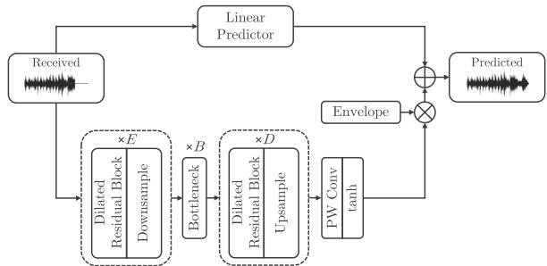

FIGURE 1. PARCnet architecture.  
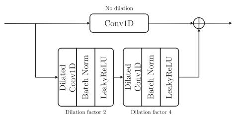  
FIGURE 2. Dilated residual block

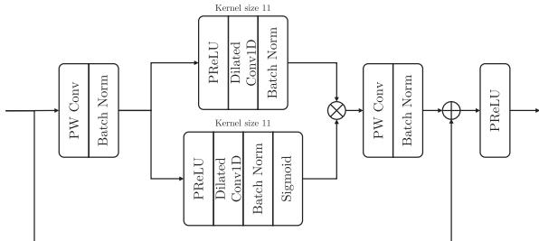  
FIGURE 3. Bottleneck GLU block.

## C. NEURAL NETWORK ARCHITECTURE

We implement $\mathcal { F } _ { \theta } ( \cdot )$ as a lightweight fully-convolutional causal information bottleneck model [13]. As shown in Fig. 1, the encoder and the decoder comprise $E = D = 4$ dilated residual blocks followed by either max-pooling-based downsampling or nearest-neighbor upsampling [31], both with a factor of two. Each dilated residual block (Fig. 2) comprises a skip connection passing through a convolutional layer with no dilation and two stacks of convolutions with dilation factor of two and four, respectively, batch normalization, and LeakyReLU with slope $\alpha = 0 . 2$ . The number of filters progressively grows in the encoder (8, 16, 32, 64), and decreases symmetrically in the decoder (64, 32, 16, 8). The convolutional layers have filters of size 11 in the encoder and seven in the decoder. The bottleneck, instead, comprises $B = 6$ blocks (Fig. 3) consisting of an input stack, a gated linear unit (GLU) [32] with kernel size 11, and an output stack, as well as a residual path shortcutting the input and the output of the block, followed by PReLU [33]. The input and output stacks feature a pointwise (PW) convolution with dilation factor of one and 32 and 64 channels, respectively, followed by batch normalization. Similarly to [13], the dilation rate grows exponentially with each GLU in order to capture the correlation among increasingly distant samples. Namely, the jth bottleneck layer has a dilation rate of $2 ^ { j - 1 }$ $j = 1 , \dots , B$ . The output of the decoder is thus fed to a PW convolution followed by a hyperbolic tangent activation function. All convolutions in the model are 1D.

## III. EVALUATION

We run our experiments using a subset of MAESTRO [34], which contains over 200 hours of human-performed piano recordings. For our purpose, we create a smaller dataset of audio data (approximately 28 hours of music), downsampled at 32 kHz and converted to mono. We consider packets of length M 320 samples (10 ms), which is just above a typical buffer size used by commercially available sound cards. In doing so, we do not normalize the data, as we want the system to be robust to silence and amplitude variations. Finally, as a test set, we select one hour of held-out data from MAESTRO and, following [11], we simulate evenly-spaced losses with a loss rate of 10%.

We evaluate the PLC performance of the proposed method against several baselines, the simplest of which is trivial zero filling. We implement three linear $\operatorname { A R } ( p )$ models with $p = 3 2$ , 64, 128, i.e., the three largest time lags examined in [8], [11]. To ease outbound transitions, we forecast 25% more samples than a packet length and apply a linear crossfade. To facilitate a meaningful comparison, we integrate the highest-order linear predictor, namely AR(128), into PARCnet’s linear branch. Additionally, we consider five deep PLC baselines: PLAAE [12], FRN [9], Verma et al. [11], TF-GAN [13], and LPCnet [19].

As in the original paper, PLAAE is implemented using five causal encoder blocks, with dilation factors $d _ { \imath } = 3 ^ { \imath - 1 }$ $\iota = 1 , . . . , 5 .$ . Our interpretation of the undisclosed parameters consists of six non-overlapping transposed decoder blocks, each comprising three residual blocks with dilation $d _ { J } = 3 ^ { J - 1 }$ $\ j = 1 , . . . , 6$ . In the bottleneck, the latent code is projected onto 256 channels, which are then reduced by a factor of two with each decoder block. Lastly, the remaining channels are projected onto one by a point-wise convolution yielding a monophonic signal. At inference time, we perform maximumcorrelation alignment and linear cross-fading as specified by the authors [12]. We optimize the FRN model [9] using the publicly available codebase, having set the sampling rate to 32 kHz and having included 320 among the training packet sizes. We modify Verma et al. [11] by applying logarithmic compression to the input mel-spectrograms instead of contextwise peak normalization in the time domain, as preliminary experiments showed a slightly superior performance. We make no modifications to the TF-GAN [13] implementation provided by the authors other than adapting the discriminator parameters to the higher sampling rate. Finally, we train the PLC version [20] of LPCnet [19] on our dataset of piano recordings.

PARCnet’s input consists of eight-packet sequences (totaling 80 ms), where the last packet is assumed to be lost and thus replaced with zeros. PARCnet and TF-GAN [13] are optimized using 100 000 of such sequences. PLAAE [12], instead, requires a longer temporal context: 100 000 packets are paired with the mel-spectrogram extracted from the past one second of audio and used for training. Verma et al. [11] use an even longer temporal context, where two downsampled context windows of 8 s and 4 s are concatenated to the previous 2 s one along the channel dimension. The LPCNet [19] prediction is obtained by conditioning the generative model with a feature vector obtained through a recurrent neural network that receives either a binary flag and the known features extracted from correctly received frames or a zero-vector if the target frame was lost. Finally, FRN [9] is trained using 40 000 audio sequences masked by a two-state Markov chain randomly selected out of three models with intra-state transition probabilities of 0.9, 0.5, 0.5 for the “valid” state, and 0.1, 0.1, 0.5 for the “loss” state, respectively.

## A. OBJECTIVE METRICS

First, we evaluate the Normalized Mean Squared Error (NMSE) between predicted and ground-truth packets, i.e.,

$$
\mathrm{NMSE} := 1 0 \log_ {1 0} \frac {\| \mathbf {y} - \hat {\mathbf {y}} \| _ {2} ^ {2}}{\| \mathbf {y} \| _ {2} ^ {2}},\tag{10}
$$

where the normalization compensates for the dependency of the error term on the energy of the ground-truth packet.

In prior work, Mel-Cepstral Distortion [38] has been used to assess the performance of PLC techniques [12]. However, though most suited for speech, cepstral analysis is not tailored to those music signals that cannot be properly characterized by a source-filter model. Therefore, we consider spectral convergence (SC) [28] as an alternative frequency-domain metric. Unlike the original definition, we apply a mel-frequency filter bank to the magnitude STFT features to account for the nonlinear human perception of sound. Mel-SC is given by

$$
\text { Mel - SC } := \frac {\| \mathbf {Y} _ {\text { mel }} - \hat {\mathbf {Y}} _ {\text { mel }} \| _ {F}}{\| \mathbf {Y} _ {\text { mel }} \| _ {F}},\tag{11}
$$

using 64 mel-scale triangular filters and a 512-sample Hann window with 50% overlap.

NMSE and Mel-SC are objective error measures and, as such, are known not to correlate so well with human assessments. Therefore, we include two objective perceptual measures in our study. First, we evaluate ITU-R BS.1387 Perceptual Evaluation of Audio Quality (PEAQ) [39]. In particular, we use the open-source MATLAB implementation of the PEAQ Basic algorithm by P. Kabal [35]. We evaluate PEAQ over windows of ten seconds and report the average Objective Difference Grade (ODG) and its standard deviation. Second, we consider PLCMOS, a convolutional-recurrent en coder developed for the INTERSPEECH 2022 Audio Deep Packet Loss Concealment Challenge [36]. PLCMOS produces scores between one and five aimed at estimating the Mean Opinion Score (MOS) of human listeners according to the

TABLE 2. Evaluation Results on Held-Out Data From MAESTRO [34]. CPU Time is Estimated by Averaging 10 000 Single-Packet Predictions on a Laptop-Mounted AMD Ryzen 5900HS Processor. Underlined Entries are Real-Time At a Sampling Rate of 32 kHz. Higher is Better; Lower is Better

<table><tr><td></td><td>NMSE (dB) ↓</td><td>Mel-SC (11) ↓</td><td>PEAQ [35] ↑</td><td>PLCMOS [36] ↑</td><td># Params ↓</td><td>CPU Time ↓</td></tr><tr><td>Zero-Insertion</td><td>0.0</td><td>0.242</td><td>-3.86 ± 0.03</td><td>1.88</td><td>—</td><td>—</td></tr><tr><td>AR(32)</td><td>-1.02</td><td>0.238</td><td>-2.35 ± 0.33</td><td>1.93</td><td>—</td><td> $\underline{1.06 ms^{\diamond}}$ </td></tr><tr><td>AR(64)</td><td>-2.03</td><td>0.214</td><td>-2.15 ± 0.33</td><td>1.95</td><td>—</td><td> $\underline{1.54 ms^{\diamond}}$ </td></tr><tr><td>AR(128)</td><td>-3.39</td><td>0.187</td><td>-1.84 ± 0.32</td><td>1.98</td><td>—</td><td> $\underline{1.84 ms^{\diamond}}$ </td></tr><tr><td>PLAAE [12]</td><td>1.7</td><td>0.198</td><td>-3.61 ± 0.17</td><td>1.91</td><td>1 M</td><td>34 ms*</td></tr><tr><td>FRN [9]</td><td>0.85</td><td>0.214</td><td>-3.33 ± 0.26</td><td>1.92</td><td>8.6 M</td><td>14.9 ms</td></tr><tr><td>LPCNet [20]</td><td>0.3</td><td>0.202</td><td>-2.43 ± 0.51</td><td>1.93</td><td>5.9 M</td><td> $\underline{7.1 ms^{\dagger}}$ </td></tr><tr><td>Verma et al. [11]</td><td>-1.3</td><td>0.175</td><td>-3.89 ± 0.03</td><td>1.92</td><td>19 M</td><td>13.5 ms</td></tr><tr><td>TF-GAN [13]</td><td>-1.6</td><td>0.149</td><td>-3.77 ± 0.20</td><td>1.94</td><td>2.2 M</td><td>18 ms</td></tr><tr><td>PARCnet (Ours)</td><td>-5.2</td><td>0.136</td><td>-1.42 ± 0.19</td><td>2.07</td><td>416 k</td><td> $\underline{8.1 ms^{\ddagger}}$ </td></tr></table>

Accelerated using Numba JIT compiler [37]; including model fitting. \* Including post-inference maximum-correlation alignment  
† Obtained using the highly-optimized C implementation of the inference model provided by the authors.  Only considering neural network inference Bold indicates the best values.

ITU-T Rec. P.808 [40]. Nevertheless, it is worth noting that PEAQ was originally developed to assess the impairment introduced by lossy audio codecs, and whether it constitutes a suitable objective measure for PLC applications is a subject of debate within the scientific community. See, for example, [41] and [42]. Similarly, PLCMOS was trained solely on speech and might not be entirely reliable when applied to music. PEAQ and PLCMOS are averaged over 10 s windows with no overlap and require the signals to be resampled at 48 kHz and 16 kHz, respectively. Mel-SC, instead, is evaluated on the entire audio files at the native 32 kHz sampling rate.

Along with the objective metrics described above, Table 2 reports the number of trainable parameters of the deep learning models and the CPU time estimated by averaging 10 000 single-packet predictions on a laptop-mounted AMD Ryzen 5900HS.

## B. LISTENING TEST

As none of the metrics described in Section III-A are entirely reliable in assessing music-oriented PLC algorithms, we conducted a MUltiple-Stimuli with Hidden Reference and Anchor (MUSHRA) test [43] compliant with the ITU-R Rec. BS.1534-3 [44]. A total of 16 musically-trained participants were asked to rate five 10-second piano excerpts processed with eight PLC methods on a scale of 0 (Bad) to 100 (Excellent). The excerpts were randomly sampled from the MAESTRO test set and degraded with 10 ms losses every 100 ms. The subjects were instructed to identify the groundtruth track without tampering (hidden reference), as well as the zero-filling technique (anchor), and were tasked to rate the former with 100 points and assign the lowest score to the latter.

According to the ITU-R Rec. BS.1534-3 post-screening guidelines [44], any assessor who rates the hidden reference below a score of 90 for more than 15% of the total number of test items must be excluded from the aggregated responses. Hence, we excluded one assessor who rated the hidden reference at 79 while assigning a score of 100 to PARCnet in one of the five test audio excerpts. We were left with 15 assessors,

14 males and one female, with ages ranging from 25 to 37 (28.8 on average). The test results are shown in Fig. 4. Audio examples are available online.1

## C. RESULTS AND DISCUSSION

Of all methods, only the three AR models, LPCnet, and PAR-Cnet are able to operate in real-time at a sampling rate of 32 kHz (see Table 2). As for LPCNet, we load the model weights optimized in Keras into the highly efficient C implementation provided by the authors [20], whereas our inference model runs in Python using PyTorch. Therefore, since PARCnet has the lowest number of trainable parameters among all deep PLC models (416 k), i.e., less than a tenth of those of LPCnet (5.9 M), we expect it to outspeed all baselines once properly optimized. Overall, PLAAE is the slowest method due to the computational burden of the ex-post maximumcorrelation alignment [12].

As shown in Table 2, PARCnet outperforms all deep PLC methods considered in the study across all objective metrics. Notably, PARCnet is backed by an already proficient linear predictor. Indeed, the simple AR(128) model appears to outperform the other baseline methods as far as NMSE, PEAQ, and PLCMOS are concerned. This can be explained by considering that the sustained portion of the notes produced by a solo musical instrument tends to be quasi-harmonic as long as we do not take into account attack transients. Thus, a short-time music signal may be well represented by an all-pole system of sufficiently high order. Nevertheless, the integration of AR(128) within the deep residual learning framework of PARCnet yields a significant improvement across the board compared to just using the linear predictor.

In particular, as far as PEAQ is concerned, PARCnet is the only method among those considered in the present study for which all 10-second test audio segments sit between what [39] describes as perceptible, but not annoying ( 1.0) and slightly annoying ( 2.0). Moreover, PARCnet is the only method to exceed the threshold of what [40] defines as poor listening quality (2.0) with regard to PLCMOS.

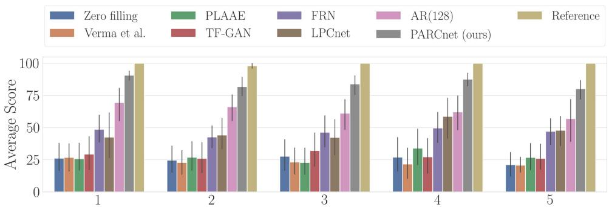

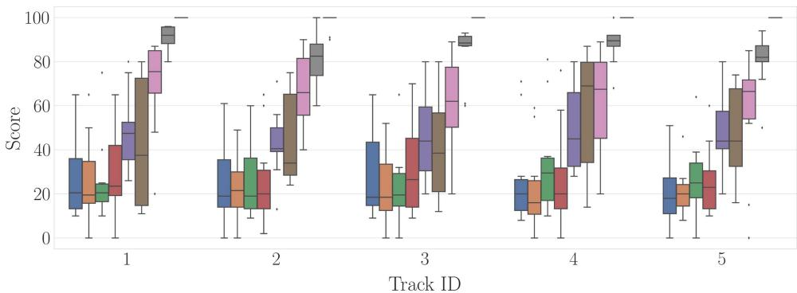  
FIGURE 4. Results of the MUSHRA listening test. Mean and standard deviation (top); box-and-whiskers diagram (bottom).

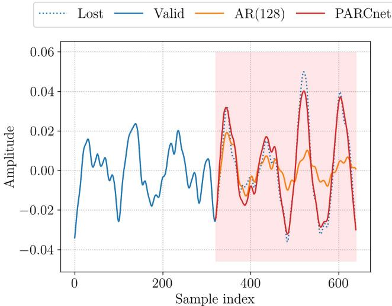  
FIGURE 5. Example of packet prediction.

The conclusions drawn above are confirmed by the results of the MUSHRA test shown in Fig. 4. We found a statistically significant relationship $( P < . 0 5 )$ between the objective perceptual measures obtained for each method and the corresponding average opinion scores. We report a Pearson correlation coefficient (r) of 0.957 for PEAQ $( P = 1 . 8 \times$ $1 0 ^ { - 4 } )$ and 0.899 for PLCMOS $( P = 2 . 3 \times 1 0 ^ { - 3 } )$ . We also note that NMSE significantly correlates with the subjects’ judgments yielding $r = - 0 . 7 2 5 \ ( P = . 0 4 )$ , whereas Mel-SC is characterized by a non-significant linear correlation with a Pearson r of 0.437 (P .27).

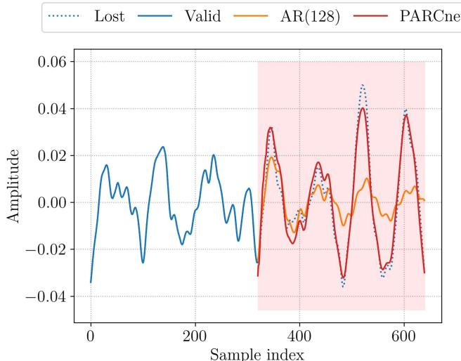  
FIGURE 6. Example of packet prediction without time-domain envelope fading-in the deep residual estimate.

Further inspecting Fig. 4, we notice that Verma et al., PLAAE, and TF-GAN perform comparably or worse than trivial zero filling. This can be attributed to audible “clicks” in the audio playback caused by discontinuities at the seam between subsequent packets, which these models fail to address. Conversely, FRN, LPCnet, and AR(128) seem less susceptible to this type of audio degradation thanks to their autoregressive inference mechanism.

Despite being the only linear model considered in the present study, AR(128) appears to consistently improve upon the neural network baselines. These results confirm previous observations [11] and put forward linear prediction as a viable option for low-resource NMP applications.

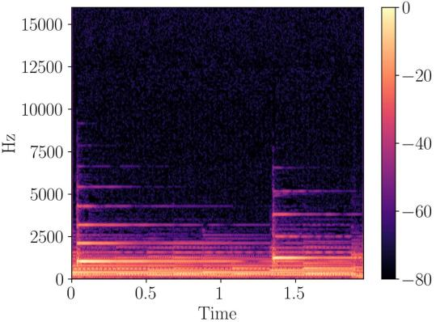  
(a) Reference signal

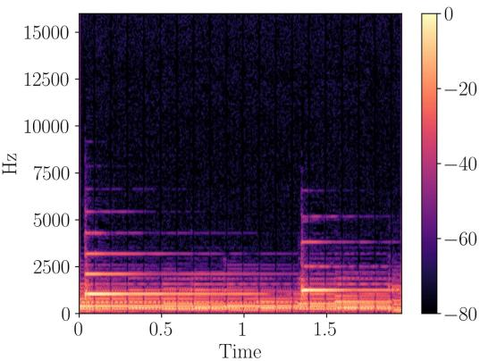  
(b) AR(128)

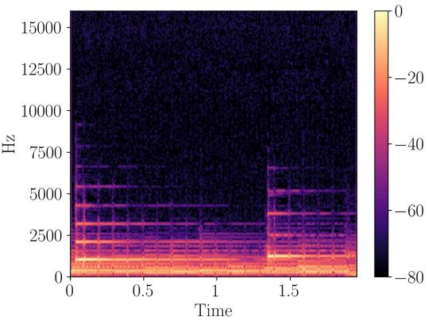  
(c) LPCNet

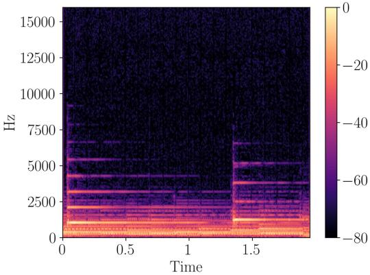  
(d) PARCnet  
FIGURE 7. Spectrograms of a 2-second piano excerpt from MAESTRO [34].

PARCnet is shown to significantly outperform all baseline methods. In particular, the proposed method provides an improvement of 21.7 points on average compared to AR(128). At the same time, PARCnet scores have the least spread among all methods considered in the MUSHRA test, indicating a stronger user agreement concerning the overall improved listening quality. Ultimately, this seems to suggest that the proposed strategy of learning the residual signal of a linear predictor using an auxiliary nonlinear model is advantageous for PLC in NMP applications.

## D. EXAMPLE OF MODEL INFERENCE

Fig. 5 shows an example of PARCnet prediction compared to that of AR(128). The first M 320 samples are considered valid (solid blue line), whereas the following 10 ms (marked by a red rectangle) correspond to a simulated packet loss. It can be seen that the AR estimate (orange line) closely matches the lost packet (dotted blue line) as far as the first few samples are concerned. Past that, however, the quality of the prediction degrades severely. On the contrary, the neural contribution of PARCnet appears to be instrumental in improving the results significantly (red line), especially as far as the later portion of the lost packet is concerned.

This phenomenon also provides empirical justification for the use of the time-domain envelope vector $\mathbf { v } \in [ 0 , 1 ] ^ { M ^ { \prime } }$ introduced in Section II. As mentioned above, autoregressive models are less likely to introduce inbound discontinuities than feed-forward models. This is highlighted in Fig. 6, where a discontinuity of the first kind (jump discontinuity) is clearly noticeable at the seam between the valid and the predicted packet when no envelope is applied to the deep residual estimate (red line). Notably, these artifacts have the effect of abruptly increasing the signal bandwidth, causing annoying impulse-like click sounds in the audio playback. On the contrary, AR(128) seems well capable of continuing the signal smoothly, further motivating the design choice of relying on the linear model for estimating the first few samples, while gradually fading-in the neural contribution.

Finally, Fig. 7 shows the spectrogram of a 2-second piano excerpt from MAESTRO (Fig. 7(a)), and illustrate the effects of concealing missing packets with AR(128) (Fig. 7(b)), LPC-Net (Fig. 7(c)), and PARCnet (Fig. 7(d)).

## IV. CONCLUSION

In this article, we introduced PARCnet, a novel low-latency hybrid packet loss concealment method that combines linear autoregressive models and feed-forward neural networks in a synergistic way. We exploited the short-time statistical properties of music signals to apply linear autoregression while using a parallel neural predictor to estimate the nonlinear residual term. Evaluated on a large-scale dataset of piano recordings, PARCnet turned out to reach state-of-the-art results and significantly outperform recent deep-learningbased methods in terms of objective metrics and subjective judgments while being able to operate in real-time on a consumer-grade CPU.

## REFERENCES

[1] C. Perkins, O. Hodson, and V. Hardman, “A survey of packet loss recovery techniques for streaming audio,” IEEE Netw., vol. 12, no. 5, pp. 40–48, Sep./Oct. 1998.

[2] Substitution and Muting ofLost Framesfor Full Rate Speech Channels, Rec. ETSI GSM 6.11, European Telecommunications Standards Institute, Sophia-Antipolis, France, Feb. 1992.

[3] J. Yeh, P. Lin, M. Kuo, and Z. Hsu, “Bilateral waveform similarity overlap-and-add based packet loss concealment for voice over IP,” J. Appl. Res. Technol., vol. 11, pp. 559–567, 2013.

[4] A High Quality Low-Complexity Algorithm for Packet Loss Concealment With G.711, Rec. ITU-T G.711 Appendix I., International Telecommunications Union, Geneva, Switzerland, Sep. 1999.

[5] K. Kondo and K. Nakagawa, “A speech packet loss concealment method using linear prediction,” IEICE Trans. Inf. Syst., vol. 89, no. 2, pp. 806–813, 2006.

[6] G. Zhang and W. B. Kleijn, “Autoregressive model-based speech packet-loss concealment,” in Proc. IEEE Int. Conf. Acoust. Speech Signal Process., 2008, pp. 4797–4800.

[7] T. L. Jensen, D. Giacobello, T. van Waterschoot, and M. G. Christensen, “Fast algorithms for high-order sparse linear prediction with applications to speech processing,” Speech Commun., vol. 76, pp. 143–156, 2016.

[8] M. Sacchetto, Y. Huang, A. Bianco, and C. Rottondi, “Using autoregressive models for real-time packet loss concealment in networked music performance applications,” in Proc. Int. Audio Mostly Conf., 2022, pp. 203–210.

[9] V.-A. Nguyen, A. H. T. Nguyen, and A. W. H. Khong, “Improving performance of real-time full-band blind packet-loss concealment with predictive network,” in Proc. IEEE Int. Conf. Acoust. Speech Signal Process., 2023, pp. 1–5.

[10] B.-K. Lee and J.-H. Chang, “Packet loss concealment based on deep neural networks for digital speech transmission,” IEEE/ACM Trans. Audio Speech Lang. Process., vol. 24, no. 2, pp. 378–387, Feb. 2016.

[11] P. Verma, A. I. Mezza, C. Chafe, and C. Rottondi, “A deep learning approach for low-latency packet loss concealment of audio signals in networked music performance applications,” in Proc. Conf. Open Innov. Assoc., 2020, pp. 268–275.

[12] S. Pascual, J. Serrà, and J. Pons, “Adversarial auto-encoding for packet loss concealment,” in Proc. IEEE Workshop Appl. Signal Process. Audio Acoust., 2021, pp. 71–75.

[13] J. Wang, Y. Guan, C. Zheng, R. Peng, and X. Li, “A temporalspectral generative adversarial network based end-to-end packet loss concealment for wideband speech transmission,” J. Acoust. Soc. Amer., vol. 150, no. 4, pp. 2577–2588, 2021.

[14] Q. Ji, C. Bao, and Z. Cui, “Packet loss concealment based on phase correction and deep neural network,” Appl. Sci., vol. 12, no. 19, 2022.

[15] N. Li, X. Zheng, C. Zhang, L. Guo, and B. Yu, “End-to-end multi-loss training for low delay packet loss concealment,” in Proc. Interspeech, 2022, pp. 585–589.

[16] Y. Guan, G. Yu, A. Li, C. Zheng, and J. Wang, “TMGAN-PLC: Audio packet loss concealment using temporal memory generative adversaria network,” in Proc. Interspeech, 2022, pp. 565–569.

[17] R. Lotfidereshgi and P. Gournay, “Speech prediction using an adaptive recurrent neural network with application to packet loss concealment." in Proc. IEEE Int. Conf, Acoust, Speech Signal Process., 2018. pp. 5394–5398.

[18] F. Stimberg et al., “WaveNetEO – Packet loss concealment with WaveRNN,” in Proc. Asilomar Conf. Signals Syst. Comput., 2020, pp. 672–676.

[19] J.-M. Valin and J. Skoglund, “LPCnet: Improving neural speech synthesis through linear prediction,” in Proc. IEEE Int. Conf. Acoust. Speech Signal Process., 2019, pp. 5891–5895.

[20] J.-M. Valin et al., “Real-time packet loss concealment with mixed generative and predictive model,” in Proc. Interspeech, 2022, pp. 570–574.

[21] M. M. Mohamed, M. A. Nessiem, and B. W. Schuller, “On deep speech packet loss concealment: A mini-survey,” 2020, arXiv:2005.07794.

[22] C. Rottondi, C. Chafe, C. Allocchio, and A. Sarti, “An overview on networked music performance technologies,” IEEE Access, vol. 4, pp. 8823–8843, 2016.

[23] J. Thyssen, H. Nielsen, and S. Hansen, “Non-linear short-term prediction in speech coding,” in Proc. Int. Conf. Acoust. Speech Signal Process., 1994, pp. I/185–I/188.

[24] P. P. Vaidyanathan, The Theory ofLinear Prediction, Ser. Synthesis Lectures on Signal Processing. San Rafael, CA, USA: Morgan & Claypoo Publishers, 2008.

[25] J. Markel and A. Gray, Linear Prediction of Speech, (Communication and cybernetics series). Berlin, Germany: Springer-Verlag, 1976.

[26] J. Durbin, “The fitting of time-series models,” Rev. Inst. Int. Stat., vol. 28, no. 3, pp. 233–244, 1960.

[27] P. Kabal, “Ill-conditioning and bandwidth expansion in linear prediction of speech,” in Proc. IEEE Int. Conf. Acoust. Speech Signal Process., 2003, pp. 824–827.

[28] S. Ö. Arık, H. Jun, and G. Diamos, “Fast spectrogram inversion using multi-head convolutional neural networks,” IEEE Signal Process. Lett., vol. 26, no. 1, pp. 94–98, Jan. 2019.

[29] G. Yang, S. Yang, K. Liu, P. Fang, W. Chen, and L. Xie, “Multi-band MelGAN: Faster waveform generation for high-quality text-to-speech,” in Proc. IEEE Spoken Lang. Technol. Workshop, 2021, pp. 492–498.

[30] L. Liu et al., “On the variance of the adaptive learning rate and beyond,” in Proc. Int. Conf. Learn. Representations, 2020.

[31] J. Pons, S. Pascual, G. Cengarle, and J. Serrà, “Upsampling artifacts in neural audio synthesis,” in Proc. IEEE Int. Conf. Acoust. Speech Signa Process., 2021, pp. 3005–3009.

[32] Y. N. Dauphin, A. Fan, M. Auli, and D. Grangier, “Language modeling with gated convolutional networks,” in Proc. Int. Conf. Mach. Learn., 2017, pp. 933–941.

[33] K. He, X. Zhang, S. Ren, and J. Sun, “Delving deep into rectifiers: Surpassing human-level performance on ImageNet classification,” in Proc. IEEE Int. Conf. Comput. Vis., 2015, pp. 1026–1034.

[34] C. Hawthorne et al., “Enabling factorized piano music modeling and generation with the MAESTRO dataset,” in Proc. Int. Conf. Learn. Representations, 2019.

[35] P. Kabal, “An examination and Interpretation of ITU-R BS.1387: Perceptual Evaluation of Audio Quality,” McGill University, Montreal, QC, Canada, Tech. Rep., 2002.

[36] L. Diener, S. Sootla, S. Branets, A. Saabas, R. Aichner, and R. Cutler, “INTERSPEECH 2022 audio deep packet loss concealment challenge,” in Proc. Interspeech, 2022, pp. 580–584.

[37] S. K. Lam, A. Pitrou, and S. Seibert, “Numba: A. LLVM-based Python JIT compiler,” in Proc. 2nd Workshop LLVM Compiler Infrastructure HPC, 2015, pp. 1–6.

[38] R. Kubichek, “Mel-cepstral distance measure for objective speech qual ity assessment,” in Proc. IEEE Pacific Rim Conf. Commun. Comput. Signal Process., 1993, pp. 125–128.

[39] T. Thiede et al., “PEAQ – The ITU standard for objective measurement of perceived audio quality,” J. Audio Eng. Soc., vol. 48, no. 1/2, pp. 3–29, 2000.

[40] Subjective Evaluation of Speech Quality With a Crowdsourcing Approach, Rec. ITU-T P.808, International Telecommunications Union, Geneva, Switzerland, Jun. 2021.

[41] M. Fink, M. Holters, and U. Zölzer, “Comparison of various predictors for audio extrapolation,” in Proc. Int. Conf. Digit. Audio Effects, 2013, pp. 1–7.

[42] A. F. Khalifeh, A.-K. Al-Tamimi, and K. A. Darabkh, “Perceptual evaluation of audio quality under lossy networks,” in Proc. Int. Conf. Wireless Commun. Signal Process. Netw., 2017, pp. 939–943.

[43] M. Schoeffler et al., “webMUSHRA – A comprehensive framework fo web-based listening tests,” J. Open Res. Softw., vol. 6, 2018.

[44] Methodfor the Subjective Assessment of Intermediate Quality Level of Audio Systems, Rec. ITU-R BS.1534-3, International Telecommunications Union, Geneva, Switzerland, Jun. 2021.