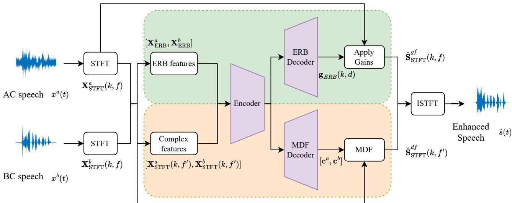
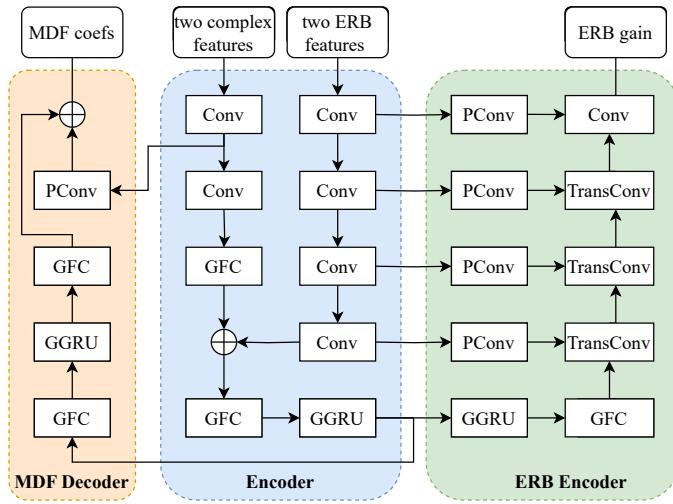
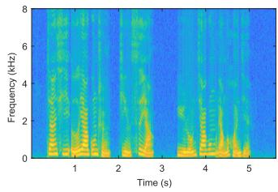
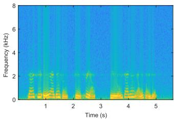
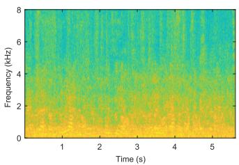
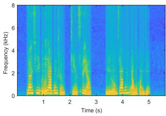

# Multi-modal Deep-filtering-based Speech Enhancement via bone-conducted Speech

Mou Wang1,2, Kelan Kuang2, Zhuo Li1,2, Feiran Yang2, Jisheng Bai3, Xin Liu1 1 OPPO, Beijing, China

2 Key Laboratory of Noise and Vibration Research, Institute of Acoustics, Chinese Academy of Sciences, Beijing, China

3 School of Communications and Information Engineering, Xi’an University of Posts and Telecommunications, Xi’an, China

Abstract—Bone-conducted (BC) speech has been harnessed to boost the performance of speech enhancement system as an auxiliary source of air-conducted (AC) speech, which is one type of multi-modal speech enhancement. However, the existing multi-modal methods based on neural networks, have high computational complexity, making them difficult to deploy into embedded systems. In this paper, we propose a lightweight multimodal deep-filtering-based network (MDFNet) for joint speech enhancement with synchronized BC and AC speech signal. The model contains two encoder-decoder branches. The first branch estimates the gain of high frequency part over ERB scale. The second branch estimates the deep-filtering coefficients of low frequency part. After applying ERB gain and deep-filtering, the enhanced complex spectrum is obtain. Experimental results on ABCS corpus demonstrate that the proposed multi-modal method achieves competitive speech enhancement performance and optimal speech recognition performance compared with state-of-the-art baseline approaches.

Keywords—multi-modal speech processing, speech enhancement, bone conduction

## I. INTRODUCTION

Speech signals are inevitably subjected to interference from surrounding environments. As the most widely used speech acquisition devices, air-conduction (AC) microphones capture both the desired speech signals and environmental interferences indiscriminately, thereby degrading speech quality and intelligibility [1], [2]. To alleviate this issue, a series of speech enhancement methods have been proposed to remove interference from noisy speech [3]. Early speech enhancement algorithms, like Wiener filtering, subspace method, and spectral subtraction, require specific model assumptions or priors, thus limiting their performance. Over the past decade, neural network-based speech enhancement methods have achieved significant advancements [4], either directly estimating the time-frequency representation of clean speech or mask [5], or performing end-to-end estimation of clean speech [6]. Speech enhancement algorithms are widely employed as the front-end of various speech systems, including speech communication, speech recognition, and personalized speech assistants.

Although neural network-based AC speech enhancement methods show the excellent performance, it remains challenging to produce satisfactory performance in low signal-to-noise ratio (SNR) and non-stationary condition. To further boost speech enhancement performance, some other modalities such as visual information [7], accelerometer signals [8], and boneconducted (BC) speech [9], [10] have been explored as auxiliary information sources. However, visual modalities are prone to occlusion and suffer from high computational complexity. In contrast, BC speech has garnered some attention.

Unlike AC microphones, BC microphones are a kind of skin-attached sensors that capture the mechanical vibrations of the speaker’s skull during speech and convert them into electrical signals [11]. Since the signals are not from sound in the air conduction, bone conduction are naturally resistant to environmental acoustic noise and interference. This physical characteristic enables BC speech to effectively separate target speech from ambient noise in low SNR environments, thus making it particularly suitable for speech enhancement tasks. However, BC speech has some drawbacks compared with AC speech. First, the middle and high-frequency parts of BC signal undergo severe attenuation or even completely lost, causing a significant decline in speech quality and intelligibility. Additionally, other vibration signals can be picked up by BC speech as noise, such as friction between the device and the speaker’s skin, or vibrations caused by speakers on the device during playback.

To leverage the inherent noise resistance of BC speech while overcoming the aforementioned drawbacks, there have been a few research on BC speech, which can be categorized into two categories. Some methods focuses on the use of BC speech, aiming to map it as closely as possible to AC speech. The core objective of these methods is bandwidth expansion. Early mapping techniques were primarily based on transform filtering [12], followed by the adoption of various neural networks to learn the mapping function [13]–[15]. The other methods treat BC speech as an auxiliary source, combining it with noisy AC speech for target speech estimation, which are one form of multimodal speech enhancement. Early studies in these methods relied on traditional machine learning methods [16], whereas recent advancements have introduced diverse neural network architectures, such as fully convolutional networks (FCN) [9], attention-based networks [1], [17], [18].

Considering that in a low SNR environment, the phase spectrum of noisy speech has been seriously interfered, and highfrequency part of BC signal is severely attenuated, making the phase of the middle and high-frequency part unavailable. Therefore, phase estimation is a critical issue in the joint enhancement task using AC and BC speech signals. To avoid this issue, end-to-end method is put forward to reconstruct the clean AC signal in the time domain [10]. In general, the time domain method has high computational complexity. However, when deploying deep learning-based methods to the edge devices, the computational complexity and real-time requirements of the algorithm need to be fully considered. Considering that another way to solve phase estimation is to operate directly in the complex domain [18]. However, the computational complexity of the above existing methods remains high for edge devices.

  
Fig. 1. Flowchart of multi-modal deep-filtering-based speech enhancement method.

In this paper, we presents a lightweight multi-modal speech enhancement method leveraging deep filtering, which can simultaneously utilize BC and noisy AC speech to perform joint enhancement in the complex domain. The method uses the complex spectra and equivalent rectangular bandwidth (ERB) features of noisy AC and BC signals as the input to the model. The model consists of two branches. One branch outputs the gain for the high-frequency part, and applying this gain to the noisy AC signal can obtain high-frequency components of complex spectrum of target speech. The other branch outputs the deep filtering coefficients for the lowfrequency part, which are used to filter the complex spectra of BC and AC speech to obtain low-frequency part of complex spectrum. The two output parts are concatenated, and then the enhanced speech is obtained through inverse transform. Experimental results on ABCS corpus validate that the proposed lightweight method achieves comparable speech enhancement performance and best automatic speech recognition (ASR) performance compared with state-of-the-art (SOTA) methods.

## II. METHOD

## A. Problem formulation

Consider a pristine AC signal $x _ { a }$ that is contaminated by surrounding noise $n _ { a }$ , thereby yielding a corrupted signal $\hat { x } _ { a } = x _ { a } + n _ { a }$ . Simultaneously, a time-aligned BC signal xb is affected by noise $n _ { b } .$ yet remains unaffected by $n _ { a } .$ The corrupted AC and BC signals are then combined to form a binary channel signal $\boldsymbol { x } = \left( \widehat { x } _ { a } , x _ { b } \right)$

Convert the signal model to the time-frequency domain, i.e.,

$$
\mathbf {X} _ {\mathrm{STFT}} ^ {a} (k, f) = \mathbf {S} _ {\mathrm{STFT}} (k, f) + \mathbf {N} _ {\mathrm{STFT}} ^ {a} (k, f),\tag{1}
$$

$$
\mathbf {X} _ {\mathrm{STFT}} ^ {b} (k, f) = \mathbf {H} _ {a b} \cdot \mathbf {S} _ {\mathrm{STFT}} (k, f) + \mathbf {N} _ {\mathrm{STFT}} ^ {b} (k, f),\tag{2}
$$

where k and f are index of time and frequency axis. ${ \bf X } _ { \mathrm { S T F T } } ^ { a } ( k , f )$ and $\mathbf { X } _ { \mathrm { S T F T } } ^ { b } ( k , f )$ are complex spectra of the noisy AC speech signal $x ^ { a } ( t )$ and BC speech $x ^ { b } ( t ) . \ \mathbf { S } _ { \mathrm { S T F T } } ( k , f )$ refers to complex spectrum of the clean AC signal, ${ \bf H } _ { a b }$ represents transfer function from clean AC speech to BC speech, ${ \bf N } _ { \mathrm { S T F T } } ^ { a } ( k , f )$ complex spectrum representing background noise in the surrounding environment recorded by an AC microphone, $\mathbf { N } _ { \mathrm { S T F T } } ^ { b } ( k , \bar { f } )$ is noise from other vibrations picked up by the BC microphone.

To obtain complex spectrum of desired AC speech from the spectra of BC and noisy AC signals, we need to filter these two input signals, , which can be expressed as

$$
\begin{array}{l} \hat {\mathbf {S}} _ {\mathrm{STFT}} (k, f) = \sum_ {j = 0} ^ {D} \mathbf {c} ^ {a} (k, j, f) \cdot \mathbf {X} _ {\mathrm{STFT}} ^ {a} (k - j, f) \\ \qquad + \sum_ {j = 0} ^ {D} \mathbf {c} ^ {b} (k, j, f) \cdot \mathbf {X} _ {\mathrm{STFT}} ^ {b} (k - j, f), \end{array}\tag{3}
$$

where, $\mathbf { c } ^ { a }$ and $\mathbf { c } ^ { b }$ are the coefficients of the D-order filter applied to the complex spectra of noisy AC and BC speech respectively, and $\hat { \mathbf { S } } _ { \mathrm { S T F T } } ( k , f )$ is the complex spectrum of the enhanced speech signal. From a multi-modal perspective, $\mathbf { c } ^ { a }$ and $\mathbf { c } ^ { b }$ respectively represent the contribution of AC and BC modalities to the final enhanced speech. If $\mathbf { c } ^ { b } = 0$ , the above multi-modal problem degenerates into a single-modal AC speech enhancement problem, and if $\mathbf { c } ^ { a } = 0 ,$ , it is a BC speech enhancement problem.

Deep filtering method [19] is used in the proposed method, which uses a neural network to generate its corresponding filter coefficients based on the input spectrum. Deep filtering can fully leverage the correlations between multiple frames, which is consistent with the form of multi-modal enhancement signal model described above. Hence, we proposes a joint speech enhancement method based on multi-modal deep filtering network, which generates deep filtering coefficients for spectra of BC and noisy AC signal. The advantage lies in that network can adaptively adjust the weighting coefficients of the two modalities according to the SNR of corrupted AC speech.

## B. Multi-modal deep-filtering model

Fig. 1 shows the framework of the multi-modal deep filtering network (MDFNet) proposed in this paper. The framework incorporates two speech enhancement branches, respectively targeting the high-frequency and low-frequency components of the spectrum. The first branch estimates the gain for each frequency band in the high-frequency part. To reduce computational complexity while fully leveraging human auditory perception, ERB filter bank is employed to compress linear frequency of time-frequency spectrum and estimates the corresponding gain on the compressed filter bank features. Since the high-frequency parts of BC speech are almost completely lost, this gain is only applied to the corrupted AC speech. The second process enhances the lowfrequency part of the speech signal in complex domain using deep filtering, where deep filtering coefficients are used to fuse the low-frequency parts of AC and BC signals.

  
Fig. 2. Diagram of the structure of MDFNet, where GGRU denotes the grouped GRU and GFC denotes the grouped FC layer.

Fig. 2 shows the structure of MDFNet. The entire MDFNet consists of three components: an encoder, an ERB decoder, and a deep filtering decoder. The architecture between the encoder and the ERB decoder is similar to the UNet. The encoder contains multiple convolutional modules, each of which includes a depthwise separable convolution. Specifically, depthwise convolution in the depthwise separable convolution has a kernel size of $1 \times 3 ,$ and the pointwise convolution uses $1 \times 1$ convolution with 64 channels, which means the feature transformation is performed solely along the frequency axis.

The ERB features of the two modalities undergo four convolutional modules. Simultaneously, the complex-domain features of the two modalities are transformed using two convolutional modules. Subsequently, the transformed feature maps of the two different input features are fused by addition. A fullyconnected (FC) layer is employed for feature transformation to ensure dimensional consistency during addition. The fused features are then fed into a multiple gated recurrent unit (GRU) for temporal context modeling, yielding the output of the entire encoder. To reduce the model parameters of the FC layers and GRUs, this paper adopts a grouping strategy.

The ERB decoder takes the feature maps output by the encoder as input, first performs temporal context modeling again through the grouped GRU, and then frequency modeling through the transposed convolution modules. Between ERB Encoder and ERB decoder, 1 1 convolutional skip connections are used.

The deep filtering decoder takes encoder’s output and employs grouped GRUs and grouped FC layers for temporal context modeling. Considering that the low-frequency spectral structure of BC speech remains relatively intact, features derived from the complex-domain inputs of both modalities was integrated into the deep filtering decoder via skip connections for deep filtering coefficient estimation.

The optimization objective of the proposed MDFNet is the same as Deepfilternet’s loss [19], which consists of two parts. One is the loss between the spectrum predicted by model and the spectrum of the desired signal, i.e.,

$$
\mathcal {L} _ {\text { spec }} = \sum \left\| | \hat {\mathbf {S}} | ^ {\varepsilon} - | \mathbf {S} | ^ {\varepsilon} \right\| ^ {2} + \sum \left\| | \hat {\mathbf {S}} | ^ {\varepsilon} e ^ {j \hat {\varphi}} - | \mathbf {S} | ^ {\varepsilon} e ^ {j \varphi} \right\| ^ {2},\tag{4}
$$

Where $\varepsilon ~ = ~ 0 . 3$ is the compression factor for perceptual loudness modeling. The two term calculates the differences in the magnitude spectrum and phase spectrum, respectively.

The second loss is multi-resolution (MR) spectral loss. Specifically, the enhanced spectrum $\hat { \mathbf { S } } _ { \mathrm { S T F T } } ( k , f )$ output by the neural network is first converted into a time-domain speech signal sˆ(t). Subsequently, spectrograms with varying timefrequency resolutions are computed using STFT with window lengths ranging from 8 to 64 ms. The multi-resolution spectral loss can be expressed as follows:

$$
\mathcal {L} _ {\mathrm{MR}} = \sum_ {i} \left\| | \hat {\mathbf {S}} _ {i} ^ {\prime} | ^ {\varepsilon} - | \mathbf {S} _ {i} ^ {\prime} | ^ {\varepsilon} \right\| ^ {2} + \sum_ {i} \left\| | \hat {\mathbf {S}} _ {i} ^ {\prime} | ^ {\varepsilon} e ^ {j \hat {\varphi}} - | \mathbf {S} _ {i} ^ {\prime} | ^ {\varepsilon} e ^ {j \varphi} \right\| ^ {2},\tag{5}
$$

where $\hat { \mathbf { S } } _ { i } ^ { ' }$ denotes the i-th spectrum of enhanced speech signal sˆ(t), with the window lengths being [128, 256, 512, 1024].

Finally, the combined loss is the weighted sum of the two losses mentioned above, i.e.,

$$
\mathcal {L} = \lambda_ {s p e c} \cdot \mathcal {L} _ {s p e c} + \lambda_ {M R} \cdot \mathcal {L} _ {M R}.\tag{6}
$$

where $\lambda _ { s p e c }$ and $\lambda _ { M R }$ are hyperparameters to weight the two losses.

## III. EXPERIMENTS

## A. Data

We conducted the experiments on the multi-modal speech database ABCS [20]. The dataset includes 100 speakers, with

TABLE I  
RESULTS OF THE PROPOSED MDFNET AND COMPARATIVE METHODS.

<table><tr><td>Modality</td><td>Method/Speech</td><td>PESQ</td><td>STOI</td><td>ESTOI</td><td>CER (%)</td></tr><tr><td rowspan="6">AC</td><td>clean</td><td>-</td><td>-</td><td>-</td><td>13.4</td></tr><tr><td>noisy</td><td>1.36</td><td>0.64</td><td>0.46</td><td>79.3</td></tr><tr><td>IMCRA [23]</td><td>1.60</td><td>0.50</td><td>0.36</td><td>77.9</td></tr><tr><td>DCCRN [24]</td><td>2.37</td><td>0.76</td><td>0.65</td><td>61.9</td></tr><tr><td>AC-TINet [10]</td><td>2.49</td><td>0.80</td><td>0.69</td><td>52.1</td></tr><tr><td>AC-DFNet</td><td>2.37</td><td>0.69</td><td>0.54</td><td>57.0</td></tr><tr><td>BC</td><td>-</td><td>2.37</td><td>0.68</td><td>0.57</td><td>88.0</td></tr><tr><td rowspan="3">Multi-modal</td><td>MFCN [9]</td><td>1.77</td><td>0.68</td><td>0.54</td><td>76.1</td></tr><tr><td>MTINet [10]</td><td>3.29</td><td>0.91</td><td>0.84</td><td>27.3</td></tr><tr><td>MDFNet</td><td>3.21</td><td>0.79</td><td>0.69</td><td>24.8</td></tr></table>

80 and 10 speakers’ speech for training and validation respectively, and the remaining 10 speakers’ speech for testing. During model training and validation phases, two noise databases were used as AC noise sources, i.e., the MUSAN [21] and NOISEX-92 [22]. Both noise and speech data were uniformly downsampled to 16 kHz, then clean AC speech and noise signals were mixed. The SNR of corrupted AC speech used for training and validation were uniformly sampled from [-15, 5] dB, while the SNRs for testing were set at $[ - 1 5 , - 1 0 , - 5 , 0 , 5 ]$ dB.

## B. Configurations

The model is trained for 30 epoches using AdamW optimizer, with the batch size set to 128. The learning rate is set to an initial value of $1 \times 1 0 ^ { - 3 }$ , and halved if validation loss does not decrease for 4 consecutive epochs. We apply early stopping if the validation loss does not decrease for 8 consecutive epochs.

## C. Comparison methods and metrics

We carried out comparisons of the proposed MDFNet against SOTA methods, including the multi-modal FCN (MFCN) [9] and multi-modal temporal involution network (MTINet) [10]. The experimental configurations for all the above methods are kept consistent with those of MTINet [10].

We used several metrics to assess the speech enhancement performance of the methods, including narrow-band PESQ, STOI and extended STOI (ESTOI). Specifically, PESQ is used to evaluate speech quality, while STOI and ESTOI are used to measure speech intelligibility. Higher values of these metrics directly imply better model performance. In addition, to further evaluate performance of ASR, speech is fed into a Conformerbased ASR system, and we use character error rate (CER) as the evaluation metric.

Table I lists the results of the proposed MDFNet and the baseline methods in terms of both speech enhancement metrics and ASR metrics. Compared with the deep filtering network based on AC speech, which is denoted as AC-DFNet, the MDFNet achieves significant performance improvements.

This result demonstrates that the proposed MDFNet can effectively extract information from noisy AC and BC speech for joint speech enhancement. When compared with the other two multi-modal baseline methods, the MDFNet far surpass the MFCN in all metrics. In the three speech enhancement metrics, the MDFNet lags behind the MTINet, because the time-domain approach inherently avoids phase estimation issues, and the temporal involution network exhibits superior modeling capability for speech context. However, the MDFNet outperforms the MTINet in ASR performance. This is because the time-domain method encodes and decodes multi-modal speech using convolutions, whereas the MDFNet operates directly in the complex domain without requiring feature learning or reconstruction, thereby better preserving spectral details and enhancing ASR performance.

  
(a)

  
(c)

(b)  
  
(d)  
Fig. 3. (a) presents spectrogram of pristine AC speech. (b) presents spectrogram of the synchronized BC speech. (c) presents the spectrogram of the corrupted AC speech under babble noise interference at -5 dB SNR. (d) presents the spectrogram of speech enhanced by MDFNet.

Fig. 3 presents the spectrograms of pristine AC speech, BC speech, corrupted AC speech, and speech enhanced by the MDFNet, to more intuitively demonstrate the complementarity between BC and AC speech. As depicted in Fig. 3d, MDFNet can suppresses noise in both BC and corrupted AC speech under low SNR conditions, and partially recover high-frequency parts lost in the BC signal to a certain extent.

## IV. CONCLUSIONS

In this paper, we presented a multi-modal deep-filteringbased speech enhancement method named MDFNet. Compared with existing SOTA approaches, the proposed approach reduces computational complexity by separately modeling the high-frequency and low-frequency components of speech. Specifically, it employs low-resolution filter bank features for high-frequency components, and deep filtering to fuse BC and AC speech in the low-frequency components, effectively leveraging the complementary strengths of both modalities.

Experimental results demonstrate that the MDFNet achieves competitive speech enhancement performance and superior ASR performance under low SNR conditions compared to mainstream multi-modal algorithms. Additionally, its low computational complexity renders it suitable for deployment in embedded systems.

## REFERENCES

[1] Changtao Li, Feiran Yang, and Jun Yang, “Bone conduction-aided speech enhancement with two-tower network and contrastive learning,” IEEE Transactions on Audio, Speech and Language Processing, vol. 33, pp. 163–174, 2025.

[2] Yueyuan Sui, Minghui Zhao, Junxi Xia, Yiting Zhang, Xiaofan Jiang, and Stephen Xia, “Dual-net: A transformer-based u-net model for denoising bone conduction speech,” in Proceedings of the 3rd International Workshop on Human-Centered Sensing, Modeling, and Intelligent Systems, 2025, pp. 47–51.

[3] Philipos C Loizou, Speech enhancement: theory and practice, CRC press, 2007.

[4] DeLiang Wang and Jitong Chen, “Supervised speech separation based on deep learning: An overview,” IEEE/ACM Transactions on Audio, Speech, and Language Processing, vol. 26, no. 10, pp. 1702–1726, 2018.

[5] Yuxuan Wang, Arun Narayanan, and DeLiang Wang, “On training targets for supervised speech separation,” IEEE/ACM Transactions on Audio, Speech, and Language Processing, vol. 22, no. 12, pp. 1849– 1858, 2014.

[6] Yi Luo, Zhuo Chen, and Takuya Yoshioka, “Dual-path rnn: Efficient long sequence modeling for time-domain single-channel speech separation,” in ICASSP 2020 - 2020 IEEE International Conference on Acoustics, Speech and Signal Processing (ICASSP), 2020, pp. 46–50.

[7] Daniel Michelsanti, Zheng-Hua Tan, Shi-Xiong Zhang, Yong Xu, Meng Yu, Dong Yu, and Jesper Jensen, “An overview of deep-learningbased audio-visual speech enhancement and separation,” IEEE/ACM Transactions on Audio, Speech, and Language Processing, vol. 29, pp. 1368–1396, 2021.

[8] Marco Tagliasacchi, Yunpeng Li, Karolis Misiunas, and Dominik Roblek, “Seanet: A multi-modal speech enhancement network,” in Interspeech 2020, 2020, pp. 1126–1130.

[9] Cheng Yu, Kuo-Hsuan Hung, Syu-Siang Wang, Yu Tsao, and Jeihweih Hung, “Time-domain multi-modal bone/air conducted speech enhancement,” IEEE Signal Processing Letters, vol. 27, pp. 1035–1039, 2020.

[10] Mou Wang, Junqi Chen, Xiaolei Zhang, Zhiyong Huang, and Susanto Rahardja, “Multi-modal speech enhancement with bone-conducted speech in time domain,” Applied Acoustics, vol. 200, pp. 109058, 2022.

[11] Junqi Chen, Mou Wang, Xiao-Lei Zhang, Zhiyong Huang, and Susanto Rahardja, “End-to-end multi-modal speech recognition with air and bone conducted speech,” in ICASSP 2022 - 2022 IEEE International Conference on Acoustics, Speech and Signal Processing (ICASSP), 2022, pp. 6052–6056.

[12] Ho Seon Shin, Hong-Goo Kang, and Tim Fingscheidt, “Survey of speech enhancement supported by a bone conduction microphone,” in Speech Communication; 10. ITG Symposium, 2012, pp. 1–4.

[13] Changtao Li, Feiran Yang, and Jun Yang, “A two-stage approach to quality restoration of bone-conducted speech,” IEEE/ACM Transactions on Audio, Speech, and Language Processing, vol. 32, pp. 818–829, 2024.

[14] Changtao Li, Feiran Yang, and Jun Yang, “Restoration of boneconducted speech with u-net-like model and energy distance loss,” IEEE Signal Processing Letters, vol. 31, pp. 166–170, 2024.

[15] Dongjing Shan, Xiongwei Zhang, Chao Zhang, and Li Li, “A novel encoder-decoder model via ns-lstm used for bone-conducted speech enhancement,” IEEE Access, vol. 6, pp. 62638–62644, 2018.

[16] John R Hershey, Trausti T Kristjansson, and Zhengyou Zhang, “Modelbased fusion of bone and air sensors for speech enhancement and robust speech recognition.,” in INTERSPEECH. Citeseer, 2004, p. 139.

[17] Kelan Kuang, Feiran Yang, and Jun Yang, “A lightweight speech enhancement network fusing bone- and air-conducted speech,” The Journal ofthe Acoustical Society ofAmerica, vol. 156, no. 2, pp. 1355– 1366, 08 2024.

[18] Heming Wang, Xueliang Zhang, and DeLiang Wang, “Attention-based fusion for bone-conducted and air-conducted speech enhancement in the complex domain,” in ICASSP 2022 - 2022 IEEE International Conference on Acoustics, Speech and Signal Processing (ICASSP), 2022, pp. 7757–7761.

[19] Hendrik Schroter, Alberto N. Escalante-B, Tobias Rosenkranz, and Andreas Maier, “Deepfilternet: A low complexity speech enhancement framework for full-band audio based on deep filtering,” in ICASSP 2022 - 2022 IEEE International Conference on Acoustics, Speech and Signal Processing (ICASSP), 2022, pp. 7407–7411.

[20] Mou Wang, Junqi Chen, Xiao-Lei Zhang, and Susanto Rahardja, “Endto-end multi-modal speech recognition on an air and bone conducted speech corpus,” IEEE/ACM Transactions on Audio, Speech, and Language Processing, vol. 31, pp. 513–524, 2023.

[21] D. Snyder, G. Chen, and D. Povey, “MUSAN: A Music, Speech, and Noise Corpus,” arXiv preprint arXiv:1510.08484v1, 2015.

[22] Andrew Varga and Herman J.M. Steeneken, “Assessment for automatic speech recognition: Ii. noisex-92: A database and an experiment to study the effect of additive noise on speech recognition systems,” Speech Communication, vol. 12, no. 3, pp. 247–251, 1993.

[23] I. Cohen, “Noise spectrum estimation in adverse environments: improved minima controlled recursive averaging,” IEEE Transactions on Speech and Audio Processing, vol. 11, no. 5, pp. 466–475, 2003.

[24] Yanxin Hu, Yun Liu, Shubo Lv, Mengtao Xing, Shimin Zhang, Yihui Fu, Jian Wu, Bihong Zhang, and Lei Xie, “Dccrn: Deep complex convolution recurrent network for phase-aware speech enhancement,” in Proc. Interspeech 2020, 2020, pp. 2472–2476.