# Blind Acoustic Beamforming Based on Generalized Eigenvalue Decomposition

Ernst Warsitz, Student Member, IEEE, and Reinhold Haeb-Umbach, Member, IEEE

Abstract—Maximizing the output signal-to-noise ratio (SNR) of a sensor array in the presence of spatially colored noise leads to a generalized eigenvalue problem. While this approach has extensively been employed in narrowband (antenna) array beamforming, it is typically not used for broadband (microphone) array beamforming due to the uncontrolled amount of speech distortion introduced by a narrowband SNR criterion. In this paper, we show how the distortion of the desired signal can be controlled by a single-channel post-filter, resulting in a performance comparable to the generalized minimum variance distortionless response beamformer, where arbitrary transfer functions relate the source and the microphones. Results are given both for directional and diffuse noise. A novel gradient ascent adaptation algorithm is presented, and its good convergence properties are experimentally revealed by comparison with alternatives from the literature. A key feature of the proposed beamformer is that it operates blindly, i.e., it neither requires knowledge about the array geometry nor an explicit estimation of the transfer functions from source to sensors or the direction-of-arrival.

Index Terms—Blind beamforming, generalized eigenvalue decomposition, microphone arrays, speech distortion.

## I. INTRODUCTION

tion. For removing unwanted interference and noise from desired signals, multichannel techniques exploit the spatial and spectral diversity to discriminate between desired and undesired signal components whereas single-channel techniques can only utilize spectral information.

Throughout this paper, we assume that the microphone signals consist of two components: a nonstationary desired (speech) signal originating from a distant source which is connected with the sensors by a reverberant enclosure, and a stationary interference signal (noise), which may be spatially correlated.

Statistically optimum beamforming has been studied for many years, and many design criteria have been proposed, such as minimum mean square error (mmse), maximum-likelihood (ML), and maximization of the output signal-to-noise ratio (Max-SNR) [1]. In the context of broadband beamforming the minimum variance distortionless response (MVDR) design [2] and the adaptive solution proposed by Frost [3] is particularly popular, where the optimal filter coefficients are determined by minimizing the output power of the beamformer under a constraint in the look direction. Note that the introduction of a spatial constraint requires knowledge of the direction-of-arrival (DoA). While Frost suggested a constrained least mean square (LMS) adaptation algorithm, Griffiths and Jim reformulated it as an unconstrained optimization problem, which was easier to realize [4]. Their so-called generalized sidelobe canceler (GSC) consists of three building blocks: a fixed beamformer which satisfies the constraint to form a beam in the look direction so that a target signal is passed without distortion and all other signals are attenuated. Then, a blocking matrix produces noise-only references at its output by blocking the desired signal. These noise signals drive LMS-type adaptive interference cancellation filters, which attempt to cancel the remaining noise in the fixed beamformer output.

However, in the original derivation of [3] and [4], it has been assumed that the DoA is perfectly known and that the propagation paths between the source and the sensors are characterized by pure delays. Wrong assumptions on the DoA and reflections present in a real, reverberant environment lead to the well-known signal cancellation phenomenon of the GSC: the desired signal leaks into the noise references, and consequently the adaptive filters not only cancel noise but also parts of the desired signal.

Various approaches have been proposed to overcome the signal cancellation problem. Hoshuyama et al. developed a signal-adaptive blocking matrix, and the use of leaky or coefficient-constrained adaptive filters resulted in a robust solution [5], [6]. Herbordt and Kellermann extended this approach and developed an efficient frequency-domain realization [7]. Further, they showed that the solution in [5] can be interpreted as a linearly constrained minimum variance beamformer with spatial and temporal constraints [8]. Cox et al. suggested to constrain the norm of the adaptive interference canceller coefficients [9]. Nordholm et al. [11] used a blocking matrix which is realized by spatial highpass filtering, thus yielding improved noise-only reference signals. Also, other means have been proposed to broaden the directivity pattern and thus reduce the effect of DoA estimation errors, e.g., by using self-adjusted interpolation filtering [10].

The signal cancellation phenomenon may alternatively be approached by abandoning the delay-only propagation assumption in the constrained branch of the GSC and explicitely modeling the signal propagation from the source to the sensors by an arbitrary transfer function. Jan and Flanagan suggested a matched filter beamformer [12], where the acoustic transfer function is being conjugated by the matched filtering. While they studied a time-invariant scenario, Affes and Grenier addressed the problem of tracking nonstationary acoustic paths [13]. In their solution, the usual steering vector of simple time delays is replaced by arbitrary finite-impulse response (FIR) filters, whose coefficients are determined by an adaptive principal eigenvector tracking algorithm. It tracks the eigenvector corresponding to the largest eigenvalue of the power spectral density matrix of the microphone signals. They have shown that the noise references obtained by an orthogonal projection contain considerably less signal leakage in a reverberant environment compared to the classical GSC. However, the use of the principal eigenvector may lead to erroneous results in the presence of a strong directional interfering noise, because the beamformer blindly looks in the direction of the strongest signal, which may not be the direction of desired signal. Gannot also considered arbitrary acoustic transfer functions from source to sensors [14], [15]. He proposed a method to estimate these transfer functions by exploiting the relative stationarity of the transfer function ratios compared to the nonstationarity of the desired speech signal.

In this paper, we propose broadband beamforming in the frequency domain by maximizing the signal-to-noise power ratio in each frequency bin separately and show that this approach alleviates some of the aforementioned limitations. No assumptions need to be made concerning the nature of the acoustic transfer function from source to sensors and concerning the spatial correlation of the noise. The adaptation works blindly, i.e., without a need to explicitely determine the acoustic transfer functions between source and microphones or the DoA. The method, however, requires the knowledge of both the power spectral density matrices of the microphone signals during speech activity and in the noise-only case, which could be considered a disadvantage compared to other optimization criteria. However, in the case of speech enhancement in a stationary acoustic environment, which is considered here, both can be estimated if a voice activity detector (VAD) is used: the first during the presence of the desired signal component and the second during speech pauses. Further, we will show that the VAD need not to be very accurate.

Eigenvector-based beamforming using a narrowband SNRmaximization criterion has previously been considered princi pally unsuitable for noise reduction of broadband speech or audio signals since the distortion introduced into the desired signal is not controlled. Noting that any beamformer optimiza tion criterion, be it mmse, ML, MVDR, or Max-SNR, can be realized by a beamformer which maximizes the output SNR and a single-channel post-filter [17], [18], we develop a post-filter, which considerably reduces the speech distortion. In the limit of known acoustic transfer function from source to sensors the beamformer reduces to a generalized MVDR beamformer, and, if further absence of reverberation is assumed, to the classical MVDR solution.

Eigenvector approaches in the time domain have been first used for single-channel speech enhancement, e.g., [19], and later also for multichannel speech enhancement [20], [21]. Doclo and Moonen considered the generalized eigenvalue problem in the time domain and achieved good SNR improvements at, however, very high computational costs [22]. Using recursive filter structures, the complexity could be reduced significantly [23].

Many adaptive dominant generalized eigenvector tracking algorithms have been developed in the past for various applications. An iteration of the stochastic gradient-type algorithms for generalized principal eigenvector tracking often consists of two steps [24]. First, the numerator of the generalized Rayleigh quotient is driven higher while keeping the denominator constant; the second part drives the denominator lower, keeping the numerator unchanged. This, however, may result in weight updates of opposite sign. In contrast, an iteration of the adaptation algorithm presented here consists of a single-stage weight update. Further, the proposed adaptation algorithm is compared with a recently developed algorithm based on the recursive least squares (RLS) method for generalized eigen-decomposition [25].

This paper is organized as follows. In the next section, we apply the Max-SNR criterion to beamforming in the frequency domain and compute the optimal beamformer coefficients. By comparing this result with a generalized version of the MVDR beamformer, which accounts for reverberant environments, it is seen that the two beamformers differ only in a scalar factor per frequency bin. The speech distortion introduced by the Max-SNR beamformer can therefore be approached by a single-channel post-filter. Alternatives for this post-filter are detailed in Section III. In Section IV, we propose a novel deterministic and stochastic gradient ascent adaptation scheme to determine the dominant eigenvector of the generalized eigenvalue problem. Finally, Section V presents extensive simulation results. The performance of the developed beamformer is investigated both for directional and diffuse noise and compared with the optimal generalized MVDR beamformer, both with respect to SNR gain and a perceptual quality measure. Also, the gradient ascent scheme developed in Section IV is compared with other dominant eigenvector trackers. We finish up with some conclusion drawn in Section VI.

## II. FREQUENCY DOMAIN EIGENBEAMFORMING

We are given an array of microphones. Each frequencydomain microphone signal $X _ { i } ( k ) , i = 1 , \dots , M$ , is assumed to consist of two components: a signal component $S _ { i } ( k )$ and a stationary noise term $N _ { i } ( k )$ . Here, $k = 0 , \ldots , L - 1$ denotes the frequency bin and is the discrete Fourier transform (DFT) size. The beamformer output $Y ( k )$ is given by

$$
\begin{array}{c} Y (k) = \sum_ {i = 1} ^ {M} F _ {i} ^ {*} (k) \cdot X _ {i} (k) \\ = \sum_ {i = 1} ^ {M} F _ {i} ^ {*} (k) \cdot (S _ {i} (k) + N _ {i} (k)). \end{array}\tag{1}
$$

$F _ { i } ^ { * } ( k )$ denotes the complex conjugate filter coefficient of the FIR filter applied to the th microphone signal. The frame index has been omitted for ease of notation. In the following we will use the vector notation, i.e., $\mathbf { X } ( k ) = ( X _ { 1 } ( k ) , \ldots , { \bar { X } } _ { M } ( k ) ) ^ { T }$ and $\mathbf { F } ( k ) = ( F _ { 1 } ( k ) , \ldots , F _ { M } ( k ) ) ^ { T }$ , such that (1) can be written as

$$
Y (k) = \mathbf {F} ^ {H} (k) \cdot \mathbf {X} (k)\tag{2}
$$

where $( \cdot ) ^ { T }$ denotes transpose and $( \cdot ) ^ { H }$ Hermitian transpose.

If the desired signal $S _ { i } ( k )$ and the noise $N _ { i } ( k )$ are uncorrelated the power spectral density (PSD) of the beamformer output can be written as

$$
\begin{array}{r l} & {\Phi_ {Y Y} (k) = \mathbf {F} ^ {H} (k) \boldsymbol {\Phi} _ {\mathbf {X X}} (k) \mathbf {F} (k)} \\ & {\qquad = \mathbf {F} ^ {H} (k) \boldsymbol {\Phi} _ {\mathbf {S S}} (k) \mathbf {F} (k) + \mathbf {F} ^ {H} (k) \boldsymbol {\Phi} _ {\mathbf {N N}} (k) \mathbf {F} (k)} \end{array}\tag{3}
$$

where $\Phi _ { \mathbf { X X } } ( k ) , \Phi _ { \mathbf { S S } } ( k )$ and $\Phi _ { \mathrm { N N } } ( k )$ are the cross power spectral density matrices of the microphone signals, the speech, and noise terms, respectively.

Our goal is to determine a vector of filter coefficients $\mathbf { F } ( k )$ such that the SNR

$$
\mathrm{SNR} (k) = \frac {\mathbf {F} ^ {H} (k) \boldsymbol {\Phi} _ {\mathbf {X X}} (k) \mathbf {F} (k)}{\mathbf {F} ^ {H} (k) \boldsymbol {\Phi} _ {\mathbf {N N}} (k) \mathbf {F} (k)} - 1\tag{4}
$$

of the output signal $Y ( k )$ is maximized. Obviously, the frequency dependent SNR (4) is maximized by

$$
\mathbf {F} _ {\mathrm{SNR}} (k) := \mathbf {v} _ {\max} (k)\tag{5}
$$

where $\mathbf { v } _ { \mathrm { m a x } } ( k )$ shall denote the eigenvector corresponding to the largest eigenvalue of $\Phi _ { \mathrm { N N } } ^ { - 1 } ( k ) \Phi _ { \mathrm { X X } } ( k )$ . Then, the Rayleigh quotient in (4) takes the magnitude of exactly the largest eigenvalue. For this reason we denote the beamformer obtained by the Max-SNR criterion by GEV beamformer (GEV: generalized eigenvalue) in the following.

Let $\Phi _ { U U } ( k )$ denote the PSD of the source speech signal $U ( k )$ and let $H _ { i } ( \pmb { \ell } _ { t } , k )$ be the transfer function from the target source at position $\ell _ { t }$ to the th sensor. The transfer functions are arranged in a vector $\mathbf { H } ( \ell _ { t } , k ) = ( H _ { 1 } ( \ell _ { t } , k ) , \ldots , H _ { M } ( \pmb { \ell _ { t } } , k ) ) ^ { T }$ Then the power spectral density matrix of the sensor signals is given by

$$
\begin{array}{r l} & {\mathbf {\Phi_ {X X}} (k) = \mathbf {\Phi_ {S S}} (k) + \mathbf {\Phi_ {N N}} (k)} \\ & {\qquad = \Phi_ {U U} (k) \mathbf {H} (\pmb {\ell} _ {t}, k) \mathbf {H} ^ {H} (\pmb {\ell} _ {t}, k) + \mathbf {\Phi_ {N N}} (k).} \end{array}\tag{6}
$$

We find, that

$$
\mathbf {F} _ {\mathrm{SNR}} (k) = \boldsymbol {\zeta} \cdot \mathbf {\Phi} _ {\mathbf {N N}} ^ {- 1} (k) \mathbf {H} (\pmb {\ell} _ {t}, k)\tag{7}
$$

is the principal eigenvector of $\Phi _ { \mathrm { N N } } ^ { - 1 } ( k ) \Phi _ { \mathrm { X X } } ( k )$ , where $\zeta$ is an arbitrary complex scalar. Using this in (4), we find for the maximum frequency dependent beamformer output SNR

$$
\mathrm{SNR} (k) = \Phi_ {U U} (k) \mathbf {H} ^ {H} (\pmb {\ell} _ {t}, k) \Phi_ {\mathbf {N N}} ^ {- 1} (k) \mathbf {H} (\pmb {\ell} _ {t}, k).\tag{8}
$$

In an alternative design, let us assume that the transfer functions from the source to the sensors $\mathbf { H } ( \pmb { \ell } _ { t } , k )$ are known. We would like to determine the beamformer coefficients such that we achieve a distortionless response w.r.t. the target source signal

$$
\mathbf {F} _ {\mathrm{GMVDR}} ^ {H} (k) \mathbf {H} (\pmb {\ell} _ {t}, k) = 1.\tag{9}
$$

With this constraint a generalized version of the minimum variance distortionless response (GMVDR) filter vector

$$
\mathbf {F} _ {\mathrm{GMVDR}} (k) = \frac {\boldsymbol {\Phi} _ {\mathbf {N N}} ^ {- 1} (k) \mathbf {H} (\boldsymbol {\ell} _ {t} , k)}{\mathbf {H} ^ {H} (\boldsymbol {\ell} _ {t} , k) \boldsymbol {\Phi} _ {\mathbf {N N}} ^ {- 1} (k) \mathbf {H} (\boldsymbol {\ell} _ {t} , k)}\tag{10}
$$

can be derived [14].

In the case of absence of reverberation and a source in the far field, the transfer function $\mathbf { H } ( \pmb { \ell } _ { t } , k )$ simplifies to

$$
\mathbf {H} (\pmb {\ell} _ {t}, k) = (1, e ^ {- j \omega_ {k} \tau_ {2} (\theta_ {t})}, \dots , e ^ {- j \omega_ {k} \tau_ {M} (\theta_ {t})}) ^ {T} =: \mathbf {d} (\theta_ {t}, k).\tag{11}
$$

Here, $\omega _ { k }$ is the discrete frequency variable, and $\tau _ { i } ( \theta _ { t } )$ denotes the delay of the target signal for the th sensor relative to the signal at the first sensor, which is a function of the DoA $\theta _ { t } =$ $\mathrm { a r g } ( \pmb { \ell } _ { t } )$ and $\mathbf { d } ( \theta _ { t } , k )$ is the well-known array steering vector. Using (11) in (10), we obtain the classical Frost MVDR beamformer [3].

If we do not restrict the transfer function from source to sensors to consist of pure delays, the resulting optimal filter coefficients are able to align early reflections, in addition to the direct line-of-sight signal component. This was, e.g., demonstrated in [13] and [26].

Comparing (10) with (7), it is seen that the two beamformers differ only in a scalar constant $w ( k )$ per frequency bin

$$
\mathbf {F} _ {\mathrm{GMVDR}} (k) = w (k) \mathbf {F} _ {\mathrm{SNR}} (k)\tag{12}
$$

which is actually a well-known fact [17], [18]. Many optimization criteria, e.g., mmse, ML, MVDR, or Max-SNR result in the same weight vector, up to a scalar per frequency bin. We conclude that all these optimization criteria can be realized by the GEV beamformer with filter coefficients $\mathbf { F } _ { \mathrm { S N R } } ( k )$ as derived above, and a single-channel post-filter, which implements the corresponding .

## III. SINGLE-CHANNEL POST-FILTER

Using (12) in (9), we see that for a distortionless speech signal at the beamformer output we have to find a post-filter $w ( k )$ which “normalizes” the filter coefficients $F _ { \mathrm { S N R } } ( k )$ such that the spatial response of the beamformer with respect to the transfer function from the target source to the microphone array will have unity gain

$$
\left| w ^ {*} (k) \mathbf {F} _ {\mathrm{SNR}} ^ {H} (k) \mathbf {H} (\ell_ {t}, k) \right| \stackrel {!} {=} 1.\tag{13}
$$

We will now derive two alternatives how to determine $w ( k )$ in order to control the speech distortions [26], without having to know $\mathbf { H } ( \ell _ { t } , k )$

## A. Blind Analytical Normalization (BAN)

If we knew and $\mathbf { H } ( \pmb { \ell } _ { t } , k )$ , the scalar $w ( k )$ in (12) could be computed as

$$
w (k) = \frac {1}{\zeta \cdot {\bf H} ^ {H} ({\pmb \ell} _ {t} , k) \Phi_ {\mathrm{NN}} ^ {- 1} (k) {\bf H} ({\pmb \ell} _ {t} , k)}.\tag{14}
$$

In absence of this knowledge we have to express the unknowns by known quantities. Using (7), we can rewrite (14)

$$
w (k) = \frac {\zeta^ {*}}{\mathbf {F} _ {\mathrm{SNR}} ^ {H} (k) \boldsymbol {\Phi} _ {\mathbf {N N}} (k) \mathbf {F} _ {\mathrm{SNR}} (k)}.\tag{15}
$$

To obtain an expression for we use the following approximation: $\parallel \mathbf { H } ( \ell _ { t } , k ) \parallel ^ { 2 } \approxparallel \mathbf { d } ( \theta _ { t } , k ) \parallel ^ { 2 } = M$ Then solving for $| \zeta | ^ { 2 }$ with (7) we find

$$
| \zeta | ^ {2} = \frac {\mathbf {F} _ {\mathrm{SNR}} ^ {H} (k) \boldsymbol {\Phi} _ {\mathbf {N N}} (k) \boldsymbol {\Phi} _ {\mathbf {N N}} (k) \mathbf {F} _ {\mathrm{SNR}} (k)}{M}.\tag{16}
$$

Discarding the phase of , we finally obtain the following postfilter

$$
w _ {\mathrm{BAN}} (k) = \frac {\sqrt {\mathbf {F} _ {\mathrm{SNR}} ^ {H} (k) \boldsymbol {\Phi} _ {\mathbf {N N}} (k) \boldsymbol {\Phi} _ {\mathbf {N N}} (k) \mathbf {F} _ {\mathrm{SNR}} (k) / M}}{\mathbf {F} _ {\mathrm{SNR}} ^ {H} (k) \boldsymbol {\Phi} _ {\mathbf {N N}} (k) \mathbf {F} _ {\mathrm{SNR}} (k)}\tag{17}
$$

where $\mathbf { F } _ { \mathrm { S N R } } ( k )$ is obtained from solving the generalized eigenvalue problem (5), and $\Phi _ { \mathrm { N N } } ( k )$ is estimated during absence of the desired signal. We call this method blind analytical normalization (BAN) since a closed-form expression can be given, in contrast to the method proposed in the next subsection. Note, however, that this normalization relies on the fact, that the eigen vector tracking algorithm (to be presented in Section IV) indeed delivers the correct result, which may not be true during initial adaptation. Further, it relies on the assumption that $\| \mathbf { H } ( \pmb { \ell } _ { t } , k )$ 二 in (7) is well approximated by a frequency-independent constant, which may hold well for a short filter capturing predominantly the direct path, but becomes problematic for longer filters.

## B. Blind Statistical Normalization (BSN)

Here, we derive a statistically motivated normalization scheme, which will be shown in Section V to have advantages during adaptation periods in a reverberant environment.

Let us assume absence of reverberation for the moment, such that $\cdot ( \ell _ { t } , k )$ reduces to $\mathbf { d } ( \theta _ { t } , k )$ and we are left with the problem of not knowing $\theta _ { t } = \arg ( \pmb { \ell } _ { t } )$ . Using this approximation in (13) we find

$$
w (k) = \frac {1}{\left| \mathbf {F} _ {\mathrm{SNR}} ^ {H} (k) \mathbf {d} (\theta_ {t} , k) \right|}\tag{18}
$$

after setting the phase of $w ( k )$ to zero.

While complete knowledge of the DoA is not available, we might have partial knowledge, which we express by a probability density function $p ( \theta )$ . Extending (18) to account for such partial knowledge yields

$$
w _ {\mathrm{BSN}} (k) = \frac {1}{\int_ {\theta = - \pi / 2} ^ {\pi / 2} p (\theta) \left| \mathbf {F} _ {\mathrm{SNR}} ^ {H} (k) \mathbf {d} (\theta , k) \right| d \theta}.\tag{19}
$$

Note that $p ( \theta )$ depends on the frequency, which we, however, do not indicate in our notation. Also, $\mathbf { F } _ { \mathrm { S N R } } ( k )$ depends on the DoA, which is also not made explicit in our notation.

It is easily seen that (19) reduces to (18), if the DoA is known, i.e., $p ( \theta ) = \delta ( \theta - \theta _ { t } )$

Indeed, some knowledge about $\theta _ { t }$ is implicitly available in the filter coefficients: a correctly operating beamformer will have a small spatial response in the direction of the noise and a large response in the direction of the desired signal. Therefore, the spatial response itself can be used as probability density function, if properly normalized

$$
p (\theta) = \frac {\left| \mathbf {F} _ {\mathrm{SNR}} ^ {H} (k) \mathbf {d} (\theta , k) \right|}{\int_ {\theta = - \pi / 2} ^ {\pi / 2} \left| \mathbf {F} _ {\mathrm{SNR}} ^ {H} (k) \mathbf {d} (\theta , k) \right| d \theta}.\tag{20}
$$

With (19) and (20), the post-filter for the blind statistical normalization (BSN) can be written as

$$
w _ {\mathrm{BSN}} (k) = \frac {\int_ {\theta = - \pi / 2} ^ {\pi / 2} \left| \mathbf {F} _ {\mathrm{SNR}} ^ {H} (k) \mathbf {d} (\theta , k) \right| d \theta}{\int_ {\theta = - \pi / 2} ^ {\pi / 2} \left| \mathbf {F} _ {\mathrm{SNR}} ^ {H} (k) \mathbf {d} (\theta , k) \right| ^ {2} d \theta}.\tag{21}
$$

If required by the application, a point estimate of the DoA can be obtained as the mean or maximum of (20) [28].

## IV. ADAPTIVE EIGENVECTOR TRACKING

In light of (4), maximizing the SNR of the beamformer output is equivalent to the following constrained optimization problem:

$$
\max _ {\mathbf {F} ^ {H} (k)} \mathbf {F} ^ {H} (k) \boldsymbol {\Phi} _ {\mathbf {X X}} (k) \mathbf {F} (k)\tag{22a}
$$

$$
\mathrm{subj.to} \mathbf {F} ^ {H} (k) \boldsymbol {\Phi} _ {\mathbf {N N}} (k) \mathbf {F} (k) = C (k)\tag{22b}
$$

where $C ( k ) \in \mathbb { R } ^ { + }$ is an arbitrary nonzero real constant.

Introducing a Lagrange multiplier $\beta ( k )$ we arrive at the optimization function

$$
\begin{array}{r l} & J (\mathbf {F}, \beta) = \mathbf {F} ^ {H} (k) \boldsymbol {\Phi} _ {\mathbf {X X}} (k) \mathbf {F} (k) \\ & \qquad + \beta (k) (\mathbf {F} ^ {H} (k) \boldsymbol {\Phi} _ {\mathbf {N N}} (k) \mathbf {F} (k) - C (k)). \end{array}\tag{23}
$$

Next, we derive a deterministic and stochastic gradient ascent method to solve this optimization problem.

In the following, we omit the frequency bin index . It has to be kept in mind, however, that the adaptation has to be carried out for each frequency bin separately.

## A. Deterministic Gradient Ascent

To iteratively solve the generalized eigenvalue problem (22) we start with

$$
\mathbf {F} _ {\kappa + 1} = \mathbf {F} _ {\kappa} + \left. \frac {\mu}{2} \nabla_ {\mathbf {F}} J (\mathbf {F}, \beta) \right| _ {\mathbf {F} = \mathbf {F} _ {\kappa}}\tag{24}
$$

where counts the iterations, and $\mu$ is the step size parameter. The Lagrange multiplier $\beta$ is computed by postulating that the constraint is to be met at the next iteration step $\kappa + 1$

$$
\mathbf {F} _ {\kappa + 1} ^ {H} \boldsymbol {\Phi} _ {\mathbf {N N}} \mathbf {F} _ {\kappa + 1} \stackrel {!} {=} C.\tag{25}
$$

Employing (24) in (25), neglecting terms of order $\scriptstyle { \mathcal { O } } ( \mu ^ { 2 } )$ and solving for we obtain

$$
\beta \approx \frac {C - \mathbf {F} _ {\kappa} ^ {H} \boldsymbol {\Phi} _ {\mathrm{NN}} \mathbf {F} _ {\kappa} - \mu \mathbf {F} _ {\kappa} ^ {H} \boldsymbol {\Phi} ^ {(X N)} \mathbf {F} _ {\kappa}}{2 \mu \mathbf {F} _ {\kappa} ^ {H} \boldsymbol {\Phi} _ {\mathrm{NN}} \boldsymbol {\Phi} _ {\mathrm{NN}} \mathbf {F} _ {\kappa}}\tag{26}
$$

where

$$
\boldsymbol {\Phi} ^ {(X N)} = \boldsymbol {\Phi} _ {\mathbf {X X}} \boldsymbol {\Phi} _ {\mathbf {N N}} + \boldsymbol {\Phi} _ {\mathbf {N N}} \boldsymbol {\Phi} _ {\mathbf {X X}}.\tag{27}
$$

Using this in (24), we obtain the following deterministic gradient ascent algorithm [29]:

$$
\begin{array}{r l} & {\mathbf {F} _ {\kappa + 1} = \mathbf {F} _ {\kappa} + \frac {C - \mathbf {F} _ {\kappa} ^ {H} \boldsymbol {\Phi} _ {\mathrm{NN}} \mathbf {F} _ {\kappa}}{2 \mathbf {F} _ {\kappa} ^ {H} \boldsymbol {\Phi} _ {\mathrm{NN}} \boldsymbol {\Phi} _ {\mathrm{NN}} \mathbf {F} _ {\kappa}} \boldsymbol {\Phi} _ {\mathrm{NN}} \mathbf {F} _ {\kappa}} \\ & {\qquad + \mu \left[ \boldsymbol {\Phi} _ {\mathrm{XX}} \mathbf {F} _ {\kappa} - \frac {\mathbf {F} _ {\kappa} ^ {H} \boldsymbol {\Phi} ^ {(X N)} \mathbf {F} _ {\kappa}}{2 \mathbf {F} _ {\kappa} ^ {H} \boldsymbol {\Phi} _ {\mathrm{NN}} \boldsymbol {\Phi} _ {\mathrm{NN}} \mathbf {F} _ {\kappa}} \boldsymbol {\Phi} _ {\mathrm{NN}} \mathbf {F} _ {\kappa} \right].} \end{array}\tag{28}
$$

Since an analytical convergence and stability analysis of (28) is very difficult, we resort to simulation results demonstrating the convergence properties in Section V.

A considerably simpler adaptation scheme is obtained in the case of spatially white noise [26], i.e., if

$$
\mathbf {\Phi} _ {\mathbf {N N}} = \sigma_ {N} ^ {2} \cdot \mathbf {I} _ {M}\tag{29}
$$

where ${ \mathbf { I } } _ { M }$ is the identity matrix of dimension $M \times M$ , and $\sigma _ { N _ { 1 } } ^ { 2 } = \cdots = \sigma _ { N _ { M } } ^ { 2 } = \overset { \cdot } { \sigma } _ { N } ^ { 2 }$ is the variance of the noise term at a microphone, which is assumed to be equal for all microphones, but which can depend on the frequency index. In this case, the generalized eigenvalue problem reduces to a standard eigenvalue decomposition.

With $C \stackrel { ! } { = } \sigma _ { N } ^ { 2 }$ it is readily seen that (28) simplifies to

$$
\mathbf {F} _ {\kappa + 1} = \frac {1 + \mathbf {F} _ {\kappa} ^ {H} \mathbf {F} _ {\kappa}}{2 \mathbf {F} _ {\kappa} ^ {H} \mathbf {F} _ {\kappa}} \mathbf {F} _ {\kappa} + \mu \left[ \boldsymbol {\Phi} _ {\mathbf {X X}} \mathbf {F} _ {\kappa} - \frac {\mathbf {F} _ {\kappa} ^ {H} \boldsymbol {\Phi} _ {\mathbf {X X}} \mathbf {F} _ {\kappa}}{\mathbf {F} _ {\kappa} ^ {H} \mathbf {F} _ {\kappa}} \mathbf {F} _ {\kappa} \right].\tag{30}
$$

It is interesting to note that if we set all instances of $\mathbf { F } _ { \kappa } ^ { H } \mathbf { F } _ { r }$ on the right-hand side of (30) to $\mathbf { F } _ { \kappa } ^ { H } \mathbf { F } _ { \kappa } = 1$ , the equation reduces to Oja’s well-known rule for the iterative estimation of the eigenvector corresponding to the largest eigenvalue of a matrix [16], [30]

$$
\begin{array}{r} \mathbf {F} _ {\kappa + 1} = \mathbf {F} _ {\kappa} + \mu \left[ \boldsymbol {\Phi} _ {\mathbf {X X}} \mathbf {F} _ {\kappa} - \mathbf {F} _ {\kappa} ^ {H} \boldsymbol {\Phi} _ {\mathbf {X X}} \mathbf {F} _ {\kappa} \mathbf {F} _ {\kappa} \right] \\ = \mathbf {F} _ {\kappa} + \mu \left[ \boldsymbol {\Phi} _ {\mathbf {X X}} \mathbf {F} _ {\kappa} - \boldsymbol {\Phi} _ {Y Y, \kappa} \mathbf {F} _ {\kappa} \right]. \end{array}\tag{31}
$$

This rule is one of the most popular algorithms for dominant eigenvector tracking.

A study of the convergence properties of (30) and a comparison with (31) can be found in [26].

## B. Stochastic Gradient Ascent

Both the cross power spectral density matrices of the speechplus-noise signals and of the noise-only signals at the microphones are not known in practice. They have to be estimated from the incoming data.

It is, however, important to pay attention to the different time variability of speech and noise. Here, we assume the noise to be stationary or at least, to change its statistics on a much longer time scale than the speech signal. Therefore, can be estimated in speech pauses and be still considered a good estimate during speech

$$
\Phi_ {\mathbf {N N}} \rightarrow \hat {\Phi} _ {\mathbf {N N}, \kappa} = \epsilon \cdot \hat {\Phi} _ {\mathbf {N N}, \kappa - 1} + (1 - \epsilon) \cdot \mathbf {X} _ {\kappa} \mathbf {X} _ {\kappa} ^ {H} \big | _ {\mathbf {X} _ {\kappa} = \mathbf {N} _ {\kappa}}.\tag{32}
$$

Note that for this stochastic gradient algorithm the variable has to be interpreted as frame counter rather than iteration index. The smoothing constant $\epsilon , 0 < \epsilon < 1$ is chosen close to one.

The power spectral density matrix of the reverberated speech can change much faster, because speech is a highly nonstationary signal. We therefore use the instantaneous estimate

$$
\Phi_ {\mathbf {X X}} \rightarrow \hat {\Phi} _ {\mathbf {X X}, \kappa} = \mathbf {X} _ {\kappa} \mathbf {X} _ {\kappa} ^ {H}.\tag{33}
$$

or a smoothed version as in (32), but with a much smaller time constant.

Using (33) and (32) in (28), we obtain the stochastic version of the iterative principal eigenvector update rule

$$
\mathbf {F} _ {\kappa + 1} = \mathbf {F} _ {\kappa} + \frac {C - \mathbf {F} _ {\kappa} ^ {H} \mathbf {G} _ {\kappa}}{2 \mathbf {G} _ {\kappa} ^ {H} \mathbf {G} _ {\kappa}} \mathbf {G} _ {\kappa} + \mu Y _ {\kappa} ^ {*} \left[ \mathbf {X} _ {\kappa} - \frac {A _ {\kappa} \mathbf {G} _ {\kappa}}{2 \mathbf {G} _ {\kappa} ^ {H} \mathbf {G} _ {\kappa}} \right]\tag{34}
$$

where

$$
\begin{array}{r l} & {\mathbf {G} _ {\kappa} = \hat {\boldsymbol {\Phi}} _ {\mathrm{NN}, \kappa} \mathbf {F} _ {\kappa}} \\ & {A _ {\kappa} = Y _ {\kappa} / Y _ {\kappa} ^ {*} \mathbf {X} _ {\kappa} ^ {H} \mathbf {G} _ {\kappa} + \mathbf {G} _ {\kappa} ^ {H} \mathbf {X} _ {\kappa}.} \end{array}
$$

Due to the block frequency nature of the algorithm, it is easy to use frequency-dependent step sizes that are inversely proportional to the power levels in the DFT frequency bins, as proposed, e.g., in [31], for improved convergence speed.

## V. SIMULATION RESULTS

## A. Introductory Remarks

In this section, we experimentally evaluate the proposed algorithms.

• First, in Section V-B we investigate the convergence behavior of the proposed gradient ascent rule for tracking the dominant eigenvector and compare it with alternatives found in the literature.

• Next, the post-filter normalization methods of the GEV beamformer are analyzed in Section V-C and compared to a generalized MVDR beamformer for directional noise.

• Finally, in Section V-D, we explore the behavior of the GEV beamformer in diffuse noise and compare it with alternative designs.

For the experiments we used a simulated reverberant enclosure of the size $( 6 \mathrm { m } ) \times ( 5 \mathrm { m } ) \times ( 3 \mathrm { m } )$ . Ten utterances from different speakers (five male and five female) were used as target speech signals. In all simulations, the speech source was placed at $\theta _ { t } = 4 5 ^ { \circ }$ relative to broadside at a distance of 0.8 m.

For the simulations in Section ${ \mathrm { V - C } } ,$ a single stationary noise source (recording of computer fan noise) was placed at $\theta _ { n } =$ $- 2 0 ^ { \circ }$ relative to broadside at a distance of 1.6 m. For the simulations in Section V-D, the directional noise was replaced by lowpass diffuse noise.

Speech and noise were mixed with a segmental SNR of about 0 dB (measured within speech periods). Diagonal loading of $- 3 0$ dB was used for regularization of $\Phi _ { \mathrm { N N } } ( k )$ , and the integration in (21) was replaced by a sum over 90 discrete angular values.

For all simulations presented, we used a $M \ : = \ : 5$ -element linear microphone array which was placed at a distance of 0.5 m from the wall. The distance between the microphones was 4 cm, and the sampling rate was $1 / T _ { s } = 1 2 \ : \mathrm { k H z }$ . The microphone signals were produced by convolution of the source signals with room impulse responses obtained using the image method [32] for different room reverberation times $T _ { 6 0 }$ computed by Sabine’s formulas.

In Sections V-C and V-D, we employed the GMVDR beam former (10) as a benchmark. To this end, the required transfer function $\mathbf { H } ( \ell _ { t } , k )$ was estimated during a training period from the clean speech signal by an iterative principal component analysis (PCA) according to (30). This approach is comparable to the matched filter presteering used in [13], which there was part of an overall GSC-like structure.

The results given in in Section V-C and V-D below were obtained with the assumption of a perfect VAD in the sense that no adaptation of the beamformer coefficients is performed in the absence of the desired speech signal and no re-estimation of $\hat { \Phi } _ { \mathbf { N N } , \kappa }$ in the presence of the desired speech. In practical experiments, we employed a VAD with two decision thresholds, such that the VAD output indicates either presence or absence of desired speech with high confidence or “don’t know,” in case the decision margin was low. In the latter case, neither beamformer adaptation nor noise PSD re-estimation is carried out. While this led to slightly larger adaptation time, it increased the robustness of the system.

## B. Adaptation Performance

In this section, we will evaluate the adaptation performance of the GEV update rule developed in Section IV and compare it with two alternatives found in the literature:

• the stochastic gradient algorithm presented in [24], (22) of that article (denoted by SG);

• the RLS-based algorithm published in [25].

For the stochastic gradient algorithms GEV and SG, a normal ized step size $\mu  \mu _ { \kappa } = \alpha / \bar { P } _ { X , \kappa }$ was employed, where $\bar { P } _ { X , \kappa }$ is the temporally smoothed input power (averaged over all sensor signals) at iteration step $\kappa ,$ and is the step-size constant which was chosen to $\alpha = 0 . 0 1$ . The RLS algorithm is a fixed-point algorithm which does not encompass a step-size parameter.

Since the adaptation of the filter coefficients is performed independently for every frequency bin, we present results for a single bin, the bin corresponding to a frequency of about 1 kHz, as a typical example outcome. To compare the performance of the adaptation algorithms in a situation that is relevant to speech enhancement, the input vectors to the adaptation scheme are generated as follows. For every iteration step $\kappa , \kappa = 1 , . . . , 1 0 0 0$ , two random Gaussian complex numbers of equal variance are generated, where one represents the noise and the other the speech source signal. These numbers are multiplied with transfer function vectors of size $M = 5$ calculated by the image method for the room setup as described above, i.e., with the speech at $\theta _ { t } = 4 5 ^ { \circ }$ and the noise at $\theta _ { n } = - 2 0 ^ { \circ }$ relative to broadside. The two resulting vectors are added to form the microphone signal ${ \bf { X } } _ { \kappa }$ . The adaptation performance is measured by the ratio of output SNR

$$
\mathrm{SNR} _ {\kappa} = \frac {\mathbf {F} _ {\kappa} ^ {H} \boldsymbol {\Phi} _ {\mathbf {X X} , \kappa} \mathbf {F} _ {\kappa}}{\mathbf {F} _ {\kappa} ^ {H} \boldsymbol {\Phi} _ {\mathbf {N N} , \kappa} \mathbf {F} _ {\kappa}} - 1\tag{35}
$$

(a)  
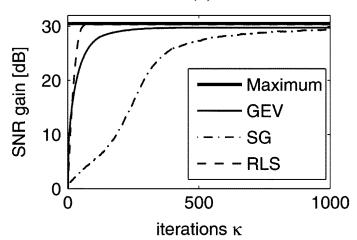

(b)  
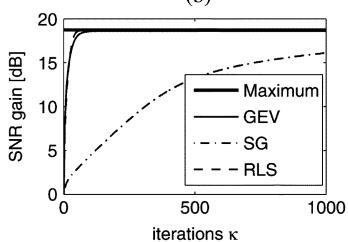  
(d)

(c)  
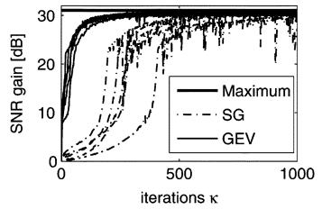

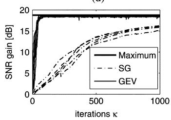  
Fig. 1. Adaptation performance of the analyzed update rules for random input signals and a simulated room transfer function evaluated at a frequency of 1 kHz. In the left column [(a) and (c)] for $T _ { 6 0 } = 0 . 0 5 :$ s and in the right column [(b) and (d)] for $T _ { 6 0 } = 0 . 5$ s. Curves in the upper row [(a) and (b)] are the averaged results of 1000 Monte Carlo simulations, and the lower row [(c) and (d)] shows five example runs for the two stochastic gradient algorithms.

to the input SNR as a function of the iteration index .

The plots in the left column of Fig. 1 show the adaptation results for $T _ { 6 0 } = 0 . 0 5$ s and in the right column for $T _ { 6 0 } = 0 . 5 \ : \mathrm { s } .$ For all plots, $\bar { \Phi } _ { \mathbf { X X } , \kappa }$ was estimated according to (33). For the estimation of the noise power spectral density, we assumed that we know the noisy part of $\mathbf { X } _ { \kappa } .$ , denoted by $\mathbf { N } _ { \kappa } .$ . In Fig. 1(a) and (b) first, only $\hat { \Phi } _ { \mathbf { N N } , \kappa }$ was estimated from $\mathbf { N } _ { \kappa } , \kappa = 1 , \ldots , 1 0 0 0$ with (32), where $\epsilon = 0 . 9 9$ . Then the adaptation of the filter coefficients $\mathbf { F } _ { \kappa }$ according to (34) was carried out with the fixed $\hat { \Phi } _ { \mathbf { N N } , 1 0 0 0 }$ This situation resembles the case in speech enhancement, where the noise PSD is estimated during speech pauses and then kept constant for the adaptation of the filter coefficients during presence of the desired speech.

An important property of the beamformer based on generalized eigenvalue decomposition is the fact that adaptation can take place even in the presence of strong directional noise. The beamformer will not tend to enhance the distortion rather than the desired speech, as long as is estimated during periods of absence of speech. On the contrary, beamformers based on principal component analysis, which maximize the output power rather than the output SNR, such as those presented in [13] and [26], will end up looking in a compromise direction, if in addition to the desired signal an unknown interferer is present during adaptation.

While the curves given in Fig. 1(a) and (b) are the average of 1000 Monte Carlo simulations, Fig. 1(c) and (d) shows five example adaptation runs for the two stochastic gradient algorithms. In the figure, the maximally achievable SNR gain (“Maximum”) is given as a reference. It can be computed from (4) by using the optimal filter coefficients and the PSD matrices after convergence.

Fig. 1(c) shows a large variation of the SNR gain obtained by the SG method after convergence. This indicates that the step-size constant is probably chosen too high. A smaller value of $\alpha$ would reduce the steady-sate error, however, at the expense of further increased adaptation time. For the current value of , the adaptation speed of the SG algorithm is already much smaller than for the GEV algorithm. A possible explanation could be that the SG algorithm maximizes the numerator and minimizes the denominator of (35) at every iteration alternatingly. Because they are closely related, this may result in first pulling in one and then in the opposite direction, leading to a net pull in neither direction.

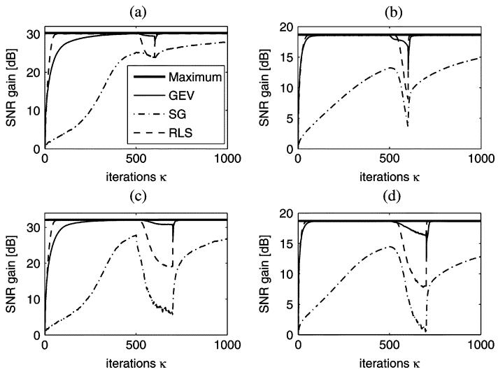  
Fig. 2. Adaptation performance of the analyzed update rules for random input signals, where only noise is present at the input during the iteration steps 500 to 600 in (a) and (b), and during the iteration steps 500 to 700 in (c) and (d), respectively. The curves show the averaged results of 1000 Monte Carlo simulations: in the left column [(a) and (c)] for $T _ { 6 0 } = 0 . 0 5$ s and in the right column [(b) and (d)] for $T _ { 6 0 } = 0 . 5 \mathrm { ~ s ~ }$

On the contrary, the GEV algorithm proposed here attempts to keep the output noise power constant and only maximizes the numerator of (35). This results in a convergence behavior, which is much faster than the SG and somewhat slower than RLS. The smooth trajectories obtained by the GEV indicate that the step size of the GEV method could even be chosen somewhat higher resulting in yet faster convergence.

In the following experiment, we demonstrate that the GEV method tends to be more robust than RLS. In Fig. 2(a) and (b), the adaptation is depicted for the situation where only noise is present at the input during the iteration steps 500 to 600, while speech plus noise is present at all other times. The noise only part is extended to iteration steps 500 to 700 in Fig. 2(c) and (d). Again, all curves are the average of 1000 Monte Carlo simulations. in the left column [Fig. 2(a) and (c)] for $T _ { 6 0 } = 0 . 0 5 :$ s and in the right column [Fig. 2(b) and (d)] for $T _ { 6 0 } = 0 . 5 \ : \mathrm { s }$ . Ideally, adaptation of the filter coefficients should be halted in such frames where the desired speech is absent. However, in a practical speech enhancement setup adaptation during noise-only periods may occur, be it because of wrong decisions of the VAD or because some frequency bins do not contain speech energy, even if speech is present. Obviously, the proposed adaptation algorithm (weak solid line) is less sensitive to the absence of the desired signal, compared to the RLS (dashed) algorithm.

The proposed GEV update rule and the RLS-based algorithm [25] are of the same order of complexity $\mathcal { O } ( M ^ { 2 } )$ , however, with different distribution of the processing load over speech and speech pause frames: while for our GEV algorithm the higher computational load occurs during speech periods, computations for the RLS-based update rule are heavier during speech pauses. To measure the computation time, we therefore applied input data with an equal number of speech and nonspeech frames. Both algorithms were used in a -element beamformer with a filterlength of 128 taps, implemented in C++. The computational performance was measured on a dual-core 2.4-GHz Intel Xeon processor, and a real-time factor of 0.059 was achieved for the proposed GEV update rule, compared to a slightly larger value of 0.073 for the RLS-based algorithm [25].

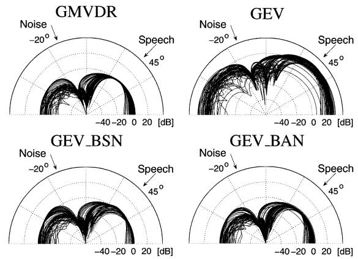  
Fig. 3. Beampattern $1 0 \log _ { 1 0 } r ^ { 2 } ( \theta _ { t } , k )$ of the GMVDR beamformer and the eigenvector beamformer without normalization (GEV) as well as with blind statistical normalization (GEV BSN) and blind analytical normalization (GEV BAN), respectively, in the case of no reverberation.

## C. Blind Normalization

In the following set of simulations, the proposed singlechannel post-filter normalization schemes are evaluated. For the simulations described in this and the next subsections, the beamformer FIR filters had a length of 128 taps each, both for the GEV variants and the GMVDR. The choice of such a short filter length was motivated by the goal to align the direct line-of-sight signal component and early reflections at the beamformer output while discarding the diffuse part of the room impulse response coming from multiple reflections. Furthermore, a short filter length allows for fast adaptation and tracking of a moving speaker by the GEV beamformer. The implementation of the frequency domain beamformer was based on the overlap-save approach with a DFT length of 256. The constraint in (25) was chosen to be frequency dependent: $C ( k ) ~ = ~ \rho \hat { \sigma } _ { N } ^ { 2 } ( k )$ with controlling the target output noise power, which was set to dB of the input noise power ${ \hat { \sigma } } _ { N } ^ { 2 } ( k )$

For illustration purposes, we first study the spatial transfer function $r ( \theta , k ) = | { \bf F } ^ { H } ( k ) { \bf d } ( \theta , k ) |$ for the case of no reverberation $( T _ { 6 0 } = 0 \ s )$ , known power spectral density matrices, and converged filter coefficients. The resulting beampattern $1 0 \log _ { 1 0 } r ^ { 2 } ( \theta , k )$ obtained by the GMVDR beamformer, the eigenvector beamformer without normalization (GEV), with blind analytical normalization (GEV BAN), and blind statistical normalization (GEV BSN) are shown in Fig. 3 for different frequencies. It can be seen that a minimum has been put in the direction of the noise, and the direction of the main lobe depends on the frequency. Only the GMVDR beamformer gives nearly a perfectly distortionless response for the target direction $\theta _ { t } = 4 5 ^ { \circ }$

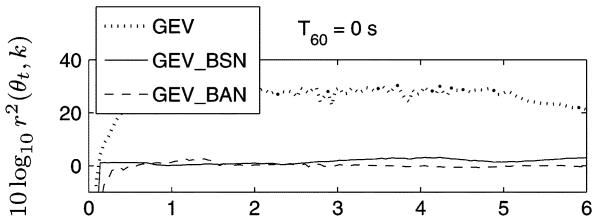

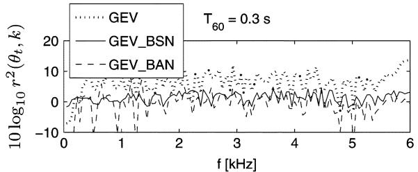  
Fig. 4. Spatial response $1 0 \log _ { 1 0 } r ^ { 2 } ( \theta _ { t } , k )$ of the eigenvector beamformer without normalization GEV and with BAN/BSN methods evaluated at the target direction $\theta _ { t } ~ = ~ 4 5 ^ { \circ }$ as a function of frequency $f ~ = ~ k / ( L T _ { s } ) ;$ ; in the upper figure for $T _ { 6 0 } = 0$ s and in the lower figure for $T _ { 6 0 } = 0 . 3 \mathrm { ~ s ~ }$

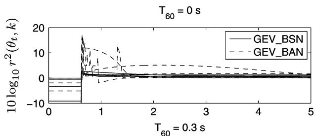

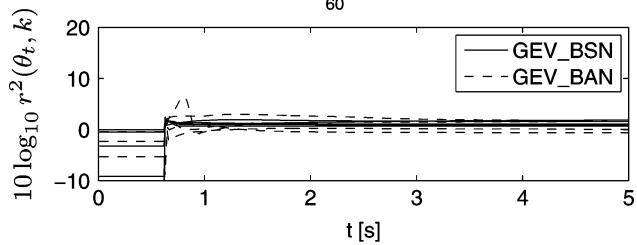  
Fig. 5. Spatial response $1 0 \log _ { 1 0 } r ^ { 2 } ( \theta _ { t } , k )$ of the eigenvector beamformer with BAN/BSN methods evaluated at the target direction $\theta _ { t } ~ = ~ 4 5 ^ { \circ }$ for the frequencies 1, 2, 3, 4, and 5 kHz over time. Upper figure for $T _ { 6 0 } = 0 ~ \mathrm { s } .$ , lower figure for $T _ { 6 0 } = 0 . 3 ~ \mathrm { s }$

While the beampattern gives an impression of the spatial response over all angles $\theta = [ - \pi / 2 , . . . , \pi / 2 ]$ , in Fig. 4 the spatial response $1 0 \log _ { 1 0 } r ^ { 2 } ( \theta _ { t } , k )$ is plotted versus frequency: in the upper figure for no reverberation, $T _ { 6 0 } = 0 ~ \mathrm { s }$ , and in the lower figure for $T _ { 6 0 } = 0 . 3 ~ \mathrm { s } .$ It can be seen that the spatial response in the case of no normalization depends highly on the frequency and the reverberation. The BSN post-filter gives good results for all frequencies and reverberation times. The analytical normal ization method BAN works better for low reverberation times.

In Fig. 5, we study the behavior during adaptation. At the beginning $( t = 0 \ \mathrm { s } )$ the beamformer is looking at broadside, and at $t = 0 . 7 { \mathrm { s } }$ the desired speech signal at $\theta _ { t }$ is turned on. The figure displays the spatial response in the direction of $\theta _ { t }$ for the frequencies 1, 2, 3, 4, and 5 kHz over time: in the upper figure for absence of reverberation, $T _ { 6 0 } = 0$ s, and in the lower figure for $T _ { 6 0 } = 0 . 3 \ : \mathrm { s }$ . While the GEV BAN beamformer shows high fluctuations during acquisition time the GEV BSN beamformer exhibits no peaks in the spatial response for all times.

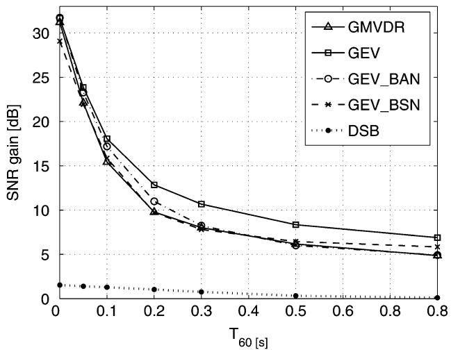  
Fig. 6. Comparison of the SNR gain for DSB, GMVDR, and GEV beamformers for directional noise placed at $\theta _ { n } = - 2 0 ^ { \circ }$

While the beampattern presented in Fig. 3 gives an illustrative qualitative impression, we now turn to the more interesting case of a reverberant environment. For all results presented in the following, we used the steady-state filter coefficients (after convergence) for all beamforming methods.

The SNR gains from the multichannel beamformer input to the beamformer output for the beamformer methods GMVDR, GEV, GEV BAN, GEV BSN, and a delay-and-sum beamformer (DSB) are given in Fig. 6 as a function of room reverberation time. For the DSB, the DoA was assumed to be perfectly known; however, no compensation of possible level differences of the input channels was made. While the absolute values of the SNR gains depend highly on the chosen setup, the SNR gain of one beamforming method relative to another is nevertheless a useful performance measure.

The largest SNR gain is obtained by the unnormalized GEV beamformer. This is due to the fact that it boosts the frequencies with high speech power and thus results in a better SNR compared to the other methods.

We now turn to the assessment of speech distortion introduced by the beamformer. To do so, we employed the perceptual speech quality measure PSM [33]. Perceptual similarity measure (PSM) has been shown to give comparable objective perceptual quality evaluation results as the well-known perceptual evaluation of speech quality (PESQ) measure [34]. PSM was used to measure the distortion present in the speech component of the output signal, where a value of one indicates that the analyzed signal is identical to the reference signal. In the following, we present results with two different reference signals.

For the results presented in Fig. 7, the reference signal was the clean speech source signal. As can be seen, for very low reverberation times the DSB performs best. This is understandable since the delay-only propagation model assumed by the DSB is valid and since the DoA was assumed to be perfectly known, whereas for the GMVDR the dominant eigenvector was determined by an iterative principal component analysis. For reverberation times $T _ { 6 0 } > 0 . 2 \ : \mathrm { s }$ , the GMVDR takes over, since it is able to align early reflections.

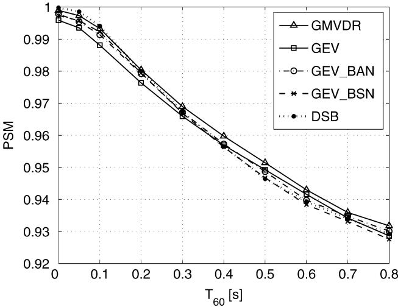  
Fig. 7. Comparison of DSB, GMVDR, and GEV beamformers using the clean speech source signal as reference for perceptual similarity measure.

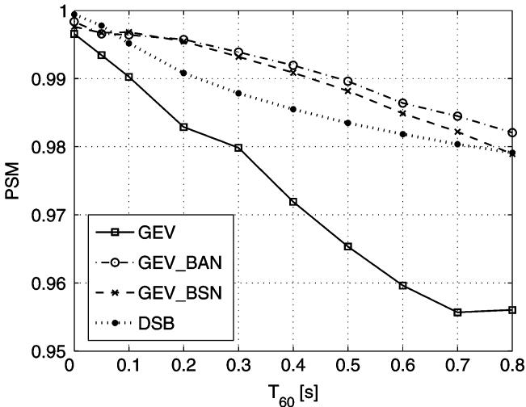  
Fig. 8. Comparison of DSB and GEV beamformers using the noise-free beamformer input signals filtered by the GMVDR as reverberant reference for perceptual similarity measure.

For low reverberation times, the normalized GEV versions achieve a better perceptual quality than the unnormalized beamformer. Unfortunately, for longer reverberation times, the results of the perceptual quality measure for the GEV beamformers are somewhat misleading here, because the reverberation effect on the PSM measure dominates the speech distortion introduced by the unnormalized GEV. Therefore, in Fig. 8, results are shown with a different reference signal, the GMVDR output, if the speech component only is present at the microphones. Note that with this setup, the GMVDR obviously gives the perfect PSM value of one. Fig. 8 now clearly shows the reduction of the speech distortion by the proposed post-filter processing methods in terms of higher PSM values. This correlates well with informal listening tests (visit web page [35] for sound examples).

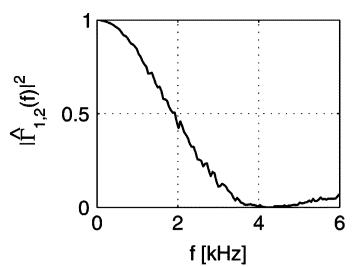

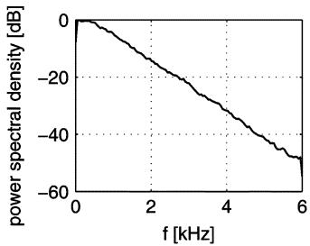  
Fig. 9. Left: measured magnitude squared coherence $| \hat { \Gamma } _ { 1 , 2 } ( f ) | ^ { 2 }$ between first and second microphone with distance $d _ { 1 2 } = 4$ cm. Right: power spectral density of the first channel.

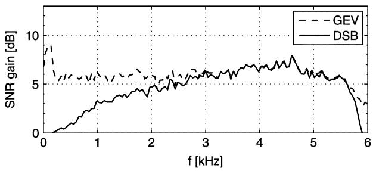  
Fig. 10. SNR gain achieved by the adaptive GEV beamformer and DSB as a function of frequency in a diffuse noise environment.

## D. Diffuse Noise

Next the performance in nondirectional, purely diffuse noise is studied. In this case, the entry in the th row and th column of $\Phi _ { \mathrm { N N } }$ is given by

$$
\{\Phi_ {\mathbf {N N}} \} _ {i, j} (k) = \sigma_ {N} ^ {2} (k) \Gamma_ {i, j} (k)\tag{36}
$$

with

$$
\Gamma_ {i, j} (k) = \frac {\sin \left(\frac {\omega_ {k} d _ {i j}}{c}\right)}{\left(\frac {\omega_ {k} d _ {i j}}{c}\right)}.\tag{37}
$$

Here, $d _ { i j } = | i - j | d$ is the distance between the th and th sensor, and $\omega _ { k } = 2 \pi k / T , 1 / T$ being the sampling rate.

In order to assess the performance of the adaptive GEV, lowpass diffuse noise was simulated. The measured magnitude squared coherence function (MSC) and the power spectral density of the simulated noise are given in Fig. 9. Note that the measured MSC follows closely the theoretically expected behavior.

Fig. 10 shows the SNR gain obtained by the adaptive GEV beamformer. As can be seen, the GEV also achieves an SNR gain at low frequencies, as is typical for MVDR or superdirective fixed beamformer [36]. Note that any scaling of the filter coefficients $\mathbf { F } ( k )$ is immaterial, i.e., does not show up in this plot, since it cancels out [see (4)]. Hence, GMVDR and our GEV differ only in a scaling factor. For comparison reasons, Fig. 10 also depicts the SNR gain obtained by a “perfect” DSB, where the DoA is assumed to be known.

Next, ${ \mathrm { F i g } } .$ 11 presents the SNR gain over the reverberation time $T _ { 6 0 }$ achieved by the GEV beamformer variants compared to a DSB and GMVDR for a segmental SNR of about 0 dB at the microphones and $\theta _ { t } = 4 5 ^ { \circ }$ . Again, the GEV methods achieve comparable performance to the benchmark GMVDR.

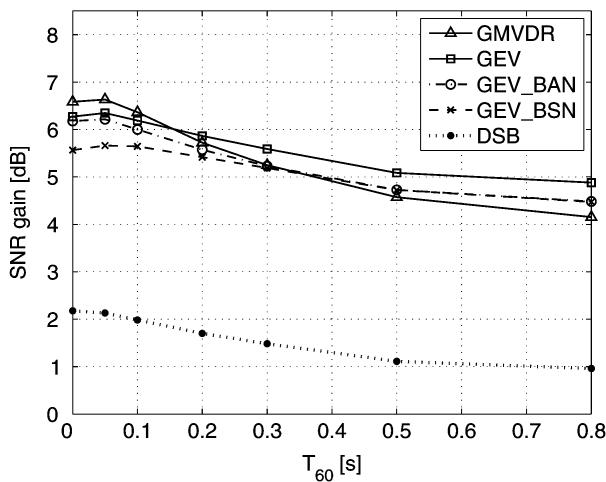  
Fig. 11. Comparison of the SNR gain for DSB, GMVDR, and GEV beamformers (diffuse noise).

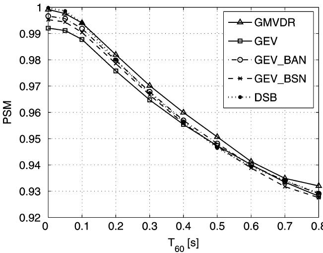  
Fig. 12. Comparison of the perceptual similarity measure for GMVDR, DSB, and GEV beamformer in the setup with diffuse noise using the clean speech source signal as reference.

Finally, Figs. 12 and 13 display the PSM values for the speech component of the beamformer output compared with the clean speech source signal and the clean GMVDR output signal as reference, respectively. Again, Fig. 13 clearly demonstrates the improved perceptual quality of the GEV with postfilter.

## VI. CONCLUSION

In this paper, we have presented a broadband acoustic beamformer based on a narrowband SNR criterion. For each discrete frequency bin, the beamformer coefficients are obtained as the principal eigenvector of a generalized eigenvalue (GEV) problem. Two variants of a single-channel post-filter were developed which effectively limit the otherwise present speech distortion. Further, a stochastic gradient ascent adaptation algorithm was presented to track the dominant eigenvector which is well suited for speech enhancement applications.

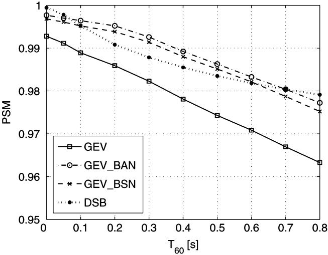  
Fig. 13. Comparison of DSB and GEV beamformers using the noise-free beamformer input signals filtered by the GMVDR as reverberant reference for perceptual similarity measure in the setup with diffuse noise.

Important properties of the proposed beamformer are as follows. First, the beamformer makes no a priori assumptions on the acoustic transfer function from the desired speech source to the microphones and on the spatial correlation of the noise. Thus, robust performance is achieved in arbitrary stationary acoustic environments. Second, the beamformer operates blindly in the sense that it does not explicitly estimate the acoustic transfer function or the direction-of-arrival, nor does it require knowledge of the array geometry. Further, no calibration is needed. Third, adaptation of the beamformer can take place even if strong directional (or diffuse) noise is present, as long as the power spectral density matrix of the interference is estimated during periods of absence of speech.

For the performance evaluation, we used the optimal generalized MVDR beamformer as a reference, where the acoustic transfer functions from the desired source to the sensors have been obtained by PCA in a training phase. It has been shown that the proposed beamformer achieves comparable performance with respect to noise reduction while introducing speech distortion, which, however, was reduced considerably by the proposed post-filters. Future research will deal with further reduction of the speech distortion.

## REFERENCES

[1] B. D. van Veen and K. M. Buckley, “Beamforming: A versatile approach to spatial filtering,” IEEE Acoust., Speech, Signal Process. Mag., vol. 5, no. 2, pp. 4–24, Apr. 1988.

[2] J. Capon, “High-resolution frequency-wavenumber spectrum analysis,” Proc. IEEE, vol. 57, no. 8, pp. 1408–1418, Aug. 1969.

[3] O. Frost, “An algorithm for linearly constrained adaptive array processing,” Proc. IEEE, vol. 60, no. 8, pp. 927–935, Aug. 1972.

[4] L. J. Griffiths and C. W. Jim, “An alternative approach to linearly constrained adaptive beamforming,” IEEE Trans. Antennas Propag., vol. 30, no. 1, pp. 27–34, Jan. 1982.

[5] O. Hoshuyama, A. Sugiyama, and A. Hirano, “A robust adaptive beamformer for microphone arrays with a blocking matrix using constrained adaptive filters,” IEEE Trans. Signal Process., vol. 47, no. 10, pp. 2677–2684, Oct. 1999.

[6] O. Hoshuyama and A. Sugiyama, “Robust adaptive beamforming,” in Microphone Arrays—Signal Processing Techniques and Applications, M. Brandstein and D. Ward, Eds. New York: Springer, 2001.

[7] W. Herbordt and W. Kellermann, “Computationally efficient frequency-domain robust generalized sidelobe canceller,” in Proc. Int. Workshop Acoust. Echo Noise Control IWAENC, Darmstadt, Germany, Sep. 2001, pp. 51–54.

[8] W. Herbordt and W. Kellermann, “Adaptive beamforming for audio signal acquisition,” in Adaptive Signal Processing—Applications to Real-World Problems, J. Benesty and Y. Huang, Eds. New York: Spinger, 2003.

[9] H. Cox, R. M. Zeskind, and M. M. Owen, “Robust adaptive beamforming,” IEEE Trans. Acoust., Speech, Signal Process., vol. ASSP-35, no. 10, pp. 1365–1376, Oct. 1987.

[10] Q. Zou, Z. L. Yu, and Z. Lin, “A robust algorithm for linearly constrained adaptive beamforming,” IEEE Signal Process. Lett., vol. 11, no. 1, pp. 26–29, Jan. 2004.

[11] S. Nordholm, I. Claesson, and B. Begtsson, “Adaptive array noise suppression of handsfree speaker input in cars,” IEEE Trans. Veh. Technol., vol. 42, no. 4, pp. 514–518, Nov. 1993.

[12] E. E. Jan and J. Flanagan, “Sound capture from spatial volumes: Matched-filter processing of microphone arrays having randomly-distributed sensors,” in Proc. IEEE ICASSP, Atlanta, GA, 1996, pp. 917–920.

[13] S. Affes and Y. Grenier, “A signal subspace tracking algorithm for microphone array processing of speech,” IEEE Trans. Speech Audio Process., vol. 5, no. 5, pp. 425–437, Sep. 1997.

[14] S. Gannot, D. Burshtein, and E. Weinstein, “Signal enhancement using beamforming and nonstationarity with applications to speech,” IEEE Trans. Signal Process., vol. 49, no. 8, pp. 1614–1626, Aug. 2001.

[15] S. Gannot and I. Cohen, “Speech enhancement based on the general transfer function GSC and postfiltering,” IEEE Trans. Speech Audio Process., vol. 12, no. 6, pp. 561–571, Nov. 2004.

[16] E. Oja, “A simplified neuron model as a principal component analyzer,” J. Math. Biol., vol. 15, pp. 267–273, 1982.

[17] L. C. Godara, “Application of antenna arrays to mobile communications, Part II: Beam-forming and direction-of-arrival considerations,” Proc. IEEE, vol. 85, no. 8, pp. 1195–1245, Aug. 1997.

[18] K. U. Simmer, J. Bitzer, and C. Marro, “Post-filtering techniques,” in Microphone Arrays—Signal Processing Techniques and Applications, M. Brandstein and D. Ward, Eds. New York: Springer, 2001.

[19] Y. Ephraim and H. L. van Trees, “A signal subspace approach for speech enhancement,” IEEE Trans. Speech Audio Process., vol. 3, no. 2, pp. 251–266, Jul. 1995.

[20] F. Asano, S. Hayamizu, T. Yamada, and S. Nakamura, “Speech enhancement based on the subspace method,” IEEE Trans. Speech Audio Process., vol. 8, no. 5, pp. 497–507, Sep. 2000.

[21] F. Asano and H. Asoh, “Blind speech enhancement using generalized eigenvalue decomposition,” in Proc. Eusipco, Sep. 2002, pp. 313–316.

[22] S. Doclo and M. Moonen, “Robustness of SVD-based optimal filtering for noise reduction in multi-microphone speech signals,” in Proc. IEEE Int. Workshop Acoust. Echo Noise Control (IWAENC), Pocono Manor, PA, Sep. 1999, pp. 80–83.

[23] S. Doclo and M. Moonen, “Multimicrophone noise reduction using recursive GSVD-based optimal filtering with ANC postprocessing stage,” IEEE Trans. Speech Audio Process., vol. 13, no. 1, pp. 53–69, Jan. 2005.

[24] D. R. Morgan, “Adaptive algorithms for solving generalized eigenvalue signal enhancement problems,” Signal Process., vol. 84, pp. 957–968, 2004.

[25] J. Yang, H. Xi, F. Yang, and Y. Zhao, “RLS-based adaptive algorithms for generalized eigen-decomposition,” IEEE Trans. Signal Process., vol. 54, no. 4, pp. 1177–1188, Apr. 2006.

[26] E. Warsitz and R. Haeb-Umbach, “Acoustic filter-and-sum beamforming by adaptive principal component analysis,” in Proc. IEEE ICASSP, Philadelphia, PA, Mar. 2005, pp. 797–800.

[27] E. Warsitz and R. Haeb-Umbach, “Controlling Speech Distortion in Adaptive Frequency-Domain Principal Eigenvector Beamforming,” in IWAENC, Paris, France, Sep. 2006.

[28] E. Warsitz, R. Haeb-Umbach, and S. Peschke, “Adaptive beamforming combined with particle filtering for acoustic source localization,” in Proc. Int. Conf. Spoken Lang. Process. (ICSLP2004), Jeju, Korea, Oct. 2004, pp. 2849–2852.

[29] R. Haeb-Umbach and E. Warsitz, “Adaptive filter-and-sum beamforming in spatially correlated noise,” in Proc. IWAENC, Eindhoven, The Netherlands, Sep. 2005, pp. 125–128.

[30] S. Haykin, Neural Networks. Englewood Cliffs, NJ: Prentice-Hall, 1999.

[31] J. J. Shynk, “Frequency-domain and multirate adaptive filtering,” IEEE Signal Process. Mag., vol. 9, no. 1, pp. 14–39, Jan. 1992.

[32] J. B. Allen and D. A. Berkley, “Image method for efficiently simulating small-room acoustics,” J. Acoust. Soc. Amer., vol. 107, no. 4, pp. 943–950, 1979.

[33] R. Huber, “Objective assessment of audio quality using an auditory processing model,” Ph.D. dissertation, Univ. Oldenburg, Oldenburg, Germany, 2003.

[34] T. Rohdenburg, V. Hohmann, and B. Kollmeier, “Objective perceptual quality measures for the evaluation of noise reduction schemes,” in Proc. IWAENC, Eindhoven, The Netherlands, Sep. 2005, pp. 169–172.

[35] Homepage of the Department of Communications Engineering, University of Paderborn, [Online]. Available: http://www-nt.uni-paderborn.de; http://www-nt.uni-paderborn.de/index.php?id=39&L=2, site with sound examples.

[36] J. Bitzer and K. U. Simmer, “Superdirective Microphone Arrays,” in Microphone Arrays: Signal Processing Techniques and Applications. New York: Springer Verlag, 2001.

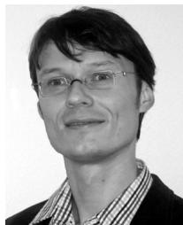

Ernst Warsitz (S’06) was born in 1971. He received the Dipl.-Ing. degree in electrical engineering from the University of Paderborn, Paderborn, Germany, in 2000.

He joined the Department of Communications Engineering of the University of Paderborn in 2001 as a Research Staff Member. His research interests are in statistical signal processing in general, and in microphone array beam forming and acoustic scene analysis in particular.

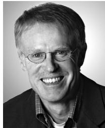

Reinhold Haeb-Umbach (M’89) received the Dipl.-Ing. and Dr.-Ing. degrees in electrical engineering from Aachen University of Technology, Aachen, Germany, in 1983 and 1988, respectively.

From 1988 to 1989, he was a Postdoctoral Fellow at the IBM Almaden Research Center, San Jose, CA, conducting research on coding and signal processing for recording channels. From 1990 to 2001, he was with Philips Research working on various aspects of automatic speech recognition. Since 2001, he has been a Full Professor in Communications Engi-

neering at the University of Paderborn, Paderborn, Germany. His main research interests are in statistical signal processing and pattern recognition.