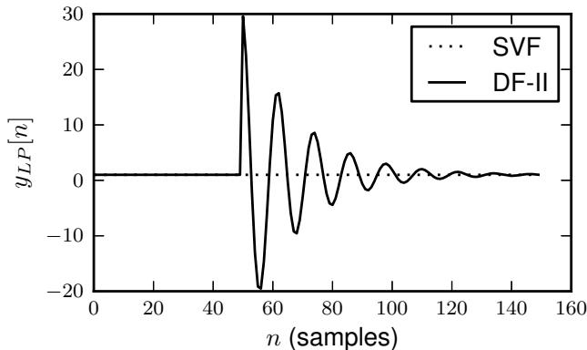
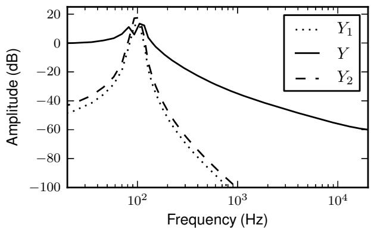
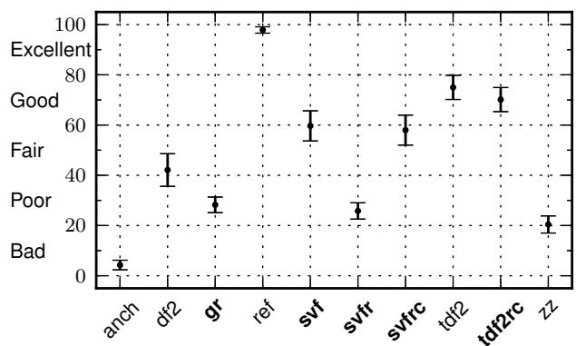
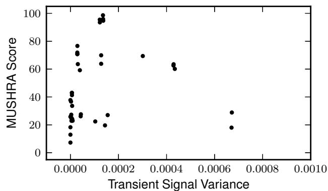
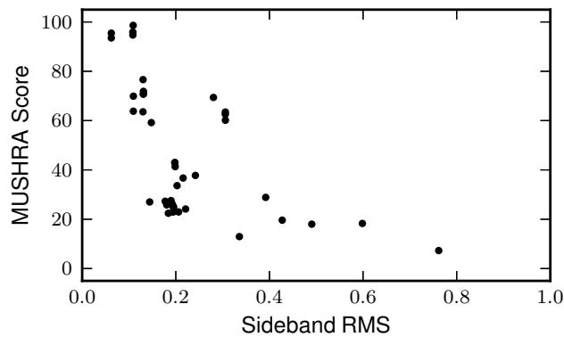

# TIME-VARYING FILTERS FOR MUSICAL APPLICATIONS

Aaron Wishnick

iZotope, Inc., Cambridge, Massachusetts, USA awishnick@izotope.com

## ABSTRACT

A variety of methods are available for implementing time-varying digital filters for musical applications. The considerations for musical applications differ from those of other applications, such as speech coding. This domain requires realtime parametric control of a filter such as an equalizer, allowing parameters to vary each sample, e.g. by user interaction, a low-frequency oscillator (LFO), or an envelope. It is desirable to find a filter structure that is timevarying stable, artifact-free, computationally efficient, easily supports arbitrary filter shapes, and yields sensible intermediate filter shapes when interpolating coefficients. It is proposed to use the state variable filter (SVF) for this purpose. A novel proof of its stable time-varying behavior is presented. Equations are derived for matching common equalizer filter shapes, as well as any zdomain transfer function, making the SVF suitable for efficiently implementing any recursive filter. The SVF is compared to state of the art filter structures in an objective evaluation and a subjective listening test. The results confirm that the SVF has good audio quality, while supporting the aforementioned advantageous qualities in a time-varying digital filter for music. They also show that a class of time-varying filter techniques useful for speech coding are unsuitable for musical applications.

## 1. INTRODUCTION

In digital audio effects, filters are rarely time-invariant. A filter is time-variant if it has a user-controllable parameter. A time-variant filter is also a useful building block for an effect such as a phaser or filter controlled by an LFO or envelope. For these applications, it is important that the filter remain stable, and that the time-varying behavior not introduce perceptible artifacts. Here, we focus on realtime musical applications, where parameters may be varied every sample, as with an LFO, and it should be computationally efficient to do so. An ideal method will allow implementation of any filter shape. As the parameter changes may be smoothed, the transfer functions resulting from the intermediate coefficients should maintain a similar magnitude response to the shapes being interpolated. This study is restricted to second-order recursive filters because higher order filters are typically decomposed into second-order sections.

The choice of filter structure has a large influence on timevarying behavior, including whether the filter will remain stable. Even stable filters can still produce objectionable artifacts, as will be shown in Sec. 6.

In order to implement time-varying filters, given a desired transfer function, one option is to select a time-varying stable filter structure, and configure this structure to realize the transfer function. Another option is to use a time-varying unstable structure such as Direct-Form II transposed, and stabilize it.

A variety of approaches have been proposed to improve timevarying behavior. One category of methods is transient suppression [1] [2] [3], and another is stabilization [4] [5]. These are discussed in more detail in Sec. 2.

One filter structure that is often used to realize realtime, persample time-varying behavior is the state variable filter (SVF). Empirically, it is known to remain stable and artifact-free, but these properties have not previously been proven. A proof of timevarying stability will be shown here. By taking the output of this filter from different nodes, it is possible to obtain second-order lowpass, bandpass, or highpass filters. The SVF also maps intuitively to common audio equalization filters, providing independent control over frequency and resonance, which results in a low computational burden. Due to this relation, directly interpolating SVF coefficients also tends to result in sensible intermediate filter shapes, unlike some other structures [6]. Here we will also show how to choose SVF coefficients to realize any desired transfer function. Thus, the SVF satisfies the desired qualities of a timevarying filter for musical applications.

Prior approaches to time-varying filtering are reviewed in Sec. 2. In Sec. 3, we review the proposed digital implementation of the SVF. In Sec. 4, we derive formulas for using the SVF to realize some common filter types for audio equalization, and generally, any second-order z-domain transfer function. This allows the SVF to be easily used to implement any digital filter. In Sec. 5, the time-varying stability of this structure is proven. In Sec. 6, the time-varying behavior is compared with state of the art methods in an objective evaluation of DC response, as well as a subjective listening test, which confirms its good audio quality, and suggests criteria for perceptually good time-varying behavior.

## 2. PRIOR WORK

A variety of filter structures have been studied in the time-varying case, e.g. [5] [4]. Structures such as Direct-Form II, lattice, and normalized ladder are not necessarily stable when coefficients are changed. Coupled form, also known as normal form or Gold and Rader [7] [8], is stable in the time-varying case. Stability here refers to bounded-input/bounded-output (BIBO) stability [5], meaning that the output of the filter will be bounded so long as the input is bounded.

In addition to these structures, there are several methods for stabilizing a filter or eliminating transients from it. Consider a change from state space matrix $\mathbf { S _ { 1 } } \ \mathrm { t o } \ \mathbf { S _ { 2 } }$ at time $n = m$ . Let $y _ { 1 } [ n ]$ be the output when filtering the entire signal with $\mathbf { S _ { 1 } }$ and y [n] be the output when using $\mathbf { S _ { 2 } }$ . The output switching model [1] [3] has the ideal response of

$$
y [ n ] = \left\{ \begin{array}{l l} y _ {1} [ n ] & : n <   m \\ y _ {2} [ n ] & : n > = m \end{array} \right.\tag{1}
$$

## 2.1. Transient Minimization

Transient minimization techniques consider the transient signal, defined as the difference between the actual output signal, and the output switching model from equation (1). Transient minimization techniques decrease this transient signal.

Zetterberg and Zhang [1] propose a method, motivated by LPCbased speech coding, that realizes equation (1). It works by recomputing the state vector, but this requires the entire input signal to achieve this, making it unsuitable for realtime use. Välimäki and Laakso [3] propose an approximation to Zetterberg-Zhang which only requires a finite signal history, allowing realtime usage. However, this method is designed for sparsely occurring coefficient changes. Supporting audio-rate coefficient changes, e.g. when modulating a filter with a LFO, would require many filters running at once, making it computationally prohibitive for this application.

Rabenstein [2] uses an intermediate set of coefficients, which minimizes the variance of the transient signal. This method is also intended for coefficient changes that are spaced far apart in time.

## 2.2. Stabilization

While transient minimization deals with correcting a filter’s output, stabilization allows use of a filter structure that is ordinarily not stable when time-varying, by forcing it to stay stable.

Rabenstein and Czarnach [4] present a method of transforming the state vector to stabilize any filter structure. It works by relating a filter in its state space structure to the coupled form. This can be performed every sample, making it suitable for audio-rate coefficient changes. It can be incorporated into the coefficient matrix, allowing the filtering operation to incur no additional cost, while making coefficient computation more costly.

## 3. THE STATE VARIABLE FILTER

## 3.1. State Space Form

The continuous-time state variable filter in state space form [9] has the differential equation

$$
\begin{array}{l} \dot {x _ {1}} = u - 2 R x _ {1} - x _ {2} \\ \dot {x _ {2}} = x _ {1} \end{array}\tag{2}
$$

where $x _ { 1 } , x _ { 2 }$ are the state variables, and u is the input to the filter. The x˙ superscript indicates a time derivative. The parameter R controls the resonance, and this continuous-time formulation places the center frequency at unity, i.e. it is normalized. It will be useful to render this system in matrix form, so that

$$
\dot {\mathbf {x}} = \mathbf {A} \mathbf {x} + \mathbf {B} \mathbf {u}\tag{3}
$$

In this case, we have

$$
\mathbf {A} = \left[ \begin{array}{c c} - 2 R & - 1 \\ 1 & 0 \end{array} \right]\tag{4a}
$$

$$
\mathbf {B} = \left[ \begin{array}{c c} 1 & 0 \end{array} \right] ^ {T}\tag{4b}
$$

$$
\mathbf {x} = \left[ \begin{array}{c c} x _ {1} & x _ {2} \end{array} \right] ^ {T}\tag{4c}
$$

$$
\mathbf {u} = [ u ]\tag{4d}
$$

## 3.2. Bilinear Transform

We will apply the bilinear transform to obtain a discrete-time filter. This is equivalent to trapezoidal integration, preserves stability, and maps the entire continuous frequency axis to the discretetime frequency axis [10] [11].

In audio signal processing literature, cases are encountered where the application of the bilinear transform to a continuoustime filter results in a delay-free loop: a feedback loop that contains no delay elements, where the state at time n appears to depend on itself instantaneously. For example, Smith [9] and Dutilleux [12] both remark that the bilinear transform cannot be used with the SVF for this reason. The Chamberlin filter structure is another discretization of the SVF, using Forward Euler and Backward Euler integrators [13] [9] [14], but this structure becomes unstable for some parameters.

These difference equations are actually implementable with some extra computation. The K-Method [10] [15] is an algebraic method for discretizing and solving systems in state space form, and Zavalishin [16] presents a graphical method that is equivalent, which is also applied to the SVF.

The K-Method involves writing a difference equation for the integrator to be used and then substituting the system to be simulated in state space form into that difference equation. Delay free loops are handled by solving the resulting system, which will be linear in this case.

## 3.3. Discretization

We apply the K-Method using a Direct-Form II transposed (TDF-II) trapezoidal integrator [11], which is the same integrator as used in [16]. This form is canonical with respect to delay. Introducing s as the state vector, the TDF-II trapezoidal integrator update rule is

$$
\mathbf {x _ {n}} = g \dot {\mathbf {x _ {n}}} + \mathbf {s _ {n - 1}}\tag{5a}
$$

$$
\mathbf {s _ {n}} = \mathbf {s _ {n - 1}} + 2 g \dot {\mathbf {x _ {n}}}\tag{5b}
$$

where the coefficient $g$ is chosen to map a specific analog frequency $w _ { a } = 2 \pi f _ { a }$ to a digital frequency $\scriptstyle w _ { c } = 2 \pi f _ { c } ,$ , at a sampling rate $\begin{array} { r } { f _ { s } = \frac { 1 } { T } } \end{array}$ , known as prewarping [11]:

$$
g = \frac {\tan (\pi T f _ {c})}{w _ {a}}\tag{6}
$$

We can substitute the state space formulation from equation (3) into the integration and update rules from equation (5) to discretize an arbitrary continuous-time state space system. This is similar to how the K-Method is used in [10] and [15], except that we use the TDF-II realization of the trapezoidal integrator, instead of DF-I. Solving for $\mathbf { x _ { n } }$ and $\mathbf { s _ { n } } ,$ , we have

$$
\mathbf {H} = (\mathbf {I} - g \mathbf {A}) ^ {- 1}\tag{7a}
$$

$$
\mathbf {x _ {n}} = g \mathbf {H} \mathbf {B} \mathbf {u _ {n}} + \mathbf {H} \mathbf {s _ {n - 1}}\tag{7b}
$$

$$
\mathbf {s} _ {\mathbf {n}} = \mathbf {s} _ {\mathbf {n - 1}} + 2 g \mathbf {A x} _ {\mathbf {n}} + 2 g \mathbf {B u} _ {\mathbf {n}}\tag{7c}
$$

This is how the K-Method handles delay-free loops: upon substituting (3) into $( 5 ) , \mathbf { x _ { n } }$ appears on both sides of the equation. The matrix inverse H is used to solve this linear system, making it explicit in $\mathbf { x _ { n } }$

Now we use (7) to implement the SVF. By substituting the SVF state space matrices from equation (4) into this TDF-II trapezoidal integration rule (7), we obtain a discrete-time realization of the SVF:

$$
\mathbf {H} = \frac {1}{g ^ {2} + 2 R g + 1} \left[ \begin{array}{c c} 1 & - g \\ g & 2 R g + 1 \end{array} \right]\tag{8a}
$$

$$
\mathbf {x _ {n}} = g \mathbf {H} \left[ \begin{array}{c} 1 \\ 0 \end{array} \right] \mathbf {u _ {n}} + \mathbf {H s _ {n - 1}}\tag{8b}
$$

$$
\mathbf {s _ {n}} = \mathbf {s _ {n - 1}} + 2 g \left[ \begin{array}{c c} - 2 R & - 1 \\ 1 & 0 \end{array} \right] \mathbf {x _ {n}} + 2 g \left[ \begin{array}{c} 1 \\ 0 \end{array} \right] \mathbf {u _ {n}}\tag{8c}
$$

By expanding the individual expressions for $x _ { 1 } [ n ]$ and $x _ { 2 } [ n ]$ , the elements of x, it can be verified that this is the same as the discretetime model of the SVF in [16], where $x _ { 1 } = y _ { B P }$ and $x _ { 2 } = y _ { L P }$ . The filter can now be implemented by computing equations (8) in order.

## 3.4. Alternate Implementation

If the filter is implemented with equations (8), the integrator outputs are directly available as the elements of $\mathbf { x _ { n } } .$ , but additional algebra is required if the integrator inputs $\dot { \mathbf { x } } _ { \mathbf { n } }$ are desired.

It is possible to realize the same filter topology by first computing $\dot { \mathbf { x } } _ { \mathbf { n } }$ as an intermediate variable. A general form can be found by substituting equation (7b) into equation (3):

$$
\dot {\mathbf {x}} _ {\mathbf {n}} = (g \mathbf {A H B} + \mathbf {B}) \mathbf {u} _ {\mathbf {n}} + \mathbf {A H s} _ {\mathbf {n - 1}}\tag{9}
$$

If this alternate realization is used, first equation (9) is computed, and then the generic TDF-II trapezoidal integration rule from equation (5) is used. Note that equation (5) does not depend on the specific state space matrices A or B, only on the integrator gain g.

This realization will be convenient for the next section, where ${ \dot { x } } _ { 1 }$ will be needed. It can be verified that x˙ is the same as y from [16].

## 4. REALIZING OTHER FILTER TYPES

One useful property of the SVF is that various transfer functions can be obtained by taking the output from different nodes, as demonstrated in [12] and [16]. Most directly, $x _ { 1 }$ is a bandpass filter, x is a lowpass filter, and x˙ is a highpass filter:

$$
H _ {H P} (s) = \frac {s ^ {2}}{s ^ {2} + 2 R s + 1}\tag{10a}
$$

$$
H _ {B P} (s) = \frac {s}{s ^ {2} + 2 R s + 1}\tag{10b}
$$

$$
H _ {L P} (s) = \frac {1}{s ^ {2} + 2 R s + 1}\tag{10c}
$$

When the filter is digitally implemented, $x _ { 1 } [ n ]$ and x [n] are available as elements of the state vector $\mathbf { x _ { n } }$ . If the alternate implementation from equation (9) is used, ${ \dot { x } } _ { 1 } [ n ]$ is immediately available as well, otherwise it can be computed from equation (2).

Zavalishin [16] presents some ways of combining these outputs to produce other filter types, such as band-shelving, notch, and allpass. However, difficulty is noted in producing other shapes, such as low- and high-shelf filters. Here we will demonstrate how to obtain these shapes, as well as others that are useful for audio equalization.

## 4.1. Filters for Audio Equalization

Some common filter types are presented in [17]. To enable broad applicability of the SVF, we will show how to implement some of these filters. The technique presented here is suitable to be used with other s-domain filter design methods, e.g. [18]. The filter types that we will implement are presented as continuous-time transfer functions with unity cutoff in Table 1.

These filters share some parameters: Q controls the filter resonance, and $A = 1 0 ^ { G / 4 0 }$ controls the gain, where G is the gain in decibels.

Table 1: Filtersfor audio equalization.

<table><tr><td>Type</td><td>Transfer Function</td></tr><tr><td>Lowpass</td><td> $H(s) = \frac{1}{s^2 + 1/Qs + 1}$ </td></tr><tr><td>Bandpass</td><td> $H(s) = \frac{s}{s^2 + 1/Qs + 1}$ </td></tr><tr><td>Highpass</td><td> $H(s) = \frac{s^2}{s^2 + 1/Qs + 1}$ </td></tr><tr><td>Peaking</td><td> $H(s) = \frac{s^2 + A/Qs + 1}{s^2 + 1/AQS + 1}$ </td></tr><tr><td>Low Shelf</td><td> $H(s) = A\frac{s^2 + \sqrt{A}/Qs + A}{As^2 + \sqrt{A}/Qs + 1}$ </td></tr><tr><td>High Shelf</td><td> $H(s) = A\frac{As^2 + \sqrt{A}/Qs + 1}{s^2 + \sqrt{A}/Qs + A}$ </td></tr></table>

The general strategy is to write the desired transfer function as a linear combination of the lowpass, bandpass, and highpass transfer functions from equation (10). This requires adjusting the resonance parameter R and the trapezoidal integrator coefficient g to scale the filter to the correct frequency. The general form is

$$
H (s) = c _ {H P} H _ {H P} (k s) + c _ {B P} H _ {B P} (k s) + c _ {L P} H _ {L P} (k s)\tag{11}
$$

The lowpass, bandpass, and highpass filters can be obtained trivially by picking $R = { ^ 1 } / { _ { 2 Q } }$ . For the rest of the filters, it is necessary to solve for R, and possibly to use frequency scaling as in [16]. Frequency scaling maps an analog frequency $w _ { a }$ to the digital frequency $w _ { c } ,$ using equation (6), with $w _ { a } = k$ . The SVF denominator can be made equal to the target transfer function by manipulating R and k in this way, and then the numerator can be matched by choosing c , c , and c .

This strategy is used to generate filter coefficients, which are displayed in Table 2. In addition to the filter type, each filter is controlled by the critical frequency $w _ { c } ,$ the resonance $Q ,$ , and possibly the gain A. For the SVF, compute 2R and k according to the table, and use k to compute the integrator gain g from equation (6).

Then, process a sample through the filter, and combine the signals using the gains $c _ { H P } , c _ { B P }$ , and $c _ { L P }$ to form the output:

$$
y [ n ] = c _ {H P} \dot {x} _ {1} [ n ] + c _ {B P} x _ {1} [ n ] + c _ {L P} x _ {2} [ n ]\tag{12}
$$

Table 2: Filter coefficients

<table><tr><td>Type</td><td>2R</td><td>k</td><td> $c_{HP}$ </td><td> $c_{BP}$ </td><td> $c_{LP}$ </td></tr><tr><td>Lowpass</td><td> $^1/Q$ </td><td>1</td><td>0</td><td>0</td><td>1</td></tr><tr><td>Bandpass</td><td> $^1/Q$ </td><td>1</td><td>0</td><td>1</td><td>0</td></tr><tr><td>Highpass</td><td> $^1/Q$ </td><td>1</td><td>1</td><td>0</td><td>0</td></tr><tr><td>Peaking</td><td> $^1/Q$ </td><td>1</td><td>1</td><td> $^A/Q$ </td><td>1</td></tr><tr><td>Low Shelf</td><td> $^1/Q$ </td><td> $\sqrt{A}$ </td><td>1</td><td> $^A/Q$ </td><td> $A^2$ </td></tr><tr><td>High Shelf</td><td> $^1/Q$ </td><td> $^1/\sqrt{A}$ </td><td> $A^2$ </td><td> $^A/Q$ </td><td>1</td></tr></table>

## 4.2. Arbitrary Digital Filters

In the previous section, common audio equalization filters, designed by applying the bilinear transform to a continuous-time transfer function with unity cutoff, were matched with the SVF. This technique is generally applicable when given a continuoustime transfer function. There are a variety of other representations available for a digital filter, but some filter design methods, e.g.

those of Berchin [19] and Christensen [20] operate directly in the digital domain, yielding transfer function coefficients. Though the filter was discretized with the bilinear transform, it can be used to realize any second-order filter. Therefore, we now derive SVF filter coefficients for arbitrary second-order digital filters, to enable use of these techniques.

## 4.2.1. Discrete-Time SVF Transfer Functions

First we must derive discrete-time transfer functions for the SVF. This can be done by substituting $s  { \frac { 1 } { q } } { \frac { 1 - z ^ { - 1 } } { 1 + z ^ { - 1 } } }$ for each of the transfer functions from equations (10), in order to apply the bilinear transform in the z-domain, or with the Z-transform. Solving, we find

$$
H _ {H P} (z) = \frac {1 - 2 z ^ {- 1} + z ^ {- 2}}{1 + g ^ {2} + 2 R g + (2 g ^ {2} - 2) z ^ {- 1} + (1 + g ^ {2} - 2 R g) z ^ {- 2}}\tag{13a}
$$

$$
H _ {B P} (z) = \frac {g - g z ^ {- 2}}{1 + g ^ {2} + 2 R g + (2 g ^ {2} - 2) z ^ {- 1} + (1 + g ^ {2} - 2 R g) z ^ {- 2}}\tag{13b}
$$

$$
H _ {L P} (z) = \frac {g ^ {2} + 2 g ^ {2} z ^ {- 1} + g ^ {2} z ^ {- 2}}{1 + g ^ {2} + 2 R g + (2 g ^ {2} - 2) z ^ {- 1} + (1 + g ^ {2} - 2 R g) z ^ {- 2}}\tag{13c}
$$

## 4.2.2. Matching a Z-domain Transfer Function

Now that we have the discrete-time SVF transfer functions, we want to choose coefficients to match a given second-order digital filter. Without loss of generality, let that filter be specified as

$$
H (z) = \frac {b _ {0} + b _ {1} z ^ {- 1} + b _ {2} z ^ {- 2}}{1 + a _ {1} z ^ {- 1} + a _ {2} z ^ {- 2}}\tag{14}
$$

Like equation (11), we will write the desired filter as a linear combination of the three transfer functions (13):

$$
H (z) = c _ {H P} H _ {H P} (z) + c _ {B P} H _ {B P} (z) + c _ {L P} H _ {L P} (z)\tag{15}
$$

Thus, there are five coefficients as input, and five degrees of freedom to match that filter: g, R, c , c , and $c _ { L P }$ . To find these parameters, we normalize the SVF transfer functions (13) by dividing the numerators and denominators by $1 + g ^ { 2 } + 2 R g$ , and then set equation (15) equal to (14). This system can be solved by setting all the coefficients of z, as well as the constant terms in the numerator, equal. Solving for positive g and R, we find

$$
g = \frac {\sqrt {- 1 - a _ {1} - a _ {2}}}{\sqrt {- 1 + a _ {1} - a _ {2}}}\tag{16a}
$$

$$
R = \frac {a _ {2} - 1}{\sqrt {- 1 - a _ {1} - a _ {2}} \sqrt {- 1 + a _ {1} - a _ {2}}}\tag{16b}
$$

$$
c _ {H P} = \frac {b _ {0} - b _ {1} + b _ {2}}{1 - a _ {1} + a _ {2}}\tag{16c}
$$

(16d)

$$
c _ {L P} = \frac {b _ {0} + b _ {1} + b _ {2}}{1 + a _ {1} + a _ {2}}\tag{16e}
$$

Note that it is possible for both square roots to be purely imaginary, but the imaginary parts will cancel when they are multiplied or divided, yielding real numbers. Using these coefficients, it is possible to design a digital filter using any design method, decompose it into second-order sections, as noted in [16], and then realize the filter using the SVF. This allows the time-varying stability and artifact-free behavior of the SVF to be used for any digital filter.

## 5. STABILITY

Stability is more complex in the time-variant case. This topic is treated thoroughly by Laroche [5]. To summarize, a time-variant filter that has the coefficients of a stable time-invariant filter at each point in time may still be unstable. There are stricter criteria for time-variant filters, two of which are presented in [5]. Here we will prove the stability of the TDF-II realization of the SVF.

## 5.1. Transition Matrix

The stability criteria apply only to the state transition matrix, which describes the linear contribution of the state vector from time $n - 1$ to time n. To derive this matrix, solve for $\mathbf { s } _ { n }$ in terms of $\mathbf { s } _ { n - 1 }$ by substituting equation (7b) into equation (7c):

$$
\mathbf {s _ {n}} = \mathbf {P s _ {n - 1}} + (2 g ^ {2} \mathbf {A H B} + 2 g \mathbf {B}) \mathbf {u _ {n}}\tag{17}
$$

$$
\mathbf {P} = (\mathbf {I} + 2 g \mathbf {A H})\tag{18}
$$

where P is the state transition matrix. Next, substitute in the SVF matrices from (4) to find the SVF state transition matrix.

$$
\mathbf {P} = \frac {1}{g ^ {2} + 2 R g + 1} \left[ \begin{array}{c c} 1 - g ^ {2} - 2 R g & - 2 g \\ 2 g & 1 - g ^ {2} + 2 R g \end{array} \right]\tag{19}
$$

Criterion 1 presented in [5] immediately fails for this matrix. The criterion is that there exist a real constant $0 \leq \gamma < 1$ such that $\| \mathbf { P } \| \leq \gamma$ , where the standard Euclidean matrix norm is used. Assuming $g > 0$ and $R > 0 ,$ , it can be seen that $\| \mathbf { P } \| = 1$

Instead, we must use Criterion 2 from [5], which requires a change of basis matrix T. Then, the criterion is that there exist a real constant $0 \leq \gamma < 1$ such that $\lVert \mathbf { T P T } ^ { - 1 } \rVert \le \gamma$ . This approach was attempted but not completed in [21].

## 5.2. Change of Basis

Pick a change of basis matrix of the form $\mathbf { T } = { \left| \begin{array} { l l } { 1 } & { k } \\ { 0 } & { 1 } \end{array} \right| }$ . We will show that it is possible to pick $k > 0$ such that g and R can take on an arbitrarily large range. This work is done with the aid of a computer algebra system, Mathematica version 8.0.1.0 (Wolfram Research, Inc.; 2011), and some intermediate results will be omitted for brevity. Throughout, the assumptions $g > 0 , R > 0$ , and $k > 0$ will be used.

First, solve for kTPT−1k. The resulting expression is very long, so it is omitted here. To simplify, make the substitutions $\alpha =$ $\frac { \sqrt { 1 6 + 4 k ^ { 2 } + k ^ { 4 } } } { 2 k }$ and $\begin{array} { r } { \beta = \frac { 4 + k ^ { 2 } } { 2 k } } \end{array}$ , and solve for the stable region of parameter values $g$ and $R ,$ and coefficient $k ,$ where $\lVert \mathbf { T P T } ^ { - 1 } \rVert < 1$ This stable region is the union of the following inequalities:

$$
(g \leq \beta - \alpha \land \frac {k}{2} <   R <   \beta)\tag{19a}
$$

$$
(\beta - \alpha <   g <   1 \land (\frac {k}{2} <   R <   \frac {g ^ {2} + 1}{2 g} \lor \frac {g ^ {2} + 1}{2 g} <   R <   \beta))\tag{19b}
$$

$$
(g = 1 \land (\frac {k}{2} <   R <   1 \lor 1 <   R <   \frac {k ^ {2} + 2}{2 k} \lor \frac {k ^ {2} + 2}{2 k} <   R <   \beta))\tag{19c}
$$

$$
(1 <   g <   \alpha + \beta \land (\frac {k}{2} <   R <   \frac {g ^ {2} + 1}{2 g} \lor \frac {g ^ {2} + 1}{2 g} <   R <   \beta))\tag{19d}
$$

$$
(g = \alpha + \beta \land \frac {k}{2} <   R <   \frac {g ^ {2} + 1}{2 g})
$$

$$
(g > \alpha + \beta \land \frac {k}{2} <   R <   \beta)\tag{19e}
$$

$$
(\beta - \alpha <   g <   \alpha + \beta \land R = \frac {g ^ {2} + 1}{2 g})\tag{19f}
$$

$$
(g = 1 \land R = \frac {k ^ {2} + 2}{2 k})\tag{19g}
$$

(19h)

Next, we want to show that for any choice of $g _ { m i n } ,$ gmax, $R _ { m i n }$ , and $R _ { m a x } ,$ , the region $0 < g _ { m i n } < g < g _ { m a x } , 0 < R _ { m i n } <$ $R < R _ { m a x }$ is included in these inequalities, so that the filter is always stable. Split the inequalities into three cases: $g < 1 , g = 1$ and $g > 1$

For $g > 1 ,$ , consider the union of (19d) and $( 1 9 \mathrm { g } )$ . Inspection of $\beta - \alpha$ reveals that it attains a maximum of $2 - { \sqrt { 3 } }$ at $k = 2$ Therefore we have $\beta - \alpha < 1$ , so the union contains the region

$$
1 <   g <   \alpha + \beta \land \frac {k}{2} <   R <   \beta\tag{20}
$$

For $g < 1$ , consider the union of (19b), (19a), and (19g). For $k > 0 .$ we have α $+ \beta > 1$ , so this union contains

$$
0 <   g <   1 \land \frac {k}{2} <   R <   \beta\tag{21}
$$

Finally, for $g = 1$ , use $( 1 9 \mathrm { c } ) , ( 1 9 \mathrm { h } )$ , and $( 1 9 \mathrm { g } )$ . Substituting $g = 1$ into $( 1 9 \mathrm { g } )$ and combining, we find that the union of these three inequalities contains

$$
g = 1 \wedge \frac {k}{2} <   R <   \beta\tag{22}
$$

Combining (20), (21), and (22), we see that the filter is stable in the region

$$
0 <   g <   \alpha + \beta \land \frac {k}{2} <   R <   \beta\tag{23}
$$

Note that equations (19e) and (19f) have not been used; it will be seen that stability where $g \ge \alpha + \beta$ is unnecessary.

To prove stability over the entire range of parameters, note that as $k \to 0 , \alpha + \beta \to \infty$ , and $\beta \to \infty$ . Therefore, for any choice of gmin $> 0 ,$ , gmax, $R _ { m i n } > 0 .$ , and $R _ { m a x }$ , it is possible to choose a $k > 0$ to simultaneously satisfy $\alpha + \beta > g _ { m a x } , \frac { k } { 2 } < R _ { m i n }$ , and $\beta > R _ { m a x } .$ In other words, the parameters $g$ and R can be allowed to vary over an arbitrarily large range, and the filter will remain stable in the time-variant sense, by Criterion 2 of [5].

## 6. EXPERIMENTS

The SVF is compared to state of the art time-varying filter structures in objective and subjective tests, in order to evaluate its quality with respect to artifacts. The code, audio files, and data associated with the experiments are available online1.

Both tests are composed of five trials. In each trial, a different filter shape is used, with a single discontinuous parameter change. Within each trial, different filter structures are compared. In this way, the effects of parameter changes on different filter structures can be evaluated. A constant gain was applied across all excerpts within each trial, to normalize peak levels. The filters for each trial are listed in Table 3.

Table 3: Filter parametersfor each trial

<table><tr><td>Trial</td><td>Filter</td><td>Frequency (Hz)</td><td>Q</td><td>Gain (dB)</td></tr><tr><td>1</td><td>Lowpass</td><td>80 to 120</td><td>6</td><td>n/a</td></tr><tr><td>2</td><td>Lowpass</td><td>100</td><td>0.6 to 4</td><td>n/a</td></tr><tr><td>3</td><td>Peaking</td><td>80 to 120</td><td>6</td><td>4</td></tr><tr><td>4</td><td>Peaking</td><td>100</td><td>6</td><td>-4 to 4</td></tr><tr><td>5</td><td>Peaking</td><td>120</td><td>0.6 to 4</td><td>4</td></tr></table>

1https://github.com/iZotope/time\_varying\_ filters\_paper

The filter structures compared are Direct-Form II (DF2), coupled form (GR), SVF, SVF using Rabenstein’s transient minimization [2] (SVFR), SVF using Rabenstein and Czarnach’s stabilization [4] (SVFRC), TDF-II (TDF2), TDF-II using Rabenstein and Czarnach’s stabilization (TDF2RC), and output switching (ZZ). Note that the SVF is already stable, but transient minimization is used to evaluate the perceptual impact of this technique, and stabilization is used for comparison against the stabilized TDF-II structure. Although DF-II and TDF-II are not stable, and Zetterberg-Zhang is not suitable for realtime, continuously varying parameters, they are included as points of comparison. Välimäki-Laakso is not included because it is an approximation to Zetterberg-Zhang, so the results are likely to be similar.

## 6.1. Objective Evaluation

One possible way to objectively evaluate the quality of a filter when parameters vary with time is to analyze the response during steady state DC. The response can be measured by supplying constant DC to a filter’s input until the filter reaches a steady state, and then changing the parameters instantaneously while continuing to pass DC. If the DC gain does not change, then there should be no change in the output, which corresponds to the output switching model. Note that if the gain does change, output switching may not be the perceptually best ideal. This will be shown in the subjective evaluation.

This evaluation method was mentioned by Berners [22], and a plot demonstrating it is present at [23], in order to show the suitability of a particular filter structure.

Fig. 1 compares the SVF used as a lowpass filter against a DF-II realization of the same transfer function. It can be seen that the SVF performs ideally, while the DF-II realization exhibits a large transient followed by ripple until it settles back into a steady state.

  
Figure 1: Comparison between lowpass state variable filter and Direct-Form II topology of steady state DC response when parameters are changed. At sample 50, the parameters are changed from $g = 0 . 0 4 5 8$ and R=0.4545 to g =0.2679 and $R { = } 0 . 1 1 1 1$

For each filter output, the $\ell _ { 2 }$ norm of the difference from the ideal DC response was computed after the parameter change. The errors are displayed in Table 4. Zetterberg-Zhang is omitted because it passes this test by definition.

As can be seen, the SVF and the stabilized SVF are the only structures besides Zetterberg-Zhang that perform perfectly in this test, with no deviation from the ideal. Transient minimization actually worsens the response of the SVF. Other filter structures perform acceptably for some trials and poorly for others. This ideal DC response can be proven to hold for the SVF over all parameters.

Table 4: Objective test results with DC stimulus. The reported values are the $\ell _ { 2 }$ norms in decibels ofthe error as compared to the output switching model. Lower values are better, and −∞ is ideal.

<table><tr><td>#</td><td>DF2</td><td>GR</td><td>SVFR</td><td>SVFRC</td><td>SVF</td><td>TDF2RC</td><td>TDF2</td></tr><tr><td>1</td><td>18</td><td>10</td><td>15</td><td> $-\infty$ </td><td> $-\infty$ </td><td>-36</td><td>-9</td></tr><tr><td>2</td><td>-25</td><td>13</td><td>13</td><td> $-\infty$ </td><td> $-\infty$ </td><td>18</td><td>18</td></tr><tr><td>3</td><td>3</td><td>-5</td><td>0</td><td> $-\infty$ </td><td> $-\infty$ </td><td>-3</td><td>-2</td></tr><tr><td>4</td><td>-65</td><td>-27</td><td>-12</td><td> $-\infty$ </td><td> $-\infty$ </td><td>7</td><td>7</td></tr><tr><td>5</td><td>-42</td><td>-4</td><td>-3</td><td> $-\infty$ </td><td> $-\infty$ </td><td>17</td><td>15</td></tr></table>

First, let us determine the filter’s state, ${ \bf s _ { n } } ,$ in a steady DC state, where the input $\mathbf { u _ { n } } = \left\lceil k \right\rceil$ for all $n ,$ , where k is the magnitude of the DC signal. Because the output at x1 is a bandpass filter, and $x _ { 2 }$ is a lowpass filter, we know ${ \bf x _ { n } } = { \left[ 0 \mathrm { ~  ~ \nabla ~ } k \right] } ^ { T }$ , since the lowpass filter passes DC, and the bandpass filter rejects it. Substituting the values of $\mathbf { u _ { n } }$ and $\mathbf { x _ { n } }$ into equation (7b), we find that

$$
\mathbf {s _ {n}} = \left[ \begin{array}{c c} 0 & k \end{array} \right] ^ {T}\tag{24}
$$

For DC input, both $\mathbf { x _ { n } }$ and $\mathbf { s _ { n } }$ are independent of the filter parameters. Therefore, time-varying parameters do not cause switchtime transients in the DC response of the filter’s state, which proves the observed behavior.

## 6.2. Subjective Evaluation

Listening to the transient elimination methods in a musical context suggests that for use on musical signals, with rapid parameter changes, output switching is the wrong goal. A sinusoidal input can be used to illustrate: an instantaneous change in filter parameters corresponds to an instantaneous change in the amplitude and phase of the signal. The spectrum centered at the point of coefficient change reveals high sidebands, which are audible as an impulsive "click", shown in Fig. 2.

  
Figure 2: Spectrum offiltered 100 $H z$ sinusoid during parameter change with output switching, using 85 ms Hann window $( Y ) .$ Spectrum of the signal before (Y ) and after (Y ) shown for reference.

Output switching removes the transients that result from the state vector reacting to a change in coefficients. However, it also emphasizes discontinuous changes in filter parameters, resulting in this click. Apparently, the transient caused by a filter structure when its parameters are changed can smooth the change out, reducing these sidebands. This is simply a case of differing goals: Zetterberg and Zhang were motivated by LPC-based speech coding, while here, we consider musical applications.

To better understand the impact of these transients, and to compare the SVF to other solutions, we have subjectively evaluated different filter structures, and schemes of transient elimination and stabilization. A 100 Hz sinusoid at 48 kHz was chosen as the test signal, because it masks the transient very little, allowing artifacts to be easily heard.

## 6.2.1. Experimental Setup

To evaluate the time-varying response of these filter structures, we performed listening tests using the MUSHRA method [24]. The test was performed with 21 subjects, all of whom have experience playing and recording music, and many of whom perform critical listening professionally. Subjects listened with headphones in a quiet room. They were asked to rank the excerpts in quality, in terms of how unpleasant they found any artifacts they might hear.

In addition to the filter structures, a high-quality reference and hidden low-quality anchor were included. The reference is made by applying a gain envelope corresponding to the gain of the filter at each point in time, smoothed with a 10 millisecond Hann filter kernel. The anchor is made using the unsmoothed gain envelope, with an impulse added when the coefficients change. The amplitude of the impulse is three times greater than the maximum filter gain applied.

## 6.2.2. Listening Test Results

Fig. 3 displays the average MUSHRA scores over all trials. Table 5 presents the MUSHRA scores separated by trial, so that performance can be compared across filter shapes.

  
Figure 3: Average MUSHRA scores and 95% confidence intervals for each filter structure, over all trials. Filter structures that are time-varying stable and support efficient per-sample coefficient update are in bold.

The results confirm the SVF’s good performance, in comparison to other filter structures. The output switching filter consistently received scores ranging from "bad" to "poor". However, of the time-varying stable filters, the stabilized TDF-II structure (TDF2RC) has the best score.

Table 5: Average MUSHRA scores for each filter structure, separated by trial.

<table><tr><td>#</td><td>DF2</td><td>GR</td><td>SVF</td><td>SVFR</td><td>SVFRC</td><td>TDF2</td><td>TDF2RC</td><td>ZZ</td></tr><tr><td>1</td><td>18</td><td>29</td><td>63</td><td>20</td><td>60</td><td>69</td><td>63</td><td>18</td></tr><tr><td>2</td><td>99</td><td>27</td><td>96</td><td>22</td><td>95</td><td>70</td><td>64</td><td>7</td></tr><tr><td>3</td><td>26</td><td>28</td><td>72</td><td>23</td><td>71</td><td>77</td><td>71</td><td>13</td></tr><tr><td>4</td><td>43</td><td>34</td><td>43</td><td>37</td><td>41</td><td>95</td><td>94</td><td>38</td></tr><tr><td>5</td><td>25</td><td>24</td><td>25</td><td>27</td><td>23</td><td>64</td><td>59</td><td>26</td></tr></table>

The efficacy of Rabenstein and Czarnach’s method of stabilization is confirmed. For both the SVF and TDF-II structures, this state vector adjustment causes only a small decrease in scores. This technique need not be applied to an already stable filter such as the SVF, as it decreases the quality without providing any benefit. Interestingly, this method is derived by transforming a system into the Gold and Rader structure, which received significantly worse scores.

Choice of filter structure is a trade-off: if interpolation of parameters is needed, or if there are performance constraints, the SVF may be a better choice, as interpolating TDF-II coefficients can give less sensible intermediate transfer functions, and the method of Rabenstein and Czarnach requires several more trigonometric function evaluations. On the other hand, if interpolation is not necessary, stabilized TDF-II may be a better generic choice. Though the TDF-II performed well in these listening tests, recall that it performed poorly in the objective test of DC response, while the SVF had an ideal response.

The per-trial scores in Table 5 also suggest that choice of filter structure may depend on the type of transfer function being implemented, and what parameters will be modulated. For example, the SVF performs better than stabilized TDF-II for both lowpass filter trials, and more or less the same when the peaking filter frequency is changed, but significantly worse when the peaking filter resonance or gain are changed.

The transient minimization methods (Zetterberg-Zhang and SVF with Rabenstein’s method) both achieve their stated goals, yet they received scores of "poor". This confirms the hypothesis that output switching is the wrong goal in this musical context. The peak signal levels are decreased, and Rabenstein’s method successfully decreases the variance of the transient signal in the SVFR excerpts. However, the results indicate that transient minimization degrades the quality of the SVF. Fig. 4 shows that the transient signal and the MUSHRA scores are essentially uncorrelated. While transient minimization may be useful for applications such as speech coding and synthesis [3], it appears to be undesirable for equalization of musical signals.

If transient minimization is not a desirable criteria for musical time-varying filters, what is? Sideband energy appears to be negatively correlated with MUSHRA scores, with Pearson’s r = −0.59 and $p { = } 7 . 0 2 \times 1 0 ^ { - 5 }$ , as can be seen in Fig. 5. This is a crude psychoacoustic measure, but perhaps it would be possible to design an optimal time-varying structure by minimization of sideband energy, rather than variance of the transient signal.

## 7. CONCLUSIONS AND FUTURE WORK

In this paper, the problem of choosing a structure suitable for digital filtering in a musical context with per-sample time-varying parameters has been addressed. In this problem domain, important qualities include support for arbitrary transfer functions, computational efficiency, zero-latency realtime implementation, and good intermediate filter shapes when interpolating parameters. The SVF discretized with the TDF-II bilinear integrator was reviewed and proposed as a good general purpose solution to this problem.

  
Figure 4: Scatter plot of transient signal variance versus MUSHRA score, excluding anchor and reference, showing little correlation. Pearson’s r =0.11, p=0.48.

  
Figure 5: Scatter plot of sideband energy versus MUSHRA score, excluding anchor and reference, showing correlation. Sideband energy was measured using an 85 ms Hann window centered around the parameter change, by computing the magnitude spectrum, removing the energy inside one equivalent rectangular band (ERB) [25] at 100 Hz, and computing the RMS of the remaining signal.

In order to make the SVF useful for this purpose, equations were derived for implementing common audio equalization filters, as well as any z-domain transfer function, and its time-varying stability was also proven for the first time. These results allow the SVF to be applied to this problem domain.

The audio quality of the SVF during parameter changes was evaluated in both objective and subjective tests. In the objective test, the SVF was the only filter structure supporting realtime persample parameter changes that was found to have an ideal DC response. The results of the subjective listening test confirmed that the SVF performs well, though the stabilized TDF-II performed better, on average. The results also indicated that different structures perform differently depending on the transfer function being realized.

The listening test results also revealed that output switching, i.e., eliminating the transient response of a filter, is not desirable in musical applications. The sideband energy was proposed as one measure of quality, with low sidebands being most desirable.

Some considerations for the SVF can be drawn by considering the experimental results alongside the presented theory. For example, as the SVF was proven to respond instantaneously to changes in DC gain, and these abrupt discontinuities were shown to cause perceived artifacts, it may be desirable to smooth the changes in coefficients cHP, cBP, and cLP, which set the filter’s zeros. In fact, Table 2 shows that the peaking filter’s zeros are affected by both gain and resonance, which corresponds with the findings in Table 5: that the SVF performs the worst when the peaking filter gain or resonance are changed. It appears that changes in these three coefficients is responsible for audible artifacts, while the transient response resulting from changes in the poles is perceptually pleasant.

Future research could concentrate on schemes for improving subjective quality in musical contexts. For example, as Rabenstein [2] derived intermediate coefficients to minimize transient signals, perhaps perceptually important factors such as sideband energy could be minimized. Another potential area of research is further perceptual evaluation of a greater variety of structures and transfer functions, using other musical stimuli. From such experiments, it might be possible to determine mathematical criteria relevant to perceived quality as alternatives to transient minimization.

## 8. REFERENCES

[1] L. H. Zetterberg and Q. Zhang, “Elimination of transients in adaptive filters with application to speech coding,” Signal Processing, vol. 15, no. 4, pp. 419–428, December 1988.

[2] R. Rabenstein, “Minimization of transient signals in recursive time-varying digital filters,” Circuits, Systems, and Signal Processing, vol. 7, no. 3, pp. 345–359, 1988.

[3] V. Välimäki and T. I. Laakso, “Suppression of transients in variable recursive digital filters with a novel and efficient cancellation method,” IEEE Transactions on Signal Processing, vol. 46, no. 12, pp. 3408–3414, December 1998.

[4] R. Rabenstein and R. Czarnach, “Stability of recursive time-varying digital filters by state vector transformation,” Signal Processing, vol. 8, pp. 75–92, 1985.

[5] J. Laroche, “On the stability of time-varying recursive filters,” J. Audio Eng. Soc., vol. 55, no. 6, pp. 460–471, June 2007.

[6] J. Laroche, “Using resonant filters for the synthesis of timevarying sinusoids,” in 105th AES Convention, California, USA, Sep. 26-29, 1998.

[7] C. M. Gold and B. Rader, “Effects of parameter quantization on the poles of a digital filter,” Proceedings ofthe IEEE, vol. 55, no. 5, pp. 688–689, May 1967.

[8] C. W. Barnes, “Roundoff noise and overflow in normal digital filters,” IEEE Transactions on Circuits and Systems, vol. 26, no. 3, pp. 154–159, March 1979.

[9] J. O. Smith, “Digital State-Variable Filters,” Available at https://ccrma.stanford.edu/\~jos/svf/svf.html, accessed March 06, 2014.

[10] D. T. Yeh, “Digital implementation of musical distortion circuits by analysis and simulation,” M.S. thesis, Stanford University, 2009.

[11] J. O. Smith, Introduction to Digital Filters with Audio Applications, W3K Publishing, second edition, 2008.

[12] P. Dutilleux, “Simple to operate digital time varying filters,” in Preprint 86th AES Convention, Hamburg, Germany, Mar. 7-10, 1989, pp. 1–25.

[13] H. Chamberlin, Musical Applications of Microprocessors, Hayden Books, second edition, 1985.

[14] D. Wise, “The modified Chamberlin and Zölzer filter structures,” in Proc of the 9th Int. Conference on Digital Audio Effects, Montreal, Canada, Sep. 18-20, 2006, pp. 53–56.

[15] G. Borin, G. De Poli, and D. Rocchesso, “Elimination of delay-free loops in discrete-time models of nonlinear acoustic systems,” IEEE Transactions on Speech and Audio Processing, vol. 8, no. 5, pp. 597–605, Sep 2000.

[16] V. Zavalishin, “The Art of VA Filter Design,” Available at http://www.native-instruments.com/fileadmin/ni\_media/ downloads/pdf/VAFilterDesign\_1.0.3.pdf, accessed March 06, 2014.

[17] R. Bristow-Johnson, “Cookbook formulae for audio EQ biquad filter coefficients,” Available at http://www.musicdsp .org/files/Audio-EQ-Cookbook.txt, accessed March 06, 2014.

[18] S. J. Orfanidis, “Digital parametric equalizer design with prescribed nyquist-frequency gain,” J. Audio Eng. Soc., vol. 45, no. 6, pp. 444–455, June 1997.

[19] G. Berchin, “Precise filter design,” IEEE Signal Processing Magazine, vol. 24, no. 1, pp. 137–139, Jan 2007.

[20] K. B. Christensen, “A generalization of the biquadratic parametric equalizer,” in Proc. 115th Audio Eng. Soc., New York, USA, Oct. 10-13, 2003.

[21] R. Bencina, “Time Varying BIBO Stability Analysis of Trapezoidal integrated optimised SVF v2,” music-dsp mailing list, Nov. 2013, Available at http://www.mail-archive .com/music-dsp@music.columbia.edu/msg02467.html.

[22] D. Berners, “Analog Circuit Emulation for Plug-In Design,” in Audio Eng. Soc. Master Class M1, New York, USA, Oct. 9, 2009.

[23] D. Berners, “The Inner Workings of the Moog Multimode Filter,” Available at http://www.uaudio.com/blog/ moog-multimode-filter-design/, accessed March 08, 2014.

[24] ITU, “ITU-R BS.1534-1: Method for the subjective assessment of intermediate quality level of coding systems,” 2003.

[25] B. C. J. Moore, “Frequency analysis and masking,” in Hearing, B. C. J. Moore, Ed., pp. 161–205. Academic Press, San Diego, California, 1995.

[26] R. Bristow-Johnson, “The Equivalence of Various Methods of Computing Biquad Coefficients for Audio Parametric Equalizers,” Available at http://thesounddesign.com/MIO/ EQ-Coefficients.pdf, accessed March 06, 2014.