# DBMIF: a deep balanced multimodal iterative fusion framework for airand bone-conduction speech enhancement

Yilei Wu1,2  · Changyan Zheng1,2,3 · Xingyu Zhang1,2 · Yakun Zhang1,2 · Chengshi Zheng4 · Shuang Yang5 · Ye Yan1,2 · Erwei Yin1,2

Received: 9 November 2025 / Accepted: 6 February 2026 / Published online: 18 March 2026 © The Author(s), under exclusive licence to Springer Science+Business Media, LLC, part of Springer Nature 2026

## Abstract

The performance of conventional speech enhancement systems degrades sharply in extremely low signal-to-noise ratio (SNR) environments where air-conduction (AC) microphones are overwhelmed by ambient noise. Although bone-conduction (BC) sensors ofer complementary, noise-tolerant information, existing fusion approaches struggle to maintain consistent performance across a wide range of SNR conditions. To address this limitation, we propose the Deep Balanced Multimodal Iterative Fusion Framework (DBMIF), a three-branch architecture designed to reconstruct high-fidelity speech through rigorous cross-modal interaction. Specifically, grounded in a multi-scale interactive encoder–decoder backbone, the framework orchestrates an iterative attention module and a cross-branch gated module to facilitate adaptive weighting and bidirectional exchange. To complement this dynamic interaction, a balanced-interaction bottleneck is further integrated to learn a compact, stable fused representation. Extensive experiments demonstrate that DBMIF achieves competitive performance compared with recent unimodal and multimodal baselines in both speech quality and intelligibility across diverse noise types. In downstream ASR tasks, the proposed method reduces the character error rate by at least 2.5% compared to competing approaches. These results confirm that DBMIF efectively harnesses the robustness of BC speech while preserving the naturalness of AC speech, ensuring reliability in real-world scenarios. The source code is publicly available at https://github.com/wyl516w/dbmif.

Keywords Speech enhancement · Multimodal fusion · Bone-conduction · Cross-modal interaction · Iterative fusion

Erwei Yin yinerwei1985@gmail.com

1 Defense Innovation Institute, Academy of Military Sciences (AMS), Beijing 100071, China

## 1 Introduction

Speech enhancement aims to recover intelligible and natural speech from noisy recordings and is a key front-end for remote communication, wearable hearing assistance, and human–computer interaction [1–3]. With deep learning, single-channel systems have made substantial progress in han dling non-stationary noise and generalizing across speakers, as reflected in recent benchmark iterations such as the Deep Noise Suppression (DNS) Challenge [4]. However, realworld acoustic scenes often exhibit extremely low SNR conditions and highly non-stationary noise. Under these conditions, approaches relying solely on AC microphones often retain residual noise and introduce speech distortion because the sensor is directly exposed to environmental interference [5].

Bone-conduction (BC) sensors capture speech via skull vibration and naturally suppress airborne noise, providing strong robustness in adverse environments [6]. Yet BC speech typically exhibits pronounced high-frequency rollof above approximately 1 kHz, limiting naturalness and intelligibility relative to AC speech [7, 8]. Beyond its limited bandwidth, BC speech is further afected by the propagation path and the transducer–skin contact, resulting in frequency-dependent spectral coloration and temporal misalignment that cannot be explained by a simple gain adjustment. These characteristics make AC and BC speech fusion non-trivial: naively mixing the two modalities may yield miscalibrated or imbalanced features, especially for highfrequency cues that are critical to consonant clarity. Prior studies have attempted to compensate for missing bands and path-induced distortions, from spectral equalization [9] and bandwidth extension to recent Generative Adversarial Networks (GAN) based [10, 11] restoration that recovers richer high-frequency structure. Despite these advances, the combined efects of bandwidth loss and modality-specific distortions still constrain BC speech when high perceptual quality is required, motivating the use of learned, adaptive fusion mechanisms that can calibrate cross-modal representations.

To jointly exploit the noise robustness of BC speech and the high-frequency detail of AC speech, multimodal fusion has attracted growing interest [12]. Hardware systems have been developed that integrate accelerometers with BC microphones to enable robust voice activity detection and provide an auxiliary speech reference for enhancement [13, 14]. Architecturally, separate modeling followed by fusion outperforms early concatenation in time-domain fully convolutional networks [15]. In the complex spectral domain, attention mechanisms with semi-supervised training can improve low-SNR performance [16]. Lightweight designs, such as DenGCAN, embed attention into skip connections to balance efectiveness and computational cost [17].

Nonetheless, existing multimodal methods remain fragile under the ultra-low SNR conditions typical of real deployments and struggle to maintain adaptability across diverse noise types. For example, during training at low SNR conditions, the AC speech quality is poor, whereas the BC channel is comparatively more noise-robust, therefore the BC speech branch tends to update more readily. As a result, BC modality that ofers the largest immediate loss reduction dominates the gradients and suppresses the other modality. This drives the representations to collapse to a single modality and ultimately degrades overall performance.

These issues call for a framework that maintains sustained and balanced exchange between modalities. Crossmodal interaction enables the modalities to repeatedly refine one another, thereby preserving and exploiting their complementarity. In contrast, single-stage fusion typically combines the modalities at a sole integration junction and then processes only the fused stream, leaving no mechanism for continued cross-modal exchange. Compared with this single-stage strategy, iterative interaction can better limit dominance by any single modality and promote the learning of informative, noise-robust features.

Accordingly, to address the issues above, we propose a Deep Balanced Multimodal Iterative Fusion Framework (DBMIF). Unlike conventional static fusion approaches, DBMIF establishes a sustained cross-modal interaction mechanism that integrates multi-scale encoding with equilibrium-driven rebalancing. This design enables the system to dynamically adapt to instantaneous modality reliability, ensuring that the complementary strengths of AC and BC speech are fully utilized without introducing redundant parameters.

The main contributions of this work are summarized as follows:

1. A three-branch, multi-scale interactive encoder–decoder architecture is presented for robust AC and BC speech fusion. Through this framework, cross-scale feature consistency is preserved, thereby facilitating the efective exploitation of complementarity between the two modalities under real-world noise.

2. An early-stage deep iterative attention fusion mechanism is developed to adapt to instantaneous modality reliability. Specifically, higher attention is assigned to BC cues under harsh noise, while attention is progressively shifted to AC high-frequency cues as conditions improve.

3. A parameter-shared balanced-interaction bottleneck is introduced to recursively recalibrate fused representations. Consequently, stability is improved across a wide range of SNRs, and modal dominance is mitigated without increasing the parameter count.

4. Extensive experiments are conducted on public datasets. The proposed method is demonstrated to yield consistent gains over strong baselines in speech quality and intelligibility, alongside a significant reduction in the character error rate (CER) for downstream automatic speech recognition (ASR).

## 2 Related work

## 2.1 AC speech enhancement

Deep learning-based speech enhancement is generally categorized into time-frequency (T-F) domain and timedomain approaches [1]. T-F domain methods typically leverage the short-time Fourier transform to estimate spectral masks or directly regress clean spectra. Representative architectures include CRN [18] and its complex-valued variant DCCRN [19], with the latter jointly modeling both magnitude and phase to mitigate phase mismatch artifacts. To further capture long-range temporal dependencies, advanced models like GaGNet employ attention mechanisms to integrate global context modeling with local spectral refinement [20]. Alternatively, time-domain models such as SEGAN [21] and Demucs [22] operate on raw waveforms. While this facilitates implicit phase reconstruction, it often comes with significant computational costs. More recently, approaches based on self-supervised learning (SSL), such as HuBERT, have been introduced to enhance generalization by regularizing representations within pre-trained feature spaces [23]. Despite these advancements, unimodal enhancement relying solely on AC signals remains inherently limited under extremely low SNR conditions, where the target speech is heavily masked by non-stationary noise.

## 2.2 BC speech enhancement

BC speech is characterized by pronounced high-frequency attenuation and nonlinear distortions resulting from propagation through the skull and soft tissue, rendering its restoration a challenging task. To mitigate these degradations, early studies explored linear approaches such as equalization [9] and linear-phase reconstruction [24]. However, these methods struggled to model complex spectral mappings. Consequently, statistical mapping approaches based on Gaussian mixture models were introduced to improve intelligibility, yet they often sufered from over-smoothed spectra [25, 26]. With the advent of deep learning, strong modeling capabilities were leveraged through denoising autoencoders to simultaneously address noise suppression and bandwidth extension [27, 28]. Building on this,

BLSTM-based models incorporating attention mechanisms were developed to better exploit temporal dependencies, achieving finer recovery of spectral details [29, 30]. Nevertheless, regression-based deep models tend to yield averaged spectra. To overcome this limitation, GAN-based schemes were investigated to reconstruct realistic highfrequency structures [31, 32]. More recently, to ease the optimization dificulty of end-to-end mapping, sequential two-stage pipelines have been proposed to decouple the objectives of denoising and bandwidth extension [33]. Despite these advances, the intrinsic bandwidth limitation of BC signals and transmission-induced distortions continue to constrain restoration quality when high perceptual fidelity and naturalness are required.

## 2.3 Multimodal feature fusion

AC speech contains rich high-frequency details but is susceptible to noise, whereas BC speech ofers robustness against ambient interference but sufers from limited bandwidth. Therefore, multimodal fusion aims to integrate the strengths of both modalities. Early studies employed inputlevel fusion by concatenating AC and BC features, reporting measurable performance gains under severe noise [34]. Subsequent approaches adopted late-fusion architectures that process each modality in a separate branch before merging, enabling wearable systems to jointly perform BC bandwidth compensation and denoising [6]. Yu et al. [15] showed that independent modeling of both signals prior to fusion significantly outperforms simple input concatenation in time-domain fully convolutional networks. In the complex spectral domain, Wang et al. [16] introduced an attention-based fusion module that adaptively weights AC and BC contributions according to noise levels, yielding substantial intelligibility gains at low SNR conditions. More recently, lightweight designs such as DenGCAN incorporated attention mechanisms into skip connections to support real-time mobile deployment while maintaining competitive perceptual quality [17]. Concurrently, multimodal enhancement approaches leveraging self-supervised learning (SSL) have attracted increasing attention. For instance, audio-visual speech enhancement leverages SSL-pretrained encoders to reduce reliance on large paired datasets [35]. Similarly, recent AC-BC speech fusion works emphasize modality-specific enhancement coupled with noise-adaptive fusion, aligning with the trend toward reliability-aware integration [36].

Despite these advances, performance often degrades in extremely low SNR regimes common in real-world deployments. Specifically, existing methods typically lack finegrained reliability-aware fusion and stable cross-modal interaction. Furthermore, balanced representation learning is often overlooked, leading to one modality dominating the optimization.

## 3 Method

## 3.1 Problem formulation

Let $\mathbf { x } _ { a } \in \mathbb { R } ^ { N }$ and $\mathbf { x } _ { b } \in \mathbb { R } ^ { N }$ denote the noisy AC speech and the corresponding BC speech signals, respectively, where N denotes the signal length. Let $\mathbf { y } \in \mathbb { R } ^ { N }$ denote clean target speech waveform. Direct time-domain processing typically treats the full-band signal uniformly, often ignoring the frequency-dependent characteristics of speech and noise. To address this, we employ a pseudo-quadrature mirror filter (PQMF) bank [37] to decompose the input signals into subbands.

Given a discrete-time input modality $c \in \{ a , b \}$ , the mth subband signal $\mathrm { s } _ { c , m }$ is obtained by convolving signal $\mathbf { x } _ { c }$ with the analysis filter $h _ { m }$ :

$$
\mathrm{s} _ {c, m} [ n ] = (\mathrm{x} _ {c} * h _ {m}) [ n ], \quad m \in \{0, \ldots , M - 1 \},\tag{1}
$$

where  denotes the convolution operation. The analysis filter $h _ { m }$ and the corresponding synthesis filter $g _ { m }$ are derived from a prototype low-pass filter p[n] of length L, designed using a Kaiser-windowed sinc function:

$$
\begin{array}{r l} & h _ {m} [ n ] = 2 p [ L - 1 - n ] \cos \left[ \frac {(2 m + 1) \pi}{2 M} \left(n - \frac {L - 1}{2}\right) + (- 1) ^ {m} \frac {\pi}{4} \right], \\ & g _ {m} [ n ] = 2 M p [ n ] \cos \left[ \frac {(2 m + 1) \pi}{2 M} \left(n - \frac {L - 1}{2}\right) - (- 1) ^ {m} \frac {\pi}{4} \right], \end{array}\tag{2}
$$

where $0 \leq n \leq L - 1$ is the tap index, and M is the number of subbands.

Based on the decomposed subband features, we propose a deep neural network, denoted as a parameterized mapping function $f _ { \pmb { \theta } ; \pmb { \mathit { \Lambda } } }$ , to estimate the clean subband components. Here, θ represents the set of learnable parameters. The network takes the concatenated subbands of both modalities as input to exploit full-band contextual information. Let $\mathrm { S } _ { c } = [ \mathrm { s } _ { c , 0 } , \dots , \mathrm { s } _ { c , M - 1 } ]$ denote the collection of subbands for modality c. The set of estimated clean subbands Sˆ is obtained by:

$$
\hat {\mathrm{S}} = f _ {\boldsymbol {\theta}} (\mathrm{S} _ {a}, \mathrm{S} _ {b}).\tag{3}
$$

The enhanced time-domain waveform $\hat { \bf y }$ is then reconstructed via PQMF synthesis:

$$
\hat {\mathrm{y}} [ n ] = \sum_ {m = 0} ^ {M - 1} (\hat {\mathrm{s}} _ {m} * g _ {m}) [ n ],\tag{4}
$$

where $\hat { \mathrm { s } } _ { m }$ is the m-th estimated subband from ${ \hat { \mathrm { S } } } .$ Finally, the network is trained by minimizing the loss function between the estimated speech and the ground truth:

$$
\min _ {\theta} \mathcal {L} (\mathrm{y}, \hat {\mathrm{y}}).\tag{5}
$$

In our experiments, we decompose the input signals into $M = 4$ subbands using the PQMF bank with a prototype filter of length $L = 6 4$

## 3.2 Model overview

As illustrated in Fig. 1, DBMIF comprises two primary components: a Generator and a multi-scale Discriminator.

The Generator performs the core enhancement task. It initially decomposes the input time-domain speech into four subbands using a PQMF analysis bank, following the configuration recommended in [11]. These subband signals are processed to yield enhanced estimates, which are subsequently reconstructed into a full-band waveform via PQMF synthesis.

Complementing the Generator, the Discriminator adopts a multi-resolution architecture. It scrutinizes not only the reconstructed full-band waveform for global consistency but also the individual subband signals to enforce finegrained spectral fidelity.

The following sections detail the specific architectures of the Generator and Discriminator, along with the loss functions and training strategy utilized to optimize the framework.

## 3.3 Generator

## 3.3.1 Three-branch multi-scale interactive encoderdecoder

We design a three-branch architecture consisting of separate AC and BC paths alongside a central fusion branch. This backbone operates across multiple hierarchical scales to capture diverse spectral contexts. Specifically, we employ progressive channel widths of {32, 64, 128, 256} at successive layers, ensuring that the network captures both finegrained details and high-level semantic abstractions. The two unimodal branches operate to preserve the discriminative characteristics of each modality, while the fusion stream facilitates continuous information exchange, providing the network with balanced and complementary guidance.

Central to this architecture is the Cross-Branch Gated Interaction (CBGI) module, which enables bidirectional modulation between the fusion branch and the unimodal branches, as illustrated in Fig. 2. At the s-th layer, let $\mathbf { x } _ { a } ^ { ( s ) } , \mathbf { x } _ { b } ^ { ( s ) } , \mathbf { x } _ { f } ^ { ( s ) }$ denote the feature representations of the $\mathrm { A C } ,$

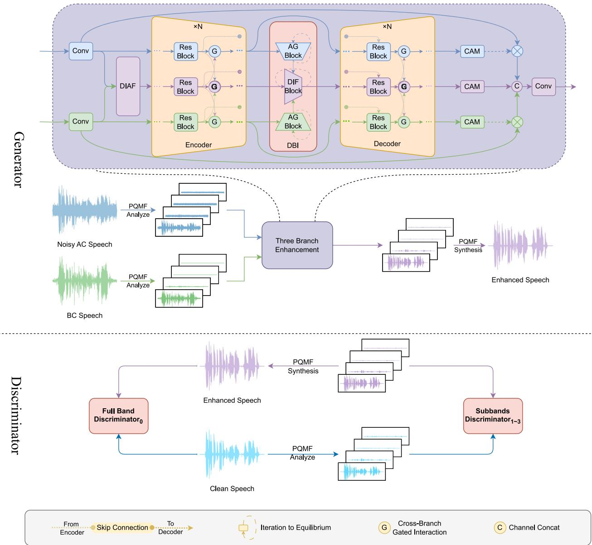  
Fig. 1 Overall architecture of DBMIF

BC, and fusion branches, respectively. The CBGI mechanism operates in two distinct stages:

1. Fusion-to-Unimodal Modulation. First, the fusion branch generates gating signals to recalibrate the unimodal features. This allows the global context from the fusion stream to suppress irrelevant components in the unimodal branches:

$$
\begin{array}{r l} & g _ {f a} ^ {(s)} = \sigma \big (\mathcal {F} _ {\mathrm{conv}} (\mathrm{x} _ {f} ^ {(s)}) \big), \qquad \tilde {\mathrm{x}} _ {a} ^ {(s)} = g _ {f a} ^ {(s)} \odot \mathcal {F} _ {\mathrm{conv}} (\mathrm{x} _ {a} ^ {(s)}), \\ & g _ {f b} ^ {(s)} = \sigma \big (\mathcal {F} _ {\mathrm{conv}} (\mathrm{x} _ {f} ^ {(s)}) \big), \qquad \tilde {\mathrm{x}} _ {b} ^ {(s)} = g _ {f b} ^ {(s)} \odot \mathcal {F} _ {\mathrm{conv}} (\mathrm{x} _ {b} ^ {(s)}), \end{array}\tag{6}
$$

where $\mathcal { F } _ { \mathrm { c o n v } }$ denotes a distinct $1 \times 1$ convolution layer, σ( ) is the sigmoid function, and  represents element-wise multiplication. $\tilde { \mathbf { X } } _ { a } ^ { ( s ) }$ and $\tilde { \mathbf { x } } _ { b } ^ { ( s ) }$ are the refined unimodal features.

2. Unimodal-to-Fusion Feedback. Conversely, to enrich the fusion stream with reliable modality-specific details, each unimodal branch produces feedback gates based on its original features. These gates regulate the integration of the fusion representation:

$$
\begin{array}{r l} & g _ {a} ^ {(s)} = \sigma \big (\mathcal {F} _ {\mathrm{conv}} (\mathrm{x} _ {a} ^ {(s)}) \big), \qquad \hat {\mathrm{x}} _ {a f} ^ {(s)} = g _ {a} ^ {(s)} \odot \mathcal {F} _ {\mathrm{conv}} (\mathrm{x} _ {f} ^ {(s)}), \\ & g _ {b} ^ {(s)} = \sigma \big (\mathcal {F} _ {\mathrm{conv}} (\mathrm{x} _ {b} ^ {(s)}) \big), \qquad \hat {\mathrm{x}} _ {b f} ^ {(s)} = g _ {b} ^ {(s)} \odot \mathcal {F} _ {\mathrm{conv}} (\mathrm{x} _ {f} ^ {(s)}). \end{array}\tag{7}
$$

The updated fusion representation $\tilde { \mathbf { x } } _ { f } ^ { ( s ) }$ is then obtained by aggregating these gated contributions:

$$
\tilde {\mathrm{x}} _ {f} ^ {(s)} = \hat {\mathrm{x}} _ {a f} ^ {(s)} + \hat {\mathrm{x}} _ {b f} ^ {(s)}.\tag{8}
$$

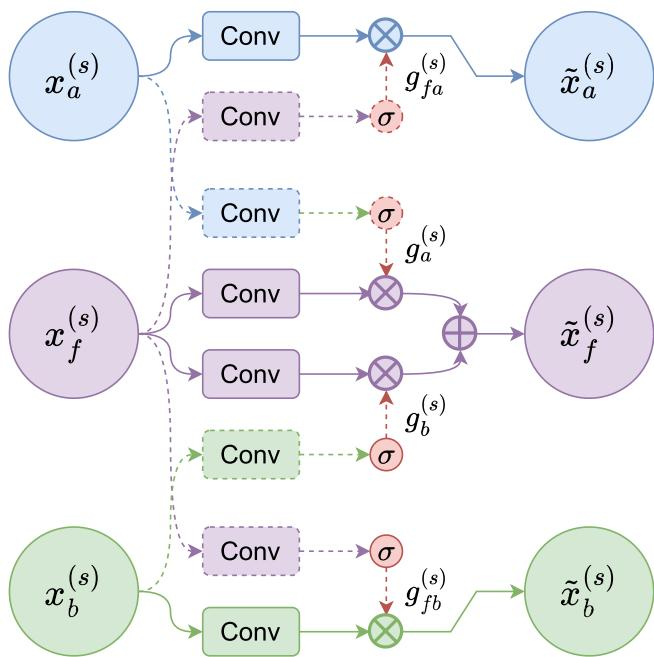  
Fig. 2 Diagram of the CBGI module. Solid arrows denote the feature flow, while dashed arrows indicate the gating signals generated to modulate the corresponding streams

Unlike conventional unidirectional fusion, this bidirectional coupling establishes a closed-loop information flow. By allowing the fusion features to gate the unimodal branches and vice versa, the mechanism ensures that the network dynamically balances the contributions of both modalities. This prevents the dominance of a single modality and facilitates the selective integration of high-fidelity components from both streams.

## 3.3.2 Early deep iterative attention fusion

To provide cleaner and more stable inputs for subsequent processing, we employ the Deep Iterative Attention Fusion (DIAF) module at the front end. This module initializes a coarse fusion and progressively refines it via an attention mechanism. At each step, a Channel Attention Module (CAM) produces a channel-wise gate that adaptively balances the contributions of each modality, attenuating less reliable modality cues while emphasizing more informative ones.

Let $\mathrm { x } _ { a }$ and $\mathrm { x } _ { b }$ denote the input feature maps corresponding to the AC and BC speech, respectively. As illustrated in Fig. 3, DIAF operates in an iterative manner. First, to establish a neutral starting point without introducing extra parameters, we initialize the coarse fusion $\mathbf { x } ^ { ( 0 ) }$ as the element-wise sum of these inputs:

$$
\mathbf {x} ^ {(0)} = \mathbf {x} _ {a} ^ {(0)} + \mathbf {x} _ {b} ^ {(0)}.\tag{9}
$$

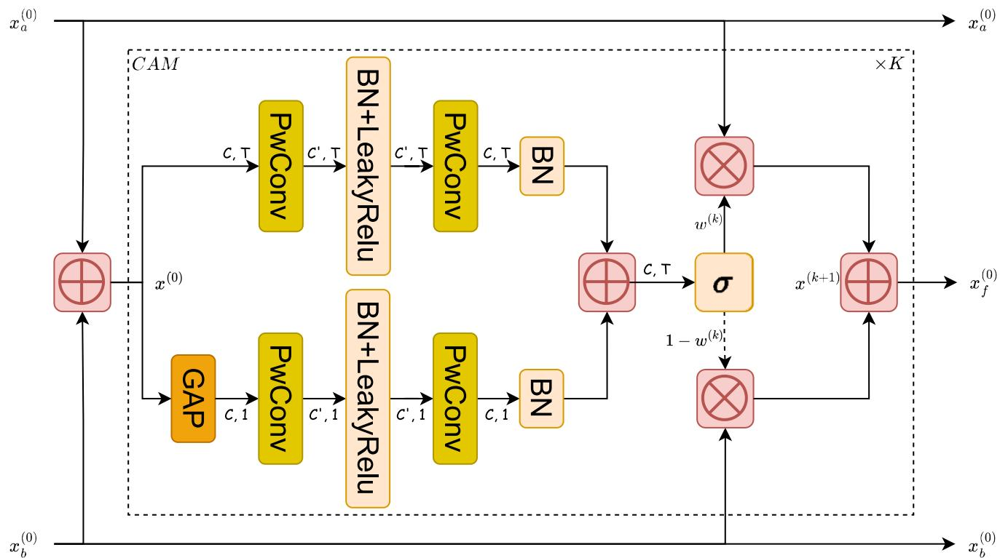  
Fig. 3 Diagram of the early DIAF module. DIAF progressively refines AC and BC features through iterative channel attention to emphasize reliable modality cues

Subsequently, for each iteration $k = 1 , \ldots , K .$ , the CAM generates an attention mask conditioned on the previous fused representation:

$$
\mathrm{w} ^ {(k)} = \operatorname{CAM} \left(\mathrm{x} ^ {(k - 1)}\right).\tag{10}
$$

Here, $\mathrm { w } ^ { ( k ) } \in \mathbb { R } ^ { C }$ serves as a channel-wise reliability gate, with values constrained to [0, 1] via a sigmoid nonlinearity following global average pooling. Mathematically, each element of $\bar { \bf w } ^ { ( k ) }$ represents the confidence in the AC modality for the corresponding channel, while $1 - \mathrm { w } ^ { ( k ) }$ weights the BC modality. This mask is then applied to refine the fusion through a soft selection mechanism:

$$
\mathrm{x} ^ {(k)} = \mathrm{w} ^ {(k)} \odot \mathrm{x} _ {a} ^ {(0)} + \left(1 - \mathrm{w} ^ {(k)}\right) \odot \mathrm{x} _ {b} ^ {(0)}.\tag{11}
$$

After K rounds of refinement, the final quality-aware fusion embedding is obtained as $\mathbf { x } _ { f } ^ { ( 0 ) } = \mathbf { x } ^ { ( K ) }$ . This iterative process allows the network to re-calibrate modality contributions dynamically as the noise profile changes. In our implementation, we employ $K = 3 ,$ , which we found to empirically achieve a robust balance between fusion quality and computational cost.

## 3.3.3 Deep balanced interaction

The encoder-decoder bottleneck aggregates compact, information-dense features and is thus critical for downstream processing. To enhance its efectiveness, we employ the Deep Balanced Interaction (DBI) module. Drawing inspiration from the Deep Equilibrium Multimodal Fusion framework [38], DBI refines modality-specific features through iterative fixed-point updates. This equilibrium mechanism stabilizes representations and improves generalization without increasing the network depth or parameter count.

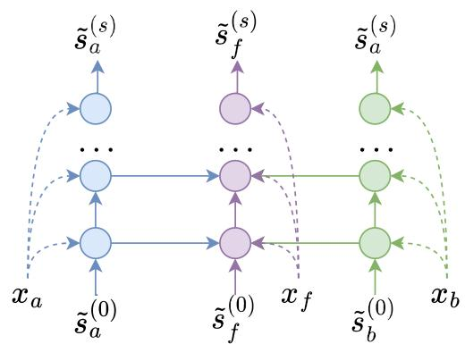  
(a) Overall DBI structure

By reusing parameters across iterations, DBI recursively denoises and re-calibrates AC and BC speech features until they reach a balanced state, yielding a consistent representation.

As shown in Fig. 4a, the DBI module operates on the bottleneck features from the encoder, denoted as $\mathbf { X } _ { a } , \mathbf { X } _ { b } , \mathbf { X } _ { f } .$ These features serve as the time-invariant input injection. Simultaneously, the module maintains three recurrent hidden states, denoted as $\mathbf { z } _ { a } ^ { ( k ) } , \mathbf { z } _ { b } ^ { ( k ) } , \mathbf { z } _ { f } ^ { ( k ) }$ at iteration k. Figure 4b illustrates one update step of the mapping function ${ \mathcal F } ,$ which proceeds in two stages: 1) Intra-modal refinement: The states $\scriptstyle { \mathbf { Z } } _ { a }$ and $\mathbf { Z } _ { b }$ are updated under the guidance of their corresponding inputs $\mathrm { x } _ { a }$ and $_ { \mathrm { x } _ { b } }$ to suppress noise while preserving modality-specific cues. 2) Fusion feedback: The refined unimodal states, along with the previous fusion state $\mathrm { z } _ { f } ^ { ( k - 1 ) }$ , are integrated under the guidance of $\mathbf { X } _ { f }$ to produce the new fusion state $\mathrm { z } _ { f } ^ { ( k ) }$ . Formally, the joint update rule is defined as:

$$
\big (\mathrm{z} _ {a} ^ {(k)}, \mathrm{z} _ {b} ^ {(k)}, \mathrm{z} _ {f} ^ {(k)} \big) = \mathcal {F} \Big (\mathrm{z} _ {a} ^ {(k - 1)}, \mathrm{z} _ {b} ^ {(k - 1)}, \mathrm{z} _ {f} ^ {(k - 1)} \Big | \mathrm{x} _ {a}, \mathrm{x} _ {b}, \mathrm{x} _ {f} \Big).\tag{12}
$$

For compact notation, we concatenate the states into a single vector $\mathsf { z } ^ { ( k ) } = \left[ \mathsf { z } _ { a } ^ { ( k ) } , \mathsf { z } _ { b } ^ { ( k ) } , \mathsf { z } _ { f } ^ { ( k ) } \right]$ . Our goal is to apply $\mathcal { F }$ repeatedly such that the sequence converges to a fixed point $\boldsymbol { \mathrm { z } } ^ { \star }$ satisfying:

$$
\mathrm{z} ^ {\star} = \mathcal {F} (\mathrm{z} ^ {\star}).\tag{13}
$$

To improve training stability, we merge the batch and temporal dimensions, treating each frame as an independent sample during the equilibrium process. This allows DBI to adapt to instantaneous changes in modality dominance.

To ensure computational eficiency, we limit the maximum number of iterations to $K _ { \operatorname* { m a x } } = 5 0$ . We monitor the convergence by calculating the relative change between consecutive iterates:

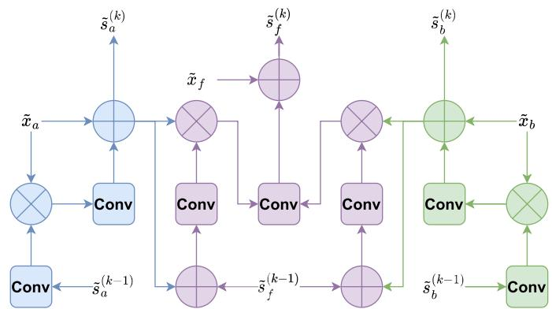  
(b) One DBI iteration  
Fig. 4 Diagram of DBI module. DBI maintains recurrent modality states and iteratively updates them through intra-modal refinement and fusion feedback

Table 1 Architecture of the full-band discriminator $D _ { \mathrm { w a v } } .$ . It outputs a time-indexed logit map for global consistency assessment

<table><tr><td>Layer</td><td> $C_{in}$ </td><td> $C_{out}$ </td><td>Kernel</td><td>Stride</td><td>Groups</td><td>Act.</td></tr><tr><td>1</td><td>1</td><td>16</td><td>15</td><td>1</td><td>1</td><td>LReLU</td></tr><tr><td>2</td><td>16</td><td>64</td><td>41</td><td>4</td><td>4</td><td>LReLU</td></tr><tr><td>3</td><td>64</td><td>256</td><td>41</td><td>4</td><td>4</td><td>LReLU</td></tr><tr><td>4</td><td>256</td><td>1024</td><td>41</td><td>4</td><td>4</td><td>LReLU</td></tr><tr><td>5</td><td>1024</td><td>1024</td><td>41</td><td>4</td><td>4</td><td>LReLU</td></tr><tr><td>6</td><td>1024</td><td>1024</td><td>5</td><td>1</td><td>1</td><td>LReLU</td></tr><tr><td>7</td><td>1024</td><td>1</td><td>3</td><td>1</td><td>1</td><td>None</td></tr></table>

Table 2 Architecture of the subband discriminator $D _ { \mathrm { s u b } }$ . Three copies are instantiated with dilation factors d $\in \{ 1 , 2 , 3 \}$ to capture multi-scale periodicities in PQMF subbands

<table><tr><td>Layer</td><td> $C_{in}$ </td><td> $C_{out}$ </td><td>Kernel</td><td>Stride</td><td>Groups</td><td>Dilation</td><td>Act.</td></tr><tr><td>1</td><td>4</td><td>36</td><td>3</td><td>1</td><td>4</td><td>d</td><td>LReLU</td></tr><tr><td>2</td><td>36</td><td>72</td><td>7</td><td>2</td><td>4</td><td>d</td><td>LReLU</td></tr><tr><td>3</td><td>72</td><td>144</td><td>7</td><td>2</td><td>4</td><td>d</td><td>LReLU</td></tr><tr><td>4</td><td>144</td><td>288</td><td>7</td><td>2</td><td>4</td><td>d</td><td>LReLU</td></tr><tr><td>5</td><td>288</td><td>576</td><td>7</td><td>2</td><td>4</td><td>d</td><td>LReLU</td></tr><tr><td>6</td><td>576</td><td>1152</td><td>7</td><td>2</td><td>4</td><td>d</td><td>LReLU</td></tr><tr><td>7</td><td>1152</td><td>1152</td><td>5</td><td>1</td><td>4</td><td>d</td><td>LReLU</td></tr><tr><td>8</td><td>1152</td><td>1</td><td>3</td><td>1</td><td>1</td><td>d</td><td>None</td></tr></table>

$$
\delta_ {k} = \left\| \mathrm{z} ^ {(k)} - \mathrm{z} ^ {(k - 1)} \right\| _ {F}, \qquad k = 2, \ldots , K _ {\max}.
$$

Instead of simply taking the last iteration, we select the state $z ^ { \star }$ with the smallest change, indicating the most stable equilibrium point, as the final output:

(14)

$$
k ^ {\star} = \arg \min _ {2 \leq k \leq K _ {\max}} \delta_ {k}, \qquad z ^ {\star} = z ^ {(k ^ {\star})}.\tag{15}
$$

Since the parameters of $\mathcal { F }$ are shared across all iterations, DBI achieves deep feature refinement and dynamic modality balancing with high parameter eficiency.

To ensure high-fidelity waveform generation, we employ a multi-scale discrimination strategy inspired by Mel-GAN [39]. However, unlike conventional multi-scale discriminators that operate solely on waveforms, our design explicitly leverages the subband decomposition to capture fine-grained spectral details. Specifically, the proposed discriminator consists of two distinct components:

## 3.4 Discriminator architecture

1. Full-band Waveform Discriminator $( D _ { \mathrm { w a v } } ) { : }$ This component operates on the raw full-band audio at the original sampling rate. It focuses on capturing global structural coherence and low-frequency consistency. As detailed in Table 1, it is composed of a stack of strided convolutional layers with large receptive fields.

2. Multi-Scale Subband Discriminator $( D _ { \mathrm { s u b } } )$ : We utilize the same PQMF analysis bank employed by the generator to decompose the real or generated speech into 4 subbands. These subbands are concatenated channel-wise and fed into three identical discriminator sub-networks as detailed in Table 2. These sub-networks difer only by their dilation factors $d \in \{ 1 , 2 , 3 \}$ This dilated convolution design enables the model to capture diverse temporal structures with varying receptive fields within the subbands.

It should be noted that, all convolutional layers in both discriminators apply weight normalization and use Leaky-ReLU activation $( \alpha = 0 . 1 )$ , except for the final layer which outputs a linear score map.

## 3.5 Training objectives

The optimization of the proposed framework follows an adversarial learning paradigm, involving a minimax game between a multi-scale discriminator and a generator. The training process is governed by two distinct yet complementary objectives: the discriminator is trained to construct a robust classification boundary between natural and synthesized waveforms, while the generator aims to synthesize perceptually realistic speech that successfully deceives the discriminator. In the following subsections, we detail the optimization targets for the discriminator and the generator, respectively.

## 3.5.1 Discriminator loss

We employ a hinge loss formulation for the adversarial training of the discriminators, as it provides a robust gradient signal compared to standard cross-entropy objectives. The total discriminator loss $L _ { D }$ aggregates the contributions from a full-band discriminator and three subband discriminators (indexed by $k = 0 , \ldots , 3 )$ . This multi-resolution evaluation scheme enables the model to simultaneously supervise global spectral envelopes and fine-grained local textures. Let $D _ { k } ( { \mathbf x } )$ denote the output score map of the k-th discriminator for an input x. The discriminators are optimized to distinguish between the ground-truth speech y and the synthesized speech yˆ by minimizing:

$$
L _ {D} = \sum_ {k = 0} ^ {3} \left[ \mathbb {E} _ {\mathrm{y}} \bigl [ \max (0, 1 - D _ {k} (\mathrm{y})) \bigr ] + \mathbb {E} _ {\hat {\mathrm{y}}} \bigl [ \max (0, 1 + D _ {k} (\hat {\mathrm{y}})) \bigr ] \right].\tag{16}
$$

## 3.5.2 Generator loss

The generator aims to minimize a composite objective that balances perceptual realism with structural fidelity. To drive the synthesis of realistic waveform structures, we first define the adversarial component $L _ { G } ^ { \mathrm { a d v } }$ using the hinge loss. By encouraging the generated samples to achieve scores exceeding the unit margin, the generator is penalized for any artifacts detected by the discriminators:

$$
L _ {G} ^ {\mathrm{adv}} = \sum_ {k = 0} ^ {3} \mathbb {E} _ {\hat {\mathbf {y}}} \big [ \max (0, 1 - D _ {k} (\hat {\mathbf {y}})) \big ].\tag{17}
$$

To complement the adversarial objective and mitigate the over-smoothing often observed in GAN-based synthesis, we incorporate a feature matching loss $L _ { G } ^ { \mathrm { f m } }$ . This term stabilizes training by minimizing the $L _ { 1 }$ distance between the intermediate feature maps of the discriminators for real and generated inputs, efectively acting as a learned perceptual metric:

$$
L _ {G} ^ {\mathrm{fm}} = \sum_ {k = 0} ^ {3} \sum_ {i = 1} ^ {N _ {k} - 1} \frac {1}{M _ {i}} \left\| D _ {k} ^ {(i)} (\mathrm{y}) - D _ {k} ^ {(i)} (\hat {\mathrm{y}}) \right\| _ {1},\tag{18}
$$

where $D _ { k } ^ { ( i ) }$ denotes the feature map extracted from the i-th layer of the k-th discriminator, and $M _ { i }$ serves as a normalization factor representing the number of elements in that layer.

Consequently, the total training objective for the generator is formulated as a weighted combination of these two terms:

$$
L _ {G} = L _ {G} ^ {\mathrm{adv}} + \lambda L _ {G} ^ {\mathrm{fm}},\tag{19}
$$

where λ is a hyperparameter that controls the relative importance of the feature matching supervision.

## 4 Experimental setup

## 4.1 Datasets

We use the Air- and Bone-Conducted Synchronized Speech corpus [40] as our dataset. The corpus contains time-aligned AC and BC speech recordings from 100 speakers which comprises 47,182 utterances and 42 hours in total, with durations ranging from 1 to 5 seconds. All audio recordings are sampled at 16 kHz.

During training, we employ an online slicing and noisemixing pipeline where each utterance is segmented into 1-second windows. We inject noise exclusively into the AC speech channel using samples sourced from the DNS Challenge [41] and UTD Environmental Noise [42] datasets. These noise sources cover diverse categories such as machinery, in-car environments, and babble. The SNR is uniformly sampled from the range [ 15, 5] dB. Following noise injection, we rescale the mixture to match the Root Mean Square energy of the original clean speech. Finally, we apply a 50 ms linear fade-in and fade-out to the segment boundaries to mitigate discontinuities caused by slicing.

For evaluation, we utilize three unseen noise corpora to ensure diverse acoustic conditions. These include QUT-NOISE [43] for realistic scenarios such as cafés and cars, NOISEX-92 [44] for standardized industrial and military benchmarks, and Nonspeech [45] for everyday ambient noises. Distinct from the training phase, we process the test utterances in their full length without segmentation. Each test utterance is mixed with these noise sources under fixed conditions where the SNR is selected from the set (-15, -10, -5, 0, 5) dB.

## 4.2 Comparison baselines

To comprehensively evaluate the efectiveness of DBMIF, we benchmark it against representative baselines as summarized in Table 3. These baselines primarily consist of multimodal approaches, including time-domain models such as FCN [15] and MMINet [46], as well as time–frequency domain models such as DenGCAN [17] and Dc–Crn [16]. Furthermore, to verify the benefits of multimodal fusion, we also incorporate unimodal baselines, specifically GaG-Net [20] for AC speech enhancement and EBEN [11] for BC speech enhancement.

Table 3 Details of compared models

<table><tr><td>Model</td><td>Modality</td><td>Domain</td><td>GAN-based</td></tr><tr><td>GaGNet [20]</td><td>AC</td><td>Time–Frequency</td><td>No</td></tr><tr><td>EBEN [11]</td><td>BC</td><td>Time</td><td>Yes</td></tr><tr><td>FCN [15]</td><td>AC&amp;BC</td><td>Time</td><td>No</td></tr><tr><td>MMINet [46]</td><td>AC&amp;BC</td><td>Time</td><td>No</td></tr><tr><td>DenGCAN [17]</td><td>AC&amp;BC</td><td>Time–Frequency</td><td>No</td></tr><tr><td>Dc-Crn [16]</td><td>AC&amp;BC</td><td>Time–Frequency</td><td>No</td></tr><tr><td>DBMIF (ours)</td><td>AC&amp;BC</td><td>Time</td><td>Yes</td></tr></table>

To further assess the practical benefits of the enhanced speech, we perform downstream ASR experiments. CER is reported using two representative end-to-end ASR frameworks, Whisper [50] and WeNet [51]. Whisper ofers strong multilingual and noise-robust recognition capabilities, while WeNet is a lightweight, open-source streaming ASR framework optimized for eficiency in specific language settings.

## 4.3 Configuration and implementation details

The model is trained using synchronized 1 second AC and BC speech pairs with a batch size of 32 for a total of 100 epochs. Optimization is performed using the Adam optimizer with a learning rate of $3 \times 1 0 ^ { - 4 }$ and momentum parameters $( \beta _ { 1 } , \beta _ { 2 } ) = ( 0 . 5 , 0 . 9 ) . \mathrm { ~ A ~ }$ cosine annealing schedule is employed to gradually decay the learning rate throughout training. During adversarial learning, the generator and discriminator are updated alternately, and the feature-matching loss is weighted by λ = 1000.

## 4.4 Evaluation metrics

Performance is evaluated using five widely adopted objective metrics, including scale-invariant signal-to-distortion ratio (SI-SDR), perceptual evaluation of speech quality (PESQ) [47], short-time objective intelligibility (STOI) [48], extended STOI (ESTOI) [49], and DNS-MOS [41]. Unlike the first four intrusive metrics that require a clean reference, DNSMOS is a non-intrusive deep neural model designed to estimate the perceptual quality of speech directly from noisy or enhanced signals. It has been shown to correlate well with human mean opinion scores, making it suitable for large-scale evaluation without subjective listening tests.

## 5 Experimental results

We present a comprehensive evaluation of the proposed DBMIF framework to validate its efectiveness and robustness. We first benchmark DBMIF against representative unimodal and multimodal baselines, analyzing performance through objective metrics, downstream ASR accuracy, and subjective listening tests. To assess generalization capabilities, we further examine performance consistency across varying SNR conditions and diverse noise categories, supported by detailed spectral analysis. Finally, we conduct systematic ablation studies to verify the contributions of key architectural components and visualize the adaptive behaviors of the modality fusion mechanism.

## 5.1 Comparison with baselines

Table 4 presents a quantitative performance summary across all models. The unprocessed AC speech sufers from severe noise degradation and is characterized by poor signal integrity with an SI-SDR of -4.96 dB and a high Whisper ASR error rate of 47.79%. Unimodal baselines exhibit distinct limitations. Specifically, the AC-based GaGNet achieves only marginal improvements in PESQ, while the BC-based EBEN is constrained by limited bandwidth and yields extremely low SI-SDR scores.

Table 4 Comparison of objective metrics between raw signals and enhanced speech

<table><tr><td>Model</td><td>SI–SDR</td><td>PESQ</td><td>STOI</td><td>ESTOI</td><td>DNSMOS</td><td>Whisper</td><td>WeNet</td></tr><tr><td>Origin</td><td></td><td></td><td></td><td></td><td></td><td></td><td></td></tr><tr><td>AC speech</td><td>-4.96</td><td>1.13</td><td>0.68</td><td>0.50</td><td>2.39</td><td>47.79</td><td>34.62</td></tr><tr><td>BC speech</td><td>-7.53</td><td>1.43</td><td>0.69</td><td>0.58</td><td>2.48</td><td>29.30</td><td>25.44</td></tr><tr><td>AC-only</td><td></td><td></td><td></td><td></td><td></td><td></td><td></td></tr><tr><td>GaGNet [20]</td><td>7.84</td><td>1.55</td><td>0.77</td><td>0.63</td><td>2.69</td><td>40.17</td><td>26.17</td></tr><tr><td>BC-only</td><td></td><td></td><td></td><td></td><td></td><td></td><td></td></tr><tr><td>EBEN [11]</td><td>0.80</td><td>1.84</td><td>0.79</td><td>0.70</td><td>3.17</td><td>43.86</td><td>34.72</td></tr><tr><td>Joint Model</td><td></td><td></td><td></td><td></td><td></td><td></td><td></td></tr><tr><td>FCN [15]</td><td>8.16</td><td>1.43</td><td>0.77</td><td>0.66</td><td>2.39</td><td>50.83</td><td>29.65</td></tr><tr><td>MMINet [46]</td><td>10.45</td><td>1.77</td><td>0.83</td><td>0.73</td><td>2.69</td><td>32.58</td><td>24.65</td></tr><tr><td>DenGCAN [17]</td><td>10.75</td><td>1.98</td><td>0.88</td><td>0.81</td><td>2.94</td><td>20.65</td><td>14.80</td></tr><tr><td>Dc–Crn [16]</td><td>10.18</td><td>2.62</td><td>0.86</td><td>0.79</td><td>2.66</td><td>19.46</td><td>14.50</td></tr><tr><td>DBMIF</td><td>12.42</td><td>2.70</td><td>0.90</td><td>0.85</td><td>3.35</td><td>15.84</td><td>12.07</td></tr></table>

## 5.1.1 Overall quantitative comparison

Generally, fusion-based baselines achieve improved signal quality metrics compared to the original noisy inputs which verifies the efectiveness of the multimodal approach. However, distinct performance gaps exist across architectures. Time-domain models such as FCN and MMINet perform poorly on ASR tasks despite gains in other metrics. This discrepancy likely arises because full-band time-domain convolution can introduce structural artifacts or oversmooth high-frequency details which disrupt the acoustic cues required for machine recognition. In contrast, T-F methods including DenGCAN and Dc-CRN achieve more balanced performance across validity and intelligibility but still leave a non-trivial gap relative to clean speech. Finally, DBMIF achieves state-of-the-art results across all metrics. This superior performance is likely attributed to the PQMFbased subband strategy and the sophisticated interaction mechanism between the AC and BC speech branches, which together mitigate artifacts common in conventional fullband time-domain modeling.

## 5.1.2 Performance consistency across SNR regimes

We compare methods across various noise corpora under low SNR conditions at -15, -10, and -5 dB. As shown in Fig. 5, GaGNet degrades severely at low SNRs and fluctuates widely across noise types. DenGCAN also struggles, likely due to limited capacity for complex non-stationary noise. In contrast, the remaining multimodal approaches are more robust across datasets, indicating that incorporating BC speech mitigates degradation under unseen noise. Moreover, both EBEN and DBMIF use GAN training and obtain higher DNSMOS, which suggests adversarial learning improves perceptual quality and naturalness. Overall, DBMIF yields consistent improvements across metrics in low-SNR regimes and typically ranks among the top-performing methods across noise conditions. We also observe a few extreme cases where the advantage becomes smaller on certain perceptual metrics. For instance, at -15 dB in highly non-stationary babble noise, the BC-only baseline EBEN achieves a DNSMOS score comparable to DBMIF. This is attributed to the inherent physical characteristics of BC sensors, which produce noise-free but bandwidth-limited signals. In contrast, DBMIF prioritizes the restoration of high-frequency details. Consequently, DBMIF yields significantly more natural speech, even if it entails retaining minimal residual noise.

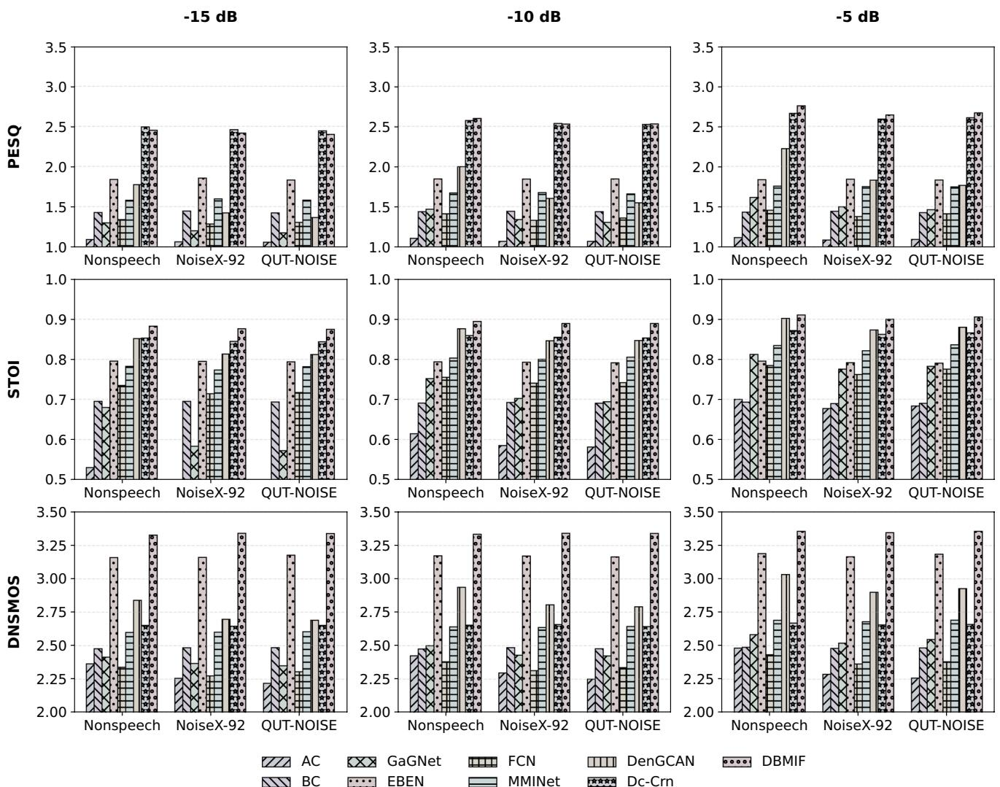  
Fig. 5 Low-SNR results among diferent methods

Figure 6 presents a performance comparison under high SNR conditions at 0 and 5 dB. As the SNR increases and the quality of the AC speech improves, methods integrating the AC speech modality demonstrate consistent performance enhancements. Notably, at an SNR of 5 dB, these frameworks surpass methods relying solely on BC speech in

Fig. 6 High-SNR results among diferent methods

terms of PESQ and STOI. This trend underscores the inherent bandwidth limitations of the BC speech modality in scenarios where clean acoustic features from the AC speech are available.

Among the evaluated baselines, MMINet maintains a steady performance baseline across diverse noise environments, whereas DenGCAN, which appears vulnerable in low-SNR conditions, shows a substantial recovery as the acoustic environment clears. Most notably, DBMIF consistently ranks among the top-performing methods across all tested scenarios.

Overall, DBMIF demonstrates robust stability across the entire SNR range, consistently ranking among the topperforming methods in all evaluated metrics. Meanwhile, it displays strong generalization capabilities across diverse noise conditions.

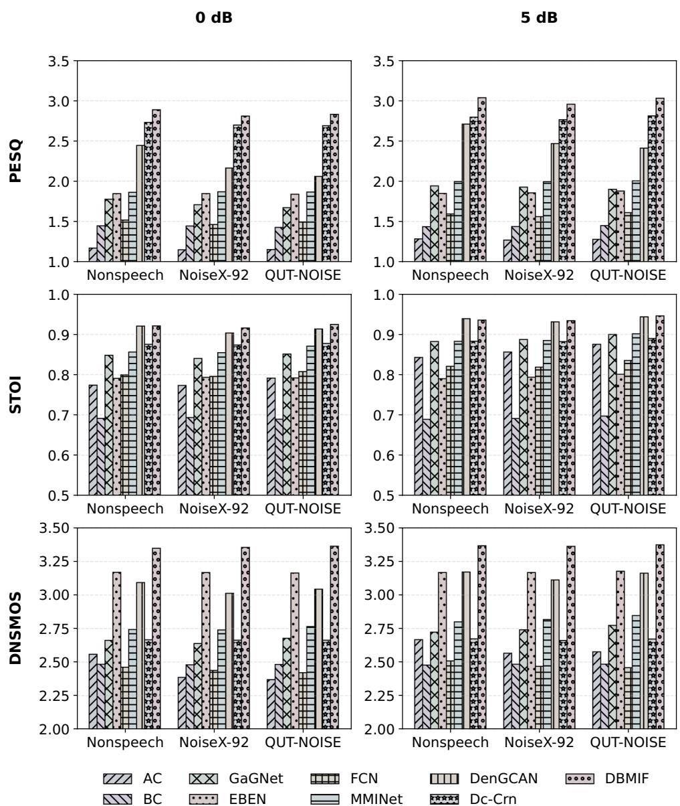

## 5.1.3 Analysis of the spectrogram

Figure 7 presents the spectrogram comparisons in the presence of street noise at an SNR of 10 dB. Under such severe noise conditions, the AC speech signal is heavily masked by background noise, whereas the BC speech preserves essential components primarily within the low-frequency region below 1 kHz. While GaGNet achieves partial noise suppression, it introduces noticeable artifacts. Meanwhile, EBEN produces a cleaner output but notably lacks suficient high-frequency content. Among multi-modal approaches, Dc–Crn preserves low-frequency energy but fails to efectively reconstruct mid-to-high-frequency details, resulting in perceptible distortion. Similarly, although MMINet and DenGCAN aim to restore high-frequency components, MMINet yields overly smoothed spectra, and DenGCAN ofers minimal spectral improvement, appearing blurred. In contrast, DBMIF achieves the most significant reconstruction fidelity, with its spectral patterns closely aligning with the clean reference in the highlighted regions. It efectively eliminates the structural artifacts observed in Dc–Crn and recovers fine spectral details missed by other models. These findings demonstrate that DBMIF successfully leverages the low-frequency guidance from BC speech while retaining the high-frequency and fine-grained features of AC speech, thereby ensuring superior naturalness and intelligibility in adverse acoustic scenarios.

## 5.1.4 Subjective evaluation

To strictly evaluate perceptual quality, we conducted subjective listening tests adopting the absolute category rating protocol. Ten native Chinese speakers participated. Clean AC speech and unprocessed noisy signals served as

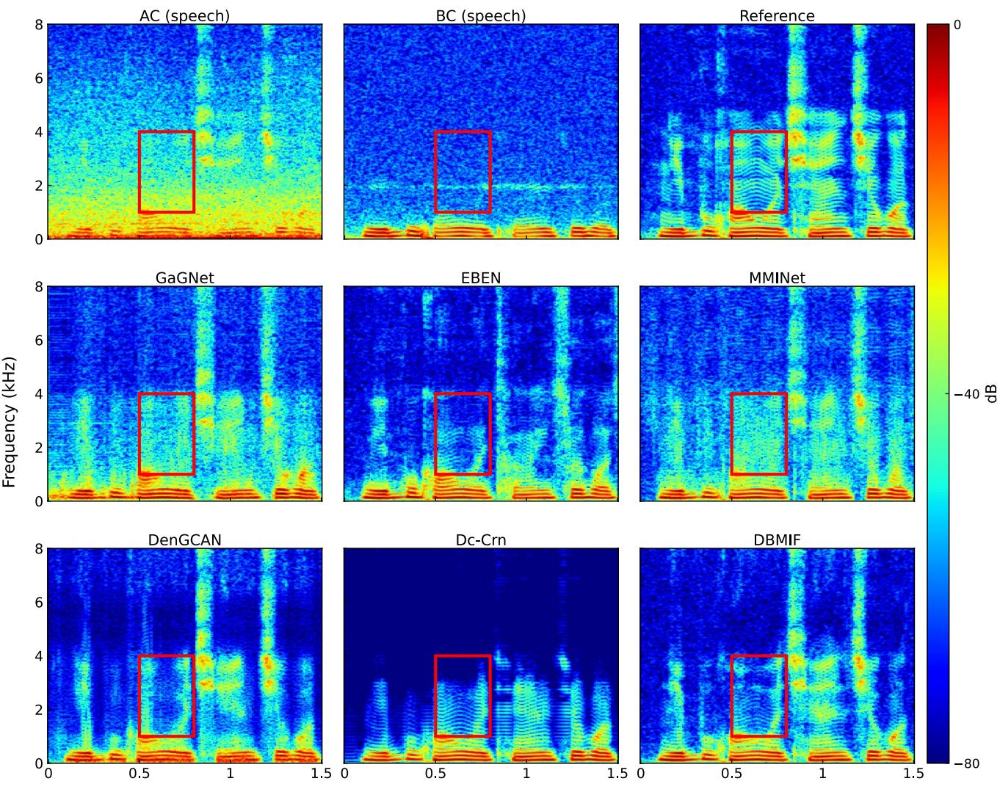  
Time (s)  
Fig. 7 Spectrogram comparison at -10 dB across methods

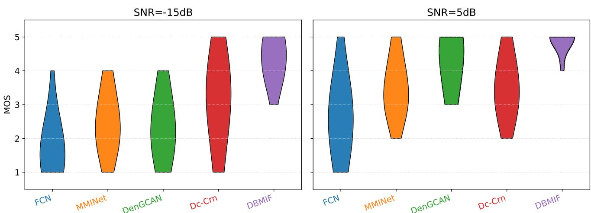  
Fig. 8 Mean opinion scores obtained from the subjective listening test. Wider sections represent higher score density, with higher positions indicat ing better perceptual quality

Table 5 Ablation study on architectural components across three branches

<table><tr><td colspan="3">Components</td><td colspan="2">CER (%)  $\downarrow^a$ </td></tr><tr><td>CBGI module</td><td>DIAF</td><td>DBI</td><td>Whisper (ASR)</td><td>WeNet (ASR)</td></tr><tr><td>AC Speech</td><td></td><td></td><td>47.79</td><td>34.62</td></tr><tr><td>BC Speech</td><td></td><td></td><td>29.30</td><td>25.44</td></tr><tr><td>Three-branch baseline</td><td></td><td></td><td>26.90</td><td>22.00</td></tr><tr><td>√</td><td>-</td><td>-</td><td>19.80</td><td>15.25</td></tr><tr><td>√</td><td></td><td>-</td><td>18.50</td><td>14.68</td></tr><tr><td>√</td><td>√</td><td></td><td>15.84</td><td>12.77</td></tr></table>

a The down arrow ( ) indicates that lower values represent better performance

anchors to calibrate the rating scale. Figure 8 visualizes the distribution of MOS under extreme noise conditions. At the severe SNR of 15 dB, comparative methods exhibit wide variances with scores frequently dropping to 1, indicating significant signal degradation. In contrast, DBMIF demonstrates superior robustness, its MOS ratings are densely clustered between 4 and 5, with no samples scored below 3. This suggests that DBMIF efectively utilizes the BC signal to prevent intelligibility collapse even when the AC signal is heavily corrupted. At 5 dB, DBMIF further distinguishes itself through high consistency. Unlike baseline methods that still retain a tail of lower scores due to residual artifacts, DBMIF maintains a compact distribution near the maximum MOS, confirming its ability to preserve speech naturalness and fine details without introducing audible distortions.

## 5.2 Ablation studies

## 5.2.1 Impact of architectural components

Table 5 presents the cumulative ablation studies evaluating the contribution of each component. The baseline is defined as a standard three-branch model excluding the CBGI, DIAF, and DBI modules, with each component added incrementally to assess its individual impact. The proposed architecture achieves substantial gains in downstream ASR performance across both Whisper and WeNet backends. Notably, the CBGI module yields the most significant improvement, reducing the CER by approximately 6% for each ASR system. This highlights its critical role in enabling gated information exchange while preserving modality-specific representations. In our preliminary experiments, we implemented a standard Gated Multimodal Unit (GMU), but observed suboptimal performance compared to the proposed CBGI. Additionally, the DIAF and DBI modules provide complementary benefits by refining the fusion process and strengthening inter-branch cooperation, leading to further performance gains. Overall, these results demonstrate that the full combination of modules achieves the most efective integration of complementary cues from AC and BC speech, resulting in a robust multimodal representation.

## 5.2.2 Impact of branching strategies

We evaluate single-, dual-, and three-branch variants to examine how branching configurations afect performance under varying noise conditions. In the single-branch variant, AC and BC speech features are fused early by DIAF and processed by a shared encoder–decoder, representing a simplified single-stage design without explicit modality separation. The dual-branch variant processes modalities independently with cross-gating attention mechanisms but lacks a dedicated final fusion stream. The three-branch configuration represents our full proposed model, where an additional branch is dedicated to integrating complementary cues from both modalities.

Table 6 Performance by SNR for branching strategies

<table><tr><td colspan="4">SI–SDR</td><td colspan="3">STOI</td><td colspan="3">DNSMOS</td></tr><tr><td>Model</td><td>-15</td><td>-5</td><td>5</td><td>-15</td><td>-5</td><td>5</td><td>-15</td><td>-5</td><td>5</td></tr><tr><td>AC Speech</td><td>-14.71</td><td>-4.73</td><td>5.03</td><td>0.52</td><td>0.69</td><td>0.85</td><td>2.29</td><td>2.48</td><td>2.60</td></tr><tr><td>Single-branch</td><td>0.86</td><td>6.04</td><td>10.96</td><td>0.67</td><td>0.75</td><td>0.81</td><td>2.57</td><td>2.66</td><td>2.74</td></tr><tr><td>Dual-branch</td><td>7.15</td><td>9.98</td><td>11.96</td><td>0.82</td><td>0.86</td><td>0.91</td><td>3.19</td><td>3.21</td><td>3.23</td></tr><tr><td>Three-branch</td><td>9.27</td><td>12.86</td><td>15.89</td><td>0.88</td><td>0.91</td><td>0.94</td><td>3.34</td><td>3.35</td><td>3.36</td></tr></table>

Table 7 Performance by noise category for branching strategies(Impulsive, Stationary, and Babble)

<table><tr><td colspan="4">SI–SDR</td><td colspan="3">STOI</td><td colspan="3">DNSMOS</td></tr><tr><td>Model</td><td>Imp.</td><td>Sta.</td><td>Bab.</td><td>Imp.</td><td>Sta.</td><td>Bab.</td><td>Imp.</td><td>Sta.</td><td>Bab.</td></tr><tr><td>AC Speech</td><td>-4.87</td><td>-4.71</td><td>-4.82</td><td>0.60</td><td>0.66</td><td>0.60</td><td>2.16</td><td>2.23</td><td>2.33</td></tr><tr><td>Single-branch</td><td>4.62</td><td>7.39</td><td>4.59</td><td>0.74</td><td>0.76</td><td>0.75</td><td>2.67</td><td>2.62</td><td>2.68</td></tr><tr><td>Dual-branch</td><td>8.92</td><td>9.53</td><td>9.04</td><td>0.84</td><td>0.83</td><td>0.85</td><td>3.22</td><td>3.20</td><td>3.21</td></tr><tr><td>Three-branch</td><td>11.26</td><td>12.41</td><td>11.24</td><td>0.89</td><td>0.89</td><td>0.90</td><td>3.34</td><td>3.30</td><td>3.38</td></tr></table>

Results in Table 6 reveal significant performance disparities among the strategies. The single-branch baseline performs the worst, particularly at low SNR conditions, indicating that simple early fusion struggles to disentangle clean speech from heavy noise due to modality dominance issues. The dual-branch configuration consistently outperforms the single-branch setup, demonstrating the benefit of maintaining independent representations with mutual guidance. The three-branch model achieves the best results across all metrics. The dedicated fusion branch efectively strengthens cross-modal exchange and suppresses artifacts, yielding clearer speech.

Interestingly, DNSMOS remains consistently high across SNRs due to metric saturation. The model leverages BC cues to suppress dominant artifacts even at 15 dB, ensuring base perceptual quality. While recovering AC speech details at higher SNRs significantly enhances fidelity, it yields diminishing perceptual gains.

Table 7 further compares performance across specific noise categories. The single-branch model exhibits significant performance drops under impulsive and babble noise, revealing its limitation in handling abrupt transients or complex speech-like interference. In contrast, the dualand three-branch configurations show consistent resilience, validating that BC speech provide reliable cues when AC speech is severely degraded. The three-branch design further amplifies this advantage through its gated fusion mechanism, which selectively suppresses unreliable information flow. Consequently, as the reliability of AC speech decreases in challenging noise environments, the structural advantage of the three-branch integration becomes increasingly pronounced.

## 5.2.3 Adaptive modality fusion behavior in DIAF

Figure 9 visualizes the evolution of the fusion weight $w ^ { ( 3 ) }$ , where a higher value indicates greater reliance on the AC modality. As shown in the left panel, the mean weight exhibits a positive correlation with SNR, confirming that DIAF is SNR-aware: it prioritizes the noise-immune BC signal in low-SNR regimes and progressively shifts toward AC as conditions improve to recover spectral fidelity.The right panel further reveals a frequency-dependent adaptation strategy. For low frequencies (Channel 1), the model consistently maintains low weights to anchor pitch information on the robust BC modality. Conversely, high frequencies (Channels 3 and 4) retain high weights, relying on AC features to compensate for the limited bandwidth of BC sensors. Notably, the mid-frequency band (Channel 2) shows the most dynamic adaptation, acting as a trade-of zone that actively balances BC stability and AC detail based on the instantaneous noise level.

## 5.2.4 Convergence behavior of the DBI solver

To quantify the practical inference cost, we analyze the distribution of the stopping iteration $k ^ { * }$ across the test set. Here, $k ^ { * }$ represents the iteration index that minimizes the inter-iteration change $\delta _ { k }$ within a bounded budget $K _ { \mathrm { m a x } } .$ . Figure 10 summarizes the empirical distribution of k∗ alongside its Cumulative Distribution Function (CDF).

As illustrated in Fig. 10(b), the DBI solver typically converges within a few refinement steps. Specifically, the median stopping iteration is $k ^ { * } = 5 ,$ , and the mean is 6.89. While certain challenging utterances exhibit a mild long-tail behavior, the iteration count remains far below the preset upper bound $K _ { \operatorname* { m a x } } = 5 0$ in practice. These results indicate that $K _ { \mathrm { m a x } }$ serves primarily as a conservative safeguard. Consequently, the fixed-point refinement terminates eficiently for the vast majority of utterances. This ensures that the computational overhead during inference remains low and manageable.

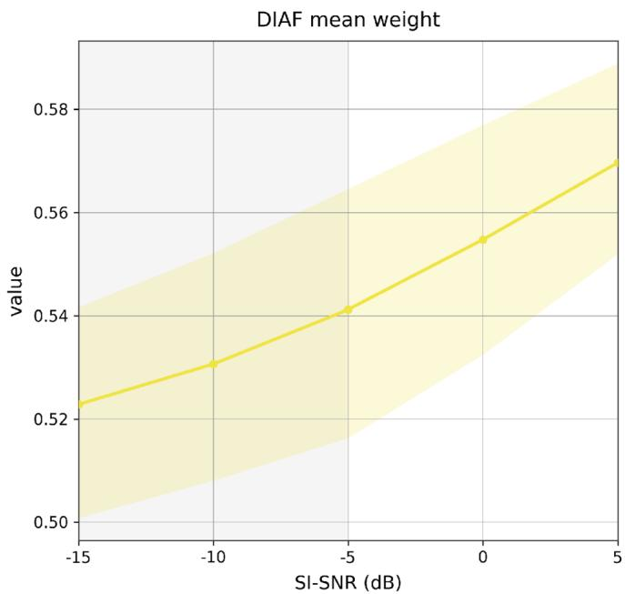

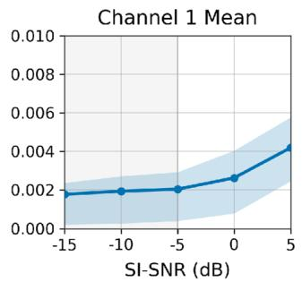

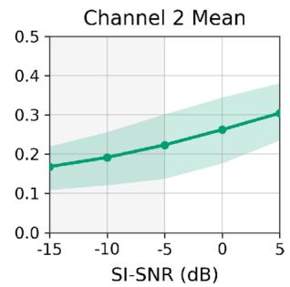

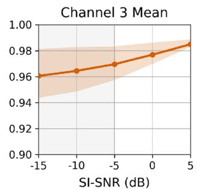

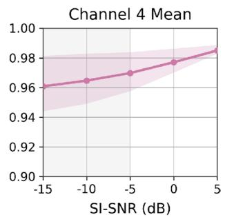

Fig. 9 DIAF fusion weights $w ^ { ( 3 ) } ( w  1 $ implies AC reliance). Left: Global mean vs. SNR with shaded interquartile range. Right: Frequencydependent adaptation across sub-bands  
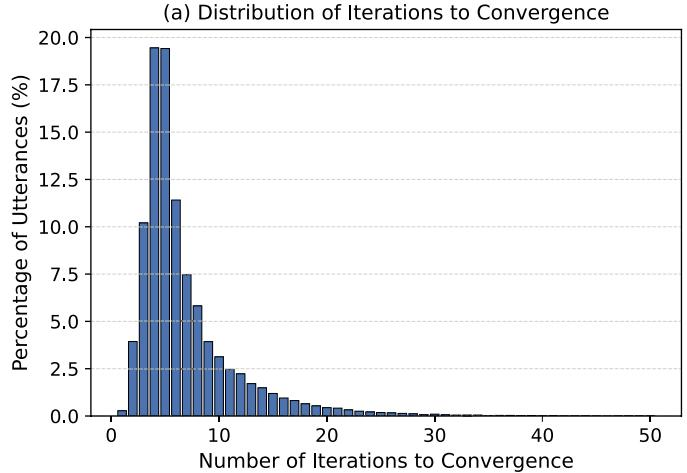

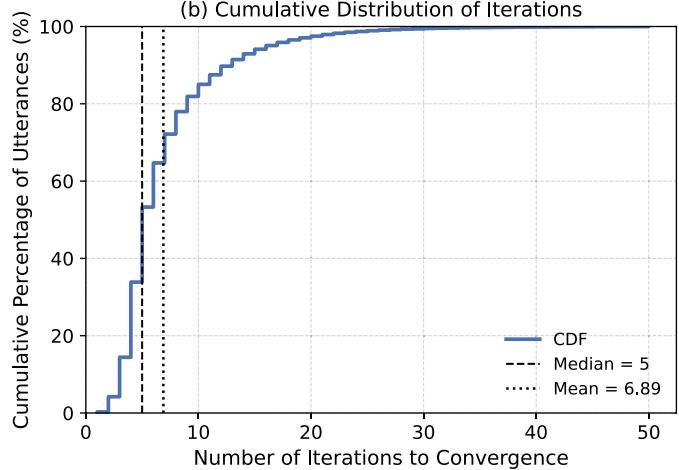  
Fig. 10 Iteration statistics of the DBI solver on the test set. Panel (a) displays the distribution of the stopping iteration $k ^ { * }$ as a percentage of tota utterances. Panel (b) plots the CDF o $\cdot _ { k ^ { * } }$ with the median and mean values indicated

## 6 Conclusion

In this paper, we presented DBMIF, a deep balanced multimodal iterative fusion framework designed to robustly enhance speech by leveraging complementary AC and BC signals. The proposed architecture orchestrates a coarse-tofine interaction strategy: it begins with an early DIAF module to adaptively weight modalities based on instantaneous reliability, follows with a multi-scale encoder–decoder equipped with CBGI for controlled bidirectional information exchange, and concludes with a parameter-shared DBI bottleneck that progressively refines the fused representation without expanding the model size. Experimental results confirm that the proposed framework consistently outperforms state-of-the-art unimodal and multimodal baselines across diverse noise environments.

Despite its generalization capability, the current noncausal architecture and high computational complexity pose challenges for real-time deployment. Furthermore, while DBMIF achieves marked improvements in extreme noise conditions, the intelligibility gap between the enhanced and clean speech remains noticeable, indicating the need for further innovation in ultra-low SNR regimes. Future work will focus on optimizing the model for causal, streaming inference on embedded platforms and exploring self-supervised pre-training to further boost the enhancement performance.

Acknowledgements This work was supported in part by the grants from the National Natural Science Foundation of China under Grant 62332019, the National Key Research and Development Program of China (2023YFF1203900, 2023YFF1203903), Sponsored by Beijing Nova Program (20240484513).

Data Availability The data used in this paper are all from public datasets.

## Declarations

Competing interests The authors declare that they have no known competing financial interests or personal relationships that could have appeared to influence the work reported in this paper.

## References

1. Wang D, Chen J (2018) Supervised speech separation based on deep learning: An overview. IEEE/ACM transactions on audio speech and language processing 26(10):1702–1726. https://doi.or g/10.1109/TASLP.2018.2853117

2. Healy EW, Johnson EM, Pandey A, Wang D (2023) Progress made in the eficacy and viability of deep-learning-based noise reduction. The Journal of the Acoustical Society of America 153(5):2751–2751. https://doi.org/10.1121/10.0019341

3. Zhou D, Zhang Y, Wu J, Zhang X, Xie L, Yin E (2025) Ave speech: A comprehensive multi-modal dataset for speech recognition integrating audio, visual, and electromyographic signals. IEEE Transactions on Human-Machine Systems. https://doi.org 10.1109/THMS.2025.3585165

4. Dubey H, Aazami A, Gopal V, Naderi B, Braun S, Cutler R, Ju A, Zohourian M, Tang M, Golestaneh M et al (2024) Icassp 2023 deep noise suppression challenge. IEEE Open J Signal Proc 5:725–737. https://doi.org/10.1109/OJSP.2024.3378602

5. Zhou Y, Chen Y, Ma Y, Liu H (2020) A real-time dual-microphone speech enhancement algorithm assisted by bone conduction sensor. Sensors 20(18):5050. https://doi.org/10.3390/s20185050

6. Huang B, Gong Y, Sun J, Shen Y (2017) A wearable bone-conducted speech enhancement system for strong background noises. In: 2017 18th International Conference on Electronic Packaging Technology (ICEPT), pp 1682–1684. https://doi.org/10.1109/ICE PT.2017.8046759

7. Ito T, Röösli C, Kim C, Sim J, Huber A, Probst R (2010) Bone conduction thresholds and skull vibration measured on the teeth during stimulation at diferent sites on the human head. Audiology and Neurotology 16(1):12–22. https://doi.org/10.1159/00031 4282

8. Nakajima Y, Kashioka H, Shikano K, Campbell N (2003) Nonaudible murmur recognition input interface using stethoscopic microphone attached to the skin. In: 2003 IEEE International Conference on Acoustics, Speech, and Signal Processing, 2003. Proceedings. (ICASSP’03) 5:708. https://doi.org/10.1109/ICASS P.2003.1200069

9. Kondo K, Fujita T, Nakagawa K (2006) On equalization of bone conducted speech for improved speech quality. In: 2006 IEEE international symposium on signal processing and information technology, pp 426–431. https://doi.org/10.1109/ISSPIT.2006.27 0839

10. Pan Q, Pan Y, Zhou J, Wang H, Tao L, Kwan HK (2022) Cyclegan with dual adversarial loss for bone-conducted speech enhancement. In: TENCON 2022–2022 IEEE Region 10 Conference (TENCON), pp 1–4. https://doi.org/10.1109/TENCON55691.20 22.9977942

11. Hauret J, Joubaud T, Zimpfer V, Bavu É (2023) Eben: Extreme bandwidth extension network applied to speech signals captured with noise-resilient body-conduction microphones. In: ICASSP 2023–2023 IEEE International Conference on Acoustics, Speech and Signal Processing (ICASSP), pp 1–5. https://doi.org/10.1109 /ICASSP49357.2023.10096301

12. Hao B, Zhou D, Li X, Zhang X, Xie L, Wu J, Yin E (2025) Lipgen: Viseme-guided lip video generation for enhancing visual speech recognition. In: IEEE international conference on acoustics, speech, and signal processing, pp 1–5. https://doi.org/10.110 9/ICASSP49660.2025.10889163

13. Dusan SV, Lindahl A, Andersen EB (2016) System and method of mixing accelerometer and microphone signals to improve voice quality in a mobile device. Google Patents. US Patent 9,363,596

14. Lee C-H, Rao, BD, Garudadri H (2018) Bone-conduction sensor assisted noise estimation for improved speech enhancement. In: Interspeech, 2018:1180

15. Yu C, Hung K-H, Wang S-S, Tsao Y, Hung J (2020) Time-domain multi-modal bone/air conducted speech enhancement. IEEE Signal Proc Letters 27:1035–1039. https://doi.org/10.1109/LSP.2020 .3000968

16. Wang H, Zhang X, Wang D (2022) Fusing bone-conduction and air-conduction sensors for complex-domain speech enhancement. IEEE/ACM transactions on audio speech and language processing 30:3134–3143. https://doi.org/10.1109/TASLP.2022.3209943

17. Kuang K, Yang F, Yang J (2024) A lightweight speech enhancement network fusing bone-and air-conducted speech. The Journa of the Acoustical Society of America 156(2):1355–1366. https://d oi.org/10.1121/10.0028339

18. Tan K, Wang D (2018) A convolutional recurrent neural network for real-time speech enhancement. In: Interspeech, 2018:3229– 3233. https://doi.org/10.21437/Interspeech.2018-1405

19. Hu Y, Liu Y, Lv S, Xing M, Zhang S, Fu Y, Wu J, Zhang B, Xie L (2020) Dccrn: Deep complex convolution recurrent network for phase-aware speech enhancement. Interspeech. https://doi.org/10 .21437/interspeech.2020-2537

20. Li A, Zheng C, Zhang L, Li X (2022) Glance and gaze: A collaborative learning framework for single-channel speech enhancement. Appl Acoust 187:108499. https://doi.org/10.1016/j.apacou st.2021.108499

21. Pascual S, Bonafonte A, Serrà J (2017) Segan: Speech enhancement generative adversarial network. Interspeech, 3642:(2017). h ttps://doi.org/10.21437/Interspeech.2017-1428

22. Défossez A, Synnaeve G, Adi Y (2020) Real time speech enhancement in the waveform domain. Interspeech. https://doi.org/10.214 37/Interspeech.2020-2773

23. Sato H, Ochiai T, Delcroix M, Moriya T, Ashihara T, Masumura R (2025) Generic speech enhancement with self-supervised representation space loss. Frontiers in Signal Processing 5:1587969

24. Shimamura T, Tamiya T (2005) A reconstruction filter for boneconducted speech. In: 48th midwest symposium on circuits and systems, 2005:1847–1850. https://doi.org/10.1109/MWSCAS.20 05.1594483. IEEE

25. Toda T, Nakagiri M, Shikano K (2012) Statistical voice conversion techniques for body-conducted unvoiced speech enhancement. IEEE Trans Audio Speech Lang Process 20(9):2505–2517. https://doi.org/10.1109/TASL.2012.2205241

26. Shin HS, Kang H-G, Fingscheidt T (2012) Survey of speech enhancement supported by a bone conduction microphone. In: Speech Communication; 10. ITG Symposium, pp 1–4. VDE

27. Liu H-P, Tsao Y, Fuh C-S (2018) Bone-conducted speech enhancement using deep denoising autoencoder. Speech Commun 104:106–112. https://doi.org/10.1016/j.specom.2018.06.002

28. Erzin E (2009) Improving throat microphone speech recognition by joint analysis of throat and acoustic microphone recordings.

IEEE Trans Audio Speech Lang Process 17(7):1316–1324. https: //doi.org/10.1109/TASL.2009.2016733

29. Zheng C, Zhang X, Sun M, Yang J, Xing Y (2018) A novel throat microphone speech enhancement framework based on deep blstm recurrent neural networks. In: 2018 IEEE 4th International Conference on Computer and Communications (ICCC), pp 1258– 1262. https://doi.org/10.1109/CompComm.2018.8780872

30. Zheng C, Cao T, Yang J, Zhang X, Sun M (2019) Spectra restoration of bone-conducted speech via attention-based contextual information and spectro-temporal structure constraint. IEICE Trans Fundam Electron Commun Comput Sci 102(12):2001– 2007. https://doi.org/10.1587/transfun.E102.A.2001

31. Pan Q, Zhou J, Gao T, Tao L (2020) Bone-conducted speech to air-conducted speech conversion based on cycleconsistent adversarial networks. In: 2020 IEEE 3rd International Conference on Information Communication and Signal Processing (ICICSP), pp 168–172. https://doi.org/10.1109/ICICSP50920.2020.9232121

32. Cheng L, Dou Y, Zhou J, Wang H, Tao L (2023) Speaker-independent spectral enhancement for bone-conducted speech. Algorithms 16(3):153. https://doi.org/10.3390/a16030153

33. Li C, Yang F, Yang J (2023) A two-stage approach to quality restoration of bone-conducted speech. IEEE/ACM Transactions on Audio Speech and Language Processing 32:818–829. https://doi. org/10.1109/TASLP.2023.3337988

34. Dekens T, Verhelst W (2013) Body conducted speech enhancement by equalization and signal fusion. IEEE Trans Audio Speech Lang Process 21(12):2481–2492. https://doi.org/10.1109/TASL.2 013.2274696

35. Lai RL, Hou J-C, Chern I-C, Hung K-H, Chen Y-T, Gogate M, Arslan T, Hussain A, Lin C-W, Tsao Y (2025) Leveraging selfsupervised audio-visual pretrained models to improve vocoded speech intelligibility in cochlear implant simulation. IEEE Trans Biomed Eng

36. Kim Y, Chung Y (2025) Modality-specific speech enhancement and noise-adaptive fusion for acoustic and body-conduction microphone framework

37. Nguyen TQ (2002) Near-perfect-reconstruction pseudo-qmf banks. IEEE Trans Signal Process 42(1):65–76. https://doi.org/10 .1109/78.277808

38. Ni J, Bai Y, Zhang W, Yao T, Mei T (2023) Deep equilibrium multimodal fusion. arXiv preprint arXiv:2306.16645, https://doi org/10.48550/arXiv.2306.16645

39. Kumar K, Kumar R, De Boissiere T, Gestin L, Teoh WZ, Sotelo J, De Brebisson A, Bengio Y, Courville AC (2019) Melgan: Generative adversarial networks for conditional waveform synthesis. Advances in neural information processing systems 32

40. Wang M, Chen J, Zhang X-L, Rahardja S (2022) End-to-end multi-modal speech recognition on an air and bone conducted speech corpus. IEEE/ACM Transactions on Audio Speech and Language Processing 31:513–524. https://doi.org/10.1109/TASL P.2022.3224305

41. Reddy CK, Gopal V, Cutler R (2021) Dnsmos: A non-intrusive perceptual objective speech quality metric to evaluate noise suppressors. In: ICASSP 2021–2021 IEEE International Conference on Acoustics, Speech and Signal Processing (ICASSP), pp 6493– 6497. https://doi.org/10.1109/ICASSP39728.2021.9414878

42. Saki F, Sehgal A, Panahi I, Kehtarnavaz N (2016) Smartphonebased real-time classification of noise signals using subband features and random forest classifier. In: 2016 IEEE International Conference on Acoustics, Speech and Signal Processing (ICASSP), pp 2204–2208. https://doi.org/10.1109/ICASSP.2016 .7472068

43. Dean D, Sridharan S, Vogt R, Mason M (2010) The qut-noisetimit corpus for evaluation of voice activity detection algorithms. In: Proceedings of the 11th Annual Conference of the International Speech Communication Association, pp 3110–3113. http s://doi.org/10.21437/Interspeech.2010-774. International Speech Communication Association

44. Varga A, Steeneken HJ (1993) Assessment for automatic speech recognition: Ii. noisex-92: A database and an experiment to study the efect of additive noise on speech recognition systems. Speech communication 12(3):247–251. https://doi.org/10.1016/0167-63 93(93)90095-3

45. Hu G, Wang D (2010) A tandem algorithm for pitch estimation and voiced speech segregation. IEEE Trans Audio Speech Lang Process 18(8):2067–2079

46. Wang M, Chen J, Zhang X, Huang Z, Rahardja S (2022) Multimodal speech enhancement with bone-conducted speech in time domain. Appl Acoust 200:109058. https://doi.org/10.1016/j.apac oust.2022.109058

47. Rix AW, Beerends JG, Hollier MP, Hekstra AP (2001) Perceptual evaluation of speech quality (pesq)-a new method for speech quality assessment of telephone networks and codecs. In: 2001 IEEE international conference on acoustics, speech, and signal processing. Proceedings (Cat. No. 01CH37221), vol 2, pp 749– 752. https://doi.org/10.1109/ICASSP.2001.941023. IEEE

48. Taal CH, Hendriks RC, Heusdens R, Jensen J (2011) An algorithm for intelligibility prediction of time-frequency weighted noisy speech. IEEE Trans Audio Speech Lang Process 19(7):2125– 2136. https://doi.org/10.1109/TASL.2011.2114881

49. Jensen J, Taal CH (2016) An algorithm for predicting the intelligibility of speech masked by modulated noise maskers. IEEE/ ACM Transactions on Audio Speech and Language Processing 24(11):2009–2022. https://doi.org/10.1109/TASLP.2016.2585878

50. Radford A, Kim JW, Xu T, Brockman G, McLeavey C, Sutskever I (2023) Robust speech recognition via large-scale weak supervision. In: International conference on machine learning, pp 28492–28518. PMLR

51. Yao Z, Wu D, Wang X, Zhang B, Yu F, Yang C, Peng Z, Chen X, Xie L, Lei X (2021) Wenet: Production oriented streaming and non-streaming end-to-end speech recognition toolkit. In: Interspeech, vol 2021, pp 4054–4058. https://doi.org/10.21437/Inter speech.2021-1983

Publisher's Note Springer Nature remains neutral with regard to jurisdictional claims in published maps and institutional afiliations.

Springer Nature or its licensor (e.g. a society or other partner) holds exclusive rights to this article under a publishing agreement with the author(s) or other rightsholder(s); author self-archiving of the accepted manuscript version of this article is solely governed by the terms of such publishing agreement and applicable law.