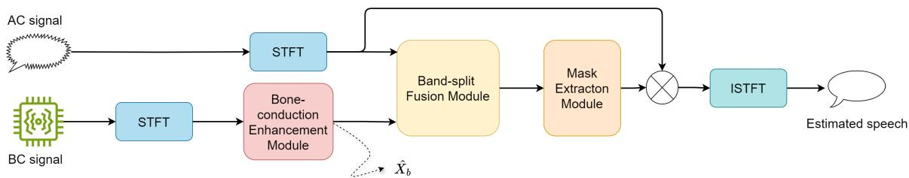
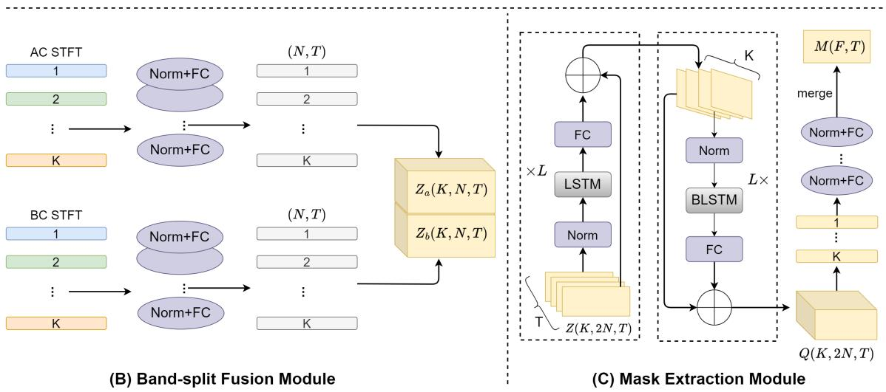
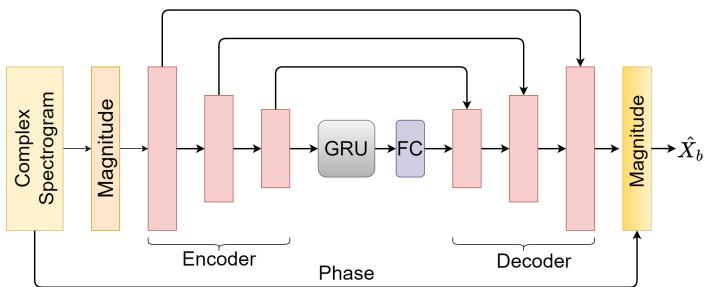

# MBENet: Bone-conduction and Air-conduction Fusion Network for Target Speaker Extraction

Chen Zhang1,3, Linfeng Feng1,2,3, Zhi Liu4, Xiao-Lei Zhang2,1,3,\*, Xuelong Li2,\*

1School of Marine Science and Technology, Northwestern Polytechnical University, Xi’an, China

2Institute of Artificial Intelligence (TeleAI), China Telecom, China

3Research and Development Institute of Northwestern Polytechnical University in Shenzhen, Shenzhen, China

4Shenzhen Huangli Technologies Company Ltd., Shenzhen, China

Emails: chen7zhang@mail.nwpu.edu.cn, xiaolei.zhang@nwpu.edu.cn, xuelong li@ieee.org

Abstract—Target speaker extraction (TSE) aims to isolate a target speaker’s voice from mixed speech using additional cues. Most TSE models rely on air-conduction (AC) signals, which are easily affected by interfering speakers and background noise. In contrast, bone-conduction (BC) speech is naturally resistant to ambient noise and captures only the target speaker’s voice. Existing BC-AC fusion methods have only been applied in conventional speech enhancement, lacking exploration in TSE applications. To leverage the advantages of BC signals, we propose the Multi-modal Bone-conduction Enhancement Network (MBENet), the first BC-AC fusion model designed for the TSE task. To further enhance performance, we introduce multi-task learning by incorporating the bandwidth extension of the BC channel as an auxiliary task. Experimental results show that our casual model outperforms existing approaches in challenging environments.

Index Terms—target speaker extraction, air-conduction, boneconduction, multi-modal fusion

## I. INTRODUCTION

Humans possess a remarkable ability to focus on a specific speaker in complex environments, including ambient noise and interfering speakers. This challenge is known as the cocktail party problem [1]. In order to enable machines to achieve selective auditory attention capabilities comparable to those of humans, the task of target speaker extraction (TSE) has been proposed. The process of TSE is to extract one target speaker’s speech from the mixture speech using auxiliary information (e.g., a registered voice snippet) [2].

Existing TSE models have a wide range of applications in both the time-frequency (T-F) domain [3]–[6] and the time-domain [7]–[12]. Most of these models are based on air-conducted (AC) speech signals. However, AC signals are vulnerable to environmental noise, especially in low signal-to-noise ratio (SNR) conditions. To address this limitation, researchers have explored multi-modal TSE methods such as audio-visual [13], audio-spatial [14]. However, boneconducted (BC) speech has emerged as a promising modality in conventional speech enhancement [15], which is the focus of this paper. BC sensors capture speech signals by recording skull vibrations of target speaker, which are inherently resistant to interference sounds in the air. However, previous work has mainly focused on speech enhancement, and BC-AC based target speaker extraction (TSE) has not been explored.

Existing BC speech enhancement methods can be categorized into two classes: blind enhancement and multi-modal enhancement. Because BC speech typically lacks high-frequency information, blind enhancement methods reconstruct wideband speech through bandwidth extension. Early studies focused on traditional filter designs, such as linear prediction (LP) analysis of AC speech from that of BC speech [16], [17]. With the advancement of deep neural networks (DNNs), denoising autoencoders have been introduced [18]. A major limitation of blind enhancement methods is their reliance solely on BC sensors, which typically have a narrow signal bandwidth, providing insufficient reference information for the model to effectively perform bandwidth expansion.

To address the aforementioned limitation, BC-AC fusion [19] emerges as an advanced multi-modal speech enhancement method recently. This method treats BC signals as an auxiliary to AC signals, with key work focusing on how to fuse the two modalities. However, the multi-modal research is still in its early stages. The potential of cross-modal features still have room to be improved.

We think that BC sensors not only naturally isolate external noise but also filter out interference from other speakers in the air. Therefore, in this paper, we explore their potential for TSE tasks. Meanwhile, noisy AC signals contain high-frequency components, which can be leveraged to ensure high-fidelity reconstruction. To address this, we introduce MBENet (Multimodal Bone-conduction Enhancement Network), a dual-modal TSE framework that integrates the benefits of BC blind enhancement and BC-AC fusion enhancement. By leveraging their complementary strengths, MBENet achieves robust speaker extraction in challenging acoustic environments. The contributions are summarized as follows:

• We propose MBENet, the first causal end-to-end BC-AC fusion framework tailored for TSE.

• We propose using multi-task learning to further enhance model performance by introducing the bandwidth extension of the BC signal as an auxiliary task.

  
(A) Overview

  
Fig. 1. Overall architecture of the proposed MBENet consists of three main components. The first part includes the bone-conduction enhancement modul for bandwidth extension. The second part (B) is band-split based fusion module for BC-AC fusion. The third part (C) involves mask extraction module and signal reconstruction.

• We experimentally demonstrate that the aforementioned joint bone-air conduction modeling method achieves both high quality and computational efficiency.

## II. PROPOSED METHOD

## A. Signal model

We use bone-conducted speech as auxiliary modal information to enhance the estimation of target speech. The boneconducted microphone captures only the low-frequency signal from the target speaker, and we treat the bandwidth extension of the bone-conducted channel as an auxiliary task. The signal model can be expressed as:

$$
(\hat {\mathbf {x}} _ {a}, \hat {\mathbf {X}} _ {b}) = \mathrm{MBENet} (\mathbf {x} _ {b}, \mathbf {y})\tag{1}
$$

where $\hat { \mathbf { x } } _ { a } ~ \in ~ \mathbb { R } ^ { T _ { w } }$ denotes the final estimated time-domain waveform of the target speech, $\hat { \mathbf X } _ { b } \in \mathbb R ^ { F \times T }$ represents the estimated complex spectrogram of the bone-conducted signal, and $\mathbf { x } _ { b } ~ \in ~ \mathbb { R } ^ { T _ { w } }$ is the ground-truth waveform of the boneconducted signal. Specifically, bone conduction signals only contain the speech of the target speaker. Additionally, $\mathbf { y } \in \mathbb { R } ^ { T _ { w } }$ corresponds to the noisy signal captured by the air-conducted microphone:

$$
\mathbf {y} = \mathbf {x} _ {a} + \mathbf {x} _ {i} + \mathbf {n}\tag{2}
$$

where $\mathbf { x } _ { a } \in \mathbb { R } ^ { T _ { w } }$ is the ground-truth target speech, $\mathbf { x } _ { i } \in \mathbb { R } ^ { T _ { w } }$ is interference speech from the other speaker, and $\mathbf { n } \in \mathbb { R } ^ { T _ { w } }$ is background noise.

## B. The overall architecture

The proposed multi-modal fusion model consists of a boneconducted enhancement module, a band-split-based fusion module, and a mask extraction module. The overall architecture of MBENet is illustrated in Figure 1. The BC enhancement module enhances the target speaker’s bone-conducted speech quality and optimizes their fusion with air-conducted speech in later stages. The band-split based fusion module adopts the band-split method from BSRNN [20].

We first obtain complex spectrograms $\mathbf { Y } \in \mathbb { R } ^ { F \times T }$ and ${ \bf X } _ { b } \in  { \bf \Psi }$ $\mathbb { R } ^ { F \times T }$ from the AC and BC channels via short-time Fourier transform (STFT). Similar to blind enhancement methods, the bone-conduction enhancement module extends the bandwidth of the BC’s complex spectrogram, yielding $\hat { \mathbf X } _ { b } \in \mathbb R ^ { F \times T }$ with high-frequency components.

Both Y and $\hat { \mathbf { X } } _ { b }$ are then processed through a sharedweight band-split module, enabling MBENet to perform more precise modeling across distinct frequency bands. Y and $\hat { \mathbf { X } } _ { b }$ are split in the same manner, so we take Y as an example. Y is divided into $K \ ( K \ < \ F )$ subbands. Each subband is then individually processed by a linear layer and layer normalization. Subsequently, the K bands are stacked to form a 3-D tensor $\mathbf { Z } _ { a } \in \mathbb { R } ^ { N \times K \times T }$ , where N is the embedding dimension of each bin. Similarly, after passing through the band-split module, $\hat { \mathbf X } _ { b }$ is transformed into $\mathbf { Z } _ { b } \in \mathbb { R } ^ { N \times K \times T }$ Then, $\mathbf { Z } _ { a }$ and $\mathbf { Z } _ { b }$ are concatenated to form $\mathbf { Z } \in \mathbb { R } ^ { 2 N \times K \times T }$

  
Fig. 2. Detailed structure of Bone-conduction enhancement module.

Finally, the stacked bands Z are fed into mask extraction module. After fusion, the mask extraction module employs LSTM layers to model the correlations between the time and frequency dimensions. Specifically, the first block is used to model time sequence features along time axis. Then the second block captures the context features among different frequency bands at each frame. After that, $\mathbf { Z } \in \mathbb { R } ^ { \mathbf { \breve { 2 } } N \times K \times T }$ is mapped to $\mathbf { Q } \in \mathbb { R } ^ { 2 N \times K \times T }$ . Next, Q undergoes band merging, which is the inverse operation of band splitting. Each subband is individually processed by a layer normalization and a linear layer, resulting in the complex mask $\mathbf { M } \in \mathbb { R } ^ { F \times T }$ . Next, the predicted clean complex spectrogram $\hat { \mathbf X } _ { a } \in \mathbb { R } ^ { F \times T }$ is obtained by applying the mask to $\mathbf { Y } \colon$

$$
\hat {\mathbf {X}} _ {a} = \mathbf {M} \odot \mathbf {Y}\tag{3}
$$

where $\odot$ is the Hadamard product operator.

## C. Bone-conduction enhancement module

This module is inspired by audio super-resolution [21], and the complete architecture is illustrated in Figure 2. One approach is to employ a DNN to map from the complex spectrogram of bone-conducted speech to that of clean speech. Building upon the typical convolutional recurrent network (CRN) [22] architectures in speech enhancement applications, our proposed bone-conduction enhancement module inherits its structural paradigm.

The proposed network architecture employs a symmetric encoder-decoder framework. The encoder consists of three causal convolutional layers, whereas the decoder mirrors this structure with three causal transposed convolutional layers. A temporal modeling block containing one GRU layer and a fully-connected layer bridges the encoder-decoder hierarchy. Exponential linear units (ELUs) are applied to all convolutional/ transposed convolutional layers excluding the final output layer, with batch normalization inserted between each convolution operation and its subsequent activation. Additionally, dense skip connections are implemented by channelwise concatenation of encoder layer outputs to corresponding decoder layer inputs. The module only enhances the magnitude of bone-conducted speech. Then the magnitude is combined with the original phase spectrum to form a complete complex spectrogram, which is then sent to band-split based fusion module.

## D. Multi-task learning

We implement multi-task learning with two objectives: a scale-invariant signal-to-distortion ratio (SI-SDR) loss for the final estimated target speech and a mean square error (MSE) loss for the bandwidth extension task in the bone-conduction enhancement module.

The hybrid loss is defined as:

$$
\mathcal {L} _ {h y b r i d} = \mathcal {L} _ {s i s d r} + \gamma \mathcal {L} _ {m s e},\tag{4}
$$

where γ is a hyperparameter. The SI-SDR loss is computed using $\hat { \mathbf { x } } _ { a } ,$ , while the MSE loss is computed using the magnitude spectrogram of $\hat { \mathbf { x } } _ { b } .$ denoted as $| \hat { \mathbf { X } } _ { b } |$ |.

The SI-SDR loss is defined as:

$$
\left\{ \begin{array}{l} \bar {\mathbf {x}} _ {a} = \frac {\hat {\mathbf {x}} _ {a} ^ {T} \mathbf {x} _ {a}}{| \mathbf {x} _ {a} | _ {2} ^ {2}} \\ \mathcal {L} _ {s i s d r} = - 1 0 \log_ {1 0} \frac {| \bar {\mathbf {x}} _ {a} | _ {2} ^ {2}}{| \bar {\mathbf {x}} _ {a} - \hat {\mathbf {x}} _ {a} | _ {2} ^ {2}} \end{array} \right.\tag{5}
$$

The MSE loss is formulated as:

$$
\mathcal {L} _ {m s e} = \frac {1}{T \times F} \left| | \mathbf {X} _ {a} (i) | - | \hat {\mathbf {X}} _ {b} (i) | \right| _ {2} ^ {2},
$$

## III. EXPERIMENTS

(6)

To evaluate the TSE performance of our proposed model, we constructed a simulated ABCS-2Mix dataset from the multimodal Mandarin corpus ABCS [23] and the MUSAN noise dataset [24]. The ABCS dataset is AC and BC synchronized utterances read by 100 native Chinese speakers (50 males and 50 females). Each speaker’s utterance is a two channel audio which contains matched BC vibration signatures and AC acoustic characteristics. We randomly selected 40 males and 40 females for training, 5 males and 5 females for validation, 5 males and 5 females for test dataset. Speech mixtures are generated by randomly selecting one target speaker utterance and the other inference speaker utterance. The signal-tointerference ratio (SIR) in each clean mixture ranges from 0dB to 2dB. Random noise samples from MUSAN are then added to the speech mixtures. The SNRs are normally distributed with a ranges randomly from -5 dB to 10 dB. In ABCS-2Mix, the training, development, and test subsets contain 80225, 13650, and 13650 mixture samples, respectively. All mixture samples in the training data are chopped into 3 seconds segments. The sampling rate of all data is 16 kHz in our experiments.

## A. Experimental setting

During the experiments, a Hanning window with 32ms window length and 8ms hop size (75% overlap) is employed for STFT. As for the bone-conduction enhancement module, it has three encoder blocks and three decoder blocks, and the setting of the output channels of the {16, 32, 64}. The kernel size and stride of all the (de)convolutional layers are set as (3,2) and (2,1), respectively. The bone-conduction enhancement module uses a single GRU layer with 64 hidden units, followed by a linear layer that projects the 64-dimensional hidden states to a 1984-dimensional representation. For the band-split detail, we split the spectrogram into 31 subbands. Two LSTMs in the mask extraction module are both with 64 hidden units. And the LSTM layer repeats for 6 times. During training, learning rate was initialized to $1 0 ^ { - 3 }$ and scheduling strategy is the learning rate is halved if no improvement in validation performance is observed for 2 consecutive epochs. AdamW is used as the optimizer. Early stopping is applied if no best model is found in the validation set for 5 consecutive epochs. The gradient clipping is set to 5. For the hybrid loss function, we set γ equal to 15.

TABLE I  
MULTI-MODAL RESULTS ON INTRUSIVE METRICS UNDER VARIOUS SNR NOISE CONDITIONS.

<table><tr><td rowspan="2"></td><td rowspan="2">Param. (M)</td><td colspan="2">-5 dB</td><td colspan="2">0 dB</td><td colspan="2">5 dB</td><td colspan="2">10 dB</td><td colspan="2">average</td></tr><tr><td>SI-SDR</td><td>PESQ</td><td>SI-SDR</td><td>PESQ</td><td>SI-SDR</td><td>PESQ</td><td>SI-SDR</td><td>PESQ</td><td>SI-SDR</td><td>PESQ</td></tr><tr><td>Noisy AC</td><td>—</td><td>0.82</td><td>2.00</td><td>0.92</td><td>2.17</td><td>1.35</td><td>2.34</td><td>1.68</td><td>2.48</td><td>1.20</td><td>2.25</td></tr><tr><td>CRN [22]</td><td>1.6</td><td>7.88</td><td>2.31</td><td>9.77</td><td>2.43</td><td>11.57</td><td>2.64</td><td>13.11</td><td>2.79</td><td>10.58</td><td>2.54</td></tr><tr><td>Spex+ [7]</td><td>11.1</td><td>11.97</td><td>2.67</td><td>14.21</td><td>2.79</td><td>16.44</td><td>3.05</td><td>17.63</td><td>3.17</td><td>15.06</td><td>2.91</td></tr><tr><td>MMINet [25]</td><td>5.2</td><td>13.10</td><td>2.69</td><td>14.70</td><td>2.81</td><td>17.10</td><td>3.04</td><td>18.31</td><td>3.13</td><td>15.81</td><td>2.92</td></tr><tr><td>pBSRNN [26]</td><td>3.8</td><td>12.74</td><td>2.82</td><td>14.90</td><td>2.91</td><td>17.20</td><td>3.11</td><td>18.24</td><td>3.29</td><td>15.77</td><td>3.03</td></tr><tr><td>MBENet</td><td>3.8</td><td>13.52</td><td>2.99</td><td>15.80</td><td>3.08</td><td>17.94</td><td>3.23</td><td>19.36</td><td>3.38</td><td>16.67</td><td>3.17</td></tr></table>

TABLE II  
MULTI-MODAL RESULTS ON NON-INTRUSIVE METRICS UNDER VARIOUS SNR NOISE CONDITIONS.

<table><tr><td rowspan="2"></td><td rowspan="2">Param. (M)</td><td colspan="3">-5 dB</td><td colspan="3">0 dB</td><td colspan="3">5 dB</td><td colspan="3">10 dB</td><td colspan="3">average</td></tr><tr><td>SIG</td><td>BAK</td><td>OVRL</td><td>SIG</td><td>BAK</td><td>OVRL</td><td>SIG</td><td>BAK</td><td>OVRL</td><td>SIG</td><td>BAK</td><td>OVRL</td><td>SIG</td><td>BAK</td><td>OVRL</td></tr><tr><td>Noisy AC</td><td>—</td><td>1.39</td><td>1.13</td><td>1.19</td><td>1.54</td><td>1.21</td><td>1.27</td><td>1.76</td><td>1.44</td><td>1.51</td><td>1.84</td><td>1.51</td><td>1.60</td><td>1.66</td><td>1.37</td><td>1.40</td></tr><tr><td>CRN [22]</td><td>1.60</td><td>2.11</td><td>1.94</td><td>1.73</td><td>2.19</td><td>2.03</td><td>1.81</td><td>2.33</td><td>2.12</td><td>1.90</td><td>2.45</td><td>2.23</td><td>2.04</td><td>2.25</td><td>2.08</td><td>1.85</td></tr><tr><td>Spex+ [7]</td><td>11.1</td><td>3.27</td><td>3.02</td><td>2.84</td><td>3.40</td><td>3.16</td><td>3.03</td><td>3.53</td><td>3.27</td><td>3.15</td><td>3.69</td><td>3.42</td><td>3.30</td><td>3.46</td><td>3.22</td><td>3.09</td></tr><tr><td>MMINet [25]</td><td>5.2</td><td>3.29</td><td>3.5</td><td>3.15</td><td>3.34</td><td>3.61</td><td>3.25</td><td>3.43</td><td>3.70</td><td>3.32</td><td>3.71</td><td>3.87</td><td>3.50</td><td>3.38</td><td>3.65</td><td>3.27</td></tr><tr><td>pBSRNN [26]</td><td>3.8</td><td>3.25</td><td>3.48</td><td>3.11</td><td>3.34</td><td>3.60</td><td>3.25</td><td>3.46</td><td>3.73</td><td>3.35</td><td>3.76</td><td>3.91</td><td>3.52</td><td>3.39</td><td>3.68</td><td>3.29</td></tr><tr><td>MBENet</td><td>3.8</td><td>3.44</td><td>3.57</td><td>3.22</td><td>3.57</td><td>3.81</td><td>3.42</td><td>3.69</td><td>3.99</td><td>3.51</td><td>3.84</td><td>4.12</td><td>3.61</td><td>3.60</td><td>3.86</td><td>3.47</td></tr></table>

## B. Evaluation metrics

We apply both intrusive metrics and non-intrusive metrics for the experiments, including SI-SDR, perceptual evaluation of speech quality (PESQ) [27], DNSMOS [28]: SIG, BAK, OVRL.

## C. Comparison of methods

Since there were no specialized AC-BC fusion TSE models previously, we made subtle modifications to some classic AC TSE models to adapt them for the task. Below are the baseline methods:

• CRN [22] designed for speech enhancement originally. To adapt it for the TSE task, we modify the framework by replacing direct magnitude spectrum prediction with a mask embedding generation branch. The AC and BC signals are concatenated as the network’s input.

• Spex+ [7] is a time-domain AC TSE model. The adjustment made here is replacing the original target speaker’s registered utterance with the target speaker’s BC signal, while the rest of the network structure remains unchanged.

• MMINet [25] is used for multi-modal AC and BC fusion model for time-domain speech enhancement.

TABLE III  
ABLATION STUDY ON THE SUPERIORITY OF BC-AC OVER AC.

<table><tr><td></td><td>SI-SDR</td><td>PESQ</td><td>SIG</td><td>BAK</td><td>OVRL</td></tr><tr><td>Noisy AC Speech</td><td>1.20</td><td>2.15</td><td>1.66</td><td>1.37</td><td>1.40</td></tr><tr><td>BC Speech</td><td>8.81</td><td>2.95</td><td>3.10</td><td>2.62</td><td>2.50</td></tr><tr><td>AC MBENet</td><td>11.19</td><td>2.68</td><td>2.77</td><td>2.51</td><td>2.39</td></tr><tr><td>MNet</td><td>16.12</td><td>3.03</td><td>3.79</td><td>3.57</td><td>3.39</td></tr><tr><td>MBENet</td><td>16.67</td><td>3.17</td><td>3.86</td><td>3.60</td><td>3.47</td></tr></table>

• pBSRNN [26] is a time-frequency domain AC TSE model. The only adjustment made here is replacing the original target speaker’s registered utterance with the target speaker’s BC signal.

## D. Main results

For intrusive metrics in Table I, MBENet outperforms other methods in terms of SI-SDR and PESQ values under all SNR conditions. As the SNR decreases from 10 dB to -5 dB, our MBENet achieves relative improvements in PESQ over pBSRNN of 2.74%, 3.86%, 5.84%, and 6.03%, respectively. This demonstrates the robustness of MBENet in the presence of strong noise. Additionally, with MBENet having a similar parameter count to pBSRNN, it highlights that the proposed auxiliary task of bone conduction signal bandwidth extension achieves significant performance gains with only a minimal increase in parameter count. In terms of non-intrusive metrics in Table II, MBENet consistently outperforms all baselines across all SNR conditions. The results from both intrusive and nonintrusive metrics align, further confirming the comprehensive performance advantages of MBENet.

Table III highlights the advantages of BC-AC combined TSE over AC-only TSE. We compare our model with the pure AC system AC MBENet using registered speaker embedding [26]. We also compare with the MNet, which is the MBENet without the bone-conduction enhancement module. The results demonstrate that our BC-AC fusion model significantly outperforms the AC-only system across all metrics. Comparing with BC speech, although the BC-AC system underperforms on some metrics due to the highly challenging test environment, the BC speech itself suffers from poor auditory quality due to severe high-frequency loss. In practice, our model still achieves significant improvements.

## IV. CONCLUSION

In conclusion, we have proposed the MBENet, a novel dual-modal casual framework for TSE that integrates boneconduction and air-conduction modalities. By leveraging the complementary strengths of BC’s noise robustness and AC’s broad spectral coverage, MBENet improves the effect of speaker extraction in noisy and complex environments. Our approach incorporates BC bandwidth extension as an auxiliary task, further enhancing the model’s performance. Experimental results demonstrate that MBENet achieves both high-quality target speaker extraction and computational efficiency.

## REFERENCES

[1] D. Wang and J. Chen, “Supervised speech separation based on deep learning: An overview,” IEEE/ACM transactions on audio, speech, and language processing, vol. 26, no. 10, pp. 1702–1726, 2018.

[2] K. Zmolikova, M. Delcroix, T. Ochiai, K. Kinoshita, J. Cernockˇ y, and\` D. Yu, “Neural target speech extraction: An overview,” IEEE Signal Processing Magazine, vol. 40, no. 3, pp. 8–29, 2023.

[3] S. He, H. Li, and X. Zhang, “Speakerfilter: Deep learning-based target speaker extraction using anchor speech,” in ICASSP 2020-2020 IEEE International Conference on Acoustics, Speech and Signal Processing (ICASSP). IEEE, 2020, pp. 376–380.

[4] W. Zhang, L. Yang, and Y. Qian, “Exploring time-frequency domain target speaker extraction for causal and non-causal processing,” in 2023 IEEE Automatic Speech Recognition and Understanding Workshop (ASRU). IEEE, 2023, pp. 1–6.

[5] X. Yang, C. Bao, and X. Chen, “Coarse-to-fine target speaker extraction based on contextual information exploitation,” IEEE/ACM Transactions on Audio, Speech, and Language Processing, 2024.

[6] F. Hao, X. Li, and C. Zheng, “X-tf-gridnet: A time–frequency domain target speaker extraction network with adaptive speaker embedding fusion,” Information Fusion, vol. 112, p. 102550, 2024.

[7] M. Ge, C. Xu, L. Wang, E. S. Chng, J. Dang, and H. Li, “Spex+: A complete time domain speaker extraction network,” in Interspeech 2020, 2020, pp. 1406–1410.

[8] ——, “Multi-stage speaker extraction with utterance and frame-level reference signals,” in ICASSP 2021-2021 IEEE International Conference on Acoustics, Speech and Signal Processing (ICASSP). IEEE, 2021, pp. 6109–6113.

[9] K. Liu, Z. Du, X. Wan, and H. Zhou, “X-sepformer: End-to-end speaker extraction network with explicit optimization on speaker confusion,” in ICASSP 2023-2023 IEEE International Conference on Acoustics, Speech and Signal Processing (ICASSP). IEEE, 2023, pp. 1–5.

[10] L. Yang, W. Liu, L. Tan, J. Yang, and H.-G. Moon, “Target speaker extraction with ultra-short reference speech by ve-ve framework,” in ICASSP 2023-2023 IEEE International Conference on Acoustics, Speech and Signal Processing (ICASSP). IEEE, 2023, pp. 1–5.

[11] J. Wang, S. Wang, J. Li, K. Zhang, Y. Qian, and H. Li, “Enhancing speaker extraction through rectifying target confusion,” in 2024 IEEE Spoken Language Technology Workshop (SLT). IEEE, 2024, pp. 349– 356.

[12] L. Yu, W. Zhang, C. Du, L. Zhang, Z. Liang, and Y. Qian, “Generationbased target speech extraction with speech discretization and vocoder,” in ICASSP 2024-2024 IEEE International Conference on Acoustics, Speech and Signal Processing (ICASSP). IEEE, 2024, pp. 12 612–12 616.

[13] B. Veluri, M. Itani, T. Chen, T. Yoshioka, and S. Gollakota, “Look once to hear: Target speech hearing with noisy examples,” in Proceedings of the CHI Conference on Human Factors in Computing Systems, 2024, pp. 1–16.

[14] R. Gu, S.-X. Zhang, Y. Xu, L. Chen, Y. Zou, and D. Yu, “Multi-modal multi-channel target speech separation,” IEEE Journal ofSelected Topics in Signal Processing, vol. 14, no. 3, pp. 530–541, 2020.

[15] C. Li, F. Yang, and J. Yang, “A two-stage approach to quality restoration of bone-conducted speech,” IEEE/ACM Transactions on Audio, Speech, and Language Processing, 2023.

[16] M. T. Turan and E. Erzin, “Source and filter estimation for throatmicrophone speech enhancement,” IEEE/ACM Transactions on Audio, Speech, and Language Processing, vol. 24, no. 2, pp. 265–275, 2015.

[17] H. Q. Nguyen and M. Unoki, “Improvement in bone-conducted speech restoration using linear prediction and long short-term memory model,” Journal of Signal Processing, vol. 24, no. 4, pp. 175–178, 2020.

[18] H.-P. Liu, Y. Tsao, and C.-S. Fuh, “Bone-conducted speech enhancement using deep denoising autoencoder,” Speech Communication, vol. 104, pp. 106–112, 2018.

[19] H. Wang, X. Zhang, and D. Wang, “Attention-based fusion for boneconducted and air-conducted speech enhancement in the complex domain,” in ICASSP 2022-2022 IEEE International Conference on Acoustics, Speech and Signal Processing (ICASSP). IEEE, 2022, pp. 7757– 7761.

[20] Y. Luo and J. Yu, “Music source separation with band-split rnn,” IEEE/ACM Transactions on Audio, Speech, and Language Processing, vol. 31, pp. 1893–1901, 2023.

[21] H. Liu, K. Chen, Q. Tian, W. Wang, and M. D. Plumbley, “Audiosr: Versatile audio super-resolution at scale,” in ICASSP 2024-2024 IEEE International Conference on Acoustics, Speech and Signal Processing (ICASSP). IEEE, 2024, pp. 1076–1080.

[22] K. Tan and D. Wang, “A convolutional recurrent neural network for realtime speech enhancement.” in Interspeech, vol. 2018, 2018, pp. 3229– 3233.

[23] M. Wang, J. Chen, X.-L. Zhang, and S. Rahardja, “End-to-end multimodal speech recognition on an air and bone conducted speech corpus,” IEEE/ACM Transactions on Audio, Speech, and Language Processing, vol. 31, pp. 513–524, 2023.

[24] D. Snyder, G. Chen, and D. Povey, “Musan: A music, speech, and noise corpus,” arXiv preprint arXiv:1510.08484, 2015.

[25] M. Wang, J. Chen, X. Zhang, Z. Huang, and S. Rahardja, “Multi-modal speech enhancement with bone-conducted speech in time domain,” Applied Acoustics, vol. 200, p. 109058, 2022.

[26] J. Yu, H. Chen, Y. Luo, R. Gu, and C. Weng, “High fidelity speech enhancement with band-split rnn,” in Interspeech 2023, 2023, pp. 2483– 2487.

[27] A. W. Rix, J. G. Beerends, M. P. Hollier, and A. P. Hekstra, “Perceptual evaluation of speech quality (pesq)-a new method for speech quality assessment of telephone networks and codecs,” in 2001 IEEE international conference on acoustics, speech, and signal processing. Proceedings (Cat. No. 01CH37221), vol. 2. IEEE, 2001, pp. 749–752.

[28] C. K. Reddy, V. Gopal, and R. Cutler, “Dnsmos: A non-intrusive perceptual objective speech quality metric to evaluate noise suppressors,” in ICASSP 2021-2021 IEEE International Conference on Acoustics, Speech and Signal Processing (ICASSP). IEEE, 2021, pp. 6493–6497.