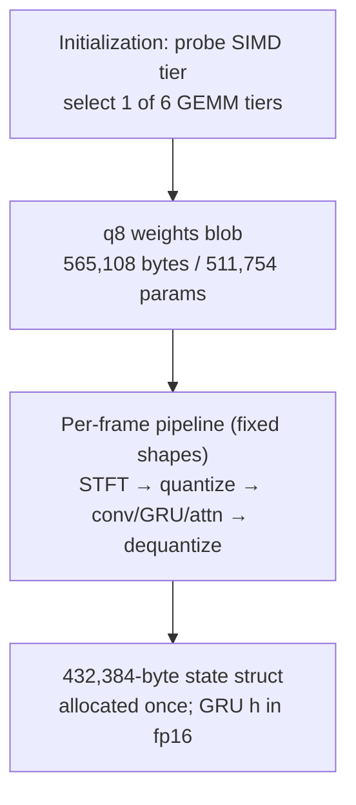

# faster-enhancer.c

A dependency-free C runtime for streaming speech enhancement on commodity CPUs, released by [[entities/gyeongmin-kim|Gyeongmin Kim]] ([[sources/kim-2026-faster-enhancer|Kim 2026]]). It ports FastEnhancer-Medium at 48 kHz to int8 inference with architecture and weights untouched, and specializes every layer of the runtime around that one fixed model.

## Design

Key elements:

- **Six int8 GEMM tiers** compiled into one binary, one selected at initialization: ARM NEON, DOTPROD, I8MM; x86 AVX2, AVX-VNNI, AVX-512 VNNI. Fixed shapes and compile-time alignment assertions delete every scalar remainder path. A host without the required baseline fails at initialization rather than taking an unverified slow path.
- **Quantization**: [[concepts/per-frame-activation-quantization|per-frame activation ranges]] (no calibration set), per-output-row symmetric int8 weights, both clamped to [−127, 127] so int16 accumulation is provably safe ($2 \times 127 \times 127 = 32{,}258 < 32{,}767$) and AVX2's `vpsignb` never sees the un-negatable −128 — making all tiers within an architecture family **byte-identical**.
- **Fusion**: transpose folded into quantization, residuals into GEMM epilogues, the GRU's two matrices + three gates + hidden update + fp16 state write as one kernel per tier (int32 accumulators never reach memory); softmax consumes int32 scores directly.
- **Winograd F(2,3)** for the k=3 convolutions; fp16 (IEEE binary16) long-lived cross-stage state, where int8 would lose ~40 dB SNR through the decoder concat.
- **Public interface**: four functions and one header; 162 KiB static library, single-threaded, no allocations after startup.

## Measured Results

| Device | Tier | RTF (racing, p50) | vs fp32 ONNX Runtime |
|--------|------|-------------------|----------------------|
| Apple M2 | DOTPROD | 0.068 | 0.230 → **3.3× speedup** |
| Apple M2 | I8MM | 0.069 | — |
| Galaxy S23+ | I8MM | 0.096 | — |

Quality tracks fp32 to −0.006 PESQ / −0.08 dB SNR over 824 VoiceBank-DEMAND utterances. Under [[concepts/racing-vs-pacing-benchmark|deadline pacing]], the deployable point is 0.286 RTF paced on a P-core at 198 mJ per audio-second with 0.05% deadline misses.

The best SIMD tier inverts between devices (DOTPROD and I8MM tie on M2; DOTPROD costs 17.7% more on the Snapdragon 8 Gen 2), so tier selection must be runtime, not compile-time.

## Notable Debugging Case: The `cosf` Window

Cross-compiler builds initially agreed on only 22% of samples. The cause was neither the integer kernels nor FP contraction: the Hann window coefficients were built with `cosf`, which is not correctly rounded, and macOS and bionic disagree in the last bit for hundreds of the 1024 coefficients — and the window multiplies every frame. Computing the window in double and narrowing once makes the platforms bit-identical. (Similarly: SSE4.1 dropped because without FMA3 the epilogue drifts ~1 ULP per op; AVX-512's 14-bit `rcp14` had to be split to reproduce the 256-bit path's 12-bit estimate, after a 44 dB SNR divergence between "identical" tiers surfaced.)

## Related Concepts

- [[concepts/per-frame-activation-quantization|Per-Frame Activation Quantization]]
- [[concepts/racing-vs-pacing-benchmark|Racing vs. Pacing Benchmark]]
- [[concepts/rnnformer|RNNFormer]]
- [[concepts/post-training-quantization|Post-Training Quantization]]

## Related Sources

- [[sources/kim-2026-faster-enhancer|Kim 2026: faster-enhancer.c]]
- [[sources/ahn-2026-fastenhancer|Ahn, Han, Woo & Kim 2026: FastEnhancer]] — the model being ported
