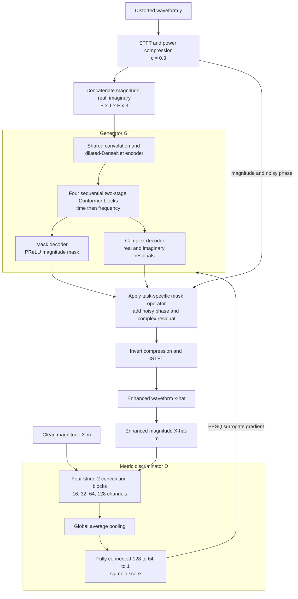

# Abdulatif, Cao & Yang 2024: CMGAN — Conformer-Based Metric-GAN for Monaural Speech Enhancement

| Field | Value |
|:------|:------|
| **Authors** | [[entities/sherif-abdulatif|Sherif Abdulatif]], [[entities/ruizhe-cao|Ruizhe Cao]], [[entities/bin-yang|Bin Yang]] |
| **Institution** | University of Stuttgart, Institute of Signal Processing and System Theory, Stuttgart, Germany |
| **Venue** | IEEE/ACM Transactions on Audio, Speech, and Language Processing |
| **Year** | 2024 |
| **Volume/Pages** | 32:2477–2493 |
| **Type** | Journal article; extended version of Cao, Abdulatif & Yang, Interspeech 2022, pp. 936–940 |
| **DOI** | [10.1109/TASLP.2024.3393718](https://doi.org/10.1109/TASLP.2024.3393718) |
| **arXiv** | [2209.11112v3](https://arxiv.org/abs/2209.11112v3) |
| **Zotero** | [KL3XIQQU](zotero://select/items/0_KL3XIQQU) |
| **Code** | [ruizhecao96/CMGAN](https://github.com/ruizhecao96/CMGAN) |

## Summary

CMGAN combines a shared magnitude/complex spectrogram encoder, sequential time–frequency Conformer blocks, decoupled mask and complex decoders, and a PESQ-based MetricGAN discriminator for monaural speech enhancement. The TASLP article extends the 2022 denoising model to dereverberation and complex time-frequency speech super-resolution, adds extensive architecture and discriminator ablations, and evaluates unseen distortions with DNSMOS and a listening test. The 1.83 M-parameter model reports PESQ 3.41 and SSNR 11.10 dB on VoiceBank+DEMAND, competitive REVERB results, and strong VCTK bandwidth-extension results.

## Problem Formulation

The three enhancement tasks are expressed with one degradation model:

$$y(t)=x(t)*h(t)+n(t),$$

where $x(t)$ is clean speech, $y(t)$ is the observed signal, $n(t)$ is additive noise, and $h(t)$ is a task-dependent filter.

| Task | Degradation model | Desired output |
|:-----|:------------------|:---------------|
| **Denoising** | $h(t)=\delta(t)$; retain $n(t)$ | Suppress stationary or non-stationary background noise while preserving speech |
| **Dereverberation** | $h(t)$ is a room impulse response; the experiments retain additive sensor noise | Preserve the direct path and early reflections while suppressing late reverberation |
| **Super-resolution / bandwidth extension** | $h(t)$ is a low-pass filter; no additive noise | Reconstruct missing high-frequency content and interpolate from 8/4/2 kHz to 16 kHz |

The method addresses two limitations of earlier TF-domain systems:

1. **Magnitude–phase trade-off.** Real/imaginary-only estimation can let magnitude errors compensate for phase errors, while magnitude-only masking retains the noisy phase. CMGAN therefore learns from magnitude, real, and imaginary inputs and combines a magnitude-mask path with a complex-refinement path.
2. **Loss–metric mismatch.** Pointwise spectral and waveform losses need not improve PESQ or STOI, which are non-differentiable. A MetricGAN-style discriminator supplies a differentiable surrogate for normalized PESQ.

The journal experiments train and evaluate each task separately; joint denoising plus dereverberation appears only in the opinion-score evaluation, not as a jointly trained task.

## Methodology

### Power-Compressed Magnitude–Complex Representation

For a distorted waveform $y\in\mathbb{R}^{L}$, the STFT produces $Y_o$. CMGAN applies [[concepts/power-law-compression|power-law compression]] with $c=0.3$ while preserving phase:

$$Y=|Y_o|^{c}e^{jY_p}=Y_m e^{jY_p}=Y_r+jY_i.$$

The generator input is the three-channel tensor $Y_{in}\in\mathbb{R}^{B\times T\times F\times 3}$, formed by concatenating compressed magnitude $Y_m$, real part $Y_r$, and imaginary part $Y_i$. This shared representation feeds one encoder rather than separate magnitude and complex encoders.

### Model Structure, Inputs, and Outputs

| Network | Structure | Input | Output | Training data | Role |
|:--------|:----------|:------|:-------|:--------------|:-----|
| **Shared encoder** | $1\times1$ 2-D convolution to 64 channels, instance normalization and PReLU; four $2\times3$ dilated dense blocks with dilations $\{1,2,4,8\}$; $1\times3$ convolution with frequency stride 2 | Three-channel compressed $Y_m,Y_r,Y_i$ tensor; 16 kHz STFT frames | $B\times T\times101\times64$ shared feature map | Two-second task-specific training segments | Learns a common magnitude/phase representation and halves frequency resolution before the Conformer bottleneck |
| **Two-stage Conformer bottleneck** | Four sequential [[concepts/two-stage-conformer|two-stage Conformer]] blocks. Each block applies a time Conformer and then a frequency Conformer; each Conformer contains two half-step FFNNs around four-head MHSA and a convolution module, with residual paths | $B\times T\times101\times64$ encoder features | Refined tensor of the same shape | Same as encoder | Captures long-range temporal and frequency dependencies plus local convolutional structure without joint time–frequency attention |
| **Mask decoder** | Four dilated dense blocks $\{1,2,4,8\}$; sub-pixel convolution to restore frequency resolution; $1\times2$ convolution to one channel; per-frequency PReLU with 201 slopes | Shared bottleneck features and $Y_m$ at reconstruction | Magnitude mask $M$; multiplicative for denoising/dereverberation, additive residual $M'$ for super-resolution | Same as encoder | Suppresses unwanted magnitude components or reconstructs missing high-frequency bands |
| **Complex decoder** | Same dense/sub-pixel backbone as the mask decoder; final $1\times2$ convolution to two channels; no output activation | Shared bottleneck features | Real and imaginary residual spectra $(\hat X'_r,\hat X'_i)$ | Same as encoder | Refines phase and complex structure beyond what magnitude masking with noisy phase can represent |
| **Metric discriminator $D$** | Four $4\times4$, stride-2 2-D convolution blocks with 16/32/64/128 channels, instance normalization and PReLU; global average pooling; linear layers $128\rightarrow64\rightarrow1$ and sigmoid | Two-channel magnitude pair $(X_m,X_m)$ or $(X_m,\hat X_m)$ | One normalized metric estimate per utterance | Clean/clean and clean/enhanced magnitude pairs with normalized PESQ targets | Learns a differentiable PESQ surrogate and supplies the adversarial generator objective |

The full generator has **1.83 M trainable parameters**. The Appendix specifies 201 STFT bins; Section IV-B says 200, an internal inconsistency noted below.

### Sequential Time–Frequency Conformer Block

Given encoder output $D\in\mathbb{R}^{B\times T\times F'\times C}$, one two-stage block first treats every frequency channel as a separate sequence:

$$D^T\in\mathbb{R}^{BF'\times T\times C},\qquad D_o^T=D^T+\operatorname{Conformer}_T(D^T).$$

It then reshapes the result along frequency and applies a second residual Conformer:

$$D^F\in\mathbb{R}^{BT\times F'\times C},\qquad D_o^F=D^F+\operatorname{Conformer}_F(D^F).$$

The sequential order is **time then frequency**. This factorization avoids the much larger joint attention space over all $T\times F'$ positions. The paper's ablation favors it over parallel time/frequency Conformers and reports a small additional advantage over frequency-then-time ordering.

### Decoupled Reconstruction and Task-Specific Masking

For denoising and dereverberation, the mask decoder multiplies the compressed input magnitude, $\hat X'_m=M\odot Y_m$. Combining this estimate with noisy phase and the complex residual gives

$$\hat X_r=\hat X'_m\cos(Y_p)+\hat X'_r,\qquad
\hat X_i=\hat X'_m\sin(Y_p)+\hat X'_i.$$

The final magnitude used by the magnitude loss is computed after both branches have contributed:

$$\hat X_m=\sqrt{\hat X_r^2+\hat X_i^2}.$$

Consequently, $\mathcal L_{Mag}$ propagates through both decoders rather than supervising only the mask branch. Compression is inverted before the ISTFT.

For [[concepts/speech-super-resolution|speech super-resolution]], suppression-oriented multiplication is inappropriate. CMGAN replaces it with addition so the same decoder predicts missing spectral content:

$$\hat X_r=(M'+Y_m)\cos(Y_p)+\hat X'_r,\qquad
\hat X_i=(M'+Y_m)\sin(Y_p)+\hat X'_i.$$

![[raw/papers/abdulatif-2024-cmgan/figures/3573763c33ddbff77f1ff18483c25edf98dd7f1ecf53c68428f9a18937b0498c.jpg|CMGAN generator, two-stage Conformer, and metric discriminator]]

*Figure 2: CMGAN architecture. Panel (a) shows the shared encoder and two decoders, panel (b) the sequential time/frequency Conformer, and panel (c) the metric discriminator. The mask operator is multiplication for denoising/dereverberation and addition for super-resolution.*

### Training Losses

The time-frequency objective is a [[concepts/mixed-magnitude-complex-loss|mixed magnitude-complex loss]] over power-compressed spectra, with the magnitude weight chosen by grid search:

$$\mathcal L_{TF}=0.7\,\mathcal L_{Mag}+0.3\,\mathcal L_{RI},$$

$$\mathcal L_{Mag}=\mathbb E\left[\lVert X_m-\hat X_m\rVert_2\right],$$

$$\mathcal L_{RI}=\mathbb E\left[\lVert X_r-\hat X_r\rVert_2\right]+\mathbb E\left[\lVert X_i-\hat X_i\rVert_2\right].$$

The PESQ surrogate follows [[concepts/metricgan|MetricGAN]] and least-squares GAN training. $Q_{PESQ}\in[0,1]$ is normalized PESQ:

$$\mathcal L_{GAN}=\mathbb E\left[\lVert D(X_m,\hat X_m)-1\rVert_2\right],$$

$$\begin{aligned}
\mathcal L_D={}&\mathbb E\left[\lVert D(X_m,X_m)-1\rVert_2\right]\\
&+\mathbb E\left[\lVert D(X_m,\hat X_m)-Q_{PESQ}\rVert_2\right].
\end{aligned}$$

Thus $D$ regresses an actual metric value rather than classifying real/fake speech, while $G$ is pushed toward the clean-score target 1. A waveform $L_1$ term anchors the time-domain reconstruction:

$$\mathcal L_{Time}=\mathbb E\left[\lVert x-\hat x\rVert_1\right].$$

The complete generator objective is

$$\boxed{\mathcal L_G=\mathcal L_{TF}+0.01\,\mathcal L_{GAN}+\mathcal L_{Time}}$$

so $(\gamma_1,\gamma_2,\gamma_3)=(1,0.01,1)$. Generator and discriminator have separate AdamW optimizers and are trained adversarially; the discriminator learns from current enhanced outputs rather than remaining a frozen PESQ estimator.

![[raw/papers/abdulatif-2024-cmgan/figures/a000fcffd1954dd0a781b78dc56c19472feb177f14713784290570c5c86aa721.jpg|CMGAN loss propagation through generator and discriminator]]

*Figure 4: Loss propagation. Spectral, waveform, and PESQ-surrogate objectives jointly train the generator; the discriminator is supervised by normalized PESQ.*

For the dereverberation variant **CMGAN-LLR**, normalized log-likelihood ratio replaces PESQ. Because lower LLR is better, the clean/target score changes from 1 to 0 in both adversarial losses.

## Experimental Setup

| Parameter | Value |
|:----------|:------|
| **Common input** | Monaural 16 kHz speech; training slices of 2 s; full variable-length utterances at test time |
| **STFT** | Hamming window, 25 ms / 400-point FFT; 6.25 ms hop; 75% overlap |
| **Generator** | $N=4$ two-stage Conformer blocks; $C=64$ channels; batch size 4; 1.83 M parameters |
| **Optimization** | Separate AdamW optimizers for $G$ and $D$; 50 epochs; initial learning rates $5\times10^{-4}$ for $G$ and $10^{-3}$ for $D$; multiply both by 0.5 every 12 epochs |
| **Denoising data** | VoiceBank+DEMAND: 11,572 training utterances from 28 speakers; 824 test utterances from 2 unseen speakers; 10 training noise types at 0/5/10/15 dB; 5 unseen test noises at 2.5/7.5/12.5/17.5 dB |
| **Dereverberation data** | REVERB Challenge: simulated WSJCAM0 with measured RIRs and 20 dB ambient noise; real MC-WSJ-AV. Three rooms with $T_{60}=0.3/0.6/0.7$ s; near and far microphone conditions |
| **Super-resolution data** | VCTK, 44 h / 108 speakers. Single-speaker: p225, 223 train + 8 test utterances. Multi-speaker: first 100 speakers train, last 8 test. Upscaling $s=\{2,4,8\}$ from 8/4/2 kHz to 16 kHz |
| **Denoising metrics** | PESQ, CSIG, CBAK, COVL, SSNR, STOI; DNSMOS and ITU-T P.835-style listening ratings for generalization |
| **Dereverberation metrics** | Cepstral distance (CD), log-likelihood ratio (LLR), FWSegSNR, and non-intrusive SRMR |
| **Super-resolution metrics** | Log-spectral distance with natural and base-10 logarithms (LSD$_e$, LSD$_{10}$) and waveform SNR; LSD uses 2048-sample Hanning windows and hop 512 |
| **Opinion-score generalization** | Models trained on VoiceBank+DEMAND and evaluated on its test set, CHiME-3 real noise, DNS-Challenge, and DNS-Challenge+Reverb; approximately 26 h in total |
| **Listening test** | 25 participants, 10 samples of about 10 s each, selected from VoiceBank+DEMAND, DNS-Challenge, and DNS-Challenge+Reverb; five compared methods |

## Results

### Denoising on VoiceBank+DEMAND

| Method | Year | Input | Params (M) | PESQ | CSIG | CBAK | COVL | SSNR (dB) | STOI |
|:-------|:-----|:------|-----------:|-----:|-----:|-----:|-----:|----------:|-----:|
| Noisy | — | — | — | 1.97 | 3.35 | 2.44 | 2.63 | 1.68 | 0.91 |
| [[concepts/metricgan|MetricGAN]] | 2019 | Magnitude | — | 2.86 | 3.99 | 3.18 | 3.42 | — | — |
| MetricGAN+ | 2021 | Magnitude | — | 3.15 | 4.14 | 3.16 | 3.64 | — | — |
| DB-AIAT | 2021 | Complex + magnitude | 2.81 | 3.31 | 4.61 | 3.75 | 3.96 | 10.79 | 0.96 |
| DPT-FSNet | 2021 | Complex | 0.91 | 3.33 | 4.58 | 3.72 | 4.00 | — | 0.96 |
| **[[concepts/cmgan|CMGAN]]** | 2022 | Complex + magnitude | **1.83** | **3.41** | **4.63** | **3.94** | **4.12** | **11.10** | **0.96** |

Against MetricGAN+, CMGAN gains **0.26 PESQ, 0.49 CSIG, 0.78 CBAK, and 0.48 COVL**. It also exceeds the paper's listed DB-AIAT and DPT-FSNet results on every reported score. The table's 2022 label identifies the original model; this 2024 TASLP article supplies the extended analysis and additional tasks.

### Denoising Ablations

| Variant | PESQ | CSIG | CBAK | COVL | SSNR (dB) | STOI |
|:--------|-----:|-----:|-----:|-----:|----------:|-----:|
| **Full CMGAN** | 3.41 | 4.63 | 3.94 | 4.12 | 11.10 | 0.96 |
| Single-Mask | 3.23 | 4.60 | 3.76 | 4.00 | 9.82 | 0.95 |
| Single-Complex | 3.35 | 4.56 | 3.79 | 4.05 | 9.19 | 0.96 |
| Dual-Complex | 3.39 | 4.63 | 3.82 | 4.10 | 9.41 | 0.95 |
| Single-Path decoder | 3.38 | 4.54 | 3.86 | 4.05 | 10.19 | 0.96 |
| Mask + cIRM | 3.28 | 4.60 | 3.83 | 4.03 | 10.40 | 0.96 |
| Without time loss | **3.45** | 4.56 | 3.86 | 4.11 | 9.71 | 0.96 |
| Without discriminator | 3.24 | 4.46 | 3.82 | 3.93 | 10.56 | 0.96 |
| MetricGAN+ discriminator | 3.44 | 4.61 | 3.87 | **4.13** | 9.83 | 0.96 |
| PESQ + STOI discriminators | 3.41 | 4.63 | 3.89 | 4.12 | 10.34 | 0.96 |
| Parallel Conformers | 3.35 | 4.54 | 3.87 | 4.03 | 10.63 | 0.96 |
| Frequency then time | 3.39 | 4.56 | 3.91 | 4.07 | 10.84 | 0.96 |
| Sigmoid mask activation | 3.34 | 4.52 | 3.80 | 4.02 | 10.70 | 0.96 |
| Softplus mask activation | **3.43** | 4.58 | 3.83 | 4.02 | 10.75 | 0.96 |

Key interpretations supported by the controlled variants:

- The two decoder types are complementary: doubling either the mask or complex decoder does not reproduce full CMGAN, and collapsing them into one three-channel decoder costs 0.91 dB SSNR relative to the full model.
- Removing PESQ-surrogate training reduces every reported score. A frozen discriminator pretrained without enhanced tracks also underperforms, supporting adversarial co-adaptation rather than a fixed metric regressor.
- The MetricGAN+ discriminator raises PESQ to 3.44 but lowers SSNR to 9.83 dB; adding a STOI discriminator leaves STOI at 0.96 and also lowers SSNR. Metric-specific gains therefore do not imply uniform quality gains.
- Removing waveform loss raises PESQ slightly to 3.45 but reduces SSNR by 1.39 dB, demonstrating the time term's balancing role.
- Per-frequency PReLU is the best overall mask activation in this comparison. Softplus marginally increases PESQ but degrades CSIG, CBAK, COVL, and SSNR.

The number of Conformer blocks is reported graphically rather than in a numeric table: moving from zero to one block improves PESQ by about 0.4, gains continue through four blocks, and no further improvement is observed thereafter.

![[raw/papers/abdulatif-2024-cmgan/figures/dcf6923012f357423f0b858d45e442f5f3dfd421c210056b2d6323e7706c0f54.jpg|PESQ and SSNR versus two-stage Conformer block count]]

*Figure 6: Effect of the two-stage Conformer block count; the authors select four blocks.*

### Dereverberation on REVERB

Average simulated-room scores, plus SRMR on real recordings:

| Condition | Model | CD ↓ | LLR ↓ | FWSegSNR ↑ | SRMR simulated ↑ | SRMR real ↑ |
|:----------|:------|-----:|------:|-----------:|-----------------:|------------:|
| Near | SkipConvNet | 2.29 | 0.28 | 11.42 | 4.77 | 7.27 |
| Near | **CMGAN (PESQ)** | **1.96** | 0.24 | **13.18** | 5.48 | 6.49 |
| Near | CMGAN-LLR | 2.23 | **0.22** | 12.67 | **5.77** | **7.71** |
| Far | SkipConvNet | 2.67 | 0.38 | 9.61 | 4.70 | 6.87 |
| Far | **CMGAN (PESQ)** | **2.54** | 0.38 | **10.30** | 5.45 | 6.61 |
| Far | CMGAN-LLR | 2.81 | **0.37** | 9.97 | **5.55** | **7.62** |

With PESQ as its surrogate target, CMGAN improves near-microphone average CD by 0.32 and FWSegSNR by 1.65 dB over U-Net, the strongest comparison for those metrics; it also improves far-microphone FWSegSNR over the listed baselines. CMGAN-LLR trades some CD and FWSegSNR performance for better SRMR, especially on real recordings: it exceeds SkipConvNet's real SRMR by 0.44 near and 0.75 far. The result demonstrates that the discriminator's target metric materially changes the enhancement trade-off.

### Complex TF-Domain Super-Resolution

| Scale $s$ | VCTK-Single LSD$_e$ ↓ | LSD$_{10}$ ↓ | SNR ↑ | VCTK-Multi LSD$_e$ ↓ | LSD$_{10}$ ↓ | SNR ↑ |
|----------:|----------------------:|-------------:|------:|---------------------:|-------------:|------:|
| 2 | **1.7** | **0.7** | **24.7** | **1.6** | **0.7** | **24.4** |
| 4 | 2.3 | 1.0 | 18.6 | **2.2** | **1.0** | **19.1** |
| 8 | **2.6** | **1.1** | 12.9 | 2.7 | 1.2 | **14.1** |

At scale 2, CMGAN improves single-speaker SNR by 2.3 dB over the AE baseline. In the multi-speaker evaluation it improves SNR over the best reported baseline by 2.3, 1.0, and 2.1 dB at scales 2, 4, and 8, respectively. Single-speaker scale 4 remains slightly behind AE in SNR (18.6 versus 18.9) and LSD$_{10}$ (1.0 versus 0.9); at scale 8 its SNR trails TFNet, which the authors attribute to overfitting on 223 training utterances.

The **CMGAN-Mag.** ablation removes the complex decoder and metric discriminator. It improves magnitude-only LSD—for example, at scale 2 it reaches LSD$_e$/LSD$_{10}$ 1.4/0.6 single-speaker and 1.3/0.6 multi-speaker—but SNR falls from 24.7/24.4 to 22.2/23.4 dB. The complex branch therefore sacrifices a magnitude-specific metric to improve the reconstructed waveform.

![[raw/papers/abdulatif-2024-cmgan/figures/f2be9896d13e46c2a3ac011da0abb8692673493bfaedc4b41710aee2e22cd8d0.jpg|Low-resolution magnitude input]]
![[raw/papers/abdulatif-2024-cmgan/figures/b19bd0c6513f64bd07658952ade7d4087dad494366ebfa5cd161b85470ee1062.jpg|Predicted additive high-frequency residual]]
![[raw/papers/abdulatif-2024-cmgan/figures/b37e15758dc7cdc83e7a2b5f16462c638d1e4b1424d807e8dd939f965b600ae5.jpg|Predicted high-resolution magnitude]]
![[raw/papers/abdulatif-2024-cmgan/figures/05d7b70123a7e13e44cf47e54ea0a634f0b23ddb4d452a570371b19f950c48ad.jpg|High-resolution reference magnitude]]
![[raw/papers/abdulatif-2024-cmgan/figures/9b915e5447b66ba9672c87a1302a79b0ba855a171c77b4c09690c5def1e76e7e.jpg|Four-kilohertz input waveform segment]]
![[raw/papers/abdulatif-2024-cmgan/figures/a5c82d573b90d4a1538bc2c537710b7cc61765536896586c156272c13ee96588.jpg|Predicted sixteen-kilohertz waveform segment]]
![[raw/papers/abdulatif-2024-cmgan/figures/292da5ce1701c2caaa3f9fe6b31e505b852344a882d81f8cf585d87b24d463b3.jpg|Reference sixteen-kilohertz waveform segment]]

*Figure 7: Scale-4 super-resolution (4 kHz to 16 kHz). Panels (a)–(d) show input, additive residual, prediction, and reference spectrograms; panels (e)–(g) show the corresponding 20 ms waveform segments.*

### DNSMOS Generalization and Listening Test

DNSMOS values are reported graphically in Figure 8 rather than as a numeric table. CMGAN has the highest mean DNSMOS in all four evaluation domains and averages 0.15 above PFPL, the strongest competing method, over VoiceBank+DEMAND, CHiME-3, and DNS-Challenge. Its narrower interquartile range is especially pronounced on DNS-Challenge. These tests include real recordings, unseen noise spectra, and unseen reverberation while all models are trained only on VoiceBank+DEMAND.

![[raw/papers/abdulatif-2024-cmgan/figures/b06de9b781e913d344129a516fecea021e9e3dea62b5cdd82c382c3c5a232fbd.jpg|DNSMOS on VoiceBank and DEMAND]]
![[raw/papers/abdulatif-2024-cmgan/figures/9f4d50caf12cf9ce0bab0ffddb03890c38a0c9211d156f6e1ad739b1f877a917.jpg|DNSMOS on CHiME-3 real noise]]
![[raw/papers/abdulatif-2024-cmgan/figures/ce83d38c4bdfcb6553d09a77e81f1994cec2763fd77e087450cff374b4792308.jpg|DNSMOS on DNS-Challenge]]
![[raw/papers/abdulatif-2024-cmgan/figures/ea25bbf7e776cc7ede215a95e436e02d6bdd584f9da3c297d2b67e0c7cfb6f5b.jpg|DNSMOS on DNS-Challenge with reverberation]]

*Figure 8: DNSMOS distributions for MetricGAN+, DEMUCS, PHASEN, PFPL, and CMGAN across four test domains.*

In the 25-listener test, CMGAN receives the highest mean overall-quality rating, exceeding second-place PHASEN by **0.81 MOS**. The relative ordering of PHASEN and PFPL differs from DNSMOS, which the authors attribute to the small listening sample or limitations of DNSMOS.

![[raw/papers/abdulatif-2024-cmgan/figures/cdfb8f2d56179c65e84ae1e59f7239cc3e4d5c190cfbeb365fdfc9fbcf045096.jpg|Subjective overall speech-quality ratings]]

*Figure 9: Listening-test overall-quality ratings; CMGAN ranks first among the five compared systems.*

## Key Contributions

1. **Shared magnitude/complex generator:** a single encoder consumes compressed magnitude, real, and imaginary channels, then splits into decoupled magnitude-mask and complex-residual decoders, avoiding separate interacting dual-branch encoders.
2. **Sequential two-stage Conformer:** factorized time-then-frequency Conformer processing captures local and global structure with 1.83 M generator parameters; ablations support both the sequential ordering and the four-block depth.
3. **Metric-driven reconstruction:** a convolutional PESQ surrogate is trained adversarially alongside the generator and combined with compressed spectral and waveform losses. Removing it degrades every VoiceBank+DEMAND score.
4. **Extensive causal ablation evidence:** controlled input, decoder, loss, discriminator, Conformer, and mask-activation variants separate architectural benefits from parameter-count effects and expose PESQ-versus-SSNR trade-offs.
5. **Journal-scale task extension:** the same framework is evaluated for denoising and dereverberation, while an additive residual-mask modification enables complex TF-domain super-resolution.
6. **Generalization and subjective validation:** DNSMOS tests cover four domains with unseen noise and reverberation, and a 25-participant listening test supports the objective findings.

## Limitations and Caveats

- **Non-causal, whole-utterance processing.** The time Conformer can access the complete track. The paper provides no real-time implementation, algorithmic latency, FLOP count, or streaming evaluation.
- **Tasks are trained separately.** Joint denoising plus dereverberation is evaluated only in the opinion-score study; a unified jointly trained multi-distortion model remains future work.
- **No ASR evaluation.** Quality and intelligibility proxies are reported, but downstream word error rate is not.
- **Listening-test scale is limited.** Ten samples and 25 listeners support the subjective conclusion, but do not establish a broad perceptual ranking; PHASEN and PFPL swap order between DNSMOS and listening results.
- **Cross-paper benchmark caution.** Most objective baseline numbers are quoted from their original publications, not retrained under one implementation. The generalization study is more controlled: DEMUCS is retrained on VoiceBank+DEMAND alone, and PHASEN uses a non-official reproduced implementation.
- **Metric optimization is not uniformly beneficial.** MetricGAN+ and PESQ+STOI discriminator variants improve selected scores while reducing SSNR; CMGAN-LLR likewise trades CD/FWSegSNR for SRMR.
- **Frequency-bin inconsistency in the journal.** Section IV-B states $F=200$, whereas Appendix Table VI and a 400-point real STFT imply 201 bins. The architecture table uses 201.
- **Super-resolution prose/table inconsistency.** The prose claims the best multi-speaker result on every metric, but Table V gives NVSR lower LSD$_{10}$ at scales 4 and 8 (0.9 versus CMGAN's 1.0, and 1.1 versus 1.2). The numeric claims above follow the table.
- **Extraction note:** numerical results above were checked against the TASLP journal PDF. Figure 6 and the opinion-score figures are graphical-only; no unprinted values were transcribed from them.

## Related Concepts

- [[concepts/cmgan|CMGAN]] — the complete model and its task-specific variants
- [[concepts/two-stage-conformer|Two-Stage Conformer]] — sequential time/frequency dependency modeling
- [[concepts/metricgan|MetricGAN]] — the discriminator-as-metric-surrogate formulation inherited by CMGAN
- [[concepts/black-box-metric-optimization|Black-Box Metric Score Optimization]] — optimizing non-differentiable PESQ through a learned surrogate
- [[concepts/complex-spectral-mapping|Complex Spectral Mapping]] — real/imaginary estimation and the magnitude–phase compensation problem
- [[concepts/power-law-compression|Power-Law Compression]] — the $c=0.3$ input and loss representation
- [[concepts/mixed-magnitude-complex-loss|Mixed Magnitude-Complex Loss]] — the 0.7/0.3 spectral objective
- [[concepts/speech-super-resolution|Speech Super-Resolution]] — bandwidth extension through additive complex-TF residuals
- [[concepts/dereverberation|Dereverberation]] — the REVERB task and PESQ-versus-LLR discriminator targets
- [[concepts/voicebank-demand|VoiceBank+DEMAND]] — the principal denoising benchmark
- [[concepts/pesq|PESQ]] — the default surrogate target and headline quality metric
- [[concepts/speech-enhancement|Speech Enhancement]] — the broader task family

## Related Synthesis

- [[synthesis/deep-speech-enhancement|Deep Speech Enhancement: Architectural & Methodological Evolution]] — CMGAN joins complex magnitude/phase modeling, dual-path sequence modeling, and metric-driven adversarial training in one compact offline model.

## Related Sources

- [[sources/fu-2019-metricgan|Fu, Liao, Tsao & Lin 2019: MetricGAN]] — supplies the PESQ-surrogate discriminator and least-squares adversarial objective used by CMGAN.
- [[sources/braun-2021-loss-functions-speech-enhancement|Braun & Tashev 2021: A Consolidated View of Loss Functions]] — supplies the $c=0.3$ compression and mixed magnitude/complex loss lineage; CMGAN uses 0.7/0.3 weighting and adds time and metric-surrogate terms.
- [[sources/pascual-2017-segan|Pascual, Bonafonte & Serrà 2017: SEGAN]] — the waveform-domain GAN baseline in the VoiceBank+DEMAND comparison; CMGAN instead enhances a compressed complex TF representation.
