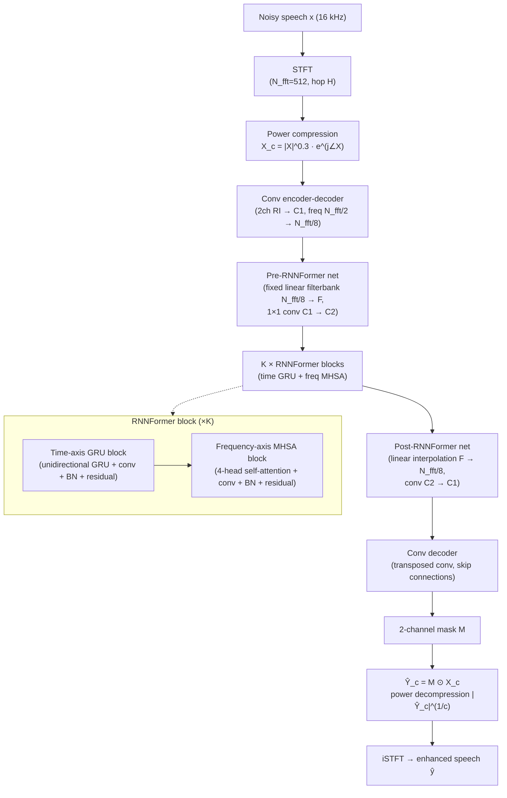

# Ahn, Han, Woo & Kim 2026: FastEnhancer — Speed-Optimized Streaming Neural Speech Enhancement

**Authors**: [[entities/sunghwan-ahn|Sunghwan Ahn]], [[entities/jinmo-han|Jinmo Han]], [[entities/beom-jun-woo|Beom Jun Woo]], [[entities/nam-soo-kim|Nam Soo Kim]]
**Affiliations**: Department of Electrical and Computer Engineering and INMC, Seoul National University, Seoul, South Korea
**Venue**: ICASSP 2026
**Type**: Conference Paper
**DOI**: [10.1109/ICASSP55912.2026.11464802](https://doi.org/10.1109/ICASSP55912.2026.11464802)
**Zotero**: [C2H4AXFF](zotero://select/items/0_C2H4AXFF)

---

## Summary

FastEnhancer is a family of five streaming neural speech-enhancement models explicitly optimized for **real-world inference speed** (RTF on a single CPU thread) rather than the usual proxy metrics of parameter count or MACs. Its core finding is that the elaborate sub-band/grouped designs that made recent lightweight models small in parameters and MACs paradoxically *increase* actual latency through added memory operations and architectural complexity; a streamlined encoder-decoder with the novel **RNNFormer** block — a time-axis GRU plus frequency-axis multi-head self-attention (MHSA) — is both faster and better. FastEnhancer-B (92k params, 262M MACs) achieves state-of-the-art results (PESQ 3.13, STOI 0.945) with the lowest RTFs among all evaluated models on Voicebank-Demand, and the family establishes a new performance-vs-speed Pareto frontier.

## Problem Formulation

Streaming monaural speech enhancement requires three properties simultaneously:

1. **High quality and intelligibility** — clear, natural output with understandable words
2. **Streaming** — frame-by-frame processing of input spectrograms
3. **Fast processing speed** — low [[concepts/audio-latency|real-time factor]] (RTF) in resource-constrained environments without GPU/NPU accelerators; a single CPU thread is the key benchmark

Prior lightweight SE work optimized parameters and MAC operations — dual-path RNN structures ([[concepts/dprnn|DPRNN]]-family), elaborate encoder-decoder designs, and sub-band decomposition strategies — but these frequently *increase* memory operations and architectural complexity, slowing actual inference. The paper's central question: **is DPRNN the optimal dual-path structure, given its assumption of a sequential relationship between frequency bands?**

## Methodology

### Overall Architecture

![[raw/papers/ahn-2026-fastenhancer/figures/a3e73dbc68ed3caa64a291fee2b8bfd6f99935df8832404044b0048a573f13e1.jpg|FastEnhancer model architecture]]

*Figure 2: FastEnhancer model architecture. Conv(k), StridedConv(k, s), and Tr. Conv(k, s) denote convolution, strided convolution, and transposed convolution with frequency-axis kernel size k and stride s.*

The architecture is a deliberately simple encoder-decoder with RNNFormer bottleneck:

1. **Pre-encoder** — strided convolution reducing frequency resolution from $N_{fft}/2$ to $N_{fft}/8$ (256 to 64 bins), channels 2 → $C_1$
2. **L encoder blocks** — convolutions; all kernel sizes/strides are frequency-axis only
3. **Pre-RNNFormer network** — fixed linear filterbank ($N_{fft}/8 \to F$ bins) + convolution ($C_1 \to C_2$ channels)
4. **K RNNFormer blocks** — the bottleneck
5. **Post-RNNFormer network** — reverse operations; the linear layer initialized as linear interpolation
6. **L decoder blocks + post-decoder** — transposed convolutions restoring frequency resolution, with skip connections

**Speed-critical design choices**:

- **Time-axis kernel size of 1 everywhere** — causal convolutions with time-kernel > 1 require caching k−1 past frames, and these memory operations significantly increase processing time. All specified kernel sizes/strides refer to the frequency axis.
- **Batch normalization (BN) throughout, fused at inference** — BN can be converted to a multiplication-addition and fused into adjacent layers; layer normalization cannot, increasing RTF at identical params/MACs (ablation-verified).
- **Weight normalization and SiLU activation** across the entire model.
- **Fixed linear filterbank/interpolation** — training the pre/post-RNNFormer linear weights offered no benefit over keeping them fixed.

### Model Structure, Inputs, and Outputs

**FastEnhancer (single network) spec**:

| Property | Value |
|----------|-------|
| **Structure** | Encoder-decoder with K RNNFormer blocks: pre-encoder strided conv (2→C₁, freq ÷4) → L encoder blocks → pre-RNNFormer (fixed linear filterbank + conv) → K × [time-GRU block + freq-MHSA block] → post-RNNFormer (fixed linear interpolation + conv) → L decoder blocks → post-decoder transposed conv; skip connections; weight norm + SiLU throughout; BN fused at inference |
| **Input** | Power-compressed complex spectrogram $X_c = |X|^{0.3} e^{j\angle X}$ interpreted as 2-channel real/imag tensor at $N_{fft}/2$ frequencies (highest bin discarded), STFT with $N_{fft}=512$, hop $H$; five model sizes T/B/S/M/L |
| **Output** | 2-channel mask M; enhanced compressed spectrogram $\hat{Y}_c = M \odot X_c$ → decompression $\hat{Y} = |\hat{Y}_c|^{1/c} e^{j\angle\hat{Y}_c}$ → zero-pad highest bin → iSTFT → enhanced speech $\hat{y}$, frame-by-frame streaming |
| **Training data** | Voicebank-Demand, 16 kHz, 2-second random segments |
| **Role** | Streaming monaural speech enhancement (noise suppression) |

**Model configurations (Table 1)**:

| Size | H (hop) | L | K | C₁ | C₂ | F |
|------|---------|---|---|----|----|----|
| Tiny (T) | 256 | 2 | 2 | 24 | 20 | 16 |
| Base (B) | 256 | 2 | 3 | 48 | 36 | 24 |
| Small (S) | 256 | 3 | 3 | 64 | 48 | 36 |
| Medium (M) | 160 | 3 | 4 | 96 | 72 | 48 |
| Large (L) | 100 | 4 | 5 | 128 | 96 | 64 |

Note the hop sizes: T/B/S use 256 samples (16 ms), M uses 160 (10 ms), L uses 100 (6.25 ms) — **larger models trade hop (more frames) for smaller per-frame frequency resolution**, a family-level knob that shapes the RTF/quality trade-off.

### RNNFormer Block

Each of the K blocks contains two sub-blocks:

- **Time-axis GRU block**: unidirectional [[concepts/gated-recurrent-unit|GRU]] + convolution + BN + residual skip. The GRU's constant-size state makes it ideal for low-latency streaming — no key-value caching.
- **Frequency-axis MHSA block**: 4-head [[concepts/attention-mechanism|self-attention]] + convolution + BN + residual skip. MHSA models global, non-sequential frequency relationships (e.g., harmonics) without caching since all bins of a frame are available simultaneously. A trainable positional encoding is added to the first MHSA block's input.

The dual-axis assignment inverts the standard DPRNN choice (frequency RNN → global attention, time RNN kept recurrent), answering the paper's motivating question: spectral relationships are **global, not sequential**, so an RNN along frequency is suboptimal.

### Training Losses

Composite loss (Eq. 1):

$$\mathcal{L} = \lambda_1 \mathcal{L}_{mag} + \lambda_2 \mathcal{L}_{comp} + \lambda_3 \mathcal{L}_{con} + \lambda_4 \mathcal{L}_{wav} + \lambda_5 \mathcal{L}_{pesq}$$

with $\lambda_1 = 0.3$, $\lambda_2 = 0.2$, $\lambda_3 = 0.3$, $\lambda_4 = 0.2$, $\lambda_5 = 0.001$:

- **Magnitude loss** (Eq. 2): $\mathcal{L}_{mag} = \big\| |\mathbf{Y}_c| - |\hat{\mathbf{Y}}_c| \big\|_2^2$ — MSE between power-compressed magnitudes
- **Complex spectrogram loss** (Eq. 3): $\mathcal{L}_{comp} = \|\mathbf{Y}_c - \hat{\mathbf{Y}}_c\|_2^2$ — MSE on compressed complex spectra as 2-channel tensors
- **Consistency loss** (Eq. 4): $\mathcal{L}_{con} = \|\mathbf{Y}_c - \mathrm{STFT}_c(\hat{\mathbf{y}})\|_2^2$ — forces the output spectrogram to be [[concepts/stft-consistency|STFT-consistent]] with the reconstructed waveform
- **Waveform loss** (Eq. 5): $\mathcal{L}_{wav} = \|\mathbf{y} - \hat{\mathbf{y}}\|_1$ — L1 in time domain
- **Differentiable PESQ loss** (torch-pesq): $\lambda_5 = 0.001$ kept deliberately tiny — optimizing solely on [[concepts/pesq|PESQ]] can degrade subjective quality (PESQetarian / Goodhart's-law concern); including it improved not only PESQ but also other objective metrics

The consistency loss trains the network so that the masked spectrogram and the synthesized waveform agree — an interesting middle ground between training-time consistency constraints and LiSenNet's inference-time [[concepts/gla-phase-refinement|GLA phase refinement]].

## Experimental Setup

| Parameter | Setting |
|-----------|---------|
| Dataset | [[concepts/voicebank-demand|Voicebank-Demand]] (48 kHz → 16 kHz) |
| Training segments | 2-second random crops |
| Optimizer | AdamP, initial LR 0.002, weight decay 0.01, batch size 64 |
| LR schedule | Cosine annealing with 500-step warm-up |
| Model variants | T / B / S / M / L (Table 1) |
| RTF measurement | ONNXRuntime, streaming, single thread of Intel Xeon Gold 6248R (server) and Apple M1 MacBook Air (laptop) |
| Metrics | Quality: DNSMOS P.808/P.835 (SIG/BAK/OVL), SCOREQ (natural speech, full reference), SISDR, PESQ (P.862.2); Intelligibility: STOI, ESTOI, WER (Whisper-large-v3-turbo) |
| Seeds | 5 random seeds per model, averaged scores |
| Baselines | [[concepts/gtcrn|GTCRN]] (official ckpt), [[concepts/lisennet|LiSenNet]] (official code; streamable variant re-trained), FSPEN (re-implementation), [[concepts/band-split-rnn|BSRNN]] (re-implementation) |

## Results

![[raw/papers/ahn-2026-fastenhancer/figures/5345b98e83c20bd7ea10103eb55ebd02b775b1230941438b59893c3cffddea56.jpg|RTF vs SISDR and RTF vs STOI of various models]]

*Figure 1: RTF vs. SISDR and RTF vs. STOI of various models — the Pareto frontier of performance vs inference speed.*

### Performance on Voicebank-Demand (Table 2)

| Model | Para. (K) | MACs | RTF (Xeon) | RTF (M1) | P.808 | SIG | BAK | OVL | SCOREQ | SISDR | PESQ | STOI | ESTOI | WER |
|-------|----------|------|-----------|----------|-------|-----|-----|-----|--------|-------|------|------|-------|-----|
| [[concepts/gtcrn|GTCRN]] | 24 | 40M | 0.060 | 0.042 | 3.43 | 3.36 | 4.02 | 3.08 | 0.330 | 18.8 | 2.87 | 0.940 | 0.848 | 3.6 |
| [[concepts/lisennet|LiSenNet]] (official) | 37 | 56M | — | — | 3.34 | 3.30 | 3.90 | 2.98 | 0.425 | 13.5 | 3.08 | 0.938 | 0.842 | 3.7 |
| LiSenNet (streamable) | 37 | 56M | 0.034 | 0.028 | 3.42 | 3.34 | 4.03 | 3.07 | 0.335 | 18.5 | 2.98 | 0.941 | 0.851 | 3.4 |
| FSPEN | 79 | 64M | 0.046 | 0.038 | 3.40 | 3.33 | 4.00 | 3.05 | 0.324 | 18.4 | 3.00 | 0.942 | 0.850 | 3.6 |
| BSRNN | 334 | 245M | 0.059 | 0.062 | 3.44 | 3.36 | 4.00 | 3.07 | 0.303 | 18.9 | 3.06 | 0.942 | 0.855 | 3.4 |
| **FastEnhancer-T** | 22 | 55M | **0.012** | **0.013** | 3.42 | 3.34 | 4.01 | 3.06 | 0.334 | 18.6 | 2.99 | 0.940 | 0.850 | 3.6 |
| **FastEnhancer-B** | 92 | 262M | **0.022** | **0.026** | 3.47 | 3.38 | 4.02 | 3.10 | 0.285 | 19.0 | 3.13 | 0.945 | 0.861 | 3.2 |
| **FastEnhancer-S** | 195 | 664M | 0.034 | 0.048 | 3.49 | 3.40 | 4.03 | 3.12 | 0.265 | 19.2 | 3.19 | 0.947 | 0.866 | 3.2 |
| **FastEnhancer-M** | 492 | 2.9G | 0.101 | 0.173 | 3.48 | 3.39 | 4.02 | 3.11 | 0.243 | 19.4 | 3.24 | 0.950 | 0.873 | 2.8 |
| **FastEnhancer-L** | 1105 | 11G | 0.313 | 0.632 | 3.53 | 3.44 | 4.04 | 3.16 | 0.239 | 19.6 | 3.26 | 0.952 | 0.877 | 3.1 |

**Key readings**:

- FastEnhancer-B beats all baselines on nearly every metric despite having the *largest* MACs (262M) — speed-optimized architecture beats complexity-optimized architecture at the metrics that matter for deployment.
- FastEnhancer-T (22k params, 55M MACs, RTF 0.012) matches GTCRN-level performance at **5× lower RTF** and LiSenNet-level performance with parameters comparable to LiSenNet's.
- The M-size anomaly: FastEnhancer-M shows slightly *degraded* DNSMOS scores (P.808 3.48, OVL 3.11) despite improvements on every other metric vs S — a caution against relying on a limited set of objective metrics.
- LiSenNet's official variant is not streamable (input normalization + Griffin-Lim); the streamable variant drops from PESQ 3.08 → 2.98 and SCOREQ 0.425 → 0.335, itself a data point on the cost of streaming constraints.

### Ablation Studies

**Convolution kernel and normalization (Table 3)**:

| Ablation | Para. (K) | RTF (Xeon) | RTF (M1) | SISDR | STOI |
|----------|-----------|------------|----------|-------|------|
| FastEnhancer-B | 92 | 0.022 | 0.026 | 19.0 | 94.5 |
| Time-axis kernel size 3 | 187 | 0.028 | 0.037 | 19.0 | 94.5 |
| BatchNorm → LayerNorm | 92 | 0.028 | 0.029 | 18.9 | 94.5 |

- Time-kernel 3: doubles parameters (92→187K), increases RTF ~27–42%, **zero** quality gain — caching past frames buys nothing here.
- LayerNorm swap: identical params/MACs, +27% Xeon RTF — fusion matters.

![[raw/papers/ahn-2026-fastenhancer/figures/4f454aac20b2387682c4bf1be04bb310158f475ee205cb50d91dc3fdd69e3062.jpg|Ablation study for RNNFormer]]

*Figure 3: Ablation study for RNNFormer — DPRNN and DPT alternatives on the RTF-performance plane.*

**Dual-path structure (Fig. 3)**:

- **DPRNN variant** (freq-GRU replaces freq-MHSA): STOI similar, but SISDR clearly degraded — self-attention beats recurrence for frequency modeling.
- **DPT variant** (time-MHSA with 31-frame/0.5 s lookbehind replaces time-GRU): fewer parameters, but key-value caching pushes RTF far higher — recurrence beats attention for temporal modeling in streaming.
- RNNFormer dominates the RTF-performance curve against both alternatives.

## Key Contributions

1. **RNNFormer block**: a dual-path block pairing a time-axis GRU with a frequency-axis MHSA — the first explicit demonstration (against DPRNN and DPT ablations) that the optimal dual-path assignment is *recurrence for time, attention for frequency*, justified by the streaming-cache and global-spectral-structure arguments
2. **Speed-first design principles**: time-axis kernel size of 1 everywhere (no frame caching), BN fused at inference, fixed filterbank/interpolation bridges — showing that architectural *simplicity* is a speed feature
3. **The params/MACs ≠ RTF argument**: quantitative evidence that sub-band/grouped complexity reductions (GTCRN 40M MACs @ RTF 0.060 vs FastEnhancer-B 262M MACs @ RTF 0.022 on Xeon) can be net speed *losses* due to memory operations
4. **New performance-speed Pareto frontier**: five model sizes (22k–1.1M params, RTF 0.012–0.313 on Xeon) spanning edge-to-desktop deployment points, with FastEnhancer-B achieving SOTA quality (PESQ 3.13, STOI 0.945) at the lowest RTF among evaluated models
5. **Comprehensive streaming evaluation protocol**: DNSMOS P.808/P.835, SCOREQ, SISDR, PESQ, STOI, ESTOI, and WER (Whisper-large-v3-turbo) on 5 seeds, with RTFs measured under true streaming conditions on both server (Xeon) and laptop (M1) CPUs

## Related Concepts

- [[concepts/rnnformer|RNNFormer]]
- [[concepts/dprnn|Dual-Path RNN (DPRNN)]]
- [[concepts/gated-recurrent-unit|Gated Recurrent Unit (GRU)]]
- [[concepts/attention-mechanism|Attention Mechanism]]
- [[concepts/convolutional-recurrent-network|Convolutional Recurrent Network (CRN)]]
- [[concepts/gtcrn|GTCRN]]
- [[concepts/lisennet|LiSenNet]]
- [[concepts/band-split-rnn|Band-Split RNN (BSRNN)]]
- [[concepts/power-law-compression|Power-Law Compression]]
- [[concepts/stft-consistency|STFT Consistency]]
- [[concepts/pesq|PESQ]]
- [[concepts/voicebank-demand|VoiceBank+DEMAND]]
- [[concepts/hyst-net|HyST-Net]]

## Related Synthesis

- [[synthesis/computational-efficiency-evolution|Computational Efficiency Evolution]]
- [[synthesis/deep-speech-enhancement|Deep Speech Enhancement]]
