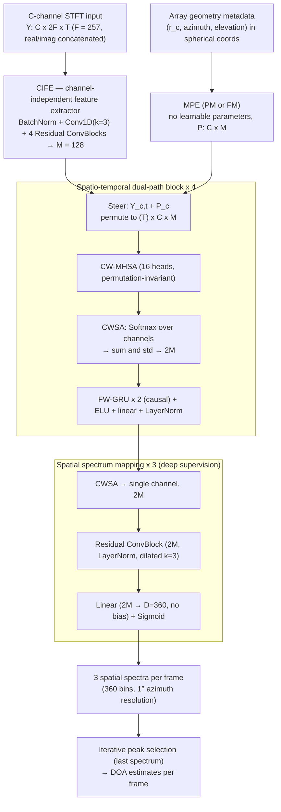

# Baek, Chang & Cohen 2025: DNN-Based Geometry-Invariant DOA Estimation With Microphone Positional Encoding and Complexity Gradual Training

**Authors**: [[entities/min-sang-baek|Min-Sang Baek]], [[entities/joon-hyuk-chang|Joon-Hyuk Chang]], [[entities/israel-cohen|Israel Cohen]]
**Venue**: IEEE Transactions on Audio, Speech, and Language Processing (TASLPRO), 2025
**Type**: Journal article
**DOI**: [10.1109/TASLPRO.2025.3577336](https://doi.org/10.1109/TASLPRO.2025.3577336)
**Zotero**: `96BTCAFQ` · Code: open-source, linked from the paper

## Summary

This paper proposes **GI-DOAEnet**, a geometry-invariant DNN for azimuth DOA estimation that works on arbitrary microphone arrays without retraining. Instead of hand-crafted pair-wise features (SRP-PHAT, GCC-PHAT), it extracts a latent feature per channel independently and injects the array geometry through **Microphone Positional Encodings (MPEs)** — sinusoidal encodings of each microphone's spherical coordinates (distance, azimuth, elevation) in a phase-modulation (PM) or frequency-modulation (FM) variant. Spatio-temporal correlations are then captured by stacked [[concepts/dprnn|dual-path]] blocks built from [[concepts/permutation-invariant-training|permutation-invariant]] channel-wise multi-head self-attention and a channel-wise Softmax aggregation (CWSA), followed by deeply supervised spatial-spectrum heads.

Because training from scratch on varying geometries does not converge, the authors introduce **Complexity Gradual Training (CGT)** — a combination of [[concepts/deeply-supervised-curriculum-learning|deeply supervised curriculum learning (DSCL)]] with soft labels of annealed beamwidth and a new [[concepts/multi-stage-geometry-learning|multi-stage geometry learning (MSGL)]] schedule that moves from a single fixed array to dynamic 4–12-channel arrays. GI-DOAEnet beats the geometry-invariant baselines on MAE across real and synthetic datasets (e.g. 8.26° vs 17.00° MAE on RSL Eval) while using 2.07 M parameters, the lowest FLOPS among DNN baselines, and FLOPS/inference time that grow only **linearly** with the microphone count.

## Problem Formulation

A $C$-channel microphone array records up to $N_S$ speakers in noise and reverberation. In the STFT domain:

$$Y_{c,t}(f) = \sum_{s \in S_t} X^s_{c,t}(f) + V_{c,t}(f)$$

with $f$ the frequency index, $t$ the frame index, $S_t$ the set of active speakers. Real and imaginary parts are concatenated along frequency so that the network input is $\mathbf{Y}^{\mathrm{STFT}} \in \mathbb{R}^{C \times 2F \times T}$ ($F = 257$ for a 512-point STFT). The task is to output a **spatial spectrum** over $D = 360$ candidate azimuths (1° resolution) for every frame, i.e. an angular heatmap whose peaks are the DOAs.

The central difficulty is that microphone coordinates determine the TDOA — the primary DOA cue — yet conventional geometry-invariant DNNs operate solely on the captured signals. Conversely, features that *do* encode geometry (SRP-PHAT, GCC-PHAT) require $\mathcal{O}(C^2)$ pair-wise computations ($\tfrac{C(C-1)}{2}$ microphone pairs) and are interference-prone because noise and reverberation corrupt inter-channel phase coherence.

## Methodology

### Model Structure, Inputs, and Outputs

![[raw/papers/baek-2025-geometry-invariant-doa-estimation/figures/1862abcae17e05d36c1d2d59975ea271b492bf2caedf7851dd9fb58470bc1986.jpg|GI-DOAEnet architecture]]

*Figure 1: Overall architecture of GI-DOAEnet (3 channels, 2 speakers shown for illustration). Array geometry is supplied as spherical coordinates during both training and inference and enters the network only through the MPEs.*

| Component | Specification |
|:----------|:--------------|
| **Input** | $\mathbf{Y}^{\mathrm{STFT}} \in \mathbb{R}^{C \times 2F \times T}$; STFT with Hann window 512 samples, hop 128 samples (8 ms), 16 kHz, $F = 257$; real + imaginary concatenated along frequency → 514 feature values per frame per channel |
| **CIFE** | Channel in the batch dimension. Init. BatchNorm → init. ConvBlock (causal 1D CNN, $k=3$, stride 1 along time, $2F \to M$) + ELU + BatchNorm → $N_R = 4$ Residual ConvBlocks. Each RCB = CB1 (pointwise $k=1$) + CB2 (depthwise, group size 1, $k=3$, causal dilated convolution with dilation $2^{i-1}$, $i$ = RCB index); residual connection; BatchNorm everywhere |
| **MPE** | $\mathcal{P}_c^{\mathrm{PM}}, \mathcal{P}_c^{\mathrm{FM}} \in \mathbb{R}^{M}$ from $(r_c, \theta_c, \phi_c)$; $\alpha = 7$, $\beta = 4$, $M = 128$; stacked to $\mathcal{P} \in \mathbb{R}^{C \times M}$; no trainable parameters |
| **STDPB** ($N_{ST}=4$) | (i) steer: $\mathbf{Y}^{\text{steered}}_{c,t} = \mathbf{Y}^{\text{MHSA,in}}_{c,t} + \mathcal{P}_c$, permuted to $T \times C \times M$; (ii) CW-MHSA with $N_H = 16$ heads + linear + LayerNorm + residual; (iii) CWSA → $2M$; (iv) FW-GRU: $N_G = 2$ causal uni-directional GRUs (input $2M$, output $M$) + ELU + linear + LayerNorm, added residually to the CWSA output |
| **SSMB** ($N_O = 3$) | Final CWSA → $2M$; each SSMB = Residual ConvBlock (2M, LayerNorm instead of BatchNorm, dilated $k=3$) → linear without bias ($2M \to D$) → Sigmoid. The three heads realise **deep supervision** of the same spectrum at increasing depth |
| **Output** | $N_O = 3$ spatial spectra, $D = 360$ bins each, one per frame; inference decodes DOAs from the last spectrum by iterative peak selection |
| **Training data** | Synthetic 4 s mixtures: LibriSpeech train-clean-100 (anechoic speech), MS-SNSD (coherent directional noise), Gaussian white noise (diffuse), gpuRIR image-source + diffuse-tail RIRs; $N_S = 2$ speakers; 28,000 utterances per epoch, generated on the fly |
| **Role** | Single network mapping multi-channel STFT + array geometry → per-frame azimuth spatial spectrum; no conventional feature extractor anywhere in the pipeline |
| **Latency / context** | Algorithmic latency 8 ms (hop size); needs ≥ 46 frames (392 ms) to fill the CNN receptive field; GRUs allow longer context |
| **Size** | 2.07 M parameters; 0.46 / 0.85 / 1.25 GFLOPS at 4 / 8 / 12 channels |

### Microphone Positional Encoding (MPE)

MPEs modulate sinusoidal functions with each microphone's spherical coordinates, extending the [[concepts/doa-microphone-positional-encoding|positional-encoding]] idea from sequence indices to physical positions. With $\mathbf{v} = \frac{4}{M}[0, 1, \dots, \frac{M}{4}-1]^{\top} \in \mathbb{R}^{M/4}$:

$$\mathcal{P}_c^{\mathrm{PM}} = \alpha r_c \begin{bmatrix} \cos(2\pi\beta\mathbf{v} + \theta_c) \\ \sin(2\pi\beta\mathbf{v} + \theta_c) \\ \cos(2\pi\beta\mathbf{v} + \phi_c) \\ \sin(2\pi\beta\mathbf{v} + \phi_c) \end{bmatrix}, \qquad
\mathcal{P}_c^{\mathrm{FM}} = \alpha r_c \begin{bmatrix} \cos(\theta_c \beta \mathbf{v}) \\ \sin(\theta_c \beta \mathbf{v}) \\ \cos(\phi_c \beta \mathbf{v}) \\ \sin(\phi_c \beta \mathbf{v}) \end{bmatrix}$$

subject to $-\pi < \theta_c \le \pi$, $0 \le \phi_c \le \pi$, $0 \le r_c$, $0 < \alpha$, $0 < \beta < M/8$. $\alpha$ and $\beta$ are amplitude/frequency scaling constants chosen to keep neighbouring microphone positions distinguishable and to avoid sinusoidal aliasing. PM **shifts the phase** (analogous to phase modulation), FM **scales the oscillation rate** (frequency modulation), and the distance $r_c$ acts as amplitude modulation.

![[raw/papers/baek-2025-geometry-invariant-doa-estimation/figures/e133c65a1797c5d4642106ce9439cb6ca21ae62a45377975a7072c7bca2b14e2.jpg|Phase modulation]]
(a) Phase modulation

![[raw/papers/baek-2025-geometry-invariant-doa-estimation/figures/79c8e5a4313032891541ac2e23c1b1974746f30844c3e5751833c4f9782f684b.jpg|Frequency modulation]]
(b) Frequency modulation

![[raw/papers/baek-2025-geometry-invariant-doa-estimation/figures/c1acc667ad63f1ddacdbad1a759931fefb94d3ad8e72486e75bc3da6c4e64daa.jpg|Amplitude modulation]]
(c) Amplitude modulation

*Figure 2: The three sinusoidal modulation modes used to build MPEs, $y = r\sin(\theta x + \phi)$ over $x \in [0, 2\pi]$; defaults $r = 0.03$, $\theta = 1$, $\phi = 0$. MPE combines (a)/(b) for the angular coordinates with (c) for the distance.*

Key properties claimed and (partly) proven in the Appendix:

- **No learnable parameters** — geometry enters as a fixed function, so it cannot drift or overfit to a training array.
- **Unique per position** — different coordinates map to different MPE vectors because of the bounded $(\alpha, \beta)$ range.
- **Adjustable dimension** — a 3-D coordinate expands to any $M$, so the encoding can be added to (or concatenated with) latent features of that width.
- **Linearity and relative-position property** — for PM, $\tilde{\mathcal{P}}^{\mathrm{PM}}_{q,\theta} = \mathcal{T}^{p,q}_\theta \tilde{\mathcal{P}}^{\mathrm{PM}}_{p,\theta}$ where the block-diagonal transform is built from rotation blocks $\boldsymbol{\Omega}_m = \frac{r_q}{r_p}\begin{bmatrix}\cos\omega_m & -\sin\omega_m \\ \sin\omega_m & \cos\omega_m\end{bmatrix}$ with $\omega_m = \theta_q - \theta_p$; for FM, $\omega_m = (\theta_q - \theta_p)\beta v_m$. Hence the transformation depends **only on the relative azimuth difference and the distance ratio**, not on absolute positions.

### Spatio-Temporal Dual-Path Block

Each STDPB alternates between the channel axis and the time axis ([[concepts/dprnn|dual-path processing]] applied to multichannel tensors rather than to DPRNN's chunks):

- **CW-MHSA** computes attention *between channels* inside each frame (frames are batched), so channel-wise correlations are learned in the latent space. Because attention is permutation-invariant over its input axis, channel order does not affect the output — the geometric invariance guarantee.
- **CWSA** then collapses $C$ channels into one: $\mathbf{Y}^{\mathrm{Softmax}} = \mathrm{Softmax}(\mathbf{Y}^{\mathrm{CWSA}}) \odot \mathbf{Y}^{\mathrm{CWSA}}$, followed by the sum $\mathbf{Y}^{\mathrm{sum}}$ and standard deviation $\mathbf{Y}^{\mathrm{std}}$ across channels, stacked into $\mathbf{Y}^{\mathrm{GRU,in}} \in \mathbb{R}^{2M}$. Sum and std are permutation-invariant; the std branch retains *channel disagreement* information that a plain sum would discard.
- **FW-GRU** then models frame-wise (temporal) correlations with two causal GRUs.

![[raw/papers/baek-2025-geometry-invariant-doa-estimation/figures/e1e739210da0691dd4065d18edb20d93065efa05a8b6289c503bcd1a7edfc244.jpg|Spatio-temporal dual-path block]]
*Figure 3: The spatio-temporal dual-path block — (a) CW-MHSA block with MPE steering, (b) FW-GRU block after CWSA aggregation.*

### Training Losses

A single loss is used: the **binary cross-entropy** between each of the $N_O$ output spectra and a soft label, summed over the $N_O$ heads. The soft label assigns a 3 dB point at angular distance $\gamma_o$ from every active target:

$$g(t, \gamma_o) = \begin{cases} \max_{\psi' \in \Psi_t} \left\{ e^{\kappa(\gamma_o)(\cos d(\psi,\psi') - 1)} \right\}, & |\Psi_t| > 0 \\ 0, & \text{otherwise} \end{cases}, \qquad \kappa(\gamma) = \frac{-\ln\sqrt{2}}{\cos\gamma - 1}$$

with $d(\psi,\psi') = |\psi - \psi'|$, $\Psi_t$ the set of active target azimuths in frame $t$, $\psi$ the $D$-dimensional candidate-azimuth vector, and $\gamma_o \in [0°, 180°]$ the beamwidth controlling the $o$-th layer's target (constrained to avoid cosine-periodicity ambiguity). Large $\gamma$ → wide, easy, ambiguous targets; small $\gamma$ → narrow, hard, sharply peaked targets. Optimiser: Adam, gradient clipping 1, batch size 16 (1 for Neural-SRP due to GPU memory), learning rate ×0.9 whenever validation loss fails to improve for two consecutive epochs.

## Complexity Gradual Training (CGT)

Naive training on mixed geometries diverges: the network must learn DOA estimation *and* how to exploit the geometric encoding simultaneously. CGT splits that burden along two axes.

### Multi-Stage Geometry Learning (MSGL)

| Stage | Microphone array | LR $\delta$ | Weight decay $\lambda$ | Epochs |
|:------|:-----------------|:------------|:-----------------------|:-------|
| 1 | ReSpeaker 4-channel (fixed) | $2.5\times10^{-4}$ | $1.0\times10^{-4}$ | 1–5 |
| 2 | Dynamic 4-channel (fixed count, varying positions) | $5.0\times10^{-4}$ | $1.0\times10^{-6}$ | 6–10 |
| 3 | Dynamic 4–12-channel | $1.0\times10^{-3}$ | $1.0\times10^{-6}$ | 11–300 |

Dynamic arrays place microphones in 3-D space with inter-microphone distances confined to

$$R_{\min} = \left[\max\left(1, 4 - 3\cdot\tfrac{C-C_{\min}}{C_{\max}-C_{\min}}\right), 6\right], \qquad
R_{\max} = \left[7, \max\left(7, 9 + 4\cdot\tfrac{C-C_{\min}}{C_{\max}-C_{\min}}\right)\right]\ \text{cm}$$

with $C_{\min}=4$, $C_{\max}=12$ and origin jitter $R_{\mathrm{origin}} = [-0.5, 0.5]$ cm. Too-close pairs make TDOAs indistinguishable; too-far pairs alias at high frequency. The learning rate *increases* and the weight decay *decreases* across stages — high decay early prevents overfitting to the single stage-1 geometry.

### Deeply Supervised Curriculum Learning (DSCL)

DSCL (from the authors' earlier Interspeech 2023 work) combines **deep supervision** — every SSMB head is supervised, with its own beamwidth $\gamma_o$ — with **curriculum learning** — $\gamma_o$ anneals over training. Settings: $\gamma^{\text{init}} = [16°, 6°, 2.5°]$ for the three heads, $\gamma^{\text{end}} = 2.5°$ everywhere; $\gamma$ is held at $\gamma^{\text{init}}$ until epoch 20 (after a few epochs of stage 3), then annealed to $\gamma^{\text{end}}$ by epoch 45 and fixed thereafter. Curriculum learning also lowers the binary cross-entropy floor, which is why loss curves of CL / no-CL runs are not directly comparable.

## Experimental Setup

| Aspect | Details |
|:-------|:--------|
| **Baselines** | MUSIC (32 azimuth × 16 elevation grid), SRP-PHAT (same grid), CRNN (Baek 2023, single-geometry), Unet with SRP-PHAT input (Schwartz 2023), Neural-SRP (Grinstein 2024, open-source reimplementation) |
| **Training data** | On-the-fly synthetic mixtures: LibriSpeech train-clean-100 (speech) + MS-SNSD (coherent noise) + Gaussian white noise; gpuRIR RIRs, image-source model to −12 dB then diffuse tail to −40 dB; 28,000 utterances/epoch |
| **Training ranges** | SNR [−5, 30] dB; SIR between utterances [−5, 5] dB; SIR between noises [−15, 15] dB; RT60 [0.2, 1.3] s; room [3×3×2.5, 10×8×6] m³; distance [0.3, 2.5] m; azimuth [0, 360)°; elevation [30, 150]°; min. 10° azimuth separation between speakers; coherent noise ≥ 2.5 m from the array |
| **Validation sets** | Four synthetic sets matching the MSGL stages (ReSpeaker, NAO 12-ch, random 4-ch, random 4–12-ch); 2,000 utterances each (300 per channel count for the 4th) |
| **Real eval** | LOCATA (NAO robot, 12 ch, RT60 = 0.55 s, 1–2 speakers), RSL Dev and RSL Eval (ReSpeaker, 4 ch, RSL2019; Dev = low noise/reverberation, Eval = noticeable noise/reverberation) |
| **Synthetic eval** | NAO Robot (12 ch, 2,000 utts), ReSpeaker (4 ch, 2,000 utts), Dynamic (4–12 ch, 300 utts); TIMIT test speech + ESC-50 noise |
| **Metrics** | MAE (per-frame angular distance to ground truth, permutation-minimised over speakers) and $\mathrm{ACC}_{10}$ (% of active frames within 10°); number of active speakers taken from WebRTC VAD, not estimated |

## Results

### Main comparison (MAE° / ACC₁₀%), Table V

| Method | LOCATA | RSL Dev | RSL Eval | NAO Robot | ReSpeaker | Dynamic |
|:-------|:-------|:--------|:---------|:----------|:----------|:--------|
| MUSIC | 14.19 / 76.65 | 5.46 / 91.29 | 28.44 / 43.82 | 19.29 / 54.91 | 33.88 / 28.09 | 26.71 / 40.18 |
| SRP-PHAT | 20.54 / 72.32 | 9.12 / 67.08 | 31.09 / 43.56 | 29.87 / 42.68 | 39.30 / 25.16 | 35.25 / 33.12 |
| CRNN₄ (fixed 4-ch) | – | **4.54 / 99.75** | 10.85 / 80.97 | – | 5.53 / 89.64 | – |
| CRNN₁₂ (fixed 12-ch) | 7.48 / 88.31 | – | – | 4.67 / 92.49 | – | – |
| Unet + DSCL & MSGL | 11.20 / 85.56 | 4.62 / 98.48 | 20.21 / 71.78 | 14.51 / 71.99 | 22.71 / 54.30 | 19.60 / 60.74 |
| Neural-SRP + DSCL & MSGL | 15.16 / 75.31 | 5.29 / 96.72 | 17.00 / 71.81 | 17.52 / 63.72 | 18.07 / 60.24 | 21.09 / 52.29 |
| **GI-DOAEnet^PM (default)** | 7.82 / 82.48 | 4.38 / 98.35 | 9.17 / 85.96 | 11.56 / 74.98 | 13.76 / 67.60 | 14.59 / 66.08 |
| **GI-DOAEnet^FM (default)** | **7.22 / 85.67** | 4.58 / 97.34 | **8.26 / 86.83** | 12.23 / 72.17 | 15.02 / 64.01 | 15.54 / 62.76 |

- Geometry-invariant GI-DOAEnets dominate the conventional methods (MUSIC/SRP-PHAT) and both geometry-invariant DNN baselines on **every** dataset in MAE; the only metric where a fixed-geometry CRNN wins is $\mathrm{ACC}_{10}$ on RSL Dev (the array both CRNN₄ and stage 1 were trained on) and on LOCATA for CRNN₁₂.
- Training on diverse geometries *generalizes to real recordings*: GI-DOAEnet attains better MAE than the matching fixed-geometry CRNN on RSL Eval (9.17 vs 10.85) and LOCATA (7.82 vs 7.48 — close, with lower ACC).
- CGT improves the baselines too (Neural-SRP RSL Eval 18.15 → 14.39 with DSCL → 17.00 with MSGL+DSCL), so the training strategy is not architecture-specific.

![[raw/papers/baek-2025-geometry-invariant-doa-estimation/figures/0b05a117bacb9c9f820c736a583cdef8e4ee95832461fd00b765d0508cba52ef.jpg|Box and violin plot of MAE on the Dynamic dataset]]
*Figure 4: MAE distribution on the Dynamic dataset (lower chroma violins = full distribution, higher chroma = IQR). GI-DOAEnets have lower mean/median and narrower IQR than the DSCL+MSGL-trained Unet and Neural-SRP — more consistent, not only better on average.*

![[raw/papers/baek-2025-geometry-invariant-doa-estimation/figures/c99a2f829631fb41be542b61825ede1c53d5d5c29eb742c695ba85ea95715e30.jpg|Oracle]]
(a) Oracle

![[raw/papers/baek-2025-geometry-invariant-doa-estimation/figures/ff0c4e8528198b2301bae22da889c4716882e78eda392a9f1791bccbf71a6b30.jpg|Unet]]
(b) Unet

![[raw/papers/baek-2025-geometry-invariant-doa-estimation/figures/b45d94b7a7817b384d98571d4cb7942fe905e62c2241148e1caa0cd996256f22.jpg|Neural-SRP]]
(c) Neural-SRP

![[raw/papers/baek-2025-geometry-invariant-doa-estimation/figures/4536212ac91e986178b7467976e966326359fd52cc887a0cd9bec19e35d44d95.jpg|GI-DOAEnet PM]]
(d) GI-DOAEnet^PM

![[raw/papers/baek-2025-geometry-invariant-doa-estimation/figures/1578cde744046eeae4738f2bfd970fe8566de54b74c5a9bb79ec6236a1ecca7a.jpg|GI-DOAEnet FM]]
(e) GI-DOAEnet^FM

*Figure 5: Spatial spectra on a LOCATA utterance. Unet shows a clear peak but rippled and with missing voice-active regions; Neural-SRP is the most ambiguous; GI-DOAEnets reproduce the oracle's clean straight ridge.*

### Ablations (Table V, rows 3–7 of each GI-DOAEnet block)

| Variant | Effect |
|:--------|:-------|
| Magnitude + phase STFT input instead of real + imaginary | Large degradation everywhere (e.g. PM Dynamic 14.59 → 24.77 MAE); the Cartesian STFT representation lets the network recover phase relations by itself |
| Fixed $\delta = 10^{-3}$, $\lambda = 10^{-6}$ across all MSGL stages | Mostly worse (PM LOCATA 7.82 → 16.25); stage-wise LR/weight-decay schedule matters |
| w/o deep supervision (single head) | Worse overall; a few isolated metric wins |
| w/o curriculum learning (static $\gamma$) | Worse overall (PM Dynamic 14.59 → 16.64); fully static targets with $\gamma = 2.5$ fail to converge at all |
| w/o std. deviation in CWSA (2M → M features) | Worse for PM everywhere (Dynamic 14.59 → 17.68) |
| w/o Softmax in CWSA | Worst CWSA ablation (PM Dynamic 14.59 → 19.43); channel attention is essential |
| Geometry encoding replaced by a learnable linear layer (MLE) | Diverges from MSGL stage 2 onward |
| No geometry / coordinate concatenation into features | Fails to generalize or diverges in training |

![[raw/papers/baek-2025-geometry-invariant-doa-estimation/figures/334b7bdee0bfe97b5a1a42398e5be72fed8e3fdbd387b781da29b5c95b2f3e24.jpg|Validation loss: MPE vs learnable encoder]]
(a) Validation loss graph of GI-DOAEnet^PM with MPE and learnable encoder

![[raw/papers/baek-2025-geometry-invariant-doa-estimation/figures/8914e48d917da0c321380ae6d26bad0ef6a696ee331ac363c5985c673cebb0a5.jpg|MLE-based estimate]]
(c) MLE-based estimate

*Figure 6: (a) Validation loss across the three MSGL stages (grey/purple/yellow bands): all models converge in stage 1 (single array), MPE models recover after the stage-2 shock while the learnable microphone encoder (MLE) diverges; (c) the MLE model's spectrum distinguishes speech-active regions but cannot localize — near-flat across all directions.*

### Robustness: SNR, RT60, channel count

![[raw/papers/baek-2025-geometry-invariant-doa-estimation/figures/c37ec8b32e14ba0e265410f4fe8002bc944809c2c4fc5a613e81802d9593ad78.jpg|MAE vs SNR]]
(a) MAE vs. SNR

![[raw/papers/baek-2025-geometry-invariant-doa-estimation/figures/88f169254366596b823ba6ad0d188f1a1fc435dba02916c055c90059e0b84205.jpg|ACC10 vs SNR]]
(b) ACC₁₀ vs. SNR

![[raw/papers/baek-2025-geometry-invariant-doa-estimation/figures/90a9abf14cc440e5c4116e17dad31b8b568f2b02128d2f33c9812372e9f382a6.jpg|MAE vs RT60]]
(c) MAE vs. RT60

![[raw/papers/baek-2025-geometry-invariant-doa-estimation/figures/e1a0ea5cb82080914aeeb4b3a866d907aafce8365718bb05faff5ccdcbc1f281.jpg|ACC10 vs RT60]]
(d) ACC₁₀ vs. RT60

![[raw/papers/baek-2025-geometry-invariant-doa-estimation/figures/1669c771ecfaa44b1a95e13a54467bef86f6cbe9d6f1c2617b6c402f6b74ec90.jpg|MAE vs number of channels]]
(e) MAE vs. Number of channels

![[raw/papers/baek-2025-geometry-invariant-doa-estimation/figures/22ecb97480154bc12c0457a9054cb8d2afdb7c86b5f6dbd0edbf3d0f1cb2722e.jpg|ACC10 vs number of channels]]
(f) ACC₁₀ vs. Number of channels

*Figure 7: Robustness sweep on the Dynamic dataset. Above ~15 dB SNR the Unet (whose SRP-PHAT input is clean) matches GI-DOAEnet^PM, but below 15 dB — and especially below 5 dB — GI-DOAEnets win clearly; they also win on every RT60 bin in MAE. Gain from more microphones plateaus beyond ~7 channels.*

### Computational cost (Table VI, 1-s input)

| Method | # params (M) | FLOPS (G) 4/8/12 ch | Memory (MB) 4/8/12 ch | CPU (ms) 4/8/12 ch | GPU (ms) 4/8/12 ch |
|:-------|:-------------|:--------------------|:----------------------|:------------------|:------------------|
| SRP-PHAT | – | 0.10 / 0.45 / 1.06 | 23.8 / 79.5 / 172.8 | 24.23 / 89.56 / 197.36 | – |
| Unet | 7.64 | 0.97 / 0.97 / 0.97 | 26.6 / 26.6 / 26.6 | 15.40 / 15.40 / 15.40 | 0.49 / 0.49 / 0.49 |
| Neural-SRP | 0.87 | 1.81 / 8.38 / 19.72 | 705 / 3276 / 7724 | 86.31 / 514.22 / 1395.94 | 3.42 / 6.39 / 11.44 |
| **GI-DOAEnet** | **2.07** | **0.46 / 0.85 / 1.25** | 116 / 211 / 310 | 37.99 / 47.19 / 66.47 | 2.60 / 2.65 / 2.69 |

- SRP-PHAT/Neural-SRP scale **quadratically** in FLOPS, memory and CPU time because of the $\tfrac{C(C-1)}{2}$ pair-wise operations; GI-DOAEnet scales ~**linearly** despite its $\mathcal{O}(C^2)$ CW-MHSA, because CWSA collapses channels early and CW-MHSA is applied per frame.
- GI-DOAEnet has the lowest FLOPS of all DNN baselines and near-constant GPU inference time (2.60 → 2.69 ms from 4 to 12 channels).
- Unet's cost excludes the SRP-PHAT front end it consumes; counted end-to-end, GI-DOAEnet has the lowest total inference time.

![[raw/papers/baek-2025-geometry-invariant-doa-estimation/figures/903bc646a3021e382745559e89589e082e8099a5c8986a3f879827ebe44bc926.jpg|FLOPS vs number of channels]]
*Figure 8: FLOPS vs. channel count — quadratic for SRP-PHAT and Neural-SRP, linear for GI-DOAEnet.*

![[raw/papers/baek-2025-geometry-invariant-doa-estimation/figures/1217c904e4693abd8b14c12112221af0dfd45d6fb1e4ccf2addbdf8ade2971fc.jpg|MAE vs FLOPS]]
*Figure 9: MAE vs. FLOPS — GI-DOAEnets occupy the best corner (lowest error at lowest cost) among the DNN methods.*

## Key Contributions

1. **GI-DOAEnet**: a causal, geometry-invariant DOA estimator that consumes only the channel-wise STFT plus array metadata — no SRP-PHAT/GCC-PHAT pair-wise features — and emits deeply supervised per-frame azimuth spatial spectra.
2. **Microphone Positional Encoding (MPE)**: a parameter-free sinusoidal encoding of spherical microphone coordinates, in phase-modulation and frequency-modulation variants, with a proof (Appendix) that both retain linearity and a relative-position property under coordinate changes. Ablations show learned encoders (MLE) and coordinate concatenation cannot replace it.
3. **Complexity Gradual Training (CGT)**: deeply supervised curriculum learning with annealed soft-label beamwidths combined with **multi-stage geometry learning** (fixed array → dynamic same-count → dynamic variable-count), which is what makes training converge at all on mixed geometries — and transfers to other architectures (Unet, Neural-SRP).
4. **Channel-wise Softmax aggregation (CWSA)**: a permutation-invariant channel-collapse operator (channel Softmax × features, then sum ⊕ std) that both improves accuracy and keeps FLOPS/inference time growing only linearly with the microphone count.
5. **Empirical efficiency/accuracy frontier**: best MAE among geometry-invariant methods on all six evaluation sets, 2.07 M parameters, lowest DNN FLOPS, and near-flat GPU latency from 4 to 12 channels.

## Limitations and Caveats

- **Azimuth only**: elevation is not estimated, although the architecture is stated to extend to elevation or regression outputs by changing the final layer and loss.
- **Speaker count is given**, not estimated — the number of active speakers comes from WebRTC VAD in every dataset, so the pipeline localizes but does not detect speech activity count.
- **Synthetic-dominated training**: all training data are gpuRIR simulations with a diffuse-tail model; the real-data evaluation is limited to 4- and 12-channel arrays from two corpora.
- **Sub-15-dB advantage**: at high SNR a SRP-PHAT-fed Unet is competitive, i.e. the gain comes from interference robustness rather than from a uniformly better spatial estimator.
- **Minimum context**: 46 frames (392 ms) are required to fill the CNN receptive field, which the paper does not evaluate in a shorter-context regime.

## Related Concepts

- [[concepts/doa-microphone-positional-encoding|DOA-Microphone Positional Encoding]] — the MPE family this paper originates; its PM/FM formulation and (α, β) hyperparameters are reused by later geometry-conditioned filters
- [[concepts/complexity-gradual-training|Complexity Gradual Training (CGT)]] — the training paradigm introduced here
- [[concepts/multi-stage-geometry-learning|Multi-Stage Geometry Learning (MSGL)]] — the fixed → dynamic → variable-count geometry curriculum
- [[concepts/deeply-supervised-curriculum-learning|Deeply Supervised Curriculum Learning (DSCL)]] — annealed-beamwidth soft labels across multiple output heads
- [[concepts/channel-wise-softmax-aggregation|Channel-Wise Softmax Aggregation (CWSA)]] — attention-weighted, permutation-invariant channel collapse
- [[concepts/direction-of-arrival-estimation|Direction-of-Arrival Estimation]]
- [[concepts/array-invariant-speech-enhancement|Array-Invariant Speech Enhancement]] — the enhancement-side counterpart of geometry invariance
- [[concepts/permutation-invariant-training|Permutation Invariant Training (PIT)]] — the broader family of permutation-invariant operations (mean/sum/std/MHSA) used to guarantee channel-order invariance
- [[concepts/steered-response-power|Steered-Response Power]] — SRP-PHAT, the pair-wise baseline the paper argues against
- [[concepts/moving-source-tracking|Moving Source Tracking]] — Neural-SRP's original application, here adapted to static multi-speaker DOA
- [[concepts/geometry-aware-dynamic-convolution|Geometry-Aware Dynamic Convolution (Geo-DConv)]] — the other explicit-geometry alternative for array-invariant models

## Related Synthesis

- [[synthesis/multi-channel-speech-enhancement|Multi-Channel Speech Enhancement]]
