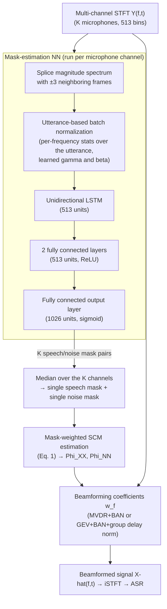

# Boeddeker, Erdogan, Yoshioka & Haeb-Umbach 2018: Exploring Practical Aspects of Neural Mask-Based Beamforming for Far-Field Speech Recognition

**Authors**: [[entities/christoph-boeddeker|Christoph Boeddeker]] (Microsoft AI and Research, Redmond, WA, USA; Paderborn University, Germany), [[entities/hakan-erdogan|Hakan Erdogan]] (Microsoft AI and Research, Redmond, WA, USA), [[entities/takuya-yoshioka|Takuya Yoshioka]] (Microsoft AI and Research, Redmond, WA, USA), [[entities/reinhold-haeb-umbach|Reinhold Haeb-Umbach]] (Paderborn University, Germany)

**Venue**: IEEE International Conference on Acoustics, Speech and Signal Processing (ICASSP) 2018
**Year**: 2018
**Type**: conferencePaper
**DOI**: [10.1109/ICASSP.2018.8461669](https://doi.org/10.1109/ICASSP.2018.8461669)
**Zotero**: [7WTFLPWA](zotero://select/items/0_7WTFLPWA)

## Summary

This paper examines whether neural mask-based beamforming — the DNN-mask + MVDR/GEV front-end that dominated the CHiME challenges — transfers to practical far-field ASR scenarios such as voice-enabled home devices. The system is stress-tested across two different microphone arrays, several beamforming variants, and two large-data acoustic models, with the mask network trained on mismatched data (CHiME-3 simulated); significant WER gains are obtained in every configuration. A new ASR-feature-level training criterion (LogMel MSE, backpropagated through the beamformer via complex-valued algorithmic differentiation) beats the conventional mask-level BCE loss by ~8% relative WER, and two online beamforming schemes (frame-level and segment-level) are explored, with the online variants still yielding significant gains over the baseline.

## Problem Formulation

Far-field audio capture degrades ASR through background noise and reverberation. Multicondition (noisy-trained) acoustic models reduce the WER gap between close-talking and distant recognition but do not close it; multi-channel beamforming and dereverberation were two of the few front-end techniques that still improved recognition in the REVERB and CHiME-3/4 challenges even against strong NN-based ASR back-ends.

However, CHiME conditions differ from commercial usage in ways that make its beamforming gains potentially non-transferable:

- CHiME test utterances average 6.9 s, much longer than typical voice queries; speaker-mic distances are below 1 m, much shorter than home-device scenarios; and speakers move more in practice.
- In development setups it is impossible to keep training data consistent across subsystems: acoustic models are trained on huge single-channel service-traffic corpora (with non-negligible distortion), while beamforming systems must be trained on simulated far-field data or device-specific multi-channel recordings.

The paper therefore asks three practical questions: (1) **modularity** — can any recording device be combined with any beamformer and any acoustic model? (2) **training criterion** — what should the mask network optimize? (3) **online operation** — how much performance is lost when the whole-utterance assumption is dropped?

## Methodology

The system is the neural mask-based beamformer of Heymann et al. (2015) / Erdogan et al. (2016): a NN predicts speech and noise T-F masks from the multi-channel STFT observation $\mathbf{Y}_{f,t}$ ($K$ microphones, frequency bin $f$, frame $t$); the masks weight the accumulation of speech and noise [[concepts/spatial-covariance-matrix|spatial covariance matrices (SCMs)]];

$$
\boldsymbol{\Phi}_{\nu\nu f} = \frac{1}{\sum_{t} M_{f,t}^{\nu}} \sum_{t} M_{f,t}^{\nu} \mathbf{Y}_{f,t} \mathbf{Y}_{f,t}^{\mathrm{H}}, \quad \nu \in \{\mathbf{X}, \mathbf{N}\}, \tag{1}
$$

from which beamforming coefficients $\mathbf{w}_f$ are derived for the output $\hat{\mathbf{X}}_{f,t} = \mathbf{w}_f^{\mathrm{H}} \mathbf{Y}_{f,t}$.

![[raw/papers/boeddeker-2018-neural-mask-beamforming/figures/b0f36c72d1b79b5e636a001ed2429a481c07f39e600ff789cbd2b82f22a7f6a2.jpg|Fig. 1: Block diagram of the neural mask-based beamformer]]
*Figure 1: Block diagram of the neural mask-based beamformer. SCM: spatial covariance matrix; BF: beamforming. Each channel is processed by its own mask network; the K per-channel mask pairs are consolidated by a median operation.*

Two beamformers are considered:

- **[[concepts/gev-beamformer|GEV beamformer]]**: $\mathbf{w}_f$ maximizes the output SNR, computed as the principal generalized eigenvector of the speech/noise SCM pair. Normalization filters compensate for the arbitrary response: **Blind Analytic Normalization (BAN)** (magnitude) and group delay normalization (phase).
- **[[concepts/mvdr-beamformer|MVDR beamformer]]** (used in most experiments): the statistics-only form $\mathbf{w}_f^{\mathrm{MVDR}} = \boldsymbol{\Phi}_{\mathbf{NN}f}^{-1} \boldsymbol{\Phi}_{\mathbf{XX}f} \mathbf{r} / \lambda$, with $\lambda = \mathrm{tr}\{\boldsymbol{\Phi}_{\mathbf{NN}f}^{-1} \boldsymbol{\Phi}_{\mathbf{XX}f}\}$ and $\mathbf{r}$ a unit vector selecting the reference microphone. The reference can be chosen to maximize output SNR (offline). While MVDR has built-in regularization capability, **MVDR followed by BAN** gave the best results in the authors' experiments.

### Model Structure, Inputs, and Outputs

**Mask-estimation neural network**

| Spec | Value |
|---|---|
| **Structure** | Input splice (±3 frames) → utterance-based batch normalization layer → unidirectional LSTM (513 units) → 2 fully connected layers (513 units, ReLU) → fully connected output layer (1026 units, sigmoid) |
| **Input** | Observed magnitude spectrum of one microphone channel, spliced with the ±3 neighboring frames; frame size 1024 samples, frame shift 256 samples (513 frequency bins) |
| **Output** | Per-frame speech and noise masks (values in [0,1], interpreted as speech/noise presence probabilities); run once per channel, the K per-channel masks consolidated per T-F bin by a **median** operation |
| **Normalization** | Utterance-based batch normalization: $y_{f,t} = \gamma\,\tilde{x}_{f,t} + \beta$ with $\tilde{x}_{f,t} = (x_{f,t} - \mu_f)/\sigma_f$ and $\mu_f, \sigma_f^2$ computed over the whole utterance (requires seeing the entire utterance; replaced by online schemes for online operation) |
| **Training data** | CHiME-3 simulated training data; CNTK framework. Larger training sets had little impact on recognition accuracy |
| **Role** | Predicts the T-F masks that weight the SCM accumulation feeding the beamformer |

**Acoustic models (downstream, frozen during front-end training)**

| Spec | Value |
|---|---|
| **Near-field AM** | LSTM acoustic model trained on 3.4K hours of Microsoft Cortana traffic |
| **Far-field AM** | Teacher-student adaptation of the near-field model: the near-field model provides soft senone posterior targets on the clean data, and the student model trains on the reverberation+noise-corrupted counterpart |
| **Role** | Two downstream ASR back-ends probing whether beamforming gains depend on the acoustic model |

### Training Losses

Two criteria are compared for the mask network:

1. **Binary cross-entropy (BCE)** between the network outputs and ideal binary masks for speech and noise (Heymann et al. 2015) — the conventional mask-level criterion. One loss term per source, no coupling coefficients.
2. **[[concepts/logmel-mse-loss|LogMel MSE]] (new, feature-level)**:

$$
L(\theta) = \sum_{k} \sum_{t} \sum_{d} \left( \hat{\mathbf{F}}_{d,t}(\theta) - \mathbf{F}^{*}_{d,t,k} \right)^{2}
$$

where $\hat{\mathbf{F}}$ is the normalized log mel-filterbank feature (D = 80 filters) computed **from the beamformed signal** and $\mathbf{F}^{*}$ the same feature of the clean reference. Gradients are backpropagated **through the beamforming operation** using the complex-valued algorithmic differentiation rules of Boeddeker et al. (2017), so the mask network is optimized for the ASR features the recognizer actually consumes rather than for mask fidelity. This criterion gave ~8% relative WER improvement over BCE and was adopted for all subsequent (offline/segment-level) experiments; the frame-level online setup favored the BCE-trained model.

### From Offline to Online Beamforming

The offline system assumes the whole utterance is available (utterance-level normalization, whole-utterance SCM accumulation, SNR-maximizing reference selection). The paper develops two online variants, detailed in [[concepts/online-mask-based-beamforming|online mask-based beamforming]]:

- **Frame-level online**: per-frame beamforming coefficients from recursively accumulated statistics. Replaces utterance normalization with **online batch normalization** (recursive per-frequency mean/variance with forgetting factor $\alpha$, Eq. 2) or **intra-frame normalization** (statistics computed along the frequency axis within each frame, Eq. 3); replaces Eq. 1 with a **recursive SCM estimate with a burn-in period** $T_{\mathrm{init}}$ (Eq. 4) that prevents the noise SCM from becoming singular before enough evidence accumulates, then updates with zero latency; fixes the reference microphone to the first channel to avoid time-dependent output variations the acoustic model has not seen.
- **Segment-level online (streaming)**: the recording is processed in $T_s$-second segments with a $T_c$-second preceding context whose masks are down-weighted by exponentially decaying scales ($e^{-t/\tau_x}$ for speech, $e^{-t/\tau_n}$ for noise; $\tau_n > \tau_x$ to exploit more context for noise statistics). Coefficients are computed per segment and applied to the central segment — a processing delay of $T_s$ — or, in a zero-delay variant, applied to the *next* segment. Chosen parameters: $T_s = 0.7$ s, $T_c = 5$ s, $\tau_n = 5$ s, $\tau_x = 0.5$ s. Advantage: the offline-trained model (utterance batch normalization) can still be used, and previous context is available.

## Experimental Setup

| Item | Value |
|---|---|
| **Test data** | 800 utterances spoken by 4 speakers (2 male, 2 female) in a conference room with various speaker-mic distances; 400 utterances from **moving speakers**; ambient noise, some utterances with background music |
| **Arrays** | **7-mic**: circular, 4.25 cm radius — 6 perimeter + 1 center microphone; **8-mic**: uniform circular array, 8 cm radius |
| **Mask NN training** | CHiME-3 simulated training data (mismatched w.r.t. test hardware/room); CNTK |
| **Acoustic models** | Near-field LSTM AM (3.4K h Cortana traffic); far-field LSTM AM (teacher-student adapted) |
| **Baselines** | BeamformIt (weighted delay-and-sum); an engineered **differential beamformer** tuned to the 7-mic array (12 fixed differential beams, SNR-based beam switching, capable of online processing) |
| **Metric** | Word error rate (WER) |

## Results

**Training criteria** (7-mic array, offline):

| Loss | Near-field AM | Far-field AM |
|---|---|---|
| BCE | 19.19 % | 11.26 % |
| LogMel MSE | **17.69 %** | **10.42 %** |

**Beamformer comparison** (WER):

| Method | 7-mic, near-field | 7-mic, far-field | 8-mic, near-field | 8-mic, far-field |
|---|---|---|---|---|
| Raw (channel #0) | 39.42 % | 17.58 % | 48.42 % | 17.24 % |
| BeamformIt | 31.38 % | 17.29 % | 35.46 % | 15.95 % |
| Differential (tuned to 7-mic) | 22.51 % | 11.76 % | — | — |
| Neural mask-based (offline, LogMel MSE) | **17.69 %** | **10.42 %** | **19.14 %** | **11.39 %** |

Key observations: the neural mask-based beamformer significantly improves ASR even with the far-field acoustic model and regardless of array geometry; it significantly outperforms BeamformIt; and it **surpasses the well-engineered differential beamformer even on the 7-mic array the differential beamformer was tuned to** (though the differential beamformer is online while this configuration is offline). The mask NN, trained on CHiME-3 simulated data, transfers to mismatched recording hardware and room — evidence for the modularity and robustness of the approach.

**Frame-level online beamforming** (7-mic, BCE-trained; * marks fully online configurations):

| Covariance estimation | Normalization | Near-field AM | Far-field AM |
|---|---|---|---|
| Offline | Batch | 19.19 % | 11.26 % |
| Offline | Online batch | 21.97 % | 12.57 % |
| Offline | Intra-frame | 21.12 % | 12.71 % |
| Online ($T_{\mathrm{init}} \approx 0.64$ s) | Batch | 19.97 % | 11.82 % |
| Online | Online batch * | 23.16 % | 13.85 % |
| Online | Intra-frame * | 22.62 % | 13.08 % |

The fully online configuration degrades WER by ≈16% relative (far-field AM) versus offline, with both the covariance-estimation and normalization changes contributing. The online mask-based beamformer performs equally well as the differential beamformer on the near-field AM and slightly worse on the far-field AM.

**Segment-level online beamforming** (LogMel MSE model, MVDR+BAN, fixed reference):

| Array | Delay (s) | Near-field AM | Far-field AM |
|---|---|---|---|
| 7-mic | 0.7 | 23.08 % | 11.29 % |
| 7-mic | 0.0 | 28.57 % | 12.04 % |
| 8-mic | 0.7 | 18.93 % | **11.42 %** |
| 8-mic | 0.0 | 23.75 % | 11.84 % |

With the far-field acoustic model, segment-level online beamforming nearly matches the offline system (e.g., 11.29 % vs. 11.26 % on 7-mic at 0.7 s delay), because it can use the better offline-trained model plus previous context (fair to assume available in streaming scenarios). The zero-delay variant also performs well with the far-field AM. Offline beamforming remains better for the 7-mic array since it has access to utterance boundaries.

## Key Contributions

1. **Practical robustness/modularity study**: unlike CHiME-3/4 (single recording hardware, WSJ-derived datasets), the system is evaluated with two microphone arrays, several beamforming alternatives, and two acoustic models trained on much larger data — showing the components are modular (any device × beamformer × acoustic model) and that the mask NN delivers significant gains despite severely mismatched training data.
2. **Feature-level training criterion (LogMel MSE)**: a new objective — MSE between the beamformed and clean normalized log-mel ASR features — enabled by backpropagating through the beamforming operation with complex-valued algorithmic differentiation; ~8% relative WER improvement over the mask-level BCE criterion.
3. **Online neural mask-based beamforming**: frame-level (online batch / intra-frame normalization, recursive SCM estimation with burn-in, fixed reference microphone) and segment-level streaming (fixed-duration segments with exponentially weighted context, with or without $T_s$ delay) — the online variants retain significant gains, and segment-level processing nearly matches offline performance with a far-field acoustic model.

## Related Concepts

- [[concepts/hybrid-speech-enhancement|Hybrid Speech Enhancement]] — the paper is a canonical Class-1 hybrid evaluation: DNN masks → SCMs → model-based beamformer
- [[concepts/tf-mask-estimation|TF Mask Estimation]] — BCE-trained mask prediction, median consolidation across channels, feature-level alternative
- [[concepts/spatial-covariance-matrix|Spatial Covariance Matrix]] — mask-weighted SCM estimation (Eq. 1) and its recursive online form (Eq. 4)
- [[concepts/mvdr-beamformer|MVDR Beamformer]] — statistics-only form with SNR-maximizing reference selection; MVDR+BAN as the best configuration
- [[concepts/gev-beamformer|GEV Beamformer]] — max-output-SNR beamformer with BAN and group delay normalization
- [[concepts/logmel-mse-loss|LogMel MSE Loss]] — the paper's feature-level training criterion
- [[concepts/online-mask-based-beamforming|Online Mask-Based Beamforming]] — frame-level and segment-level online schemes
- [[concepts/neural-beamforming|Neural Beamforming]] — differentiable-beamforming training and the mask-based MVDR instance
- [[concepts/beamforming|Beamforming]] — parent topic

## Related Synthesis

- [[synthesis/multi-channel-speech-enhancement|Multi-Channel Speech Enhancement]] — commercial-scale Class-1 hybrid validation (Insight 4): cross-array/cross-AM robustness with mismatched training data, feature-level training criterion, online variants
- [[synthesis/deep-speech-enhancement|Deep Speech Enhancement]] — Insight 6: the phase-1→phase-2 transition began at the training criterion (feature-level loss through the differentiable beamformer) before the architecture moved end-to-end
