# Braun & Tashev 2021: A Consolidated View of Loss Functions for Supervised Deep Learning-Based Speech Enhancement

**Authors**: [[entities/sebastian-braun|Sebastian Braun]], [[entities/ivan-tashev|Ivan Tashev]] (Microsoft Research, Redmond, WA, USA)
**Venue**: Proc. 44th International Conference on Telecommunications and Signal Processing (TSP 2021), Brno, Czech Republic, pp. 72–76
**Published**: July 2021
**Type**: Conference Paper
**DOI**: [10.1109/TSP52935.2021.9522648](https://doi.org/10.1109/TSP52935.2021.9522648)
**Zotero**: [TNLT26TN](zotero://select/items/0_TNLT26TN)

## Summary

A controlled, single-network comparison of 17 spectral training losses (eqs. 3–19) for real-time monaural speech enhancement: 9 magnitude-only and 8 phase-aware complex criteria arranged as a 2-D table — L2, L1, log, weighted log, power-law compressed, SNR/SDR ratios, correlation, speech-distortion-weighted, and AMR-weighted — plus their linear mixtures $\mathcal{L}_{\mathrm{mix}} = (1-\beta)\mathcal{L}_{\mathrm{mag}} + \beta\mathcal{L}_{\mathrm{complex}}$. All variants train the *same* 2.8 M-parameter causal FF+GRU gain predictor on the reverberant CHiME-2 WSJ-20k corpus, so the loss is the only free variable. Three headline findings: mixing a magnitude with a complex loss **always** improves PESQ (even though the network predicts a real-valued, zero-phase gain only); **power-law-compressed** losses are the best single family (combined compressed loss: PESQ 3.31 vs. 3.17 for MSE-mixed); and **phase-sensitive** improvement (SI-SDR) comes from *linear-domain* losses, with plain MAE achieving the best SI-SDR 9.75 dB of the study.

## Problem Formulation

Additive noise model in the STFT domain, with $\ell$ the frame and $k$ the frequency bin:

$$
X(k, \ell) = S(k, \ell) + N(k, \ell), \qquad \widehat{S}(k, \ell) = G(k, \ell)\,X(k, \ell),
$$

where $S$ is the (possibly reverberant) speech and $G$ a real-valued suppression gain — the paper deliberately restricts itself to real gains, never complex filters or direct spectral mapping. Every loss is a distance between $\widehat{S}$ and $S$ (or between their magnitudes $|\widehat{S}|$, $|S|$, written $\widehat{A}$, $A$ in the paper), averaged per sequence by $\langle Y\rangle = \frac{1}{KN}\sum_{k,\ell} Y$.

The motivating argument: **the training loss is independent of inference complexity**, so unlike architecture or look-ahead it can improve quality at zero deployment cost — and yet its individual contribution is normally confounded by architecture, features, and data. The comparison closest in spirit, Kollbak et al. 2020, used a convolutional time-domain network with >30× the inference complexity and anechoic data; this study is deliberately small, causal, and reverberant.

## Taxonomy of Losses

The paper's organizing device is Table 1: rows are *metrics* (distance families), columns are *domains* (magnitude vs. complex/phase-aware), and every row admits a mixture. Daggers mark the losses the paper introduces.

| Metric family | Magnitude loss | Complex (phase-aware) loss |
|:---|:---|:---|
| L2 | magMSE $\langle|\widehat{A}-A|^2\rangle$ (3) | cMSE $\langle|\widehat{S}-S|^2\rangle$ (4) |
| L1 | magMAE $\langle|\widehat{A}-A|\rangle$ (5) | cMAE / RI loss $\langle|\widehat{S}-S|\rangle$ (6) |
| log MSE | LSD $\langle|\log_{10}\widehat{A}-\log_{10}A|^2\rangle$ (7) | **PLSD**$^\dagger$ $\langle|\log_{10}|\widehat{S}/S| \cdot (2-\Re\{\widehat{S}/S\})|\rangle$ (8) |
| weighted log MSE | **wLSD**$^\dagger$ $\langle W_{\mathrm{lsd}}|\log_{10}\widehat{A}-\log_{10}A|^2\rangle$ (9) | **wPLSD**$^\dagger$ (10) |
| power-law compressed | magComp $\langle|\widehat{A}^{c}-A^{c}|^2\rangle$ (11), $c=0.3$ | cComp (12) |
| ratios | **SNR**$^\dagger$ $-\log_{10}\frac{\langle A^2\rangle}{\langle|\widehat{A}-A|^2\rangle}$ (13) | SDR $-\log_{10}\frac{\langle|S|^2\rangle}{\langle|\widehat{S}-S|^2\rangle}$ (14) |
| correlation | **magCorr**$^\dagger$ $-\frac{\langle\widehat{A}A\rangle^2}{\langle\widehat{A}^2\rangle\langle A^2\rangle}$ (15) | **cCorr**$^\dagger$ (16), the coherence |
| speech-distortion weight | SDW $\lambda\langle|S-GS|^2\rangle + (1-\lambda)\langle|GN|^2\rangle$ (17) | — |
| AMR-weighted L2 | MSE-AMR (18) | cMSE-AMR (19) |
| **mixture** | $\mathcal{L}_{\mathrm{mix}} = (1-\beta)\mathcal{L}_{\mathrm{mag}} + \beta\mathcal{L}_{\mathrm{complex}}$ | (21) |

### Structural relations the paper establishes

- **L1 over L2 for spectra.** STFT bins are closer to Laplacian than Gaussian (Fig. 1), so the MAE is the better-fitting distance — the reason magMAE beats magMSE before any compression is applied.
- **Ratios and correlations are not independent losses.** SNR/SDR are MSE divided by speech power; the correlation losses are normalized inner products. The paper predicts (and measures) that they land on top of L2, and that they are signal-level independent.
- **Log vs. power-law compression.** Both flatten dynamic range, but the log is unbounded and produces Gaussian-like errors, whereas $|\cdot|^{c}$ is positive semi-definite and broadens the distribution of values near zero (Fig. 1, red vs. yellow). The paper's LSD evidence is negative: plain LSD is *worse than* MSE, and its low-energy-bin sensitivity has to be repaired by the proposed target-power weighting $W_{\mathrm{lsd}}(k,\ell)=|\widehat{S}+\gamma X|^{0.3}$, $\gamma=0.1$ — the noisy-signal blend prevents zero weights where suppression is strong.
- **SDW is a magnitude loss in disguise.** Because (17) never sees $X$, a zero-phase gain is optimal; the paper therefore files it under magnitude. Its weight is data dependent (0.3 in Xia 2020, 0.5 in Xu 2020, **0.6 here**) — which is exactly why it transfers poorly.
- **PLSD's constant 2.** The bin-wise product of the magnitude error with $(2-\cos\Delta\varphi)$ bounds the phase term in $[1,3]$, so the phase error vanishes only when the magnitude error does.

![[raw/papers/braun-2021-loss-functions-speech-enhancement/figures/953eae6c31be31154411a8134363c04f9ef5a70c4048d85219d4c5e222d5742d.jpg|Histograms of real and imaginary parts]]

*Figure 1: Distributions of the linear complex spectrum $X$ (blue), the compressed complex spectrum $|X|^c e^{j\varphi}$ (red) and $\log_{10}|X|^2$ (yellow) over 5 min of noisy speech. The linear spectrum is sharply peaked, the compressed spectrum is bimodal with fewer values near zero, the log spectrum is broad and Gaussian-like — the empirical argument for L1 loss plus compression.*

## Methodology

### Model Structure, Inputs, and Outputs

```mermaid
flowchart LR
    IN["Input frame"] --> STFT["STFT (512, sqrt-Hann 32 ms, hop 16 ms)"]
    STFT -->|"255 bins (DC and Nyquist dropped)"| LOG["log pow: log10(|X|^2 + eps) + online mean/var norm"]
    LOG --> E["FF 400 (ReLU)"]
    E --> G1["GRU 400"]
    G1 --> G2["GRU 400"]
    G2 --> D1["FF 600 (ReLU)"]
    D1 --> D2["FF 600 (ReLU)"]
    D2 --> OUT["FF 255 (sigmoid)"]
    OUT -->|"filter G(k,l) in [0,1]"| MUL["multiply"]
    STFT -->|"noisy complex spectrum X"| MUL
    MUL --> ISTFT["iSTFT"] --> OUTF["Output frame"]
```

| Item | Specification |
|:---|:---|
| **Structure** | FF 400 (ReLU) → GRU 400 → GRU 400 → FF 600 (ReLU) → FF 600 (ReLU) → FF 255 (sigmoid); 2.8 M trainable parameters |
| **Input** | $\log_{10}(|X(k,\ell)|^2+\epsilon)$ with online mean/variance normalization; 255 bins per frame (0th and Nyquist omitted), frame-by-frame |
| **Framing** | STFT size 512, 32 ms square-root Hann window, 16 ms hop |
| **Output** | One real-valued gain $G(k,\ell)\in[0,1]$ per bin, multiplied onto the noisy complex spectrum, iSTFT → enhanced frame |
| **Causality** | Online frame-by-frame, no look-ahead; the architecture is chosen to meet real-time constraints with moderate complexity |
| **Training data** | CHiME-2 WSJ-20k: 7138 / 2418 / 1998 utterances train/valid/test, binaural reverberant speech with in-room noise, mixed at −6…9 dB SNR |
| **Role** | Isolates the loss function as the single experimental variable — the network capacity, features, and schedule are held fixed across all 19 loss configurations |

The architecture follows the "core architecture" of Wisdom et al. 2019 (differentiable consistency constraints). It is a *mask/gain* predictor, not a complex-spectrum mapper, which is what makes the phase-aware-loss question non-trivial: every complex loss is applied to $\widehat{S}=GX$, whose phase is by construction the noisy phase — so any phase-aware term can only act through the magnitude of $G$.

### Training Losses

The study has no single objective; it trains one model per cell of Table 1, plus the mixture (21). All variants share:

- **Optimizer**: AdamW, learning rate $10^{-4}$.
- **Model selection**: validation PESQ, checked every 10 epochs.
- **Hyperparameter selection**: grid search over $\beta$ (mixture weight), $\lambda$ (SDW speech-distortion weight) and the other free weights, again maximizing validation PESQ.

The mixture itself is the paper's central reusable object — for each row, $\mathcal{L}_{\mathrm{mix}}=(1-\beta)\mathcal{L}_{\mathrm{mag}}+\beta\mathcal{L}_{\mathrm{complex}}$. Two design choices matter downstream: $\beta$ is tuned *per metric pair* (so the compressor family's $\beta=0.3$ is not a universal constant), and the paper reports that "out-of-metric" crossings — e.g. magComp mixed with the stronger cMAE rather than with cComp — did **not** improve over the in-row mixture.

## Experimental Setup

| Parameter | Value |
|:---|:---|
| Dataset | CHiME-2 WSJ-20k (reverberant, real room noise) |
| Utterances (train/valid/test) | 7138 / 2418 / 1998 |
| SNR range (valid/test) | −6 to 9 dB |
| Test channel | Left channel only |
| Optimizer / LR | AdamW / $10^{-4}$ |
| Model selection | Best validation PESQ (every 10 epochs) |
| Hyperparameter tuning | Grid search on validation PESQ ($\beta$, $\lambda$, weights) |
| Metrics | PESQ (quality / noise reduction), SI-SDR (phase-sensitive) |
| Compression exponent | $c=0.3$ for magComp / cComp |

PESQ is the selection metric throughout, which the paper does not treat as neutral: it is precisely the metric the compensation effect favours.

## Results

### Test-set PESQ (SI-SDR in parentheses), CHiME-2 WSJ-20k

| Loss | Magnitude-only | Complex-only | Mixed (21), PESQ-optimal $\beta$ |
|:---|:---|:---|:---|
| noisy | — | 2.29 (1.92) | — |
| MSE | 3.16 (9.57) | 3.10 (9.58) | 3.17 (9.58) |
| MAE | 3.25 (9.73) | 3.08 (9.68) | 3.25 (9.75) |
| LSD | 3.04 (8.59) | 3.03 (8.31) | — |
| wLSD | 3.19 (9.12) | 3.21 (8.88) | — |
| Compressed | 3.25 (9.45) | 2.88 (9.21) | **3.31 (9.42)** |
| SNR / SDR | 3.15 (9.54) | 3.11 (9.62) | 3.19 (9.66) |
| Correlation | 3.16 (9.56) | 3.11 (9.60) | 3.16 (9.58) |
| SDW | 3.12 (9.61) | — | — |
| MSE-AMR | 3.01 (9.39) | 2.98 (9.45) | — |

![[raw/papers/braun-2021-loss-functions-speech-enhancement/figures/2efeff5eca29b56d3172b1867bd36847adb8a847996a7f5b75009d176c0daed9.jpg|PESQ vs. mixture weight beta on the validation set]]

*Figure 3: Validation PESQ as a function of the mixture weight $\beta$ (and of the SDW weight $\lambda$). Every curve rises from its magnitude-only endpoint toward a mid-range optimum and then falls — the mixture gain is universal; the compressed pair peaks near $\beta=0.3$ and collapses toward $\beta=1$ (complex-only compressed loss alone is the worst complex loss in Table 2).*

### Findings

1. **Mixing magnitude with a complex loss always helps** — all five mixture rows beat both of their endpoints on PESQ, despite the enhancement filter being real-valued and the phase never being estimated. This is the empirical signature of the [[concepts/magnitude-phase-compensation-effect|magnitude–phase compensation effect]]: a complex term drives the gain toward a phase-dependent compromise, and the magnitude term re-anchors it. The gain is small for L2 (+0.01), real for ratios (+0.04) and largest for the compressed pair (+0.06 over magComp).
2. **Compression is the best single-domain family.** magComp ties magMAE at 3.25 alone; the mixed compressed loss leads the table at PESQ 3.31 — but complex-only compression is a trap (2.88, the worst complex loss), so the benefit needs the magnitude anchor.
3. **"Distribution-matched" distance metrics win.** Because STFT bins are Laplacian, MAE beats MSE in both columns; because the compressed complex distribution is bimodal, the compressed pair wins only when mixed.
4. **Phase-sensitive gains come from the linear domain.** SI-SDR is maximized by cMAE (9.68) and its mixture (9.75), and by SDR (9.62/9.66) — the log and compressed losses all score lower (8.31–9.45), i.e. PESQ-optimal and SI-SDR-optimal configurations differ measurably.
5. **Perceptually motivated weighting did not transfer to reverberant data.** AMR-weighted MSE is *worse* than plain MSE in both columns (3.01/2.98 vs. 3.16/3.10), and the paper notes it could not reproduce improvements from log-energy sigmoid weighting or noise-shaping weighting either. The only weighting that helped was the paper's own target-power $W_{\mathrm{lsd}}$: wLSD 3.19 > LSD 3.04, wPLSD 3.21 > PLSD 3.03.
6. **SDW's optimum moved with the data** — $\lambda=0.6$ here vs. 0.3 (Xia 2020) and 0.5 (Xu 2020) — and at that optimum it still trails plain MSE (3.12 vs. 3.16), contradicting its strong showing on non-reverberant data. The paper reads this as evidence of SDW's data dependence rather than of a flawed loss.

## Key Contributions

1. **A 2-D loss taxonomy** (metric family × magnitude/complex) with explicit algebraic relations — L1-over-L2 from the Laplacian bin distribution, ratios as normalized MSE, correlations as normalized inner products, SDW as an implicitly zero-phase magnitude loss.
2. **Six new losses** (PLSD, wLSD/wPLSD, SNR, magCorr, cCorr) plus the unified mixture formulation $\mathcal{L}_{\mathrm{mix}}=(1-\beta)\mathcal{L}_{\mathrm{mag}}+\beta\mathcal{L}_{\mathrm{complex}}$, which became the standard "consolidated time-frequency loss" of later low-complexity systems.
3. **The controlled comparison itself**: one architecture, one dataset, one schedule, 17 losses — the reference table that later papers cite instead of re-running their own loss ablations.
4. **Two negative results with practical consequences**: perceptual/AMR weighting does not generalize to reverberant data, and "out-of-metric" mixtures (best magnitude loss + best complex loss) do not compose.
5. **The phase-without-phase-estimation result**: a complex loss improves a real-gain predictor, which separates "use phase information" from "estimate phase".

## Limitations and Caveats

- **Single architecture, single dataset.** 2.8 M causal FF+GRU on CHiME-2 only; the authors explicitly contrast with the convolution/time-domain study of Kollbak et al. 2020 and note results may differ there.
- **Real gains only.** No complex mask, no direct complex-spectrum mapping; the phase-aware losses act through $|G|$, so the study says nothing about losses in complex-mapping architectures.
- **PESQ-guided everywhere.** Model selection *and* all hyperparameter tuning maximize validation PESQ, which biases the conclusions toward the metric that is known to favour magnitude accuracy — the paper reports SI-SDR but does not tune for it.
- **No perceptual listening test.** All conclusions are objective-metric conclusions; Wang et al. 2021 and Li et al. 2020 show objective and subjective orderings can disagree.
- **Compression exponent fixed at $c=0.3$** and $W_{\mathrm{lsd}}$'s $\gamma$ at 0.1, both asserted rather than swept.

## Related Concepts

- [[concepts/frequency-domain-loss|Frequency Domain Loss]]
- [[concepts/magnitude-phase-compensation-effect|Magnitude-Phase Compensation Effect]]
- [[concepts/power-law-compression|Power-Law Compression]]
- [[concepts/complex-compressed-mse|Complex Compressed MSE (CCMSE)]]
- [[concepts/mixed-magnitude-complex-loss|Mixed Magnitude-Complex Loss]]
- [[concepts/log-spectral-distance|Log-Spectral Distance (LSD)]]
- [[concepts/speech-distortion-weighted-loss|Speech-Distortion-Weighted Loss (SDW)]]
- [[concepts/pesq|PESQ]]
- [[concepts/si-sdr|SI-SDR]]
- [[concepts/gated-recurrent-unit|Gated Recurrent Unit (GRU)]]
- [[concepts/nsnet2|NSNet2]]
- [[concepts/speech-enhancement|Speech Enhancement]]

## Related Synthesis

- [[synthesis/deep-speech-enhancement|Deep Speech Enhancement: Architectural & Methodological Evolution]] — Insight 2 (training-objective axis)
