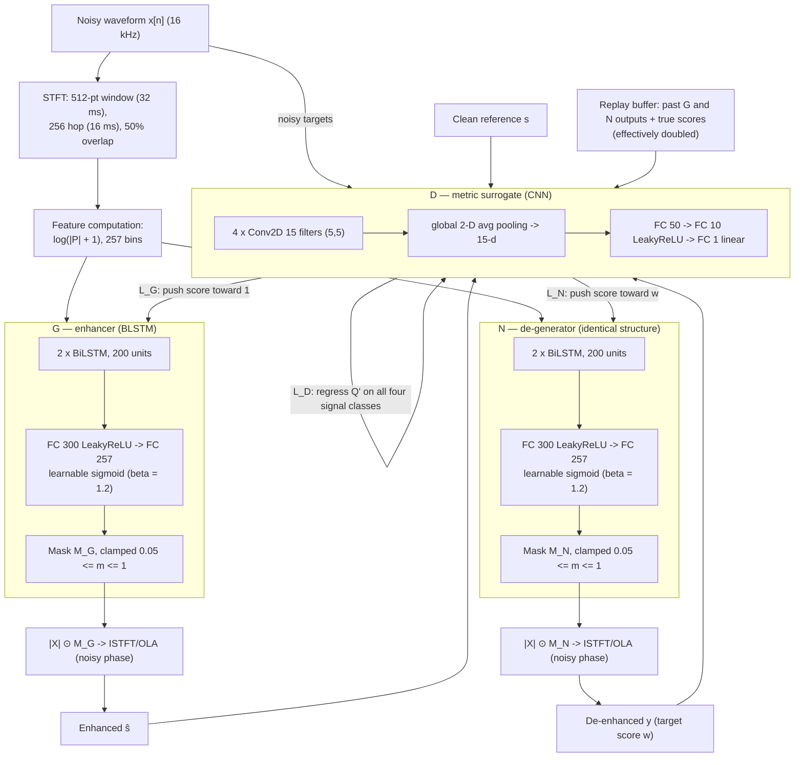

# Close, Hain & Goetze 2022: MetricGAN+/- — Robustness of Noise Reduction on Unseen Data

**Authors**: [[entities/george-close|George Close]], [[entities/thomas-hain|Thomas Hain]], [[entities/stefan-goetze|Stefan Goetze]]
**Institution**: Department of Computer Science, The University of Sheffield, UK
**Venue**: EUSIPCO 2022 (30th European Signal Processing Conference), Belgrade, Serbia
**Year**: 2022
**Pages**: 165–169
**Type**: Conference paper
**DOI**: [10.23919/EUSIPCO55093.2022.9909682](https://doi.org/10.23919/EUSIPCO55093.2022.9909682)
**arXiv**: [2203.12369](https://arxiv.org/abs/2203.12369) (v5)
**Zotero**: [EFD7V27D](zotero://select/items/0_EFD7V27D)
**Code**: extension of the [SpeechBrain](https://github.com/speechbrain/speechbrain) MetricGAN+ recipe (no separate release stated)

## Summary

MetricGAN+/- adds a third network to [[sources/fu-2021-metricgan-plus|MetricGAN+]]: a **[[concepts/metric-surrogate-de-generator|de-generator]]** $\mathcal{N}$ trained to *degrade* speech to an assigned sub-perfect metric score $w \in (0,1)$, so the metric discriminator $\mathcal{D}$ observes score regions sparsely populated in the training data. On VoiceBank+DEMAND the extension lifts the SpeechBrain MetricGAN+ baseline from PESQ 3.05 to **3.22** ($w = 0.5$), and — the paper's headline claim — generalizes better to fully unseen data: on the CHiME-3 real test set PESQ rises 1.54 → 1.76 and on the simulated set 2.14 → 2.38. The score-assignment mechanism is MetricGAN's $s < 1$ degrader repurposed from a *metric-analysis probe* into a *training-data generator for the surrogate*.

## Problem Formulation

A learned metric surrogate $D \approx Q'$ is only accurate on the distribution of signals it has been trained on. In MetricGAN+, $D$ sees clean speech ($Q' = 1$), noisy inputs, and the generator's enhanced outputs — as $\mathcal{G}$ improves, its outputs cluster near the top of the score range, leaving mid-range scores sparsely observed. The paper's diagnosis: **the predictor's performance is limited by the distribution of metric scores that appear in the training data**, which hurts both in-domain accuracy and generalization to unseen noise/speakers.

The baseline objectives (SpeechBrain MetricGAN+, log-compressed magnitude features $\mathbf{P}_f = \log(|\mathbf{P}| + 1)$):

$$L_{\mathcal{G},\mathrm{MG+}} = \mathbb{E}\big[(\mathcal{D}(\hat{\mathbf{S}}_f, \mathbf{S}_f) - 1)^2\big]$$

$$L_{\mathcal{D},\mathrm{MG+}} = \mathbb{E}\big[(\mathcal{D}(\mathbf{S}_f,\mathbf{S}_f) - 1)^2 + (\mathcal{D}(\hat{\mathbf{S}}_f,\mathbf{S}_f) - Q'(\hat{s},s))^2 + (\mathcal{D}(\mathbf{X}_f,\mathbf{S}_f) - Q'(x,s))^2\big]$$

MetricGAN+/- appends a fourth term for the de-generator's output $y$ (features $\mathbf{Y}_f$):

$$L_{\mathcal{D},\mathrm{MG+/-}} = L_{\mathcal{D},\mathrm{MG+}} + \mathbb{E}\big[(\mathcal{D}(\mathbf{Y}_f,\mathbf{S}_f) - Q'(y,s))^2\big]$$

and trains $\mathcal{N}$ exactly like $\mathcal{G}$ but toward the assigned degraded score:

$$L_{\mathcal{N},\mathrm{MG+/-}} = \mathbb{E}\big[(\mathcal{D}(\mathbf{Y}_f,\mathbf{S}_f) - w)^2\big], \qquad 0 < w < 1$$

$w$ is chosen to target **sparsely populated values of $Q'$ in the dataset** — e.g. $w = 0.5$ corresponds to PESQ ≈ 3, a score few training pairs occupy. This is the [[concepts/metricgan|MetricGAN]] score-assignment idea ($s<1$ turns the enhancer into a controlled degrader) turned into a curriculum for the surrogate rather than an analysis experiment.

## Methodology

### Model Structure, Inputs, and Outputs

Three networks; $\mathcal{N}$ is structurally identical to $\mathcal{G}$ (changing its structure and clamp threshold is left to future work). All exist only at training time except $\mathcal{G}$.

| Network | Structure | Input | Output | Training data | Role |
|:--------|:----------|:------|:-------|:--------------|:-----|
| **$\mathcal{G}$** (generator) | 2 bidirectional LSTM layers, 200 neurons each → FC 300 LeakyReLU → FC 257 [[concepts/learnable-sigmoid-mask\|learnable sigmoid]] ($\beta = 1.2$, learnable $\alpha$). Mask clamped element-wise to $\xi \le m \le 1$, $\xi = 0.05$ (musical-tone suppression) | Log-compressed noisy magnitude $\mathbf{X}_f = \log(\lvert\mathbf{X}\rvert+1)$, 257 bins; STFT 512-pt (32 ms) window, 256 (16 ms) hop at 16 kHz | T-F mask $\mathbf{M}_{\mathcal{G}}$; enhanced magnitude $\lvert\hat{\mathbf{S}}\rvert = \mathbf{M}_{\mathcal{G}} \odot \lvert\mathbf{X}\rvert$; waveform by OLA with the noisy phase (inverse feature transform: $\exp(\cdot)-1$) | VoiceBank+DEMAND train (11,572 pairs, 28 speakers) | Speech enhancer, trained purely by the surrogate gradient toward score 1 |
| **$\mathcal{N}$** (de-generator, **new**) | Identical to $\mathcal{G}$ (BLSTM 2×200 + FC 300 + FC 257 learnable sigmoid, $\beta = 1.2$; one variant makes $\beta$ learnable too) | Same noisy features $\mathbf{X}_f$ | Mask $\mathbf{M}_{\mathcal{N}}$ → de-enhanced signal $y$ whose predicted metric score is driven to $w$ | Same pairs; outputs stored in the shared replay buffer | Generates *controlled degraded* speech so $D$ observes mid-range metric scores absent from the data |
| **$\mathcal{D}$** (discriminator / evaluator) | CNN: 4 × 2-D conv, 15 filters, kernel (5,5); global 2-D average pooling fixing variable-length inputs at 15 features; FC 50 → FC 10 LeakyReLU → FC 1 linear (no final activation) | Feature-space pairs $(\mathbf{P}_f, \mathbf{S}_f)$ for $P \in \{S, \hat{S}, X, Y\}$ — clean, enhanced, noisy, **de-enhanced** | Scalar normalized metric estimate $Q' \in [0,1]$ (PESQ or STOI) | All four signal classes + replay buffer | Differentiable surrogate of the black-box metric; the network whose coverage the paper widens |

The paper's $\mathcal{D}$ description places the global pooling "immediately after the input" while also taking a mean over the 2nd/3rd dimensions *after* the conv layers — an internal inconsistency; the functional description (pool after convs, 15-d fixed representation) matches the MetricGAN+ discriminator it claims to replicate.

### Training Losses

- **$\mathcal{G}$**: $L_{\mathcal{G}} = \mathbb{E}[(\mathcal{D}(\hat{\mathbf{S}}_f,\mathbf{S}_f) - 1)^2]$ — unchanged from MetricGAN+; no reconstruction term.
- **$\mathcal{N}$**: $L_{\mathcal{N}} = \mathbb{E}[(\mathcal{D}(\mathbf{Y}_f,\mathbf{S}_f) - w)^2]$, $0<w<1$ — same form, assigned degraded score.
- **$\mathcal{D}$**: four-term MSE regression (clean→1, enhanced→$Q'(\hat{s},s)$, noisy→$Q'(x,s)$, de-enhanced→$Q'(y,s)$), all terms unweighted.

All losses are squared-error ([[concepts/least-squares-gan|least-squares]] form). Per epoch: (1) train $\mathcal{D}$ on $I$ fresh segments (outputs added to the replay buffer), (2) train $\mathcal{D}$ on a `history_portion` $H$ of the buffer — now containing **both enhanced and de-enhanced outputs, effectively doubling its size**, (3) train $\mathcal{D}$ again on fresh samples, (4) train $\mathcal{N}$ (toward $w$), then $\mathcal{G}$ (toward 1). $\mathcal{G}$/$\mathcal{N}$ are frozen during $\mathcal{D}$ updates and vice versa; since $\mathcal{D}$ trains first, the enhanced term uses the previous epoch's generator output. Optimizer: Adam, lr $5\times10^{-4}$.

## Experimental Setup

| Parameter | Value |
|:----------|:------|
| Train data | [[concepts/voicebank-demand\|VoiceBank+DEMAND]]: 11,572 pairs, 28 speakers (14 m / 14 f), SNRs 0/5/10/15 dB, 8 DEMAND noises + babble + speech-shaped noise |
| In-domain test | 824 utterances, 2 unseen speakers, 5 unseen DEMAND noises, SNRs 2.5/7.5/12.5/17.5 dB |
| Out-of-domain test | CHiME-3 test set (models trained only on VBD): 1,320 **real** + 1,320 **simulated** pairs; channel 5 of 6; real "clean" reference is a close-talk headset mic (itself noisy); environments bus/cafe/pedestrian/street; simulated data mixed at measured, not fixed, SNR |
| Features | STFT 512-pt DFT, 512 (32 ms) window, 256 (16 ms) hop, 16 kHz; $\log(\lvert P\rvert+1)$ compression; noisy phase for OLA resynthesis |
| Mask clamp | $\xi = 0.05$ for both $\mathbf{M}_{\mathcal{G}}$ and $\mathbf{M}_{\mathcal{N}}$ |
| Optimizer | Adam, lr 0.0005 |
| Objectives | PESQ (P) and STOI (S) as $Q$; $w \in \{1.0, 0.5, 0.45, 0.3\}$; $H \in \{0.1, 0.2, 0.4\}$ |
| Baselines | SpeechBrain MetricGAN+ (PESQ and STOI objectives), SEGAN; the paper's own MetricGAN+ re-run scores **3.05**, below the 3.15 reported by Fu et al. 2021 |
| Metrics | PESQ, STOI (reported ×100), CSIG/CBAK/COVL |

## Results

### VoiceBank+DEMAND (Table I; STOI shown as fraction)

| Model | Obj. | $w$ | $H$ | PESQ | STOI | CSIG | CBAK | COVL |
|:------|:-----|:----|:----|:-----|:-----|:-----|:-----|:-----|
| Noisy | — | — | — | 1.97 | 0.92 | 3.35 | 2.44 | 2.63 |
| MG+ (SpeechBrain) | P | — | 0.2 | 3.05 | 0.93 | 4.03 | 2.87 | 3.52 |
| MG+ (SpeechBrain) | S | — | 0.2 | 2.42 | 0.934 | 3.56 | 2.58 | 2.97 |
| SEGAN (as listed) | — | — | — | 2.42 | 0.925 | 3.61 | 2.61 | 3.01 |
| MG+ | P | — | 0.4 | 3.17 | 0.923 | 4.05 | 2.91 | 3.59 |
| MG+/- | P | 1.0 | 0.2 | 3.20 | 0.930 | 4.08 | 2.94 | 3.62 |
| **MG+/-** | P | **0.50** | 0.2 | **3.22** | 0.913 | 4.05 | 2.94 | 3.62 |
| MG+/- | P | 0.45 | 0.2 | 3.21 | 0.919 | 4.09 | **2.95** | 3.64 |
| MG+/-\* (learnable $\beta$ in $\mathcal{N}$) | P | 0.45 | 0.2 | 3.17 | 0.930 | **4.16** | 2.93 | **3.65** |
| MG+/- | P | 0.45 | 0.1 | 3.13 | 0.921 | 4.05 | 2.91 | 3.58 |
| MG+/- | P | 0.30 | 0.2 | 3.04 | 0.930 | 4.07 | 2.88 | 3.55 |
| MG+/- | S | 0.45 | 0.1 | 2.13 | 0.932 | 3.04 | 2.42 | 2.56 |
| MG+/- | S | 0.30 | 0.2 | 2.31 | 0.933 | 3.19 | 2.49 | 2.72 |

Readings:

- **Best PESQ 3.22 at $w = 0.5$** (de-generator targets PESQ ≈ 3, the sparse mid-range) — +0.17 over the same-recipe baseline, +0.07 over Fu et al.'s reported 3.15. But STOI at that setting *drops* to 0.913 (below noisy-adjacent 0.93 of the baseline): the PESQ gain is again a bias purchase.
- **Even $w = 1$ helps** (3.20): $\mathcal{N}$ then has the same objective as $\mathcal{G}$, so the gain cannot come from score-range widening alone — the authors attribute it to output variation between the two networks plus the doubled replay buffer.
- **Buffer-size control**: raising the *baseline's* $H$ to 0.4 (matching MG+/-'s effective buffer) yields 3.17 — most but not all of the gain; **contradicting Fu et al. 2021's report of no improvement beyond $H = 0.2$**. Larger $H$ drastically increases training time; the authors call for better buffer curation.
- STOI-objective variants gain at most +0.001 STOI over the MG+ (S) baseline (0.933 vs 0.934 at best — essentially flat) while PESQ collapses; the extension's benefit is demonstrated for PESQ, not STOI.
- Making $\beta$ learnable in $\mathcal{N}$ trades PESQ (3.17) for the best CSIG 4.16 / COVL 3.65.

### Spectrogram analysis (Fig. 4)

The MG+/- mask boosts the fundamental-frequency curve and suppresses less energy around 400 Hz across the utterance — an artefact already present in baseline MetricGAN+ but **more prominent** in MG+/-, hypothesized to explain its relatively low CBAK: $\mathcal{D}$ may not learn to penalize errors in that region, possibly due to $\mathcal{N}$'s influence on its training. Flagged by the authors as needing further experimentation.

![[raw/papers/close-2022-metricgan-plus-minus/figures/fig1.png|Spectrogram comparison of MetricGAN+ and MetricGAN+/-]]

*Figure 4: Clean reference |S|, noisy input |X|, generator mask M_G and masked output for baseline MetricGAN+ (c, d) and MetricGAN+/- w=0.45 (e, f). The proposed model's mask boosts the F0 curve and leaves more energy near 400 Hz — a residual-noise artefact linked to its lower CBAK.*

### Generalization to unseen data (CHiME-3, Tables II–III)

Real recordings (close-talk reference; STOI as fraction):

| Model | PESQ | STOI | CSIG | CBAK | COVL |
|:------|:-----|:-----|:-----|:-----|:-----|
| Noisy | 1.37 | 0.440 | **2.96** | 1.42 | 2.09 |
| MG+ (P) | 1.54 | **0.458** | 2.67 | **2.09** | 2.00 |
| MG+/- (P) | **1.76** | 0.443 | 2.86 | 2.03 | **2.20** |
| MG+ (S) | 1.24 | 0.447 | 2.45 | 1.84 | 1.76 |
| MG+/- (S) | 1.22 | 0.453 | 2.31 | 1.81 | 1.67 |

Simulated mixtures:

| Model | PESQ | STOI | CSIG | CBAK | COVL |
|:------|:-----|:-----|:-----|:-----|:-----|
| Noisy | 1.27 | 0.870 | 2.61 | 1.39 | 1.88 |
| MG+ (P) | 2.14 | 0.874 | 3.05 | 2.31 | 2.53 |
| MG+/- (P) | **2.38** | 0.861 | **3.17** | **2.41** | **2.70** |
| MG+ (S) | 1.52 | **0.889** | 2.75 | 2.07 | 2.08 |
| MG+/- (S) | 1.47 | 0.885 | 2.62 | 2.02 | 1.99 |

The PESQ-objective de-generator improves PESQ/CSIG/CBAK/COVL on both real and simulated unseen environments — the paper's central robustness claim, consistent with wider surrogate coverage yielding a better-conditioned gradient off-distribution. On real CHiME-3, MG+ still *lowers* CSIG and COVL below the noisy input (2.67/2.00 vs 2.96/2.09); MG+/- reduces but does not eliminate that regression (2.86/2.20). STOI-objective variants remain weak throughout.

## Key Contributions

1. **De-generator $\mathcal{N}$**: a third network trained toward an assigned sub-perfect metric score $w$, generating controlled degraded speech that widens the score distribution the metric surrogate observes — repurposing MetricGAN's score-assignment degrader as training-time data generation for $D$.
2. **Coverage-targeted $w$ selection**: choosing $w$ to hit sparsely populated $Q'$ values (0.5 ≈ PESQ 3) gives the best result (3.22 vs 3.05 baseline); even $w = 1$ helps via output diversity and the doubled buffer.
3. **Out-of-domain robustness evidence**: VBD-trained models tested on CHiME-3 real/simulated — PESQ 1.54 → 1.76 (real) and 2.14 → 2.38 (simulated), the metric-surrogate line's first explicit unseen-environment generalization result.
4. **Replay-buffer refutation**: baseline $H = 0.4$ improves PESQ to 3.17, contradicting MetricGAN+'s reported saturation at $H > 0.2$; buffer size/contents identified as an underexplored lever (at steep training-time cost).
5. **Honest artefact analysis**: the ~400 Hz residual-energy artefact is *worsened* by the extension (low CBAK), hypothesized as $D$ failing to penalize that region under $\mathcal{N}$'s influence.

## Limitations and Caveats

- **Baseline discrepancy**: the SpeechBrain MetricGAN+ re-run scores PESQ 3.05 / CBAK 2.87 vs the original paper's 3.15 / 3.16 — recipe/implementation differences are not analyzed; the headline "+3.8%" is against the re-run, and the fair cross-paper delta is +0.07.
- **SEGAN row discrepancy**: Table I lists SEGAN at PESQ 2.42 / STOI 0.925 / CSIG 3.61 / CBAK 2.61 / COVL 3.01, whereas the SEGAN paper reports 2.16 / 3.48 / 2.94 / 2.80 on this benchmark — provenance of the row is not stated.
- **PESQ–STOI trade persists**: the best-PESQ setting drops STOI to 0.913; STOI-objective variants show no meaningful gain from the extension.
- $\mathcal{N}$ doubles generator-side training cost and the replay buffer; no parameter counts, training times, or epoch counts are reported.
- The de-generator's structure/clamp are copied from $\mathcal{G}$ without ablation (explicitly future work); the 400 Hz artefact mechanism is a hypothesis.
- Real-CHiME-3 "clean" references are close-talk recordings containing background noise, so absolute scores there are pessimistic and CSIG/COVL can fall below the noisy input.

## Related Concepts

- [[concepts/metric-surrogate-de-generator|Metric-Surrogate De-Generator]] — the contribution this paper introduces
- [[concepts/metricgan|MetricGAN]] — the framework lineage (2019 → + 2021 → +/- 2022); score assignment reused as surrogate training
- [[concepts/black-box-metric-optimization|Black-Box Metric Score Optimization]] — surrogate coverage as a first-class requirement
- [[concepts/learnable-sigmoid-mask|Learnable Sigmoid Mask]] — mask head of both $\mathcal{G}$ and $\mathcal{N}$ ($\beta = 1.2$; learnable-$\beta$ variant)
- [[concepts/least-squares-gan|Least-Squares GAN (LSGAN)]] — squared-error form of all three objectives
- [[concepts/pesq|PESQ]] · [[concepts/stoi|STOI]] — the two metrics used as $Q$; the extension helps PESQ, not STOI
- [[concepts/voicebank-demand|VoiceBank+DEMAND]] — training/in-domain benchmark
- [[concepts/bidirectional-lstm|Bidirectional LSTM]] — backbone of $\mathcal{G}$ and $\mathcal{N}$
- [[concepts/ideal-ratio-mask|Ideal Ratio Mask (IRM)]] — the clamped magnitude-mask family both networks emit
- [[concepts/segan|SEGAN]] — the (discrepantly listed) GAN baseline
- [[concepts/speech-enhancement|Speech Enhancement]] · [[concepts/generative-vs-discriminative-speech-enhancement|Generative vs. Discriminative Speech Enhancement]]

## Related Synthesis

- [[synthesis/deep-speech-enhancement|Deep Speech Enhancement: Architectural & Methodological Evolution]] — extends the metric-optimization axis with surrogate-coverage training and its first out-of-domain (CHiME-3) data points

## Related Sources

- [[sources/fu-2021-metricgan-plus|Fu et al. 2021: MetricGAN+]] — the direct baseline (SpeechBrain recipe); its $H > 0.2$ saturation claim is refuted here, and its 3.15 PESQ is not reproduced (3.05)
- [[sources/fu-2019-metricgan|Fu, Liao, Tsao & Lin 2019: MetricGAN]] — origin of score assignment: the $s<1$ degrader used there to *characterize* metrics becomes here a *generator of surrogate training data*
- [[sources/fu-2020-metricgan-post-processing|Fu et al. 2020: MetricGAN Post-Processing]] — sibling extension of the same framework (post-hoc fine-tuning); both address surrogate failure modes from different angles
- [[sources/pascual-2017-segan|Pascual, Bonafonte & Serrà 2017: SEGAN]] — baseline in Table I, with scores that differ from the original paper's benchmark report
- [[sources/yan-2025-lisennet|Yan, Zhang, Fan, Zhou & Liu 2025: LiSenNet]] · [[sources/abdulatif-2024-cmgan|Abdulatif, Cao & Yang 2024: CMGAN]] — later MetricGAN+-descended systems whose PESQ surrogates face the same coverage limitation this paper attacks
