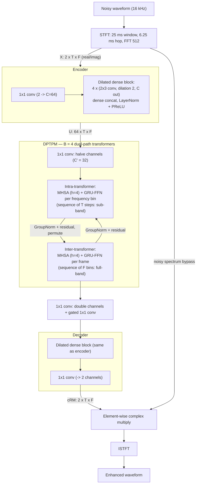

# Dang, Chen & Zhang 2022: DPT-FSNet — Dual-Path Transformer Full-Band and Sub-Band Fusion for Speech Enhancement

**Venue**: ICASSP 2022

| Field | Value |
|:------|:------|
| **Authors** | [[entities/feng-dang\|Feng Dang]], [[entities/hangting-chen\|Hangting Chen]], [[entities/pengyuan-zhang\|Pengyuan Zhang]] |
| **Institution** | Key Laboratory of Speech Acoustics & Content Understanding, Institute of Acoustics, Chinese Academy of Sciences; University of Chinese Academy of Sciences, Beijing (all three authors) |
| **Published** | ICASSP 2022, pp. 6857–6861 |
| **Type** | Conference paper |
| **DOI** | [10.1109/ICASSP43922.2022.9746171](https://doi.org/10.1109/ICASSP43922.2022.9746171) |
| **arXiv** | [2104.13002](https://arxiv.org/abs/2104.13002) (v2; preprint first posted April 2021) |
| **Zotero** | [AI3KJIDJ](zotero://select/items/0_AI3KJIDJ) |

## Summary

DPT-FSNet transfers the [[concepts/dual-path-transformer\|dual-path transformer]] from time-domain sequences to the STFT time-frequency map: the **intra-transformer models sub-band information** (the time sequence within each frequency bin) and the **inter-transformer models full-band information** (all frequency bins within each frame), realizing full-band/sub-band fusion inside one sequence model. A convolutional encoder-decoder with dilated dense blocks extracts the latent T-F features, and the decoder estimates a [[concepts/complex-ratio-mask\|complex ratio mask]] trained with a combined waveform-MSE + RI-magnitude-L1 loss. At **0.88 M parameters** it reports state-of-the-art results on both VoiceBank+DEMAND (WB-PESQ 3.33, STOI 0.96) and the Interspeech 2020 DNS test sets (WB-PESQ 3.53 with reverb / 3.26 without), with a controlled ablation isolating the gain of frequency-domain input over time-domain input to the same dual-path transformer.

## Problem Formulation

Given noisy speech $y = x + n$, the system estimates a complex ratio mask $\hat{M} \in \mathbb{R}^{2 \times T \times F}$ on the noisy STFT $X \in \mathbb{R}^{2 \times T \times F}$ (real/imaginary channels stacked); the enhanced spectrum is the element-wise product $\hat{S} = X \odot \hat{M}$, inverted by ISTFT. Two observations motivate the design:

1. **Sub-band locality**: local spectrogram patterns differ across frequency bands, so per-band models that focus on the temporal evolution of a narrow-band spectrum outperform full-band-only models (the FullSubNet finding, Hao et al. ICASSP 2021).
2. **Dual-path input features are under-explored**: time-domain dual-path networks (DPRNN, DPTNet, TSTNN) model local/global structure of learned or segmented waveform features. What the dual-path structure should actually *see* — waveform segments vs. interpretable T-F bins — had not been isolated. DPT-FSNet's ablation (exp.1 vs exp.4 below) is the controlled answer: with parameters, complexity, window (25 ms), hop (6.25 ms), and latency held essentially constant, swapping segmentation/overlap-add input for STFT input raises WB-PESQ from 2.97 to 3.33.

## Methodology

### Improved Transformer Block

Each transformer (encoder-only) block has two modules, following DPTNet's modification of the vanilla transformer encoder:

1. **Multi-head self-attention** (standard): $Q_i = ZW_i^Q$, $K_i = ZW_i^K$, $V_i = ZW_i^V$; $\mathrm{head}_i = \mathrm{Softmax}(Q_iK_i^\top/\sqrt{d})V_i$; $\mathrm{Mid} = \mathrm{LayerNorm}(Z + \mathrm{MultiHead})$, with $Z \in \mathbb{R}^{l \times d}$ and $h = 4$ heads. (The arXiv HTML renders $Q_iK_i$ without the transpose; the transpose is the standard formulation.)
2. **Modified position-wise feed-forward network**: the first fully-connected layer is replaced by a **GRU** to learn order information — positional encodings were found unsuitable for dual-path networks (DPTNet; Sperber et al. 2018):

$$\mathrm{FFN}(\mathrm{Mid}) = \mathrm{ReLU}(\mathrm{GRU}(\mathrm{Mid}))W_1 + b_1, \qquad \mathrm{Output} = \mathrm{LayerNorm}(\mathrm{Mid} + \mathrm{FFN})$$

with $W_1 \in \mathbb{R}^{d_{ff} \times d}$ and $d_{ff} = 4d$. Figure 1(d) shows group normalization after each sub-module (the text describes LayerNorm; both appear in the paper).

### Model Structure, Inputs, and Outputs

| Component | Structure | Input | Output | Role |
|:----------|:----------|:------|:-------|:-----|
| **Encoder** | 1×1 conv → dilated dense block of four 2×3 dilated convs (dilation rate 2), input channels growing $C, 2C, 3C, 4C$ by dense concatenation, each conv emitting $C$ channels; LayerNorm + PReLU after each conv. $C = 64$ | Complex STFT $X \in \mathbb{R}^{2 \times T \times F}$ — 16 kHz speech, 25 ms window, 6.25 ms hop, FFT 512 ($F = 257$ bins implied) | $U \in \mathbb{R}^{64 \times T \times F}$ | Extracts an efficient latent T-F feature space for the dual-path transformer |
| **DPTPM** | 1×1 conv ($64 \to 32$) → $B = 4$ dual-path transformers, each = intra-transformer then inter-transformer (improved transformer blocks above, $h = 4$ heads, $d_{model} = 32$, $d_{ff} = 128$) → 1×1 conv ($32 \to 64$) → gated 1×1 conv; PReLU after convs, GroupNorm inside transformers | $D \in \mathbb{R}^{32 \times T \times F}$ | $D_B^{inter} \in \mathbb{R}^{64 \times T \times F}$ after channel doubling/gating | Intra path models each sub-band's temporal evolution; inter path fuses sub-bands into full-band context per frame — **alternating**, not parallel (contrast: Tang et al. IJCAI 2021) |
| **Decoder** | Dilated dense block (same as encoder) → 1×1 conv to 2 channels | DPTPM output | Complex ratio mask $\hat{M} \in \mathbb{R}^{2 \times T \times F}$ | Mask applied element-wise to the noisy complex spectrum; ISTFT reconstructs the waveform |

Total: **0.88 M parameters** (Table 1). Single network, trained end-to-end; no separate stages. The intra/inter split follows the axis definitions of Eqs. (7)–(8): intra acts on $D[:,:,i] \in \mathbb{R}^{C' \times T}$ (all time steps of sub-band $i$), inter on $D[:,j,:] \in \mathbb{R}^{C' \times F}$ (all sub-bands at frame $j$). Because the intra path has already summarized each sub-band's history into every frame, the inter path models genuinely global (full-band) information.

![[raw/papers/dang-2022-dpt-fsnet/figures/fig1.png|DPT-FSNet architecture: overall diagram, dense block, dual-path transformer, improved transformer]]

*Figure 1: Architecture of the proposed DPT-FSNet. (a) Overall diagram; (b) dense block detail (2×3 convs with dense concatenation); (c) dual-path transformer detail (intra → GroupNorm → residual → permute → inter → GroupNorm → residual, repeated B times); (d) improved transformer detail (MHSA and GRU-based feed-forward network).*

### Training Losses

Single objective jointly training the whole network, combining waveform-level and T-F-level supervision:

$$L = \alpha_1 L_{audio} + \alpha_2 L_{spectral}, \qquad \alpha_1 = 0.4,\ \alpha_2 = 0.6$$

- **Waveform MSE**: $L_{audio} = \frac{1}{N}\sum_{i=0}^{N-1}(y_i - \tilde{y}_i)^2$ over $N$ waveform samples of clean $y$ vs enhanced $\tilde{y}$.
- **RI-magnitude L1**: $L_{spectral} = \frac{1}{TF}\sum_{t,f}\big|(|Y_r(t,f)| - |\tilde{Y}_r(t,f)|) + (|Y_i(t,f)| - |\tilde{Y}_i(t,f)|)\big|$ — L1 on the magnitudes of the real and imaginary parts separately (not on signed RI, and not on $|Y|$).

The mixture exploits both time-domain waveform features and T-F spectral features; the spectral term carries the larger weight (0.6), consistent with the [[concepts/frequency-domain-loss\|frequency-domain-loss]] finding that spectral supervision drives perceptual quality.

## Experimental Setup

| Parameter | Value |
|:----------|:------|
| Sample rate | 16 kHz |
| STFT/ISTFT | 25 ms window, 6.25 ms hop, FFT 512 |
| Feature maps $C$ / $C'$ | 64 / 32 |
| Dual-path transformers $B$ / heads $h$ | 4 / 4 |
| Dense block | 4 dilated convs, dilation 2, channels $C,2C,3C,4C \to C$ each |
| Loss weights | $\alpha_1 = 0.4$ (waveform MSE), $\alpha_2 = 0.6$ (RI-magnitude L1) |
| Optimizer | Adam, gradient clipping at L2-norm 5 |
| LR schedule | Transformer warmup: $k_1 d_{model}^{-0.5} n\,\mathrm{warmup}^{-1.5}$ for $n \le \mathrm{warmup}$, then $k_2 \cdot 0.98^{\lfloor epoch/2 \rfloor}$; $k_1 = 0.2$, $k_2 = 4\mathrm{e}{-4}$, $d_{model} = 32$, warmup = 4000 steps |
| Epochs | 100 |
| VCTK+DEMAND train | 11,572 utterances, 28 speakers; 10 noise types (8 DEMAND + 2 artificial) at SNR 0/5/10/15 dB; 4 s random segments |
| VCTK+DEMAND test | 872 utterances (as stated in this paper), 2 speakers; 5 unseen DEMAND noises at SNR 2.5/7.5/12.5/17.5 dB |
| DNS train | >500 h clean (2150 speakers), >180 h noise (150 classes); dynamic mixing each epoch; 75% of clean convolved with ICASSP-2021 DNS RIRs; SNR uniform −5…20 dB |
| DNS test | Interspeech 2020 non-blind `with_reverb` / `no_reverb`, 150 pairs each |
| Metrics | WB-PESQ, STOI (+ CSIG/CBAK/COVL on VCTK+DEMAND; SI-SDR on DNS) |

## Results

### VoiceBank+DEMAND (Table 1)

| Method | Domain | WB-PESQ | STOI | CSIG | CBAK | COVL | Params (M) |
|:-------|:-------|--------:|-----:|-----:|-----:|-----:|-----------:|
| Noisy | — | 1.97 | 0.91 | 3.34 | 2.44 | 2.63 | — |
| [[concepts/metricgan\|MetricGAN]] | F | 2.86 | — | 3.99 | 3.18 | 3.42 | 1.90 |
| TSTNN | T | 2.96 | 0.95 | 4.33 | 3.53 | 3.67 | 0.92 |
| T-GSA | F | 3.06 | — | 4.18 | 3.59 | 3.62 | — |
| DEMUCS | T | 3.07 | 0.95 | 4.31 | 3.40 | 3.63 | 33.5 |
| SE-Conformer | T | 3.13 | 0.95 | 4.45 | 3.55 | 3.82 | — |
| Learnable Loss Mixup | F | 3.26 | — | 4.49 | 3.27 | 3.91 | 20.32 |
| **DPT-FSNet** | F | **3.33** | **0.96** | **4.58** | **3.72** | **4.00** | **0.88** |

State of the art on all five metrics **with the fewest parameters** among compared systems — ahead of the time-domain transformer models TSTNN and SE-Conformer and the frequency-domain T-GSA.

### Ablation (Table 2) — what the dual-path transformer should see

All four variants matched in parameters, complexity, window/hop, and latency:

| Variant | Input | Sequence model | WB-PESQ | STOI |
|:--------|:------|:---------------|--------:|-----:|
| exp.1 CED + Dual-path former | Time (segmentation + overlap-add, TSTNN-style) | Intra + inter transformers | 2.97 | 0.95 |
| exp.2 STFT + CED + BLSTM | T-F | Sub-band BLSTM only | 3.05 | 0.95 |
| exp.3 STFT + CED + Sub-band former | T-F | Both paths model sub-bands | 3.20 | 0.95 |
| exp.4 STFT + CED + Full-sub former (**DPT-FSNet**) | T-F | Intra sub-band + inter full-band | **3.33** | **0.96** |

Three controlled conclusions: exp.2→exp.3 (+0.15 PESQ) the improved transformer beats BLSTM; exp.3→exp.4 (+0.13) full-band fusion beats sub-band-only dual-path; exp.1→exp.4 (+0.36) **frequency-domain features are markedly more effective than time-domain features for the dual-path transformer**.

### DNS (Table 3), `with_reverb` (`no_reverb`)

| Method | WB-PESQ | STOI (%) | SI-SDR (dB) |
|:-------|--------:|---------:|------------:|
| Noisy | 1.82 (1.58) | 86.62 (91.52) | 9.03 (9.07) |
| NSNet | 2.37 (2.15) | 90.43 (94.47) | 14.72 (15.61) |
| [[concepts/dtln\|DTLN]] | — (—) | 84.68 (94.76) | 10.53 (16.34) |
| PoCoNet | 2.83 (2.75) | — (—) | — (—) |
| FullSubNet | 2.97 (2.78) | 92.62 (96.11) | 15.75 (17.29) |
| CTS-Net | 3.02 (2.94) | 92.70 (96.66) | 15.58 (17.99) |
| GaGNet | — (3.17) | — (97.13) | — (18.91) |
| **DPT-FSNet** | **3.53 (3.26)** | **95.23 (97.68)** | **18.14 (20.36)** |

Best on every metric on both test sets. The margin over the full-band NSNet baseline is **larger on reverberant data** — the same trend FullSubNet shows. The paper's explanation: the sub-band path models the temporal evolution of the narrow-band spectrum, which captures reverberation effects (see [[concepts/dereverberation\|Dereverberation]]).

### Discrepancy notes (later citations vs this paper)

- **Parameter count**: [[sources/abdulatif-2024-cmgan\|CMGAN (Abdulatif et al. 2024)]] lists DPT-FSNet at **0.91 M** params (and year 2021, the arXiv date); this paper self-reports **0.88 M** (ICASSP 2022). All five quality scores agree exactly (3.33 / 4.58 / 3.72 / 4.00 / 0.96). The original paper's 0.88 M is authoritative.
- **Test-set size**: this paper states **872** test utterances for VCTK+DEMAND; the canonical Valentini-Botinhao release (and [[concepts/voicebank-demand\|the wiki's benchmark page]]) counts **824**. Scores are unchanged; the count appears to be a typo in this paper.
- **Not the Chen 2023 model**: the ~100K-parameter "online DPT-FSNet" in [[sources/chen-2023-ultra-dual-path-compression\|Chen et al. 2023]] is a heavily redesigned streaming variant (linear attention, single GRU, $E=48$, multi-signal AEC+NS input), not this 0.88 M offline model.

## Key Contributions

1. **Frequency-domain dual-path transformer**: first dual-path transformer SE model whose intra/inter paths are explicitly assigned to sub-band (per-bin temporal) and full-band (per-frame spectral) modeling of the STFT map — full-band/sub-band fusion realized inside the sequence model rather than as separate network branches.
2. **Controlled evidence that input representation matters for dual-path networks**: at matched parameters/complexity/latency, STFT input beats TSTNN-style time-domain segmentation by +0.36 WB-PESQ (2.97 → 3.33); the ablation also isolates +0.15 for the improved transformer over BLSTM and +0.13 for full-band fusion over sub-band-only.
3. **SOTA at small size on two benchmarks**: 0.88 M params, WB-PESQ 3.33 / STOI 0.96 on VoiceBank+DEMAND (fewest parameters among compared systems) and 3.53 / 3.26 on DNS with/without reverb, with the reverberant-condition margin attributed to sub-band temporal modeling.
4. **GRU-replacing-FC positional modeling** carried over from DPTNet into the T-F domain, plus a dual-domain loss (0.4 waveform MSE + 0.6 RI-magnitude L1).

## Limitations and Caveats

- Offline (bidirectional attention on both paths); no streaming variant or latency/RTF/MACs analysis in this paper — compute cost surfaced only later via Chen et al. 2023 (1822M MACs/s for their online redesign).
- The 872-vs-824 test-utterance count and the 0.88-vs-0.91 M parameter discrepancy above.
- GroupNorm (Fig. 1) vs LayerNorm (text) in the transformer blocks is not reconciled in the paper.
- No code link is given in the paper.

## Related Concepts

- [[concepts/dpt-fsnet\|DPT-FSNet]] — the architecture itself
- [[concepts/dual-path-transformer\|Dual-Path Transformer]] — the sequence-model family this paper transplants to the T-F domain
- [[concepts/dprnn\|Dual-Path RNN (DPRNN)]] — the recurrent predecessor of the dual-path family
- [[concepts/full-band-sub-band-fusion\|Full-Band and Sub-Band Fusion]] — the modeling paradigm (FullSubNet lineage)
- [[concepts/complex-ratio-mask\|Complex Ratio Mask]] — the estimation target
- [[concepts/complex-spectral-mapping\|Complex Spectral Mapping]] — the phase-aware complex-domain paradigm
- [[concepts/frequency-domain-loss\|Frequency-Domain Loss]] — why the spectral term dominates the objective
- [[concepts/voicebank-demand\|VoiceBank+DEMAND]] · [[concepts/dns-challenge\|DNS Challenge]] — the two benchmarks
- [[concepts/pesq\|PESQ]] · [[concepts/stoi\|STOI]] · [[concepts/si-sdr\|SI-SDR]] — evaluation metrics
- [[concepts/dereverberation\|Dereverberation]] — the sub-band path's reverberation advantage
- [[concepts/speech-enhancement\|Speech Enhancement]]

## Related Synthesis

- [[synthesis/deep-speech-enhancement|Deep Speech Enhancement: Architectural & Methodological Evolution]] — DPT-FSNet is the 2022 dual-path transformer point on the backbone axis (Insight 4) and the controlled STFT-vs-time-domain input evidence on the domain axis (Insight 2)

## Related Sources

- [[sources/chen-2023-ultra-dual-path-compression\|Chen, Yu, Luo, Gu, Li, Lu & Weng 2023: Ultra Dual-Path Compression]] — redesigns this model into a ~109K-parameter streaming AEC+NS network and compresses it 4×–32×
- [[sources/abdulatif-2024-cmgan\|Abdulatif, Cao & Yang 2024: CMGAN]] — uses DPT-FSNet as a VoiceBank+DEMAND baseline (0.91 M params cited; see discrepancy note)
- [[sources/fu-2019-metricgan\|Fu, Liao, Tsao & Lin 2019: MetricGAN]] — VoiceBank+DEMAND baseline in Table 1 (PESQ 2.86)
- [[sources/pandey-2019-cnn-speech-enhancement-time-domain\|Pandey & Wang 2019: CNN-Based Speech Enhancement in the Time Domain]] — cited as the time-domain SE category this paper contrasts against