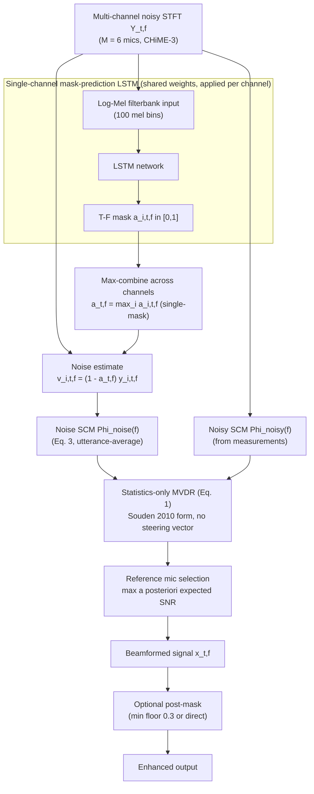

# Erdogan, Hershey, Watanabe, Mandel & Le Roux 2016: Improved MVDR Beamforming Using Single-Channel Mask Prediction Networks

**Authors**: [[entities/hakan-erdogan|Hakan Erdogan]] (Sabanci University, Istanbul, Turkey), [[entities/john-hershey|John Hershey]] (MERL, Cambridge, MA, USA), [[entities/shinji-watanabe|Shinji Watanabe]] (MERL, Cambridge, MA, USA), [[entities/michael-mandel|Michael Mandel]] (Brooklyn College, CUNY, New York, NY, USA), [[entities/jonathan-le-roux|Jonathan Le Roux]] (MERL, Cambridge, MA, USA)

**Venue**: Interspeech 2016 (17th Annual Conference of the International Speech Communication Association)
**Year**: 2016
**Type**: conferencePaper
**DOI**: [10.21437/Interspeech.2016-552](https://doi.org/10.21437/Interspeech.2016-552)
**Zotero**: [DAZUURWK](zotero://select/items/0_DAZUURWK)

## Summary

This paper is one of the three founding papers (with Heymann et al. 2016 and Higuchi et al. 2016) of **neural mask-based beamforming**: single-channel LSTM speech-enhancement networks — trained on single-channel data only — predict time-frequency masks that drive the noise spatial covariance estimation of an MVDR beamformer, steering it toward speech without any explicit steering vector or array geometry. The paper's distinctive contribution is its systematic analysis of *how* to use the masks: single-mask (max-combined across microphones) vs. per-channel multi-mask covariance estimation, with or without a post-mask after beamforming (direct vs. minimum-floor-limited). Using a single max-combined mask plus a post-mask with a minimum floor of 0.3 gives the best SDR, PESQ, and WER on CHiME-3 in a deliberately mismatched ASR scenario (AMI-trained recognizer), beating WDAS beamforming.

## Problem Formulation

MVDR beamforming performs well for ASR **if the steering vector is known**, but steering the beamformer toward speech in unknown acoustic conditions remains challenging. The noise spatial covariance matrix (SCM) also needs to be estimated, typically via an **edge-mask** (assuming the first and last half second of each utterance contain only noise) or VAD/SPP-based noise tracking — both fragile in nonstationary noise.

The multi-channel observation model is

$$
y_{i}(\tau) = b_{i}(\tau) * s(\tau) + v_{i}(\tau), \quad i = 1, \dots, M,
$$

with $M$ microphones, source signal $s(\tau)$, channel $b_{i}(\tau)$, and noise $v_{i}(\tau)$; $x_{i}(\tau) = b_{i}(\tau) * s(\tau)$ is the source image, and the goal is to estimate the reference-microphone image $x_{\mathrm{ref}}(\tau)$.

The paper uses the **statistics-only MVDR formulation** of [[sources/souden-2010-pmwf|Souden, Benesty & Affes 2010]], which requires no steering vector, channel transfer functions, or array geometry — only the noise and noisy-signal SCMs:

$$
[h_{1}(f), \dots, h_{M}(f)]^{T} = \frac{1}{\lambda(f)} \left(\boldsymbol{G}(f) - \boldsymbol{I}_{M \times M}\right) \boldsymbol{e}_{\mathrm{ref}}, \tag{1}
$$

where $\boldsymbol{G}(f) = \Phi_{\mathrm{noise}}^{-1}(f)\,\Phi_{\mathrm{noisy}}(f)$, $\lambda(f) = \operatorname{trace}(\boldsymbol{G}(f)) - M$, and $\boldsymbol{e}_{\mathrm{ref}}$ selects the reference microphone. The question the paper answers: *can single-channel enhancement networks supply the noise SCM — and thereby the implicit steering — reliably?*

## Methodology

Each microphone signal is enhanced separately by the same single-channel LSTM network; the predicted masks steer the MVDR via the noise SCM. The noise component estimate at each T-F bin uses the complement of the mask,

$$
\hat{v}_{i,t,f} = (1 - \hat{a}_{i,t,f})\, y_{i,t,f},
$$

accumulated into the noise SCM

$$
\hat{\Phi}_{\mathrm{noise}}(f) = \frac{1}{T} \sum_{t=0}^{T-1} \hat{V}_{t,f} \hat{V}_{t,f}^{H}, \tag{3}
$$

with spatial noise vectors $\hat{V}_{t,f} = [\hat{v}_{1,t,f} \dots \hat{v}_{M,t,f}]^{T}$; the noisy SCM $\hat{\Phi}_{\mathrm{noisy}}(f)$ comes directly from the measurements, using $\Phi_{\mathrm{noisy}} = \Phi_{\mathrm{speech}} + \Phi_{\mathrm{noise}}$.

The **masking design space** explored (the paper's core analysis):

1. **Edge-mask** (baseline): $\hat{a} = 0$ only in the first and last half second of the utterance, 1 elsewhere.
2. **Multi-mask**: a separate per-channel LSTM mask $\hat{a}_{i,t,f}$ for each channel's noise SCM contribution.
3. **Single-mask**: one common mask $\hat{a}_{t,f} = \max\{\tilde{a}_{1,t,f}, \dots, \tilde{a}_{M,t,f}\}$ (max over the $M$ per-channel masks; mean tried and slightly worse).
4. **Post-mask** (optional), applied to the beamformed output with the reference microphone's mask: (a) direct application, or (b) with a **minimum floor of 0.3** to avoid sharp-zero masking artifacts.

The reference microphone is chosen per utterance by maximum a posteriori expected SNR,

$$
\mathrm{SNR}_{\mathrm{post},r} = \frac{\sum_{f} \boldsymbol{h}_{r}^{H}(f)\, \Phi_{\mathrm{speech}}(f)\, \boldsymbol{h}_{r}(f)}{\sum_{f} \boldsymbol{h}_{r}^{H}(f)\, \Phi_{\mathrm{noise}}(f)\, \boldsymbol{h}_{r}(f)},
$$

so the masking choice also changes which microphone is selected as reference.

### Model Structure, Inputs, and Outputs

The paper (5 pages, Interspeech) does not specify the LSTM layer sizes; the mask-prediction network follows the single-channel enhancement architecture line of Weninger et al. 2014 and Erdogan et al. 2015 [12, 13]. What is specified:

**Mask-prediction LSTM** spec:

| Property | Value |
|---|---|
| Structure | LSTM (layer sizes not specified in this paper; follows [12, 13]) |
| Input | Log-Mel filterbank energies, 100 mel bins, per channel (single-channel features only — no spatial features) |
| Output | T-F mask $\hat{a}_{i,t,f} \in [0,1]$ at frame rate, per channel |
| Training data | CHiME-3 single-channel (CH5) noisy/clean pairs only; applied to each of the 6 channels at test time |
| Role | Predicts the speech proportion per T-F bin, whose complement weights the noise SCM accumulation — the network never sees multi-channel data |

**Training losses.** The mask network is trained with the **magnitude spectrum approximation (MSA)** loss,

$$
D_{\mathrm{msa}}(\hat{a}) = (\hat{a}\,|\hat{y}| - |s|)^{2},
$$

rather than mask approximation $D_{\mathrm{ma}}(\hat{a}) = |\hat{a} - a^{*}|^{2}$ against the ideal ratio mask $a^{*}$ — MSA was previously found to perform better [12]. This is a signal-domain loss (in contrast to the mask-domain BCE of Heymann et al. 2016 and the binary-mask targets therein).

## Experimental Setup

| Item | Value |
|---|---|
| Dataset | CHiME-3 (6-mic tablet array), sim/real dev and test |
| Mask network | Single-channel LSTM, MSA loss, trained on CH5 only |
| Masking variants | Edge-mask / multi-mask / single-mask (max, mean) × post-mask (none / minfloor 0.3 / direct) |
| Beamformer | Statistics-only MVDR (Eq. 1); reference mic per utterance by max posterior SNR |
| Baselines | WDAS (BeamformIt), CH5 LSTM enhancement alone, CH5 noisy |
| Metrics | SDR (dB), PESQ, WER |
| ASR (WER) | **Mismatched**: trained on WDAS-beamformed AMI meeting data (DNN acoustic model, sMBR), decoded on MVDR-beamformed CHiME-3 |
| SDR target (real data) | Close-talking microphone channel-adapted to the reference mic (imperfect "clean" — results "with a grain of salt") |

## Results

**SDR (dB), CHiME-3** (Table 1; sim-dev / real-dev / sim-test / real-test):

| Mask | Post-mask | sim-dev | real-dev | sim-test | real-test |
|---|---|---|---|---|---|
| Edge-mask | none | 11.78 | 3.70 | 12.02 | 4.20 |
| **Single-mask** | **minfloor** | **15.79** | **6.72** | **15.12** | 5.52 |
| Single-mask | none | 15.04 | 5.87 | 14.36 | 5.02 |
| Single-mask | direct | 15.80 | 6.72 | 15.10 | 5.36 |
| Multi-mask | none | 13.42 | 3.94 | 13.00 | 3.75 |
| Multi-mask | minfloor | 14.82 | 5.57 | 14.22 | 4.71 |
| CH5 LSTM-enh | n/a | 10.44 | 4.41 | 10.41 | 3.11 |
| CH5 noisy | n/a | 5.79 | 1.09 | 6.50 | 1.69 |

**PESQ** (Table 2) follows the same pattern (single-mask + minfloor: 2.19 / 1.68 / 2.29 / 1.79), with one exception: on the challenging **real-test** set, *no* post-masking (1.85) beats minfloor (1.79) and direct (1.54), and even the noisy single-channel signal outscores the single-channel enhancement (1.45 vs. 1.33) — enhancement artifacts hurt perceptual quality there.

**WER (%)** (Table 3, real data, AMI-trained mismatched ASR):

| Mask | Post-mask | real-dev | real-test |
|---|---|---|---|
| Edge-mask | none | 31.30 | 43.59 |
| **Single-mask** | **minfloor** | **21.20** | **34.78** |
| Single-mask | none | 22.41 | 36.23 |
| Single-mask | direct | 21.55 | 36.87 |
| Multi-mask | none | 26.18 | 43.18 |
| Multi-mask | minfloor | 24.20 | 40.93 |
| CH5 LSTM-enh | n/a | 28.02 | 49.33 |
| CH5 noisy | n/a | 34.79 | 55.53 |
| WDAS beamforming | n/a | 22.67 | 36.19 |

Key findings:

- **Single (max-combined) mask beats per-channel multi-masks** for noise SCM estimation. Conjectured mechanism: combining per-channel mask errors yields less reliable covariance accumulation, and per-channel masks can zero out some channels' noise estimates at a bin while leaving others high — partially-observed spatial vectors destabilize the SCM estimate. Taking the max retains only bins that *all* microphones agree are noise-only.
- **Post-masking with a minimum floor (0.3) is best overall** — sharp zeros in the STFT domain introduce artifacts that hurt perceptual quality and ASR; a floor limits them while keeping most of the suppression.
- The best configuration **beats WDAS beamforming on WER** (34.78 vs. 36.19 real-test) despite the mismatched AMI-trained recognizer.
- SDR numbers across rows are not perfectly comparable: the reference microphone (hence the target signal) differs per masking choice.

![[raw/papers/erdogan-2016-improved-mvdr-mask-prediction/figures/6068013af2a40c4d74c93ce19046839715d67eb01d39fae322e76296cad28c43.jpg|Fig. 1: System diagram illustrating the basic idea of using single-channel enhancement for beamforming]]
*Figure 1: System diagram illustrating the basic idea of using single-channel enhancement for beamforming. Each microphone is enhanced by the same single-channel LSTM; masks drive the noise SCM of the MVDR beamformer, and a post-mask (minimum-floor limited) is applied to the beamformed output.*

## Key Contributions

1. **Founding instance of single-channel-mask-driven MVDR**: single-channel LSTM enhancement networks (trained on CH5 data only, no multi-channel training) supply the noise SCM for the statistics-only Souden-form MVDR — no steering vector, no array geometry, no VAD.
2. **Single-mask vs. multi-mask design analysis**: a single mask max-combined across microphones beats per-channel masks for noise SCM estimation (e.g., real-dev WER 22.41 vs. 26.18 without post-masking) — the design decision later adopted (as median consolidation) by the Heymann 2016 / Boeddeker 2018 CHiME-winning front-ends.
3. **Post-mask strategy analysis**: applying the reference microphone's mask after beamforming with a minimum floor of 0.3 avoids sharp-masking artifacts and gives the best SDR/PESQ/WER; direct application is inferior on PESQ and WER.
4. **Mismatched-training evaluation**: SDR, PESQ, and WER in a deliberately mismatched scenario (AMI-trained ASR on CHiME-3), showing the mask-driven MVDR beats both WDAS beamforming and single-channel enhancement.
5. **Signal-domain (MSA) mask training**: unlike the concurrent mask-domain binary-target approach of Heymann et al. 2016, the mask network is trained with a magnitude-spectrum-approximation regression loss.

## Related Concepts

- [[concepts/mask-based-beamforming|Mask-Based Beamforming]] — this paper is one of the three origins; contributes the single/multi-mask and post-mask design space
- [[concepts/mvdr-beamformer|MVDR Beamformer]] — statistics-only Souden form driven by mask-estimated noise SCM
- [[concepts/tf-mask-estimation|TF Mask Estimation]] — single-channel LSTM mask prediction with MSA loss
- [[concepts/spatial-covariance-matrix|Spatial Covariance Matrix]] — noise SCM from $(1-\hat{a})\,y$ accumulation; single max-combined mask
- [[concepts/neural-beamforming|Neural Beamforming]] — early mask-based instance: learned statistics, fixed beamformer formula
- [[concepts/phase-sensitive-mask|Phase-Sensitive Mask]] — the same group's preceding mask-objective line (MSA here, phase-sensitive in Erdogan et al. 2015)

## Related Synthesis

- [[synthesis/multi-channel-speech-enhancement|Multi-Channel Speech Enhancement]] — origin data point of the mask-based beamforming hybrid sub-pattern

## Related Sources

- [[sources/souden-2010-pmwf|Souden, Benesty & Affes 2010: On Optimal Frequency-Domain Multichannel Linear Filtering for Noise Reduction]] — source of the statistics-only MVDR form (Eq. 1) used here
- [[sources/heymann-2016-neural-spectral-mask-beamforming|Heymann, Drude & Haeb-Umbach 2016: Neural Network Based Spectral Mask Estimation for Acoustic Beamforming]] — concurrent founding paper; mask-domain loss, binary targets, predicted steering vector, GEV/MVDR comparison (differences from this paper enumerated in its Introduction)
- [[sources/boeddeker-2018-neural-mask-beamforming|Boeddeker, Erdogan, Yoshioka & Haeb-Umbach 2018: Exploring Practical Aspects of Neural Mask-Based Beamforming for Far-Field Speech Recognition]] — direct successor refining the same idea (median consolidation, feature-level loss, online variants)
- [[sources/zhang-2021-adl-mvdr|Zhang et al. 2021: ADL-MVDR]] — later replacement of the closed-form SCM operations with learned modules
- [[sources/li-2022-embedding-beamforming|Li et al. 2022: Embedding and Beamforming]] — evidence on the structural limits of the tandem mask-then-MVDR scheme this paper founded
