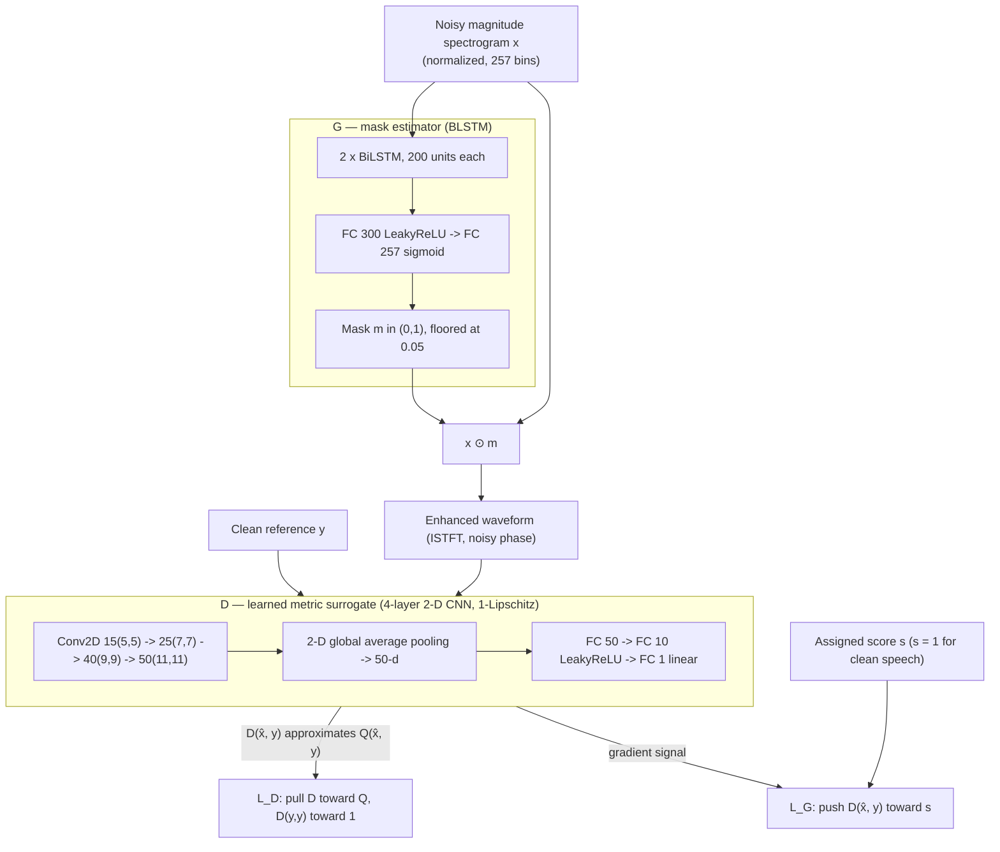

# Fu, Liao, Tsao & Lin 2019: MetricGAN — Black-Box Metric Score Optimization for Speech Enhancement

| Field | Value |
|:------|:------|
| **Authors** | [[entities/szu-wei-fu\|Szu-Wei Fu]], [[entities/chien-feng-liao\|Chien-Feng Liao]], [[entities/yu-tsao\|Yu Tsao]], [[entities/shou-de-lin\|Shou-De Lin]] |
| **Institution** | National Taiwan University (Fu, Liao, Lin); Academia Sinica, Taiwan (Fu, Liao, Tsao) |
| **Venue** | ICML 2019 (Proceedings of the 36th International Conference on Machine Learning) |
| **Year** | 2019 |
| **Volume/Pages** | PMLR 97:2031–2041 |
| **Type** | Conference paper |
| **DOI** | [10.48550/arXiv.1905.04874](https://doi.org/10.48550/arXiv.1905.04874) |
| **arXiv** | [1905.04874](https://arxiv.org/abs/1905.04874) |
| **Zotero** | [BQITS4VB](zotero://select/items/0_BQITS4VB) |
| **Code** | [JasonSWFu/MetricGAN](https://github.com/JasonSWFu/MetricGAN) |

## Summary

MetricGAN repurposes the GAN discriminator as a **learned surrogate of a black-box evaluation metric**. Instead of labelling generated speech `0` (fake), the discriminator is trained to *predict the metric score itself* — for a real pair $(\mathbf{y},\mathbf{y})$ the target is 1, and for $(\hat{\mathbf{x}},\mathbf{y})$ the target is the normalized metric $Q'(\hat{\mathbf{x}},\mathbf{y})$. The discriminator's output space thereby becomes **continuous and metric-valued**, which makes $\hat{\mathbf{x}}$ steerable: the generator can be trained toward *any assigned score* $s$, not merely "real". On TIMIT, MetricGAN(P) reaches the best PESQ of six objective functions at identical generator capacity (2.133 avg vs. 2.033 for $L_1$ and 2.002 for conventional CGAN), and on the VoiceBank+DEMAND split it sets PESQ 2.86 / CSIG 3.99 / CBAK 3.18 / COVL 3.42, beating SEGAN, MMSE-GAN, WGAN-GP, Deep Feature Loss and SERGAN.

## Problem Formulation

A CGAN for time-frequency-masked speech enhancement maps noisy $\mathbf{x}$ to clean $\mathbf{y}$ by minimizing

$$L_{G(\text{CGAN})} = \mathbb{E}_{\mathbf{x}}\big[\lambda\,(D(G(\mathbf{x}),\mathbf{x}) - 1)^2\big] + \lVert G(\mathbf{x}) - \mathbf{y}\rVert_1$$

against

$$L_{D(\text{CGAN})} = \mathbb{E}_{\mathbf{x},\mathbf{y}}\big[(D(\mathbf{y},\mathbf{x}) - 1)^2 + (D(G(\mathbf{x}),\mathbf{x}) - 0)^2\big]$$

The paper's starting observation is that **this adversarial term buys essentially nothing in SE**: as in prior image and speech work, $D$'s decision boundary is unrelated to the metrics we care about, and the scores barely move (sometimes worsen). The paper's own measurement of this is IRM(CGAN) scoring 2.002 PESQ / 0.751 STOI against IRM(L1)'s 2.033 / 0.753 at the same generator — the adversarial term is a slight *loss*. Increasing $\lambda$ above the reported 0.01 makes it worse.

The paper also disposes of the alternative framing. Existing metric-optimizing methods split into two families:

- **White-box** — replace the metric with a hand-crafted differentiable proxy. Requires knowing the metric's internals, and the proxy is only as good as the designer's assumptions.
- **Black-box** — treat the metric as a reward and optimize with reinforcement learning (e.g. parameter-exploring policy gradients). Requires no metric internals but is sample-inefficient and, in the paper's reproduction, "very sensitive to the hyperparameters (weight initialization, step size of jitter, …)" — it only worked for PESQ and had to be pre-trained from IRM(L1).

MetricGAN is proposed as a black-box method that keeps RL's freedom from metric internals while inheriting GAN training efficiency (see [[concepts/black-box-metric-optimization|Black-Box Metric Score Optimization]]).

## Methodology

### Model Structure, Inputs, and Outputs

| Network | Structure | Input | Output | Training data | Role |
|:--------|:----------|:------|:-------|:--------------|:-----|
| **G** (generator) | [[concepts/bidirectional-lstm\|BLSTM]]: **2 bidirectional LSTM layers, 200 nodes each** → FC 300 LeakyReLU → FC 257 sigmoid (mask estimation). Mask floored at **0.05** to suppress musical noise, as in Koizumi et al. | Normalized **noisy magnitude spectrogram** (257 bins — the sigmoid width implies a 512-point FFT, which the paper does not state explicitly) | A **257-bin mask in (0,1)**, multiplied element-wise with the noisy magnitude spectrogram; waveform recovered by ISTFT with the noisy phase. The paper notes there is *no per-T-F-bin target* — the generator is trained only on the scalar metric objective | TIMIT (16 kHz, standard) | Estimates the T-F mask that maximizes the assigned metric score |
| **D** (discriminator / metric surrogate) | 4 × 2-D conv, filter count and kernel: **15(5,5) → 25(7,7) → 40(9,9) → 50(11,11)**; **2-D global average pooling** to fix variable-length utterances at 50 features; FC 50 → FC 10 LeakyReLU → FC 1 linear. Constrained to be **1-Lipschitz by [[concepts/spectral-norm\|spectral normalization]]** | **A spectrogram pair** $(\cdot, \mathbf{y})$ — both the speech under test and the clean reference. Crucially the conditioning is the **clean** signal $\mathbf{y}$, not the noisy $\mathbf{x}$ as in CGAN, because $D$'s input must match $Q$'s | A single **scalar metric estimate** in $[0,1]$ | Same pairs as $G$ (real: $(\mathbf{y},\mathbf{y})$; generated: $(G(\mathbf{x}),\mathbf{y})$) | Acts as a **learned, differentiable stand-in for the metric**; its output is the training signal for $G$ |

The 1-Lipschitz constraint is not inherited reflexively from WGAN: the paper's stated reason is that $D$ should be a **smooth** function of the spectrogram — "we do not want a small change in the input spectrogram [to] result in a significant difference to the estimated score" — and it separately reports that the constraint stabilizes $D$'s training.

### Training Losses

The discriminator is trained against the metric rather than against a real/fake label. With $Q$ the metric being optimized:

$$L_{D(\text{MetricGAN})} = \mathbb{E}_{\mathbf{x},\mathbf{y}}\big[(D(\mathbf{y},\mathbf{y}) - Q(\mathbf{y},\mathbf{y}))^2 + (D(G(\mathbf{x}),\mathbf{y}) - Q(G(\mathbf{x}),\mathbf{y}))^2\big]$$

Since $Q$ can be mapped to $Q' \in [0,1]$ with 1 the best score, and $Q(\mathbf{y},\mathbf{y}) = 1$ for a clean reference, this simplifies to

$$L_{D(\text{MetricGAN})} = \mathbb{E}_{\mathbf{x},\mathbf{y}}\big[(D(\mathbf{y},\mathbf{y}) - 1)^2 + (D(G(\mathbf{x}),\mathbf{y}) - Q'(G(\mathbf{x}),\mathbf{y}))^2\big]$$

The generator loss carries an **assigned score** $s$ instead of the constant 1:

$$L_{G(\text{MetricGAN})} = \mathbb{E}_{\mathbf{x}}\big[(D(G(\mathbf{x}),\mathbf{y}) - s)^2\big], \qquad s = 1 \text{ for clean-speech generation}$$

Two consequences the paper draws out, both structural rather than numerical:

1. **The adversarial term disappears from $G$.** In CGAN the generator needs an $L_p$ term (here $\lVert G(\mathbf{x}) - \mathbf{y}\rVert_1$) to be trainable; MetricGAN's generator is trained *entirely* by the surrogate gradient. The paper reports this is also *more sample-efficient* than the $L_p$ loss — see the learning curves in Figure 2, where MetricGAN reaches higher validation scores in fewer iterations.
2. **A metric mismatch is fatal, an absent metric is fatal.** The paper states that if the $Q$ used to train MetricGAN does not match the evaluation metric, performance is sub-optimal, and that a preliminary experiment showed **learning does not converge at all without $Q$** — i.e. the surrogate must be anchored to the true metric; it cannot bootstrap from nothing.

Loss form is [[concepts/least-squares-gan|least-squares]] (squared error on metric-valued targets, not sigmoid cross-entropy), which is what allows a *continuous* label space. Optimizer: **Adam with $\beta_1 = 0.9$, $\beta_2 = 0.999$**. $D$ and $G$ are trained **alternately** (the paper describes MetricGAN as "an iterative process between surrogate loss learning and generator learning") and the surrogate is only valid in the region it has observed, so the alternation must run to convergence.

![[raw/papers/fu-2019-metricgan/figures/fig1.png|Refer to caption]]

*Figure 1: Learning process of MetricGAN to optimize the evaluation metric $Q$. $D$ learns a local surrogate of $Q$ near the current generator output, and $G$ moves its weights $W_G$ toward the optimum of that surrogate.*

### Multi-Metric Score Assignment

Because $D$'s output is continuous and metric-valued, several metrics can be optimized at once with one discriminator each (Algorithm 1 in the paper). Each iteration:

1. Pick the metric with the largest shortfall, $i = \arg\max_n \lvert Q'_n(G(\mathbf{x}),\mathbf{y}) - s_n\rvert$;
2. Train $G$ only against that discriminator's loss, $L_G = \mathbb{E}_{\mathbf{x}}[(D_i(G(\mathbf{x}),\mathbf{y}) - s_i)^2]$;
3. Train **all** discriminators $D_n$ toward their respective metrics (whether or not they guided $G$ this iteration).

Only one $D$ guides $G$ per step because the score requirements act as mutual constraints: when the assignments are too extreme the system fails to converge, "in this case the solution may not even exist". Multi-metric assignment therefore works for achievable tuples, not arbitrary ones.

## Experimental Setup

| Parameter | Value |
|:----------|:------|
| Dataset (Sec. 4.2, TIMIT) | TIMIT corpus; 300 train utterances × 10 noise types (crowd, 2 machine, alarm/siren, traffic/car, animal, water, wind, bell, laugh) × 5 SNR (−8 to 8 dB, step 4) = **15,000 train utterances** |
| Validation | 100 clean TIMIT utterances × unseen noise × 5 SNR (−10 to 10 dB, step 5) |
| Test | 100 TIMIT test utterances × 4 unseen noise types (**engine, white, street, baby cry**) × 5 SNR (−12, −6, 0, 6, 12 dB) = **2,000 test utterances** |
| Dataset (Sec. 4.3) | Valentini-Botinhao et al. release (VoiceBank+DEMAND) — same train/test split as prior published SE models, for direct comparison |
| Generator | 2-layer BLSTM (200 units/direction) + FC 300 LeakyReLU + FC 257 sigmoid; mask floor 0.05 |
| Discriminator | 4 × 2-D conv `[15,(5,5)], [25,(7,7)], [40,(9,9)], [50,(11,11)]` + 2-D global average pooling + FC 50 + FC 10 LeakyReLU + FC 1 linear; spectrally normalized |
| Optimizer | Adam, $\beta_1 = 0.9$, $\beta_2 = 0.999$ |
| Baselines (Sec. 4.2) | IRM(L1), IRM(CGAN, $\lambda = 0.01$), PE policy grad (P, RL, pre-trained from IRM(L1)) |
| Baselines (Sec. 4.3) | SEGAN, MMSE-GAN, WGAN-GP, SERGAN, Deep Feature Loss — all five supply loss signal from another network, making them the fair comparison class |
| Metrics | PESQ (quality, −0.5…4.5), STOI (intelligibility, 0…1); VoiceBank+DEMAND adds CSIG / CBAK / COVL (1…5) |

## Results

### Objective Evaluation with Different Loss Functions (TIMIT, fixed generator)

| SNR (dB) | Noisy PESQ/STOI | IRM(L1) | IRM(CGAN) | PE policy grad\*(P) | **MetricGAN(P)** | **MetricGAN(S)** |
|:--|:--|:--|:--|:--|:--|:--|
| 12 | 2.375 / 0.919 | 2.913 / 0.935 | 2.879 / 0.936 | **2.995** / 0.927 | 2.967 / 0.936 | 2.864 / **0.939** |
| 6 | 1.963 / 0.831 | 2.520 / 0.878 | 2.479 / 0.876 | 2.595 / 0.869 | **2.616** / 0.881 | 2.486 / **0.885** |
| 0 | 1.589 / 0.709 | 2.086 / 0.787 | 2.053 / 0.786 | 2.144 / 0.776 | **2.200** / 0.796 | 2.086 / **0.802** |
| −6 | 1.242 / 0.576 | 1.583 / 0.655 | 1.551 / 0.653 | 1.634 / 0.644 | **1.711** / 0.668 | 1.599 / **0.679** |
| −12 | 0.971 / 0.473 | 1.061 / 0.508 | 1.046 / 0.507 | 1.124 / 0.500 | **1.169** / 0.521 | 1.090 / **0.533** |
| **Avg.** | 1.628 / 0.702 | 2.033 / 0.753 | 2.002 / 0.751 | 2.098 / 0.743 | **2.133** / 0.760 | 2.025 / **0.768** |

Reading: MetricGAN(P) wins PESQ at every SNR and holds the second-best STOI; MetricGAN(S) wins STOI at every SNR, with the margin largest at low SNR, "where speech intelligibility improvement is most critical". The RL baseline (PE policy grad) beats $L_1$ on PESQ but *loses* STOI relative to its IRM(L1) initialization. IRM(CGAN) is at or below IRM(L1) — the paper's core negative result about conventional adversarial SE.

![[raw/papers/fu-2019-metricgan/figures/ICML_fig2_learning_process_2.svg]]

*Figure 2: Learning curve of different objective functions on the validation set, with the generator structure fixed: (a) PESQ score, (b) STOI score. MetricGAN reaches higher scores in fewer iterations, which the paper reads as the surrogate gradient being "the most accurate toward the maximum value of Q".*

### Subjective Evaluation

Three AB preference tests, 20 sample pairs each from the test set, 15 listeners, randomized order, Sennheiser HD headphones in a quiet environment:

- **IRM(L1) vs IRM(CGAN)** — preference scores overlap within the 95% confidence interval, agreeing with the objective result that the conventional adversarial term adds nothing.
- **MetricGAN(P) vs IRM(CGAN)** and **MetricGAN(P) vs IRM(L1)** — MetricGAN(P) wins both **with non-overlapping confidence intervals**.

![[raw/papers/fu-2019-metricgan/figures/ICML_fig_abtest.svg]]

*Figure 3: AB preference test results (95% CI) on speech quality: MetricGAN(P) against the two baselines.*

### Spectrogram Evidence

![[raw/papers/fu-2019-metricgan/figures/fig2.png|Refer to caption]]

*Figure 4: Spectrograms of a TIMIT test utterance: (a) clean target, (b) noisy (engine noise, 0 dB), (c)–(f) enhanced under different loss functions. MetricGAN(S) (f) best recovers the speech structure (black-dashed boxes) and scores the highest STOI, while IRM(CGAN) (d) is visually close to IRM(L1) (c). Raising $\lambda$ on the conventional adversarial term instead introduces "unpleasant artifacts".*

### Score Assignment and Metric Characterization

Setting $s < 1$ turns the enhancer into a **degrader**, and the *manner* of degradation identifies what each metric is sensitive to — the paper's most distinctive empirical contribution:

| Metric $Q$ | What the generator removes as $s$ decreases | Interpretation |
|:--|:--|:--|
| **STOI** | **Speech components themselves** — "the speech components are almost removed"; a uniform mask constraint (penalizing the mask away from 0.5) forces the cheapest route to the target | STOI measures intelligibility, so speech content is the only thing that matters to it |
| **PESQ** | Background noise is *added* — lower-$s$ output "seems to become more noisy"; only at very low $s$ do speech components begin to vanish too, and less severely than for STOI | PESQ measures quality, not intelligibility — noise dominates its score |

The score-assignment experiments also show the targets are not equally easy to hit: reaching a small $s$ is much easier than a large one, because "the number of solutions decreases gradually when $s$ increases … it is easier to obtain noisy speech than a clean speech".

![[raw/papers/fu-2019-metricgan/figures/fig3.png|Refer to caption]]

*Figure 5: Assigning different scores $s$ to the generator. With STOI as $Q$, speech components progressively disappear (f); with PESQ as $Q$, the output instead becomes noisier (j).*

![[raw/papers/fu-2019-metricgan/figures/Visio-ICML_fig5_2.svg]]

*Figure 6: Multi-metric learning curves for pairs of (STOI, PESQ) assignments. Given a fixed STOI target, the upper/lower rows show the maximum/minimum PESQ the system can reach. PESQ is normalized to 0–1 with the original score in parentheses.*

### Comparison with State-of-the-Art SE Models (VoiceBank+DEMAND)

| Metric | Noisy | SEGAN | MMSE-GAN | WGAN-GP | Deep Feature Loss | SERGAN | **MetricGAN(P)** |
|:--|:--|:--|:--|:--|:--|:--|:--|
| PESQ | 1.97 | 2.16 | 2.53 | 2.54 | — | 2.62 | **2.86** |
| CSIG | 3.35 | 3.48 | 3.80 | — | 3.86 | — | **3.99** |
| CBAK | 2.44 | 2.94 | 3.12 | — | 3.33 | — | **3.18** |
| COVL | 2.63 | 2.80 | 3.14 | — | 3.22 | — | **3.42** |

MetricGAN(P) leads on every metric and is the only compared system trained against a metric rather than against a target signal or another network's features.

**Naming caveat**: this 2019 paper is distinct from **MetricGAN+** (Fu et al., Interspeech 2021), the successor whose PESQ on VoiceBank+DEMAND is 3.15. Later literature and this wiki's benchmark tables sometimes use "MetricGAN" loosely for either; the rows are different systems and the numbers must not be conflated. Within this page, MetricGAN(P)/MetricGAN(S) are the 2019 model.

## Key Contributions

1. **Discriminator-as-metric-surrogate**: the first method to train a GAN discriminator to regress an evaluation metric instead of classifying real/fake, making the metric itself — with no knowledge of its internals — the training objective. The paper argues $D$ is better called an *evaluator*.
2. **Continuous, steerable output space**: because the label is the metric value rather than a real/fake bit, the generator can be trained to an **arbitrarily assigned score** $s$ — including $s < 1$, which turns the enhancer into a controlled degrader and makes the metric's sensitivity inspectable.
3. **Demonstration that conventional adversarial SE loss is inert**: at matched generator, IRM(CGAN) scores 2.002/0.751 against IRM(L1)'s 2.033/0.753, and the AB test shows no listener preference between them — the paper's own measurement of the failure that motivates the method.
4. **Generator trained with no $L_p$ term at all**: MetricGAN's $G$ is driven purely by the surrogate gradient and is nevertheless *more* sample-efficient than $L_1$ (Figure 2).
5. **Multi-metric optimization** (Algorithm 1): one discriminator per metric, largest-shortfall scheduling, all discriminators updated each step — demonstrated for the (STOI, PESQ) pair, with the honest caveat that unachievable tuples do not converge.
6. **Black-box vs white-box taxonomy** of metric-optimizing SE, with an empirical baseline for each family (hand-crafted proxy; RL policy gradients).

## Limitations and Caveats

- **Surrogate validity is local.** $D$ approximates $Q$ only where it has seen data, so training must alternate to convergence; the paper also reports a dependence on $Q$ matching the true evaluation metric, with non-convergence when $Q$ is absent.
- **Metric-bias is inherited, not fixed.** Optimizing PESQ makes the output the best *by PESQ*; the score-assignment experiment shows this means adding noise rather than preserving speech. Whether that serves listeners is not established here beyond the AB test on the standard quality question.
- **Generator capacity is small and dated by design** — a 2-layer BLSTM mask estimator chosen to isolate the loss function. The paper explicitly fixes $G$'s structure across objectives, so the comparison isolates the objective but says nothing about MetricGAN with modern backbones.
- **Multi-metric claims are bounded**: results are on the top-10% metric-score validation subset, and extreme score pairs are reported as non-convergent.
- **No complexity, latency or parameter accounting**, and the optimizer/batch-size schedule is not fully specified for either experiment section.
- The RL baseline was pre-trained (marked `*`) because of its lower training efficiency — a like-for-like comparison against MetricGAN, which was not pre-trained, is not claimed.

## Related Concepts

- [[concepts/metricgan|MetricGAN]] — the method itself
- [[concepts/black-box-metric-optimization|Black-Box Metric Score Optimization]] — the white-box/black-box framing and surrogate mechanism
- [[concepts/least-squares-gan|Least-Squares GAN (LSGAN)]] — the loss form that permits the continuous label space
- [[concepts/ideal-ratio-mask|Ideal Ratio Mask (IRM)]] — the baseline mask target, and the training signal MetricGAN replaces
- [[concepts/pesq|PESQ]] · [[concepts/stoi|STOI]] — the two metrics optimized, and the two whose sensitivities the score-assignment experiment separates
- [[concepts/bidirectional-lstm|Bidirectional LSTM]] — the generator backbone
- [[concepts/spectral-norm|Spectral Norm]] — the 1-Lipschitz constraint making $D$ a smooth metric surrogate
- [[concepts/generative-vs-discriminative-speech-enhancement|Generative vs. Discriminative Speech Enhancement]]
- [[concepts/segan|SEGAN]] — the adversarial-SE predecessor whose inert adversarial term this paper measures and repairs
- [[concepts/voicebank-demand|VoiceBank+DEMAND]] · [[concepts/speech-enhancement|Speech Enhancement]] · [[concepts/deep-learning-for-signal-processing|Deep Learning for Signal Processing]]

## Related Synthesis

- [[synthesis/deep-speech-enhancement|Deep Speech Enhancement: Architectural & Methodological Evolution]] — MetricGAN is the point at which the generative axis shifts from "generate realistic data" to "optimize a metric", and the direct cause of the metric-loss family (MetricGAN+, CMGAN) that later SE systems adopt

## Related Sources

- [[sources/pascual-2017-segan|Pascual, Bonafonte & Serrà 2017: SEGAN]] — benchmarked in Table 2 (PESQ 2.16); its LSGAN + $L_1$ objective is the CGAN form whose adversarial term this paper measures as inert
- [[sources/abdulatif-2024-cmgan|Abdulatif, Cao & Yang 2024: CMGAN]] — adopts the normalized-PESQ surrogate as a 0.01-weighted term alongside compressed spectral and waveform reconstruction losses; its ablations support adversarial co-adaptation and expose PESQ-versus-SSNR trade-offs.
