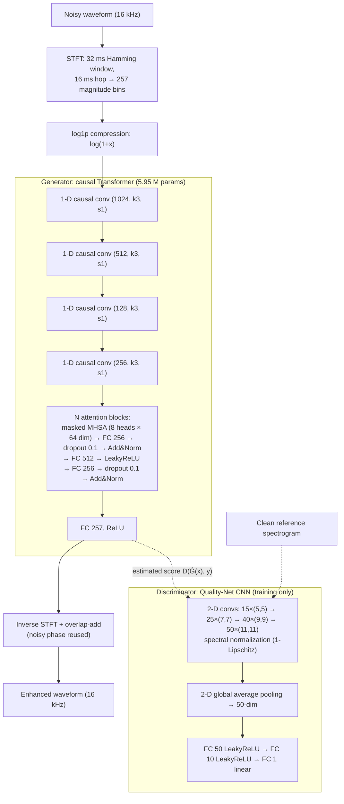

# Fu et al. 2020: Boosting Objective Scores by MetricGAN Post-Processing

**Authors**: [[entities/szu-wei-fu|Szu-Wei Fu]]\*, [[entities/chien-feng-liao|Chien-Feng Liao]]\*, [[entities/tsun-an-hsieh|Tsun-An Hsieh]]\*, [[entities/kuo-hsuan-hung|Kuo-Hsuan Hung]]\*, Syu-Siang Wang, Cheng Yu, Heng-Cheng Kuo, Ryandhimas E. Zezario, You-Jin Li, Shang-Yi Chuang, Yen-Ju Lu, Yu-Chen Lin, [[entities/yu-tsao|Yu Tsao]] (\* equal contribution)
**Institution**: National Taiwan University & Research Center for Information Technology Innovation, Academia Sinica, Taipei
**Venue**: APSIPA Annual Summit and Conference (APSIPA ASC) 2020, Auckland, New Zealand, 7–10 December 2020
**Year**: 2020
**Type**: Conference paper (5 pages)
**DOI**: [10.48550/arXiv.2006.10296](https://doi.org/10.48550/arXiv.2006.10296) (arXiv preprint; IEEE Xplore document [9306484](https://ieeexplore.ieee.org/document/9306484), proceedings paper 0000455 — IEEE DOI not registered in Crossref/OpenAlex)
**Zotero**: [ILIRYGXZ](zotero://select/items/0_ILIRYGXZ)

## Summary

This paper turns [[concepts/metricgan|MetricGAN]] from a from-scratch training scheme into a **general post-processing (fine-tuning) module**: a causal Transformer speech enhancer is first pre-trained to convergence with an $L_1$ signal-approximation loss, then fine-tuned against a spectrally-normalized Quality-Net discriminator that regresses normalized PESQ, gaining +0.13 PESQ and +0.014 STOI at **zero added inference cost**. The Transformer itself replaces positional encoding with causal 1-D convolutional encoding — additive fixed positional encoding measurably *hurts* SE (PESQ 2.429 vs 2.966) — and on the INTERSPEECH 2020 [[concepts/dns-challenge|DNS Challenge]] data the system beats the NSNet baseline on both objective scores (3.104 vs 2.692 PESQ) and organizer-run P.808 MOS (3.21 vs 3.03 overall).

## Problem Formulation

Two coupled problems:

1. **Loss–metric mismatch under a subjective challenge criterion.** The DNS Challenge is scored by ITU-T P.808 subjective quality, but quality metrics like PESQ are too complex to differentiate. A *frozen* learned surrogate (Quality-Net as a fixed loss, Fu et al., SPL 2019) improves PESQ only for the first few iterations before being "fooled" — estimated scores rise while true scores fall. MetricGAN's alternating $G$/$D$ updates fix this, but the original was trained from scratch; Kawanaka et al. (ICASSP 2020) showed stable-training tricks make it a *post-processing* stage for an already-converged model. This paper applies that recipe to a Transformer generator.
2. **Positional information in a causal SE Transformer.** Learned positional encodings fix the sequence length; fixed sinusoidal encodings are length-flexible but "may not be rich enough for embedding". The paper hypothesizes that for SE, positional encoding is not merely suboptimal but harmful, and replaces it with causal convolutional layers.

The MetricGAN objective is unchanged from [[sources/fu-2019-metricgan|Fu et al. 2019]]: with $Q'$ the metric normalized to $[0,1]$,

$$L_{D} = \mathbb{E}_{x,y}\big[(D(y,y) - 1)^2 + (D(G(x),y) - Q'(G(x),y))^2\big]$$

$$L_{G} = \mathbb{E}_{x}\big[(D(G(x),y) - s)^2\big], \qquad s = 1$$

Causality is imposed on the multi-head self-attention by a future mask $M$ (strictly upper-triangular entries $-\infty$):

$$\mathrm{Attention}(Q_h, K_h, V_h) = \mathrm{softmax}\Big(M + \frac{Q_h K_h^{T}}{\sqrt{d_k}}\Big) V_h$$

## Methodology

### Model Structure, Inputs, and Outputs

Two networks, trained **sequentially** (not jointly): the Transformer generator is pre-trained with $L_1$ until convergence; then the Quality-Net discriminator and the generator alternate MetricGAN updates as a fine-tuning stage. The discriminator exists only at training time — deployment is the generator alone.

**Generator — causal Transformer with 1-D convolutional encoding**

| Aspect | Specification |
|:--|:--|
| Structure | 4 causal 1-D convs (output channels, kernel, stride): (1024, 3, 1) → (512, 3, 1) → (128, 3, 1) → (256, 3, 1); then $N$ attention blocks ($N$ not stated), each = masked MHSA (8 heads, 64 dim/head) → FC 256 → dropout 0.1 → residual Add & Norm, then FC 512 → LeakyReLU → FC 256 → dropout 0.1 → residual Add & Norm; final FC 257 with ReLU. Encoder-only — the seq2seq decoder is dropped since input/output lengths match. Layer-norm moments computed **only across the channel dimension** to preserve causality |
| Positional information | No positional encoding; the causal conv stack injects relative location information. Future frames excluded by the $-\infty$ upper-triangular attention mask |
| Input | $\log(1+x)$-compressed 257-bin magnitude spectrogram; STFT 32 ms Hamming window / 16 ms hop at 16 kHz (62.5 frames/s) |
| Output | Enhanced 257-bin magnitude spectrum per frame (ReLU); waveform via inverse STFT + overlap-add with the **noisy phase** |
| Training data | 10,000 utterances randomly drawn from the DNS Challenge 2020 default synthetic mixture configuration |
| Complexity | 5,953,920 parameters; 0.256 ms/frame on an Intel Core i5 quad-core 2.4 GHz CPU (32 ms frame ⇒ real-time with large margin) |
| Role | The enhancement model; pre-trained with $L_1$, then fine-tuned as the MetricGAN generator |

**Discriminator — Quality-Net CNN (PESQ surrogate)**

| Aspect | Specification |
|:--|:--|
| Structure | Four 2-D conv layers (filters, kernel): [15, (5,5)], [25, (7,7)], [40, (9,9)], [50, (11,11)]; 2-D global average pooling → fixed 50-dim feature (handles variable-length input); FC layers of 50 LeakyReLU → 10 LeakyReLU → 1 linear node |
| Constraint | Spectral normalization on the weights ⇒ 1-Lipschitz, so the surrogate is a *smooth* function of the spectrogram (see [[concepts/spectral-norm|Spectral Norm]]) |
| Input | Pair (spectrogram to score, clean reference spectrogram); targets are normalized PESQ values $Q' \in [0,1]$, with $(y,y) \mapsto 1$ |
| Output | Scalar estimated quality score |
| Training data | Same DNS pairs plus generator outputs, scored by the true PESQ function each iteration |
| Role | Differentiable stand-in for PESQ during fine-tuning; discarded at inference |

This CNN discriminator differs from the original MetricGAN's BLSTM discriminator and from the original Quality-Net (a BLSTM non-intrusive assessor, Interspeech 2018) — the name is reused for the CNN quality regressor of the learned-loss line (Fu et al., SPL 2019).

### Training Losses

Two stages, no combined objective:

1. **Pre-training (generator only)** — $L_1$ signal-approximation (SA) loss between the enhanced and clean compressed magnitude spectrograms: $L_{\mathrm{SA}} = \lVert G(x) - y \rVert_1$. Adam, learning rate $5\times10^{-5}$, early stopping on the validation set. PESQ converges to ≈2.97.
2. **Fine-tuning (alternating)** — discriminator: $L_D$ above (regression onto true normalized PESQ, clean pair anchored at 1); generator: $L_G$ above with assigned score $s=1$, **no reconstruction term**. The stable-training techniques are those of Kawanaka et al. (ICASSP 2020); the paper does not itemize which subset it adopted. PESQ rises by a further ≈0.13 (Figure 3).

Because fine-tuning only changes weights, parameter count and per-frame inference time are identical before and after — the score gain is free at deployment.

![[raw/papers/fu-2020-metricgan-post-processing/figures/29edc4aa5f101f5cc2363009abac8322bc603ed9212953d86d2d9526aa2dd5f4.jpg|Proposed Transformer architecture with 1-D convolutional encoding]]

*Figure 1: Proposed Transformer architecture with 1-D convolutional encoding. 1-D Conv is (output channels, kernel size, stride); FC (output channels) is a fully connected layer; Add and Norm are residual connections followed by layer normalization; each MHSA layer has 8 heads and 64 dimensions per head.*

![[raw/papers/fu-2020-metricgan-post-processing/figures/1764698e3f649246fb8dcf06af793d64e57133968bb9c5ce8074b473a987fd49.jpg|Flow chart of MetricGAN training]]

*Figure 2: Flow chart of MetricGAN training (alternating discriminator/generator updates during fine-tuning).*

## Experimental Setup

| Item | Setting |
|:--|:--|
| Dataset | INTERSPEECH 2020 DNS Challenge, default synthetic configuration; **10,000 training utterances** (random subset, to cut training time) |
| Validation | Synthetic test set **without reverberation** (objective scores) |
| Subjective test | Organizer-run blind test: noreverb / realrec / reverb categories; ITU-T P.808, 10 qualified judges per clip, 95% CI ≈ 0.02 on overall MOS |
| Features | 16 kHz; STFT 32 ms Hamming / 16 ms hop → 257 bins; $\mathrm{log1p}(x)=\log(1+x)$ magnitude compression; noisy phase for resynthesis |
| Optimizer | Adam, lr $5\times10^{-5}$, early stopping on validation |
| Baselines | Noisy; NSNet (DNS baseline, Xia et al. ICASSP 2020); Transformer (PE) = same model with additive fixed positional encoding |
| Metrics | PESQ (−0.5…4.5), STOI (0…1); P.808 MOS |

## Results

### Objective scores (synthetic no-reverb validation set, Table 1)

| System | PESQ | STOI |
|:--|:--|:--|
| Noisy | 2.454 | 0.915 |
| NSNet (baseline) | 2.692 | 0.906 |
| Transformer (PE) | 2.429 | 0.894 |
| Proposed Transformer ($L_1$) | 2.966 | 0.932 |
| **Transformer + MetricGAN** | **3.104** | **0.946** |

- **Positional encoding actively hurts**: additive fixed PE drops the Transformer *below the noisy input* on PESQ (2.429 vs 2.454) and below NSNet on both metrics; replacing it with causal conv encoding gains **+0.537 PESQ / +0.038 STOI**.
- **MetricGAN post-processing gains +0.138 PESQ / +0.014 STOI** over the already-converged $L_1$ model, at unchanged 5,953,920 parameters and 0.256 ms/frame (Table 2). NSNet raises PESQ but *lowers* STOI relative to noisy (0.906 vs 0.915); the proposed system improves both.
- Fine-tuning curve (Figure 3): $L_1$ pre-training plateaus at ≈2.97 PESQ; switching on the surrogate loss adds ≈0.13.

![[raw/papers/fu-2020-metricgan-post-processing/figures/32c320691da8d4138880d32d9c401a02321392ef8fd9270b749b1df1aed1095c.jpg|PESQ scores during MetricGAN fine-tuning]]

*Figure 3: PESQ scores of the fine-tuning process using the MetricGAN framework; the dashed level is the best $L_1$ pre-trained score (≈2.97).*

### Subjective P.808 MOS (blind test set, Table 3)

| System | noreverb | realrec | reverb | Overall |
|:--|:--|:--|:--|:--|
| Noisy | 3.32 | 2.97 | 2.78 | 3.01 |
| NSNet | 3.49 | 3.00 | 2.64 | 3.03 |
| **Transformer + MetricGAN** | **3.63** | **3.18** | **2.83** | **3.21** |

+0.18 overall MOS over NSNet (95% CI ≈ 0.02), and wins in all three categories — notably NSNet *degrades* reverberant speech below noisy (2.64 vs 2.78) while the proposed system improves it (2.83).

### Spectrogram evidence

MetricGAN fine-tuning removes residual noise the $L_1$ model leaves behind (blue dashed region in Figure 4c vs 4d).

![[raw/papers/fu-2020-metricgan-post-processing/figures/2aa098f36cf9f5bf88f868ec6ff3166e45062f704d1780d26a4af5d2da46dde8.jpg|(a) clean speech]]
![[raw/papers/fu-2020-metricgan-post-processing/figures/66a8fb8c3658153983f3b3bf707fa77fd318e5711c3606f3354328bd5b845ec7.jpg|(b) noisy speech]]
![[raw/papers/fu-2020-metricgan-post-processing/figures/74546a4a2f4a5dc05f090d13f152f9a76ed74a00b58119d21caa8a004f490a9d.jpg|(c) Transformer with L1 loss]]
![[raw/papers/fu-2020-metricgan-post-processing/figures/e4d1e0b2f016dd2d454c48cef902303e6dc7614c271887e3f5c6d9b3ebb960a9.jpg|(d) Transformer + MetricGAN]]

*Figure 4: Spectrograms of an utterance in the synthetic test set: (a) clean speech, (b) noisy speech (traffic noise), (c) enhanced with Transformer + $L_1$ loss, (d) enhanced with Transformer + MetricGAN.*

## Key Contributions

1. **MetricGAN as a universal post-processing module**: demonstrates the pre-train-then-fine-tune recipe (Kawanaka et al.'s stable-training techniques) on a third generator family — after BLSTM (MetricGAN 2019) and convolutional BLSTM (Kawanaka 2020) — here a causal Transformer, with +0.13 PESQ at zero inference-cost change.
2. **Convolutional positional encoding for causal SE Transformers**: replaces positional encoding with a causal 1-D conv stack and shows fixed additive PE is actively harmful for SE (2.429 vs 2.966 PESQ), a measured negative result about a standard Transformer component.
3. **DNS Challenge 2020 system beating the NSNet baseline on both axes**: PESQ 3.104 vs 2.692, STOI 0.946 vs 0.906, P.808 MOS 3.21 vs 3.03 (all three blind categories), at 5.95 M params and 0.256 ms/frame — real-time causal.
4. **Artifact caveat with a mechanism**: PESQ/STOI surrogates can induce *high-frequency noise* because both metrics ignore high-frequency signal differences; the authors therefore recommend applying the post-processing to **mask-estimation** models (whose output is bounded by the noisy input) rather than direct spectral **mapping** models.

## Limitations and Caveats

- **Surrogate blind spots become artifacts.** Optimizing PESQ or STOI as $Q'$ can generate high-frequency noise invisible to both metrics — the metric-bias inheritance of [[concepts/black-box-metric-optimization|black-box metric optimization]] made concrete. The mask-vs-mapping recommendation bounds output energy by the noisy signal, masking the failure rather than fixing the metric.
- **Small training subset**: 10,000 utterances of the DNS corpus, chosen for training speed; no scaling study.
- **Underspecified architecture**: the number of attention blocks $N$ is never stated; the exact subset of Kawanaka et al.'s training tricks is not itemized; no fine-tuning learning-rate/schedule details.
- **STOI not optimized**: only PESQ serves as $Q'$; the STOI gain (+0.014) is a side effect, so the "boost the scores of interest" claim is demonstrated for one metric here.
- The pre-print title differs ("…through MetricGAN Post-Processing", arXiv v1); the proceedings version ingested here is authoritative.

## Related Concepts

- [[concepts/metricgan|MetricGAN]] — the fine-tuning framework applied as post-processing
- [[concepts/black-box-metric-optimization|Black-Box Metric Score Optimization]] — the framing; frozen-surrogate failure and bias inheritance
- [[concepts/convolutional-positional-encoding|Convolutional Positional Encoding]] — the causal conv stack replacing PE, with the measured PE penalty
- [[concepts/pesq|PESQ]] · [[concepts/stoi|STOI]] — optimized/observed metrics, and their shared high-frequency blind spot
- [[concepts/spectral-norm|Spectral Norm]] — the 1-Lipschitz smoothness constraint on the Quality-Net discriminator
- [[concepts/least-squares-gan|Least-Squares GAN]] — the squared-error form carrying continuous metric targets
- [[concepts/attention-mechanism|Attention Mechanism]] — masked MHSA with future-frame exclusion
- [[concepts/dns-challenge|DNS Challenge]] — dataset, baseline, and P.808 evaluation framework
- [[concepts/speech-enhancement|Speech Enhancement]]

## Related Synthesis

- [[synthesis/deep-speech-enhancement|Deep Speech Enhancement: Architectural & Methodological Evolution]] — the point where the metric-loss family becomes a post-hoc fine-tuning stage independent of the backbone

## Related Sources

- [[sources/fu-2019-metricgan|Fu, Liao, Tsao & Lin 2019: MetricGAN]] — the from-scratch framework this paper converts into a post-processing stage; also the origin of the Quality-Net-as-loss line (SPL 2019) whose frozen-surrogate failure motivates alternating updates
- [[sources/abdulatif-2024-cmgan|Abdulatif, Cao & Yang 2024: CMGAN]] — later system in the same MetricGAN tradition (PESQ surrogate as a 0.01-weighted *added* term rather than a post-hoc fine-tuning stage)
- [[sources/li-2024-dbccrn|Li, Sun, Zhang & Van hamme 2024: DBCCRN]] — also trains on DNS-2020 synthesized data; documents complementary PESQ/STOI blind spots (output-scale drift)
