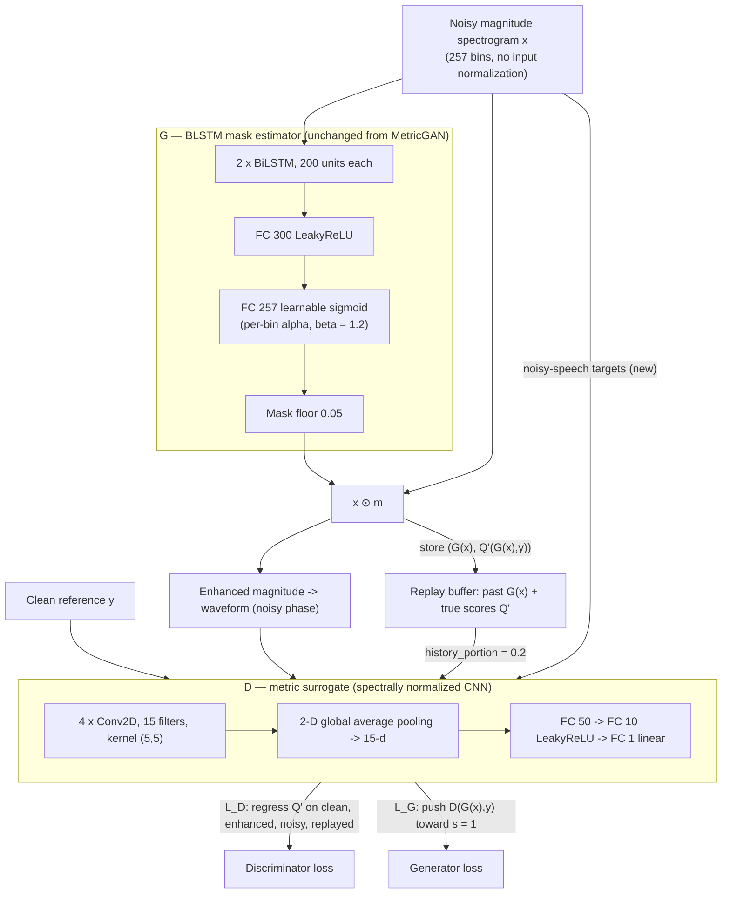

# Fu et al. 2021: MetricGAN+ — An Improved Version of MetricGAN for Speech Enhancement

**Authors**: [[entities/szu-wei-fu|Szu-Wei Fu]], [[entities/cheng-yu|Cheng Yu]], [[entities/tsun-an-hsieh|Tsun-An Hsieh]], [[entities/peter-plantinga|Peter Plantinga]], [[entities/mirco-ravanelli|Mirco Ravanelli]], [[entities/xugang-lu|Xugang Lu]], [[entities/yu-tsao|Yu Tsao]]
**Institution**: Research Center for Information Technology Innovation, Academia Sinica, Taipei (Fu, Yu, Hsieh, Tsao); The Ohio State University (Plantinga); Mila–Quebec AI Institute (Ravanelli); NICT, Kyoto (Lu)
**Venue**: Interspeech 2021
**Year**: 2021
**Pages**: 201–205
**Type**: Conference paper
**DOI**: [10.21437/Interspeech.2021-599](https://doi.org/10.21437/Interspeech.2021-599)
**arXiv**: [2104.03538](https://arxiv.org/abs/2104.03538)
**Zotero**: [LDWQQ8PL](zotero://select/items/0_LDWQQ8PL)
**Code**: [SpeechBrain](https://github.com/speechbrain/speechbrain) (`templates/enhancement/MetricGAN+`)

## Summary

MetricGAN+ improves the [[concepts/metricgan|MetricGAN]] framework — a GAN whose discriminator regresses a black-box evaluation metric — with **three domain-knowledge training techniques**: (1) training the discriminator on *noisy* speech in addition to clean and enhanced speech, (2) enlarging the experience-replay buffer portion from 0.1 to 0.2 to prevent the discriminator's catastrophic forgetting of previously generated speech, and (3) a per-frequency [[concepts/learnable-sigmoid-mask|learnable sigmoid]] mask activation with scale $\beta = 1.2$. Together with removing the input-spectrogram normalization, they lift the same BLSTM generator from PESQ 2.86 (MetricGAN) to **3.15** on VoiceBank+DEMAND — state of the art at publication — despite the generator remaining a conventional magnitude-mask BLSTM with no attention and no phase information. The code ships in the SpeechBrain toolkit, which is how the recipe became the field's standard PESQ-surrogate training baseline.

## Problem Formulation

Signal-level losses ($L_1$, $L_2$) correlate poorly with perceived quality, intelligibility and WER; perceptual metrics such as [[concepts/pesq|PESQ]] and [[concepts/stoi|STOI]] correlate better but are non-differentiable. The [[concepts/black-box-metric-optimization|black-box metric optimization]] family treats the metric $Q$ as an oracle; MetricGAN learns a discriminator $D \approx Q'$ (metric normalized to $[0,1]$) and trains the generator entirely against it:

$$L_{D(\text{MetricGAN})} = \mathbb{E}_{x,y}\big[(D(y,y) - 1)^2 + (D(G(x),y) - Q'(G(x),y))^2\big]$$

$$L_{G(\text{MetricGAN})} = \mathbb{E}_{x}\big[(D(G(x),y) - s)^2\big], \qquad s = 1$$

The paper's diagnosis of the original's remaining weaknesses:

1. **The surrogate is only accurate where it has seen data.** $D$ is fitted on clean and *current* enhanced speech only; as $G$ moves, $D$ forgets its behavior on previously generated speech (catastrophic forgetting, Goodfellow et al. 2014), so $D$'s gradient stops approximating $Q$'s.
2. **The fixed sigmoid mask head is doubly wrong for magnitude masks.** Because of phase differences, $|X(t,f)| \neq |Y(t,f)| + |N(t,f)|$, so the ideal magnitude mask $|Y|/|X|$ is **not bounded by 1**; and speech/noise patterns differ across frequency bands, so one fixed compression slope for all bins is suboptimal.

MetricGAN+ addresses both with training techniques rather than a new architecture — the generator's backbone is deliberately unchanged from [[sources/fu-2019-metricgan|Fu et al. 2019]].

## Methodology

### The Three Techniques

**1. Learning metric scores for noisy speech (Sec. 3.1).** Adopted from Kawanaka et al. (ICASSP 2020): add a third regression term so $D$ also learns the metric value of the *noisy* input, anchoring the surrogate at the low-quality end of the score range and stabilizing training:

$$L_{D(\text{MetricGAN+})} = \mathbb{E}_{x,y}\big[(D(y,y) - Q'(y,y))^2 + (D(G(x),y) - Q'(G(x),y))^2 + (D(x,y) - Q'(x,y))^2\big]$$

**2. Experience-replay buffer (Sec. 3.2).** As in DQN (Mnih et al. 2015), enhanced speech from previous epochs — with its true metric scores — is stored and replayed when training $D$. `history_portion` rises from 0.1 (MetricGAN) to **0.2**; 0.3 brings no further gain. Per epoch (Algorithm 1): sample `number_of_samples` utterances → train $G$ with $L_G$ → store $(G(x), Q'(G(x),y))$ into the buffer → update $D$ on current data with $L_D$ → update $D$ again on a random `history_portion` of the buffer. Without any replay ($\text{portion}=0$) PESQ collapses to 2.82; 0.1 and 0.2 buy +0.20 and +0.23 respectively.

**3. Learnable sigmoid for mask estimation (Sec. 3.3).** Replace the fixed sigmoid output activation with

$$\mathrm{LSigmoid}(x) = \frac{\beta}{1 + e^{-\alpha x}}, \qquad \beta = 1.2, \quad \alpha \text{ learned per frequency bin}$$

$\beta = 1.2$ lets the mask exceed 1 (the ideal magnitude mask can, per the phase argument above); making $\beta$ learnable too was tried and did **not** improve performance. Large $\alpha$ behaves like a hard threshold (binary-mask-like, saturated); small $\alpha$ is near-linear. See [[concepts/learnable-sigmoid-mask|Learnable Sigmoid Mask]].

**Plus one ablation-level change**: removing the input-spectrogram normalization used in the original MetricGAN (+0.09 PESQ on its own).

![[raw/papers/fu-2021-metricgan-plus/figures/b28849f95bfe26bd590cfea9c71a6ea84673bac35ad3135f88c811398b5e3e89.jpg|Training flow of MetricGAN]]

*Figure 1: Training flow of MetricGAN — the discriminator learns to approximate the metric $Q$ while the generator is pushed toward the assigned score; MetricGAN+ keeps this loop and adds noisy-speech targets and replayed historical samples to $D$'s training.*

![[raw/papers/fu-2021-metricgan-plus/figures/26b7a55ce108748701af2a3ddec476c62efafc38181ff0130c47c4aa83051801.jpg|Sigmoid function with different alpha]]

*Figure 2: Sigmoid function with different $\alpha$. Large $\alpha$ (red) saturates toward a binary mask; small $\alpha$ (green) overlaps the linear dotted line over a wider input range.*

### Model Structure, Inputs, and Outputs

| Network | Structure | Input | Output | Training data | Role |
|:--------|:----------|:------|:-------|:--------------|:-----|
| **G** (generator) | [[concepts/bidirectional-lstm\|BLSTM]]: 2 bidirectional LSTM layers, 200 neurons each → FC 300 LeakyReLU → FC 257 **learnable-sigmoid** nodes ($\beta = 1.2$, per-bin $\alpha$). Mask floored at **0.05** to prevent musical noise (Koizumi et al.) | **Unnormalized noisy magnitude spectrogram**, 257 bins (512-point FFT implied by the bin count, not stated explicitly; frame rate/window not stated) | 257-bin mask in $(0, 1.2)$, floored at 0.05, multiplied with the noisy magnitude; waveform via ISTFT with noisy phase | VoiceBank+DEMAND train set (11,572 utterances, 28 speakers) | Mask estimator trained *only* by the surrogate gradient — no per-bin target |
| **D** (discriminator / metric surrogate) | 4 × 2-D conv layers, **15 filters each, kernel (5,5)** → 2-D global average pooling (fixes variable-length utterances at 15 features) → FC 50 LeakyReLU → FC 10 LeakyReLU → FC 1 linear. **1-Lipschitz via [[concepts/spectral-norm\|spectral normalization]]** so small spectrogram changes cannot swing the estimated score | Spectrogram pairs $(\cdot, y)$: clean $(y,y)$, enhanced $(G(x),y)$, **noisy $(x,y)$** (new), and replayed historical enhanced speech | Scalar quality estimate in $[0,1]$ (normalized PESQ) | Same utterances as $G$ plus the replay buffer | Differentiable stand-in for PESQ; exists only at training time |

Note the discriminator is **smaller and more uniform** than the original MetricGAN's (whose four conv layers grew 15→25→40→50 filters with growing kernels and pooled to 50 features); the paper lists "the structure of the discriminator can be further investigated" as future work. Training alternates $G$ and $D$ per epoch as in Algorithm 1; `number_of_samples` = 100 per epoch. The generator is trained from scratch (unlike the post-processing variant of [[sources/fu-2020-metricgan-post-processing|Fu et al. 2020]]).

### Training Losses

- **Generator**: $L_G = \mathbb{E}_x[(D(G(x),y) - s)^2]$ with $s = 1$ — unchanged from MetricGAN; the *only* generator objective (no $L_p$ term). Loss form is [[concepts/least-squares-gan|least-squares]], which admits the continuous metric-valued target.
- **Discriminator**: the three-term $L_{D(\text{MetricGAN+})}$ above (clean / current-enhanced / noisy), applied twice per epoch — once on current data, once on a random 20% of the replay buffer. All terms are unweighted squared errors.

The improvements are thus entirely in *what data $D$ is fitted on* and *how the mask is parameterized*, not in the loss algebra.

## Experimental Setup

| Parameter | Value |
|:----------|:------|
| Dataset | [[concepts/voicebank-demand\|VoiceBank+DEMAND]]: 11,572 train utterances, 28 speakers, SNRs 0/5/10/15 dB; 824 test utterances, 2 unseen speakers, SNRs 2.5/7.5/12.5/17.5 dB |
| Optimized metric | PESQ (normalized to $[0,1]$ as $Q'$) |
| Evaluation metrics | PESQ; CSIG (signal-distortion MOS), CBAK (background-intrusiveness MOS), COVL (overall MOS), all 1–5 |
| Generator | 2-layer BLSTM (200 units) + FC 300 LeakyReLU + FC 257 learnable sigmoid; mask floor 0.05; $\beta = 1.2$ |
| Discriminator | 4 × Conv2D(15, 5×5) + global average pooling + FC 50/10 LeakyReLU + FC 1 linear; spectral normalization |
| Replay buffer | `history_portion` 0.2 (vs 0.1 in MetricGAN); `number_of_samples` 100 per epoch |
| Input processing | **No spectrogram normalization** (removed relative to MetricGAN) |
| Compared systems | SEGAN, MMSE-GAN, SERGAN, BLSTM (MSE), MetricGAN, HiFi-GAN, DeepMMSE, MHSA+SPK, PHASEN, SDR-PESQ, T-GSA, DEMUCS |

## Results

### Ablation (Table 1 — cumulative, each row adds one technique)

| Setting | PESQ | CSIG | CBAK | COVL |
|:--------|:-----|:-----|:-----|:-----|
| MetricGAN | 2.86 | 3.99 | 3.18 | 3.42 |
| − Input normalization | 2.95 | 4.03 | 3.11 | 3.49 |
| + Include noisy for $D$ (Sec. 3.1) | 3.02 | 4.13 | 3.23 | 3.57 |
| + `history_portion` 0.1 → 0.2 (Sec. 3.2) | 3.05 | 4.11 | 3.15 | 3.57 |
| + Learnable sigmoid (Sec. 3.3) = **MetricGAN+** | **3.15** | **4.14** | 3.16 | **3.64** |

Removing input normalization (+0.09) and adding noisy speech (+0.07) contribute more than enlarging the buffer (+0.03); the learnable sigmoid adds the largest single final step (+0.10).

### Replay-buffer portion (Table 2)

| `history_portion` | PESQ | CSIG | CBAK | COVL |
|:------------------|:-----|:-----|:-----|:-----|
| 0 | 2.82 | 3.99 | **3.38** | 3.41 |
| 0.1 | 3.02 | **4.13** | 3.23 | **3.57** |
| 0.2 | **3.05** | 4.11 | 3.15 | **3.57** |

The buffer itself — not its size — is the load-bearing element: without it PESQ drops to 2.82, below even the original MetricGAN. The paper's reading: without replay, $D$ focuses on current samples and ignores its correctness on previously generated speech, so its gradient is no longer a good approximation of $Q$'s. 0.3 gave no further improvement.

### What the learned α values reveal (Figure 3)

Most bins learn $\alpha < 1$ (the fixed sigmoid's value), clustering near **0.5** — i.e. a near-linear transfer, which backpropagates more efficiently than saturated regions. **High-frequency bins learn $\alpha \gg 1$** — binary-mask-like behavior. The authors conjecture this reflects the training noises not occupying high frequencies, or PESQ's own characteristics, and explicitly flag that more experiments are needed. Making $\beta$ learnable did not help.

![[raw/papers/fu-2021-metricgan-plus/figures/e5a6e62bc388cca901cde6cdcd4a5dec8ff921df1a7fc62e549cf16b9b2d9d13.jpg|Learned values of alpha]]

*Figure 3: Learned values of $\alpha$ in the learnable sigmoid. Most bins sit near 0.5 (near-linear); high-frequency bins go far above 1 (binary-mask-like).*

### Learning curves (Figure 4)

All MetricGAN variants beat the same BLSTM trained with MSE loss by a large margin; including noisy speech and the learnable sigmoid improve both final score and training efficiency.

![[raw/papers/fu-2021-metricgan-plus/figures/d5858e2cf005ac9c5b2781da510d7026bd78b59d67d10dae61753c5d2ae8c136.jpg|Learning curves of different settings]]

*Figure 4: Learning curves of different settings, generator structure fixed — MetricGAN-based objectives dominate MSE, and the noisy-speech and learnable-sigmoid techniques also converge faster.*

### Comparison with state of the art (Table 3, VoiceBank+DEMAND)

| System | PESQ | CSIG | CBAK | COVL |
|:-------|:-----|:-----|:-----|:-----|
| Noisy | 1.97 | 3.35 | 2.44 | 2.63 |
| [[concepts/segan\|SEGAN]] | 2.16 | 3.48 | 2.94 | 2.80 |
| MMSE-GAN | 2.53 | 3.80 | 3.12 | 3.14 |
| SERGAN | 2.62 | — | — | — |
| BLSTM (MSE) | 2.71 | 3.94 | 3.28 | 3.32 |
| [[concepts/metricgan\|MetricGAN]] | 2.86 | 3.99 | 3.18 | 3.42 |
| HiFi-GAN | 2.94 | 4.07 | 3.07 | 3.49 |
| DeepMMSE | 2.95 | 4.28 | 3.46 | 3.64 |
| MHSA+SPK | 2.99 | 4.15 | 3.42 | 3.57 |
| PHASEN | 2.99 | 4.21 | 3.55 | 3.62 |
| SDR-PESQ | 3.01 | 4.09 | 3.54 | 3.55 |
| T-GSA | 3.06 | 4.18 | **3.59** | 3.62 |
| DEMUCS | 3.07 | **4.31** | 3.40 | 3.63 |
| **MetricGAN+** | **3.15** | 4.14 | 3.16 | **3.64** |

A conventional magnitude-mask BLSTM with the right objective beats attention-based (MHSA+SPK, T-GSA) and phase-aware (HiFi-GAN, DEMUCS, PHASEN) systems on PESQ — +0.44 over the same backbone trained with MSE. Two honest caveats the paper states: **CBAK 3.16 is below most compared systems**, attributed to the 0.05 mask floor deliberately leaving residual noise (musical-noise prevention); and Kataria et al.'s perceptual-loss system scores higher but **requires additional datasets** for its perceptual-loss training.

## Key Contributions

1. **Three domain-knowledge training techniques for metric-surrogate GANs**: noisy-speech targets for $D$ (adopted from Kawanaka et al.), a larger experience-replay portion (0.2), and the per-frequency learnable sigmoid mask head ($\beta = 1.2$) — together +0.29 PESQ over MetricGAN at unchanged generator backbone.
2. **Replay buffer identified as load-bearing**: without it PESQ falls to 2.82 (below the original MetricGAN); the discriminator's catastrophic forgetting of past generated speech, not buffer size, is the dominant failure mode.
3. **Learnable sigmoid mask**: motivated by $|X| \neq |Y| + |N|$ (ideal magnitude mask can exceed 1) and per-band speech/noise statistics; learned $\alpha \approx 0.5$ for most bins (near-linear, efficient gradients) and $\alpha \gg 1$ at high frequencies (binary-like).
4. **Loss-over-architecture evidence**: PESQ 3.15 SOTA with a plain BLSTM magnitude-mask generator, outperforming attention and phase-aware systems; +0.44 PESQ over the identical network trained with MSE.
5. **Reproducibility**: released inside SpeechBrain, making MetricGAN+ the community's standard metric-optimization baseline.

## Limitations and Caveats

- **CBAK regresses** (3.16 vs MetricGAN-era competitors' 3.4–3.6): the mask floor trades background-noise suppression for musical-noise prevention; PESQ-first optimization does not uniformly improve all quality axes.
- **FFT size, window/hop, optimizer, learning rate and epoch count are not stated** — the 257-bin width implies a 512-point FFT, but reimplementation requires the SpeechBrain recipe for the missing details.
- The high-frequency $\alpha \gg 1$ explanation is explicitly a conjecture ("more experiments are needed").
- Optimizes PESQ only; STOI/WER variants are cited as separate work (iMetricGAN) or future work (black-box ASR WER minimization). Replay-buffer training is noted as time-consuming as history grows; incremental learning is proposed as future work.
- **Naming**: distinct from MetricGAN (ICML 2019, PESQ 2.86) and from the MetricGAN post-processing variant (APSIPA ASC 2020); benchmark tables must not conflate the three.

## Related Concepts

- [[concepts/metricgan|MetricGAN]] — the framework this paper improves
- [[concepts/learnable-sigmoid-mask|Learnable Sigmoid Mask]] — introduced here (per-bin $\alpha$, $\beta = 1.2$)
- [[concepts/black-box-metric-optimization|Black-Box Metric Score Optimization]] — the paradigm; this paper hardens the surrogate against forgetting
- [[concepts/least-squares-gan|Least-Squares GAN (LSGAN)]] — the squared-error form carrying continuous metric targets
- [[concepts/pesq|PESQ]] — the optimized metric · [[concepts/stoi|STOI]] — the intelligibility counterpart cited throughout
- [[concepts/bidirectional-lstm|Bidirectional LSTM]] — the deliberately unchanged generator backbone
- [[concepts/spectral-norm|Spectral Norm]] — 1-Lipschitz smoothness constraint on $D$
- [[concepts/ideal-ratio-mask|Ideal Ratio Mask (IRM)]] — the magnitude-mask family whose $[0,1]$ bound the learnable sigmoid relaxes
- [[concepts/voicebank-demand|VoiceBank+DEMAND]] — the benchmark · [[concepts/speech-enhancement|Speech Enhancement]]
- [[concepts/generative-vs-discriminative-speech-enhancement|Generative vs. Discriminative Speech Enhancement]] — metric-surrogate GANs as the third position

## Related Synthesis

- [[synthesis/deep-speech-enhancement|Deep Speech Enhancement: Architectural & Methodological Evolution]] — MetricGAN+ is the 2021 SOTA point of the metric-loss lineage and the recipe later systems (CMGAN, LiSenNet) inherit

## Related Sources

- [[sources/fu-2019-metricgan|Fu, Liao, Tsao & Lin 2019: MetricGAN]] — the direct predecessor; same generator, original two-term discriminator loss, replay portion 0.1, fixed sigmoid, input normalization
- [[sources/fu-2020-metricgan-post-processing|Fu et al. 2020: MetricGAN Post-Processing]] — sibling variant converting MetricGAN into post-hoc fine-tuning of a converged Transformer; shares the Kawanaka et al. stable-training lineage this paper adopts for from-scratch training
- [[sources/yan-2025-lisennet|Yan, Zhang, Fan, Zhou & Liu 2025: LiSenNet]] — adopts this paper's learnable sigmoid (with $\beta = 2.0$) as its mask head and the MetricGAN+-style PESQ discriminator loss
- [[sources/abdulatif-2024-cmgan|Abdulatif, Cao & Yang 2024: CMGAN]] — benchmarks against MetricGAN+ (3.15) and ablates a "MetricGAN+ discriminator" variant (PESQ 3.44 but SSNR drops to 9.83)
- [[sources/dang-2022-dpt-fsnet|Dang, Chen & Zhang 2022: DPT-FSNet]] — the discriminative counterpoint one year later: dual-domain reconstruction loss reaches PESQ 3.33 with no metric surrogate
