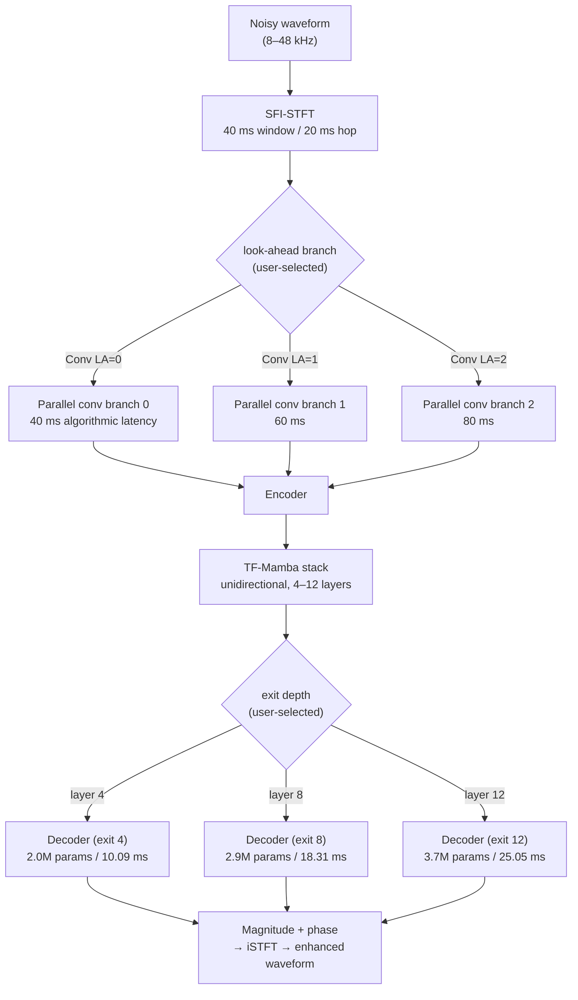

# Fu et al. 2026: One Model, Many Latencies: Universal Speech Enhancement for Diverse Real-Time Applications

**Authors**: [[entities/szu-wei-fu|Szu-Wei Fu]], [[entities/rong-chao|Rong Chao]], [[entities/xuesong-yang|Xuesong Yang]], [[entities/sung-feng-huang|Sung-Feng Huang]], [[entities/ante-jukic|Ante Jukić]], [[entities/yu-tsao|Yu Tsao]], [[entities/yu-chiang-frank-wang|Yu-Chiang Frank Wang]]
**Institutions**: NVIDIA (¹); Academia Sinica, Taipei, Taiwan (²)
**Year**: 2026
**Type**: Preprint
**Venue**: arXiv preprint 2606.25621 (v3)
**DOI**: [10.48550/arXiv.2606.25621](https://doi.org/10.48550/arXiv.2606.25621)
**Zotero**: [YA7X7SUC](zotero://select/items/0_YA7X7SUC)
**Model weights**: [nvidia/Real-time_RE-USE](https://huggingface.co/nvidia/Real-time_RE-USE)

## Summary

One [[concepts/universal-speech-enhancement|universal speech enhancement (USE)]] model whose **algorithmic and computational latency are both user-selectable at inference**, so a single trained checkpoint covers 30 latency configurations instead of requiring one specialized model per latency budget. Algorithmic latency is set by the number of look-ahead frames, realized as **parallel convolutional branches** (one per look-ahead setting, MoE-style but with user—not learned—routing); computational latency is set by an **early-exit** depth choice over a 12-layer TF-Mamba backbone (2.0M parameters at exit 4 up to 3.7M at exit 12). A **two-stage shared→multiple decoder** training schedule removes most of the quality gap between flexible and specialized models. On the URGENT 2025 non-blind test set it stays close to per-configuration specialized upper bounds while spanning 40–80 ms algorithmic latency and 10–25 ms compute; on VoiceBank-DEMAND it reaches PESQ 2.82 / SI-SDR 18.8 dB at 2.9M parameters and 60 ms latency, beating DeepFilterNet3 and Stream.FM at comparable or lower latency.

## Problem Formulation

Total latency for a streaming SE model is the sum of two independently controllable terms (Fig. 1):

$$
l_{\text{Total}} = \underbrace{w + N_{\text{LA}} \cdot h}_{\text{algorithmic}} + l_{\text{Compute}}
$$

where $w$ is the STFT window length, $h$ the hop size, and $N_{\text{LA}}$ the number of look-ahead frames.

![[raw/papers/fu-2026-one-model-many-latencies/figures/fig1.png|Algorithmic vs. computational latency]]

*Figure 1: The latency of a speech enhancement system splits into algorithmic latency (input the model must buffer before its first output) and computational latency (time to compute that output on the deployment hardware).*

Algorithmic latency is "how much input the model needs before emitting the first output unit"; computational latency is the wall-clock time to produce that output, which depends on model depth and hardware. A real-time SE system must satisfy three requirements, the third of which the paper stresses is routinely violated in reporting practice:

1. **Causality** — the architecture must be causal or have a bounded number of look-ahead frames.
2. **Latency budget** — $l_{\text{Total}} \le l_{\text{budget}}$, which is application specific: conversational VoIP tolerates 50–150 ms, streaming ASR 100–200 ms.
3. **Real-time processing** — $l_{\text{Compute}} \le h$, i.e. RTF $< 1$, so latency does not accumulate over time.

The motivation is explicitly that requirement (3) is often measured under *offline* whole-utterance processing, where time-axis parallelism and large-tensor CUDA kernels make RTF look far better than in true per-frame streaming inference; the paper therefore measures all computational latency online, per frame, without `torch.compile` or CUDA graphs.

## Methodology

### Adjustable algorithmic latency: parallel look-ahead convolutions

Padding is the natural knob (a kernel-3 conv with left/right padding $(2,0)$, $(1,1)$, $(0,2)$ gives 0, 1, 2 look-ahead frames), but convolution is translation equivariant, $f(T(x)) = T(f(x))$, so *one* layer asked to serve all three padding configurations cannot specialize — the paper attributes learning inefficiency to this. Instead it instantiates **parallel convolutional layers, one per look-ahead setting**, inspired by mixture-of-experts: at each training step one branch is sampled to build the computational graph, but there is **no learned router** — the user picks the branch from the latency budget. This is the mechanism documented on [[concepts/parallel-look-ahead-convolutions|Parallel Look-Ahead Convolutions]].

![[raw/papers/fu-2026-one-model-many-latencies/figures/fig2.png|One-for-all architecture: parallel look-ahead conv branches and early-exit depths]]

*Figure 2: The proposed one-for-all model enables adjustable algorithmic latency through configurable look-ahead frames and computational latency via early exit. Orange arrows = low-latency path; green arrows = high-latency path.*

### Adjustable computational latency: early exit + two-stage training

Every intermediate TF-Mamba depth can emit an output, giving depth-selectable compute. A naive early-exit model underperforms a model trained for a fixed depth because each intermediate layer must also serve all deeper layers. The paper's initial experiments showed that **separate decoders from scratch are worse than one shared decoder** (the shared decoder enforces a consistent representation space; independent decoders hinder learning — Fig. 3), which motivates the two-stage schedule documented on [[concepts/early-exit-speech-enhancement|Early-Exit Speech Enhancement]]:

1. **Shared decoder stage** — all exits share one decoder; the exit layer is randomly sampled per training step.
2. **Multiple decoder stage** — after convergence, instantiate an independent decoder per exit layer, initialized from the shared decoder; fine-tune the modules *before* the decoders (encoder + sequence model) at 1/10 the learning rate.

The result keeps intermediate exits in a similar representation space while letting each optimize its own output.

![[raw/papers/fu-2026-one-model-many-latencies/figures/Learnining_curves.svg|Validation UTMOS learning curves by architecture]]

*Figure 3: Validation UTMOS versus training iterations. Early-exit and the parallel-conv (MoE) model rise fastest and stay highest; the single-convolution-layer variant climbs more slowly, and independent decoders trained from scratch are worst early and noisiest throughout — the evidence for the shared-decoder-first schedule.*

### Model Structure, Inputs, and Outputs

| Property | Specification |
|---|---|
| **Structure** | USEMamba / RE-USE lineage: causal conv encoder → 12 TF-Mamba blocks (unidirectional Mamba over time + frequency) → magnitude and phase decoders. Causal convolutions replace standard convolutions; bidirectional Mamba replaced by the unidirectional variant; instance norm replaced by channel-wise layer norm. A parallel-conv bank (one branch per look-ahead setting) sits in front of the encoder. Maximum depth 12 layers |
| **Input** | Streaming STFT frames via **sampling-frequency-independent (SFI) STFT**: FFT window and hop scale with the input sampling rate so the *time* durations stay fixed at 40 ms / 20 ms for every sampling rate (8, 16, 22.05, 24, 32, 44.1, 48 kHz), guaranteeing an integer bin count |
| **Output** | Enhanced magnitude and phase at the same frame rate, converted by iSTFT to waveform samples; emitted either per frame (streaming) or per utterance |
| **Training data** | URGENT 2025 challenge corpus: multi-condition recordings in five languages (English, German, French, Spanish, Chinese), seven sampling rates, additive noise + RIRs; seven degradation types (noise, reverberation, clipping, bandwidth limitation, codec artifacts, packet loss, wind noise) |
| **Role** | A single one-for-all enhancer: pick the conv branch from the algorithmic-latency budget and the exit layer from the remaining compute budget (Section II requirement 3) |

### Training Losses

The paper reports the two phases without printed equations:

- **Stage 1 — regression pre-training**: standard regression loss on the enhanced magnitude/phase against the training target.
- **Stage 2 — adversarial fine-tuning**: a set of discriminators guides adversarial training on top of the regression output. The stated purpose is to *approximate* what RE-USE obtains with an extra generative refinement model — "optimally transporting the posterior mean (MMSE estimate) toward the true data distribution" — but without a second network, i.e. to buy fidelity–quality trade-off at lower computational latency.
- **Optimizer**: AdamW, learning rate $2\times10^{-4}$; modules preceding the decoders use $2\times10^{-5}$ in the multiple-decoder stage.

Training randomization: exit layer sampled uniformly from 3–12, look-ahead from 0–2. Checkpoint selection uses validation UTMOS.

## Experimental Setup

| Item | Setting |
|---|---|
| Test set | URGENT 2025 **non-blind** test set, 1,000 utterances |
| Training data | URGENT 2025 multi-condition corpus, 5 languages, 7 sampling rates, 7 degradation types |
| Validation | Simulated per organizer guidelines from underlying corpora validation splits; checkpoint chosen by UTMOS |
| Reference for scoring | Anechoic clean speech (RE-USE convention), not early-reflected speech as the organizers use |
| Non-intrusive metrics | DNSMOS, NISQA, UTMOS |
| Intrusive metrics | PESQ, ESTOI |
| Task-independent metrics | SpeechBERTScore (SBERT), Levenshtein Phoneme Similarity (LPS) |
| Task-dependent metric | ASR character accuracy (CAcc), OWSM v3.1 |
| Latency | Algorithmic $= 40\,\mathrm{ms} + N_{\text{LA}} \times 20\,\mathrm{ms}$; computational measured **online, per frame**, on an NVIDIA A100 with 16 kHz input, no `torch.compile`/CUDA graphs (3090/4090 give a similar range) |
| Architecture size | 2.0M params / 19.15 G MAC/s at exit 4; 2.9M / 25.41 at exit 8; 3.7M / 31.67 at exit 12 |
| Second benchmark | VoiceBank-DEMAND (cross-dataset generalization; none of the compared models except DEMUCS trained on it) |

## Results

### URGENT 2025 non-blind test set (excerpt of Table I)

Rows are the ablations: specialized model trained for that exact config (upper bound), plain early exit, + parallel look-ahead conv, + multiple-decoder stage. Note the conventional early-exit model cannot produce a look-ahead=1 row at all (N/A) — adjustable algorithmic latency is what the parallel-conv branch adds.

| Config | Variant | DNSMOS | NISQA | UTMOS | PESQ | ESTOI | SBERT | LPS | CAcc | Algo. ms | Comp. ms |
|---|---|---|---|---|---|---|---|---|---|---|---|
| Noisy | — | 1.84 | 1.69 | 1.56 | 1.34 | 0.50 | 0.74 | 0.61 | 81.29 | — | — |
| Non-causal baseline (TF-GridNet) | — | 2.94 | 2.89 | 2.11 | — | — | — | — | 84.96 | non-causal | non-causal |
| Exit 4, LA 0 | Specialized (upper bound) | 3.05 | 3.65 | 2.26 | 2.06 | 0.68 | 0.82 | 0.76 | 82.75 | 40 | 10.09 |
| | Early-exit | 3.03 | 3.57 | 2.19 | 2.02 | 0.67 | 0.82 | 0.75 | 81.13 | 40 | 10.09 |
| | + Parallel conv | 2.96 | 3.52 | 2.16 | 2.00 | 0.67 | 0.82 | 0.75 | 81.69 | 40 | 10.09 |
| | + Multiple dec. stage | 2.98 | 3.41 | 2.19 | 2.02 | 0.67 | 0.82 | 0.75 | 81.86 | 40 | 10.09 |
| Exit 8, LA 0 | Specialized | 3.10 | 3.77 | 2.36 | 2.19 | 0.71 | 0.84 | 0.78 | 83.71 | 40 | 18.31 |
| | Early-exit | 3.08 | 3.77 | 2.32 | 2.13 | 0.70 | 0.83 | 0.77 | 81.84 | 40 | 18.31 |
| | + Parallel conv | 3.04 | 3.73 | 2.28 | 2.13 | 0.70 | 0.83 | 0.77 | 82.72 | 40 | 18.31 |
| | + Multiple dec. stage | 3.07 | 3.62 | 2.31 | 2.15 | 0.70 | 0.84 | 0.77 | 83.10 | 40 | 18.31 |
| Exit 8, LA 1 | Specialized | 3.15 | 3.90 | 2.42 | 2.27 | 0.72 | 0.85 | 0.79 | 84.93 | 60 | 18.31 |
| | Early-exit | N/A | N/A | N/A | N/A | N/A | N/A | N/A | N/A | N/A | N/A |
| | + Parallel conv | 3.10 | 3.82 | 2.34 | 2.21 | 0.71 | 0.84 | 0.79 | 84.06 | 60 | 18.31 |
| | + Multiple dec. stage | 3.13 | 3.74 | 2.37 | 2.24 | 0.72 | 0.84 | 0.79 | 84.62 | 60 | 18.31 |
| Exit 12, LA 0 | Specialized | 3.10 | 3.76 | 2.37 | 2.21 | 0.71 | 0.84 | 0.78 | 84.24 | 40 | 25.05 |
| | Early-exit | 3.10 | 3.81 | 2.34 | 2.14 | 0.70 | 0.84 | 0.77 | 82.62 | 40 | 25.05 |
| | + Parallel conv | 3.07 | 3.78 | 2.31 | 2.15 | 0.70 | 0.83 | 0.77 | 82.93 | 40 | 25.05 |
| | + Multiple dec. stage | 3.11 | 3.70 | 2.34 | 2.17 | 0.70 | 0.84 | 0.78 | 83.25 | 40 | 25.05 |

Reading of the ablation:

- **Parallel conv costs ~0.03–0.05 PESQ vs plain early exit** at the same exit depth, and buys algorithmic-latency control that early exit cannot provide at all (the exit-8/LA-1 early-exit row does not exist).
- **The multiple-decoder stage recovers most of the gap**, with the biggest gain on CAcc (81.13 → 81.86 at exit 4; 81.84 → 83.10 at exit 8; 82.62 → 83.25 at exit 12). The one metric that regresses consistently is NISQA.
- At the deepest exit, the flexible model is within 0.01–0.02 of the specialized upper bound on DNSMOS/UTMOS; the residual gap is largest at shallow depths.
- **12-layer inference is not real-time on an A100**: 25 ms compute vs 20 ms hop → RTF 1.25, violating Section II requirement (3). The paper states a faster GPU is needed for that operating point — a concrete case of the compute-budget constraint the model is meant to expose.

### Performance vs. total latency (Fig. 4)

The model spans 30 configurations (10 exit layers $\times$ 3 look-ahead settings).

![[raw/papers/fu-2026-one-model-many-latencies/figures/utmos_latency.svg|UTMOS vs total latency]]

*Figure 4(a): UTMOS versus total latency. Additional look-ahead frames help less than additional depth.*

![[raw/papers/fu-2026-one-model-many-latencies/figures/CAcc_latency.svg|CAcc vs total latency]]

*Figure 4(b): CAcc versus total latency. One look-ahead frame gives a large ASR gain; a second adds little.*

Two asymmetric trade-offs: for perceptual quality (UTMOS) **depth** pays better than look-ahead; for ASR accuracy (CAcc) **one frame of look-ahead** is worth much more than the depth it costs, while the second frame is marginal. Practical consequence: ASR-front-end deployments should spend their budget on look-ahead=1 before deepening the stack.

### VoiceBank-DEMAND cross-dataset comparison (Table II)

None of the compared models except DEMUCS saw VoiceBank-DEMAND training data — training/test mismatch is deliberate.

| Method | PESQ | ESTOI | SI-SDR | Algo. latency (ms) | Params |
|---|---|---|---|---|---|
| Noisy | 1.97 | 0.79 | 8.4 | — | — |
| Diffusion Buffer | 2.45 | 0.84 | 14.5 | 176 | 22.2M |
| DEMUCS | 2.60 | 0.85 | 15.1 | 41 | 33.5M |
| DeepFilterNet3 | 2.71 | 0.84 | 17.3 | 40 | 2.14M |
| Stream.FM | 2.72 | 0.85 | 13.4 | 32 | 52.5M |
| **Proposed (exit 8, LA 0)** | **2.76** | **0.86** | **18.6** | 40 | 2.9M |
| **Proposed (exit 8, LA 1)** | **2.82** | **0.86** | **18.8** | 60 | 2.9M |

At matched ~40 ms algorithmic latency the one-for-all model leads every baseline on all three metrics, at 1/4 the parameters of DeepFilterNet3's nearest generative competitor and 1/18 of Stream.FM's. The paper notes its enhanced speech often sounds cleaner than the corresponding clean reference, attributing this to the adversarial stage.

### Deployment procedure

The full 12-layer model is the *training artifact*, not the shipped artifact: users benchmark all (depth $\times$ look-ahead) settings on their own hardware, pick the configuration that fits the budget, then **retain only the layers up to the selected exit and the selected conv branch** — yielding a model with exactly the footprint of a specialized one. Because compute latency is bounded by both budget and hop size while algorithmic latency is bounded only by the budget, the paper's advice for weak hardware is to *spend algorithmic latency* (raise look-ahead) rather than fight for depth.

## Limitations and Caveats

- **No latency-adaptive runtime policy**: the configuration is chosen offline per deployment, not switched per frame or per utterance. The "one model" is one checkpoint, but each deployment is a frozen sub-graph.
- **Deepest exit is not real-time** on an A100 at 20 ms hop (RTF 1.25); the real-time claim holds only for shallower exits on that hardware.
- **Shallow exits remain clearly behind specialized models** (0.03–0.07 PESQ at exit 4). The shared→multiple decoder stage narrows, but does not close, the gap; knowledge distillation is named as future work.
- **Comparisons are against a non-causal TF-GridNet baseline on URGENT**, i.e. the non-blind test set rather than the blind evaluation, and scores use anechoic references instead of the organizers' early-reflected references — numbers are therefore not directly comparable to published challenge results.
- **No ablation isolating the two training stages' cost**: both training phases are reported, but no wall-clock or sample-efficiency comparison against single-phase adversarial training is given.
- **The branching is a memory/compute multiplier during training** (three conv branches), removed only at deployment pruning.

## Key Contributions

1. **One-for-all latency control** — a single streaming USE model exposing both algorithmic latency (look-ahead frames) and computational latency (exit depth), covering 30 configurations without retraining; deployment prunes it to a specialized-size model.
2. **Parallel look-ahead convolutional branches** — replaces variable padding on a shared conv (which fails because convolution is translation equivariant and cannot specialize per padding) with MoE-style parallel branches sampled during training and selected by the user at inference, requiring no learned router.
3. **Two-stage shared→multiple decoder training** — shows that a shared decoder during early-exit training enforces a consistent representation space, then instantiates per-exit decoders from it with a 10$\times$ lower LR on the shared trunk; consistently improves the flexible model, most notably CAcc.
4. **Empirical latency accounting for streaming SE** — measures compute latency per frame on A100/3090/4090 (no `torch.compile`, no CUDA graphs) and shows the deepest config violates the per-hop real-time constraint, making real-time claims auditable.
5. **State-of-the-art efficiency point** — PESQ 2.82 / ESTOI 0.86 / SI-SDR 18.8 dB on VoiceBank-DEMAND at 2.9M params and 60 ms, ahead of DeepFilterNet3 and Stream.FM at comparable latency; weights released as `nvidia/Real-time_RE-USE`.

## Related Concepts

- [[concepts/universal-speech-enhancement|Universal Speech Enhancement]] — the task framing this model instantiates
- [[concepts/parallel-look-ahead-convolutions|Parallel Look-Ahead Convolutions]] — the algorithmic-latency mechanism
- [[concepts/early-exit-speech-enhancement|Early-Exit Speech Enhancement]] — the computational-latency mechanism and its two-stage training
- [[concepts/mamba|Mamba]] — the TF-Mamba backbone, used unidirectionally for streaming
- [[concepts/audio-latency|Audio Latency]] — algorithmic vs. computational latency decomposition
- [[concepts/urgent-challenge|URGENT Challenge]] — training corpus and evaluation benchmark
- [[concepts/voicebank-demand|VoiceBank-DEMAND]] — cross-dataset comparison benchmark
- [[concepts/speech-enhancement|Speech Enhancement]] — the parent task

## Related Synthesis

- [[synthesis/deep-speech-enhancement|Deep Speech Enhancement]] — the single-channel efficiency frontier gains a latency-selectable point (2.9M params, 40 ms, PESQ 2.76 / SI-SDR 18.6)
- [[synthesis/computational-efficiency-evolution|Computational Efficiency Evolution]] — one checkpoint amortizes training across latency targets instead of multiplying models
