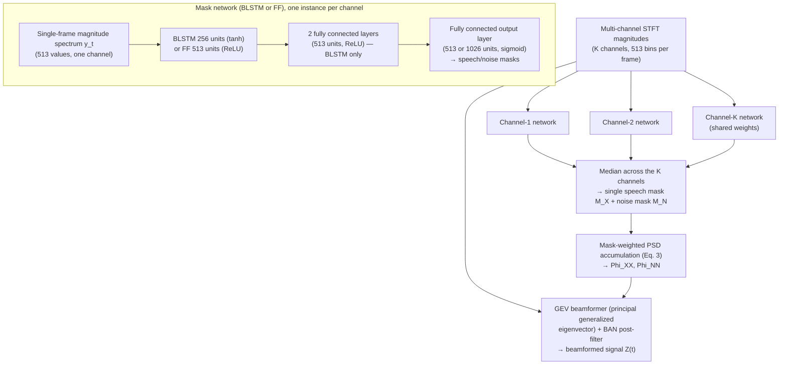

# Heymann, Drude & Haeb-Umbach 2016: Neural Network Based Spectral Mask Estimation for Acoustic Beamforming

**Authors**: [[entities/jahn-heymann|Jahn Heymann]] (University of Paderborn, Department of Communications Engineering, Paderborn, Germany), [[entities/lukas-drude|Lukas Drude]] (University of Paderborn, Germany), [[entities/reinhold-haeb-umbach|Reinhold Haeb-Umbach]] (University of Paderborn, Germany)

**Venue**: IEEE International Conference on Acoustics, Speech and Signal Processing (ICASSP) 2016
**Year**: 2016
**Type**: conferencePaper
**DOI**: [10.1109/ICASSP.2016.7471664](https://doi.org/10.1109/ICASSP.2016.7471664)
**Zotero**: [DKAD5AIA](zotero://select/items/0_DKAD5AIA)

## Summary

This paper presents the neural network based spectral mask estimator for acoustic beamforming that originated the CHiME-challenge-winning front-end family: per-channel neural networks estimate speech and noise T-F masks, from which speech and noise PSD matrices are accumulated and beamformer coefficients (MVDR or GEV with BAN) are computed. Training is independent of the number and geometric configuration of microphones, and a clean-speech-only training regime (no separated speech+noise data required) is shown to work well. A tiny single-hidden-layer feed-forward network nearly matches a BLSTM, and the data-driven masks beat parametric (complex Watson mixture model EM) mask estimation on both PESQ and CHiME-3 word error rate.

## Problem Formulation

Data-dependent beamforming requires estimates of the speech and noise statistics: advanced beamformers need the Cross-Power Spectral Density (PSD) matrices of speech and noise, and the steering/response vector (from DoA or relative transfer functions). These statistics can be obtained from **spectral masks** — but existing parametric mask estimators (EM on complex Watson mixture models, e.g., Tran10, Ito13) treat each frequency bin independently, ignoring the typical spectral structure of speech, and are easily fooled by high-energy noise concentrated in a few frequency bins. The paper asks whether a discriminatively trained neural network can estimate the masks jointly across all frequencies, whether the usual noise-aware training requirement (separated speech and noise signals) can be relaxed, and which beamformer design (MVDR vs. GEV) is best suited to mask-estimated statistics.

## Methodology

The mask estimator consists of **multiple neural networks with shared weights — one per microphone channel**. Each network sees a single frame of the spectral magnitude of one channel (no spatial information is used for mask estimation, which is what makes the training independent of the array geometry and channel count). Two architectures are compared:

- **BLSTM**: BLSTM layer (256 units, tanh) → 2 fully connected layers (513 units, ReLU) → fully connected output layer (513 or 1026 units, sigmoid); dropout 0.5 on all but the output layer.
- **FF (feed-forward)**: one hidden layer (513 units, ReLU) → output layer (513 or 1026 units, sigmoid). Single-frame input, no temporal context.

The per-channel masks are condensed to a single speech mask and a single noise mask by a **median** operation across channels — preferred over the mean for resilience to outliers, e.g., broken or occluded microphones. With noise-aware training, two masks are estimated (speech-dominant and noise-dominant bins); with clean-speech-only training, only the speech mask $M_{\mathbf{X}}$ is estimated and the noise mask is $1 - M_{\mathbf{X}}$ per T-F bin.

The condensed masks accumulate the PSD matrices of speech and noise,

$$
\boldsymbol{\Phi}_{\nu\nu} = \sum_{t=1}^{T} M_{\nu}(t)\, \mathbf{Y}(t) \mathbf{Y}(t)^{\mathrm{H}}, \quad \nu \in \{X, N\}, \tag{3}
$$

from which the beamformer coefficients are computed:

- **[[concepts/mvdr-beamformer|MVDR beamformer]]**: $\mathbf{F}_{\mathrm{MVDR}} = \boldsymbol{\Phi}_{\mathbf{NN}}^{-1} \mathbf{d} \, / \, \mathbf{d}^{H} \boldsymbol{\Phi}_{\mathbf{NN}}^{-1} \mathbf{d}$, where the response vector is **not** obtained from a DoA estimate (which assumes anechoic propagation) but as the principal component of the speech PSD matrix, $\mathbf{d} = \mathcal{P}\{\boldsymbol{\Phi}_{\mathbf{XX}}\}$ — valid under reverberation.
- **[[concepts/gev-beamformer|GEV beamformer]]**: maximizes the per-frequency output SNR (Rayleigh coefficient), solved as the **generalized eigenvalue problem** $\boldsymbol{\Phi}_{\mathbf{XX}} \mathbf{F} = \lambda \boldsymbol{\Phi}_{\mathbf{NN}} \mathbf{F}$; the optimal beamformer is the principal generalized eigenvector. No assumptions on the acoustic transfer function or noise spatial correlation are needed. Since the GEV can introduce arbitrary speech distortions, a single-channel post-filter performing **Blind Analytic Normalization (BAN)**,

$$
g_{\mathrm{BAN}} = \frac{\sqrt{\mathbf{F}_{\mathrm{GEV}}^{\mathrm{H}} \boldsymbol{\Phi}_{\mathrm{NN}} \boldsymbol{\Phi}_{\mathrm{NN}} \mathbf{F}_{\mathrm{GEV}} / D}}{\mathbf{F}_{\mathrm{GEV}}^{\mathrm{H}} \boldsymbol{\Phi}_{\mathrm{NN}} \mathbf{F}_{\mathrm{GEV}}}, \tag{8}
$$

restores a distortionless response toward the speaker; with perfect distortion removal the GEV+BAN coincides with the MVDR. The estimate is $Z(t) = g_{\mathrm{BAN}} \mathbf{F}_{\mathrm{GEV}}^{\mathrm{H}} \mathbf{Y}(t)$.

### Model Structure, Inputs, and Outputs

**Mask-estimation networks (two variants)**

| Spec | BLSTM network | FF network |
|---|---|---|
| **Structure** | L1: BLSTM 256 units (tanh, dropout 0.5) → L2/L3: FF 513 units (ReLU, dropout 0.5) → L4: FF 513/1026 units (sigmoid) | L1: FF 513 units (ReLU, dropout 0.5) → L4: FF 513/1026 units (sigmoid) |
| **Input** | Single frame of the spectral magnitude of one channel (513 values) | Same — no temporal context |
| **Output** | Speech mask and (noise-aware training) noise mask, values in [0,1], 513 or 1026 units | Same |
| **Training data** | CHiME-3 (noise-aware: simulated data with separated images; clean regime: clean speech only) | Same |
| **Role** | Per-channel mask estimation for PSD accumulation feeding the beamformer | Low-complexity alternative demonstrating that a tiny network suffices |

Output size 513 = single speech mask (clean-speech-only training); 1026 = speech + noise masks (noise-aware training).

### Training Losses

A single standard loss: **cross-entropy** between the binary target masks and the network's sigmoid outputs (one term per estimated mask, no coupling coefficients). The contribution lies in the *targets*:

- **Noise-aware training** — ideal binary masks defined with **frequency-dependent SNR thresholds**:

$$
\mathrm{IBM}_{\mathbf{N}}(t,f) = \begin{cases} 1, & \frac{\|\mathbf{X}\|}{\|\mathbf{N}\|} < 10^{\mathrm{th}_{\mathbf{N}}(f)}, \\ 0, & \text{else}, \end{cases} \qquad
\mathrm{IBM}_{\mathbf{X}}(t,f) = \begin{cases} 1, & \frac{\|\mathbf{X}\|}{\|\mathbf{N}\|} > 10^{\mathrm{th}_{\mathbf{X}}(f)}, \\ 0, & \text{else}, \end{cases} \tag{1–2}
$$

The two thresholds differ, so a decision in favor of speech or noise is taken only when the instantaneous SNR is sufficiently high or low — a **dead zone** of bins labeled neither speech nor noise keeps the false acceptance rate low at the expense of discarding some bins, yielding more reliable PSD estimates.

- **Clean-speech-only training** — no noise references needed: T-F bins are sorted by their contribution to the signal power, and bins are retained until their summed contribution reaches **99%**; the retained bins form the speech-mask target (noise mask = $1 - M_{\mathbf{X}}$).

**Optimization**: RMSProp (learning rate 0.001, momentum 0.9), gradient renormalization when the gradient norm exceeds 1, dropout 0.5 (input-hidden connections of the BLSTM, inputs of the ReLU layers), batch normalization on all but the output layers — **normalized per frequency**, with the minibatch (one utterance's frames) statistics reused at decoding time. BLSTM weights initialized uniform in $[-0.04, 0.04]$; ReLU/output layers Glorot–Bengio initialization; zero biases. Early stopping on development data with 10 epochs of patience.

### Parametric Baselines

- **Tran10**: EM algorithm for complex Watson mixture models, operating on each frequency bin independently; uses spatial information, needs no training phase.
- **Ito13**: permutation-free frequency-domain source separation with complex Watson mixture models and time-varying, frequency-independent mixture weights, processing all frequency bins simultaneously.

## Experimental Setup

| Item | Value |
|---|---|
| **Dataset** | CHiME-3: real + simulated 6-channel audio of 5k WSJ0 prompts with 4 real-world background noises |
| **Enhancement metric** | PESQ on the *simulated* development set (speech/noise images available separately), with an oracle computing PSDs directly from the images |
| **Beamformer for PESQ** | GEV with BAN |
| **ASR backend** | CHiME-3 baseline DNN-HMM, unmodified, no sequence training; **matched training** (recognizer trained on beamformed training data) |
| **ASR metric** | WER on dev/eval, simu/real |
| **ASR baselines** | BeamformIt! (delay-and-sum, GCC-PHAT DoA); CHiME-3 baseline beamformer (MVDR, SRP-PHAT + Viterbi speaker localization, noise PSD from pre-utterance context) |
| **BAN at ASR** | Not used — results without the post-filter were slightly better (the matched acoustic model compensates the GEV distortions) |

## Results

**MVDR vs. GEV**: although GEV+BAN is theoretically equal to MVDR under some circumstances, GEV was consistently better with the proposed masks. The cause is the **explicit inversion of the noise PSD matrix** in the MVDR (Eq. 5), which is numerically sensitive when the mask is very sparse for some frequencies: when the [[concepts/condition-number|condition number]] of $\boldsymbol{\Phi}_{\mathbf{NN}}$ is high, the MVDR output SNR drops below the GEV's. The GEV avoids explicit inversion by solving the generalized eigenvalue problem, which is numerically more stable. All further results use GEV.

![[raw/papers/heymann-2016-neural-spectral-mask-beamforming/figures/1461ccebc805f87e157e212163aa8dcaa6c611854cb0a120f0292ad170442f87.jpg|Fig. 1: Condition number of the noise PSD matrix vs. beamformer output SNR]]
*Figure 1: Logarithm of the condition number of $\boldsymbol{\Phi}_{\mathrm{NN}}$ plotted against the SNR of the MVDR and GEV beamformer output. High condition numbers (sparse masks) hurt the MVDR's explicit matrix inversion; the GEV stays stable.*

**Speech enhancement (PESQ, simulated dev, GEV+BAN)**: the noise-aware BLSTM performs nearly equal to the oracle (PSDs computed directly from the speech/noise images). Clean-speech-only training costs about 0.2 PESQ points on average. The simple FF network is surprisingly close to the BLSTM — negligible difference when trained on clean speech only; a clear gap appears only for noise-aware training, where the FF model's limited parameter count cannot capture the full noise variety. All parametric approaches are noticeably worse, with a significant number of outliers where beamforming *deteriorates* the signal due to wrong masks.

![[raw/papers/heymann-2016-neural-spectral-mask-beamforming/figures/d8d5176a128f96cb3ac5c711cea177765faa56e12095e2b6cb8e82b958b47121.jpg|Fig. 2: PESQ score box plots]]
*Figure 2: PESQ scores on the development set for the different models using the GEV beamformer with BAN.*

The parametric methods are highly sensitive to high-energy noise concentrated in a few frequency bins, whereas the networks exploit inter-frequency (and, for the BLSTM, temporal) dependencies to distinguish speech from noise by their time-frequency characteristics rather than energy alone:

![[raw/papers/heymann-2016-neural-spectral-mask-beamforming/figures/105b7e594a2d7331920839e8b1fe2b914a12e4f3c728f52584bc0a009e047d11.jpg|Fig. 3: Spectrogram masks, neural vs. parametric]]
*Figure 3: Spectrogram of channel 5 of an utterance (a), the speech-spectrogram estimate using the BLSTM mask (b), and the Tran10 parametric mask (c). The high-energy noise at the end does not affect the neural network, while the parametric approach concentrates on it.*

**Speech recognition (WER, %)**:

| System | dev simu | dev real | eval simu | eval real |
|---|---|---|---|---|
| CHiME-3 baseline | 9.27 | 20.14 | 12.75 | 40.17 |
| BLSTM, noise-aware | 9.13 | **9.27** | 9.73 | **15.42** |
| FF, noise-aware | 9.70 | 11.21 | 10.65 | 17.85 |
| BLSTM, clean-speech-only | 10.05 | 11.77 | 11.20 | 22.28 |
| FF, clean-speech-only | 10.01 | 11.99 | 11.65 | 21.93 |
| BeamformIt! | 12.97 | 12.16 | 23.53 | 22.65 |
| Ito13 | 18.79 | 19.98 | 27.34 | 27.32 |
| Tran10 | 18.19 | 16.09 | 20.62 | 22.70 |

On the real evaluation set (the most important, real-world condition) the neural mask-based systems outperform all competitors mostly by a large margin: the noise-aware BLSTM halves the baseline's 40.17% to 15.42%, and even the clean-speech-only systems (≈22%) beat the parametric approaches and BeamformIt! (22.65%), though the gap to noise-aware training is non-negligible.

## Key Contributions

1. **Neural mask estimation for beamforming**: per-channel neural networks (shared weights) estimate speech/noise spectral masks from single-channel magnitude spectra, from which PSD matrices and beamformer coefficients are computed — the mask-based beamforming front-end that later dominated the CHiME challenges (in-depth analysis of the system first used in the authors' CHiME-3 challenge contribution, Heymann et al. ASRU 2015).
2. **Joint-frequency mask estimation**: the network estimates the mask for all frequencies simultaneously, capturing speech's spectro-temporal structure — unlike per-frequency parametric estimators (complex Watson mixture model EM), which are fooled by high-energy noise concentrated in a few bins.
3. **Array-configuration independence**: because each channel is processed separately (no spatial features), training is independent of the number and geometric configuration of microphones.
4. **Clean-speech-only training**: sorting T-F bins by power contribution and retaining 99% suffices as a speech-mask target, waiving the need for separated speech+noise training data and knowledge of the noise scenario at training time.
5. **MVDR vs. GEV numerical analysis**: explicit inversion of a sparsely-masked noise PSD matrix makes the MVDR numerically fragile (high condition number → reduced output SNR); the GEV's generalized eigenproblem is more stable, an observation grounded in a condition-number-vs-SNR analysis (Fig. 1).
6. **Tiny-network feasibility**: a single-hidden-layer FF network with single-frame input achieves remarkably good results — well suited for low-resource applications.

## Related Concepts

- [[concepts/hybrid-speech-enhancement|Hybrid Speech Enhancement]] — canonical Class-1 hybrid: DNN masks → PSD matrices → model-based beamformer
- [[concepts/tf-mask-estimation|TF Mask Estimation]] — joint-frequency DNN masks vs. per-frequency parametric EM estimators; clean-speech-only training targets
- [[concepts/spatial-covariance-matrix|Spatial Covariance Matrix]] — mask-weighted PSD accumulation (Eq. 3) with median-consolidated per-channel masks
- [[concepts/mvdr-beamformer|MVDR Beamformer]] — principal-component steering from the speech PSD; numerical sensitivity to sparse masks
- [[concepts/gev-beamformer|GEV Beamformer]] — max-SNR beamformer with BAN post-filter; numerically more stable than MVDR here
- [[concepts/ideal-binary-mask|Ideal Binary Mask]] — training targets with frequency-dependent SNR thresholds and a dead zone
- [[concepts/condition-number|Condition Number]] — diagnosis of MVDR degradation under sparse masks
- [[concepts/bidirectional-lstm|BLSTM]] — the larger mask-estimation architecture
- [[concepts/neural-beamforming|Neural Beamforming]] — mask-based beamforming as the data-driven-statistics instance
- [[concepts/beamforming|Beamforming]] — parent topic

## Related Synthesis

- [[synthesis/multi-channel-speech-enhancement|Multi-Channel Speech Enhancement]] — origin of the CHiME-winning neural mask-based beamforming front-end
- [[synthesis/deep-speech-enhancement|Deep Speech Enhancement]] — early data-point on the mask-then-beamform hybrid design
