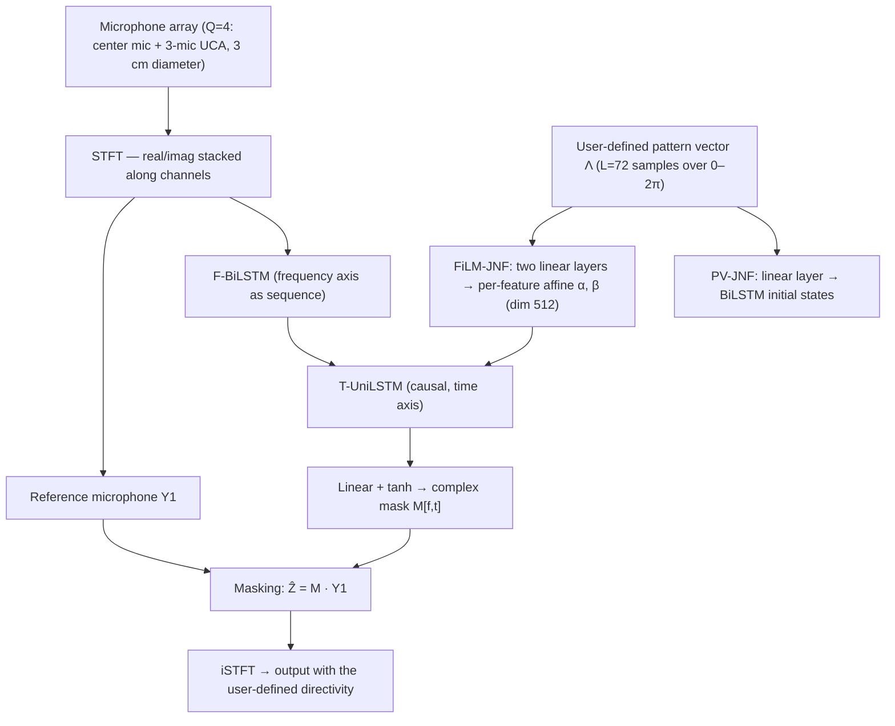

# Huang, Chetupalli & Habets 2026: UNDF — Configurable Directivity Pattern at Inference

**Authors**: [[entities/weilong-huang|Weilong Huang]], [[entities/srikanth-raj-chetupalli|Srikanth Raj Chetupalli]], [[entities/emanuel-habets|Emanuël A. P. Habets]]
**Institution**: International Audio Laboratories Erlangen (Fraunhofer IIS / FAU), Germany; Indian Institute of Technology Bombay, India
**Venue**: arXiv preprint 2510.20253 (v2, 2026-06-03; first submitted October 2025)
**Year**: 2026
**Type**: Preprint — the introducing companion study of [[sources/huang-2026-neural-directional-filtering|Huang et al. 2026]] (comprehensive journal-style NDF)
**DOI**: [10.48550/arXiv.2510.20253](https://doi.org/10.48550/arXiv.2510.20253)
**Zotero**: [Zotero Link](zotero://select/items/0_6TMYN4TL)

## Summary

This paper proposes **UNDF** — [[concepts/neural-directional-filtering|neural directional filtering]] with **user-defined directivity patterns** — enabling spatial filtering with directivity patterns that users can configure *during inference*, rather than one fixed pattern per trained model (NDF) or a fixed pattern shape that can only be steered ([[concepts/steerable-neural-directional-filtering|SNDF]]). The user-defined pattern is sampled at $L=72$ angles and fed as a conditioning vector to the DNN via two mechanisms: **PV-JNF** (pattern vector → linear layer → BiLSTM initial states, adapted from the SSF conditioning) and **FiLM-JNF** ([[concepts/film-layer|FiLM]]-conditioned FT-JNF). FiLM conditioning proves decisively superior (up to 11 dB SDR better on unseen patterns) and enables generalization to unseen higher orders, scaling variations, and steering directions; progressively refined training recipes (B− → B → B+) enable the approximation of irregular pattern shapes. This is the study that first introduced the FiLM-JNF architecture later used for continuous steering in the comprehensive NDF paper.

## Problem Formulation

$N$ sources are recorded by a compact array of $Q$ omnidirectional microphones (azimuth-only scenario, x-y plane):

$$
Y_{q}[f,t]=\sum_{n=1}^{N}X_{q,n}[f,t]+V_{q}[f,t], \qquad q\in\{1,\ldots,Q\},
$$

with sensor noise $V_q$. The pattern is assumed **frequency-invariant**, so it is represented as a vector applicable to all frequency bands. The user-defined pattern at time $t$ is $\Lambda_t(\theta)$ (azimuth $\theta$), and the target signal is a per-source weighted mixture at the reference microphone $q=1$:

$$
Z[f,t]=\sum_{n=1}^{N}\Lambda_{t}(\theta_{n})\,X_{1,n}[f,t].
$$

Note the contrast with source extraction: the objective is to *capture the acoustic scene* with a spatial weighting of the user's choosing (sources at high-pattern-gain directions dominate, others are attenuated), not to isolate a single source. The target pattern is allowed to be **time-varying** ($\Lambda_t$), since it is a conditioning input applied at every frame.

## Methodology

### Model Structure, Inputs, and Outputs

Two DNN architectures (both adaptations of the [[concepts/joint-nonlinear-filtering|FT-JNF]] backbone of Tesch & Gerkmann 2023) are compared. The real/imaginary STFT parts of the $Q$ microphone signals are stacked along channels ($[B,T,F,2Q]$), reshaped to $[B\times T,F,2Q]$, and processed by a BiLSTM with the **frequency** axis as the recurrent sequence. The conditioning pattern is sampled uniformly at $L=72$ angles over $[0,2\pi]$ (pattern input vector $[B,L]$).

![[raw/papers/huang-2026-undf-configurable-directivity/figures/architectures.png|Proposed DNN architectures]]

*Figure 1: Proposed DNN architectures. Left: PV-JNF, incorporating the pattern vector as the conditioning input (linear layer → BiLSTM initial states, adapted from the SSF framework of Tesch & Gerkmann 2023). Right: FiLM-JNF, integrating FiLM conditioning between the frequency BiLSTM and the time UniLSTM.*

| Spec | PV-JNF | FiLM-JNF |
|------|--------|----------|
| **Structure** | FT-JNF backbone; pattern vector → linear layer → initial states of the F-BiLSTM (per time step) | FT-JNF backbone; pattern vector → two linear layers → per-feature affine parameters $\boldsymbol{\alpha},\boldsymbol{\beta}\in\mathbb{R}^{512}$; FiLM modulation $\mathbf{y}=\boldsymbol{\alpha}\odot\mathbf{x}+\boldsymbol{\beta}$ between F-BiLSTM and T-UniLSTM, shared across time and frequency |
| **Input** | Real/imag STFT parts of $Q=4$ mics, $[B,T,F,8]$; pattern vector $[B,72]$ | Same |
| **Output** | complex-valued single-channel mask $\mathcal{M}[f,t]$; $\widehat{Z}[f,t]=\mathcal{M}[f,t]\,Y_{1}[f,t]$ | same |
| **Conditioning mechanism** | initial-state injection (one linear layer) | FiLM affine modulation (two linear layers) |
| **Role** | baseline conditioning variant (SSF-style) | proposed conditioning — generalizes to unseen patterns |

Both architectures are **causal** (conditioning is applied to every frame), so pattern changes are reflected immediately in the output.

### Training Losses

A batch-aggregated normalized $\mathcal{L}_1$ loss:

$$
\mathcal{L}_{\mathrm{1}}=\frac{\sum_{b=1}^{B}\left\|\mathbf{z}^{b}-\hat{\mathbf{z}}^{b}\right\|_{1}}{\sum_{b=1}^{B}\left\|\mathbf{z}^{b}\right\|_{1}+\epsilon}, \qquad \epsilon=10^{-7},
$$

where $\hat{\mathbf{z}},\mathbf{z}$ are the time-domain signals of the STFT-domain estimate $\widehat{Z}$ and target $Z$. Maximum suppression for all patterns clipped at $-20$ dB.

### Training Strategy: Pattern Recipes

Patterns are parametrized by a simplified DMA form focusing on mainlobe shape (no negative polarity, $\Lambda\in[0,1]$):

$$
\Lambda(\theta)=\lvert\mu+(1-\mu)\cos(\theta-\theta_{\mathrm{s}})\rvert^{J},
$$

with $\mu\in[0,1]$ determining the null position, order $J$, steering $\theta_s$; plus the rectangular pattern ($\Lambda=1$ inside $[\theta_{\text{start}},\theta_{\text{end}}]$, else $0$). Each source-array setup yields $P=60$ training patterns:

| Recipe | Composition | Purpose |
|--------|--------------|---------|
| **A** | 60 first-order patterns: $J=1$, $\mu\in\{0,0.1,\ldots,0.9\}$, $\theta_s\in\{0°,60°,\ldots,300°\}$ | finite, specific pattern set (conditioning comparison) |
| **B** | linear combinations of $C=4$ random DMA patterns (random $\mu$, $\theta_s\in[0,2\pi]$, $J\in[1,11]$), normalized to max 1 | broader coverage of orders/directions + combination exposure |
| **B−** | $C=1$: single random DMA pattern (ablation of the linear-combination operation) | isolates the effect of combinations |
| **B+** | 33.3% Recipe B + 33.3% linear combinations of random rectangular patterns + 33.3% mixed DMA+rectangular | adds rectangular mixing → irregular shapes |

For training, the target signal is generated per (2) by applying the pattern gain to each source; the same source-array setup contributes $P$ samples (one per pattern).

### Directivity-Pattern Evaluation

The estimated mask is applied separately to each source at the reference microphone, and the wideband power ratio per direction

$$
\xi[\theta_{n}]=\frac{\sum_{f,t}\left|\mathcal{M}[f,t]\,X_{1,n}[f,t]\right|^{2}}{\sum_{f,t}\left|X_{1,n}[f,t]\right|^{2}},
$$

averaged over all test samples from the same direction, yields the estimated wideband directivity pattern (narrowband: drop the frequency summation). This is the power-ratio form of the [[concepts/data-dependent-directivity-metrics|data-dependent directivity metrics]] elaborated in the companion journal paper.

## Experimental Setup

| Item | Value |
|------|-------|
| Array | $Q=4$: three microphones in a UCA + one at the center, 3 cm diameter; $q=1$ (center) reference |
| Training data | LibriSpeech train-clean-360 (training) / dev-clean (validation); up to 3 concurrent speakers; 4 s samples; $4320\times 60$ train / $1080\times 60$ validation samples |
| Test data | EARS dataset (min loudness $-42$ dBFS), 2 concurrent sources, 3240 samples per pattern |
| DOA grids | train $\{0°,5°,\ldots,355°\}$; validation $\{2.5°,7.5°,\ldots,357.5°\}$; test $\{1.25°,3.75°,\ldots,358.75°\}$ (interleaved, unseen) |
| Geometry | fixed source-array distance $d=1.5$ m; direct-path RIRs (Habets RIR generator, reflection order 0) — anechoic training |
| Optimization | 100 epochs, batch size 10, initial LR 0.001 |
| Pattern input | $L=72$ samples; max suppression $-20$ dB; $\epsilon=10^{-7}$ |
| Baseline | parametric filtering with **oracle** DOA (upper bound) — significantly outperforms the LS beamformer, which is therefore omitted |
| Metrics | estimated wideband/narrowband directivity patterns; SDR |

## Results

### Conditioning Mechanisms (Recipe A, Table I)

| Method | 1st-order (60°) | 1st-order (90°, unseen $\theta_s$) | 3rd-order (90°, unseen order+$\theta_s$) | Scaled (−5 dB, unseen scaling) |
|--------|------------------|-----------------------------------|------------------------------------------|-------------------------------|
| Parametric filtering (oracle DOA) | 20.37 | 20.34 | 20.37 | 21.35 |
| PV-JNF (Recipe A) | 26.50 | 20.87 | 10.40 | 8.11 |
| FiLM-JNF (Recipe A) | 26.30 | 24.31 | 17.34 | 19.54 |
| FiLM-JNF (Recipe B) | **26.83** | **26.30** | **24.54** | **26.80** |

- On the *seen* 1st-order/60° pattern, PV-JNF and FiLM-JNF are comparable (both ≈ 26.5 dB, above the oracle parametric baseline's 20.37 dB).
- On *unseen* steering (90°), *unseen higher order* (3rd), and *unseen scaling* (−5 dB gain in the target direction), PV-JNF collapses (10.4 / 8.1 dB) while FiLM-JNF degrades gracefully (17.3 / 19.5 dB) — up to **11 dB** better. PV-JNF's pattern estimates show steering bias and severe deviation on scaled patterns.
- FiLM conditioning therefore provides **compositional generalization over the pattern space**, not just memorized patterns.

### Training Strategies (Table II, FiLM-JNF)

| Pattern | Recipe B− | Recipe B | Recipe B+ |
|---------|-----------|----------|-----------|
| Multi-scaled pattern | 12.98 | **19.75** | 17.61 |
| Irregular pattern | 14.20 | 14.81 | **20.39** |

- **Recipe B vs B−**: the *linear-combination* operation (not just broader single-pattern coverage) drives multi-scaled pattern approximation (+6.8 dB).
- **Recipe B+ vs B**: adding rectangular-pattern mixing trades a little multi-scaled performance (17.6 vs 19.8 dB) for a large gain on **irregular shapes** (20.4 vs 14.8 dB) — rectangular mixing is what enables arbitrary shapes.
- Recipe B outperforms both Recipe A and oracle parametric filtering on all Table I patterns (26.3–26.8 dB vs ≤ 21.4 dB).
- Narrowband patterns of the Recipe B+ model are **frequency-invariant** (Figure 4).

![[raw/papers/huang-2026-undf-configurable-directivity/figures/narrowband-multiscaled.png|Narrowband directivity patterns, multi-scaled target]]

![[raw/papers/huang-2026-undf-configurable-directivity/figures/narrowband-irregular.png|Narrowband directivity patterns, irregular target]]

*Figure 4: Estimated narrowband directivity patterns for FiLM-JNF trained with Recipe B+ (multi-scaled and irregular targets) — frequency-invariant approximation.*

### Time-Varying Directivity Patterns

A 20 s reverberant scene (speech at 60°, music at 230°, RT60 = 0.15 s, both at $d=1.5$ m) is processed in three 6.7 s periods with three different conditioning patterns: first favoring music and suppressing speech, then recovering speech while partly suppressing music, then further suppressing the retained music. The output spectrogram follows the requested per-period patterns, and — because conditioning is applied per frame and the model is causal — pattern changes take effect **immediately**. Despite anechoic speech-only training, the model generalizes to non-speech (music) sources and low reverberation.

![[raw/papers/huang-2026-undf-configurable-directivity/figures/spectrogram-input.png|Unprocessed mixture spectrogram]]

![[raw/papers/huang-2026-undf-configurable-directivity/figures/spectrogram-undf-output.png|UNDF output spectrogram]]

*Figure 5: Time-varying directivity application — unprocessed mixture at the reference microphone vs. UNDF output; the three consecutive conditioning patterns progressively trade speech/music components.*

## Key Contributions

1. **UNDF task formulation**: neural directional filtering with *user-defined* directivity patterns configurable at inference — decoupling pattern shape from training, one step beyond SNDF's steering-only configurability.
2. **FiLM conditioning for pattern control**: the FiLM-JNF architecture (pattern vector → FiLM layer in FT-JNF), which generalizes to unseen higher orders, scaling variations, and steering directions — up to 11 dB better than the initial-state PV-JNF conditioning on unseen patterns.
3. **Pattern training recipes**: progressive refinement (A → B− → B → B+) showing that (i) linear combinations of random DMA patterns drive multi-scaled approximation, and (ii) rectangular-pattern mixing enables irregular shape approximation.
4. **Time-varying directivity demonstration**: per-frame conditioning of a causal model gives immediate response to pattern changes; generalization to non-speech sources and light reverberation from anechoic speech-only training.

## Related Concepts

- [[concepts/neural-directional-filtering|Neural Directional Filtering]]
- [[concepts/undf|UNDF]]
- [[concepts/steerable-neural-directional-filtering|Steerable Neural Directional Filtering]]
- [[concepts/film-jnf|FiLM-JNF]]
- [[concepts/film-layer|FiLM Layer]]
- [[concepts/joint-nonlinear-filtering|Joint Nonlinear Filtering]]
- [[concepts/directivity-pattern|Directivity Pattern]]
- [[concepts/virtual-directional-microphone|Virtual Directional Microphone]]
- [[concepts/data-dependent-directivity-metrics|Data-Dependent Directivity Metrics]]
- [[concepts/spatially-selective-nonlinear-filter|Spatially Selective Non-Linear Filter]]

## Related Sources

- [[sources/wechsler-2024-neural-directional-filtering|Wechsler et al. 2024: Neural Directional Filtering]] — founding NDF paper (fixed pattern per model)
- [[sources/huang-2025-steerable-neural-directional-filtering|Huang et al. 2025: Steerable Neural Directional Filtering]] — steering conditioning (pattern shape fixed)
- [[sources/huang-2026-neural-directional-filtering|Huang et al. 2026: Neural Directional Filtering with a Compact Microphone Array]] — companion journal-style paper using FiLM-JNF for continuous steering

## Related Synthesis

- [[synthesis/multi-channel-speech-enhancement|Multi-Channel Speech Enhancement]]
