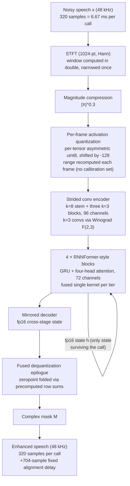

# Kim 2026: faster-enhancer.c — A Dependency-Free int8 Runtime for Streaming Speech Enhancement on Commodity CPUs

**Authors**: [[entities/gyeongmin-kim|Gyeongmin Kim]]
**Affiliation**: Department of Computer Science, Hanyang University, Seoul, Korea
**Venue**: arXiv preprint 2607.25350
**Type**: Preprint (implementation and measurement study)
**DOI**: [10.48550/arXiv.2607.25350](https://doi.org/10.48550/arXiv.2607.25350)
**Zotero**: [SB54CQSW](zotero://select/items/0_SB54CQSW)
**Code**: [kdrkdrkdr/faster-enhancer.c](https://github.com/kdrkdrkdr/faster-enhancer.c) (commit 7d78dab) — dependency-free C library

---

## Summary

This is an implementation and measurement study of what it costs to run a streaming speech enhancer on a CPU: the author ports FastEnhancer-Medium at 48 kHz to **faster-enhancer.c**, a C runtime with six int8 GEMM tiers selected at initialization, leaving architecture and weights untouched. One Apple M2 core reaches **0.069 RTF** against 0.230 for the fp32 ONNX Runtime graph on the same machine (a 3.3× speedup); a Galaxy S23+ reaches 0.096. The speedup comes from specializing every layer of the runtime around one fixed model. Beyond speed, the paper's key conceptual contribution is reading real-time factor as a **duty cycle rather than a latency**: pacing to the 6.67 ms deadline costs 4.2× per frame, *saves 49% of the energy*, and reveals that the cheapest core placement misses 96% of its deadlines.

## Problem Formulation

Neural suppressors have displaced hand-tuned signal processing for real-time speech enhancement, and the model-side literature has pushed hard on parameters and MACs — but deployment did not follow at the same rate. Shipping a model usually means shipping a general inference runtime, keeping an exported graph synchronized with training code, and defending frame-level *tail* latency rather than average throughput.

Two framings drive the study:

1. **RTF as a duty cycle, not a latency.** The reference implementation of FastEnhancer reports RTF 0.1347 for the 48 kHz Medium configuration on an Apple M5. But enhancement is rarely the product — it runs underneath a call, a recording session, or a transcription pipeline, often for hours, on weaker hardware. The enhancer holds a fraction of a core for as long as the microphone is open. A benchmark races through a file; an audio callback does not.
2. **The power budget is physical, not abstract.** MCU-targeting work states it in milliamp-hours (a 60 mAh cell sustains a 20-hour lifetime only near 10 mW average power); application processors have a larger budget, not an unlimited one.

The research question: how far does deployment cost fall when every layer of the runtime is specialized around one fixed streaming model — with architecture and weights untouched?

Prior work brackets the problem from both sides: RNNoise showed a neural denoiser can run real-time at 48 kHz on a CPU but at a quality target below current models; DeepFilterNet/2 reach 48 kHz realtime enhancement natively; GTCRN pushes model-side complexity down; TinyLSTMs and mixed FP16-INT8 schemes trade model fidelity for MCU power budgets; general deployment stacks (XNNPACK, KleidiAI, gemmlowp, llama.cpp) supply kernels but not model-specific fusion or the reproducibility contract needed here.

## Methodology

### Runtime Design

![[raw/papers/kim-2026-faster-enhancer/figures/80a2dbba7665c89bedfa983374cb070e9a8b64a610c0279bb728002670cabcd5.jpg|Per-frame runtime graph of faster-enhancer.c]]

*Figure 1: Per-frame runtime graph; shading encodes arithmetic rather than layer type. Only the GRU state `h` survives the call. Both fp16 buffers are read and written by the kernels directly, with no pack/unpack pass.*

### Model Contract and Streaming State

FastEnhancer-Medium predicts a complex mask from a 1024-point STFT, on magnitudes compressed by $p = 0.3$. Architecture (unchanged from upstream): a strided convolutional encoder with a $k = 8$ stem and three $k = 3$ blocks at 96 channels, four blocks pairing a GRU with four-head attention over 72 channels, and a mirrored decoder. Each call consumes and produces 320 samples (6.67 ms); the STFT contributes a fixed alignment delay of 704 samples (14.67 ms) with no look-ahead.

The runtime contract is deliberately narrow:

| Property | Value |
|----------|-------|
| Public interface | Four functions and one header |
| State | Single 432,384-byte state structure allocated once — nothing allocated per frame |
| Library size | 162 KiB static (macOS arm64), no external runtime dependency |
| Weights | q8 blob of 565,108 bytes (3.7× smaller than the fp32 ONNX export), 511,754 parameters |
| Threading | CPU only, single-threaded, one global instance, no scalar fallback tier |
| Fallback policy | A host without the required baseline fails at initialization rather than taking an unverified slow path |

### Model Structure, Inputs, and Outputs

The ported model is FastEnhancer-Medium, retrained on nothing; the runtime below is the contribution.

**faster-enhancer.c runtime spec**:

| Property | Value |
|----------|-------|
| **Structure** | Six int8 GEMM tiers compiled into one binary, one selected at initialization: ARM NEON, DOTPROD, I8MM; x86 AVX2, AVX-VNNI, AVX-512 VNNI. Fixed shapes; compile-time alignment assertions delete every scalar remainder path |
| **Input** | 320 samples (6.67 ms) of 48 kHz audio per call |
| **Output** | 320 enhanced samples per call; 704-sample (14.67 ms) fixed alignment delay, no look-ahead |
| **State** | 432,384-byte single structure, allocated once; GRU hidden state and long-lived cross-stage state in fp16 (IEEE binary16) |
| **Weights** | 511,754 parameters, q8 blob 565,108 bytes; per-output-row symmetric int8 with one fp32 scale per row |
| **Training data** | None — training-free port of the FastEnhancer-Medium 48 kHz weights (activation ranges recomputed per frame, so no calibration set) |
| **Role** | Deployment runtime for streaming monaural speech enhancement on commodity CPUs |

### The [−127, 127] Clamp

Weights are per-output-row symmetric int8; activations are quantized per frame with a per-tensor asymmetric uint8 range stored shifted by −128, so signed kernels consume them directly. The range is recomputed from each frame, so there is no calibration set and no sensitivity to one. The zeropoint correction folds into the dequantization epilogue through precomputed row sums (the integer-only formulation of Jacob et al.), leaving the hot path as an int8 dot product and one fused multiply-add.

Both weights and activations are clamped to **[−127, 127]**, one code point short of the full int8 range. Discarding that endpoint buys two things:

- It makes int16 accumulation **provably safe** in tiers without a native int8 dot product: worst-case pair sum $2 \times 127 \times 127 = 32{,}258$ against the int16 limit 32,767.
- It removes the one value that breaks reproducibility: AVX2 reaches signed products through `vpsignb`, which cannot negate −128.

With the clamp, every tier in an architecture family emits **byte-identical output**, at a measured cost of 0.000 PESQ to three decimals.

### Cross-Build Bit-Identity: The `cosf` Discovery

A notable debugging case study: binaries compiled by Apple clang for M2 and by NDK clang for the Snapdragon initially produced different output for the same input, agreeing on only 22% of samples. The cause was neither the (integer) kernels nor floating-point contraction (ruled out by rebuilding both with contraction disabled) — **it was the analysis window**. The engine built its Hann coefficients at initialization with `cosf`, which is not correctly rounded; the macOS and bionic implementations disagree in the last bit for hundreds of the 1024 coefficients, and the window multiplies every frame, so one wrong bit separates two builds forever. Computing the window in double and narrowing once makes the platforms bit-identical at zero runtime cost.

This contract constrains the tier design: SSE4.1 was dropped because without FMA3 the dequantization epilogue becomes a two-step rounding that drifts ~1 ULP per operation until hashes diverge (x86 floor = AVX2 + FMA3 + F16C); on AVX-512, the 14-bit `rcp14` reciprocal had to be reproduced as the 256-bit path's 12-bit estimate by splitting the register into halves — the divergence had surfaced as 44 dB SNR between supposedly identical tiers. Both were found by hash comparison, not by listening. No AVX-512 host was available, so that tier is verified functionally under Intel SDE and carries no timing row.

### Kernels and Fusion

- **The binding constraint was rarely the dot instruction; it was how the activation operand is fed.** Load-and-replicate per row held DOT-PROD at 62% of SDOT peak; pre-packing activations into row quads and indexing lanes reaches 186 GMAC/s (I8MM needed the same treatment). On AVX-VNNI, broadcasting the activation from memory frees the issue port `vpdpbusd` needs; with 12 accumulators the kernel moves from latency-bound to throughput-bound. AVX2 has no int8 dot-accumulate and reaches about 24 MAC/cycle — an architectural floor.
- **M2 dispatch-port symmetry**: SMMLA packs twice as many MACs per instruction as SDOT, but M2 issues SDOT on four pipes and SMMLA on two, so both reach 64 MAC/cycle. On this core the I8MM tier is not why the runtime is fast.
- **Fusion removes graph-level round trips**: transpose folds into quantization, residuals into GEMM epilogues, and the GRU's two matrices, three gates, hidden update and fp16 state write are one kernel per tier so int32 accumulators never reach memory. Softmax consumes int32 scores directly.
- **Winograd F(2,3)** for the $k = 3$ convolutions; **long-lived state is IEEE binary16**, where int8 would lose about 40 dB SNR through the decoder concat.

### Training Losses

Not applicable — this is a training-free port. Architecture and weights are FastEnhancer-Medium's (trained upstream with its composite loss); the paper changes neither. The entire "training" surface of this paper is quantization: per-frame activation range recomputation substitutes for calibration.

## Experimental Setup

| Parameter | Setting |
|-----------|---------|
| Devices | Apple M2 (FEAT I8MM + DotProd); Galaxy S23+ (SM-S916N, Snapdragon 8 Gen 2) |
| x86 tiers | Build and pass tier-equality gate, not timed (no x86 host available); AVX-512 verified under Intel SDE |
| Quality set | [[concepts/voicebank-demand\|VoiceBank-DEMAND]] test set at native 48 kHz: 824 utterances (same set upstream validates on) |
| Timing set | Three 48 kHz RNNoise demo clips at 5 dB, 5569 frames each; percentiles steady-state after first 200 frames |
| Baseline | Exported graph under ONNX Runtime fp32, same machine, frame-wise inference only |
| Energy | Package power/cluster frequency/die temperature at 5 Hz via macmon, bracketed by idle; 3 repeats of 180 s audio, median |
| Metrics | Band-limited: PESQ (16 kHz resample — blind above 8 kHz), STOI/eSTOI (0–5 kHz); full band: waveform SNR, SI-SDR, LSD (32 ms window), SIGMOS (built on ITU-T P.804). DNSMOS noted as a 16 kHz metric |
| Statistical test | Two-sided Wilcoxon signed-rank |
| Framing | fp32 reference generated on the engine's own causal analysis grid (a default centered STFT's 192-sample offset is not a multiple of the 320-sample hop, so scoring against it would measure framing phase rather than quantization error) |

A separate timing set from the quality set is sound because the engine's compute is data-independent — fixed shapes, no data-dependent branching, denormals flushed; the three clips' p50 agree to within 0.3%.

## Results

### Throughput (Table 1)

Racing = frames fed as fast as the core accepts them.

| System | Tier / precision | p50 | p99 | ms/fr. |
|--------|-----------------|-----|-----|--------|
| **Apple M2, same machine** | | | | |
| ONNX Runtime | fp32 | 0.230 | — | 1.531 |
| fe | I8MM | 0.069 | 0.084 | 0.458 |
| fe | DOTPROD | 0.068 | 0.081 | 0.452 |
| fe | NEON | 0.163 | 0.187 | 1.085 |
| **Other devices, fe** | | | | |
| Galaxy S23+ | I8MM | 0.096 | 0.105 | 0.640 |
| Galaxy S23+ | DOTPROD | 0.113 | 0.122 | 0.753 |
| Galaxy S23+ | NEON | 0.344 | 0.365 | 2.293 |

- The model's largest GEMM is only $72 \times 216 \times 72$ — shapes at which a general graph executor spends much of its time on per-operator bookkeeping rather than arithmetic.
- Per frame the engine issues 1.60 Mcycle for 46.3 MMAC (28.9 MAC/cycle end-to-end); the GEMM kernels sit at 85–93% of the 64 MAC/cycle SDOT ceiling while the frame runs at 45% of peak. The RTF floor is ~0.033; the gap is STFT, nonlinearities and per-frame quantization.
- **The best tier inverts between devices**: on M2 the two tiers tie to within 1% (DOTPROD marginally ahead); on the Snapdragon 8 Gen 2, DOTPROD costs 17.7% more than I8MM — a property of issue widths, not code (output hashes agree across tiers and both parts). A compile-time tier choice would be wrong on one of the two devices.
- S23+ figures are a pessimistic bound: `adb shell` runs at normal priority, and the SoC hot-unplugs its prime core, so every placement is a cluster.

### Quality (Table 2)

824-utterance means; the last row scores the q8 output against the fp32 output.

| Signal | PESQ | STOI | SNR | LSD | SIGMOS |
|--------|------|------|-----|-----|--------|
| Noisy input | 1.967 | 0.9211 | 8.39 | 14.72 | 2.317 |
| fp32 ONNX | 3.060 | 0.9512 | 19.43 | 12.56 | 3.381 |
| fe q8 | 3.054 | 0.9509 | 19.35 | 12.33 | 3.363 |
| q8 vs fp32 | 4.610 | 0.9998 | 37.80 | 2.86 | — |

- Full-band metrics: −0.079 dB SNR, −0.23 LSD (negative meaning the quantized output is marginally *closer* to the clean target), −0.017 SIGMOS against an enhancement that moves SIGMOS by +1.064 — **quantization costs 1.6% of what the model gains**.
- Band-limited: −0.006 PESQ, −0.0003 STOI. At n = 824 all differences but the SIGMOS noise term are significant (Wilcoxon $p < 10^{-4}$) — consistently different, and far below what a listener could hear.
- For context: prior post-training quantization of comparable enhancers reports −0.06 PESQ (mixed FP16-INT8) and −0.3 (uniform int8); this port achieves −0.006.
- The cost does not grow on harder inputs: PESQ delta by input-SNR bucket is −0.003/−0.006/−0.008/−0.005 (2.5/7.5/12.5/17.5 dB); by noise type it spans −0.012 to +0.003.

### Duty-Cycled Operation (the headline finding)

![[raw/papers/kim-2026-faster-enhancer/figures/7b76681157da2852ce6e9bd6ae5740d5907eadc13ed3bed56198993602e6c3a1.jpg|Energy per audio-second by core placement and pacing]]

*Figure 2: Energy per audio-second by core placement and pacing, Apple M2, 180 s of audio. Bars are medians, whiskers the full range over repeats; labels give the deadline-miss rate where it exceeds 1%.*

A benchmark races; a deployed enhancer receives one frame every 6.67 ms and idles in between, and the governor responds by dropping the clock.

- **Pacing raises per-frame cost 4.2×** on the P-core (0.068 → 0.286 RTF). The engine does identical work; what changes is the clock and the idle gap before each frame. The racing figure is therefore a floor on what a real audio callback pays. Both remain real-time: at 0.286, 71% of the budget is still left.
- **Racing costs 387 mJ per audio-second; pacing costs 198 mJ — a 49% energy saving for bit-identical work.** Race-to-idle is the wrong instinct: the core finishes sooner but at 3.5 GHz, and the voltage that clock costs is never repaid by the idle that follows.
- **The SIMD tier decides energy as much as speed**: the NEON floor costs 844 mJ racing / 347 mJ paced against 387/198 — the kernel work is worth roughly a factor of two in battery terms.
- On the S23+, racing spreads placements 5.7× (0.090 → 0.515 RTF) but pacing collapses this to 1.06× (0.684 vs 0.724) — near 10% duty the governor holds every cluster at its floor. A racing benchmark says the little cluster is unusable; at deployment duty it is within 6% of the big one. I8MM holds the deadline on all three placements; NEON on the little cluster misses every one.
- **The E-core trap**: E-core columns are cheaper still (95 mJ racing, 101 mJ paced) but unreachable in practice — QOS BACKGROUND brings timer coalescing, and the paced E-core misses **96% of its deadlines even though the median frame takes 3.5 ms of the 6.67 ms budget**. The compute fits; the wake-up does not. The deployable point is the paced P-core: 198 mJ per audio-second, 0.05% missed deadlines.

### Sustained Operation (30 minutes, 270,000 frames)

- **M2 drifts but stays in budget**: p50 0.2863 → 0.2987 RTF from the 180 s run, p99 0.5648, 0.124% deadline misses (vs 0.05% short-run). Die temperature holds near 36 °C; the P-cluster opens at 1102 MHz and settles at 784–833 MHz — a governor hunting, not a part throttling.
- **The phone crosses the budget**: p50 0.7215 but p99 1.0139, 1.77% deadline misses, per-frame cost rising 35% from the first hundred frames to steady state. Die temperature flat at 38.2 °C, cluster frequency wandering without trend — the widening tail is scheduler behaviour, "the more awkward answer because heat would at least be predictable." A phone deployment has to be validated at deployment duration.

### Ablations

| Ablation | Effect on p50 |
|----------|---------------|
| Fall to NEON floor | +138.5% (0.0685 → 0.1634) — what a device without FEAT DotProd pays |
| Force DOTPROD on M2 | −1.0% (nothing — ties with I8MM) |
| Accurate polynomial transcendentals instead of fast SIMD | +20.1% (0.0682 → 0.0819) — price of an accuracy axis not measured |
| Remove Winograd | +30.1% (0.0692 → 0.0900) |
| Link-time optimization | −0.6% (neutral; opt-in) |

Profiling: the fused GRU kernel is the largest per-frame bucket at 82.2 µs, then QKV projection at 36.3 µs, attention and Winograd blocks at 22–26 µs each (buckets nest). Winograd cuts the multiply footprint 13% (53.4 → 46.3 MMAC/frame) but removing it raises p50 by 30.1% because the direct path also pays im2col traffic and a layout change the transform avoids — **multiplies are not the currency**.

## Key Contributions

1. **Training-free int8 port with per-frame activation ranges**: architecture and weights untouched; ranges recomputed from each frame, so there is no calibration set and no sensitivity to one — and the port tracks fp32 to −0.006 PESQ / −0.08 dB SNR over 824 utterances
2. **End-to-end runtime specialization**: six int8 GEMM tiers, Winograd F(2,3), fp16 cross-stage state, fused GRU and dequantization epilogues, and a state layout that allocates nothing per frame — reaching 0.069 RTF on one Apple M2 core against 0.230 for the fp32 graph (3.3×)
3. **Measured RTF and joules per audio-second across two silicon tiers and three ISA tiers**, including an inversion of the best tier between devices, made controlled by byte-identical output across tiers within an architecture family (the [−127, 127] clamp; the `cosf` window discovery)
4. **Deadline-paced benchmarking protocol**: racing through a file misstates per-frame cost by 4.2× and hides that the cheapest core placement cannot hold its deadlines; the RTF-as-duty-cycle reading with the 49%-energy-saved-by-pacing finding

## Limitations and Caveats

- The quality figures use a test set that upstream also validates on, so they measure the port faithfully but **not the model** (the fp32 reference itself is the ceiling, not perceptual ground truth).
- The x86 tiers are verified for bit-equality but not timed.
- Some fusions rest on profile attribution rather than one-switch-off ablations.
- Bit-identity does not cross architecture families, only compilers and devices within one.

## Related Concepts

- [[concepts/rnnformer|RNNFormer]]
- [[concepts/faster-enhancer-c|faster-enhancer.c]]
- [[concepts/per-frame-activation-quantization|Per-Frame Activation Quantization]]
- [[concepts/post-training-quantization|Post-Training Quantization]]
- [[concepts/racing-vs-pacing-benchmark|Racing vs. Pacing Benchmark]]
- [[concepts/winograd-convolution|Winograd Convolution]]
- [[concepts/gated-recurrent-unit|Gated Recurrent Unit (GRU)]]
- [[concepts/attention-mechanism|Attention Mechanism]]
- [[concepts/power-law-compression|Power-Law Compression]]
- [[concepts/voicebank-demand|VoiceBank+DEMAND]]
- [[concepts/pesq|PESQ]]

## Related Sources

- [[sources/ahn-2026-fastenhancer|Ahn, Han, Woo & Kim 2026: FastEnhancer]] — the model ported here (architecture and weights untouched); its RNNFormer block is the runtime's compute hot spot
- [[sources/laroche-2026-lisenet-embedded|Laroche & Olsson 2026: Beyond Model Size]] — the complementary NPU route to quantized speech enhancement: rather than a custom GRU runtime (per-frame ranges + fp16 state), it removes recurrence for the static int8 operator set of an MCU NPU (see [[concepts/mcu-npu-deployment|MCU NPU Deployment]])

## Related Synthesis

- [[synthesis/computational-efficiency-evolution|Computational Efficiency Evolution]]
- [[synthesis/deep-speech-enhancement|Deep Speech Enhancement]]
