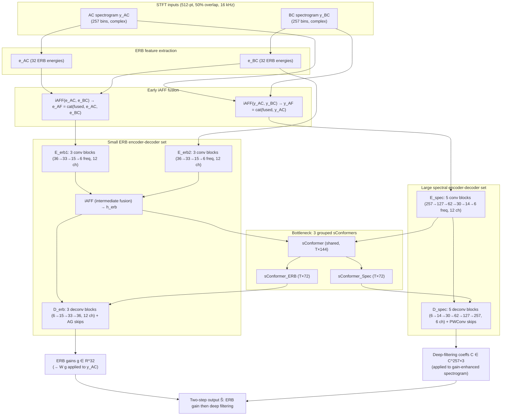

# Kuang, Yang, Wang & Yang 2025: Low-Complexity BC-Aided Speech Enhancement Leveraging Sub-Band and Full-Band Architecture

- **Authors**: [[entities/kelan-kuang|Kelan Kuang]], [[entities/feiran-yang|Feiran Yang]], [[entities/mou-wang|Mou Wang]], [[entities/jun-yang|Jun Yang]]
- **Affiliations**: Laboratory of Noise and Audio Research, Institute of Acoustics, Chinese Academy of Sciences; University of Chinese Academy of Sciences; State Key Laboratory of Acoustics and Marine Information, Institute of Acoustics, CAS
- **Venue**: Applied Acoustics, Vol. 236, 110924
- **Year**: 2025
- **Type**: Journal Article
- **DOI**: [10.1016/j.apacoust.2025.110924](https://doi.org/10.1016/j.apacoust.2025.110924)
- **Zotero**: [Open in Zotero](zotero://select/items/0_TP8WPKPL)

## Summary

This paper presents a low-complexity bone-conduction-aided speech enhancement model that jointly utilizes sub-band and full-band features of BC and AC speech via a two-step (coarse-then-fine) enhancement procedure: first estimating ERB sub-band gains to enhance the spectral envelope of noisy AC speech, then estimating deep-filtering coefficients to suppress residual noise at fine spectral resolution. A lightweight backbone with two encoder-decoder sets (small ERB pair + large spectral pair) plus [[concepts/iterative-attentional-feature-fusion|iAFF]] modules for early and intermediate BC/AC fusion achieves 40.3 MMACs/s — lower than most existing BC-aided methods — while attaining the best wb-PESQ (2.396 average), eSTOI (79.84%), and near-best SI-SDR on the 109-speaker A4BS corpus. The work demonstrates that band-compression designs can be made effective for BC-aided enhancement by adding a full-band deep-filtering stage, which suppresses the high-frequency narrowband noise that sub-band gains alone cannot address.

## Problem Formulation

STFT-domain signal model for frame $t$, bin $f$ (identical to the [[sources/kuang-2024-lightweight-speech-enhancement-bone-air|Kuang 2024 DenGCAN paper]] from the same group):

$$
Y_{AC}(t,f) = S(t,f) + V_b(t,f), \qquad Y_{BC}(t,f) = \phi(S(t,f)) + V_s(t,f)
$$

where $S$ is target speech, $V_b$ ambient noise, $V_s$ BC self-noise (sensor–body friction), and $\phi(\cdot)$ the time-variant nonlinear AC→BC mapping.

The enhancement runs in two steps. **Step 1** applies estimated sub-band gains $\mathbf{g}(t) \in \mathbb{R}^{B \times 1}$ via an interpolation matrix $\mathbf{W} \in \mathbb{R}^{F \times B}$:

$$
\hat{\mathbf{y}}(t) = \mathbf{W}\mathbf{g}(t) \otimes \mathbf{y}_{AC}(t)
$$

**Step 2** applies deep filtering of order $N$ to the gain-enhanced spectrogram:

$$
\hat{S}(t,f) = \sum_{i=1}^{N} C(t,f,i) \cdot \hat{Y}(t-i+1,f)
$$

The DNN thus estimates both the ERB gains $\mathbf{g}$ and the complex deep-filtering coefficients $\mathbf{C} \in \mathbb{C}^{F \times N}$ from the current frame of BC and AC speech: $[\mathbf{g}(t), \mathbf{C}(t)] = \mathcal{F}\{\mathbf{y}_{AC}(t), \mathbf{y}_{BC}(t)\}$.

**Motivation**: band-compression methods (PercepNet-style ERB gains, GTCRN-style band merging) are computationally cheap but merge multiple high-frequency bins into one sub-band, so a sub-band gain cannot suppress narrowband noise *within* a band. Conversely, high-capacity bone-air fusion models (DC-CRN, DenGCAN, DeepFilterNet) are hard to deploy on low-resource platforms. The two-step design assigns the coarse envelope correction to a tiny ERB branch and the fine-grained suppression to a full-band deep-filtering branch, keeping the total at 40.3 MMACs/s.

![[raw/papers/kuang-2025-low-complexity-bc-speech-enhancement/figures/8ecd2fe919bf9a64cfa56254a4c165a7504c4d2b45a327fd44e3dc9d26dfa9ed.jpg|Spectrograms of AC (left) and BC (right) speech]]
*Figure 1: Spectrograms of air-conducted and bone-conducted speech (external auditory canal position) — BC speech is noise-robust but band-limited.*

![[raw/papers/kuang-2025-low-complexity-bc-speech-enhancement/figures/b4723546ab7d6dfec3042756168fffecc65fa9add9473fd82525c1375d05496f.jpg|Two-step enhancement framework diagram]]
*Figure 2: Overview of the two-step speech enhancement framework — sub-band gains (coarse) followed by deep filtering (fine).*

## Methodology

### Sub-Band Feature Extraction

Both AC and BC spectra are divided into $B = 32$ ERB sub-bands. Sub-band energies are computed as:

$$
e^{(k)} = \frac{1}{N_k}\sum_{f=f_{k,min}}^{f_{k,max}} |Y(f)|
$$

giving $\mathbf{e}_{AC}, \mathbf{e}_{BC} \in \mathbb{R}^{B \times 1}$. The ERB bands are defined over the full frequency range (solid AC vs. dashed BC spectrum of vowel /e/ shown in Fig. 3) — unlike GTCRN's hard 2 kHz split that leaves only high frequencies compressed.

![[raw/papers/kuang-2025-low-complexity-bc-speech-enhancement/figures/32fc72c484f2048181d79cc80bd4ffd4e4c260811a3a2db9dc7e40cdd905cebf.jpg|ERB sub-band definitions overlaid on AC and BC spectra]]
*Figure 3: Sub-bands defined according to the ERB scale; solid = AC spectrum, dashed = BC spectrum of vowel /e/.*

### Modality Fusion (Early + Intermediate iAFF)

Fusion uses the [[concepts/iterative-attentional-feature-fusion|iAFF]] module (Dai et al. 2021), as in the group's [[sources/kuang-2024-lightweight-speech-enhancement-bone-air|prior DenGCAN paper]], but applied at three points:

- **Early fusion, ERB features**: $\mathbf{e}_{AF} = \mathrm{cat}(\mathcal{F}_{iAFF}\{\mathbf{e}_{AC}, \mathbf{e}_{BC}\}, \mathbf{e}_{AC}, \mathbf{e}_{BC})$
- **Early fusion, full-band features**: $\mathbf{y}_{AF} = \mathrm{cat}(\mathcal{F}_{iAFF}\{\mathbf{y}_{AC}, \mathbf{y}_{BC}\}, \mathbf{y}_{AC})$ — the output is concatenated *only* with $\mathbf{y}_{AC}$ (not $\mathbf{y}_{BC}$) to reduce compute; this asymmetry is deliberate.
- **Intermediate fusion**: after the two small ERB encoders, $\mathbf{h}_{erb} = \mathcal{F}_{iAFF}\{\mathcal{E}_{erb1}(\mathbf{e}_{AF}), \mathcal{E}_{erb2}(\mathbf{e}_{BC})\}$ in the embedding space.

Each iAFF fuses two modalities twice (coarse then refined) via attention coefficients $\alpha', \alpha$ computed from local + global context (see the iAFF concept page). The paper justifies early + intermediate fusion over late fusion by noting BC–AC differences are less pronounced than audio–visual ones, and early fusion is cheaper at comparable performance.

### Model Structure, Inputs, and Outputs

The backbone comprises three convolutional encoders ($\mathcal{E}_{erb1}, \mathcal{E}_{erb2}$ small; $\mathcal{E}_{spec}$ large), two decoders ($\mathcal{D}_{erb}$ small; $\mathcal{D}_{spec}$ large), and a bottleneck of three grouped sConformer blocks (one shared + two parallel). Figure 4 shows the overall structure; Table 1 of the paper gives the full layer sizes.

![[raw/papers/kuang-2025-low-complexity-bc-speech-enhancement/figures/44c587a96f264fab666b11a000bea31881c0eeda76088dc7c08c0a8642abed5d.jpg|Structural diagram of the proposed model]]
*Figure 4: Structural diagram of the proposed model — ERB feature extractors, iAFF fusion modules, and the backbone network with separate ERB and spectral encoder-decoder sets.*

**Backbone network spec (from paper Table 1):**

| Component | Structure (input → output, channels × frames × freq) | Role |
|-----------|--------------------------------------------------------|------|
| $\mathcal{E}_{erb1}$ | 3×T×36 → 12×T×33 → 12×T×15 → 12×T×6 (kernels (2,4) then (1,4); strides 1 then (2,1)) | Encode fused ERB features $\mathbf{e}_{AF}$ |
| $\mathcal{E}_{erb2}$ | 1×T×36 → 12×T×33 → 12×T×15 → 12×T×6 | Encode BC-only ERB features $\mathbf{e}_{BC}$ |
| $\mathcal{E}_{spec}$ | 4×T×257 → 12×T×127 → 12×T×62 → 12×T×30 → 12×T×14 → 12×T×6 | Encode fused full-band features $\mathbf{y}_{AF}$ |
| Bottleneck | sConformer (T×144) → {sConformer_ERB (T×72), sConformer_Spec (T×72)}, 4 groups + channel shuffle | Model temporal dependencies |
| $\mathcal{D}_{erb}$ | 24×T×6 → 12×T×15 → 12×T×33 → 1×T×36, AG skip-connections | Estimate 32 ERB gains |
| $\mathcal{D}_{spec}$ | 24×T×6 → 12×T×14 → 12×T×30 → 12×T×62 → 12×T×127 → 6×T×257, PWConv skip-connections | Estimate N=3 deep-filtering coefficients per TF bin |

Key architectural choices for complexity control:

- **HardSwish activation** in conv blocks instead of ReLU — in low-dimensional embedding spaces ReLU causes information loss (per MobileNetV2/V3 findings); HardSwish is better suited to models with lower convolutional channels.
- **Depthwise separable convolutions** replace standard convolutions in decoders.
- **sConformer grouping** (4 groups, channel shuffle between layers).
- The last layer of $\mathcal{D}_{spec}$ outputs $2 \times N = 6$ channels — the real/imaginary parts of the $N$-order deep-filtering coefficients.
- **Inputs**: 512-point FFT ($F = 257$) with 50% overlap (32 ms window / 16 ms hop at 16 kHz); ERB features use $B = 32$ bands; deep filtering order $N = 3$. Model is causal.
- **Outputs**: 32 sub-band gains per frame (interpolated to 257 bins via $\mathbf{W}$) and 257×3 complex deep-filtering coefficients per frame.
- **Training data**: ~200 h training / 25 h validation / 25 h test synthesized from the A4BS corpus (109 Mandarin speakers; 87 train / 22 split val-test), SNR ∈ [−15, 5] dB.

### Training Losses

Weighted combination of real/imaginary and magnitude losses on the final enhanced spectrogram (same form as the DenGCAN paper):

$$
\mathcal{L}_{RI} = \|\hat{\mathbf{S}}_r - \mathbf{S}_r\|_F + \|\hat{\mathbf{S}}_i - \mathbf{S}_i\|_F
$$
$$
\mathcal{L}_{Mag} = ||\hat{\mathbf{S}}| - |\mathbf{S}||_F
$$
$$
\mathcal{L}_{RI-Mag} = 0.5\,\mathcal{L}_{RI} + 0.5\,\mathcal{L}_{Mag}
$$

Adam optimizer with weight decay; linear warm-up 2e-5 → 2e-4 then cosine decay back to 2e-5; 250 epochs with early stopping (patience 20).

## Experimental Setup

| Parameter | Value |
|-----------|-------|
| **Dataset** | A4BS (air and four bone-conducted speech) — 109 Mandarin speakers, ~1 h each; experiments use BC from external auditory canal position |
| **Train/Val/Test speakers** | 87 / 22 split into validation and test (11+11) |
| **Noise — training** | ICASSP2022 DNS Challenge, QUT Noise, Environmental Background Noise, MUSAN (music) |
| **Noise — test** | Non-speech115, NOISEX-92, CHiME-3, MUSAN |
| **SNR** | Uniform [−15, 5] dB; metrics reported per sub-range [−15,−9] / [−9,−2] / [−2,5] |
| **Data volume** | ~200 h train, 25 h val, 25 h test, 4-second clips, 16 kHz |
| **STFT** | 512-point FFT, 50% overlap |
| **ERB bands / DF order** | $B = 32$, $N = 3$ |
| **Metrics** | wb-PESQ, eSTOI, SI-SDR |
| **Platforms** | Quad-core ARM and x86 for RTF |

**Competitive models** (all bone-air fusion variants given the same iAFF fusion strategy for fairness; channel counts adjusted for comparable complexity where needed):

| Model | Modality | Causal | Params (K) | MACs (M) |
|-------|----------|-------|-----------:|----------:|
| GTCRN-AC (Rong et al. 2024, AC-only) | air | T | 23.7 | 33.8 |
| GTCRN (Rong et al. 2024) | bone-air | T | 24.9 | 42.8 |
| DeepFilterNet (Schröter et al. 2022) | bone-air | T | 755.6 | 88.7 |
| DC-CRN (Wang et al. 2022) | bone-air | T | 205.5 | 181.1 |
| DenGCAN (Kuang et al. 2024) | bone-air | T | 231.3 | 162.9 |
| **Proposed** | bone-air | T | 256.4 | **40.3** |

## Results

### Objective metrics (test set, average over three SNR ranges)

| Model | wb-PESQ [−15,−9] | wb-PESQ [−9,−2] | wb-PESQ [−2,5] | eSTOI [−15,−9] | eSTOI [−9,−2] | eSTOI [−2,5] | SI-SDR [−15,−9] | SI-SDR [−9,−2] | SI-SDR [−2,5] |
|-------|---:|---:|---:|---:|---:|---:|---:|---:|---:|
| Noisy AC | 1.116 | 1.106 | 1.165 | 36.00 | 48.84 | 63.01 | −11.34 | −4.95 | 1.96 |
| BC speech | 1.576 | 1.575 | 1.581 | 59.46 | 59.59 | 59.66 | −12.49 | −13.00 | −12.74 |
| GTCRN-AC | 1.393 | 1.649 | 2.024 | 50.27 | 64.70 | 76.69 | 3.78 | 7.90 | 12.10 |
| DeepFilterNet | 1.820 | 2.102 | 2.433 | 72.96 | 78.40 | 83.35 | 6.60 | 9.39 | 12.22 |
| DC-CRN | 1.896 | 2.189 | 2.541 | 74.00 | 79.23 | 84.10 | 6.44 | 9.65 | 13.07 |
| DenGCAN | 1.842 | 2.143 | 2.531 | 73.95 | 79.24 | 84.40 | 6.45 | 9.77 | 13.47 |
| GTCRN | 2.002 | 2.300 | 2.652 | 73.56 | 78.88 | 83.98 | 7.14 | 10.40 | 14.02 |
| **Proposed** | **2.102** | **2.396** | **2.747** | **74.82** | **79.84** | **84.61** | 7.08 | 10.18 | 13.55 |

The proposed model attains the best quality and intelligibility at the lowest MACs. BC speech is highly beneficial: GTCRN vs. GTCRN-AC shows large gaps on all metrics, confirming that a noise-immune BC reference is transformative at very low SNR. GTCRN — with only ~1/4 the MACs of DenGCAN/DC-CRN — beats both, and the proposed model improves on GTCRN further while keeping MACs at 40.3 M. Spectrograms (Fig. 6) show DeepFilterNet/GTCRN leave more high-frequency residual noise than DC-CRN/DenGCAN/proposed, attributed to the absence of fine-grained high-frequency noise reduction; the proposed model sits between GTCRN and the heavier models.

### Real-time factor (RTF)

| Model | MACs (M) | RTF (ARM) | RTF (x86) |
|-------|---------:|----------:|----------:|
| DeepFilterNet | 88.7 | 0.579 | 0.109 |
| DC-CRN | 181.1 | 0.271 | 0.039 |
| DenGCAN | 162.9 | 0.291 | 0.050 |
| GTCRN | 42.8 | 0.446 | 0.097 |
| **Proposed** | 40.3 | **0.159** | 0.043 |

Despite near-identical MACs, the proposed model's RTF is 2.8× lower than GTCRN's on ARM — the dual-path RNN (DPRNN) bottleneck of GTCRN is hard to parallelize, whereas the sConformer bottleneck parallelizes well. Caveat: the proposed model may need **more memory** at real-time inference, since self-attention caches query/key states per layer, while RNN-based models cache only a state tensor.

### Ablation studies

| Variant | MACs (M) | wb-PESQ (3 SNR ranges) | eSTOI (3 ranges, %) |
|---------|---------:|---|---|
| **Proposed** | 40.3 | 2.102 / 2.396 / 2.747 | 74.82 / 79.84 / 84.61 |
| w/o deep filtering | 24.9 | 1.126 / 1.219 / 1.420 | 57.13 / 67.16 / 76.91 |
| w/o ERB gain | 37.8 | 1.809 / 2.061 / 2.359 | 73.10 / 78.45 / 83.48 |

- **Deep filtering is the dominant contributor**: removing it collapses wb-PESQ to near-noisy levels (1.126 at [−15,−9] dB). The ERB-gain stage adds ~2.5 MMACs and delivers a significant additional improvement — the cascade of coarse-then-fine noise reduction is beneficial. Spectrogram evidence (Figs. 7–8): ERB gains alone suppress broadband noise but leave harmonic noise (siren/ringing) under-suppressed due to the low resolution of ERB bands; adding deep filtering removes most residual noise.
- **Deep filtering vs. cRM** (substituting $N=1$): DF wins on all metrics at slightly higher complexity (40.3 vs. 39.6 MMACs; wb-PESQ 2.396 vs. 2.322 mid-range).
- **Activation function**: HardSwish > ReLU > PReLU in the low-channel regime (e.g., wb-PESQ 2.396 vs. 2.355 mid-range).
- **iAFF**: removing all iAFF modules (early or intermediate, replaced by concat/add) degrades wb-PESQ modestly (2.396 → 2.376 mid-range); iAFF affects quality more than intelligibility. Replacing iAFF with **cross attention** (BC as Query, AC as Key/Value) costs more MACs (44.21 vs. 40.26) *and* degrades quality (2.337 mid-range) — iAFF is both cheaper and better.
- **Band-compression strategy**: replacing the full-range ERB banding with GTCRN-style band merging (high frequencies only, merging the two encoder-decoder sets into one) costs −0.146 average wb-PESQ and −1.64% eSTOI at *higher* MACs (44.3 M) — evidence that the separate sub-band/full-band architecture, not just the total capacity, drives the advantage.

## Key Contributions

1. **Sub-band + full-band two-step BC-aided enhancement**: a coarse-to-fine procedure pairing 32 ERB sub-band gains (envelope correction) with full-band $N{=}3$ deep filtering (fine noise suppression) — the first combination of band-compression efficiency with fine-grained suppression in the bone-air fusion setting, solving the high-frequency narrowband-noise failure mode of pure band-compression designs.
2. **Separate encoder-decoder sets per processing granularity**: small ERB encoders/decoder for the gain branch and large spectral encoders/decoder for the deep-filtering branch, sharing a grouped-sConformer bottleneck — achieving best-in-class quality at 40.3 MMACs/s, below most existing BC-aided methods.
3. **Early + intermediate iAFF fusion of BC and AC**: two early-fusion modules (ERB energies and full-band spectra) plus one embedding-space intermediate fusion — validated as cheaper and better than cross attention.
4. **Empirical design rules for low-channel regimes**: HardSwish over ReLU/PReLU in low-dimensional embedding spaces; depthwise separable convolutions in decoders; evidence that sConformer bottlenecks yield much lower RTF than DPRNN at equal MACs (0.159 vs. 0.446 on ARM).
5. **BC benefit quantification on A4BS**: GTCRN (bone-air) vs. GTCRN-AC at matched complexity isolates the BC contribution — e.g., +0.61 wb-PESQ at [−15,−9] dB.

## Related Concepts

- [[concepts/sub-band-full-band-architecture|Sub-Band and Full-Band Architecture]]
- [[concepts/deep-filtering|Deep Filtering]]
- [[concepts/erb-scale|ERB Scale]]
- [[concepts/iterative-attentional-feature-fusion|Iterative Attentional Feature Fusion (iAFF)]]
- [[concepts/attention-gate|Attention Gate (AG)]]
- [[concepts/densely-gated-convolutional-attention-network|DenGCAN]]
- [[concepts/gtcrn|GTCRN]]
- [[concepts/bone-conduction|Bone Conduction]]
- [[concepts/bcs-guided-speech-enhancement|BCS-Guided Speech Enhancement]]
- [[concepts/depthwise-separable-convolution|Depthwise Separable Convolution]]

## Related Synthesis

- [[synthesis/multimodal-bc-speech-enhancement|Multimodal Smart Hearables: Bone-Conduction Aided Speech Enhancement]]
- [[synthesis/computational-efficiency-evolution|Computational Efficiency Evolution]]
