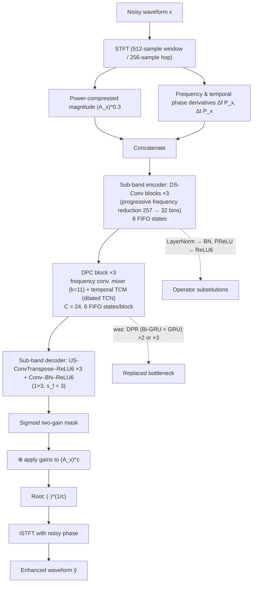

# Laroche & Olsson 2026: Beyond Model Size — Redesigning LiSenNet for Embedded Speech Enhancement

**Authors**: [[entities/clement-laroche|Clément Laroche]], [[entities/rasmus-kongsgaard-olsson|Rasmus Kongsgaard Olsson]]
**Affiliations**: GN Audio A/S, Denmark (both authors previously co-authored the Conv-FSENet line at GN Hearing)
**Venue**: arXiv preprint 2609.29866 (2026-09-24)
**Type**: Preprint
**DOI**: [10.48550/arXiv.2609.29866](https://doi.org/10.48550/arXiv.2609.29866)
**Zotero**: [Open in Zotero](zotero://select/items/0_X3MPPVQJ)

## Summary

This paper redesigns LiSenNet — a 37k-parameter sub-band dual-path speech enhancer — for deployment on the **STM32N6 microcontroller's Neural-ART NPU**, showing that parameter and MAC counts do not predict deployed efficiency on restricted accelerators. The dual-path GRU bottleneck is replaced by a depthwise-separable frequency mixer plus a causal dilated temporal convolutional network, and the remaining unsupported operators (LayerNorm, PReLU, Mish, sub-pixel upsampling) by foldable BatchNorm, ReLU6, and a 1×3 transposed convolution. The resulting fully-int8 LiSenNet-NPU reaches PESQ 3.08 (FP32) / **3.01 (int8)** on VoiceBank-DEMAND — matching or exceeding the recurrent baseline (3.01/2.93) — and processes each 16 ms frame in **4.83 ms (RTF 0.30)** on the NPU.

## Problem Formulation

Deploying real-time speech enhancement on resource-constrained devices requires meeting strict latency, memory, and energy constraints. Microcontroller NPUs (Arm Ethos-U, STMicroelectronics Neural-ART) can accelerate neural inference, but only through a **restricted set of operators in static, integer-quantized graphs**: predominantly convolutional and matrix-multiplication workloads with tensor dimensions fixed at compile time. Unsupported operations are assigned to the integrated Cortex-M55 host, and for small streaming networks the resulting host execution, data transfers, and scheduling overheads can dominate the cost of supported arithmetic.

Recent SE networks have reduced parameters and MACs to levels nominally suitable for microcontrollers — but low parameter and MAC counts **do not themselves guarantee efficient execution on embedded NPUs**. A model that is compact by conventional measures may still rely on recurrent layers, runtime normalization, dynamic tensor operations, or nonlinearities that fixed-function NPUs do not support (compile failure, host fallback, or data-transfer overheads dominating arithmetic cost).

For [[concepts/lisennet|LiSenNet]] specifically (37k params, competitive quality), the deployment gaps on the STM32N6 are:

1. **Frequency-axis bidirectional GRU** — cannot be imported as a supported recurrent operator; unrolling its 32 frequency steps introduces ~850 tensor-slicing operations and causes the compiler to stall;
2. **Multi-dimensional LayerNorm** — runtime normalization over dynamic tensor extents;
3. **PReLU and Mish activations** — not in the supported int8 operator set;
4. **Reshape-based sub-pixel upsampling** — unsupported rank-5 intermediate tensors.

The research question: which architectural, quantization, and streaming choices are required to preserve enhancement quality while achieving real-time execution on a restricted MCU NPU — versus model compression alone?

## Methodology

The redesign preserves LiSenNet's sub-band encoder, progressive frequency reduction, U-Net skip connections, and mask decoder, while redesigning the dual-path recurrent bottleneck and replacing the remaining unsupported operators.

### Bottleneck Replacement: Dual-Path Convolutional Mixer (DPC)

The frequency-axis Bi-GRU is replaced by a **depthwise-separable convolutional frequency mixer**: a symmetric depthwise convolution along frequency (kernel size 11, selected over several explored sizes as the best quality) followed by a pointwise convolution for channel mixing. Symmetric frequency context introduces no temporal look-ahead, since the complete spectrum of the current frame is available at once — mirroring the original argument that a frequency-axis Bi-GRU is causal in time. The convolutional mixer maps directly to NPU-supported convolutional primitives.

### Operator Replacements

| Original (LiSenNet) | Replacement (LiSenNet-NPU) | Rationale |
|---|---|---|
| Multi-dim LayerNorm | Per-channel BatchNorm (folded into preceding conv at inference) | Static, foldable into conv weights |
| PReLU / Mish | ReLU6 | Supported int8 operator; bounds activation range for quantization robustness |
| Reshape-based sub-pixel upsampling | 1×3 transposed convolution, stride 3 along frequency | Avoids rank-5 tensors; cuts decoder arithmetic ~3× |

The temporal GRU is handled separately (next subsection): the primary model replaces it with a **causal temporal convolutional network (TCN)** — depthwise convolutions with increasing dilations, pointwise channel mixing, and convolutional gating — assembled into repeated DPC blocks (frequency mixer + temporal TCM). The bottleneck width is $C = 24$ (selected from {20, 24, 28}).

### Temporal Modeling and Streaming State

Notably, the temporal GRU *could* be deployed on Neural-ART (by exposing its hidden state as graph input/output and expressing its affine transformations as dense operations) — the authors evaluate this hybrid variant too. The TCN replacement in the primary model is motivated instead by:

- **Recurrent-state drift**: gated recurrent speech enhancers can exhibit internal-state drift during long-duration streaming (citing Fast-ULCNet);
- **Quantization error accumulation**: errors in quantized recurrent states may accumulate over time (citing Li & Alvarez);
- A **convolutional FIFO state** is kept for only a fixed number of frames, so any error is eventually flushed out of the receptive field.

The final LiSenNet-NPU stacks three DPC blocks with dilations up to 16 (receptive field 196 frames ≈ 3.1 s), plus a bounded ReLU6 decoder ("lim-ReLU6"), reaching 46.2k parameters.

### Model Structure, Inputs, and Outputs

**LiSenNet-NPU (main SE network)**

| Spec | Value |
|------|-------|
| **Structure** | Sub-band encoder (3 DS-Conv blocks, progressive frequency reduction 257 → 32 bins) → 3 DPC blocks (frequency depthwise-sep conv mixer k=11 + temporal causal dilated TCN with gating, C=24) → sub-band decoder (3 US-ConvTranspose–ReLU6, 1×3 stride-3 + Conv–BN–ReLU6) → Sigmoid two-gain mask; ReLU6 ("lim-ReLU6") in decoder |
| **Input** | Power-compressed magnitude $(|\mathbf{X}|)^{0.3}$ concatenated with normalized frequency derivative of phase and normalized instantaneous-frequency deviation, per 16 ms frame (256-sample hop, 512-sample STFT window) |
| **Output** | Two spectral gains (Sigmoid) per frame; applied to the compressed magnitude, de-compressed by $(\cdot)^{1/c}$, resynthesized via iSTFT with noisy phase — one 16 ms output frame per 16 ms input hop |
| **Training data** | VoiceBank-DEMAND (16 kHz, original train/test partition), CMGAN recipe |
| **Role** | NPU-compatible real-time magnitude-masking SE back-end |
| **Size / cost** | 46.2k parameters, 1.66 M MACs/frame; 45.0 KiB int8 weights; 154 KiB FIFO state across 25 tensors; 4.83 ms/frame on Neural-ART |

**Temporal-GRU hybrid variant** (deployment alternative): the TCN is swapped back for the GRU bottleneck (hidden state as graph input/output, affine transforms as dense ops) — 45.6k params, 17 KiB state, 2.18 ms/frame at int8 PESQ 2.98.

### Training Losses

All models (reproduced LiSenNet baseline included) are trained from scratch with the **same CMGAN recipe** — the objective combines complex-spectrum, magnitude-spectrum, and adversarial losses with weights **0.1 / 0.9 / 0.05**:

$$\mathcal{L} = 0.9\,\mathcal{L}_{\mathrm{mag}} + 0.1\,\mathcal{L}_{\mathrm{comp}} + 0.05\,\mathcal{L}_{\mathrm{adv}}$$

- $\mathcal{L}_{\mathrm{mag}}$ — magnitude-spectrum loss (compressed-domain);
- $\mathcal{L}_{\mathrm{comp}}$ — complex-spectrum loss;
- $\mathcal{L}_{\mathrm{adv}}$ — adversarial loss with a **perceptual discriminator trained to approximate wideband PESQ** (MetricGAN+ tradition).

Optimizer: AdamW ($\beta_1 = 0.8$, $\beta_2 = 0.99$), initial lr $5\times 10^{-4}$ with ×0.98 decay, 140 epochs. (Same weight ordering as the [[sources/yan-2025-lisennet|original LiSenNet recipe]] — "CMGAN recipe" here refers to the MetricGAN+-style adversarial PESQ-proxy training popularized by CMGAN; see [[concepts/pesq|PESQ]] for the PESQ-loss tradition.)

### Quantization and Deployment Flow

- Export + quantization: ONNX Runtime **static post-training quantization** — signed int8 activations, per-channel signed int8 weights, percentile-based calibration; no floating-point fallback to the host;
- Hardware: STM32N6 (Neural-ART NPU at 1 GHz, Cortex-M55 at 800 MHz) via ST Edge AI Core 4.0.1;
- Latency measured with the target validation tool over 10 runs; execution-epoch assignments and memory from compiler report, verified with on-device per-epoch profiler;
- Stateful frame-based inference: intermediate activations are kept in **FIFO state buffers** between frames (streaming), contrasted against **stateless receptive-field recomputation** (full RF recomputed per output frame).

## Experimental Setup

| Parameter | Setting |
|-----------|---------|
| **Dataset** | VoiceBank-DEMAND, 16 kHz; original train/test partition; full 824-utterance test set |
| **STFT** | 512-sample window, 256-sample hop (16 ms frame shift) |
| **Training** | CMGAN recipe; losses (complex, magnitude, adversarial) = 0.1 / 0.9 / 0.05; PESQ-proxy discriminator; AdamW (β₁=0.8, β₂=0.99), lr 5e-4 × 0.98 decay, 140 epochs; all models (incl. baseline) retrained from scratch |
| **Quantization** | ONNX Runtime static PTQ: signed int8 activations, per-channel int8 weights, percentile calibration |
| **Hardware** | STM32N6570-DK, Neural-ART @ 1 GHz, Cortex-M55 @ 800 MHz, ST Edge AI Core 4.0.1 |
| **Metrics** | Wideband PESQ (P-32/P-8), STOI, SI-SDR, DNSMOS P.835 (SIG/BAK/OVRL); MACs/frame, state size, KiB weights, ms/frame, RTF |
| **Baselines** | Reproduced LiSenNet (recurrent), 11 LiSenNet variants, NSNet2 (dense, 2.78M params), Conv-FSENet (1.45M params) |

## Results

### Enhancement Quality Ablation (VoiceBank-DEMAND, Table 1)

P-32 / P-8 = float32 / int8 PESQ; each "+" row adds the change to the configuration above.

| Model | Params | RF | P-32 | P-8 |
|---|---|---|---|---|
| LiSenNet (recurrent, reproduced) | 36.8k | ∞ | 3.01 | 2.93 |
| + dual-path conv. mixer | 41.1k | 68 | 2.97 | 2.86 |
| + NPU-friendly ops, C=20 | 25.7k | 68 | 2.90 | 2.85 |
| NPU-friendly ops, C=24 | 36.3k | 68 | 3.01 | **3.00** |
| NPU-friendly ops, C=28 | 48.7k | 68 | 2.93 | 2.87 |
| + dilation 16 (from C=24) | 37.7k | 132 | 3.03 | 2.95 |
| + third DPC block | 46.2k | 196 | 3.07 | 2.99 |
| **LiSenNet-NPU (+ lim-ReLU6)** | 46.2k | 196 | **3.08** | **3.01** |

Findings: (i) replacing the recurrent bottleneck costs little (−0.04 FP32 PESQ), and NPU-friendly ops + width C=24 *recover* it — matching the recurrent baseline pre-quantization and exceeding it by +0.07 post-quantization; (ii) the C=24 model's quantization loss is only **0.01 PESQ vs. 0.08 for the original LiSenNet** — ReLU6's bounded activations make the network quantization-robust; (iii) quality is *not* monotonic in bottleneck width (C=20 and C=28 both worse); (iv) longer temporal context improves FP32 but the gains are only partly retained after quantization; (v) bounding the decoder activations (lim-ReLU6) adds +0.015 FP32 / +0.029 int8 PESQ at unchanged parameters.

### Additional Metrics (Table 2, int8)

| System | STOI | SI-SDR | SIG | BAK | OVRL |
|---|---|---|---|---|---|
| Noisy | 0.921 | 8.4 | 3.04 | 2.17 | 1.98 |
| LiSenNet, int8 | 0.934 | **17.7** | 3.02 | 3.63 | 2.64 |
| LiSenNet-NPU, int8 | **0.934** | 16.9 | **3.05** | **3.67** | **2.69** |

LiSenNet-NPU matches STOI and improves all three DNSMOS scores over the quantized recurrent baseline, but loses ~0.8 dB SI-SDR (the prose says "18.8 to 17.3 dB"; Table 2 lists 17.7 → 16.9 — a minor internal inconsistency in the paper). Finite-context convolutional design + constrained decoder preserves intelligibility and perceptual scores, not the recurrent model's waveform-reconstruction accuracy.

### On-Device Results (STM32N6, Table 3, static int8)

| Model | Params | RF | MACs/frame | State tensors | State size | Weights | ms/frame | RTF | P-8 |
|---|---|---|---|---|---|---|---|---|---|
| *Conv mixer + temporal conv mixer (FIFO streaming)* | | | | | | | | | |
| + NPU-friendly ops, C=20 | 25.7k | 68 | 0.92 M | 17 | 47 KiB | 24.9 KiB | 2.59 | 0.16 | 2.85 |
| NPU-friendly ops, C=24 | 36.3k | 68 | 1.30 M | 17 | 57 KiB | 35.3 KiB | 2.79 | 0.17 | 2.96 |
| NPU-friendly ops, C=28 | 48.7k | 68 | 1.75 M | 17 | 66 KiB | 47.3 KiB | 3.15 | 0.20 | 2.87 |
| + dilation 16 | 37.7k | 132 | 1.38 M | 19 | 105 KiB | 36.6 KiB | 3.63 | 0.23 | 2.95 |
| + third DPC block | 46.2k | 196 | 1.69 M | 25 | 154 KiB | 44.8 KiB | 4.88 | 0.30 | 2.99 |
| **LiSenNet-NPU (+ lim-ReLU6)** | 46.2k | 196 | 1.66 M | 25 | 154 KiB | 45.0 KiB | **4.83** | 0.30 | **3.01** |
| *Conv mixer + temporal GRU (recurrent state)* | | | | | | | | | |
| + NPU-friendly ops, C=24 | 36.4k | ∞ | 1.29 M | 11 | 13 KiB | 35.4 KiB | **1.82** | **0.11** | 2.87 |
| + third DPC block | 45.6k | ∞ | 1.59 M | 13 | 17 KiB | 44.4 KiB | 2.18 | 0.14 | 2.98 |
| *Conv mixers, stateless (RF recomputation)* | | | | | | | | | |
| + NPU-friendly ops, C=20 | 25.7k | 68 | 66.55 M | 0 | — | 24.9 KiB | 29.93 | 1.87 | 2.85 |
| NPU-friendly ops, C=28 | 48.7k | 68 | 123.76 M | 0 | — | 47.3 KiB | 40.01 | 2.50 | 2.87 |
| + third DPC block | 46.2k | 196 | 336.31 M | 0 | — | 44.8 KiB | 127.16 | 7.95 | 2.99 |
| *Other model families (same board, flow, FIFO streaming)* | | | | | | | | | |
| Conv-FSENet | 1.45M | 68 | 1.47 M | 9 | 15.8 KiB | 1411.5 KiB | 4.40 | 0.28 | 2.91 |
| NSNet2 dense | 2.78M | ∞ | 2.78 M | 2 | 0.8 KiB | 2720.0 KiB | 22.94 | 1.43 | 2.83 |

Key findings:

- **Persistent state is essential**: the C=20 model needs 0.92 M MACs and 2.59 ms/frame with FIFO state vs. 66.55 M MACs and 29.93 ms stateless; the deep model grows from 1.69 to 336.31 M MACs and 4.88 to 127.16 ms. **No stateless variant meets the 16 ms deadline** (order-of-magnitude slower despite higher NPU utilization);
- **Model size ≠ deployed efficiency**: LiSenNet-NPU (46.2k params) beats Conv-FSENet (1.45M, PESQ 2.91, 4.40 ms) and dense NSNet2 (2.78M, PESQ 2.83, 22.94 ms, RTF 1.43 — not real-time) on both quality and latency — 31–60× fewer parameters;
- **Streaming state costs memory**: LiSenNet-NPU stores 154 KiB across 25 FIFO tensors — >3× its 45 KiB weights; the temporal-GRU variant shrinks this to 17 KiB and 2.18 ms/frame by carrying a compact recurrent state instead of convolutional FIFOs (at −0.03 PESQ vs. the TCN primary model).

Figure 2 (latency-vs-quality scatter with Pareto front) is reported graphically in the paper; all numeric values appear in Table 3 above.

## Key Contributions

1. **NPU-compatible LiSenNet redesign**: replaces the dual-path GRU bottleneck with a depthwise-separable frequency mixer (k=11) + causal dilated temporal convolutional network, plus operator substitutions (foldable BatchNorm, ReLU6, transposed-conv upsampling) — the resulting graph uses only integer-NPU-mappable operators while matching or exceeding the recurrent reference's quality (int8 PESQ 3.01 vs. 2.93).
2. **Quantization-robust by design**: bounded decoder activations (ReLU6) and the fully static int8 quantization (no FP fallback) cut the quantization loss from 0.08 to 0.01 PESQ at C=24, and lim-ReLU6 recovers the deep model's long-context gains post-quantization (+0.029 int8 PESQ).
3. **Stateful vs. stateless streaming study on real hardware**: deployed on the STM32N6, stateful FIFO inference meets the 16 ms deadline (4.83 ms/frame, RTF 0.30) while stateless receptive-field recomputation is an order of magnitude slower (127 ms/frame for the deep model) — streaming latency depends jointly on operator support, quantization, host–NPU partitioning, and state handling.
4. **"Beyond model size" evidence**: parameter count and operator compatibility, quantization range, and persistent streaming state must be **co-designed** — model size alone does not predict deployed quality or execution time (46.2k-param LiSenNet-NPU beats 1.45M-param Conv-FSENet and 2.78M-param NSNet2 on both axes).

## Related Concepts

- [[concepts/lisennet|LiSenNet]]
- [[concepts/lisennet-npu|LiSenNet-NPU]]
- [[concepts/mcu-npu-deployment|MCU NPU Deployment]]
- [[concepts/stateful-streaming-inference|Stateful Streaming Inference]]
- [[concepts/post-training-quantization|Post-Training Quantization]]
- [[concepts/relu6-quantization-robustness|ReLU6 Quantization Robustness]]
- [[concepts/depthwise-separable-convolution|Depthwise-Separable Convolution]]
- [[concepts/dprnn|Dual-Path RNN (DPRNN)]]
- [[concepts/sub-band-convolution|Sub-band Convolution]]
- [[concepts/sub-pixel-convolution|Sub-Pixel Convolution]]
- [[concepts/gated-recurrent-unit|Gated Recurrent Unit (GRU)]]
- [[concepts/voicebank-demand|VoiceBank+DEMAND]]
- [[concepts/pesq|PESQ]]
- [[concepts/pesq|PESQ]] (MetricGAN+-style adversarial training — PESQ-proxy discriminator)
- [[concepts/tinyml|TinyML]]

## Related Synthesis

- [[synthesis/computational-efficiency-evolution|Computational Efficiency Evolution]]
- [[synthesis/deep-speech-enhancement|Deep Speech Enhancement]]

## Related Sources

- [[sources/yan-2025-lisennet|Yan et al. 2025: LiSenNet]] — the redesigned baseline; its dual-path GRU, LayerNorm/PReLU/Mish, and sub-pixel upsampling are exactly the operators replaced here
- [[sources/kim-2026-faster-enhancer|Kim 2026: faster-enhancer.c]] — complementary evidence on recurrent quantization: per-frame activation ranges + fp16 state let GRUs quantize to W8A8 cleanly, whereas this paper sidesteps recurrence entirely in the primary model
- [[sources/le-2026-efficient-nn-tinyml-review|Lê, Wolinski & Arbel 2026: Efficient NNs for TinyML]] — reviews MCU quantization constraints; this paper is the speech-enhancement instantiation of operator-level co-design
