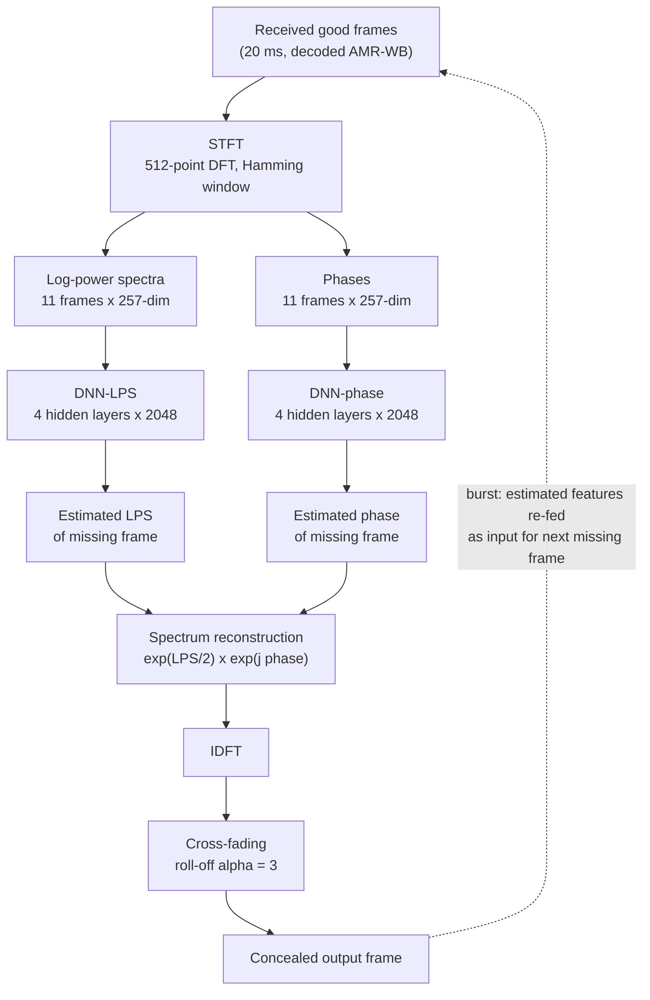

# Lee & Chang 2016: DNN-Based Packet Loss Concealment

**Authors**: [[entities/bong-ki-lee|Bong-Ki Lee]], [[entities/joon-hyuk-chang|Joon-Hyuk Chang]] (Hanyang University, Seoul, Korea)
**Venue**: IEEE/ACM Transactions on Audio, Speech, and Language Processing, Feb. 2016
**Year**: 2016
**Type**: Journal article
**DOI**: [10.1109/TASLP.2015.2509780](https://doi.org/10.1109/TASLP.2015.2509780)
**Zotero**: [5QKLI6JI](zotero://select/items/0_5QKLI6JI)

## Summary

This paper proposes the first (to the authors' knowledge) regression-based packet loss concealment (PLC) algorithm using deep neural networks: two separately trained feed-forward DNNs map the log-power spectra and phases of preceding good frames to those of the missing frame. With RBM-based pre-training, an asymmetric MMSE fine-tuning that penalizes spectral overestimation, recursive re-feeding for burst losses, and cross-fading at the reconstruction boundaries, the method outperforms the AMR-WB Appendix I standard PLC and the HMM-based PLC on LSD, PESQ, and MOS, and dramatically reduces word error rate when used as a pre-processor for network speech recognition.

## Problem Formulation

Voice packets in VoLTE/VoIP systems are lost due to network delay and jitter; the jitter buffer can only compensate up to a tolerable delay, so the receiver needs a PLC algorithm to reconstruct missing frames. Receiver-based PLC (a post-processing step after decoding, bit-stream compatible) is preferred over sender-based schemes (retransmission, interleaving, FEC) which cost bandwidth and transmitter modifications.

Conventional receiver-based PLC falls into several families, each with weaknesses:

- **Waveform-based** (pitch waveform replication, overlap-add interpolation) — easy to implement, but phase/envelope mismatch degrades quality at high loss rates.
- **LP-based** (Gündüzhan; AR-model MMSE prediction) — annoying artifacts during consecutive losses because the excitation of the last good frame is reused.
- **TSM-based** (SOLA, WSOLA) — natural-sounding except at high loss rates and signal transitions.
- **Shallow statistical models** (GMM-based LSF estimation; [[concepts/packet-loss-concealment|HMM-based PLC]]) — statistically inefficient for the *non-linear* dynamics of acoustic features; HMM parameter trajectories evolve more naturally than substitution schemes but cannot capture the non-linearities.
- **Standard codec PLC** (AMR-WB Appendix I) — a state machine with substitution and muting (eqs. 1–4): attenuated median-based substitution of LTP/FC gains, ISF concealment $ISF_q(i) = \alpha \cdot past\_ISF_q(i) + (1-\alpha) \cdot ISF_{mean}(i)$ with $\alpha = 0.9$, and history-buffer LTP-lag prediction. Parameters are muted toward zero after six consecutive losses; the scheme is vulnerable to burst errors because it ignores the statistical evolution of speech.

The paper's premise: a DNN's superior generative modeling capability (already proven for VAD, speech enhancement, BWE, ASR) can learn the non-linear mapping from past frames to missing frames.

## Methodology

The algorithm has three stages (Figure 1): **feature extraction**, **DNN training**, and **DNN-based concealment**.

![[raw/papers/lee-2016-dnn-plc/figures/57d05b0aa0ef6acc240918c1ab54076c5cecd34957c1386d174f8ae0a9c0bd38.jpg|Flow chart of the proposed PLC algorithm]]

*Figure 1: Flow chart of the proposed PLC algorithm.*

### Feature Selection

The choice of regression target is a central design decision, validated empirically (Section IV-A):

- **ISF/LSF codec parameters** are *not* chosen: they are robust to quantization error but sensitive to regression error — a small regression error yields non-smooth temporal contours and severe distortion (worse than the simple (3) substitution of AMR-WB App. I).
- **MDCT coefficients** are *not* chosen: energy compaction gives coefficients a high dynamic range, which trains poorly in DNN regression.
- **DFT-domain log-power spectra (LPS) and phases** are chosen: LPS is perceptually relevant and proven in DNN regression (Xu et al. 2015); phase regression by DNN is validated against phase-copy (copying the previous frame's phase produces audible waveform repetition during the loss, Fig. 4).
- **Two separate DNNs** (one for LPS, one for phase) beat a single DNN estimating both: LPS is strongly correlated across frames while phase is not, and mixing the two aggravates regression.
- **Context length**: MSE decreases as the number of previous input frames $P$ grows and saturates at $P = 11$ (Fig. 6), so 11 previous frames are used.

Feature extraction (Figure 2a): each 20 ms frame is analyzed by a 512-point DFT with a Hamming window. For $Y^f(k) = \sum_{m=0}^{M-1} y^t(m) h(m) e^{-j2\pi km/M}$, the log-power spectra are $Y^l(k) = \log |Y^f(k)|^2$, $k = 0, \dots, K-1$ with $K = M/2 + 1 = 257$ (using the symmetry property).

![[raw/papers/lee-2016-dnn-plc/figures/19aab88ee6e1337a3940696e128870d50c01e827578c8416b049eb029c04b665.jpg|Feature extraction and waveform reconstruction processes]]

*Figure 2: The processes of (a) feature extraction and (b) waveform reconstruction.*

![[raw/papers/lee-2016-dnn-plc/figures/d422fba852ffd60488dee55a1a6d519c02e0b6dc545d8ae73610990d7547e16f.jpg|MSEs of LPS, phase, LPS+phase (single DNN), and MDCT vs number of previous frames]]

*Figure 6: MSEs of the LPS, phase, LPS+phase (single DNN), and MDCT according to the number of previous frames; saturation at 11 frames.*

### Model Structure, Inputs, and Outputs

Both networks are feed-forward DNNs initialized by RBM pre-training (Figure 3): a Gaussian-Bernoulli RBM on the real-valued input, stacked Bernoulli-Bernoulli RBMs above, sigmoid hidden activations, linear outputs. Features are normalized to zero mean and unit variance. Training: 50 pre-training epochs per hidden layer, 200 fine-tuning epochs, mini-batch back-propagation.

![[raw/papers/lee-2016-dnn-plc/figures/d9b092c603862bfd60baa690a549d7835d4d96e30b0fbc62fd250ea9984275b9.jpg|Structure of the proposed DNN training]]

*Figure 3: The structure of the proposed DNN training.*

**DNN-LPS** (log-power spectra network):

| Property | Value |
|----------|-------|
| Structure | Feed-forward DNN, $L$ hidden layers (1–4 tested; 4 best) × 2048 nodes; Gaussian-Bernoulli RBM input layer + stacked Bernoulli-Bernoulli RBMs; sigmoid hidden activations, linear output |
| Input | 11 previous frames × 257-dim log-power spectra (512-point DFT, Hamming window, 20 ms frames at 16 kHz = 320 samples + 192 zero-padding), zero-mean/unit-variance normalized |
| Output | 257-dim log-power spectra of the target (missing) frame |
| Training data | 7,560 Korean utterances (8.4 h), clean signals encoded and decoded by AMR-WB |
| Role | Regresses the spectral envelope of the missing frame from the preceding good frames |

**DNN-phase** (phase network): identical structure, input, output (phases instead of LPS), and training data. Trained *separately* from DNN-LPS because the strongly-correlated LPS and weakly-correlated phase interfere when estimated by a single network.

The proposed PLC has **no algorithmic delay**; its complexity is dominated by $D_I \cdot N_H + L \cdot N_H^2 + N_H \cdot D_O$ multiplications (input/output dims $D_I, D_O$; $N_H$ hidden nodes, $L$ hidden layers), reducible by ~40% via node pruning without performance loss.

### Training Losses

**Pre-training (unsupervised)**: RBMs are trained layer-by-layer with contrastive divergence (CD), maximizing log-likelihood with the update rule $\Delta w_{ij} \propto \langle v_i h_j \rangle_{\mathrm{data}} - \langle v_i h_j \rangle_{\mathrm{model}}$, where the model expectation is approximated by one full Gibbs step initialized at the data.

**Fine-tuning (supervised)**: mini-batch back-propagation with MMSE objectives. For the LPS network:

$$E_{\mathrm{lps}} = \frac{1}{N} \sum_{n=1}^{N} \sum_{d=1}^{D} [\hat{X}_n^d(\mathbf{W}^l, \mathbf{b}^l) - X_n^d]^2$$

modified by an **asymmetric overestimation penalty** — since overestimated spectral components cause more annoying artifacts than underestimation:

$$\widetilde{e}_{\mathrm{lps}} = \begin{cases} e_{\mathrm{lps}}, & e_{\mathrm{lps}} \leq 0 \\ \sqrt{2}\, e_{\mathrm{lps}}, & e_{\mathrm{lps}} > 0 \end{cases}$$

For the phase network, plain MMSE between estimated and target phases:

$$E_{\mathrm{phase}} = \frac{1}{N} \sum_{n=1}^{N} \sum_{d=1}^{D} [\angle\hat{X}_n^d(\mathbf{W}^l, \mathbf{b}^l) - \angle X_n^d]^2$$

Weights are updated iteratively with learning rate $\lambda$: $(\mathbf{W}^l, \mathbf{b}^l) \leftarrow (\mathbf{W}^l, \mathbf{b}^l) - \lambda \frac{\partial E}{\partial (\mathbf{W}^l, \mathbf{b}^l)}$. A dropout variant ($DNN_4$+Dropout) drops 10% of input and 20% of hidden nodes during fine-tuning.

### Concealment Stage

- **Single loss**: the trained DNNs are fed the features of the previous good frames; the missing frame's spectrum is reconstructed as $\hat{X}^f(k) = e^{\hat{X}^l(k)/2} e^{j \angle \hat{X}^f(k)}$ and transformed to time domain by IDFT (Figure 2b).
- **Cross-fading**: an overlap window with roll-off $\alpha = 3$ (eq. 18) mitigates the discontinuity between the reconstructed frame and the adjacent good frames.
- **Burst losses**: the first missing frame is reconstructed as above; its *estimated* LPS/phase features are then re-fed as input to estimate the following missing frames recursively (Figure 1) — in contrast to AMR-WB App. I's muting approach, the DNN approach remains effective across multiple consecutive losses.

## Experimental Setup

| Item | Setting |
|------|---------|
| Codec | AMR-WB (integrated into the decoder; also portable to G.722, EVS with frame-size changes) |
| Training data | 7,560 Korean utterances, 8.4 h, 16 kHz |
| Evaluation data | 1,890 Korean utterances, 2.1 h |
| Features | 257-dim LPS + phase, 512-point DFT, Hamming window, 20 ms frames (320 samples + 192 zero-pad) |
| DNN configs | $DNN_1$–$DNN_4$ (1–4 hidden layers × 2048 nodes); dropout variant (10% input, 20% hidden) |
| Context | 11 previous frames (MSE sweep 1–13) |
| Loss patterns | 5/10/15/20/30% loss, random and burst (ITU-T G.191 EID, burst factor $\gamma = 0.5$, zero bit error) |
| Baselines | Baseline (zero-fill), AMR-WB Appendix I, HMM-based PLC (288 voiced / 42 unvoiced states) |
| Objective measures | LSD, PESQ |
| Subjective test | ACR/MOS, 14 native Korean expert listeners, 40 files (4 male / 4 female, NTT Korean DB), 8 s each, 95% CI |
| ASR test | Kaldi, speaker-independent phone recognition on TIMIT; look-ahead variant uses past 10 + future 1 frame (NSR tolerates delay) |

## Results

**LSD (Table I, lower is better)**: $DNN_4$ is best at nearly all rates — 0.05/0.09/0.14/0.19/0.32 at 5/10/15/20/30% loss vs. AMR-WB App. I 0.11/0.15/0.21/0.32/0.43 and HMM 0.13/0.16/0.19/0.28/0.41. $DNN_1$ is *worse* than the baselines at low rates — depth matters.

**PESQ (Table II)**: $DNN_4$ 3.37/2.94/2.79/2.42/2.08 vs. AMR-WB App. I 3.27/2.86/2.71/2.34/1.79 and HMM 3.28/2.88/2.74/2.31/1.74. Dropout gives similar or slightly worse results than plain $DNN_4$ — dropout is not effective at this data scale but has potential with larger databases.

**MOS (Table III, language-mismatched)**: $DNN_4$ 3.32/2.97/2.82/2.48/2.17 vs. AMR-WB App. I 3.21/2.88/2.61/2.34/1.87 and HMM 3.23/2.91/2.65/2.26/1.85. The HMM-PLC degrades below App. I at high rates because its training and test databases differ — shallow models generalize poorly, while the DNN stays best.

**WER for network speech recognition (Table IV)**: the most dramatic gains. $DNN_4$: 20.2/21.9/29.7/44.6/61.6% vs. AMR-WB App. I 23.8/34.5/53.0/65.7/87.8% and HMM 23.1/33.6/51.4/59.6/74.1% at 5/10/15/20/30% loss. With look-ahead (past 10 + future 1 frame): 19.8/20.6/28.3/42.5/58.2%. The DNN's advantage is larger for ASR than for speech quality, indicating strong modeling of speech-feature dynamics.

## Key Contributions

1. **First DNN-based regression PLC**: two separately trained feed-forward DNNs regress the LPS and phase of a missing frame from 11 preceding good frames — the earliest application of DNN regression to packet loss concealment.
2. **Feature-selection study**: systematic comparison of regression targets (ISF, MDCT, DFT-LPS, phase; single vs. separate DNNs; context length), justifying DFT-domain LPS + phase with two networks and an 11-frame context.
3. **Asymmetric overestimation-penalizing error criterion**: a $\sqrt{2}$ penalty on positive LPS regression errors during fine-tuning, motivated by the greater perceptual annoyance of overestimated spectral components.
4. **Recursive burst-loss concealment with cross-fading**: estimated features of a reconstructed frame are re-fed as input for subsequent missing frames, avoiding the muting-to-zero behavior of standard PLC under burst errors.
5. **PLC as an ASR front-end**: demonstration that DNN-based PLC dramatically improves recognition accuracy in network speech recognition (WER 87.8% → 61.6% at 30% loss vs. AMR-WB App. I), including a look-ahead variant exploiting NSR's delay tolerance.

## Related Concepts

- [[concepts/packet-loss-concealment|Packet Loss Concealment]] — the task; this paper is the earliest neural (DNN-regression) entry in the field
- [[concepts/dnn-regression-plc|DNN Regression PLC]] — the method introduced by this paper
- [[concepts/pesq|PESQ]] — objective quality metric used for evaluation
- AMR-WB Appendix I, HMM-based PLC (Rodbro et al. 2006) — conventional baselines (plain text; no dedicated pages)
- Cross-fading, contrastive divergence, dropout — generic techniques used off-the-shelf

## Related Synthesis

(No synthesis pages updated — triage found only a broad-tag coincidence (`speech-coding` with the neural-vocoder survey); the wiki has no cross-source synthesis page covering packet loss concealment or neural PLC yet. With both Lee & Chang 2016 and Valin et al. 2022 now ingested, a future synthesis page on the evolution of neural PLC — from frame-feature regression to generative vocoder hybrids — would have two anchor sources.)
