# Li, Sun, Zhang & Van hamme 2024: Scale-Aware Dual-Branch Complex CRN (DBCCRN)

**Authors**: [[entities/yihao-li|Yihao Li]], [[entities/meng-sun|Meng Sun]] (corresponding), [[entities/xiongwei-zhang|Xiongwei Zhang]], [[entities/hugo-van-hamme|Hugo Van hamme]]
**Institutions**: Lab of Intelligent Information Processing, Army Engineering University, Nanjing, China; Center for Processing Speech and Images (PSI), ESAT, KU Leuven, Belgium
**Venue**: Computer Speech & Language, vol. 86, art. 101618
**Year**: 2024 (June)
**Type**: Journal article
**DOI**: [10.1016/j.csl.2024.101618](https://doi.org/10.1016/j.csl.2024.101618)
**Zotero**: [87F9MQ76](zotero://select/items/0_87F9MQ76)
**Demo**: [Audio examples](https://liyihao17.github.io/DualBranchComplexCRN/)

## Summary

DBCCRN extends DCCRN into a dual-branch complex convolutional recurrent network that estimates clean speech and noise simultaneously from a complex spectrogram, coupling the two encoder–decoder branches with 1×1 complex-convolution bridge blocks and conformer skip blocks. The paper shows analytically that SI-SNR and OSI-SNR losses are scale-blind (they depend only on the angle between estimate and target), which makes enhanced speech clip when inputs are amplified and makes per-segment normalization destructive in streaming; it proposes the scale-aware SNR (SA-SNR) loss plus a ScaleError metric and a peak-normalized "scaled test set" recipe. DBCCRN + SA-SNR reaches PESQ 3.16 / STOI 0.940 on VoiceBank+DEMAND with 8.31 M parameters and near-zero scale error.

## Problem Formulation

Additive mixture in time and STFT domains:

$$
x(t) = s(t) + n(t), \qquad X(T,F) = S(T,F) + N(T,F)
$$

The key premise for working in the complex domain: magnitude spectrograms show predictable structure, but phase spectrograms are noise-like; the **real and imaginary parts** of the complex spectrogram, in contrast, both show clear structure (Fig. 2), so a network can regress them without computing gradients w.r.t. phase parameters.

![[raw/papers/li-2024-dbccrn/figures/4fb6dacb06e09b8fc982884cdf60e04305d2ab5faa950f04d1b988aa21bec4fa.jpg|Real components]]
(a) Real components spectra (in dB)

![[raw/papers/li-2024-dbccrn/figures/308cfdf570a7aa136e24e387652b0a56d9f9f2ee9862e3d8a8ec6ee9ca66b096.jpg|Imaginary components]]
(b) Imaginary components spectra (in dB)

*Figure 2: Real (a) and imaginary (b) parts of the complex spectrogram of an utterance — both structured, unlike raw phase.* (The paper's caption swaps (a)/(b); the sub-labels above follow the images.)

The second problem is **scale sensitivity of the training loss**. With an arbitrary gain $\alpha$ on the estimate, SI-SNR reduces to

$$
\text{SI-SNRLoss}(\alpha\hat{s}, s) = -10\log_{10}\frac{1}{\tan^2\theta},
$$

and OSI-SNR to $10\log_{10}\bigl(1/\sin^2\theta\bigr)$, where $\theta$ is the angle between $\hat{s}$ and $s$ — both independent of $\alpha$. Amplification or attenuation of the output therefore costs nothing in training, but at inference an unpredictable output scale leads to clipping in $[-1,1]$ playback software (Fig. 8). Global normalization fixes offline processing only; per-segment normalization in streaming breaks inter-segment loudness continuity (quantified in Table 5 below). Plain SNR loss is scale-aware but biased: its optimum projects $s$ onto $\hat{s}$, so $\|\hat{s}_{SNR}\| \le \|s\|$ (shrinkage), and its lower bound $-\|s\|^2$ fluctuates with the target energy (Fig. 9).

![[raw/papers/li-2024-dbccrn/figures/ffdc4afdf8168910274cea6fe437c6ccaaf64feb2a55a8aa1658e865e9b42ecf.jpg|Noisy speech]]
(a) Noisy speech

![[raw/papers/li-2024-dbccrn/figures/65319f8854a3f4a0524ee3a032dcf135b68b681708f3717095cc5bb6776b3c2c.jpg|Clean speech]]
(b) Clean speech

![[raw/papers/li-2024-dbccrn/figures/f762d82b6a9fe76bf2cf011a753e42adda0751b1cf331c881b3ae03c8b08ac6f.jpg|SI-SNR output]]
(c) DCCRN output with SI-SNR

![[raw/papers/li-2024-dbccrn/figures/c3cb2fbfc182dce9179b9c60e703081e3c61e9c18afe233e45f9dbe3e6a7ca16.jpg|OSI-SNR output]]
(d) DCCRN output with OSI-SNR

*Figure 8: Clipping in DCCRN-enhanced speech trained with SI-SNR (c) / OSI-SNR (d) without normalization.*

![[raw/papers/li-2024-dbccrn/figures/4f49c6f773ded7455d5a951fc44a01039e736902b0a80c23453dd421c04532a6.jpg|SNR vs SA-SNR geometry]]
*Figure 9: Geometry of SNR (red) vs SA-SNR (blue) at fixed angle θ. SNR minimizes the residual and shrinks the estimate ($\|\hat{s}_{SNR}\| \le \|s\|$); SA-SNR targets the same modulus as the ground truth.*

## Methodology

### Model Structure, Inputs, and Outputs

```mermaid
flowchart TB
    X["Noisy waveform x(t), 16 kHz, 1 s segments"] --> STFT["Conv-STFT front-end<br/>Hann 512, hop 128, FFT 512"]
    STFT --> C["Complex spectrogram X(T,F), 257 bins"]
    subgraph SB["Speech branch (encoder-decoder)"]
        SE["5 complex conv blocks<br/>channels 16-32-64-128-256"] --> SL["Complex LSTM<br/>2 x LSTM, 1024 hidden units"] --> SD["5 complex deconv blocks + skips"]
    end
    subgraph NB["Noise branch (encoder-decoder)"]
        NE["5 complex conv blocks<br/>channels 16-32-64-128-256"] --> NL["Complex LSTM<br/>2 x LSTM, 1024 hidden units"] --> ND["5 complex deconv blocks + skips"]
    end
    C --> SE
    C --> NE
    SE <-->|"bridge blocks (1x1 complex conv)"| NE
    SL <-->|"bridge blocks"| NL
    SD <-->|"bridge blocks"| ND
    SE -.->|"conformer blocks (time + freq)"| SD
    NE -.->|"conformer blocks"| ND
    SD --> MS["Complex mask M_s"]
    ND --> MN["Complex mask M_n"]
    MS --> PS["S_hat = M_s * X"]
    MN --> PN["N_hat = M_n * X"]
    C --> PS
    C --> PN
    PS --> IS["iSTFT"] --> SH["Enhanced speech s_hat(t)"]
    PN --> IN["iSTFT"] --> NH["Estimated noise n_hat(t)"]
```

![[raw/papers/li-2024-dbccrn/figures/df14b20e83e8ba7158caf15a7f03b9460d591b9350ef6df174bb010da24b49bf.jpg|DBCCRN architecture]]
*Figure 3: DBCCRN architecture — two encoder–decoder branches coupled by bridge blocks.*

**DBCCRN (single network, jointly trained, 8.31 M parameters):**

| Aspect | Specification |
|---|---|
| Structure | Two mirrored encoder–decoder branches (speech, noise). Per branch: 5 complex conv blocks → complex LSTM bottleneck → 5 complex deconv blocks with skip connections; decoder channels 2× the corresponding encoder layer (skip concatenation). Encoder channels {16, 32, 64, 128, 256}; kernel [3,3], stride [2,1], padding [1,2] (freq, time). Complex conv block = complex conv + complex batch norm + complex PReLU. Complex LSTM = two real LSTMs (1024 hidden units each) combined via the complex-linear rule (Eq. 7). Bridge blocks: 1×1 complex conv coupling corresponding layers of the two branches. Conformer blocks connect corresponding encoder/decoder layers: two conformers per block (time and frequency axes), MHSA with 8 heads, linear layers expand/shrink features ×4, three complex conv layers shrink/enlarge the first feature dimension ×4 |
| Input | Complex STFT of 16 kHz noisy waveform via differentiable Conv-STFT (conv layer, Choi et al. 2019): Hann window 512 samples (32 ms), hop 128 (8 ms), FFT 512 → 257 bins, 125 frames/s |
| Output | Two complex masks multiplied with the noisy complex spectrogram → $\hat{S}$, $\hat{N}$ → differentiable iSTFT → enhanced speech and estimated noise waveforms at 16 kHz |
| Training data | VoiceBank+DEMAND (11,572 train utterances, 28 speakers, 0/5/10/15 dB); separately DNS 2020 (100 h synthesized pairs, SNR uniform in −5…20 dB) |
| Role | Simultaneous speech/noise estimation; the noise branch and bridge interactions enforce orthogonality of the two outputs |

Complex arithmetic is realized with real operations: complex convolution couples four real convolutions,

$$
X \circledast W = (X_r * W_r - X_i * W_i) + i(X_r * W_i + X_i * W_r),
$$

complex PReLU applies PReLU to each part, and the complex LSTM combines four real LSTM passes:

$$
cLSTM_{out} = \bigl(LSTM_r(X_r) - LSTM_i(X_i)\bigr) + i\bigl(LSTM_i(X_r) + LSTM_r(X_i)\bigr).
$$

![[raw/papers/li-2024-dbccrn/figures/d8e2e10faf1a6cc0e06103e01acf78a114ec0bcaad2e9a38c8a78595b3ebacb8.jpg|Complex convolutional block]]
*Figure 4: Complex convolutional block — four coupled real convolutions, complex BN, complex PReLU.*

![[raw/papers/li-2024-dbccrn/figures/9342461d0d68cf0757ec9fee63e11d3b4554080ae4e5a01f6db26b96a9faa7fa.jpg|Complex LSTM block]]
*Figure 5: Complex LSTM block — real/imaginary parts each modeled by an LSTM, outputs recombined.*

![[raw/papers/li-2024-dbccrn/figures/427586bfe3587911e1b928b42ea5bb16e9068305d769a12bbbd96fd64f2116be.jpg|Bridge blocks]]
*Figure 6: Bridge blocks — information flows both ways between the speech and noise branches.*

![[raw/papers/li-2024-dbccrn/figures/9a43ece25657c51165716030185a0c5961eed4195e928f7b56086a4074352dff.jpg|Conformer block]]
*Figure 7: Conformer block — local (conv) and global (MHSA) features along both time and frequency.*

### Training Losses

Total objective — SA-SNR on **both** branch outputs (Eq. 15), no weighting coefficients:

$$
\mathcal{L} = \text{SA-SNRLoss}(\hat{s}, s) + \text{SA-SNRLoss}(\hat{n}, n)
$$

with (Eq. 14)

$$
\text{SA-SNRLoss}(\hat{s}, s) = -10\log_{10}\left( \frac{\|s_{target}\|^2}{\|e_{noise}\|^2} \cdot \frac{\min\!\left(\frac{\|\hat{s}\|}{\|s\|}, 1\right)}{\max\!\left(\frac{\|\hat{s}\|}{\|s\|}, 1\right)} \right).
$$

The SNR ratio part follows the OSI-SNR construction ($s_{target} = \frac{\|\hat{s}\|^2}{\langle \hat{s}, s\rangle} s$; the paper's §4.2.2 contrasts SA-SNR's "OSI-SNR versus SI-SNR in the SNR part" against the SI-SNR+L1 baseline). The regularization factor equals $e^{-|\log(\|\hat{s}\|/\|s\|)|} \le 1$: it penalizes both over- and under-scaling symmetrically in the log domain, pulling the output norm toward the target norm while keeping the angular separation term. Unlike plain SNR, it does not force shrinkage; unlike additive penalties, it introduces no waveform-regression artifacts.

Baseline losses used in the ablation (all training the same networks):

| Loss | Definition | Coefficient |
|---|---|---|
| SNR | $-10\log_{10}\bigl(\|s\|^2 / \|s-\hat{s}\|^2\bigr)$ | — |
| SI-SNR | Eq. 3, projection of $\hat{s}$ onto $s$ | — |
| OSI-SNR | Eq. 4, adaptive rescaling of the target | — |
| SI-SNR+L1 | $\text{SI-SNRLoss}(\hat{s},s) + \eta\|\hat{s}-s\|$ | $\eta = 100$ (1 and 10 failed) |
| SI-SNR+EC | $\text{SI-SNRLoss}(\hat{s},s) + \eta\bigl(\frac{\|\hat{s}\|}{\|s\|}-1\bigr)^2$ | $\eta = 100$ |
| L1 / MSE | waveform regression baselines | — |

Optimizer: RMSProp, initial lr 0.01, halved on validation-loss increase, floor 2.5e-4. The two branches are trained jointly end-to-end.

### ScaleError metric and scaled test set

$$
\text{ScaleError}(\hat{s}, s) = \Bigl(\max_i |\hat{s}_i| - \max_i |s_i|\Bigr)^2
$$

— squared difference of peak amplitudes (lower = better scale preservation). Complementary evaluation recipe: a **scaled test set**, the original test waveforms peak-normalized into $[-1,1]$, exposing models whose output scale drifts with input level (see [[concepts/scale-error|ScaleError]]).

## Experimental Setup

| Item | Setting |
|---|---|
| Dataset | [[concepts/voicebank-demand\|VoiceBank+DEMAND]]: 11,572 train utterances (28 speakers), 824 test (2 unseen speakers); train noises 2 artificial + 8 DEMAND at 0/5/10/15 dB; test 5 unseen DEMAND noises at 2.5/7.5/12.5/17.5 dB; 10% of train held out for validation |
| Second dataset | [[concepts/dns-challenge\|Interspeech 2020 DNS Challenge]]: 100 h synthesized pairs via official script, SNR uniform −5…20 dB; official non-reverberant test set |
| Preprocessing | Downsample 48/44.1 → 16 kHz; 1 s segments, 50% overlap (train), no overlap (test) |
| STFT | Hann 512, hop 128, FFT 512; Conv-STFT / iSTFT differentiable front/back-ends |
| Model | DBCCRN 8.31 M params (DCCRN baseline enlarged to 8.40 M by matching LSTM layer count for fairness) |
| Training | PyTorch, RMSProp, lr 0.01 → ×0.5 on val-loss increase, floor 0.00025 |
| Metrics | PESQ, STOI, SSNR (segmental SNR), CSIG, CBAK, COVL + proposed ScaleError; original and scaled test sets |
| Baselines | Wiener, SEGAN, SERGAN, TSN, MetricGAN, Wave-U-Net, WaveCRN, DCCRN (re-run from open source), TSEGAN, NSNet, RNNoise |

## Results

### Baseline comparison (VoiceBank+DEMAND, Table 1)

| Model | Params | PESQ | STOI | SSNR | CSIG | CBAK | COVL |
|---|---|---|---|---|---|---|---|
| Noisy | — | 1.97 | 0.921 | 1.68 | 3.35 | 2.44 | 2.63 |
| Wiener | — | 2.22 | — | 5.07 | 3.23 | 2.68 | 2.67 |
| SEGAN | 43.2 M | 2.16 | 0.925 | 7.73 | 3.48 | 2.94 | 2.80 |
| SERGAN | 43.2 M | 2.51 | 0.938 | — | 3.79 | 3.24 | 3.14 |
| TSN | — | 2.68 | 0.925 | 2.89 | 3.96 | 2.94 | 3.32 |
| MetricGAN | 1.86 M | 2.86 | — | — | 3.99 | 3.18 | 3.42 |
| Wave-U-Net | — | 2.62 | — | 10.05 | 3.91 | 3.35 | 3.27 |
| WaveCRN | 4.65 M | 2.64 | — | 10.26 | 3.94 | 3.37 | 3.29 |
| DCCRN (re-run) | 8.40 M | 2.75 | 0.931 | 8.87 | 3.82 | 2.72 | 3.28 |
| TSEGAN | — | 2.52 | — | 10.16 | 3.67 | 3.27 | 3.08 |
| **DBCCRN + SA-SNR** | **8.31 M** | **3.16** | **0.940** | **10.98** | **4.07** | **3.68** | **3.62** |

Best on all six metrics; PESQ +1.19 over noisy, +0.30 over MetricGAN, +0.41 over the capacity-matched DCCRN. Note the DCCRN row is the SI-SNR-trained re-run — its SSNR 8.87 here becomes −0.68 in Table 3 where the scale-sensitive SSNR/ScaleError columns are exposed.

### Architecture ablation (Table 2, SA-SNR throughout)

| Model | Params | PESQ | STOI | SSNR | CSIG | CBAK | COVL |
|---|---|---|---|---|---|---|---|
| DBCCRN | 8.31 M | 3.16 | 0.940 | 10.98 | 4.07 | 3.68 | 3.62 |
| − conformer | 8.09 M | 2.98 | 0.940 | 10.38 | 3.93 | 3.51 | 3.45 |
| − noise branch | 8.09 M | 2.84 | 0.931 | 9.98 | 3.84 | 2.63 | 3.34 |
| − bridge module (element-wise add) | 7.40 M | 2.87 | 0.935 | 9.48 | 3.67 | 3.01 | 3.25 |

Every component contributes: the noise branch costs only 0.22 M params but +0.32 PESQ (and +1.05 CBAK); learned bridges beat plain addition by +0.29 PESQ; conformers +0.18 PESQ. Waveform evidence (Fig. 10): the full model leaves less residual noise in speech and less speech leakage in the noise estimate.

### Loss ablation (Tables 3–4)

Original test set (Table 3, selected rows):

| Model | Loss | PESQ | STOI | SSNR | COVL | ScaleError (%) |
|---|---|---|---|---|---|---|
| DCCRN | SI-SNR | 2.75 | 0.931 | −0.68 | 3.28 | 16.106 |
| DCCRN | OSI-SNR | 2.79 | 0.931 | 1.31 | 3.29 | 20.614 |
| DCCRN | SI-SNR+L1 | 2.84 | 0.932 | 9.98 | 3.30 | 0.018 |
| DCCRN | SA-SNR | 2.88 | 0.935 | 10.02 | 3.40 | 0.019 |
| DBCCRN | SI-SNR | 2.89 | 0.930 | 1.87 | 2.98 | 18.653 |
| DBCCRN | OSI-SNR | 2.96 | 0.931 | 0.96 | 3.28 | 19.791 |
| DBCCRN | SI-SNR+L1 | 2.92 | 0.930 | 9.16 | 3.41 | 0.017 |
| **DBCCRN** | **SA-SNR** | **3.16** | **0.940** | **10.98** | **3.62** | **0.014** |

Scaled test set (Table 4, peak-normalized inputs): DBCCRN+SA-SNR barely moves (PESQ 3.16 → 3.15, SSNR 10.98 → 10.87, ScaleError 0.014 → 0.057%), while DBCCRN+SI-SNR collapses (PESQ 2.89 → 2.50, SSNR 1.87 → −0.87, COVL 2.98 → 2.97 with ScaleError still 5.769%) and OSI-SNR similarly (PESQ 2.96 → 2.49). SA-SNR beats the SI-SNR+L1 / SI-SNR+EC regularizers on every metric — the authors attribute this to the additive waveform penalties introducing artifacts that the multiplicative log-domain factor avoids. Time-domain clipping smears the spectrum (Fig. 11), directly degrading perceptual scores.

### Streaming normalization (Table 5)

| Model | PESQ | STOI | SSNR | CSIG | CBAK | COVL |
|---|---|---|---|---|---|---|
| SI-SNR (per-1s-segment normalization) | 2.10 | 0.913 | −7.96 | 2.96 | 1.89 | 2.49 |
| OSI-SNR (per-1s-segment normalization) | 2.13 | 0.913 | −6.38 | 2.84 | 1.93 | 2.47 |
| SA-SNR (no normalization) | 2.48 | 0.934 | 6.77 | 3.19 | 2.95 | 2.75 |

The standard "just normalize" fix is actively harmful in streaming: per-segment normalization of SI-SNR outputs drops SSNR to −7.96 dB; SA-SNR needs no normalization and stays 14.7 dB above it. (Absolute scores here are lower than Table 3 — segment-wise processing, not whole-utterance.)

### DNS 2020 transfer (Table 6)

| Model | Params | PESQ | CSIG | CBAK | COVL |
|---|---|---|---|---|---|
| Noisy | — | 1.582 | 3.186 | 2.533 | 2.350 |
| NSNet | 1.3 M | 1.811 | 2.781 | 2.003 | 2.235 |
| RNNoise | — | 1.973 | 2.692 | 3.463 | 2.789 |
| DCCRN | 8.40 M | 2.204 | 3.039 | 3.007 | 2.613 |
| DBCCRN (transfer from VBD) | 8.31 M | 2.220 | 2.950 | 3.071 | 2.262 |
| DBCCRN (retrain on DNS) | 8.31 M | 2.638 | 3.316 | 3.213 | 3.015 |

Zero-shot transfer from VoiceBank+DEMAND already matches DCCRN trained on DNS data (PESQ 2.220 vs 2.204); retraining with SA-SNR on 100 h of DNS pairs adds +0.42 PESQ.

## Key Contributions

1. **DBCCRN**: a noise-aware dual-branch complex CRN estimating speech and noise simultaneously end-to-end, with 1×1 complex-conv bridge blocks enforcing branch orthogonality and time+frequency conformer skips; ablations attribute +0.32 PESQ to the noise branch, +0.29 to learned bridges, +0.18 to conformers.
2. **SA-SNR loss**: multiplicative min/max-norm regularization on the OSI-SNR ratio that restores scale awareness without SNR's shrinkage bias or additive penalties' artifacts; ScaleError 0.014% vs ~16–21% for SI-SNR/OSI-SNR, and near-invariance under input peak normalization.
3. **ScaleError metric + scaled-test-set recipe**: peak-amplitude MSE and a peak-normalized test set that expose scale sensitivity invisible to PESQ/STOI/COVL; plus the quantitative demonstration (Table 5) that per-segment normalization destroys streaming quality (SSNR −7.96 dB).

## Related Concepts

- [[concepts/dbccrn|DBCCRN]] — the proposed architecture (new page)
- [[concepts/scale-aware-snr|Scale-Aware SNR (SA-SNR)]] — the proposed loss (new page)
- [[concepts/scale-error|ScaleError]] — the proposed metric and scaled-test-set recipe (new page)
- [[concepts/si-sdr|SI-SDR / SI-SNR]] — the scale-invariant loss family SA-SNR repairs
- [[concepts/convolutional-recurrent-network|Convolutional Recurrent Network]] — DCCRN/CRN family DBCCRN extends
- [[concepts/complex-spectrum-mapping|Complex Spectrum Mapping]] — complex-domain estimation strategy used here (masking variant)
- [[concepts/voicebank-demand|VoiceBank+DEMAND]] — primary benchmark
- [[concepts/dns-challenge|DNS Challenge]] — transfer/retrain dataset
- [[concepts/pesq|PESQ]] — headline quality metric
- [[concepts/speech-enhancement|Speech Enhancement]] — task hub

## Related Synthesis

- [[synthesis/deep-speech-enhancement|Deep Speech Enhancement]] — quality/efficiency landscape this paper adds a data point to

## Related Sources

- [[sources/fu-2020-metricgan-post-processing|Fu et al. 2020: MetricGAN Post-Processing]] — also trains on DNS-2020 synthesized data; documents a complementary PESQ/STOI blind spot (high-frequency noise induced by metric-surrogate training, vs this paper's output-scale drift)