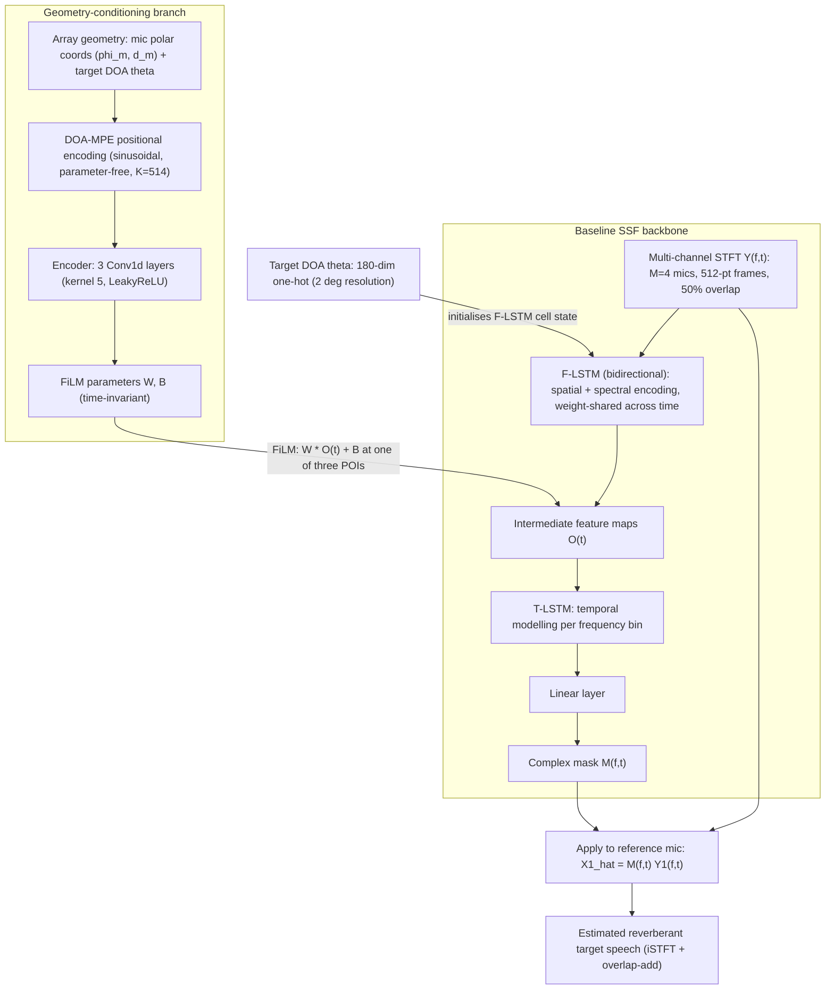

# Li, Middelberg & Doclo 2026: Geometry-Conditioned Spatially Selective Non-Linear Filter

| Field | Value |
|:------|:------|
| **Authors** | [[entities/jiatong-li\|Jiatong Li]], [[entities/wiebke-middelberg\|Wiebke Middelberg]], [[entities/simon-doclo\|Simon Doclo]] |
| **Institution** | Carl von Ossietzky Universität Oldenburg, Germany |
| **Venue** | arXiv preprint (submitted to IWAENC 2026) |
| **Year** | 2026 |
| **Type** | Preprint |
| **DOI** | [10.48550/arXiv.2605.18442](https://doi.org/10.48550/arXiv.2605.18442) |
| **arXiv** | [2605.18442](https://arxiv.org/abs/2605.18442) |
| **Zotero** | [D5LDQUHY](zotero://select/items/0_D5LDQUHY) |

## Summary

Proposes a **geometry-conditioned spatially selective non-linear filter (GC-SSF)** for [[concepts/target-speaker-extraction|target speaker extraction]] that generalises across different microphone array geometries. A [[concepts/film-layer|FiLM]]-based conditioning branch, driven by a novel **DOA-Microphone Positional Encoding (DOA-MPE)** feature, modulates the intermediate feature maps of the baseline [[concepts/spatially-selective-nonlinear-filter|SSF]] to capture the spatial relationship between microphone positions and the target speaker. Trained on random arrays, the GC-SSF outperforms baselines on all evaluated geometries (circular, ULA, random) while maintaining high spatial selectivity.

![[raw/papers/li-2026-geometry-conditioned-ssanc/figures/system.png|Figure 1: Overview of the proposed GC-SSF. White blocks are the baseline SSF architecture; gray blocks are the geometry-conditioning branch, integrated via a FiLM layer at one of three points of injection (POI 1, 2, or 3).]]

## Problem Formulation

The baseline [[concepts/spatially-selective-nonlinear-filter|SSF]] (Tesch & Gerkmann 2024) estimates a complex-valued mask $\mathcal{M}(f,t)$ applied to the reference microphone signal:

$$\hat{X}_1(f,t) = \mathcal{M}(f,t) \, Y_1(f,t),$$

where $Y_1(f,t)$ is the noisy speech at the reference microphone and $\hat{X}_1(f,t)$ is the estimated reverberant target speech. The SSF uses two LSTM layers (F-LSTM for spectral-spatial encoding, T-LSTM for temporal modelling) conditioned on the target DOA $\theta$ via a 180-dimensional one-hot vector.

**Limitation**: The learned intermediate features are tied to the training array geometry. Performance degrades significantly on mismatched geometries.

## Methodology

### Model Structure, Inputs, and Outputs

The GC-SSF is a single jointly-trained system: the baseline SSF backbone plus a lightweight geometry-conditioning branch (Figure 1). Data flow at inference:

**Baseline SSF backbone** (architecture of Tesch & Gerkmann 2024, [8]):

| Spec | Value |
|:-----|:------|
| **Structure** | F-LSTM (bidirectional, spatial/spectral encoding, weight-shared across time) → T-LSTM (temporal modelling) → linear layer → complex-valued mask $\mathcal{M}(f,t)$ |
| **Input** | Multi-channel STFT coefficients $\mathbf{Y}(f,t) \in \mathbb{C}^{4 \times F \times T}$ ($M=4$ microphones, 16 kHz, 512-sample frames, 50% overlap, sqrt-Hann window); DOA conditioning via 180-dim one-hot vector (2° resolution) projected to F-LSTM cell state |
| **Output** | Single-channel complex mask $\mathcal{M}(f,t)$, one value per TF bin, applied to the reference microphone signal |
| **Training data** | 30 h WSJ0 mixtures (3 s utterances), Pyroomacoustics simulation |
| **Role** | Core spatial filtering network — estimates the mask that extracts the target speaker |

**Geometry-conditioning branch** (proposed):

| Spec | Value |
|:-----|:------|
| **Structure** | DOA-MPE positional encoding (parameter-free) → encoder: 3 Conv1d layers (kernel size 5, LeakyReLU; 64/128 output channels, final layer $2M$ channels for POI 1 or $2F$ for POIs 2–3) |
| **Input** | Array geometry (microphone polar coordinates $(\varphi_m, d_m)$ relative to the array centroid) + target DOA $\theta$, encoded as $\mathbf{P}_{\text{DOA-MPE}} \in \mathbb{R}^{K \times (M+1)}$, $K=514$, $\alpha=7$, $\sigma=4$ |
| **Output** | Time-invariant FiLM parameters: scaling matrix $\mathbf{W}$ and bias $\mathbf{B}$, dimensions matching the injected feature map |
| **Training data** | Same 30 h WSJ0 random-array mixtures as the backbone (jointly trained) |
| **Role** | Encodes geometry context so one model generalises across circular, ULA, and random arrays |

The conditioning parameters are **time-invariant** because array geometry and target DOA are assumed static. Conv1d strides are $(1,1,1)$ for POIs 1–2 and $(2,2,1)$ for POI 3 so the encoder output matches the injected feature map dimensions. Backbone and conditioning branch are trained **jointly** end-to-end.

### Geometry-Conditioning Branch

The GC-SSF adds a conditioning branch that modulates the SSF's intermediate feature maps $\mathbf{O}(t)$ via a [[concepts/film-layer|FiLM layer]]:

$$\text{FiLM}(\mathbf{O}(t)) = \mathbf{W} \odot \mathbf{O}(t) + \mathbf{B},$$

where the scaling matrix $\mathbf{W}$ and bias matrix $\mathbf{B}$ are estimated by a Conv1d encoder from the positional encoding feature $\mathbf{P}$.

### DOA-Microphone Positional Encoding (DOA-MPE)

The [[concepts/doa-microphone-positional-encoding|DOA-MPE]] feature jointly encodes microphone positions and target DOA:

$$\mathbf{P}_{\text{DOA-MPE}} = [\mathbf{P}_{\text{MPE}}, \mathbf{p}_{\text{DOA}}] \in \mathbb{R}^{K \times (M+1)},$$

where $\mathbf{P}_{\text{MPE}}$ encodes each microphone's polar coordinates $(\varphi_m, d_m)$ via sinusoidal features, and $\mathbf{p}_{\text{DOA}}$ encodes the target direction $\theta$.

### Points of Injection

Three injection points are investigated:

| POI | Location | Encoder output dim |
|:----|:---------|:-------------------|
| 1 | After F-LSTM | $2M$ channels |
| 2 | After T-LSTM input | $2F$ channels |
| 3 | After T-LSTM output | $2F$ channels |

**Best configuration**: DOA-MPE at POI 2 (highest PESQ on both Circ and Random).

### Training Losses

All networks (GC-SSF and both SSF baselines) are trained to minimise a combined time-domain + frequency-domain loss following Tesch & Gerkmann 2024 [8]:

$$\mathcal{L} = \frac{\beta}{N} \sum_{n=1}^{N} |x_1(n) - \hat{x}_1(n)| + \frac{1}{TF} \sum_{t=1}^{T} \sum_{f=1}^{F} \big| |X_1(f,t)| - |\hat{X}_1(f,t)| \big|,$$

where $x_1(n)$ is the reverberant time-domain target speech at the reference microphone and $\hat{x}_1(n)$ its estimate (reconstructed via inverse STFT + overlap-add); the frequency-domain term compares **magnitude spectra**. The weighting factor $\beta = 10$ scales the time-domain term to approximately equalize the contribution of either domain (per Tesch & Gerkmann 2024 [8]; corrected 2026-10-25 against the original — an earlier revision of this page had the weighting on the frequency-domain term). The $L_1$ forms are the standard choice from the baseline SSF framework — kept unchanged here so that the geometry-conditioning branch is the only new variable. Training: Adam (initial lr 0.001), multi-step scheduler decaying lr by 0.75 every 50 epochs up to epoch 400, 500 epochs, batch size 16, gradient $l_2$-norm clipped to 1.

## Experimental Setup

![[raw/papers/li-2026-geometry-conditioned-ssanc/figures/scenario.png|Figure 2: Simulation setup and room characteristics. The target and interfering speakers are placed in the gray region.]]

| Parameter | Value |
|:----------|:------|
| Dataset | WSJ0 (Wall Street Journal) |
| Sampling rate | 16 kHz |
| STFT frame length | 512 (50% overlap, sqrt-Hann window) |
| Microphones | $M = 4$ |
| Array geometries | Circular, ULA, Random ($10 \times 10$ cm²) |
| Room simulation | Pyroomacoustics |
| Room dimensions | 2.5–5 m × 3–9 m × 2.2–3.5 m |
| $T_{60}$ | 0.2–0.5 s |
| Training data | 30 h (3 s utterances); validation 1 h; evaluation 1 h per geometry |
| Speakers | 1 target + 1 interferer, ≥ 20° angular separation, height 1.6 m; target-to-interferer power ratio −5…10 dB at reference mic |
| Positional encoding | $\alpha=7$, $\sigma=4$, $K=514$ |
| Encoder | 3 Conv1d layers (kernel 5, LeakyReLU) |
| Loss | Time-domain + frequency-domain ($\beta=10$) |
| Optimiser | Adam, lr=0.001 (×0.75 every 50 epochs to epoch 400), 500 epochs, batch 16, grad $l_2$-clip 1 |
| Metrics | PESQ, SI-SDR (reverberant target at reference mic as reference) |

## Results

### Ablation: Positional Encoding and POI (PESQ, trained on Random)

| Feature | POI 1 Circ | POI 1 Rand | POI 2 Circ | POI 2 Rand | POI 3 Circ | POI 3 Rand |
|:--------|:-----------|:-----------|:-----------|:-----------|:-----------|:-----------|
| $\mathbf{P}_{\text{MPE}}$ | 1.72 | 1.70 | 2.09 | 2.02 | 1.99 | 1.89 |
| $\mathbf{P}_{\text{DOA-MPE}}$ | **2.51** | **2.43** | **2.53** | **2.46** | 2.12 | 2.15 |

### Generalisation (PESQ ± std, DOA-MPE at POI 2)

![[raw/papers/li-2026-geometry-conditioned-ssanc/figures/random.png|Figure 3: The three considered array geometries with M=4 microphones: (a) Random, (b) Circular, (c) ULA. The gray circle denotes the reference microphone; the red cross denotes the array centroid.]]

| System | Train | Circ | ULA | Random |
|:-------|:------|:-----|:----|:-------|
| Unprocessed | — | 1.38 | 1.39 | 1.36 |
| SSF-Circ | Circ | **2.95** | 1.16 | 1.20 |
| SSF-Random | Random | 2.04 | 2.02 | 1.93 |
| **GC-SSF** | Random | 2.53 | **2.41** | **2.46** |

**Key findings**:
- SSF-Circ excels on matched geometry (2.95 PESQ) but **fails catastrophically** on mismatched geometries (below unprocessed)
- SSF-Random generalises better but with overall degradation (~0.5 PESQ below SSF-Circ on matched)
- GC-SSF surpasses SSF-Random by ~0.45 PESQ across all geometries and improves over SSF-Circ by up to 1.25 PESQ on mismatched geometries

### Spatial Selectivity (DOA-Error Sensitivity)

![[raw/papers/li-2026-geometry-conditioned-ssanc/figures/pesq_sisdr.png|Figure 4: Average PESQ and SI-SDR of the baseline SSFs and the GC-SSF (DOA-MPE, POI 2) for different target DOA errors, evaluated on the circular array.]]

Evaluated on the Circ array under target-DOA errors of 0–90°:

- **SSF-Circ**: PESQ/SI-SDR drop sharply once the DOA error exceeds 15° — the fixed training geometry lets it learn a direct mapping from inter-channel phase relationships to the given DOA, yielding high spatial selectivity at the cost of DOA-error robustness.
- **SSF-Random**: much lower sensitivity to DOA errors — but because it never sees a consistent geometry→phase mapping, it **fails to properly use the given DOA information** at all, resulting in low spatial selectivity and degraded performance.
- **GC-SSF**: achieves higher SI-SDR and PESQ than SSF-Random for DOA errors below 20° while showing spatial selectivity comparable to SSF-Circ — explicit geometry conditioning lets it *use* the DOA cue despite being trained on random arrays.

## Key Contributions

1. **Geometry-conditioned SSF (GC-SSF)**: First application of geometry conditioning via [[concepts/film-layer|FiLM]] layers to DOA-based [[concepts/target-speaker-extraction|target speaker extraction]]
2. **DOA-MPE feature**: Novel positional encoding that jointly represents microphone positions and target DOA, enabling the conditioning branch to model spatial relationships
3. **Robust generalisation**: Trained on random arrays, GC-SSF achieves competitive performance across circular, ULA, and random geometries without retraining

## Important Distinctions

- **vs. [[concepts/spatially-selective-anc|Spatially Selective ANC]]**: SSF is a deep-learning-based spatial filter for speech extraction (mask estimation), while SSANC is a control-theoretic approach for hearable noise cancellation. Both use spatial selectivity but in fundamentally different frameworks.
- **vs. geometry-agnostic systems**: Unlike permutation-invariant or ambisonics-based approaches, GC-SSF explicitly conditions on geometry rather than being geometry-invariant by design.
- **vs. meta-learning**: GC-SSF avoids per-geometry fine-tuning by learning a single geometry-conditioned model.

## Future Work

- Architectures independent of the number of microphones
- Deployment in ad-hoc acoustic sensor networks

## Related Concepts

- [[concepts/spatially-selective-nonlinear-filter|Spatially Selective Non-Linear Filter (SSF)]]
- [[concepts/geometry-conditioned-ssf|Geometry-Conditioned SSF (GC-SSF)]]
- [[concepts/doa-microphone-positional-encoding|DOA-Microphone Positional Encoding (DOA-MPE)]]
- [[concepts/film-layer|FiLM Layer]]
- [[concepts/target-speaker-extraction|Target Speaker Extraction]]
- [[concepts/direction-of-arrival-estimation|Direction-of-Arrival Estimation]]
- [[concepts/beamforming|Beamforming]]
- [[concepts/spatially-selective-anc|Spatially Selective ANC]]

## Related Sources

- [[sources/xiao-2026-robust-spatially-selective-anc|Xiao 2026: Robust Soft-Constrained SSANC for Hearables]]
