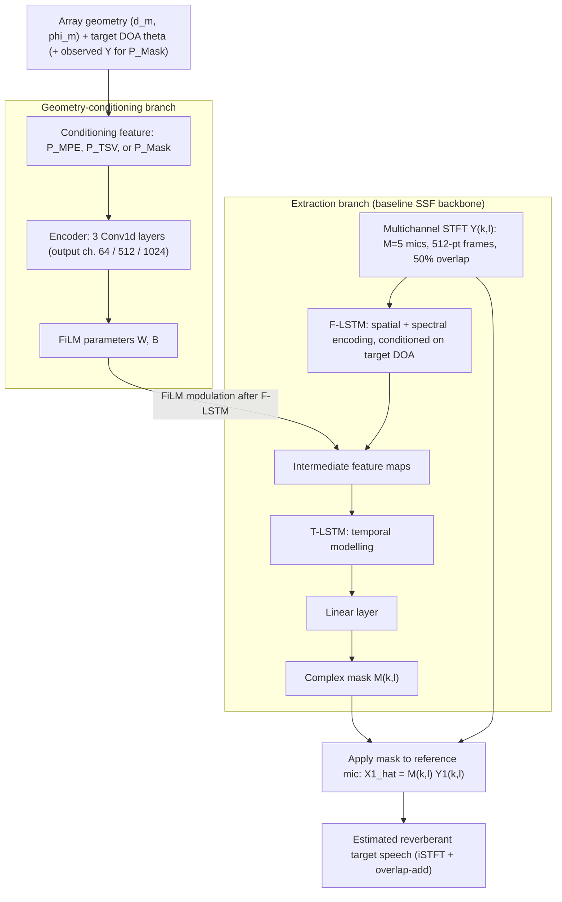

# Li & Doclo 2026: Geometry-Conditioned Target Speaker Extraction with Spatial Features

| Field | Value |
|:------|:------|
| **Authors** | [[entities/jiatong-li\|Jiatong Li]], [[entities/simon-doclo\|Simon Doclo]] |
| **Institution** | Carl von Ossietzky Universität Oldenburg, Germany |
| **Venue** | arXiv preprint 2610.29778 (October 2026) |
| **Year** | 2026 |
| **Type** | Preprint |
| **DOI** | [10.48550/arXiv.2610.29778](https://doi.org/10.48550/arXiv.2610.29778) |
| **arXiv** | [2610.29778](https://arxiv.org/abs/2610.29778) |
| **Zotero** | [58N83GBE](zotero://select/items/0_58N83GBE) |

## Summary

Follow-up to the [[concepts/geometry-conditioned-ssf|GC-SSF]] of Li, Middelberg & Doclo: instead of conditioning on abstract sinusoidal [[concepts/doa-microphone-positional-encoding|positional encodings]] (MPE), this paper feeds the geometry-conditioning branch of the GCSSF two explicit spatial features derived from acoustic propagation principles — the **target steering vector** (TSV, capturing inter-microphone phase differences) and a **GCC-PHAT spatial mask** (quantifying target presence per time-frequency bin). Both features outperform the MPE baseline across all metrics on random and circular arrays, with the TSV yielding the best results (+1.66 dB SI-SDR, +0.31 PESQ over GCSSF-MPE on random arrays); the advantage is maintained for target DOA errors up to 20°.

![[raw/papers/li-2026-geometry-conditioned-tse/figures/fig1.png|Figure 1: GCSSF system using different features for array geometry conditioning. The gray block highlights the computation of the three features (P_MPE, P_TSV, P_Mask); the features are encoded and integrated via a FiLM layer.]]

## Problem Formulation

The scenario matches the [[concepts/geometry-conditioned-ssf|GC-SSF]] setup: $J$ speakers and background noise in a reverberant room, one speaker designated as target, recorded by an arbitrary planar array of $M$ microphones with polar coordinates $(d_m, \varphi_m)$ relative to the array centroid. In the STFT domain the noisy speech vector is

$$\mathbf{Y}(k,l) = \mathbf{X}(k,l) + \mathbf{V}(k,l) \in \mathbb{C}^{M},$$

and the goal is to recover the reverberant target speech component at the reference microphone via a complex mask:

$$\hat{X}_{1}(k,l) = \mathcal{M}(k,l)\, Y_{1}(k,l).$$

**Limitation addressed**: the MPE feature of the predecessor maps microphone coordinates and target DOA into abstract high-dimensional sinusoidal embeddings, but "does not explicitly utilize spatial features derived from acoustic propagation principles" — the network must *implicitly learn* the relationship between inter-microphone phase differences, target DOA, and array geometry, which limits extraction performance.

## Methodology

### Explicit Spatial Features for Geometry Conditioning

#### Target Steering Vector (TSV)

Assuming far-field propagation, the TDOA between the $m$-th microphone and the array centroid for a target at DOA $\theta$ is $\tau_m = d_m \cos(\varphi_m - \theta)/c$. The target steering vector relative to the reference microphone at frequency $f_k$:

$$\mathbf{d}(k) = [1,\, e^{\jmath 2\pi f_k (\tau_2 - \tau_1)}, \ldots, e^{\jmath 2\pi f_k (\tau_M - \tau_1)}]^{\text{T}} \in \mathbb{C}^{M}.$$

As in classical delay-and-sum beamforming ($\mathbf{d}^{H}\mathbf{Y}$), the complex conjugate $\mathbf{d}^{*}(k)$ defines the phase compensation that spatially aligns the microphone signals to the target DOA. The feature $\mathbf{P}_{\text{TSV}}$ stacks $\mathbf{d}^{*}(k)$ across all $K$ frequency bins, yielding a tensor of shape $[B, M, K]$ — a **purely geometric, signal-independent** feature that explicitly guides the network to the target DOA.

#### GCC-PHAT Spatial Mask

To explore a **signal-dependent** feature indicating target presence per TF bin, the microphone signals are first spatially aligned toward the target DOA:

$$\mathbf{S}(k,l) = \mathbf{d}^{*}(k) \odot \mathbf{Y}(k,l),$$

then the instantaneous GCC-PHAT between any pair of TDOA-compensated channels $i, j$ is

$$\Psi_{ij}(k,l) = \frac{S_{i}(k,l)\, S_{j}^{*}(k,l)}{|S_{i}(k,l)|\, |S_{j}(k,l)|},$$

and the [[concepts/gcc-phat-spatial-mask|GCC-PHAT spatial mask]] averages the real part over all $\tfrac{M(M-1)}{2}$ microphone pairs:

$$I(k,l) = \frac{2}{M(M-1)}\, \text{Re}\!\left(\sum_{i=1}^{M}\sum_{j=i+1}^{M} \Psi_{ij}(k,l)\right).$$

When the target dominates a TF bin, the aligned channels are in phase and $I(k,l) \to 1$; interference from other DOAs, reverberation, or noise degrades the phase alignment and $I(k,l)$ decreases. The feature $\mathbf{P}_{\text{Mask}}$ aggregates $I(k,l)$ across the $K$ frequency bins per time step and is processed frame-by-frame for online processing (input shape $[BL, 1, K]$, frames treated independently — so unlike MPE/TSV, the resulting conditioning is potentially *time-varying*). Conceptually related to classical spectral post-filtering.

### Model Structure, Inputs, and Outputs

The system is the [[concepts/geometry-conditioned-ssf|GC-SSF]] of the predecessor paper with the conditioning feature swapped; the extraction branch is identical to the baseline [[concepts/spatially-selective-nonlinear-filter|SSF]]. Data flow at inference:

**Extraction branch (SSF backbone)**:

| Spec | Value |
|:-----|:------|
| **Structure** | F-LSTM (frequency-domain, spatial + spectral encoding) → T-LSTM (temporal modelling) → linear layer → complex-valued mask $\mathcal{M}(k,l)$ |
| **Input** | Multichannel STFT coefficients $\mathbf{Y}(k,l) \in \mathbb{C}^{5 \times K \times L}$ ($M=5$ microphones, 16 kHz, 512-sample frames ≈ 32 ms, 50% overlap, sqrt-Hann window); target DOA $\theta$ as conditioning input to the F-LSTM |
| **Output** | Single-channel complex mask $\mathcal{M}(k,l)$ applied to the reference microphone signal |
| **Training data** | 30 h WSJ0 random-array mixtures (2–6 speakers + diffuse noise, Pyroomacoustics simulation) |
| **Role** | Core spatial filtering network — jointly processes spatial, spectral, and temporal information |

**Geometry-conditioning branch** (this paper's contribution is the input feature):

| Spec | Value |
|:-----|:------|
| **Structure** | Feature computation (gray block in Fig. 1) → encoder: 3 Conv1d layers, output channels 64 / 512 / 1024 (for $\mathbf{P}_{\text{TSV}}$ and $\mathbf{P}_{\text{Mask}}$); the GCSSF-MPE baseline instead uses 64 / 1024 / 514 with MPE hyperparameters $\sigma = 4$, $Q = 514$ — matched so all systems have a comparable parameter count |
| **Input** | $\mathbf{P}_{\text{TSV}} \in \mathbb{C}^{B \times M \times K}$ (conjugate steering vectors stacked over frequency), or $\mathbf{P}_{\text{Mask}} \in \mathbb{R}^{BL \times 1 \times K}$ (GCC-PHAT spatial mask per frame), or $\mathbf{P}_{\text{MPE}} \in \mathbb{R}^{Q \times (M+1)}$ (baseline) |
| **Output** | FiLM parameters modulating the intermediate representations after the F-LSTM |
| **Training data** | Same 30 h WSJ0 random-array mixtures (jointly trained with the backbone) |
| **Role** | Injects array geometry + target DOA (and, for the Mask, observed-signal evidence) so one model generalises across array geometries |

### Training Losses

Joint time- and frequency-domain loss (identical to the [[concepts/spatially-selective-nonlinear-filter|SSF]] framework of Tesch & Gerkmann 2024):

$$\mathcal{L} = \frac{\beta}{N}\sum_{n=1}^{N} |x_{1}(n) - \hat{x}_{1}(n)| + \frac{1}{KL}\sum_{l=1}^{L}\sum_{k=1}^{K} \big| |X_{1}(k,l)| - |\hat{X}_{1}(k,l)| \big|,$$

where $x_{1}(n)$ is the reverberant time-domain target speech at the reference microphone, $\hat{x}_{1}(n)$ its estimate (inverse STFT + overlap-add), and $\beta = 10$ weights the time-domain term to approximately equalize the contribution of either domain. The $L_1$ forms follow the baseline SSF framework unchanged so the conditioning feature is the only new variable.

**Robustness training**: the target DOA is corrupted by an angular error drawn from $\mathcal{U}(-4^{\circ}, 4^{\circ})$ and each microphone position by an error drawn from $\mathcal{U}(-4\,\text{mm}, 4\,\text{mm})$ during training.

## Experimental Setup

![[raw/papers/li-2026-geometry-conditioned-tse/figures/fig2.png|Figure 2: Illustration of the simulation setup and the room characteristics. The speakers are located in the gray region.]]

![[raw/papers/li-2026-geometry-conditioned-tse/figures/fig3.jpg|Figure 3: The considered circular and random array geometries with M = 5 microphones.]]

| Parameter | Value |
|:----------|:------|
| Dataset | WSJ0, 16 kHz, disjoint speaker split following Tesch & Gerkmann 2024 |
| Training / validation data | 30 h / 1 h, random arrays |
| Evaluation data | 1 h per array geometry (random + circular) |
| Microphones | $M = 5$; circular arrays: evenly spaced on a 10 cm-diameter circle; random arrays: uniform within 10 × 10 cm², min. spacing 2 mm, random reference microphone; random rotation, height 1.6 m |
| Speakers | 2–6 per mixture, ≥ 20° angular separation between target and all interferers, ≥ 50 cm inter-speaker distance, height 1.6 m |
| Room simulation | Pyroomacoustics; room dimensions and $T_{60}$ uniformly sampled from Fig. 2 ranges |
| Mixture SIR | −5 dB … 10 dB (reverberant, at reference mic) |
| Noise | Diffuse noise from QUT dataset via ANF generator, SNR 15 dB at reference mic |
| STFT | 512 samples (32 ms), 50% overlap, sqrt-Hann (analysis + synthesis) |
| Encoder | 3 Conv1d layers; output channels 64/512/1024 (TSV, Mask) or 64/1024/514 (MPE baseline, $\sigma=4$, $Q=514$) |
| Loss | Time + frequency $L_1$, $\beta = 10$; DOA/mic-position training perturbations (±4°, ±4 mm) |
| Optimiser | Adam, lr 0.001, ×0.75 every 50 epochs up to epoch 400, 500 epochs, batch 16, grad $l_2$-clip 1 |
| Metrics | SI-SDR, PESQ, ESTOI, DNSMOS (overall) — reverberant target at reference mic as reference |

## Results

### Target Speaker Extraction Performance (Table 1)

| System | Random: SI-SDR | Random: PESQ | Random: ESTOI | Random: DNSMOS | Circ: SI-SDR | Circ: PESQ | Circ: ESTOI | Circ: DNSMOS |
|:-------|:--------------|:-------------|:--------------|:---------------|:------------|:-----------|:------------|:-------------|
| Unprocessed | 2.21 | 1.27 | 0.52 | 1.18 | 2.19 | 1.27 | 0.52 | 1.21 |
| SSF [Tesch & Gerkmann 2024] | 6.78 | 1.79 | 0.66 | 1.85 | 7.00 | 1.80 | 0.66 | 1.86 |
| GCSSF-MPE [Li et al. 2026] | 7.77 | 1.96 | 0.69 | 1.95 | 7.79 | 1.95 | 0.69 | 1.93 |
| **GCSSF-TSV (proposed)** | **9.43** | **2.27** | **0.75** | **2.07** | **9.87** | **2.33** | **0.77** | **2.08** |
| GCSSF-Mask (proposed) | 8.45 | 2.10 | 0.72 | 1.99 | 8.86 | 2.17 | 0.74 | 2.02 |

(Standard deviations ±3.5–5.3 dB SI-SDR, ±0.5 PESQ, ±0.1–0.16 ESTOI, ±0.6 DNSMOS; full values in the paper.)

**Key findings**:

- Both explicit spatial features **consistently outperform both baselines on all metrics** on random and circular arrays — propagation-derived features provide a highly informative representation that directly connects inter-microphone phase differences with the target DOA and array geometry, simplifying the network's learning task.
- **GCSSF-TSV is best overall**: +1.66 dB SI-SDR, +0.31 PESQ, +0.06 ESTOI, +0.12 DNSMOS over GCSSF-MPE on random arrays.
- **TSV > Mask**, for two reasons: (1) the TDOA compensation behind the mask assumes direct-path propagation, so reverberation degrades phase alignment and produces an inaccurate mask that suppresses valid target TF bins; (2) the mask is aggregated into a **single-channel** representation and does not preserve inter-microphone phase information across the array, unlike the multichannel $\mathbf{P}_{\text{TSV}}$.
- Evaluation on circular arrays shows results similar to random arrays (generalisation across geometries).

### Robustness to Target DOA Errors (Fig. 4)

![[raw/papers/li-2026-geometry-conditioned-tse/figures/fig4.png|Figure 4: Average PESQ of the baseline systems (SSF and GCSSF-MPE) and the proposed GCSSF systems using explicit spatial features for different target DOA errors. All systems are trained and evaluated on random arrays.]]

- The proposed systems maintain a **clear advantage up to 20° target DOA error**.
- Beyond 20°, they fall *below* the baselines: because the features are explicitly derived from the input target DOA, large errors introduce severe phase mismatches and incorrect signal alignments — the network is explicitly guided to focus on a wrong DOA and suppresses the true target.
- The GCSSF-MPE baseline does not rely on propagation principles and thereby avoids the severe misalignment degradation — an inherent sensitivity/robustness trade-off of explicit physical features.

## Key Contributions

1. **Target steering vector feature ($\mathbf{P}_{\text{TSV}}$)**: conjugate far-field steering vectors stacked across frequency bins as a purely geometric, signal-independent conditioning feature — directly encoding the phase compensation a delay-and-sum beamformer would apply.
2. **GCC-PHAT spatial mask ($\mathbf{P}_{\text{Mask}}$)**: a signal-dependent per-TF-bin target-presence indicator built from pairwise phase correlations of TDOA-compensated channels, related to classical spectral post-filtering.
3. **Empirical case for physics-based conditioning**: both explicit features beat abstract positional encodings across all metrics and both array geometries (+1.66 dB SI-SDR / +0.31 PESQ for TSV), while a sensitivity analysis delimits the cost: performance degrades beyond 20° target DOA error, where the abstract MPE baseline is more forgiving.

## Important Distinctions

- **vs. GCSSF-MPE (predecessor)**: same backbone, encoder, and FiLM integration — the *only* change is the conditioning feature. The comparison therefore isolates the value of acoustic-propagation structure vs. learned abstract embeddings.
- **vs. hand-crafted input features** (e.g. IPD + angle features): here the spatial features enter through the *conditioning branch* (FiLM modulation), not as network input replacing the raw STFT.
- **vs. delay-and-sum beamforming**: the TSV feature hands the network the steering vector's phase compensation but leaves the non-linear extraction to the SSF mask estimation.

## Related Concepts

- [[concepts/target-steering-vector|Target Steering Vector (TSV) Feature]]
- [[concepts/gcc-phat-spatial-mask|GCC-PHAT Spatial Mask]]
- [[concepts/geometry-conditioned-ssf|Geometry-Conditioned SSF (GC-SSF)]]
- [[concepts/spatially-selective-nonlinear-filter|Spatially Selective Non-Linear Filter (SSF)]]
- [[concepts/doa-microphone-positional-encoding|DOA-Microphone Positional Encoding (MPE)]]
- [[concepts/gcc-phat|GCC-PHAT]]
- [[concepts/film-layer|FiLM Layer]]
- [[concepts/target-speaker-extraction|Target Speaker Extraction]]
- [[concepts/beamforming|Beamforming]]

## Related Sources

- [[sources/li-2026-geometry-conditioned-ssanc|Li, Middelberg & Doclo 2026: Geometry-Conditioned Spatially Selective Non-Linear Filter]] — the GCSSF-MPE baseline extended here
- [[sources/tesch-2024-spatially-selective-nonlinear-filters|Tesch & Gerkmann 2024: Multi-channel Speech Separation Using Spatially Selective Deep Non-linear Filters]] — the SSF baseline and the shared training framework

## Successor

- [[sources/li-2026-geometry-conditioned-tse|Li & Doclo 2026: Geometry-Conditioned Target Speaker Extraction with Spatial Features]] replaces this paper's abstract MPE embeddings with propagation-derived spatial features (target steering vector, GCC-PHAT mask) in the same GCSSF framework
