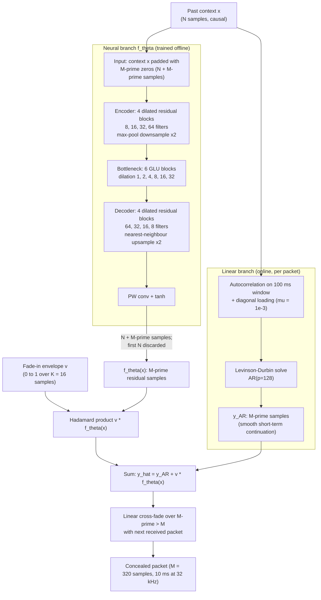

# Mezza, Amerena, Bernardini & Sarti 2024: Hybrid Packet Loss Concealment for Real-Time Networked Music Applications

| Field | Value |
|-------|-------|
| **Authors** | [[entities/alessandro-ilic-mezza\|Alessandro Ilic Mezza]], [[entities/matteo-amerena\|Matteo Amerena]], [[entities/alberto-bernardini\|Alberto Bernardini]], [[entities/augusto-sarti\|Augusto Sarti]] |
| **Institution** | Dipartimento di Elettronica, Informazione e Bioingegneria, Politecnico di Milano, 20133 Milan, Italy |
| **Published** | IEEE Open Journal of Signal Processing, vol. 5, 2024 (published online 14 December 2023; current version 4 January 2024) |
| **Type** | Journal Article |
| **DOI** | [10.1109/OJSP.2023.3343318](https://doi.org/10.1109/OJSP.2023.3343318) |
| **Zotero** | [DLLAPHHR](zotero://select/items/0_DLLAPHHR) |
| **Audio examples** | Available online (linked as footnote 1 in the article) |

## Summary

This paper presents **PARCnet**, a hybrid packet loss concealment (PLC) method for real-time [[concepts/networked-music-performance|Networked Music Performance (NMP)]]: it recasts PLC as *predicting the residual of a linear autoregressive model* rather than generating a coherent waveform from scratch. Two parallel time-domain branches cooperate — an $\mathrm{AR}(p)$ predictor fitted online that yields a smooth short-term continuation, and a lightweight feed-forward neural network that predicts the nonlinear residual term — combined by a time-domain fade-in envelope that suppresses the inbound (seam) discontinuities typical of feed-forward models. On a 28-hour MAESTRO piano subset at 32 kHz, PARCnet is the only deep method that runs in real time on a laptop CPU (416 k parameters, 8.1 ms per 10 ms packet) while outperforming all deep PLC baselines and the linear predictor on every objective metric, and it wins a MUSHRA listening test by 21.7 points over $\mathrm{AR}(128)$.

## Problem Formulation

Real-time audio over IP uses best-effort transport (RTP/UDP): late or lost packets are never retransmitted, and the receiver's decoder invokes [[concepts/packet-loss-concealment|PLC]] when the jitter buffer underruns. NMP raises the bar over VoIP:

- **High fidelity** — musicians judge timbre and timbral continuity, not word intelligibility; word error rate is irrelevant, while fidelity, bandwidth and latency are not.
- **Higher sampling rates** — the paper targets 32 kHz mono (vs. 16 kHz for speech PLC), tripling the samples to synthesize per packet.
- **Strict temporal constraints** — simultaneous interaction between remote musicians bounds total algorithmic latency, so the model must be causal, feed-forward and cheap.

The paper also sharpens the architectural dichotomy in neural PLC: feed-forward models are fast but do not guarantee smooth signal continuation (they introduce *inbound* discontinuities at the seam where the prediction starts), whereas autoregressive neural models (LPCNet, WaveRNN) continue smoothly but are slower and drift.

**Signal model.** Assume an $M$-sample packet is missing at index $k$, and that the short-time signal follows an $\mathrm{AR}(p)$ model

$$
y[n]=\sum_{i=1}^{p}\varphi_i\,y[n-i]+\varepsilon[n].
$$

A naive PLC fits $\{\varphi_1,\dots,\varphi_p\}$ locally and forecasts $n=k,\dots,k+M-1$ with $\varepsilon[n]=0$. In practice the residual of a finite-memory linear model is far from white, so this degrades audio quality — hence the residual-prediction formulation below.

## Methodology

### Residual Prediction with Two Parallel Branches

PARCnet estimates the missing waveform as

$$
\begin{cases}
\hat{y}[n] = y[n] + f_\theta(\mathbf{x})_{n-k},\\[2pt]
y[n] = \sum_{i=1}^{p}\varphi_i\,y[n-i],
\end{cases}
\qquad n=k,\dots,k+M'-1,
$$

where $\mathbf{x}=[y[k-N],\dots,y[k-1]]^{T}$ is the past $N$-sample context and $f_\theta:\mathbb{R}^{N}\to\mathbb{R}^{M'}$ is a vector-valued neural mapping whose entries are indexed by an integer subscript. The key move: the network never generates the waveform, only the **nonlinear residual** of the linear predictor. The idea traces back to Thyssen et al. (1994), where a tiny network (two hidden layers, two nodes each) predicted LPC residuals one sample at a time; PARCnet instead performs *frame-by-frame feed-forward* inference, which lets the architecture shrink drastically and run far faster than autoregressive neural PLC.

Since the two branches run **in parallel and independently**, the combination is a vector expression, with $\odot$ the Hadamard product and $\mathbf{v}$ a time-domain envelope:

$$
\hat{\mathbf{y}}=\mathbf{y}_{\mathrm{AR}}+\mathbf{v}\odot f_\theta(\mathbf{x}),
\qquad
\mathbf{y}_{\mathrm{AR}}=\Big[\textstyle\sum_{i=1}^{p}\varphi_i y[k-i],\ \dots,\ \sum_{i=1}^{p}\varphi_i y[k+M'-1-i]\Big]^{T}.
$$

**Two seam mechanisms, two branches.** The AR branch is accurate for the first few future samples and yields a smooth transition from valid to predicted audio; the feed-forward neural branch is likely to introduce audible *inbound* discontinuities. The envelope therefore **fades the neural contribution in** from 0 to 1 over $K=16$ samples, $v_\ell=\ell/(K-1)$ for $0\le\ell<K$ and $v_\ell=1$ for $K\le\ell<M'$. Outbound discontinuities (prediction → next received packet) are handled by gathering $M'>M$ samples (25% more than a packet) and linearly cross-fading the overlap.

### Linear Autoregressive Branch (Online Fitting)

For every packet, $\mathrm{AR}(p)$ coefficients are re-estimated from the previously received context: the autocorrelation method solves a Toeplitz system with the Levinson–Durbin recursion, over a sliding **100 ms** analysis window with **10 ms** stride (wide-sense stationarity assumption). The autocorrelation matrix is conditioned by [[concepts/diagonal-loading|diagonal loading]] $\mu=10^{-3}$ added to the zeroth autocorrelation coefficient — "white noise compensation", which bounds the eigenvalue spread that causes ill-conditioning in linear prediction.

The main configuration uses $p=128$ (also benchmarked standalone against $p=32$ and $p=64$), i.e. the highest order examined in prior NMP-PLC work and integrated as PARCnet's linear branch.

### Model Structure, Inputs, and Outputs

**1. Neural branch $f_\theta$ — feed-forward residual predictor**

| Item | Specification |
|------|---------------|
| **Structure** | Fully-convolutional causal **information bottleneck** model (TF-GAN style, Wang et al. 2021). Encoder $E=4$ and decoder $D=4$ **dilated residual blocks**; each block = skip connection + 1D conv with no dilation + two conv stacks with dilation 2 and 4 + batch norm + LeakyReLU ($\alpha=0.2$). Encoder filter counts 8, 16, 32, 64 (kernel 11) with max-pooling downsampling ×2; decoder 64, 32, 16, 8 (kernel 7) with nearest-neighbour upsampling ×2. Bottleneck = $B=6$ **bottleneck GLU blocks**: input stack (pointwise conv, 32 channels, dilation 1, BN) → GLU (kernel 11) → output stack (pointwise conv, 64 channels, dilation 1, BN), plus a residual shortcut and PReLU. GLU dilation grows exponentially, $2^{j-1}$ for $j=1,\dots,B$. Output: pointwise conv + $\tanh$ |
| **Input** | $\tilde{\mathbf{x}}=[y[k-N],\dots,y[k-1],0,\dots,0]^{T}$ — the $N$-sample valid context with $M'$ zeros appended. Training uses 8-packet sequences (80 ms at 10 ms/packet) with the last packet zeroed. $N$ is a free parameter traded against compute |
| **Output** | $N+M'$ time-domain samples; the first $N$ are discarded at inference, leaving $M'$ residual samples $f_\theta(\mathbf{x})$ for the branch sum |
| **Training data** | ~28 h of MAESTRO piano recordings, 32 kHz mono, resampled/downmixed; no amplitude normalization (robustness to silence and level changes). 100 000 training sequences |
| **Role** | Predicts the non-white residual term $\varepsilon[n]$ of the linear model in a nonlinear, frame-wise manner, extending accuracy past the few samples the AR predictor can forecast well |

**2. Linear branch $\mathrm{AR}(p)$ — online, untrained**

| Item | Specification |
|------|---------------|
| **Structure** | Order-$p$ all-pole predictor, $p=128$ in the proposed configuration ($p\in\{32,64,128\}$ benchmarked standalone) |
| **Input** | Sliding 100 ms window of received audio, hop 10 ms |
| **Output** | $M'$ linearly forecast samples $\mathbf{y}_{\mathrm{AR}}$ |
| **Fitting** | Autocorrelation method + Levinson–Durbin, with diagonal loading $\mu=10^{-3}$ on the zeroth autocorrelation coefficient |
| **Role** | Provides an accurate and *smooth* continuation of the first samples of the loss and carries the quasi-harmonic (all-pole) structure of sustained instrumental notes; the neural branch only refines the residual |

The two branches are **not trained together**: the AR coefficients are re-fitted online per packet (no training at all), while $f_\theta$ is trained offline against the residual of the linear predictor.

### Training Losses

The network is trained so that its output *plus* the linear prediction reconstructs the ground truth, over a windowed ground-truth segment $\tilde{\mathbf{y}}=[y[k-N],\dots,y[k+M'-1]]^{T}$ that includes the valid context (this forces the network to model the residual of a $p$-order linear predictor rather than only the missing packet):

$$
\min_\theta\ \mathcal{L}\big(\tilde{\mathbf{y}},\ \mathcal{F}_\theta(\tilde{\mathbf{x}})+\tilde{\mathbf{y}}_{\mathrm{AR}}\big),
\qquad
\mathcal{L}=\mathcal{L}_{\mathrm{MSE}}+\frac{\lambda}{Q}\sum_{q=1}^{Q}\Big(\mathcal{L}_{\mathrm{sc}}^{(q)}+\mathcal{L}_{\log}^{(q)}\Big),
$$

with time-domain MSE, spectral convergence over $Q=3$ STFT resolutions, and the $L^{1}$ norm of the regularized log-magnitude error:

$$
\mathcal{L}_{\mathrm{MSE}}=\frac{1}{N+M'}\sum_{n=k-N}^{k+M'-1}\big(y[n]-\hat{y}[n]\big)^{2},
$$

$$
\mathcal{L}_{\mathrm{sc}}^{(q)}=\frac{\big\||\mathrm{STFT}_q(y[n])|-|\mathrm{STFT}_q(\hat{y}[n])|\big\|_{F}}{\big\||\mathrm{STFT}_q(y[n])|\big\|_{F}},
\qquad
\mathcal{L}_{\log}^{(q)}=\frac{1}{T_qF_q}\Big\|\ln\frac{|\mathrm{STFT}_q(y[n])|+\epsilon}{|\mathrm{STFT}_q(\hat{y}[n])|+\epsilon}\Big\|_{1}.
$$

Multi-resolution STFT parameters (Table 1 of the paper):

| $q$ | FFT size | Window length | Hop size |
|-----|----------|---------------|----------|
| 1 | 512 | 240 | 50 |
| 2 | 1024 | 600 | 120 |
| 3 | 2048 | 1200 | 240 |

$\lambda=0.005$; 275 000 iterations with RAdam ($\beta_1=0.5$, $\beta_2=0.9$), batch size 128, learning rate 0.001. Although the loss is time-frequency, **inference is purely time-domain**: after training, $\mathcal{F}_\theta$ emits $N+M'$ samples and only the last $M'$ are kept.

![[raw/papers/mezza-2024-hybrid-plc/figures/4db8d9b45f535cb6ae711751f14a37a4a482c7d54c31714e01f0bc5b20eea63a.jpg|PARCnet architecture]]

*Figure 1: PARCnet architecture — parallel linear AR branch and feed-forward neural residual branch, summed after applying the fade-in envelope.*

![[raw/papers/mezza-2024-hybrid-plc/figures/600cc76ecf49160cbb0e5517c83f957a5ba7da2affb74c4714e5e3121aeefa68.jpg|Dilated residual block]]

*Figure 2: Dilated residual block used in the encoder and decoder.*

![[raw/papers/mezza-2024-hybrid-plc/figures/b4e4b27572e0d7412cec86d137be4171ef3acf370bc5e2c73835c94dffb47f6f.jpg|Bottleneck GLU block]]

*Figure 3: Bottleneck GLU block, with exponentially growing dilation rates $2^{j-1}$.*

## Experimental Setup

| Aspect | Configuration |
|--------|---------------|
| **Dataset** | Subset of MAESTRO (200+ h of human-performed piano); ~28 h kept, downsampled to 32 kHz, converted to mono, **not** normalized |
| **Test set** | 1 h held-out MAESTRO data; evenly spaced losses at a 10% loss rate (following Verma et al. 2020) |
| **Packet size** | $M=320$ samples = 10 ms at 32 kHz, just above a typical commercial sound-card buffer |
| **Cross-fade** | Forecast 25% more samples than a packet ($M'=400$); linear cross-fade of the overlap |
| **Training** | 275 000 iterations, RAdam ($\beta_1=0.5$, $\beta_2=0.9$), batch 128, lr 0.001; 100 000 eight-packet sequences |
| **Linear baselines** | Zero insertion; $\mathrm{AR}(32)$, $\mathrm{AR}(64)$, $\mathrm{AR}(128)$ with 25% forecast overshoot + linear cross-fade |
| **Deep baselines** | PLAAE (Pascual et al. 2021), FRN (Nguyen et al. 2023), Verma et al. 2020, TF-GAN (Wang et al. 2021), LPCNet (Valin et al. 2022 PLC variant) — all retrained/adapted at 32 kHz on the same piano data |
| **Objective metrics** | NMSE (dB), Mel-Spectral Convergence (64 mel triangular filters, 512-sample Hann, 50% overlap), [[concepts/peaq\|PEAQ]] ODG (ITU-R BS.1387, Kabal MATLAB "Basic", 10-s windows, 48 kHz), [[concepts/plcmos\|PLCMOS]] (10-s windows, 16 kHz) |
| **Subjective test** | [[concepts/mushra-listening-test\|MUSHRA]] per ITU-R BS.1534-3: 16 musically trained participants, 5 × 10-s piano excerpts, 8 methods, 10 ms losses every 100 ms, hidden reference + zero-fill anchor; one assessor excluded by post-screening (rated the hidden reference 79) → 15 assessors (14 M / 1 F, ages 25–37, mean 28.8) |
| **Complexity measurement** | Mean of 10 000 single-packet predictions on a laptop-mounted AMD Ryzen 5900HS |

Baseline adaptation details worth noting: FRN was retrained with 32 kHz sampling and 320 included in its training packet sizes; Verma et al. replaced time-domain context-wise peak normalization with logarithmic compression of input mel-spectrograms (empirically better); TF-GAN was used unmodified except for discriminator parameters adapted to 32 kHz; LPCNet's PLC version was retrained on the piano dataset and its Keras weights loaded into the authors' optimized C implementation.

## Results

### Objective Metrics and Complexity (Table 2)

| Method | NMSE (dB) ↓ | Mel-SC ↓ | PEAQ ODG ↑ | PLCMOS ↑ | Params | CPU time per packet |
|--------|-------------|----------|------------|----------|--------|---------------------|
| Zero-insertion | 0.0 | 0.242 | −3.86 ± 0.03 | 1.88 | — | — |
| AR(32) | −1.02 | 0.238 | −2.35 ± 0.33 | 1.93 | — | 1.06 ms |
| AR(64) | −2.03 | 0.214 | −2.15 ± 0.33 | 1.95 | — | 1.54 ms |
| AR(128) | −3.39 | 0.187 | −1.84 ± 0.32 | 1.98 | — | 1.84 ms |
| PLAAE | 1.7 | 0.198 | −3.61 ± 0.17 | 1.91 | 1 M | 34 ms |
| FRN | 0.85 | 0.214 | −3.33 ± 0.26 | 1.92 | 8.6 M | 14.9 ms |
| LPCNet | 0.3 | 0.202 | −2.43 ± 0.51 | 1.93 | 5.9 M | 7.1 ms |
| Verma et al. | −1.3 | 0.175 | −3.89 ± 0.03 | 1.92 | 19 M | 13.5 ms |
| TF-GAN | −1.6 | 0.149 | −3.77 ± 0.20 | 1.94 | 2.2 M | 18 ms |
| **PARCnet** | **−5.2** | **0.136** | **−1.42 ± 0.19** | **2.07** | **416 k** | **8.1 ms** |

Real-time at 32 kHz means < 10 ms per 10 ms packet: only the three AR models, LPCNet (7.1 ms, with its optimized C inference) and PARCnet (8.1 ms, unoptimized Python/PyTorch) qualify. PLAAE is slowest due to ex-post maximum-correlation alignment. PARCnet has the fewest parameters of any deep model — under a tenth of LPCNet's 5.9 M — so the authors expect it to beat all baselines once optimized.

Key observations:

- **The linear predictor is a strong baseline** — $\mathrm{AR}(128)$ alone beats every deep baseline on NMSE, PEAQ and PLCMOS. Sustained notes of a solo instrument are quasi-harmonic (outside attack transients), so a sufficiently high-order all-pole model represents short-time music well.
- **Residual learning beats the linear predictor across the board** — integrating $\mathrm{AR}(128)$ into PARCnet improves every metric (NMSE −3.39 → −5.2 dB, Mel-SC 0.187 → 0.136, PEAQ −1.84 → −1.42, PLCMOS 1.98 → 2.07).
- **Only PARCnet sits in the "perceptible but not annoying" band** on PEAQ for *all* 10-s segments (ODG between −1.0 and −2.0), and it is the only method to exceed the "poor listening quality" threshold (2.0) on PLCMOS.

### MUSHRA Listening Test (Fig. 4)

![[raw/papers/mezza-2024-hybrid-plc/figures/0e156484b6c76bf46d301ca22c0dbbb1f9830337555f1851a0f047118b2dbff6.jpg|MUSHRA mean scores]]

![[raw/papers/mezza-2024-hybrid-plc/figures/04a520ee9d98d73b96845f3bfa70b367a06f286c077b8f6d05929a2b6a61d639.jpg|MUSHRA box-and-whiskers]]

*Figure 4: MUSHRA results — mean and standard deviation (top), box-and-whiskers (bottom). PARCnet leads with the smallest spread.*

- PARCnet improves **21.7 points on average over $\mathrm{AR}(128)$** and has the **least spread** of all methods, i.e. the strongest inter-listener agreement.
- **Verma et al., PLAAE and TF-GAN perform comparably to or worse than zero-filling** — audible *clicks* from discontinuities at packet seams, which these feed-forward models fail to address. FRN, LPCNet and $\mathrm{AR}(128)$ are less susceptible thanks to their autoregressive inference.
- Objective-vs-subjective correlation (Pearson): PEAQ $r=0.957$ ($P=1.8\times10^{-4}$), PLCMOS $r=0.899$ ($P=2.3\times10^{-3}$), NMSE $r=-0.725$ ($P=.04$); **Mel-SC fails** to correlate significantly ($r=0.437$, $P\approx.27$) — an error metric need not predict perception.

### Inference Behaviour (Figs. 5–7)

![[raw/papers/mezza-2024-hybrid-plc/figures/d1489f96cadc860e759dbeb33e23c949b6ddee8ce7e73fbd5ec3d0f7ad6add2d.jpg|Example of packet prediction]]

*Figure 5: Example of packet prediction — AR (orange) tracks the lost packet (dotted) only for the first few samples, while PARCnet (red) stays close throughout the 10 ms loss.*

![[raw/papers/mezza-2024-hybrid-plc/figures/f366ffc1db7b5316acfd2020e1e6e839c628f17df25eb4d14b6be16fb17182b5.jpg|Prediction without envelope]]

*Figure 6: Packet prediction without the time-domain fade-in envelope — a first-kind (jump) discontinuity is visible at the valid/predicted seam, abruptly widening the signal bandwidth and producing a click.*

![[raw/papers/mezza-2024-hybrid-plc/figures/d3c5f2d6c934bd3f5877b2d3811fe75cc298b2f8a93acbc8885a2d5051ce9177.jpg|Reference spectrogram]]
![[raw/papers/mezza-2024-hybrid-plc/figures/a1c64fb086a2f0bc2b540070e1ad0ae6326d682b41bf7cb87141620337bb60c1.jpg|AR(128) spectrogram]]
![[raw/papers/mezza-2024-hybrid-plc/figures/2bc218133e4b992f9e6b540c828b4752a69e286df5c00ddd138d2b10cd3000bb.jpg|LPCNet spectrogram]]
![[raw/papers/mezza-2024-hybrid-plc/figures/f6b42dd7d591e7769d1ff8ba1f64f6dbc35d8b6f72bd2e12891f29ed3412c87a.jpg|PARCnet spectrogram]]

*Figure 7: Spectrograms of a 2-second piano excerpt from MAESTRO — (a) reference, (b) AR(128), (c) LPCNet, (d) PARCnet.*

The envelope ablation is the paper's clearest design argument: without $\mathbf{v}$, the deep residual estimate introduces a jump discontinuity at the seam even though the underlying estimate is good; with the AR branch carrying the first samples and the neural branch faded in over 16 samples, the seam disappears. This justifies "let the linear model estimate the first few samples, gradually fading in the neural contribution".

## Key Contributions

1. **Residual-prediction formulation of PLC** — instead of synthesizing a coherent waveform, PARCnet predicts the **nonlinear residual of an online $\mathrm{AR}(p)$ model**; the training target mixes the valid context and the missing packet so the network explicitly learns the linear predictor's residual, reviving Thyssen et al.'s 1994 idea in frame-wise feed-forward form.
2. **Parallel two-branch hybrid architecture** — a linear AR branch (accurate and smooth for the first samples) and a feed-forward neural branch (accurate later in the packet) run independently and are summed; independence enables the envelope trick and keeps the network small enough for real time.
3. **Fade-in envelope for seam continuity** — a 16-sample ramp $v_\ell$ multiplies the neural residual, converting the feed-forward model's inbound discontinuity into a smooth hand-over from the AR prediction; the paper shows empirically (Fig. 6) that removing it produces audible clicks.
4. **416 k-parameter network that is real-time at 32 kHz on a CPU** — the smallest deep PLC model in the comparison (less than a tenth of LPCNet's parameters), 8.1 ms per 10 ms packet in unoptimized Python/PyTorch on a laptop.
5. **State-of-the-art music PLC results** — best on all four objective metrics among deep baselines; +21.7 MUSHRA points over $\mathrm{AR}(128)$ with the lowest inter-listener spread; only method in the "perceptible but not annoying" PEAQ band and above the PLCMOS "poor quality" threshold.
6. **Evidence that linear prediction is a viable low-resource NMP baseline** — $\mathrm{AR}(128)$ alone outperforms every deep baseline considered on NMSE/PEAQ/PLCMOS at a fraction of the cost, confirming earlier NMP observations and reframing neural PLC as residual refinement rather than waveform generation.
7. **Music-appropriate evaluation practice** — argues Mel-cepstral distortion is unsuitable outside source-filter signals, substitutes mel-weighted spectral convergence, and quantifies which objective metrics track listener judgments for music (PEAQ $\approx$ PLCMOS $\gg$ Mel-SC).

## Related Concepts

- [[concepts/parcnet|PARCnet]] — the proposed hybrid PLC architecture
- [[concepts/packet-loss-concealment|Packet Loss Concealment]] — the umbrella task
- [[concepts/networked-music-performance|Networked Music Performance]] — the application domain driving the fidelity/rate/latency constraints
- [[concepts/linear-prediction|Linear Prediction]] — the autoregressive branch and the residual the network learns
- [[concepts/diagonal-loading|Diagonal Loading]] — white-noise compensation used to condition the autocorrelation matrix
- [[concepts/lpcnet|LPCNet]] — the autoregressive neural baseline, retrained at 32 kHz on piano
- [[concepts/mushra-listening-test|MUSHRA Listening Test]] — the subjective protocol used
- [[concepts/peaq|PEAQ]] — ITU-R BS.1387 perceptual audio quality metric ($r=0.957$ with MUSHRA)
- [[concepts/plcmos|PLCMOS]] — speech-trained PLC quality predictor, best-correlated proxy here after PEAQ

## Related Synthesis

- [[synthesis/neural-packet-loss-concealment|Neural Packet Loss Concealment]] — adds the *music / high-fidelity* axis to the speech-centered cross-source comparison, and a fifth architecture family: linear AR + learned residual (feed-forward, parallel, envelope-gated)
