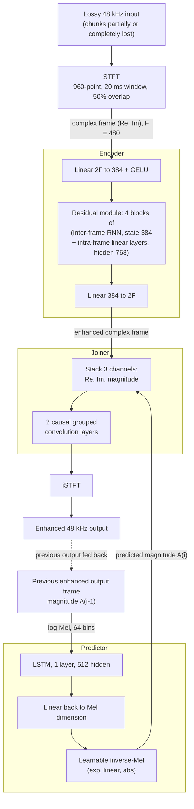

# Nguyen, Nguyen & Khong 2023: Full-Band Blind Packet-Loss Concealment With Predictive Network

| Field | Value |
|-------|-------|
| **Authors** | [[entities/viet-anh-nguyen\|Viet-Anh Nguyen]], [[entities/anh-h-t-nguyen\|Anh H. T. Nguyen]], [[entities/andy-khong\|Andy W. H. Khong]] |
| **Institution** | Crystalsound Team, NamiTech JSC, Ho Chi Minh City, Vietnam (Nguyen & Nguyen); Nanyang Technological University, Singapore (Khong) |
| **Published** | Proc. IEEE Int. Conf. Acoust., Speech, Signal Process. (ICASSP 2023) |
| **Type** | Conference Paper |
| **DOI** | 10.1109/ICASSP49357.2023.10097132 |
| **Zotero** | [UJNYNJ9B](zotero://select/items/0_UJNYNJ9B) |

## Summary

This paper proposes the **full-band recurrent network (FRN)**, a real-time recurrent method for **blind** packet loss concealment (PLC) of 48 kHz speech that requires no prior knowledge of the loss mask or packet size. Inspired by the RNN-transducer model, FRN combines an encoder that reconstructs the current (possibly corrupted) input frame with a **predictor that leverages the previous output** to improve prediction during consecutive losses, fused by a CNN joiner. Despite being frame-causal and blind, FRN outperforms an *informed* challenge top-performer (tPLCnet) across all metrics and loss rates, and beats an offline non-causal GAN baseline (TFGAN) on LSD, STOI, and PESQ by large margins.

## Problem Formulation

Packet loss in VoIP degrades speech at the receiver. PLC algorithms are divided into **informed** PLC — which receives the loss trace identifying which packets were lost — and **blind** PLC (audio in-painting), which must recover the lossy signal without any loss metadata. Blind operation has two practical advantages: it works when packet metadata is unavailable, and it does not require alignment between the audio stream and the packet stream, so it handles **arbitrary packet sizes**.

Three limitations of prior work motivate FRN:

1. Most existing PLC methods operate at **16 kHz**, which is inadequate for full-band 48 kHz telecommunication.
2. Existing blind in-painting models (spectrogram-inpainting networks, GAN-based PLC) are **non-causal**, hence unsuitable for real-time communication.
3. Informed models — including the top entries of the Interspeech 2022 Audio Deep PLC Challenge — depend on loss-mask information that may not be available.

The assumed setting: the content of each input chunk may be partially or completely lost in the time domain, and *no information about which parts are lost is available*. The input signal $x$ is represented via STFT as complex time-frequency frames $\langle \Re^{F \times T}, \Im^{F \times T} \rangle = \mathrm{STFT}(x)$, and each frame is processed **causally and sequentially** — the model is frame-causal by construction, with no look-ahead used (look-ahead is possible if performance is prioritized over latency).

## Methodology

### Architecture Overview

FRN is a time-frequency model with three modules, shown in Fig. 1:

- **Encoder (Enc)** — reconstructs audio loss in the current input frame $\langle \Re_i^F, \Im_i^F \rangle$;
- **Predictor (Pred)** — a pre-trained network that leverages the **previous output** $\langle \hat{\Re}_{i-1}^F, \hat{\Im}_{i-1}^F \rangle$ and exploits predictable patterns in speech to yield further improvement — essential when several consecutive packets are lost;
- **Joiner** — a CNN that combines the encoder's complex feature with the predictor's magnitude feature into the final enhanced frame.

The authors note that reusing previous output has a long history in speech enhancement, e.g. the celebrated decision-directed SNR estimator ([[concepts/decision-directed-a-priori-snr|Ephraim & Malah 1984]]); the predictor branch is the neural, architecture-level instantiation of that principle, inspired by the RNN-transducer model (Graves 2012) where a prediction network complements the encoder.

![[raw/papers/nguyen-2023-predictive-plc/figures/28394cbbe95b1aca151172b0515a48aae673a826bf257504e81dc23a74a0a9ee.jpg|(a) Overall FRN]]
(a)
![[raw/papers/nguyen-2023-predictive-plc/figures/ce5c90aa89458221c3e3f3f06dd78e9156ee9e38f1f945d39791afcb0adc5377.jpg|(b) Encoder]]
(b)
![[raw/papers/nguyen-2023-predictive-plc/figures/660761a5b19c06ccb187eb835512f4d90e33b6a44b689706287fddffadefcde1.jpg|(c) Predictor]]
(c)
![[raw/papers/nguyen-2023-predictive-plc/figures/9aece7cf70ebfc3d9e72b6a659851dd78941617c9a31416dc49ec8682eb8a4dd.jpg|(d) Joiner]]
(d)
*Figure 1: Full-band recurrent network (FRN): (a) sequential time-frequency processing; (b) encoder that enhances the current input; (c) predictor that infers output from the previous step; (d) joiner that combines the two branches.*

### Model Structure, Inputs, and Outputs

The three modules process STFT frames sequentially at a 10-ms frame rate (20-ms windows, 50% overlap, 960-point STFT, $F = 480$ bins) on 48 kHz audio.

**1. Encoder (Enc)**

| Item | Specification |
|------|---------------|
| **Structure** | Linear projection $2F \to \mathrm{dim}$ (384) + GELU → residual module of 4 blocks, each an inter-frame RNN layer (state 384) + intra-frame linear layers (hidden 768) with affine normalization → linear projection $\mathrm{dim} \to 2F$. The arrangement is described as an efficient hybrid between ResMLP and [[concepts/dprnn\|dual-path RNN]] modeling |
| **Input** | Flattened complex STFT frame $\mathbf{RI}^{2F \times T}$ (480 Re + 480 Im values) at 10-ms frame rate |
| **Output** | Enhanced complex TF frame $\langle \tilde{\Re}_i^F, \tilde{\Im}_i^F \rangle$ per frame |
| **Training data** | VCTK-derived PLC dataset (100 speakers, 3-s segments, Markov-chain loss masks, packet sizes 256–1536 samples) |
| **Role** | Reconstructs the current input frame: inter-frame correlation via RNN, intra-frame structure via MLP |

The encoder projection and output are

$$
\mathbf{X}^{\,\mathrm{dim} \times T} = \mathrm{GELU}\left(\mathbf{W}_{1}^{\,\mathrm{dim} \times 2F} \cdot \mathbf{RI}^{\,2F \times T} + \mathbf{b}_{1}\right),
$$

$$
\langle \Re^{F \times T}, \Im^{F \times T} \rangle = \mathbf{W}_{2}^{\,2F \times \mathrm{dim}} \cdot \mathrm{Res}\left(\mathbf{X}^{\,\mathrm{dim} \times T}\right) + \mathbf{b}_{2}.
$$

**2. Predictor (Pred)**

| Item | Specification |
|------|---------------|
| **Structure** | Log-Mel transform (64 bins) → single-layer LSTM (hidden 512) → linear layer projecting back to the Mel dimension → learnable **inverse-Mel layer**: exponential function, linear layer, absolute activation, mapping Mel magnitude back to $F$-bin STFT magnitude |
| **Input** | Magnitude of the previous enhanced output frame, $A_{i-1}^{F} = \sqrt{(\Re_{i-1}^{F})^{2} + (\Im_{i-1}^{F})^{2}}$, in the log-Mel domain |
| **Output** | Predicted magnitude of the current frame, $\hat{A}_i^F = \mathrm{Pred}(A_{i-1}^F)$, in the STFT domain |
| **Training data** | Pre-trained on the **target** (clean) audio frames of the training PLC dataset, then jointly trained with the encoder (pre-training yields a modest performance improvement) |
| **Role** | Models temporal dynamics of speech from the model's own previous output; the Mel-domain bottleneck exploits that most speech energy concentrates in low frequency bins, keeping the predictor efficient |

**3. Joiner**

| Item | Specification |
|------|---------------|
| **Structure** | Channel-stacking of encoder Re, encoder Im, and predictor magnitude (3 channels, same $F \times T$ shape) → **two causal grouped convolution layers** (output channels $c$, kernel size $k$, groups $g$ as specified in Fig. 1(d)) → 2-channel final Re/Im |
| **Input** | Encoder complex feature + predictor magnitude feature |
| **Output** | Final complex TF frame $\langle \hat{\Re}_i^F, \hat{\Im}_i^F \rangle$, transformed to waveform $\hat{y}$ by iSTFT |
| **Role** | Fuses the reconstruction (encoder) and prediction (predictor) branches; CNNs are effective here because the two features share the $F \times T$ shape but differ in channel count |

$$
\langle \hat{\Re}_{i}^{F}, \hat{\Im}_{i}^{F} \rangle = \mathrm{Joiner}\left(\langle \tilde{\Re}_{i}^{F}, \tilde{\Im}_{i}^{F}, \hat{A}_{i}^{F} \rangle\right),
\qquad
\hat{y} = \mathrm{iSTFT}\left(\langle \hat{\Re}_{i}^{F}, \hat{\Im}_{i}^{F} \rangle\right).
$$

The encoder and predictor are trained **in sequence then jointly**: the predictor is pre-trained on target audio (ensuring stability and that it genuinely predicts from the previous frame), then both are trained together with the PLC learning objective below.

### Training Losses

FRN is trained end-to-end with the **multi-resolution STFT loss** (a [[concepts/frequency-domain-loss|frequency-domain loss]]) as the sole objective. The compressed STFT magnitude of a signal $s$ is

$$
\mathcal{C}(s) = |\mathrm{STFT}(s)|^{\alpha},
$$

with compression rate $\alpha = 0.3$ that equalizes energy across frequency bands. The loss between generated signal $\hat{y}$ and target $y$ over $M$ resolutions (default auraloss library configurations) is

$$
\ell_{\mathrm{MR}}(\hat{y}, y) = \frac{1}{M} \sum_{m=1}^{M}\left(\frac{\|\mathcal{C}(y) - \mathcal{C}(\hat{y})\|_{\mathrm{F}}}{\|\mathcal{C}(y)\|_{\mathrm{F}}} + \frac{1}{N}\|\mathcal{C}(y) - \mathcal{C}(\hat{y})\|_{1}\right),
$$

where the first bracketed term is the **spectral convergence** (Frobenius norm) and the second the **spectral magnitude loss** (L1 norm over $N$ frequency bins). Both encoder and predictor are trained with this objective (predictor pre-training also uses it).

### Packet-Loss Generation

Realistic loss sequences are simulated with a **two-state Markov chain** over states 'loss' (L) and 'non-loss' (N), parameterized by intra-state transition probabilities $(p_N, p_L)$:

*Table 1: Markov-chain transition probabilities used for training loss masks.*

| $p_N$ | $p_L$ | Expected loss rate |
|-------|-------|--------------------|
| 0.9 | 0.1 | 10% |
| 0.9 | 0.5 | 16.7% |
| 0.5 | 0.1 | 35.7% |
| 0.5 | 0.5 | 50% |

## Experimental Setup

| Aspect | Configuration |
|--------|---------------|
| **Dataset** | VCTK corpus; 3-second segments selected randomly per file; 109 English speakers — first 100 train, 9 test |
| **Loss masks (training)** | One of the four Markov chains of Table 1 per audio output; packet size drawn from {256, 512, 768, 1024, 1536} samples |
| **Loss masks (evaluation)** | Three Markov chains giving 10%, 20%, 40% expected loss; plus **real traces** (~10.27% loss rate) collected from real calls by the Interspeech 2022 Audio Deep PLC Challenge |
| **Evaluation packet size** | Fixed 20 ms (960 samples) |
| **STFT** | 960-point, 20-ms window, 50% overlap, $F = 480$; no look-ahead |
| **Encoder** | Projection/RNN dimension 384; linear hidden dimension 768; 4 residual blocks |
| **Predictor** | 64-bin Mel filterbank; single-layer LSTM, hidden 512 |
| **Optimization** | Adam, learning rate $1 \times 10^{-4}$; 150 epochs; 90 samples per batch (both PLC training and predictor pre-training) |
| **Loss** | Multi-resolution STFT loss, compression $\alpha = 0.3$, auraloss default resolutions |
| **Metrics** | PLCMOS, LSD, STOI, PESQ. Note: STOI/PLCMOS/PESQ only evaluate bands up to 5/8/8 kHz, while LSD evaluates the entire 24 kHz band |
| **Hardware** | Single Intel Core-i9 3.0 GHz CPU thread, ONNX inference engine |
| **Baselines** | **tPLCnet** ('Large' version) — real-time *informed* PLC, ranked 3rd in the Interspeech 2022 PLC Challenge; **TFGAN** — offline *blind* GAN-based PLC (chunk size and discriminator linear head enlarged from 2,560 to 7,680 to adapt the 16 kHz design to 48 kHz) |

## Results

### Quality comparison (Table 2)

VCTK test set, four test conditions (simulated 10%/20%/40% loss + real traces):

*Table 2a: PLCMOS (higher better) and LSD (lower better).*

| Model | PLCMOS 10% | PLCMOS 20% | PLCMOS 40% | PLCMOS Real | LSD 10% | LSD 20% | LSD 40% | LSD Real |
|-------|-----------:|-----------:|-----------:|------------:|--------:|--------:|--------:|---------:|
| Input (zero fill) | 3.505 | 2.754 | 1.931 | 3.517 | 1.156 | 1.811 | 3.267 | 1.984 |
| tPLC (tPLCnet, informed) | 3.417 | 2.863 | 2.417 | 3.463 | 1.201 | 1.611 | 2.073 | 1.216 |
| TFGAN (offline blind) | 3.902 | 3.675 | 3.019 | 3.645 | 2.081 | 3.181 | 3.714 | 2.314 |
| **FRN (proposed)** | **4.032** | 3.573 | 2.623 | 3.655 | **0.783** | **1.117** | **1.682** | **0.946** |

*Table 2b: STOI and PESQ (both higher better).*

| Model | STOI 10% | STOI 20% | STOI 40% | STOI Real | PESQ 10% | PESQ 20% | PESQ 40% | PESQ Real |
|-------|---------:|---------:|---------:|----------:|---------:|---------:|---------:|----------:|
| Input (zero fill) | 0.842 | 0.748 | 0.592 | 0.797 | 1.931 | 1.393 | 1.126 | 2.484 |
| tPLC (tPLCnet, informed) | 0.831 | 0.776 | 0.704 | 0.838 | 1.981 | 1.629 | 1.386 | 2.532 |
| TFGAN (offline blind) | 0.823 | 0.751 | 0.641 | 0.760 | 1.716 | 1.321 | 1.116 | 1.339 |
| **FRN (proposed)** | **0.920** | **0.862** | **0.746** | **0.889** | **2.336** | **1.799** | **1.422** | **2.797** |

- **vs. informed tPLCnet**: FRN achieves significantly higher scores across *all* benchmarks and loss rates despite lacking loss-trace information — a blind, frame-causal model beating an informed challenge top-performer.
- **vs. offline TFGAN**: TFGAN attains higher PLCMOS at 20% and 40% loss, but FRN outperforms it by approximately **250%, 12%, and 30%** in LSD, STOI, and PESQ respectively. (Notably, TFGAN's adversarial training does not even beat zero-fill on LSD, and tPLCnet's PLCMOS at 10% loss falls below the zero-filled input.)

### Complexity (Table 3)

| Model | Causal | Blind | Model size | Inference time | Real-time factor |
|-------|--------|-------|-----------:|---------------:|-----------------:|
| tPLCnet | yes | no | 5.7M | 2.7 ms | 0.27 |
| TFGAN (generator) | no | yes | 1.9M | N/A | N/A |
| **FRN (proposed)** | yes | yes | 9.1M | 4.1 ms | 0.41 |

FRN processes a 10-ms chunk (20-ms windows, 50% overlap) in **4.1 ms** on a single CPU thread — a real-time factor of 0.41, a modest 1.4 ms increase over tPLCnet that is outweighed by the performance gain.

### Predictor ablation (Table 4)

On the 'Real trace' test set:

| Model | PLCMOS | LSD | PESQ | STOI |
|-------|-------:|----:|-----:|-----:|
| Input | 3.517 | 1.984 | 2.484 | 0.797 |
| Encoder only | 3.639 | 1.081 | 2.687 | 0.862 |
| **FRN (encoder + predictor + joiner)** | **3.655** | **0.946** | **2.797** | **0.889** |

The encoder alone performs well, but the predictor and joiner provide consistent additional improvement — confirming that **reusing the previous output is beneficial** for blind PLC.

## Key Contributions

1. **First real-time full-band (48 kHz) blind neural PLC** — FRN is frame-causal (STFT-based, no look-ahead) and requires no loss mask or packet-size information, handling arbitrary packet sizes; prior blind in-painting models are non-causal and mostly limited to 16 kHz.
2. **Predictive architecture that reuses the previous output** — an RNN-transducer-inspired design where a log-Mel LSTM predictor branch infers the current frame's magnitude from the previous *enhanced output*, formalizing the decision-directed principle (reusing one's previous estimate) as a dedicated network branch; essential for consecutive packet losses (ablation: real-trace LSD 1.081 → 0.946 over the encoder-only variant).
3. **Efficient full-band encoder** — a hybrid of ResMLP and dual-path RNN ideas: inter-frame correlation modeled by an RNN, intra-frame structure by MLPs with affine normalization, on the flattened complex STFT projected from $2F$ down to 384 dimensions for efficiency.
4. **Empirical demonstration that blind causal PLC can beat informed and offline models** — FRN outperforms the informed tPLCnet ('Large', 3rd place Interspeech 2022 PLC Challenge) on PLCMOS, LSD, STOI, and PESQ at all tested loss rates, and beats the offline non-causal TFGAN on LSD/STOI/PESQ by ~250%/12%/30%, at 4.1 ms per 10-ms frame (RTF 0.41).

## Related Concepts

- [[concepts/full-band-recurrent-network|Full-Band Recurrent Network (FRN)]] — the method introduced by this paper
- [[concepts/packet-loss-concealment|Packet Loss Concealment]] — the umbrella task and the informed/blind taxonomy
- [[concepts/dnn-regression-plc|DNN Regression PLC]] — the earlier regression PLC whose recursive re-feeding for burst losses anticipates the predictor branch
- [[concepts/frequency-domain-loss|Frequency Domain Loss]] — the multi-resolution STFT training objective
- [[concepts/decision-directed-a-priori-snr|Decision-Directed A Priori SNR Estimation]] — the classical precedent the paper cites for reusing previous output
- [[concepts/dprnn|Dual-Path RNN (DPRNN)]] — architectural inspiration for the encoder's inter-/intra-frame hybrid
- [[concepts/long-short-term-memory|Long Short-Term Memory]] — the predictor's backbone
- [[concepts/recurrent-neural-network|Recurrent Neural Network]] — the encoder's inter-frame modeling layer
- [[concepts/pesq|PESQ]] — evaluation metric

## Related Synthesis

- [[synthesis/neural-packet-loss-concealment|Neural Packet Loss Concealment]] — cross-source comparison with [[sources/lee-2016-dnn-plc|Lee & Chang 2016]] (informed DNN regression) and [[sources/valin-2022-real-time-plc|Valin et al. 2022]] (hybrid generative + predictive)
