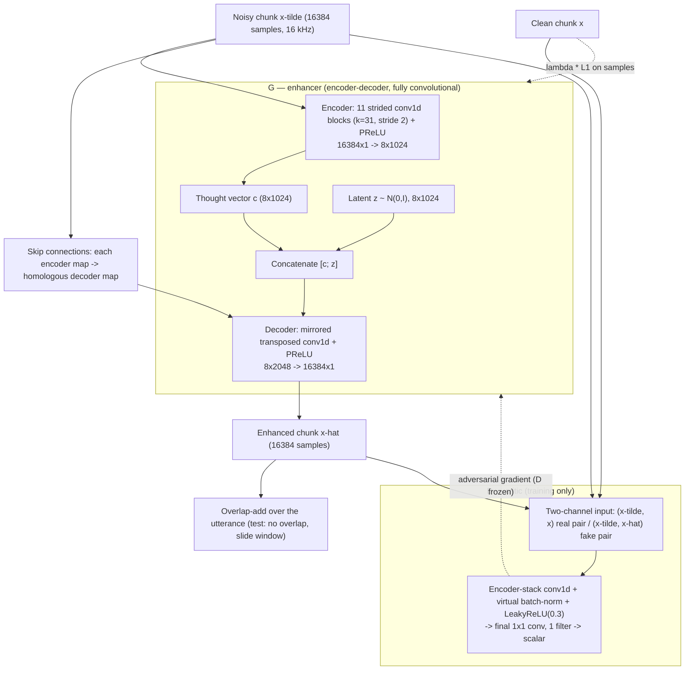

# Pascual, Bonafonte & Serrà 2017: SEGAN — Speech Enhancement Generative Adversarial Network

| Field | Value |
|:------|:------|
| **Authors** | [[entities/santiago-pascual\|Santiago Pascual]], [[entities/antonio-bonafonte\|Antonio Bonafonte]], [[entities/joan-serra\|Joan Serrà]] |
| **Institution** | Universitat Politècnica de Catalunya (Pascual, Bonafonte); Telefónica Research, Barcelona (Serrà) |
| **Venue** | Interspeech 2017 |
| **Year** | 2017 |
| **Pages** | pp. 3642–3646 |
| **Type** | Conference paper |
| **DOI** | [10.21437/Interspeech.2017-1428](https://doi.org/10.21437/Interspeech.2017-1428) |
| **Zotero** | [Y773YGEC](zotero://select/items/0_Y773YGEC) |
| **Code** | [santi-pdp/segan](https://github.com/santi-pdp/segan) (TensorFlow) |
| **Samples** | [veu.talp.cat/segan](http://veu.talp.cat/segan) |

## Summary

SEGAN is the first application of a [[concepts/segan|generative adversarial network to speech enhancement]], and the first waveform-level (raw 16 kHz sample) end-to-end enhancement system. A fully convolutional encoder–decoder generator, conditioned on the noisy waveform and a latent vector, is trained with a [[concepts/least-squares-gan|least-squares adversarial objective]] plus an $L_1$ sample-domain term ($\lambda = 100$) against a convolutional discriminator that scores (noisy, clean) against (noisy, enhanced) pairs. A single shared parametrization covering 28 training speakers and 40 noise conditions beats a Wiener-filter baseline on every metric except PESQ — CSIG 3.48, CBAK 2.94, COVL 2.80, SSNR 7.73 — and wins a 16-listener subjective test (MOS 3.18 vs 2.70 Wiener, 2.09 noisy).

## Problem Formulation

Given a noisy signal $\tilde{\mathbf{x}}$ and its clean reference $\mathbf{x}$, enhancement seeks $\hat{\mathbf{x}} = G(\tilde{\mathbf{x}})$ such that the estimate is both noise-free and undistorted. Two structural complaints motivate the paper's design:

1. **Spectral-domain operation with noisy phase.** Most systems work in the STFT analysis/synthesis framework and modify only the magnitude [^17], [^18], prior to the [[concepts/invalid-stft-problem|invalid STFT problem]] being named.
2. **Regression losses on waveforms are misspecified.** As WaveNet notes for raw audio, MAE/MSE presuppose a unimodal output distribution and bias predictions toward the conditional mean — an inadequate model for speech. This is the paper's stated motivation for replacing a waveform regression loss with an adversarial one.

Inference-time requirements the design targets: no causality requirement (no recursion, unlike RNN denoisers), no hand-crafted features, and one shared model across speakers and noise types.

## Methodology

### Model Structure, Inputs, and Outputs

| Network | Structure | Input | Output | Training data | Role |
|:--------|:----------|:------|:-------|:--------------|:-----|
| **G** (generator / enhancer) | Fully convolutional auto-encoder, **22 1-D strided-conv layers**, filter width **31**, stride $N=2$, PReLU activations, no dense layers. Encoder feature-map widths (samples × maps): $16384{\times}1$, $8192{\times}16$, $4096{\times}32$, $2048{\times}32$, $1024{\times}64$, $512{\times}64$, $256{\times}128$, $128{\times}128$, $64{\times}256$, $32{\times}256$, $16{\times}512$, $8{\times}1024$; the decoder mirrors widths and filter counts, and its maps double because skips and $z$ are concatenated | Noisy waveform chunk $\tilde{\mathbf{x}}$ (16384 samples = ~1 s at 16 kHz) **and** latent $\mathbf{z}\sim\mathcal{N}(\mathbf{0},\mathbf{I})$ of dimension $8{\times}1024$ | Enhanced chunk $\hat{\mathbf{x}}=G(\mathbf{z},\tilde{\mathbf{x}})$, 16384 raw samples at 16 kHz | Trained on chunks of the noisy Voice Bank + DEMAND training set (28 speakers, 40 conditions) | Performs the enhancement; the adversarial term gives it a distribution-matching (rather than conditional-mean) objective, the $L_1$ term anchors it to the clean reference |
| **D** (discriminator / critic) | Same 1-D conv stack as G's encoder, in classification topology: conv1d + **virtual batch-norm** + LeakyReLU ($\alpha=0.3$); final layer is a **1×1 conv with one filter** (stride 1, no downsampling) instead of a dense layer — cutting that component from $8{\times}1024 = 8192$ to 8 parameters while making the channel merge learnable | **Two channels of 16384 samples**: real pair $(\tilde{\mathbf{x}},\mathbf{x})$, fake pair $(\tilde{\mathbf{x}},\hat{\mathbf{x}})$ | Scalar real/fake score per input pair | Same training data (real pairs from the corpus, fake pairs generated on the fly) | Provides the adversarial training signal; discarded at inference |

Strided convolutions replace pooling because they proved more stable for GAN training. Skip connections pass fine-grained waveform information (phase, alignment) around the compression bottleneck and improve gradient flow; "thought vector" $\mathbf{c}$ is the paper's name for the bottleneck activation.

### Training Losses

Two networks, one adversarial objective with a regression anchor. The base GAN objective is

$$\min_{G}\max_{D} V(D,G) = \mathbb{E}_{\mathbf{x}\sim p_{\text{data}}(\mathbf{x})}[\log D(\mathbf{x})] + \mathbb{E}_{\mathbf{z}\sim p_{\mathbf{z}}(\mathbf{z})}[\log(1 - D(G(\mathbf{z})))]$$

which the paper conditions on the noisy signal $\mathbf{x}_c = \tilde{\mathbf{x}}$ (so $D$ sees the pair and $G$ is asked to produce the *conditioned* clean sample). Cross-entropy in this objective suffers vanishing gradients, so the paper adopts [[concepts/least-squares-gan|LSGAN]] least-squares losses with binary coding (1 = real, 0 = fake):

$$\min_{D} V_{\text{LSGAN}}(D) = \tfrac{1}{2}\mathbb{E}_{\mathbf{x},\mathbf{x}_c}\left[(D(\mathbf{x},\mathbf{x}_c)-1)^2\right] + \tfrac{1}{2}\mathbb{E}_{\mathbf{z},\mathbf{x}_c}\left[D(G(\mathbf{z},\mathbf{x}_c),\mathbf{x}_c)^2\right]$$

$$\min_{G} V_{\text{LSGAN}}(G) = \tfrac{1}{2}\mathbb{E}_{\mathbf{z},\mathbf{x}_c}\left[(D(G(\mathbf{z},\mathbf{x}_c),\mathbf{x}_c)-1)^2\right]$$

**SEGAN's generator loss** adds the $L_1$ distance to the clean sample, weighted by $\lambda$:

$$\min_{G} V_{\text{SEGAN}}(G) = \tfrac{1}{2}\mathbb{E}_{\mathbf{z},\tilde{\mathbf{x}}}\left[(D(G(\mathbf{z},\tilde{\mathbf{x}}),\tilde{\mathbf{x}})-1)^2\right] + \lambda\,\lVert G(\mathbf{z},\tilde{\mathbf{x}}) - \mathbf{x}\rVert_1$$

- $L_1$ (not $L_2$) is the anchor, following its effectiveness in conditional image generation — $L_1$ gives crisper generations than the conditional-mean-biased $L_2$.
- **$\lambda = 100$**, chosen after $\lambda=1$ proved inert: with $\lambda=1$ the $L_1$ term sat two orders of magnitude below the adversarial term and had no practical effect on learning. At $\lambda=100$ the $L_1$ minimizes while the adversarial term reaches equilibrium, and lower $L_1$ correlated with better output quality.
- $D$ is trained on real pairs $(\tilde{\mathbf{x}},\mathbf{x})$ and fake pairs $(\tilde{\mathbf{x}},\hat{\mathbf{x}})$; $G$ is updated with $D$'s parameters frozen (Fig. 1 below).
- The two networks are trained **jointly** (alternating adversarial updates), not staged.

![[raw/papers/pascual-2017-segan/figures/fig1.png|Refer to caption]]

*Figure 1: GAN training process. First, D back-props a batch of real examples. Then, D back-props a batch of fake examples that come from G, and classifies them as fake. Finally, D's parameters are frozen and G back-props to make D misclassify.*

![[raw/papers/pascual-2017-segan/figures/fig2.png|Refer to caption]]

*Figure 2: Encoder-decoder architecture for G. The arrows between encoder and decoder blocks denote skip connections — the reason the decoder's feature-map count is doubled.*

![[raw/papers/pascual-2017-segan/figures/fig3.png|Refer to caption]]

*Figure 3: Adversarial training for speech enhancement. Dashed lines represent gradient backprop. The real pair is $(\tilde{\mathbf{x}}, \mathbf{x})$, the fake pair $(\tilde{\mathbf{x}}, \hat{\mathbf{x}})$.*

## Experimental Setup

| Parameter | Value |
|:----------|:------|
| Dataset | Valentini et al. (Voice Bank corpus speakers + DEMAND noise); 30 speakers — 28 train / 2 test, unseen speakers and conditions |
| Train conditions | 40: 10 noise types (2 artificial + 8 DEMAND) × 4 SNR (15, 10, 5, 0 dB); ~10 sentences per condition per speaker |
| Test conditions | 20: 5 DEMAND noise types × 4 SNR (17.5, 12.5, 7.5, 2.5 dB); ~20 sentences per condition per speaker; **824 test files** |
| Sample rate | Down-sampled 48 kHz → **16 kHz** |
| Chunking | Train: 16384-sample (~1 s) windows every 500 ms (50% overlap). Test: window slid with **no overlap** over the whole utterance |
| Optimizer | RMSprop, lr $2\times10^{-4}$, effective batch size 400 |
| Epochs | 86 |
| $\lambda$ | 100 |
| Framework | TensorFlow |
| Metrics | WB-PESQ (ITU-T P.862.2), CSIG, CBAK, COVL (Hu & Loizou composite measures), SSNR; plus a 16-listener MOS/CMOS test |

## Results

### Objective Evaluation (824 test files)

| Metric | Noisy | Wiener | SEGAN |
|:-------|:------|:-------|:------|
| PESQ | 1.97 | **2.22** | 2.16 |
| CSIG | 3.35 | 3.23 | **3.48** |
| CBAK | 2.44 | 2.68 | **2.94** |
| COVL | 2.63 | 2.67 | **2.80** |
| SSNR | 1.68 | 5.07 | **7.73** |

SEGAN is slightly *worse* than Wiener on PESQ but better on every distortion/intrusiveness measure: less speech distortion (CSIG), more effective noise removal (CBAK, SSNR), and therefore a better overall tradeoff (COVL). The paper's reading is that the composite measures track speech/noise distortion better than PESQ here.

### Subjective Evaluation

20 test sentences, 3 systems presented in randomized order, 16 listeners, 1–5 scale (see [[sources/pascual-2017-segan|Figure 4]]'s CMOS box plot for the relative view):

| Metric | Noisy | Wiener | SEGAN |
|:-------|:------|:-------|:------|
| MOS | 2.09 | 2.70 | **3.18** |

Absolute MOS differences are wide because the test SNR varies a lot, so the paper reports comparative MOS (CMOS) instead:

- SEGAN vs noisy: preferred **67%** vs 8% (25% no preference).
- SEGAN vs Wiener: preferred **53%** vs 23% (24% no preference).

### External comparison points

- [[sources/pandey-2019-cnn-speech-enhancement-time-domain|Pandey & Wang 2019]] benchmark the same architecture family on TIMIT/IEEE/WSJ0 (different data entirely) and report SEGAN at STOI 0.70 / PESQ 1.37 / SI-SDR 1.2 dB at −5 dB SNR, and ~**58 M parameters** — the parameter count is *not* stated in the SEGAN paper itself, so the 58 M figure is an external estimate. Their AECNN (6.4 M) beats SEGAN with a plain STFT-magnitude MAE loss, the first evidence that SEGAN's adversarial waveform objective was not the most sample-efficient way to a good perceptual metric.
- The wiki's VoiceBank-DEMAND lineage tables ([[concepts/voicebank-demand]], [[concepts/pesq]]) take **PESQ 2.16** from this paper as the benchmark's origin point.

## Key Contributions

1. **First GAN for speech enhancement**, and the first end-to-end waveform-level enhancement system: no STFT, no hand-crafted features, no phase reconstruction step.
2. **Convolutional adversarial + $L_1$ objective for enhancement** with the empirical $\lambda = 100$ calibration (adversarial term and $L_1$ term must be within ~2 orders of magnitude for the anchor to bite).
3. **Single shared parametrization across 28 speakers and 40 noise conditions** — evidence that one model generalizes across speakers and noise types rather than being conditioned per case.
4. **Fast non-recursive inference**: no causality constraint and no RNN recursion; enhancement is one forward pass over ~1 s chunks.
5. **Subjective win over Wiener filtering** (MOS 3.18 vs 2.70; 53% vs 23% pairwise preference) while beating it on CSIG/CBAK/COVL/SSNR — the paper that made adversarial training a viable SE objective.
6. Public code (TensorFlow) and released enhanced-audio samples, which made the method a standard baseline.

## Limitations and Caveats

- **PESQ below Wiener** (2.16 vs 2.22); the paper attributes the gap to the adversarial objective's high-frequency artifacts, and names perceptual weighting of the adversarial loss as future work.
- **No parameter/MAC/complexity accounting** in the paper; SEGAN's ~58 M parameters (external) are ~9× an AECNN of the same shape.
- **Offline chunking**: the paper does not claim causality, and test-time inference slides a one-second window over the full utterance — no streaming/latency analysis.
- **Objective and subjective evaluation use the same 824-file test set family**; the subjective test draws only 20 sentences from it, selected by listening rather than by a stratified protocol.
- Comparisons are against one classical baseline (Wiener with a priori SNR estimation) — no competing deep systems, which the conclusion lists as required future work.

## Related Concepts

- [[concepts/segan|SEGAN]] — the architecture itself
- [[concepts/least-squares-gan|Least-Squares GAN (LSGAN)]] — the adversarial objective adopted and extended with the $L_1$ anchor
- [[concepts/time-domain-speech-enhancement|Time-Domain Speech Enhancement]] — SEGAN is the first entry in this lineage
- [[concepts/generative-vs-discriminative-speech-enhancement|Generative vs. Discriminative Speech Enhancement]] — SEGAN opens the generative branch
- [[concepts/u-net|U-Net]] — the skip-connected encoder–decoder topology SEGAN's generator instantiates in 1-D
- [[concepts/invalid-stft-problem|Invalid STFT Problem]] — the frequency-domain failure mode waveform-level generation avoids
- [[concepts/voicebank-demand|VoiceBank+DEMAND]] — the benchmark whose canonical configuration comes from this data setup
- [[concepts/pesq|PESQ]]
- [[concepts/speech-enhancement|Speech Enhancement]]
- [[concepts/deep-learning-for-signal-processing|Deep Learning for Signal Processing]]

## Related Synthesis

- [[synthesis/deep-speech-enhancement|Deep Speech Enhancement: Architectural & Methodological Evolution]] — SEGAN supplies the origin point of the time-domain axis (Insight 2) and of the generative/adversarial axis (Insight 7)

## Related Sources

- [[sources/abdulatif-2024-cmgan|Abdulatif, Cao & Yang 2024: CMGAN]] — includes SEGAN as the waveform-domain GAN baseline on VoiceBank+DEMAND (PESQ 2.16); CMGAN instead combines compressed complex-TF reconstruction with a PESQ-surrogate discriminator and reaches PESQ 3.41.

## References

[^17]: D. Wang and J. Lim, "The unimportance of phase in speech enhancement," *IEEE Trans. ASSP*, vol. 30, no. 4, pp. 679–681, 1982.
[^18]: K. Paliwal, K. Wójcicki, and B. Shannon, "The importance of phase in speech enhancement," *Speech Communication*, vol. 53, no. 4, pp. 465–494, 2011.
