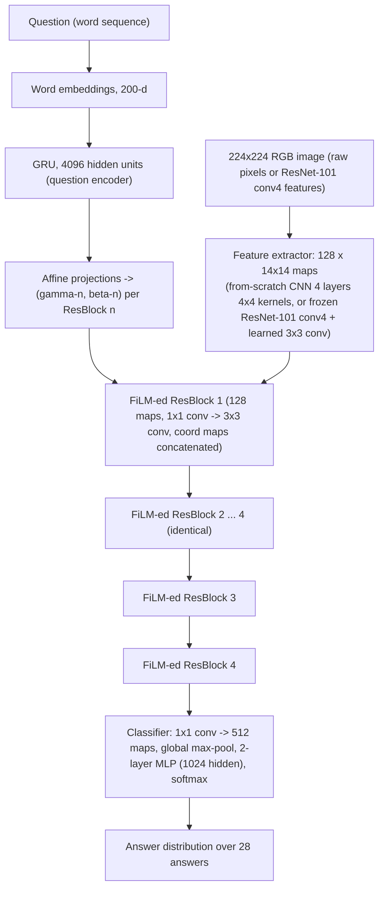

# Perez, Strub, de Vries, Dumoulin & Courville 2018: FiLM: Visual Reasoning with a General Conditioning Layer

- **Authors**: [[entities/ethan-perez|Ethan Perez]], [[entities/florian-strub|Florian Strub]], [[entities/harm-de-vries|Harm de Vries]], [[entities/vincent-dumoulin|Vincent Dumoulin]], [[entities/aaron-courville|Aaron Courville]]
- **Affiliation**: MILA / Université de Montréal; Rice University; Univ. Lille, CNRS, Centrale Lille, Inria, UMR 9189 CRIStAL
- **Venue**: Proceedings of the AAAI Conference on Artificial Intelligence (AAAI 2018)
- **Year**: 2018
- **Type**: Conference paper (extends 2017 arXiv report 1709.07871)
- **DOI**: [10.1609/aaai.v32i1.11671](https://doi.org/10.1609/aaai.v32i1.11671)
- **Zotero**: [Open in Zotero](zotero://select/items/0_33WHG648)
- **Code**: [github.com/ethanjperez/film](https://github.com/ethanjperez/film)

## Summary

This paper introduces **[[concepts/film-layer|FiLM: Feature-wise Linear Modulation]]**, a general-purpose conditioning method that influences a neural network's computation by applying a learned, feature-wise affine transformation $\gamma \mathbf{F} + \beta$ to its intermediate features, with $(\gamma, \beta)$ predicted by a "FiLM generator" network from arbitrary conditioning input. Applied to visual reasoning (multi-step, question-answering over images), a GRU-based FiLM generator processes the question and modulates a CNN visual pipeline, roughly **halving the state-of-the-art error on CLEVR** (4.5% → 2.3%, 97.7% accuracy, surpassing humans at 92.6%), and setting new state-of-the-art on CLEVR-Humans (75.9%) and CLEVR-CoGenT. Ablations show FiLM is robust to architectural changes, and that its success is **not** tied to placement after normalization layers — decoupling it from "Conditional Normalization" and opening its use in RNNs, reinforcement learning, and audio processing.

## Problem Formulation

Visual reasoning — answering image-related questions that require multi-step, high-level processes — was, at the time, resistant to standard deep-learning approaches: general VQA models (CNN+LSTM, Stacked Attention) exploited dataset biases rather than capturing compositional structure, while the best CLEVR results came from architectures with strong built-in priors: modular networks with program supervision (PG+EE, N2NMN) or relational architectures (Relation Networks). The question posed: **can a model made of general-purpose components — no compositional priors, no program labels, no specialized architecture — learn to visually reason?**

The paper answers by conditioning a CNN on the question with FiLM: learn functions $f$ and $h$ that output $\gamma_{i,c} = f_c(\mathbf{x}_i)$ and $\beta_{i,c} = h_c(\mathbf{x}_i)$ from conditioning input $\mathbf{x}_i$, then modulate the network's feature maps $\mathbf{F}_{i,c}$ (the $c$-th feature map of the $i$-th input) via:

$$
FiLM(\mathbf{F}_{i,c} \mid \gamma_{i,c}, \beta_{i,c}) = \gamma_{i,c}\,\mathbf{F}_{i,c} + \beta_{i,c}.
$$

For CNNs this modulates the per-feature-map distribution of activations, agnostic to spatial location. Each feature map is conditioned independently, giving the generator fine-grained control: it can scale up/down, negate, shut off, or selectively threshold feature maps (when followed by ReLU). FiLM adds only **two parameters per modulated feature map**, so its cost does not scale with image resolution — unlike attention or Relation Networks (whose pairwise comparisons scale quadratically with spatial resolution).

## Methodology

![[raw/papers/perez-2018-film-visual-reasoning/figures/fig2.png|A single FiLM layer for a CNN. The dot signifies a Hadamard product.]]

*Figure 2: A single FiLM layer for a CNN. Various combinations of γ and β can modulate individual feature maps: scaling, negating, shutting off, selective thresholding.*

The single function that predicts the $(\boldsymbol{\gamma}, \boldsymbol{\beta})$ vectors for all FiLM layers is called the **FiLM generator**; the network being modulated is the **FiLM-ed network**. FiLM generalizes Conditional Normalization (Conditional Instance Norm for stylization, Dynamic Layer Norm for ASR, Conditional Batch Norm for VQA), which replace the affine parameters of normalization layers with learned functions of conditioning input. Prior CN work had never examined whether the affine transform must follow normalization; this paper shows it need not.

![[raw/papers/perez-2018-film-visual-reasoning/figures/fig3.png|The FiLM generator (left), FiLM-ed network (middle), and residual block architecture (right)]]

*Figure 3: The FiLM generator (left), FiLM-ed network (middle), and residual block architecture (right) of the model.*

### Model Structure, Inputs, and Outputs

The model consists of a linguistic pipeline (FiLM generator) and a visual pipeline (FiLM-ed network), trained end-to-end from image-question-answer triplets only.

**FiLM generator (linguistic pipeline) specification:**

| Property | Value |
|----------|-------|
| **Structure** | GRU with 4096 hidden units over learned 200-d word embeddings; final hidden state = question embedding; per ResBlock $n$, affine projections predict $(\boldsymbol{\gamma}^{n}_{i,\cdot}, \boldsymbol{\beta}^{n}_{i,\cdot})$ |
| **Input** | Question word sequence (CLEVR questions up to 40+ words) |
| **Output** | $(\boldsymbol{\gamma}, \boldsymbol{\beta})$ pairs — one 128-dim pair per FiLM layer (4 ResBlocks ⇒ 4 pairs); $\gamma$ implemented as $1 + \Delta\gamma$ to avoid zeroing activations/gradients at init |
| **Training data** | CLEVR training set (700K image-question-answer-program tuples); only triplets used, no programs, no data augmentation |
| **Role** | Converts the question into per-layer, per-feature-map scale/shift parameters that steer the visual pipeline |

**FiLM-ed network (visual pipeline) specification:**

| Property | Value |
|----------|-------|
| **Structure** | 128 feature maps throughout; 4 FiLM-ed residual blocks, each: 1×1 conv → (FiLM applied to output) → 3×3 conv → ReLU; batch-norm parameters of layers immediately preceding FiLM turned off; two coordinate feature maps (relative x/y position, scaled −1 to 1) concatenated to ResBlock inputs and classifier input; classifier = 1×1 conv to 512 maps → global max-pooling → 2-layer MLP with 1024 hidden units → softmax over 28 answers |
| **Input** | Image, resized 224×224: either raw pixels (from-scratch CNN: 4 layers, 128 4×4 kernels, ReLU, batch norm) or fixed pre-trained ResNet-101 conv4 features + a learned 3×3 conv layer |
| **Output** | Softmax distribution over 28 CLEVR answers, one per question |
| **Training data** | CLEVR (same as above); 80 epochs max, early stopping on validation accuracy |
| **Role** | Extracts and reasons over image features, modulated per-feature-map by the question-derived $(\gamma, \beta)$ |

### Training Losses

Plain **cross-entropy** over the 28 CLEVR answers — no auxiliary losses, no program supervision, no data augmentation. Adam optimizer (learning rate $3\times10^{-4}$), weight decay $1\times10^{-5}$, batch size 64, batch normalization and ReLU throughout the FiLM-ed network. Training takes 4 days on 1 NVIDIA TITAN Xp GPU (image-features variant).

### Key Design Decisions

- **Feature-wise affine conditioning only**: no attention, no concatenation-fusion of language and vision — the question influences the visual pipeline solely through $\gamma/\beta$.
- **$\gamma$ implemented as $1 + \Delta\gamma$**: zero-centered $\gamma$ would zero out feature maps and gradients at initialization.
- **Coordinate feature maps**: concatenated with image features (from prior work on CLEVR) to facilitate spatial reasoning.
- **Large FiLM capacity**: empirically the model had a large capacity, so many architectural/hyperparameter choices were made for added regularization.

## Experimental Setup

| Property | Value |
|----------|-------|
| **Dataset (main)** | CLEVR: 700K (image, question, answer, program) tuples; 3D-rendered objects varying in shape/material/color/size; multi-step compositional questions up to 40+ words; 28 possible answers |
| **Baselines** | Q-type, LSTM, CNN+LSTM, Stacked Attention (CNN+LSTM+SA), N2NMN, PG+EE (9K/700K programs), Relation Networks (CNN+LSTM+RN) |
| **Generalization datasets** | CLEVR-Humans (18K/7K/7K human-posed questions, AMT-collected); CLEVR-CoGenT (conditions A/B with disjoint color-shape combos) |
| **Hardware** | 1 NVIDIA TITAN Xp GPU, 80 epochs, 4 days (features model) |
| **Analysis tools** | Activation visualizations, γ/β histograms, t-SNE of (γ, β), test-time noise ablations |

## Results

**CLEVR** (Table 1): FiLM achieves **97.7% overall** (94.3 count / 99.1 exist / 96.8 compare-numbers / 99.1 query-attribute / 99.1 compare-attribute), vs. Relation Networks 95.5%, PG+EE (700K programs) 96.9%, humans 92.6%. Without extra supervision or data augmentation, FiLM halves state-of-the-art error from 4.5% → 2.3%.

**What FiLM learns** (Figures 4–6): Activation visualizations show globally-pooled features come from question-relevant object regions — feature modulation indirectly yields spatial attention. γ histograms peak sharply at 0 (shutting off feature maps) with a selective set of high-magnitude upregulated maps; γ ranges −15 to 19, β ranges −9 to 16; 36% of γ values negative, 76% of β values negative (selective thresholding against the subsequent ReLU). t-SNE of (γ, β) clusters by reasoning function: first-layer parameters group by *low-level* functions (equal_color, query_color), last-layer by *high-level* functions — **function-based modularity emerges without any architectural prior**.

![[raw/papers/perez-2018-film-visual-reasoning/figures/fig6.png|t-SNE plots of gamma/beta of the first (left) and last (right) FiLM layers of a 6-FiLM-layer network]]

*Figure 6: t-SNE of (γ, β) for 3,000 validation points. First-layer FiLM parameters cluster by low-level reasoning functions; last-layer parameters by high-level functions — learned function-based modularity.*

**Ablations** (robustness, Table 2/3):

| Ablation | Accuracy |
|----------|----------|
| Best architecture | 97.4 ± 0.4 |
| FiLM with β:=0 (scaling only) | 96.9 |
| FiLM with γ:=1 (bias-only) | 95.9 |
| γ restricted to (0,1) via sigmoid | 95.9 |
| γ restricted to (−1,1) via tanh | 96.3 |
| γ restricted to (0,∞) via exp | 96.3 |
| FiLM after residual connection | 96.6 |
| FiLM after ResBlock ReLU-2 | 97.7 |
| FiLM before ResBlock Conv-1 | 95.0 |
| No FiLM in ResBlocks 2–4 (single FiLM layer) | 97.3 |
| No FiLM at all (1–4) | 21.4 |
| No batch normalization | 93.7 |
| No residual connection | 94.0 |
| 1×1 convs only, no coordinate maps | 95.3 |
| Raw pixels instead of pre-trained features | 97.6 |
| Depth: 1/2/3/4/5/6/7/8/12 ResBlocks | 93.5/97.1/96.7/97.4/97.4/97.7/97.4/97.6/96.9 |

Key ablation findings:
- **γ matters more than β**: replacing β with training-mean values at test time costs only 1.0% accuracy; the same for γ costs 65.4%. γ-noise hurts far more than β-noise.
- **Unrestricted scaling is essential**: sigmoid/tanh/exp restrictions on γ each hurt roughly as much as removing γ-conditioning entirely — FiLM's ability to scale by large magnitudes *and* to negate/zero feature maps contributes to its success.
- **Normalization decoupled**: moving FiLM to different ResBlock positions (best: after post-norm ReLU, 97.7) shows no drop — conditioning need not follow a normalization layer.
- **One FiLM layer suffices** (97.3%): even a single modulation passes enough question information for the CNN to reason downstream.
- **Spatial reasoning without spatial interaction**: 1×1 convs + global max-pooling (no cross-position information transfer) still reaches 95.3% — the model reasons about space from fixed feature locations alone.

**CLEVR-Humans**: fine-tuning only the FiLM generator (linguistic pipeline) yields **75.9%** vs. PG+EE 66.6% — a 9.3% gain over prior SOTA; FiLM's fine-tuning gain is >50% larger than other models', showing data-efficient adaptation.

**CLEVR-CoGenT**: trained on condition A, FiLM generalizes to held-out attribute combinations in B better than PG+EE (which models compositionality explicitly and receives program labels). A novel **zero-shot generalization method** composes unseen-concept questions by linear combination in FiLM parameter space — e.g., γ/β for "How many cyan cubes are there?" ≈ ("How many cyan spheres?" + "How many brown cubes?" − "How many brown spheres?"), analogous to word-vector arithmetic ("King − Man + Woman = Queen") — lifting zero-shot accuracy on applicable questions from 71.5% → 80.7%.

**Error analysis** (appendix): 96.1% of counting mistakes are off-by-one; occasional logically inconsistent answers (correct counts, wrong comparison); occlusion cases fail with the fixed 14×14 feature resolution.

## Key Contributions

1. **FiLM: a general conditioning mechanism** — feature-wise affine transformation $\gamma\mathbf{F}+\beta$ predicted by a generator network from arbitrary conditioning input; only two parameters per modulated feature map, cost independent of image resolution.
2. **State-of-the-art visual reasoning** — 97.7% on CLEVR (halves SOTA error), 75.9% on CLEVR-Humans, best compositional generalization on CLEVR-CoGenT — using no program supervision, no data augmentation, no architectural reasoning priors.
3. **Decoupling conditioning from normalization** — shows FiLM's success is not tied to placement after normalization layers, unifying and relaxing Conditional Normalization and opening application to RNNs, RL, and other settings.
4. **Mechanistic analysis** — γ/β statistics, t-SNE, and activation visualizations show FiLM selectively upregulates/downregulates/shuts off feature maps, inducing function-based modularity and implicit spatial attention.
5. **Zero-shot generalization via linear combination of FiLM parameters** — analogy-making in FiLM parameter space, correcting learned attribute-combination biases without retraining.

## Related Concepts

- [[concepts/film-layer|FiLM Layer]] — the paper's core contribution
- [[concepts/gated-recurrent-unit|Gated Recurrent Unit (GRU)]] — question encoder of the FiLM generator
- [[concepts/attention-mechanism|Attention Mechanism]] — competing conditioning/fusion approach; FiLM achieves implicit spatial attention without explicit attention

## Related Synthesis

- [[synthesis/film-conditioning-across-domains|FiLM Conditioning Across Domains]] — cross-source synthesis of this paper and its eight audio descendants: mechanism invariance, identity initialization, conditioning-input dominance, and the drift from signal-level to filter-estimation conditioning
