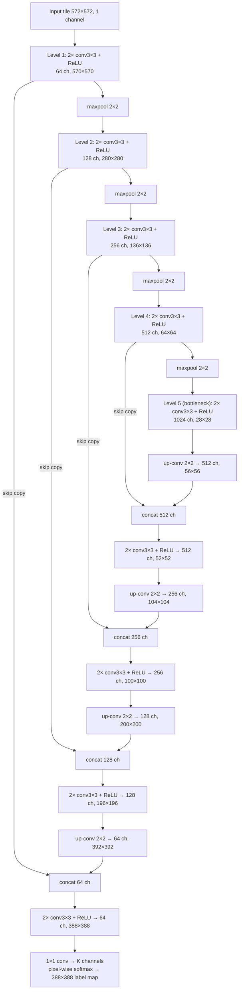

# Ronneberger, Fischer & Brox 2015: U-Net — Convolutional Networks for Biomedical Image Segmentation

**Authors**: [[entities/olaf-ronneberger|Olaf Ronneberger]], [[entities/philipp-fischer|Philipp Fischer]], [[entities/thomas-brox|Thomas Brox]]

**Affiliation**: Computer Science Department and BIOSS Centre for Biological Signalling Studies, University of Freiburg, Germany

**Venue**: MICCAI 2015 (LNCS 9351), pp. 234–241

**Year**: 2015 | **Type**: Conference paper | **DOI**: [10.1007/978-3-319-24574-4_28](https://doi.org/10.1007/978-3-319-24574-4_28)

**Zotero**: [D97HADY7](zotero://select/items/0_D97HADY7)

## Summary

The paper introduces the U-Net, a fully convolutional encoder–decoder in which a contracting path captures context and a symmetric expansive path restores pixel-level localization, with high-resolution features copied across at every resolution level. Trained end-to-end on as few as 20–30 annotated images — made possible by heavy [[concepts/elastic-deformation-augmentation|elastic deformation augmentation]] and a [[concepts/boundary-weighted-loss|boundary-weighted loss]] — it beat the sliding-window CNN entry (Cireșan et al.) on the ISBI 2012 EM-segmentation challenge and won the ISBI 2015 cell-tracking challenge on both 2D transmitted-light datasets with a large margin.

## Problem Formulation

Convolutional networks were built for image classification: one label per image. Biomedical segmentation needs a **class label per pixel**, and in biomedical tasks annotated images number in the tens, not the millions that AlexNet-scale training assumed. The then-best approach (Cireșan et al. 2012) ran a CNN in a sliding window over patches, which has two drawbacks the paper names explicitly:

1. **Redundancy** — every patch is re-evaluated, so inference is slow and overlapping regions are computed many times.
2. **Localization–context trade-off** — larger patches require more max-pooling, which costs localization accuracy; small patches see too little context.

The paper's target is a network that produces the full segmentation map in one forward pass, keeps full-resolution localization, and trains from very few images.

## Methodology

### Model Structure, Inputs, and Outputs

The architecture is a contracting path (left) and an expansive path (right); the two are connected at every resolution by a copy-and-crop of the contracting feature maps into the expanding feature maps. No fully connected layers, only *valid* (unpadded) convolutions, hence the segmentation map covers only pixels whose full context is inside the input tile.

![[raw/papers/ronneberger-2015-u-net/figures/u-net-illustration-correct-scale2.svg|U-Net architecture]]

*Figure 1: U-Net architecture (example for 32×32 pixels in the lowest resolution). Each blue box is a multi-channel feature map; channel count on top, x-y size at the lower-left edge; white boxes are copied feature maps; arrows are the operations.*

| Item | Specification |
|------|---------------|
| **Structure** | 23 convolutional layers. Contracting path: 4 levels of [2× conv 3×3 (valid) + ReLU] followed by 2×2 max-pool stride 2; channels 64 → 128 → 256 → 512, bottleneck 1024. Expansive path: [2×2 up-convolution halving channels] + [concat with the cropped contracting feature map] + [2× conv 3×3 + ReLU]; channels 512 → 256 → 128 → 64. Final 1×1 conv maps 64 components to K classes. ReLU everywhere except the softmax output; dropout at the end of the contracting path. |
| **Input** | Image tile, 1 channel, tiled so every 2×2 pooling sees an even x- and y-size (the paper's example is 572×572). |
| **Output** | Per-pixel class posterior over $K$ classes, 388×388 for a 572×572 input (the 184-pixel border loss is the price of valid convolutions), integrated into a whole-image map by the [[concepts/overlap-tile-strategy|overlap-tile strategy]]. |
| **Training data** | ISBI 2012 EM challenge: 30 images of 512×512 (Drosophila first instar larva VNC, serial-section TEM). ISBI cell tracking: PhC-U373 (35 partially annotated images), DIC-HeLa (20 partially annotated images). |
| **Training cost** | ~10 hours on one NVIDIA Titan GPU (6 GB). |
| **Role** | The entire model — a single dense-prediction network that replaces patch-wise classification for segmentation. |

Two design choices carry the architecture: (i) the **large number of feature channels in the upsampling path**, which lets context propagate to higher-resolution layers instead of being squeezed into a thin decoder; and (ii) **copy-and-concatenate skip connections**, so the decoder receives high-resolution detail it could not otherwise reconstruct after pooling. Because only valid convolutions are used, each skip tensor is *cropped* to the matching spatial size before concatenation.

### Training Losses

Training is per-pixel softmax plus cross-entropy, with a precomputed per-pixel weight map:

$$p_{k}(\mathbf{x})=\frac{\exp(a_{k}(\mathbf{x}))}{\sum_{k'=1}^{K}\exp(a_{k'}(\mathbf{x}))}, \qquad E=\sum_{\mathbf{x}\in\Omega} w(\mathbf{x})\,\log p_{\ell(\mathbf{x})}(\mathbf{x})$$

where $a_k(\mathbf{x})$ is the activation of channel $k$ at pixel $\mathbf{x}\in\Omega\subset\mathbb{Z}^2$, $\ell:\Omega\to\{1,\dots,K\}$ is the true label, and $w:\Omega\to\mathbb{R}$ is the weight map. The paper writes $E$ as this sum and minimizes it; the operative form is the weighted negative log-likelihood (the explicit minus sign is elided in the printed equation).

The weight map has two jobs — rebalance class frequencies and force learning of the thin separation borders between touching cells:

$$w(\mathbf{x}) = w_{c}(\mathbf{x}) + w_{0}\cdot\exp\!\left(-\frac{(d_{1}(\mathbf{x})+d_{2}(\mathbf{x}))^{2}}{2\sigma^{2}}\right)$$

with $w_c$ the class-frequency balancing map, $d_1$/$d_2$ the distances to the borders of the nearest and second-nearest cell, and $w_0 = 10$, $\sigma \approx 5$ pixels. The separation border itself is produced by morphological operations on the ground-truth mask.

**Initialization**: weights drawn from a Gaussian with standard deviation $\sqrt{2/N}$ ($N$ = number of incoming nodes; e.g. $N = 9\cdot64 = 576$ for a 3×3 convolution over 64 channels), so every feature map starts with roughly unit variance.

**Optimization**: Caffe SGD, batch size 1 (large tiles favored over large batches to use GPU memory), momentum 0.99 so many previously seen samples determine the current update.

### Data Augmentation

Shift and rotation invariance, robustness to deformation and gray-value variation. The decisive transformation is **random elastic deformation**: random displacement vectors are sampled on a coarse 3×3 grid from a Gaussian with 10-pixel standard deviation, and per-pixel displacements are obtained by bicubic interpolation. Dropout layers at the end of the contracting path act as further implicit augmentation. See [[concepts/elastic-deformation-augmentation|elastic deformation augmentation]].

### Overlap-Tile Inference

To segment images larger than the GPU tile, the input is padded by mirroring, each tile is predicted, and the valid center region is stitched; the mirrored context supplies what the tile's border pixels lack. See [[concepts/overlap-tile-strategy|overlap-tile strategy]].

## Experimental Setup

| Task | Dataset | Training images | Metric |
|------|---------|-----------------|--------|
| Neuronal structure segmentation (EM) | ISBI 2012 EM segmentation challenge (Drosophila VNC, serial-section TEM) | 30 × 512×512, fully annotated | Warping error, Rand error, pixel error (threshold swept over 10 levels) |
| Cell segmentation (phase contrast) | ISBI cell tracking 2014/2015, "PhC-U373" (glioblastoma-astrocytoma U373 on polyacrylamide) | 35 partially annotated | IOU |
| Cell segmentation (DIC) | ISBI cell tracking 2015, "DIC-HeLa" (HeLa on flat glass) | 20 partially annotated | IOU |

The EM submission averages the network over 7 rotated versions of the input; no further pre- or post-processing.

![[raw/papers/ronneberger-2015-u-net/figures/fig1.png|Overlap-tile strategy]]

*Figure 2: Overlap-tile strategy for seamless segmentation of arbitrarily large images (neuronal structures in EM stacks). Predicting the yellow region needs the blue input region; missing input is extrapolated by mirroring.*

## Results

**ISBI 2012 EM challenge (ranked by warping error, 6 March 2015)**

| Rank | Entry | Warping error | Rand error | Pixel error |
|------|-------|--------------:|-----------:|------------:|
| — | Human values | 0.000005 | 0.0021 | 0.0010 |
| **1** | **U-Net** | **0.000353** | 0.0382 | 0.0611 |
| 2 | DIVE-SCI | 0.000355 | 0.0305 | 0.0584 |
| 3 | IDSIA (Cireșan et al.) | 0.000420 | 0.0504 | 0.0613 |
| 4 | DIVE | 0.000430 | 0.0545 | 0.0582 |
| 10 | IDSIA-SCI | 0.000653 | 0.0189 | 0.1027 |

The win over IDSIA (0.000420) is decisive on warping error; on Rand error, only entries that apply dataset-specific post-processing to Cireșan et al.'s probability map do better — i.e. without any post-processing U-Net is the strongest raw output.

**ISBI cell tracking 2015 (IOU)**

| Entry | PhC-U373 | DIC-HeLa |
|-------|---------:|---------:|
| IMCB-SG (2014) | 0.2669 | 0.2935 |
| KTH-SE (2014) | 0.7953 | 0.4607 |
| HOUS-US (2014) | 0.5323 | — |
| second-best 2015 | 0.83 | 0.46 |
| **U-Net (2015)** | **0.9203** | **0.7756** |

The DIC-HeLa gap (+31.5 points over the runner-up) is the sharper result: HeLa cells under DIC have weak, low-contrast boundaries, which the elastic-augmented model handles where the competing pipelines do not.

![[raw/papers/ronneberger-2015-u-net/figures/fig2.png|HeLa cells and weight map]]

*Figure 3: HeLa cells on glass (DIC). (a) raw image; (b) ground-truth overlay, colors = cell instances; (c) generated segmentation mask (white foreground, black background); (d) pixel-wise loss weight map that forces the network to learn the border pixels.*

![[raw/papers/ronneberger-2015-u-net/figures/fig3.png|ISBI cell tracking results]]

*Figure 4: ISBI cell tracking challenge results. (a) PhC-U373 input; (b) segmentation (cyan) against manual ground truth (yellow border); (c) DIC-HeLa input; (d) segmentation (random colored masks) against ground truth.*

## Key Contributions

1. **U-Net architecture**: a symmetric contracting/expansive fully convolutional network whose expansive path keeps many feature channels and receives cropped high-resolution feature maps through skip connections at every level — dense per-pixel prediction in one forward pass, trained end-to-end, 23 conv layers, no fully connected layers.
2. **Overlap-tile strategy**: seamless segmentation of images of arbitrary size by mirroring the missing context at tile borders and stitching only valid center regions — makes the valid-convolution border loss a non-issue at inference.
3. **Boundary-weighted loss**: a precomputed weight map $w(\mathbf{x}) = w_c(\mathbf{x}) + w_0\exp(-(d_1+d_2)^2/2\sigma^2)$ with $w_0=10$, $\sigma\approx5$ px that forces the network to learn separation borders between touching instances of the same class.
4. **Elastic deformation augmentation as the enabling trick**: very few annotated images suffice when training samples are warped by smooth random displacements (coarse 3×3 Gaussian grid, 10-px std, bicubic interpolation).
5. **State of the art on three biomedical tasks** from one architecture: ISBI 2012 EM (best warping error) and both 2D transmitted-light ISBI 2015 cell-tracking datasets (IOU 0.9203 / 0.7756).

## Related Concepts

- [[concepts/u-net|U-Net]] — the architecture itself
- [[concepts/overlap-tile-strategy|Overlap-Tile Strategy]]
- [[concepts/boundary-weighted-loss|Boundary-Weighted Loss]]
- [[concepts/elastic-deformation-augmentation|Elastic Deformation Augmentation]]
- [[concepts/u-net-post-filter|U-Net Post Filter]] — the same encoder–decoder topology reused as a neural post filter for AEC / speech enhancement
- [[concepts/trunet|TRU-Net]] — frequency-axis U-Net variant for real-time speech enhancement
- [[concepts/tfc-tdf-unet|TFC-TDF U-Net]] — spectrogram-domain U-Net for music source separation
- [[concepts/cdunet|CDUNet]] — 74.4K-parameter causal U-Net for directional speech enhancement

## Related Synthesis

- [[synthesis/deep-speech-enhancement|Deep Speech Enhancement]] — axis ③ (encoder/decoder topology): this paper is the ancestor of the symmetric U-Net branch that CRN/GTCRN/ULCNet family trees descend from
