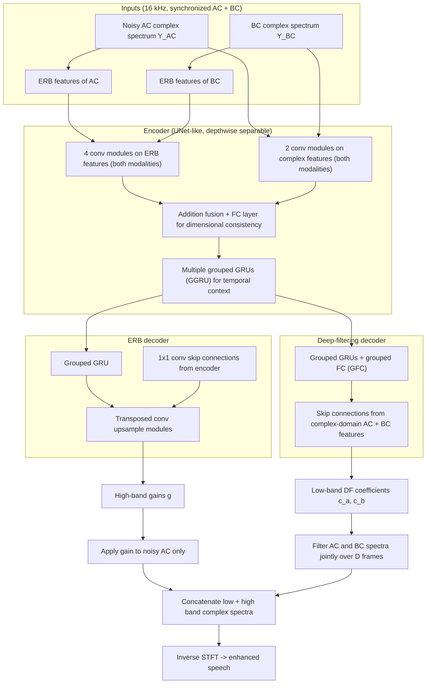

# Wang, Kuang, Li, Yang, Bai & Liu 2025: Multi-Modal Deep-Filtering-Based Speech Enhancement via Bone-Conducted Speech

- **Authors**: [[entities/mou-wang|Mou Wang]], [[entities/kelan-kuang|Kelan Kuang]], [[entities/zhuo-li|Zhuo Li]], [[entities/feiran-yang|Feiran Yang]], [[entities/jisheng-bai|Jisheng Bai]], [[entities/xin-liu|Xin Liu]]
- **Affiliations**: OPPO, Beijing, China; Key Laboratory of Noise and Vibration Research, Institute of Acoustics, Chinese Academy of Sciences; School of Communications and Information Engineering, Xi'an University of Posts and Telecommunications
- **Venue**: ICSPCC 2025 (IEEE International Conference on Signal Processing, Communications and Computing)
- **Year**: 2025
- **Type**: Conference Paper
- **DOI**: [10.1109/ICSPCC66825.2025.11194354](https://doi.org/10.1109/ICSPCC66825.2025.11194354)
- **Zotero**: [Open in Zotero](zotero://select/items/0_YAXJXJ6B)

## Summary

This paper proposes **MDFNet**, a lightweight multi-modal [[concepts/deep-filtering|deep-filtering]] network that jointly enhances synchronized bone-conducted (BC) and noisy air-conducted (AC) speech in the complex STFT domain. The spectrum is split by frequency: a **high-frequency branch** estimates [[concepts/erb-scale|ERB]]-band gains applied to the noisy AC spectrum only (BC has essentially no high-frequency content), while a **low-frequency branch** estimates deep-filtering coefficients that filter *both* the AC and BC complex spectra, fusing the two modalities through the filter coefficients $\mathbf{c}^a$ and $\mathbf{c}^b$ rather than through feature concatenation or attention. On the 100-speaker ABCS corpus at SNR ∈ [−15, 5] dB, MDFNet reaches PESQ 3.21 / STOI 0.79 / ESTOI 0.69 at 24.8% character error rate with a Conformer ASR back-end — trailing the time-domain multi-modal MTINet on the enhancement metrics (3.29 / 0.91 / 0.84) but beating it on ASR (24.8% vs. 27.3% CER), and far exceeding MFCN and the single-modal deep-filtering baseline AC-DFNet.

## Problem Formulation

A pristine AC signal $x_a$ is corrupted by ambient noise $n_a$ to give $\hat{x}_a = x_a + n_a$; the time-aligned BC signal $x_b$ is corrupted by a *different* noise $n_b$ (skin/device friction, playback vibration) but is insensitive to $n_a$. The pair forms a two-channel observation $\mathbf{x} = (\hat{x}_a, x_b)$, which in the STFT domain obeys

$$
\mathbf{X}^{a}_{\mathrm{STFT}}(k,f) = \mathbf{S}_{\mathrm{STFT}}(k,f) + \mathbf{N}^{a}_{\mathrm{STFT}}(k,f), \qquad
\mathbf{X}^{b}_{\mathrm{STFT}}(k,f) = \mathbf{H}_{ab}\cdot\mathbf{S}_{\mathrm{STFT}}(k,f) + \mathbf{N}^{b}_{\mathrm{STFT}}(k,f)
$$

where $\mathbf{H}_{ab}$ is the AC→BC transfer function (a strongly low-pass, mildly nonlinear mapping).

The enhancement is posed as a **two-input, multi-frame linear filter** in the STFT domain:

$$
\hat{\mathbf{S}}_{\mathrm{STFT}}(k,f) = \sum_{j=0}^{D} \mathbf{c}^{a}(k,j,f)\,\mathbf{X}^{a}_{\mathrm{STFT}}(k-j,f) + \sum_{j=0}^{D} \mathbf{c}^{b}(k,j,f)\,\mathbf{X}^{b}_{\mathrm{STFT}}(k-j,f)
$$

The coefficients $\mathbf{c}^a$ and $\mathbf{c}^b$ are the *modality weights*: $\mathbf{c}^b = 0$ degenerates the problem to single-modal AC enhancement, $\mathbf{c}^a = 0$ to BC enhancement. This is exactly the [[concepts/deep-filtering|deep-filtering]] signal model, and it is why the authors call the design "multi-modal deep filtering" — **fusion happens inside the filter coefficients**, which the network predicts per time-frequency bin, rather than in a feature space (contrast with concatenation, [[concepts/iterative-attentional-feature-fusion|iAFF]] or attention-based fusion).

Two practical motivations frame the design:

- **Phase estimation**: at low SNR the noisy-AC phase is corrupted, and the BC phase above the BC passband is simply absent — so neither phase is directly usable at high frequencies. A complex-domain filter with learned coefficients avoids an explicit phase-estimation stage while keeping the cost well below the time-domain end-to-end alternative ([[sources/wang-2022-fusing-bc-ac-complex-domain-se|Wang, Zhang & Wang 2022]] shows the complex-domain route is viable; the time-domain MTINet is the accurate but expensive alternative).
- **Embedded deployment**: existing attention-based BC/AC fusion networks (DC-CRN, DenGCAN) are too heavy for edge devices, so the design pushes both model size and spectral resolution down.

![[raw/papers/wang-2025-multi-modal-deep-filtering-bc/figures/031e57870b1f476ec5285a3b2b45b934971dec193c8cec95b5ad1d8c71283867.jpg|Flowchart of the multi-modal deep-filtering enhancement method]]
*Figure 1: Flowchart of the multi-modal deep-filtering-based speech enhancement method — ERB-band gains for the high-frequency part, deep filtering for the low-frequency part, concatenated into the enhanced complex spectrum.*

## Methodology

### Two-Branch Frequency Split

The enhanced complex spectrum is assembled from two disjoint frequency ranges:

$$
\hat{\mathbf{S}}(k,f) =
\begin{cases}
\hat{\mathbf{S}}^{\text{DF}}(k,f), & f \in \text{low band} \quad (\text{AC} + \text{BC deep filtering})\\[2pt]
\mathbf{g}(k,f)\cdot\mathbf{X}^{a}_{\mathrm{STFT}}(k,f), & f \in \text{high band} \quad (\text{AC-only ERB gain})
\end{cases}
$$

- **High-frequency branch — ERB gains.** Because the BC high-frequency content is "severely attenuated or even completely lost", a gain estimated from the *fused* BC+AC representation is applied **only to the noisy AC spectrum**. Applying the gain on the ERB scale (rather than per FFT bin) is the compute-saving move of the [[sources/schroter-2022-deepfilternet|DeepFilterNet]]/[[sources/kuang-2025-low-complexity-bc-speech-enhancement|Kuang et al. 2025]] lineage: the linear frequency axis is compressed to ERB bands, gains are predicted there, and the resulting resolution loss is tolerable because the ear is coarse at high frequencies.
- **Low-frequency branch — deep filtering.** The BC low-frequency spectral structure is relatively intact, so the low band is where BC actually contributes. Deep-filtering coefficients $\mathbf{c}^a, \mathbf{c}^b$ filter the AC and BC complex spectra jointly over $D$ frames, i.e. the two modalities are combined with learnable, per-bin, per-tap weights rather than a mask.

The paper does not state the numeric split frequency between the two bands, nor the filter order $D$ — both are gaps relative to the DeepFilterNet-style description it borrows from.

### Model Structure, Inputs, and Outputs

MDFNet has three components: a shared **encoder** (UNet-like, [[concepts/depthwise-separable-convolution|depthwise separable convolutions]]), an **ERB decoder**, and a **deep-filtering decoder**.

- The encoder processes **ERB features of both modalities** through **four convolutional modules** and the **complex-domain features of both modalities** through **two convolutional modules**. The transformed maps are fused by **addition**, with a fully-connected layer inserted to reconcile dimensional mismatches before the add.
- The fused features pass through **multiple GRUs** for temporal-context modeling, producing the encoder output. To cut parameters, both the FC layers and the GRUs use **grouping** ([[concepts/grouped-recurrent-neural-network|grouped RNN]] / grouped FC — the paper's GGRU and GFC).
- The **ERB decoder** repeats a grouped-GRU temporal modeling step, then upsamples with **transposed convolution** modules; **1×1 convolutional skip connections** link encoder to ERB decoder.
- The **deep-filtering decoder** also uses grouped GRUs plus grouped FC layers for temporal modeling, and receives **skip connections from the complex-domain input features of both modalities** — justified by the observation that BC's low-frequency structure is preserved, so raw complex features are informative for coefficient estimation.

![[raw/papers/wang-2025-multi-modal-deep-filtering-bc/figures/ec1ed3c9d92ce4be03dc2766c0da1ea1580b610d04485eaf5a3b8c4478cc90aa.jpg|Structure of MDFNet with GGRU and GFC blocks]]
*Figure 2: Diagram of the MDFNet structure — encoder with grouped GRU (GGRU) temporal modeling, an ERB decoder producing high-frequency gains, and a deep-filtering decoder producing low-frequency filter coefficients.*

**Network spec (paper states the module counts and the conv kernel; layer widths, filter order $D$, split frequency, and the ERB band count are not reported):**

| Aspect | Specification |
|--------|---------------|
| **Structure** | UNet-like encoder; 4 conv modules on ERB features (both modalities), 2 conv modules on complex-domain features (both modalities); addition fusion with an FC layer for dimension matching; multiple grouped GRUs; ERB decoder (grouped GRU + transposed conv, 1×1 conv skips); deep-filtering decoder (grouped GRU + grouped FC, skips from complex-domain inputs) |
| **Convolution detail** | Every conv module contains a depthwise separable convolution: depthwise kernel 1×3 (frequency axis only), pointwise 1×1 with **64 channels** — feature transformation happens *solely along frequency* |
| **Input** | Complex spectra of noisy AC and synchronized BC speech plus their ERB-band features; 16 kHz sampling; STFT parameters not stated in the paper |
| **Output** | Per frame: high-band ERB-band gains (applied to the AC spectrum) and low-band complex deep-filtering coefficients $\mathbf{c}^a, \mathbf{c}^b$ (applied to both spectra); concatenated into the enhanced complex spectrum and inverse-transformed |
| **Training data** | ABCS corpus (100 Mandarin speakers; 80 train / 10 val / 10 test); AC noise from MUSAN and NOISEX-92; SNR ∈ [−15, 5] dB |
| **Training config** | 30 epochs, AdamW, batch 128, initial LR $1\times10^{-3}$ halved after 4 stagnant epochs, early stopping at 8 stagnant epochs |
| **Role** | Single model that performs both high-frequency gain enhancement (AC-only) and low-frequency BC/AC deep filtering, producing one enhanced complex spectrum per frame |

### Training Losses

The objective is inherited verbatim from [[sources/schroter-2022-deepfilternet|DeepFilterNet]] and has two terms. The first is a compressed, phase-aware spectral loss

$$
\mathcal{L}_{\text{spec}} = \sum \big\||\hat{\mathbf{S}}|^{\varepsilon} - |\mathbf{S}|^{\varepsilon}\big\|^{2} + \sum \big\||\hat{\mathbf{S}}|^{\varepsilon}e^{j\hat{\varphi}} - |\mathbf{S}|^{\varepsilon}e^{j\varphi}\big\|^{2}, \qquad \varepsilon = 0.3
$$

with $\varepsilon = 0.3$ the perceptual loudness compression factor; the two sums penalize magnitude and phase mismatch respectively.

The second is a **multi-resolution spectral loss** evaluated after converting the enhanced spectrum back to the time domain $\hat{s}(t)$:

$$
\mathcal{L}_{\mathrm{MR}} = \sum_{i}\big\||\hat{\mathbf{S}}'_i|^{\varepsilon} - |\mathbf{S}'_i|^{\varepsilon}\big\|^{2} + \sum_{i}\big\||\hat{\mathbf{S}}'_i|^{\varepsilon}e^{j\hat{\varphi}} - |\mathbf{S}'_i|^{\varepsilon}e^{j\varphi}\big\|^{2}
$$

over STFT window lengths `[128, 256, 512, 1024]` samples (8–64 ms at 16 kHz). The total loss is

$$
\mathcal{L} = \lambda_{\text{spec}}\,\mathcal{L}_{\text{spec}} + \lambda_{\mathrm{MR}}\,\mathcal{L}_{\mathrm{MR}}
$$

The paper gives no values for $\lambda_{\text{spec}}$ and $\lambda_{\mathrm{MR}}$ (DeepFilterNet uses $\lambda_{\text{spec}}=1$ with an additional DF-activation term, which MDFNet drops entirely). The multi-resolution term is what forces the model to be consistent across time resolutions — the mechanism by which a two-branch, frequency-split design still produces a globally coherent signal.

## Experimental Setup

| Parameter | Value |
|-----------|-------|
| **Dataset** | ABCS multi-modal speech database — 100 speakers with paired AC and BC recordings |
| **Split** | 80 speakers training / 10 validation / 10 testing |
| **AC noise (train + val)** | MUSAN, NOISEX-92 |
| **Sampling rate** | 16 kHz (speech and noise both downsampled) |
| **SNR (train + val)** | Uniformly sampled from [−15, 5] dB |
| **SNR (test)** | {−15, −10, −5, 0, 5} dB |
| **Optimizer** | AdamW, batch 128, 30 epochs, LR $1\times10^{-3}$ (halved on 4-epoch plateau), early stop at 8 |
| **Metrics** | PESQ (paper reports narrow-band PESQ), STOI, ESTOI, CER |
| **ASR back-end** | Conformer-based recognizer; character error rate |

**Comparators**: IMCRA (classical noise-PSD estimation), DCCRN (complex-domain single-channel SE), AC-TINet (time-domain single-modal involution network), AC-DFNet (the authors' deep-filtering network restricted to the noisy AC input — i.e. the single-modal ablation of MDFNet), MFCN (time-domain multi-modal BC/AC FCN), and MTINet (time-domain multi-modal temporal involution network). All comparators use the experimental configuration of MTINet.

## Results

| Modality | Method / Speech | PESQ | STOI | ESTOI | CER (%) |
|----------|-----------------|-----:|-----:|------:|--------:|
| AC | clean | — | — | — | 13.4 |
| AC | noisy | 1.36 | 0.64 | 0.46 | 79.3 |
| AC | IMCRA | 1.60 | 0.50 | 0.36 | 77.9 |
| AC | DCCRN | 2.37 | 0.76 | 0.65 | 61.9 |
| AC | AC-TINet | 2.49 | 0.80 | 0.69 | 52.1 |
| AC | AC-DFNet | 2.37 | 0.69 | 0.54 | 57.0 |
| BC | BC only | 2.37 | 0.68 | 0.57 | 88.0 |
| Multi-modal | MFCN | 1.77 | 0.68 | 0.54 | 76.1 |
| Multi-modal | MTINet | **3.29** | **0.91** | **0.84** | 27.3 |
| Multi-modal | **MDFNet** | 3.21 | 0.79 | 0.69 | **24.8** |

Findings as reported:

- **BC fusion is worth a lot over the same architecture**: MDFNet vs. AC-DFNet isolates the BC contribution at fixed architecture — PESQ 3.21 vs. 2.37, STOI 0.79 vs. 0.69, ESTOI 0.69 vs. 0.54, CER 24.8% vs. 57.0%. This is the paper's cleanest single comparison and the largest jump in the table.
- **MDFNet ≫ MFCN on every metric** (both multi-modal, but FCN is the older time-domain fusion design).
- **MDFNet < MTINet on quality/intelligibility**: the authors attribute this to the time-domain approach sidestepping phase estimation and to the temporal involution network's stronger context modeling.
- **MDFNet > MTINet on ASR** (24.8% vs. 27.3% CER): explained by operating *directly* in the complex domain — no convolutional feature encoding/decoding of the waveform, so spectral details that the ASR front-end needs are better preserved. The paper frames this as the central trade: the time-domain model wins on perceptual metrics, the complex-domain model wins on recognition.
- **BC alone is surprisingly strong on PESQ** (2.37, matching DCCRN) but useless for ASR (88.0% CER) — the band-limited spectrum that perceptual metrics tolerate is unrecoverable for recognition. This is the quantitative statement of why BC must be a *complement* to AC rather than a substitute.

![[raw/papers/wang-2025-multi-modal-deep-filtering-bc/figures/bc3f56f60c07bae31bce7321e7508dd0d7a19fe3226861109fcba0f23019897a.jpg]]
(a) Pristine AC speech

![[raw/papers/wang-2025-multi-modal-deep-filtering-bc/figures/bb5acb60396da9ca1ad229edf4b9d7d608e094376788e8f0e336df7e0cb4f922.jpg]]
(b) Synchronized BC speech

![[raw/papers/wang-2025-multi-modal-deep-filtering-bc/figures/0b99452ea57be7a92823a45547d33abe980f50dce76ffbf0bc180f53a3b2cd13.jpg]]
(c) Corrupted AC speech, babble noise, −5 dB SNR

![[raw/papers/wang-2025-multi-modal-deep-filtering-bc/figures/5650212e32cbdd11490962809d82ce7590768ab636b9328accb84f64c9ba44fd.jpg]]
(d) Enhanced by MDFNet

*Figure 3: Spectrograms illustrating BC/AC complementarity — BC (b) is noise-free relative to the corrupted AC (c) but loses essentially all energy above ~1–2 kHz; MDFNet (d) suppresses the noise in both inputs and partially restores the high-frequency band that BC never carried.*

## Key Contributions

1. **Fusion inside deep-filtering coefficients**: a multi-modal extension of [[concepts/deep-filtering|deep filtering]] in which the AC and BC contributions are the two coefficient sets $\mathbf{c}^{a}, \mathbf{c}^{b}$ of a single complex filter. Weighting between modalities is therefore per-bin, per-tap, and driven by the input SNR, rather than a scalar or attention weight in feature space — the model default-degenerates to single-modal DF when $\mathbf{c}^b = 0$.
2. **Frequency-split lightweight architecture (MDFNet)**: high frequencies handled by ERB-band gains on the AC spectrum only (cheap, and BC contributes nothing there), low frequencies handled by full-resolution deep filtering over both modalities (where BC's information lives). Splitting the work this way is what makes the two-branch design cheaper than a uniform full-band complex mask.
3. **Best ASR performance among the compared systems at low SNR**: 24.8% CER vs. 27.3% for MTINet and 52.1% for the strongest single-modal baseline — evidence that complex-domain operation preserves the spectral detail ASR needs even when perceptual metrics prefer the time-domain model.
4. **Quantified BC contribution at fixed architecture**: the AC-DFNet ablation (same deep-filtering network without BC input) shows gains of +0.84 PESQ, +0.10 STOI, +0.15 ESTOI and −32.2 points of CER from adding the BC channel.

## Limitations and Caveats

- **The "lightweight" claim is not substantiated numerically**: no parameter count, MACs, or RTF is reported anywhere in the paper, so the central motivation (deployability on embedded systems) cannot be checked against DC-CRN, DenGCAN, MTINet, or [[sources/kuang-2025-low-complexity-bc-speech-enhancement|Kuang et al. 2025]]'s 40.3 MMACs/s design.
- **Reproducibility gaps**: the low/high split frequency, the deep-filtering order $D$, the ERB band count, the STFT parameters, the encoder/decoder channel widths, the GRU grouping factor, and the loss weights $\lambda_{\text{spec}}/\lambda_{\mathrm{MR}}$ are all unstated.
- **No ablation beyond the AC-only variant**: the frequency split, the ERB compression of the high band, and the grouped GRU/GFC choices are each asserted rather than measured; there is no DF-order sweep and no comparison against a single-branch full-band deep filter (the natural baseline for "why split?").
- **Modest dataset**: the ABCS corpus is simulated-noise, Mandarin, and the reported numbers are pooled over five SNRs rather than broken down per SNR, which hides where the two-branch advantage concentrates.
- **The STOI/ESTOI gap to MTINet is large** (0.79/0.69 vs. 0.91/0.84) while the PESQ gap is small (3.21 vs. 3.29) — an unusual pattern that the paper explains only qualitatively; it is consistent with ERB-compressed high-band gains preserving quality-perception cues but smearing the modulation information STOI/ESTOI depend on.
- **Comparison is partly cross-corpus**: ABCS differs from the A4BS corpus used by the authors' CAS co-authors' other BC work, so the numbers are not directly comparable with [[sources/kuang-2024-lightweight-speech-enhancement-bone-air|Kuang 2024]] or [[sources/kuang-2025-low-complexity-bc-speech-enhancement|Kuang 2025]].

## Related Concepts

- [[concepts/multi-modal-deep-filtering|Multi-Modal Deep Filtering]] — the formulation this paper introduces
- [[concepts/deep-filtering|Deep Filtering]]
- [[concepts/grouped-recurrent-neural-network|Grouped Recurrent Neural Network (GRNN)]]
- [[concepts/erb-scale|ERB Scale]]
- [[concepts/bone-conduction|Bone Conduction]]
- [[concepts/bcs-guided-speech-enhancement|BCS-Guided Speech Enhancement]]
- [[concepts/complex-spectrum-mapping|Complex Spectrum Mapping]]
- [[concepts/depthwise-separable-convolution|Depthwise Separable Convolution]]
- [[concepts/sub-band-full-band-architecture|Sub-Band and Full-Band Architecture]] — the frequency-range split here is a coarser-grained cousin

## Related Synthesis

- [[synthesis/multimodal-bc-speech-enhancement|Multimodal Smart Hearables: Bone-Conduction Aided Speech Enhancement]]
