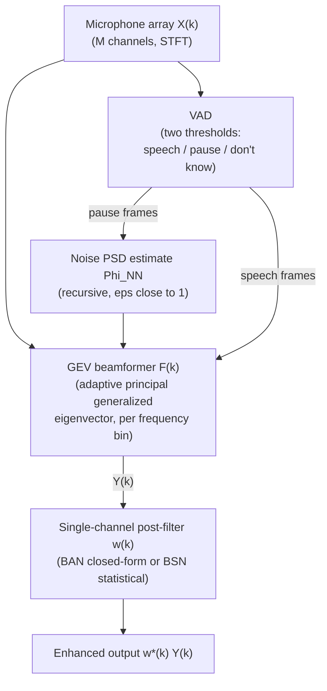

# Warsitz & Haeb-Umbach 2007: Blind Acoustic Beamforming Based on Generalized Eigenvalue Decomposition

**Authors**: [[entities/ernst-warsitz|Ernst Warsitz]], [[entities/reinhold-haeb-umbach|Reinhold Haeb-Umbach]] (Department of Communications Engineering, University of Paderborn)
**Venue**: IEEE Transactions on Audio, Speech, and Language Processing, vol. 15, no. 5, pp. 1529–1539, Jul. 2007
**Type**: Journal article
**DOI**: [10.1109/TASL.2007.898454](https://doi.org/10.1109/TASL.2007.898454)
**Zotero**: [FL9G9KX2](zotero://select/items/0_FL9G9KX2)

## Summary

This is the origin paper of the **GEV (max-SNR) beamformer with Blind Analytical Normalization (BAN)** — the classical spatial filter that later became one of the two standard beamformers of neural [[concepts/mask-based-beamforming|mask-based beamforming]]. It shows that maximizing the output SNR per frequency bin (a generalized eigenvalue problem, long avoided for broadband speech because of uncontrolled distortion) becomes practical when the resulting beamformer — which differs from the generalized MVDR only by a scalar per bin — is followed by a single-channel normalization post-filter. Two such post-filters (BAN and BSN) and a novel single-stage gradient-ascent eigenvector tracking algorithm are contributed, and the whole system operates blindly: no array geometry, no DoA, no transfer-function estimates, no calibration.

## Problem Formulation

With frequency-domain microphone signals $\mathbf{X}(k) = \mathbf{S}(k) + \mathbf{N}(k)$ and beamformer output $Y(k) = \mathbf{F}^{\mathrm{H}}(k)\,\mathbf{X}(k)$, the per-bin output SNR under uncorrelated speech and noise is the generalized Rayleigh quotient

$$
\mathrm{SNR}(k) = \frac{\mathbf{F}^{\mathrm{H}}(k)\,\boldsymbol{\Phi}_{\mathbf{XX}}(k)\,\mathbf{F}(k)}{\mathbf{F}^{\mathrm{H}}(k)\,\boldsymbol{\Phi}_{\mathbf{NN}}(k)\,\mathbf{F}(k)} - 1,
$$

which is maximized by the **principal generalized eigenvector** of $(\boldsymbol{\Phi}_{\mathbf{XX}}(k), \boldsymbol{\Phi}_{\mathbf{NN}}(k))$ — the GEV beamformer $\mathbf{F}_{\mathrm{SNR}}(k) = \mathbf{v}_{\max}(k)$. For a source with PSD $\Phi_{UU}$ connected by arbitrary transfer functions $\mathbf{H}(\boldsymbol{\ell}_t, k)$ (reverberant enclosure), the principal eigenvector is

$$
\mathbf{F}_{\mathrm{SNR}}(k) = \zeta \cdot \boldsymbol{\Phi}_{\mathbf{NN}}^{-1}(k)\,\mathbf{H}(\boldsymbol{\ell}_t, k),
$$

with $\zeta$ an arbitrary complex scalar, and the maximum achievable SNR is $\Phi_{UU}(k)\,\mathbf{H}^{\mathrm{H}}\boldsymbol{\Phi}_{\mathbf{NN}}^{-1}\mathbf{H}$.

The **distortionless counterpart** under known transfer functions is the generalized MVDR (GMVDR, cf. Gannot et al. 2001):

$$
\mathbf{F}_{\mathrm{GMVDR}}(k) = \frac{\boldsymbol{\Phi}_{\mathbf{NN}}^{-1}(k)\,\mathbf{H}(\boldsymbol{\ell}_t, k)}{\mathbf{H}^{\mathrm{H}}(\boldsymbol{\ell}_t, k)\,\boldsymbol{\Phi}_{\mathbf{NN}}^{-1}(k)\,\mathbf{H}(\boldsymbol{\ell}_t, k)}.
$$

With anechoic far-field propagation ($\mathbf{H} \to$ steering vector $\mathbf{d}(\theta_t, k)$) this reduces to the classical Frost MVDR. Comparing the two closed forms gives the paper's key structural observation:

$$
\mathbf{F}_{\mathrm{GMVDR}}(k) = w(k)\,\mathbf{F}_{\mathrm{SNR}}(k),
$$

i.e. **every optimization criterion of the family (MMSE, ML, MVDR, Max-SNR) yields the same weight vector up to a scalar per frequency bin** — so the uncontrolled speech distortion of the narrowband Max-SNR criterion can be repaired by a single-channel post-filter $w(k)$ implementing the corresponding scale.

## Methodology

### Blind post-filter normalization

The post-filter must "normalize" the spatial response toward the target to unity gain, $|w^*(k)\,\mathbf{F}_{\mathrm{SNR}}^{\mathrm{H}}(k)\,\mathbf{H}(\ell_t, k)| \stackrel{!}{=} 1$, **without knowing $\mathbf{H}$**. Two solutions are derived:

- **[[concepts/blind-analytical-normalization|Blind Analytical Normalization (BAN)]]** — a closed-form post-filter obtained by exploiting $\|\mathbf{H}(\ell_t, k)\|^2 \approx \|\mathbf{d}(\theta_t, k)\|^2 = M$:

  $$
  w_{\mathrm{BAN}}(k) = \frac{\sqrt{\mathbf{F}_{\mathrm{SNR}}^{\mathrm{H}}\,\boldsymbol{\Phi}_{\mathbf{NN}}\,\boldsymbol{\Phi}_{\mathbf{NN}}\,\mathbf{F}_{\mathrm{SNR}} / M}}{\mathbf{F}_{\mathrm{SNR}}^{\mathrm{H}}\,\boldsymbol{\Phi}_{\mathbf{NN}}\,\mathbf{F}_{\mathrm{SNR}}}.
  $$

  The approximation holds well for short filters capturing predominantly the direct path; BAN works best at low reverberation times and may fluctuate before the eigenvector tracker has converged.

- **[[concepts/blind-statistical-normalization|Blind Statistical Normalization (BSN)]]** — a statistically motivated alternative that treats the (unknown) DoA as a random variable with pdf $p(\theta)$ and integrates the spatial response against it. Crucially, the *beamformer's own spatial response* can serve as that pdf (a correctly operating beamformer responds strongly toward the target and weakly toward the noise), giving

  $$
  w_{\mathrm{BSN}}(k) = \frac{\int_{-\pi/2}^{\pi/2} |\mathbf{F}_{\mathrm{SNR}}^{\mathrm{H}}(k)\,\mathbf{d}(\theta, k)|\,\mathrm{d}\theta}{\int_{-\pi/2}^{\pi/2} |\mathbf{F}_{\mathrm{SNR}}^{\mathrm{H}}(k)\,\mathbf{d}(\theta, k)|^2\,\mathrm{d}\theta}.
  $$

  BSN needs no closed-form-requiring assumptions, shows no response peaks during adaptation, and yields a **DoA point estimate as a byproduct** (mean or maximum of the response-derived pdf).

### Adaptive eigenvector tracking

The per-bin generalized eigenproblem is posed as constrained optimization — maximize $\mathbf{F}^{\mathrm{H}}\boldsymbol{\Phi}_{\mathbf{XX}}\mathbf{F}$ subject to $\mathbf{F}^{\mathrm{H}}\boldsymbol{\Phi}_{\mathbf{NN}}\mathbf{F} = C$ — and solved by **gradient ascent on the Lagrangian**, with the Lagrange multiplier chosen so the constraint holds at the *next* iteration (terms $\mathcal{O}(\mu^2)$ neglected). Unlike stochastic-gradient trackers of the literature (e.g. Morgan 2004), whose iterations alternately push the numerator up and the denominator down — possibly producing updates of opposite sign — the proposed update is **single-stage**. In the spatially white special case ($\boldsymbol{\Phi}_{\mathbf{NN}} = \sigma_N^2 \mathbf{I}$, $C = \sigma_N^2$) it simplifies to a normalized variant of **Oja's rule**, the classic dominant-eigenvector tracker.

The **stochastic version** replaces the matrices by estimates that respect the different time scales of speech and noise:

- noise PSD (stationary, estimated in speech pauses with smoothing constant $\epsilon$ close to 1): $\hat{\boldsymbol{\Phi}}_{\mathbf{NN},\kappa} = \epsilon\,\hat{\boldsymbol{\Phi}}_{\mathbf{NN},\kappa-1} + (1-\epsilon)\,\mathbf{X}_\kappa\mathbf{X}_\kappa^{\mathrm{H}}$ (noise-only frames);
- speech-plus-noise PSD (nonstationary): instantaneous estimate $\hat{\boldsymbol{\Phi}}_{\mathbf{XX},\kappa} = \mathbf{X}_\kappa\mathbf{X}_\kappa^{\mathrm{H}}$ (or lightly smoothed).

A [[concepts/voice-activity-detection|VAD]] gates both estimators; a two-threshold scheme ("speech" / "no speech" / "don't know") freezes adaptation and noise re-estimation on low-margin frames, trading slightly longer adaptation for robustness — the VAD "need not be very accurate". Frequency-dependent step sizes $\mu_\kappa = \alpha / \bar{P}_{X,\kappa}$ (input-power-normalized) improve convergence.

## Experimental Setup

| Item | Value |
|---|---|
| **Room** | Simulated $6 \times 5 \times 3$ m, image method; $T_{60} \in \{0, 0.05, 0.1, \dots, 0.5\}$ s |
| **Array** | $M = 5$-element linear, 4 cm spacing, 0.5 m from wall |
| **Sampling** | 12 kHz; 128-tap FIR filters, DFT size 256, overlap-save |
| **Speech** | 10 utterances (5 male, 5 female), source at $\theta_t = 45°$, 0.8 m |
| **Noise (directional)** | Computer-fan recording at $\theta_n = -20°$, 1.6 m |
| **Noise (diffuse)** | Lowpass diffuse noise (sinc coherence model, verified by measured MSC) |
| **Mixing** | Segmental SNR ≈ 0 dB (within speech periods) |
| **Regularization** | Diagonal loading of −30 dB on $\boldsymbol{\Phi}_{\mathbf{NN}}(k)$; BSN integral over 90 discrete angles |
| **Benchmark** | GMVDR with $\mathbf{H}$ estimated offline by iterative PCA on clean speech (matched-filter presteering); DSB with perfectly known DoA |
| **Metrics** | SNR gain (input → output); perceptual similarity measure (PSM) with two references (clean source; GMVDR output of noise-free inputs) |

## Results

**Adaptation (1 kHz bin, 1000 Monte-Carlo runs, random inputs through simulated room transfer functions).** The proposed GEV update converges much faster than Morgan's stochastic-gradient (SG) tracker (which additionally shows large steady-state variance at $\alpha = 0.01$, attributable to its alternating numerator/denominator updates) and only slightly slower than the RLS-based tracker of Yang et al. 2006 — but unlike the RLS it degrades gracefully when adaptation erroneously continues through speech-absent frames (VAD errors, speechless frequency bins). Both GEV and RLS are $\mathcal{O}(M^2)$; measured on a 2.4 GHz dual-core Xeon (C++, 128-tap filters), the GEV update reaches a real-time factor of 0.059 vs. 0.073 for RLS, with the load distributed oppositely over speech vs. pause frames.

![[raw/papers/warsitz-2007-blind-gev-beamforming/figures/f7594e7c49c3921a1865b560d12283834c232e426a54d371ec6a4b9cbb9c2568.jpg|Fig. 1(a)]]
![[raw/papers/warsitz-2007-blind-gev-beamforming/figures/bfae5fd6aa8c74352c5bf54d46cdb96ddaf046301a062d5f3840b066ecaaf7b8.jpg|Fig. 1(b)]]
![[raw/papers/warsitz-2007-blind-gev-beamforming/figures/8511c854dea6239bceeadab8e98f4ec889fdb84c9be7ba0d7f4fa5233b8edb5c.jpg|Fig. 1(c)]]
![[raw/papers/warsitz-2007-blind-gev-beamforming/figures/dc4186e5878752617f20aa89fef8406a315979df148fb51840d90dbe8d01dec1.jpg|Fig. 1(d)]]

*Figure 1: Adaptation performance (SNR gain vs. iteration) of the GEV, SG, and RLS update rules at 1 kHz. Left column: $T_{60} = 0.05$ s; right column: $T_{60} = 0.5$ s. Top row: averaged over 1000 Monte-Carlo runs; bottom row: five example runs of the two stochastic-gradient algorithms, showing the SG method's large steady-state variance.*

![[raw/papers/warsitz-2007-blind-gev-beamforming/figures/6410bb405ca7068bc52b329a906c97f301f79ec724bd517fccb14f1d1a9fc12a.jpg|Fig. 2]]

*Figure 2: Adaptation when only noise is present during iterations 500–600 (a, b) / 500–700 (c, d) — modeling VAD errors or speechless bins. The GEV update is markedly less sensitive to the absence of the desired signal than the RLS-based tracker.*

**Blind normalization (directional noise).** In the anechoic beampattern view, all GEV variants place a null toward the noise at $-20°$; only the GMVDR is (near-)distortionless at $\theta_t = 45°$. Across frequency, the unnormalized GEV's response at the target varies wildly with frequency and reverberation; **BSN stays close to unity for all frequencies and reverberation times, while BAN degrades with growing $T_{60}$** (its $\|\mathbf{H}\|^2 \approx M$ assumption breaks down) and fluctuates during acquisition. In the time view (target switched on at 0.7 s), the BAN-normalized response shows high fluctuation during adaptation whereas the BSN exhibits no peaks at any time.

![[raw/papers/warsitz-2007-blind-gev-beamforming/figures/4649616de0454b378f3aefcf8b0ce1696b2f1ce1de79dd169504d3f1d815d3da.jpg|Fig. 3]]

*Figure 3: Beampatterns of the GMVDR and the eigenvector beamformer without normalization (GEV) and with BSN / BAN, for the anechoic case — a minimum is placed at the noise direction; only the GMVDR is distortionless at the target.*

![[raw/papers/warsitz-2007-blind-gev-beamforming/figures/b18033d1cd7c4ff39d6bce41fb5dc7c4a8d5cf12a50a26cab61dd0b2f2a113b9.jpg|Fig. 4 upper]]
![[raw/papers/warsitz-2007-blind-gev-beamforming/figures/728ff2116f76b81d44ece258aa38c90699b0269ee6b62d7070cd6f9f12dab464.jpg|Fig. 4 lower]]

*Figure 4: Spatial response of the GEV / GEV+BAN / GEV+BSN at the target direction versus frequency, for $T_{60} = 0$ s (upper) and $T_{60} = 0.3$ s (lower). Unnormalized GEV: strongly frequency- and reverberation-dependent; BSN: flat for all conditions; BAN: good at low reverberation only.*

**SNR gain and speech quality (directional noise).** The unnormalized GEV achieves the largest raw SNR gain (it boosts high-speech-power frequencies), with the normalized variants and the GMVDR benchmark close behind — but the raw gain comes at the cost of speech distortion. On the PSM perceptual measure with the clean source as reference, the DSB wins for very low $T_{60}$ (its delay-only model is valid there and its DoA is perfect), and the GMVDR takes over for $T_{60} > 0.2$ s (it aligns early reflections). Because reverberation itself dominates the PSM at larger $T_{60}$, a second evaluation uses the *GMVDR output on noise-free inputs* as the reference: there the post-filters' effect is isolated — **BAN/BSN clearly raise the PSM of the GEV output, confirming the distortion reduction** (corroborated by informal listening tests).

![[raw/papers/warsitz-2007-blind-gev-beamforming/figures/1ec40623cc9ed3acd688d21bf329a798988e929cd47c95878c6736e2674178f6.jpg|Fig. 6]]

*Figure 6: SNR gain vs. reverberation time for DSB, GMVDR, and the GEV variants (directional noise at $-20°$). Largest gain: unnormalized GEV; normalized GEV variants comparable to the GMVDR benchmark.*

![[raw/papers/warsitz-2007-blind-gev-beamforming/figures/ac33e7bcf003a314b7f7ccc57ee4cf6f26bf65c05db976a50d5862eaa7d0481f.jpg|Fig. 8]]

*Figure 8: PSM with the reverberant GMVDR output as reference (directional noise) — isolating the beamformer-induced distortion: BAN/BSN post-filtering clearly improves perceptual similarity.*

**Diffuse noise.** With lowpass diffuse noise, the adaptive GEV attains SNR gain particularly at **low frequencies, as is typical for superdirective beamformers**, and any per-bin scaling is immaterial to the gain (it cancels in the Rayleigh quotient — GEV and GMVDR differ only in scale). Over $T_{60}$, the GEV variants again match the GMVDR benchmark, and the PSM evaluation with the reverberant reference again shows the post-filters' distortion reduction.

![[raw/papers/warsitz-2007-blind-gev-beamforming/figures/e861c6b4774711c352380704c5755848b5eef3cd2a442be2e30bc50080d666cc.jpg|Fig. 11]]

*Figure 11: SNR gain comparison of DSB, GMVDR, and GEV beamformers under diffuse noise — GEV variants comparable to the GMVDR benchmark.*

![[raw/papers/warsitz-2007-blind-gev-beamforming/figures/92c99e08b2374c8b54a262b3408d7cdd8e603abceec66ec7f2f2da5429f2ef40.jpg|Fig. 13]]

*Figure 13: PSM under diffuse noise with the reverberant GMVDR output as reference — again the post-filtered GEV variants clearly reduce speech distortion.*

## Key Contributions

1. **Blind broadband GEV beamformer**: transfers the narrowband max-SNR (principal generalized eigenvector) criterion to broadband microphone-array speech enhancement — no assumptions on the acoustic transfer functions, the noise's spatial correlation, the array geometry, or the DoA; no calibration. Adaptation works even under strong directional or diffuse noise, as long as $\boldsymbol{\Phi}_{\mathbf{NN}}$ is estimated during speech absence.
2. **Scalar-equivalence argument**: the GEV beamformer equals the (transfer-function-generalized) MVDR up to one complex scalar per frequency bin — the paper's route to taming the Max-SNR criterion's distortion with a single-channel post-filter, connecting MMSE/ML/MVDR/Max-SNR realizations.
3. **Two blind normalization post-filters**: the closed-form **BAN** (adopted verbatim by later neural mask-based beamforming) and the statistically motivated **BSN** (response-as-pdf, robust during adaptation and at high reverberation, DoA estimate as byproduct).
4. **Single-stage gradient-ascent eigenvector tracking**: a deterministic/stochastic adaptation algorithm that converges faster than Morgan's SG tracker, is more robust to speech-absent frames than the RLS tracker of Yang et al. 2006, is $\mathcal{O}(M^2)$, and runs at real-time factor 0.059 (5-mic, 128-tap, C++).
5. **Evaluation methodology**: benchmarking against an *oracle-ish* GMVDR (transfer functions trained by PCA on clean speech) on both SNR gain and PSM, with a reverberant-reference PSM protocol that isolates beamformer-induced distortion from room reverberation.

## Related Concepts

- [[concepts/gev-beamformer|GEV Beamformer]] — the beamformer this paper introduces (later driven by neural masks)
- [[concepts/blind-analytical-normalization|Blind Analytical Normalization (BAN)]] — closed-form magnitude post-filter introduced here
- [[concepts/blind-statistical-normalization|Blind Statistical Normalization (BSN)]] — statistical post-filter introduced here
- [[concepts/mvdr-beamformer|MVDR Beamformer]] — distortionless counterpart; GEV = GMVDR up to a per-bin scalar
- [[concepts/generalized-eigenvalue-decomposition|Generalized Eigenvalue Decomposition]] — the underlying joint-diagonalization tool
- [[concepts/voice-activity-detection|Voice Activity Detection]] — gates noise-PSD estimation and adaptation; two-threshold scheme
- [[concepts/gsc-beamformer|Generalized Sidelobe Canceller]] — signal-cancellation motivation (DoA/delay-only assumptions)
- [[concepts/beamforming|Beamforming]] — parent topic
- [[concepts/mask-based-beamforming|Mask-Based Beamforming]] — 2016 descendant: DNN masks replace the VAD-based SCM estimates of the GEV+BAN kernel
- [[concepts/gevd-spatial-filtering|GEVD-Based Spatial Filtering]] — related GEVD-of-SCMs family (rank-constrained SDW-MWF)
- [[concepts/gsvd-based-optimal-filtering|GSVD-Based Optimal Filtering]] — Doclo & Moonen's time-domain ancestor of GEV beamforming
- [[concepts/superdirective-beamforming|Superdirective Beamforming]] — shares the low-frequency SNR gain in diffuse noise

## Related Synthesis

- [[synthesis/multi-channel-speech-enhancement|Multi-Channel Speech Enhancement]] — adds the 2007 classical origin point of the blind GEV+BAN line that mask-based beamforming later built on

## Related Sources

- [[sources/heymann-2016-neural-spectral-mask-beamforming|Heymann, Drude & Haeb-Umbach 2016: Neural Network Based Spectral Mask Estimation for Acoustic Beamforming]] — replaces the VAD-based statistics with DNN masks; adopts GEV+BAN
- [[sources/boeddeker-2018-neural-mask-beamforming|Boeddeker, Erdogan, Yoshioka & Haeb-Umbach 2018: Exploring Practical Aspects of Neural Mask-Based Beamforming for Far-Field Speech Recognition]] — practical GEV+BAN+group-delay front-end at scale
- [[sources/doclo-2002-gsvd-optimal-filtering|Doclo & Moonen 2002: GSVD-Based Optimal Filtering]] — time-domain generalized-eigenvalue beamforming ancestor cited as related work
