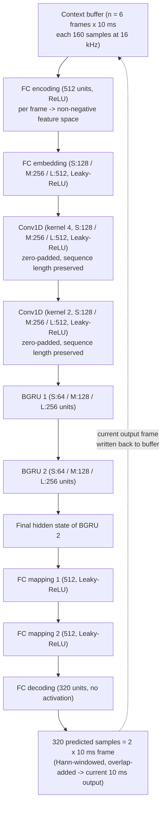

# Westhausen & Meyer 2022: tPLCnet — Real-Time Deep Packet Loss Concealment in the Time Domain

**Authors**: [[entities/nils-l-westhausen|Nils L. Westhausen]], [[entities/bernd-t-meyer|Bernd T. Meyer]] (University of Oldenburg, Germany — DFG EXC 2177 "Hearing4all" / SFB 1330)
**Venue**: Proc. INTERSPEECH 2022, pp. 2903–2907
**Published**: September 2022
**Type**: Conference Paper
**DOI**: [10.21437/Interspeech.2022-10157](https://doi.org/10.21437/Interspeech.2022-10157)
**arXiv**: [2204.01300](https://arxiv.org/abs/2204.01300)
**Zotero**: [EKZQW6Z7](zotero://select/items/0_EKZQW6Z7)

## Summary

This paper introduces **tPLCnet**, a real-time time-domain neural network for [[concepts/packet-loss-concealment|packet loss concealment]] that predicts a lost frame from a short context buffer in a **sequence-to-one (seq2one)** fashion — the model is invoked only when a loss is actually detected, instead of running continuous inference on every incoming frame. It is trained on the 64 h open-source training set and real packet-loss traces of the Interspeech 2022 Audio Deep PLC Challenge, with a combined magnitude + complex mean-absolute-error loss in the time-frequency domain. The **Large** configuration ranked **3rd (tied)** in the challenge, improving PLC-MOS by +1.07 over the zero-filling baseline on the blind test set, while the **Small** configuration (2.96 M MACs per 10 ms frame, 0.57 ms execution time) already delivers robust concealment.

## Problem Formulation

Packet loss concealment must synthesize missing 10 ms/20 ms audio packets in real time on resource-constrained devices. Previous recurrent neural PLC approaches ([Lotfidereshgi & Gournay 2018](https://doi.org/10.1109/ICASSP.2018.8452274); [Lin et al. 2021](https://doi.org/10.1109/ICASSP39728.2021.9413662)) run **continuous inference**, updating internal states for *every* incoming frame — including the vast majority that arrive intact — wasting compute and battery on mobile devices. The paper reframes PLC as: **predict one lost 10 ms frame $y$ from a short buffer $x_{-(n+2)}, \ldots, x_{-1}, x, x_{+1}$ of past context (and one look-ahead frame when available)**, triggering the network only at loss time. The seq2one task removes per-frame inference and all "continuous" state maintenance; the price is that the model sees only a short temporal context (≤ ~80 ms) around the loss instead of an unbounded streaming history.

## Methodology

### Deep PLC Strategy (Framing and Windowing)

The system operates on non-overlapping 10 ms frames (160 samples at 16 kHz). The challenge allows 20 ms total delay, so **one look-ahead frame** (the next 10 ms packet, if received) may be used. The model operates seq2one over a context buffer of length $n$ frames:

- **No loss**: the current frame and the look-ahead frame are concatenated (320 samples) and Hann-windowed; overlap-add produces the output frame (a pass-through of received audio).
- **Loss detected**: the dPLC model predicts a 320-sample frame from the context buffer, which is Hann-windowed and overlap-added.
- The resulting current 10 ms output frame is written back to the context buffer, so predictions for consecutive losses see previous predictions (recursive re-feeding at the buffer level), and transitions at loss edges are smoothed — pursuing the same goal as the cross-fading in [[concepts/dnn-regression-plc|Lee & Chang 2016]].

![[raw/papers/westhausen-2022-tplcnet/figures/PLC_system.png|Illustration of the proposed PLC system: context buffer, loss detection branch, Hann windowing, and overlap-add returning the current frame]]

*Figure 1: Illustration of the proposed PLC system. Incoming audio is written to a context buffer; when no frame is lost, current + look-ahead frames are concatenated and Hann-windowed; when the frame at position $x$ or $x{+}1$ is lost, the dPLC predicts an audio frame that is also Hann-windowed, and overlap-add returns the current frame $y$ time-aligned to input frame $x$.*

### Model Structure, Inputs, and Outputs

General architecture inspired by NSnet2 ([Braun & Tashev 2020](https://doi.org/10.1007/978-3-030-60636-8_8)) and the time-domain convolutional recurrent network of Lin et al. (ICASSP 2021), adapted to a seq2one task working entirely in the time domain. The first FC layer maps time-domain frames to a non-negative feature space, following the TasNet approach.

**tPLCnet (the dPLC model)** — single network, three size configurations:

| Item | Specification |
|------|---------------|
| **Structure** | Per frame: FC encoding 512 (ReLU) → FC embedding (128/256/512 for S/M/L, Leaky-ReLU); then along the buffer sequence: Conv1D k=4 → Conv1D k=2 (128/256/512, Leaky-ReLU, zero-padded) → BGRU 1 → BGRU 2 (64/128/256 units each); final hidden state → FC mapping 1 (512) → FC mapping 2 (512, both Leaky-ReLU) → FC decoding 320 (no activation). FF-baseline variant replaces Conv1D+BGRU with flatten + 3×FC-512 Leaky-ReLU |
| **Input** | Context buffer of $n$ = 6 non-overlapping 10 ms time-domain frames (160 samples each, 16 kHz), optionally containing previously predicted frames; level-normalized speech (training sampled at $-26 \pm 10$ dB) |
| **Output** | One 320-sample (2×10 ms) time-domain frame per loss event, Hann-windowed and overlap-added to produce the current 10 ms output |
| **Complexity** | Small 2.96 M MACs / 0.57 ms per 10 ms frame; Medium 7.85 M / 1.41 ms; Large 26.18 M / 3.95 ms (Intel i5-7267U dual-core @ 3.1 GHz); FF-baseline 2.49 M / 0.47 ms |
| **Training data** | 64 h of open-source (podcast) speech + real packet-loss traces from the Interspeech 2022 Audio Deep PLC Challenge |
| **Role** | Frame predictor invoked **on demand** at loss time only — no continuous inference |

**Per-configuration layer widths (Table 1)**:

| Layer | Small | Medium | Large |
|-------|-------|--------|-------|
| FC encoding | 512 | 512 | 512 |
| FC embedding | 128 | 256 | 512 |
| Conv1×4 | 128 | 256 | 512 |
| Conv1×2 | 128 | 256 | 512 |
| BGRU 1 | 64 | 128 | 256 |
| BGRU 2 | 64 | 128 | 256 |
| FC mapping 1 | 512 | 512 | 512 |
| FC mapping 2 | 512 | 512 | 512 |
| FC decoding | 320 | 320 | 320 |

### Training Losses

Three loss functions are compared, all applied to the whole enhanced utterance:

**Time-domain MAE** (as in Lin et al. 2021) — phase-sensitive but outlier-robust relative to MSE:

$$
\mathrm{MAE_{time}}=|\hat{x}-x|.
$$

**Magnitude-domain MAE** — computed on STFT magnitudes $|X(t,f)|, |\hat{X}(t,f)|$ (a [[concepts/frequency-domain-loss|frequency-domain loss]]):

$$
\mathrm{MAE_{mag}}=\big||\hat{X}|-|X|\big|.
$$

**Combined magnitude + complex MAE** — the selected training objective, adding a phase-sensitive complex term weighted by $\alpha$:

$$
\mathrm{MAE_{comb}}=(1-\alpha)\big||\hat{X}|-|X|\big|+\alpha|\hat{X}-X|,
$$

with $\alpha=0.1$ (found to trade magnitude reconstruction against some phase sensitivity in preliminary experiments). For the STFT window, **32 ms with 50 % overlap** gave the best PLC-MOS (20 ms was best for PESQ/DNS-MOS; 64 ms was too long to help).

### Training Setup

200 epochs, batch size 16, Adam optimizer, learning rate $5 \times 10^{-4}$ multiplied by 0.8 after 3 non-improving epochs, gradient-norm clipping 3. Context buffer size 6. During training, the **four most recent buffer frames are sampled from the degraded signal and the last two from the clean signal** — mimicking the inference-time situation where early buffer frames contain previously concealed (imperfect) audio; this improves robustness over training on degraded audio only. Medium model trains in ~6 h on one Nvidia RTX A5000.

## Experimental Setup

| Aspect | Configuration |
|--------|---------------|
| **Training data** | 64 h clean speech (podcast audio, ~10 s utterances) + real loss traces from the PLC Challenge |
| **Training augmentation** | Speech and traces cut to 8 s with random start/end; speech/trace pairing reshuffled each epoch; traces time-reversed with 50 % probability; level sampled $\mathcal{N}(-26\,\mathrm{dB}, 10\,\mathrm{dB})$ |
| **Known test set** | 2.7 h clean + degraded + traces; three subsets by burst length: low ≤120 ms (52 %), medium 120–320 ms (32 %), high 320–1000 ms (16 %) |
| **Blind test set** | Same properties, clean speech withheld (challenge evaluation) |
| **Metrics (objective)** | PESQ-WB, PLC-MOS, DNS-MOS P.835 (SIG/BAK/OVR) |
| **Metrics (challenge)** | Double-ended PLC-MOS, DNS-MOS P.808, crowd-sourced CCR-MOS (Amazon Mechanical Turk), word accuracy (Azure ASR); final score combines CCR-MOS + word accuracy |
| **Baselines** | Zero-filling (challenge baseline), feed-forward baseline (FF, 2.49 M MACs, same training) |
| **Hardware** | Intel i5-7267U dual-core @ 3.1 GHz (complexity measurements); Nvidia RTX A5000 (training) |

## Results

### Objective comparison on the known test set (Table 2)

| Method | MACs | Exec. [ms] | PESQ ovr. | PLC-MOS ovr. | DNS-MOS nOVR |
|--------|------|-----------|-----------|--------------|--------------|
| Zero-fill baseline | — | — | 2.19 | 2.87 | 2.97 |
| FF baseline | 2.49 M | 0.47 | 2.68 | 3.81 | 3.75 |
| tPLCnet Small | 2.96 M | 0.57 | 2.71 | 3.86 | 3.74 |
| tPLCnet Medium | 7.85 M | 1.41 | 2.74 | 3.90 | 3.78 |
| tPLCnet Large | 26.18 M | 3.95 | **2.77** | **3.95** | **3.79** |

For tPLCnet Large: +0.58 PESQ, **+1.08 PLC-MOS**, +0.82 DNS-MOS nOVR over zero-filling, with improvements **constant across all loss-duration subsets** (PESQ low 3.36 / med. 2.18 / high 1.99; PLC-MOS low 4.16 / med. 3.66 / high 3.82). Scaling helps monotonically but saturates: the 9× MACs increase from Small to Large buys +0.09 PLC-MOS.

### Loss-function ablation (Table 3, tPLCnet Medium)

| Loss | PESQ | PLC-MOS | DNS-MOS nOVR |
|------|------|---------|--------------|
| $\mathrm{MAE_{time}}$ | 2.43 | 3.30 | 3.54 |
| $\mathrm{MAE_{mag}}$ (32 ms, 50 %) | 2.75 | **3.88** | 3.79 |
| $\mathrm{MAE_{comb}}$ (64 ms, 50 %) | 2.61 | 3.53 | 3.66 |
| $\mathrm{MAE_{comb}}$ (32 ms, 50 %) | 2.73 | **3.90** | 3.78 |
| $\mathrm{MAE_{comb}}$ (20 ms, 50 %) | **2.76** | 3.71 | **3.85** |

Time-domain MAE is clearly worst; the TF-domain losses dominate. Magnitude-only ≈ combined (consistent with observations in [[concepts/frequency-domain-loss|Braun & Tashev 2021]]); the combined form with a 32 ms STFT window gives the best PLC-MOS (3.90).

### Context-buffer-length ablation (Figure 2)

Performance is optimal at **6–7 frames (60–70 ms)** of context (PLC-MOS optimum 7, DNS-MOS optimum 6) and *degrades* for long buffers (lowest at 20 frames for PLC-MOS, 15 for DNS-MOS). Even a 4-frame buffer reaches good performance — the information needed for robust PLC is temporally localized around the lost frame, and long-term dependencies only weakly influence performance, so a short buffer can be chosen without sacrificing quality (this mirrors the observation for longer input buffers in [[concepts/dnn-regression-plc|Lee & Chang 2016]]).

![[raw/papers/westhausen-2022-tplcnet/figures/buffer_len_emb.png|PLC-MOS and DNS-MOS P.835 nOVR versus the number of 10 ms frames in the context buffer]]

*Figure 2: Performance in terms of PLC-MOS and OVR DNS-MOS P.835 versus the number of 10 ms frames in the context buffer length.*

### Interspeech 2022 Audio Deep PLC Challenge (Table 4)

| Rank | PLC-MOS | DNS-MOS | CCR-MOS | Word acc. | Final score |
|------|---------|---------|---------|-----------|-------------|
| 1st | 4.282 | 3.797 | −0.552 | 0.875 | 0.845 |
| 2nd | 3.744 | 3.788 | −0.638 | 0.882 | 0.835 |
| **3rd (tied, ours: tPLCnet Large, $\mathrm{MAE_{comb}}$ 32 ms)** | **3.976** | 3.688 | −0.838 | 0.859 | 0.790 |
| 3rd (tied) | 3.829 | 3.684 | −0.812 | 0.868 | 0.798 |
| 5th | 3.277 | 3.513 | −1.102 | 0.863 | 0.748 |
| 6th | 3.478 | 3.738 | −1.042 | 0.825 | 0.739 |
| Baseline | 2.904 | 3.444 | −1.231 | 0.861 | 0.725 |

The submitted tPLCnet Large configuration (with $\mathrm{MAE_{comb}}$, 32 ms window) achieves the **second-best PLC-MOS of all submissions (3.976)** — higher than the 2nd-place system — and improves every metric over the baseline except word accuracy (0.859 vs. 0.861). Final score +1.07 over the zero-filling baseline.

## Discussion

- **Complexity–quality saturation** — the FF baseline already produces robust PLC (PLC-MOS 3.81), so a large portion of the gain comes from the *general seq2one approach + training setup* rather than the recurrent machinery; models can be sized to the available device resources. A similar saturation was observed for NSNet2-style models in noise suppression.
- **High PLC-MOS does not imply high CCR-MOS** — tPLCnet outscores the 2nd-place system on PLC-MOS but loses on crowd-sourced CCR-MOS; the authors attribute this to the 2nd-ranked model's additional speech enhancement, which may lower PLC-MOS while raising perceived quality.
- **ASR gains do not follow** — word accuracy (0.859) is essentially unchanged from the zero-filling baseline (0.861): the ASR system already copes with missing packets, and the smoothing at loss edges may slightly deteriorate clean speech in the vicinity of losses.

## Key Contributions

1. **First seq2one (on-demand) RNN PLC in the PLC Challenge context** — a time-domain BGRU model triggered only when packet loss is detected, eliminating continuous per-frame inference and its compute/battery cost on mobile devices.
2. **Time-domain model trained with TF-domain loss** — combined magnitude + complex MAE loss ($\alpha = 0.1$, 32 ms STFT) applied to a purely time-domain network, with a systematic loss/window ablation showing time-domain MAE clearly inferior (PLC-MOS 3.30 vs. 3.90).
3. **Short-context finding** — a 4–7 frame (40–70 ms) context buffer is sufficient for robust PLC and long buffers (15–20 frames) are *detrimental*; PLC-relevant information is temporally localized around the loss.
4. **Training-on-mixed-context strategy** — sampling the most recent buffer frames from degraded audio and older frames from clean audio during training improves robustness to imperfect buffer content at inference.
5. **3rd place (tied) in the Interspeech 2022 Audio Deep PLC Challenge**, with the 2nd-best PLC-MOS overall (+1.07 final score vs. zero-filling baseline), using only open-source training data — robust and reproducible.

## Related Concepts

- [[concepts/packet-loss-concealment|Packet Loss Concealment]] — the paper's central task
- [[concepts/tplcnet|tPLCnet]] — the proposed seq2one architecture (this paper)
- [[concepts/gated-recurrent-unit|Gated Recurrent Unit]] — bidirectional GRU layers form the sequence-modeling core
- [[concepts/frequency-domain-loss|Frequency Domain Loss]] — the TF-domain training objectives for the time-domain model
- [[concepts/nsnet2|NSNet2]] — the architecture whose FC+GRU topology inspired tPLCnet
- [[concepts/dnn-regression-plc|DNN Regression PLC]] — the earlier frame-regression PLC paradigm whose cross-fading goal the windowing/overlap-add inherits
- [[concepts/time-domain-speech-enhancement|Time-Domain Speech Enhancement]] — the broader time-domain modeling context
- [[concepts/pesq|PESQ]] — evaluation metric

## Related Synthesis

- [[synthesis/neural-packet-loss-concealment|Neural Packet Loss Concealment]] — tPLCnet is the informed, 16 kHz, on-demand prediction datum connecting Lee & Chang 2016 (regression), Valin et al. 2022 (hybrid vocoder), and Nguyen, Nguyen & Khong 2023 (blind full-band FRN)
